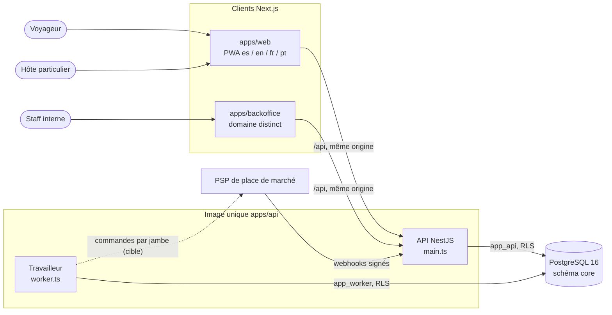
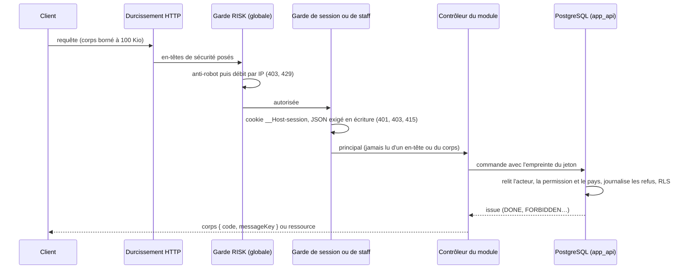

# Architecture de rueda (Kmino)

> US-038, ADR-079. Point d'entrée de la documentation d'architecture **tenue à jour par la CI**. La cible fait foi dans `docs/specs/17_DATA_MODEL_AND_ARCHITECTURE.md` (v6) ; ces pages décrivent **l'état réel du code**. Un écart entre les deux est inscrit dans [`docs/team/PROPOSITIONS.md`](../team/PROPOSITIONS.md), jamais corrigé en silence.

## Les documents et ce qui les garde à jour

| Document                           | Contenu                                                                                                                      | Source                                                      | Contrôle CI (échoue si le document dérive)                                                |
| ---------------------------------- | ---------------------------------------------------------------------------------------------------------------------------- | ----------------------------------------------------------- | ----------------------------------------------------------------------------------------- |
| ce fichier                         | vue d'ensemble, diagrammes de contexte et de requête                                                                         | écrit à la main                                             | rendu `mmdc` de chaque diagramme (job `diagrammes`)                                       |
| [`modules.md`](modules.md)         | modules, schéma cible, dépendances autorisées et **réellement importées**, routes, état ; applications et paquets            | **généré** : `dependency-graph.ts`, sources, `package.json` | `apps/api/src/testing/docs/docs-sync.test.ts` (`test:unit`)                               |
| [`api.md`](api.md)                 | référence lisible de l'API : opérations, statuts, codes d'erreur stables, réponses transverses                               | **généré** : `apps/api/openapi/openapi.json`                | `docs-sync.test.ts` (`test:unit`)                                                         |
| `apps/api/openapi/openapi.json`    | contrat OpenAPI 3.1 de **toutes** les routes                                                                                 | écrit à la main, **vérifié contre le code**                 | `openapi-contract.test.ts` et les suites de contrat (`test:unit`) : voir ci-dessous       |
| [`schema.md`](schema.md)           | schéma réel : migrations, rôles, schémas, tables (RLS, droits, colonnes, contraintes, index, politiques), `SECURITY DEFINER` | **généré** depuis une vraie base PostgreSQL 16              | `packages/db/test/int/schema-doc.test.ts` (`test:int`, job `base de données`)             |
| [`../glossary.md`](../glossary.md) | glossaire es / fr / en / pt de l'interface et du métier                                                                      | écrit à la main                                             | `scripts/ci/glossary.test.mjs` (quatre langues par terme, termes de 17 annexe B présents) |

Régénérer après un changement : `RUEDA_DOCS_WRITE=1 pnpm --filter @rueda/api exec vitest run src/testing/docs` (modules, API). Le schéma se régénère dans le job CI `base de données` : en cas d'écart, le document attendu est imprimé entre deux marqueurs `----- docs/architecture/schema.md` dans le journal du job ; sur un banc local (P-07), `RUEDA_DOCS_WRITE=1 pnpm --filter @rueda/db test:int`.

### Le contrat d'API ne dérive pas du code

Le contrat est écrit à la main (les contrôleurs reçoivent des corps `unknown` validés à la main : un générateur à partir de décorateurs donnerait des schémas plus faibles et sans codes d'erreur stables, ADR-079). Il est **vérifié** contre le code par cinq contrôles :

1. **Routes** : les routes réellement montées par Nest (`ApiModule` démarré, journal « Mapped ») = les opérations du contrat = la lecture des décorateurs. Plus aucune route « en attente » (`x-rueda-pending` vide).
2. **Codes d'erreur** : chaque code déclaré (`const` / `enum`) existe dans un catalogue du code (`AUTH_MESSAGES`, `BRAND_MESSAGES`, `RISK_MESSAGES`, codes d'hygiène), au même statut HTTP ; les surcharges de statut du code forment une liste fermée relue dans les sources.
3. **Couverture** : chaque statut déclaré de chaque opération est observé par une suite de contrat sur l'application réelle (`ContractClient`) ; chaque préfixe de chemin a sa suite (`CONTRACT_SUITES`), et chaque réponse transverse (403 anti-robot, 413, 429, 500) est observée.
4. **Conformité** : chaque réponse observée valide le schéma (Ajv strict), le type de contenu et les en-têtes requis.
5. **Référence** : `api.md` est régénéré depuis le contrat et comparé.

## Contexte

- **Une image, deux processus** (17 §6.1, ADR-050) : l'API sert HTTP ; le travailleur relaiera l'outbox et exécutera files et tâches périodiques en SQL (module BUS livré par US-008 ; boucles et pool `app_worker` branchés par US-003 : aujourd'hui le processus s'initialise puis s'arrête). Pointillé = cible, pas encore câblée.
- **Rôles de production** : l'API se connecte sous `app_api`, le travailleur sous `app_worker` ; aucun n'a `SUPERUSER` ni `BYPASSRLS` (refus de démarrer sinon). Les écritures métier passent par des commandes `SECURITY DEFINER` dont le propriétaire `NOLOGIN` est dédié (ADR-053). Voir [`schema.md`](schema.md).
- **PSP** : uniquement les ports et les adaptateurs `FAKE`, jamais actifs en production (C19) ; le démarrage de production refuse un compte FAKE.

## Cycle d'une requête

## Où lire la suite

- Modules et dépendances : [`modules.md`](modules.md) ; règles de frontière : `apps/api/src/modules/dependency-graph.ts` et le lint `rueda/module-boundaries`.
- API : [`api.md`](api.md) ; matrice d'autorisations des routes : `apps/api/security/route-matrix.json` (ADR-077).
- Base : [`schema.md`](schema.md) ; migrations : `packages/db/migrations/` et `packages/db/README.md`.
- Décisions : `docs/adr/` (journal du dépôt) ; à reporter dans 17 §8.1 par demande de fusion revue.
- Vocabulaire : [`../glossary.md`](../glossary.md).
