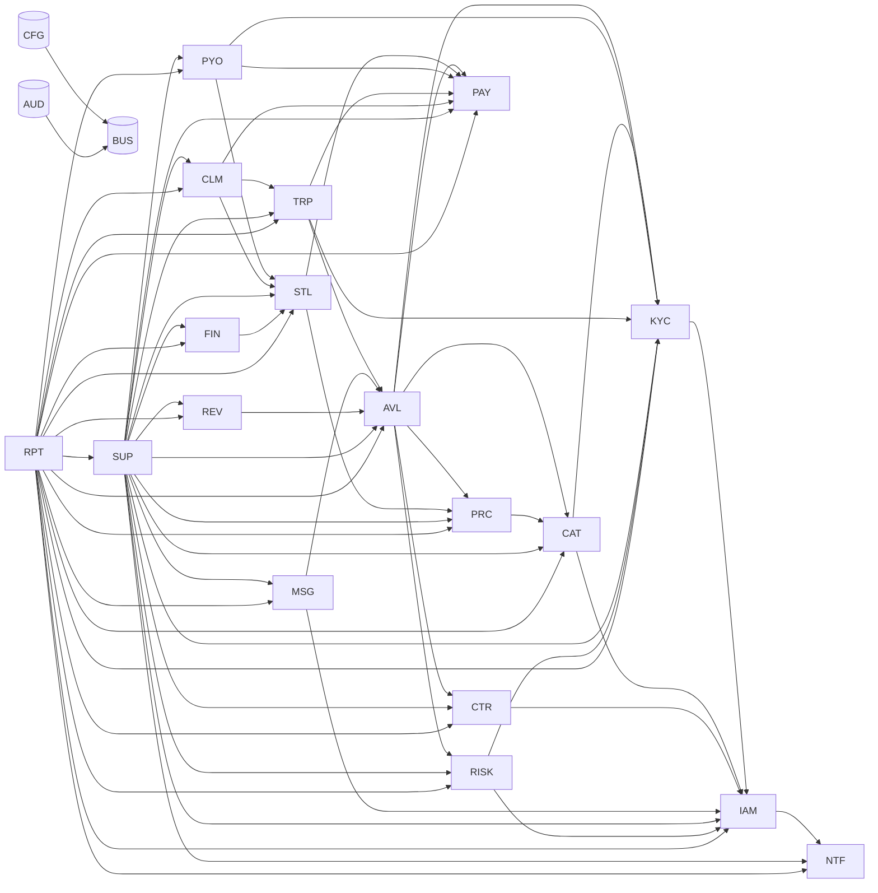
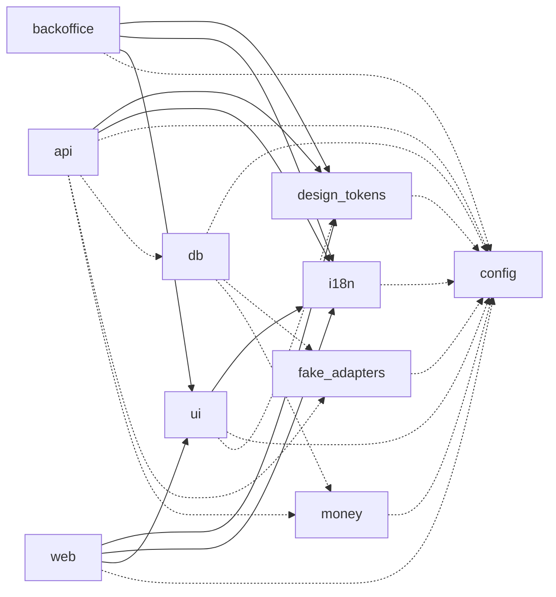

<!-- Fichier GÉNÉRÉ depuis apps/api/src/modules (dependency-graph.ts, sources) et packages/db/schemas.ts (US-038, ADR-079) : ne pas modifier à la main. -->
<!-- Régénérer : RUEDA_DOCS_WRITE=1 pnpm --filter @rueda/api exec vitest run src/testing/docs ; la CI échoue si ce fichier n'est plus à jour. -->

# Modules et dépendances

Monolithe modulaire NestJS (17 §2.1, §2.2) : un répertoire par module sous `apps/api/src/modules/`, importé seulement par son `index.ts` (règle de lint `rueda/module-boundaries`). Les dépendances **autorisées** viennent du graphe `dependency-graph.ts` (17 §2.2 ; socle implicite CFG, AUD, BUS) ; les dépendances **réelles** sont relues dans les imports des fichiers de production. Une dépendance réelle hors du graphe fait échouer le lint ; ce document les montre côte à côte.

## Graphe des dépendances explicites

Flèche = « dépend de » (17 §2.2). Les dépendances implicites de chaque module vers le socle (CFG, AUD, BUS) sont omises pour la lisibilité.

## Modules

| Code | Nom (17 §2.2) | Schéma cible | Responsabilité | Dépendances autorisées | Dépendances réelles (imports) | Routes HTTP | État |
| ---- | ------------- | ------------ | -------------- | ---------------------- | ----------------------------- | ----------- | ---- |
| IAM | Identity & Access | `iam` (PROPOSÉ) | comptes, authentification (mot de passe, OTP, TOTP du staff), sessions, compte d'hôte et co-hôtes, rôles et permissions, restrictions, blocage d'un voyageur par un hôte | NTF, CFG, AUD, BUS | NTF, CFG, BUS | `GET /auth/session` `GET /phone` `GET /staff/audit` `GET /staff/me` `POST /auth/login` `POST /auth/logout` `POST /auth/logout-all` `POST /auth/signup` `POST /auth/verify-email` `POST /host/accounts` `POST /phone/otp` `POST /phone/verify` `POST /staff/members/{id}/reset-totp` `POST /staff/members/{id}/suspend` `POST /staff/mfa/enroll` `POST /staff/mfa/verify` | construit |
| KYC | KYC / KYB | `kyc` (PROPOSÉ) | vérification du conducteur et de l'hôte (personne physique, numéro fiscal), pièces, liveness, contrôle du permis à la remise, filtrage sanctions de l'hôte | IAM, CFG, AUD, BUS | IAM, CFG | `GET /identity` `POST /identity/consent` `POST /identity/verification` `POST /kyc/webhooks/{provider}` | construit |
| CAT | Catalog / Listings | `catalog` (17) | lieux de remise de l'hôte, véhicules, annonces, photos, documents du véhicule, éligibilité au contrat d'assureur, flux iCal | IAM, KYC, CFG, AUD, BUS | IAM | `DELETE /host/accounts/{orgId}/listings/{listingId}` `DELETE /host/accounts/{orgId}/vehicles/{vehicleId}/blocks/{blockId}` `GET /host/accounts/{orgId}/catalog/makes` `GET /host/accounts/{orgId}/catalog/makes/{makeId}/models` `GET /host/accounts/{orgId}/catalog/models/{modelId}/variants` `GET /host/accounts/{orgId}/catalog/variants/{variantId}/prefill` `GET /host/accounts/{orgId}/listings` `GET /host/accounts/{orgId}/locations` `GET /host/accounts/{orgId}/vehicles` `GET /host/accounts/{orgId}/vehicles/{vehicleId}/calendar` `GET /listings/{listingId}` `POST /host/accounts/{orgId}/listings` `POST /host/accounts/{orgId}/listings/{listingId}/photos` `POST /host/accounts/{orgId}/listings/{listingId}/submit` `POST /host/accounts/{orgId}/locations` `POST /host/accounts/{orgId}/vehicles` `POST /host/accounts/{orgId}/vehicles/{vehicleId}/blocks` `POST /host/accounts/{orgId}/vehicles/{vehicleId}/catalog-request` `PUT /host/accounts/{orgId}/listings/{listingId}/pricing` `PUT /host/accounts/{orgId}/locations/{locationId}/notice` | construit |
| AVL | Availability & Booking | `booking` (17) | occupation unique, hold CHECKOUT, réservation, trip, segments, conducteurs, annulations et no-shows, import iCal en blocages | KYC, CAT, PRC, CTR, PAY, RISK, CFG, AUD, BUS | BUS | — | construit |
| PRC | Pricing & Quotes | `pricing` (PROPOSÉ) | devis versionné, jours facturables, lignes (trip fee, protection), taxes, instantané des paramètres, versions de prix du trip | CAT, CFG, AUD, BUS | — | — | coquille |
| CTR | Contracts & Documents | `contract` (PROPOSÉ) | gabarits juridiques versionnés, génération PDF (contrat entre l'hôte et le voyageur), signature électronique, consentements | IAM, CFG, AUD, BUS | IAM, CFG | `GET /host/accounts/{orgId}/terms` `GET /legal/consents` `GET /legal/documents` `GET /legal/documents/{kind}` `POST /host/accounts/{orgId}/terms/accept` `POST /legal/consents/accept` `POST /legal/consents/marketing` | construit |
| PAY | Payments abstraction | `payment` (17) | adaptateurs PSP de place de marché, sous-marchands hôtes, capacités, opérations avec montants par jambe, commandes monétaires, webhooks, remboursements, caution | CFG, AUD, BUS | CFG | `POST /webhooks/{provider}/{publicWebhookId}` | construit |
| STL | Settlement engine & Ledger | `settlement` (PROPOSÉ) | règlement économique pur, jambes, grand livre en partie double, host_ledger, insurer_ledger et bordereaux, avances de Kmino | PRC, PAY, CFG, AUD, BUS | — | — | coquille |
| PYO | Payouts | `payout` (PROPOSÉ) | compte de versement vérifié de l'hôte, lots depuis la jambe HOST, compensation des débits (NETTING), gel et reprise | KYC, PAY, STL, CFG, AUD, BUS | — | — | coquille |
| TRP | Trip operations | `trip_ops` (PROPOSÉ) | check-in et check-out par l'hôte et le voyageur, hors ligne, retards et non-restitution, refus du véhicule, remises du jour | KYC, AVL, PAY, CFG, AUD, BUS | — | — | coquille |
| CLM | Claims & Disputes | `claim` (PROPOSÉ) | dommages et incidents, factures annexes, débits de dommage par jambe, litiges, dossiers de preuve, décisions | PAY, STL, TRP, CFG, AUD, BUS | — | — | coquille |
| MSG | Messaging | `messaging` (PROPOSÉ) | fil par trip, masquage des coordonnées, détection du marché gris | IAM, AVL, CFG, AUD, BUS | — | — | coquille |
| NTF | Notifications | `notification` (PROPOSÉ) | règles événement → destinataires → canaux → gabarit, repli, idempotence, préférences | CFG, AUD, BUS | CFG, BUS | — | construit |
| REV | Reviews | `review` (PROPOSÉ) | avis guest, avis hôte (P1), agrégats | AVL, CFG, AUD, BUS | — | — | coquille |
| SUP | Support & back-office | `support` (PROPOSÉ) | console interne, fiche 360°, files de revue (KYC, annonces, vérification d'hôte), dossiers de support, actions manuelles | IAM, KYC, CAT, AVL, PRC, CTR, PAY, STL, PYO, TRP, CLM, MSG, NTF, REV, FIN, RISK, CFG, AUD, BUS | IAM, RISK, CFG | `GET /console/brand/versions` `GET /console/brand/versions/{id}` `GET /console/content/gaps` `GET /console/finance/approvals` `GET /console/queues` `GET /console/security/abuse` `POST /console/actions` `POST /console/brand/assets` `POST /console/brand/drafts` `POST /console/brand/rollback` `POST /console/brand/versions/{id}/publish` `POST /console/cases` `POST /console/cases/{id}/status` `POST /console/content/drafts` `POST /console/content/publish` `POST /console/content/rollback` `POST /console/evidence` `POST /console/finance/approvals/{id}/approve` `POST /console/queues/items/{id}/catalog-addition` `POST /console/queues/items/{id}/catalog-addition/resolve` `POST /console/queues/items/{id}/claim` `POST /console/queues/items/{id}/kyc` `POST /console/users/search` `POST /console/users/{id}/notes` `POST /console/users/{id}/profile` | construit |
| FIN | Finance & Tax | `finance` (17) | configuration fiscale, documents fiscaux de Kmino (PAC, SIFEN), relevés de gains de l'hôte, rapprochements par jambe, exports comptables | STL, CFG, AUD, BUS | BUS | — | construit |
| RISK | Fraud / Risk | `risk` (PROPOSÉ) | règles de risque, évaluation à la réservation, file de revue, journal explicable | IAM, KYC, CFG, AUD, BUS | IAM, CFG | — | construit |
| CFG | Country configuration | `config` (17) | pays, devises, fuseaux, locales, paramètres versionnés, fériés, entités juridiques | BUS | — | `GET /brand` `GET /brand/assets/{id}` `GET /brand/content` `GET /regulatory-notices` | construit |
| AUD | Audit & Evidence store | `audit` (PROPOSÉ) | journal d'audit chaîné, accès aux données, fichiers, clés par sujet, incidents | BUS | BUS | — | construit |
| RPT | Reporting | `reporting` (PROPOSÉ) | vues de lecture (tableaux de bord, KPI), exports CSV | IAM, KYC, CAT, AVL, PRC, CTR, PAY, STL, PYO, TRP, CLM, MSG, NTF, REV, SUP, FIN, RISK, CFG, AUD, BUS | — | — | coquille |
| BUS | Outbox et bus d'événements | `outbox` (PROPOSÉ) | outbox transactionnelle et diffusion des événements de domaine (17 §4) | — | — | — | construit |

## Applications et paquets

Trait plein : dépendance de production ; pointillé : dépendance de développement (tests, outillage).

| Paquet | Répertoire | Description | Dépendances internes | Dépendances internes de développement |
| ------ | ---------- | ----------- | -------------------- | ------------------------------------- |
| `@rueda/api` | `apps/api` | Back-end NestJS (monolithe modulaire) : API (main.ts) et travailleur (worker.ts : outbox, files et tâches périodiques en SQL, ADR-050), une image. | @rueda/design-tokens, @rueda/i18n | @rueda/config, @rueda/db, @rueda/fake-adapters, @rueda/money |
| `@rueda/backoffice` | `apps/backoffice` | Back-office interne Next.js (App Router), application séparée sur domaine distinct (17 §6.1). | @rueda/design-tokens, @rueda/i18n, @rueda/ui | @rueda/config |
| `@rueda/web` | `apps/web` | Application Next.js (App Router), mobile-first et installable (PWA) : voyageur et espace hôte. | @rueda/design-tokens, @rueda/i18n, @rueda/ui | @rueda/config |
| `@rueda/config` | `packages/config` | Configuration partagée : ESLint (frontières de modules, horloge SQL), garde d'environnement SQL, tsconfig. | — | — |
| `@rueda/db` | `packages/db` | Base PostgreSQL : correspondance module → schéma, migrations SQL versionnées, exécuteur de migrations, harnais de tests (US-005), liste blanche de l'horloge, journal d'audit chaîné, clés par sujet et magasin de preuves (US-009). | — | @rueda/config, @rueda/fake-adapters, @rueda/money |
| `@rueda/design-tokens` | `packages/design-tokens` | Jetons de design, source unique du thème : palettes US-028 validées, contrôle de contraste WCAG 2.2 AA, variables CSS pour apps/web et apps/backoffice, lint des styles codés en dur (US-030) ; règles de mouvement et règles photo (US-031). | — | @rueda/config |
| `@rueda/fake-adapters` | `packages/fake-adapters` | Adaptateurs FAKE (tests et développement seulement, jamais en production, C19) : identité, facture électronique, messagerie, fichiers, antivirus, signature, tuiles de carte (US-020) ; PSP (US-019). | — | @rueda/config |
| `@rueda/i18n` | `packages/i18n` | Internationalisation partagée (web, back-office, gabarits de l'API) : catalogues es / en / fr / pt (pt-BR), locales, formats d'affichage des montants, nombres, dates et pluriels. | — | @rueda/config |
| `@rueda/money` | `packages/money` | Primitives monétaires exactes : Money en bigint d'unités mineures, fractions exactes, roundHalfUp et allocHost uniques (US-015, BR-PRICE-14, ADR-009). | — | @rueda/config |
| `@rueda/ui` | `packages/ui` | Bibliothèque de composants vivante (US-032) : composants React accessibles, quadrilingues es / en / fr / pt-BR, écrits uniquement contre les jetons de design (US-030), et leur vitrine. | @rueda/i18n | @rueda/config, @rueda/design-tokens |

## Lecture

- **Schéma cible** : `17` = nommé par 17 ; `PROPOSÉ` = choisi par US-001 (`packages/db/schemas.ts`). En bêta, toutes les tables sont dans le schéma unique `core`, préfixées par le schéma cible (`core.booking_trip` → `booking.trip`) : voir [`schema.md`](schema.md).
- **État** : `coquille` = seulement `index.ts` et `<code>.module.ts`, réservés par US-001 ; `ports seulement` = des ports d’intégration (`*.port.ts`) sans logique ; `construit` = du code de production.
