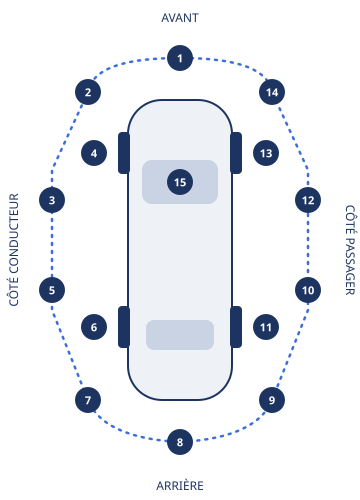

# US-031 — Mouvement, micro-interactions et règles photo

- **Statut** : PROPOSÉ (agent design, claude-opus-5-5, 2026-11-03). Révisable à tout moment : chaque valeur est une **donnée**, jamais une constante d'un composant.
- **Sources** : 10b §3.1 (UX-01, UX-02), §3.10 (UX-46 à UX-49), §3.11 (UX-52 à UX-58), UX-67 à UX-70 ; 08 BR-LIST-05 ; 16 TRP-004 (gabarit d'angles) ; 17 §3.2.10 (`slot_code`). Décision : [ADR-069](../../adr/ADR-069-regles-mouvement-et-photo-en-donnees.md).
- **Données consommables** (paquet `@rueda/design-tokens`, validées au chargement, fail-closed) :

| Fichier                                            | Contenu                                                                    | Accès en code                                                  |
| -------------------------------------------------- | -------------------------------------------------------------------------- | -------------------------------------------------------------- |
| `packages/design-tokens/foundation.tokens.json`    | jetons de mouvement ajoutés (`stagger`, courbe `exit`, échelle `press`)    | variables CSS `--motion-*`                                     |
| `packages/design-tokens/rules/motion.rules.json`   | catalogue des 12 micro-interactions : jetons de durée et de courbe, budget | `MOTION_RULES`, `motionPattern`, `motionDurationMs`            |
| `packages/design-tokens/rules/photo.rules.json`    | prise de vue, cadrages, lumière, interdits, angles, annonce, remise        | `PHOTO_RULES`, `checkHandoverSet`                              |
| `packages/design-tokens/rules/photo.messages.json` | 95 textes visibles, en espagnol, anglais et français                       | `PHOTO_MESSAGES` (clés `web.photo.*`, format de `@rueda/i18n`) |

## 1. Mouvement

### 1.1 Principes

1. **Le mouvement explique, il ne décore pas.** Il montre d'où vient un élément, où il va, ou qu'une action a pris. Jamais de rebond, jamais de boucle infinie (UX-69).
2. **Court et vif.** 150 à 300 ms pour tout ce qui répond à un geste. Une sortie est plus courte que l'entrée. Seules exceptions, une fois et une seule par écran : le tracé du _camino_ et le compteur de revenus de l'hôte (700 ms, « signature »).
3. **Un seul mouvement à la fois** dans le champ de vision (`budget.maxSimultaneous` = 1). Une liste qui apparaît décale ses cartes de 40 ms, **6 au plus** ; les suivantes arrivent avec la sixième.
4. **Jetons seulement.** Une durée, une courbe ou une échelle écrite en dur fait échouer `pnpm lint` (lint des styles d'US-030).
5. **Mouvement réduit = rien ne bouge.** Avec `prefers-reduced-motion: reduce`, l'état final s'affiche d'emblée, signatures comprises (§1.4).

### 1.2 Jetons

| Jeton (variable CSS)                   | Valeur Tinta               | Usage                                                    |
| -------------------------------------- | -------------------------- | -------------------------------------------------------- |
| `--motion-duration-fast`               | 150 ms                     | appui, survol, focus                                     |
| `--motion-duration-base`               | 180 ms                     | changement d'état (interrupteur, favori), sortie         |
| `--motion-duration-slow`               | 240 ms                     | dépliant, photo prise                                    |
| `--motion-duration-enter`              | 280 ms                     | apparition d'un bloc ou d'une feuille du bas             |
| `--motion-duration-page`               | 300 ms                     | carte du véhicule vers sa fiche                          |
| `--motion-duration-signature`          | 700 ms                     | _camino_, compteur de revenus (une fois)                 |
| `--motion-duration-skeleton`           | 1 400 ms × 3               | squelette de chargement, puis arrêt                      |
| `--motion-duration-stagger` **(neuf)** | 40 ms                      | décalage entre deux cartes d'une liste                   |
| `--motion-easing-standard`             | `cubic-bezier(.2,.6,.2,1)` | par défaut                                               |
| `--motion-easing-emphasis`             | `cubic-bezier(.2,.7,.2,1)` | entrées, transitions d'écran                             |
| `--motion-easing-exit` **(neuf)**      | `cubic-bezier(.4,0,1,1)`   | sorties : accélère, sans rebond                          |
| `--motion-scale-press` **(neuf)**      | 0,98                       | échelle d'un élément pressé (1 avec le mouvement réduit) |

Les trois jetons neufs sont dans le socle commun : toutes les palettes les ont, et une palette peut les redéfinir.

### 1.3 Micro-interactions

| Motif             | Où                                                 | Propriétés                   | Durée / courbe           |
| ----------------- | -------------------------------------------------- | ---------------------------- | ------------------------ |
| `press`           | bouton, carte, case                                | `transform`, fond            | fast / standard, `press` |
| `hover`           | survol et focus clavier                            | ombre, couleur               | fast / standard          |
| `toggle`          | interrupteur, case, favori                         | `transform`, couleur         | base / emphasis          |
| `expand`          | détail du prix, conditions                         | hauteur (grille), chevron    | slow / standard          |
| `enter`           | bloc au défilement, feuille du bas : fondu + 12 px | `opacity`, `transform`       | enter / emphasis         |
| `exit`            | fermeture d'une feuille, d'un message              | `opacity`, `transform`       | base / exit              |
| `stagger`         | résultats de recherche (6 cartes au plus)          | `opacity`, `transform`       | enter + 40 ms par carte  |
| `page`            | carte → fiche : la photo garde sa place            | transition de vue            | page / emphasis          |
| `skeleton`        | chargement                                         | `opacity`, 3 fois puis arrêt | skeleton / standard      |
| `photoCaptured`   | la vignette rejoint sa case, la case se coche      | `opacity`, `transform`       | slow / emphasis          |
| `camino`          | accueil, « Comment ça marche », mini-carte         | `stroke-dashoffset`          | signature / emphasis     |
| `earningsCounter` | compteur de revenus de l'hôte (A02), à l'ouverture | valeur affichée              | signature / emphasis     |

Le moment « waouh » vient de trois signatures sobres, pas d'une accumulation : la photo de la carte qui devient la fiche (`page`), le _camino_ qui se trace une fois, et la série de photos de remise qui se coche case par case (`photoCaptured`), avec un message en région live polie (« Enviada », UX-48).

### 1.4 Mouvement réduit (critère 1 d'US-031)

Avec `prefers-reduced-motion: reduce`, **aucune animation non essentielle ne joue** ; aucune ne l'est (WCAG 2.3.3), donc aucune ne joue. Quatre verrous, chacun testé :

1. **Feuille du thème** (`themeStyleSheet`) : toutes les durées `--motion-duration-*` passent à `0s`, `--motion-scale-press` à `1`.
2. **Règles de base** (`BASE_CSS`) : `animation-duration`, `transition-duration` à `0s` et `animation-iteration-count` à `1` sur tout élément, `scroll-behavior: auto`.
3. **Lint** (`packages/design-tokens/lint/motion.ts`, dans `pnpm lint`) : une `animation` CSS doit être remise à `none` dans un bloc `@media (prefers-reduced-motion: reduce)` du même fichier (ou n'exister que sous `no-preference`) ; un script qui anime (`requestAnimationFrame`, `.animate(`) doit consulter la préférence ; l'animation SMIL (`<animate>`) est refusée.
4. **Animation par script** : `motionDurationMs(theme, id, reduced)` rend 0 avec le mouvement réduit ; `prefersReducedMotion(matchMedia)` suppose le mouvement réduit sans `matchMedia` (rendu serveur) : en cas de doute, on n'anime pas.

**Preuve automatisée** : `packages/design-tokens/test/reduced-motion.test.ts` lit les vrais modules CSS de `packages/ui` (bouton, carte, bouton d'icône, squelette), rejoue la cascade avec le mouvement réduit pour **chaque palette acceptée** (transitions à 0, animations à `none`), vérifie `BASE_CSS`, passe le lint sur les scripts de `packages/ui`, et montre par mutation qu'un composant privé de son bloc `reduce` fait échouer le lint.

## 2. Photos

Les mêmes règles servent à l'**annonce** de l'hôte et au **gabarit d'angles de la remise** entre particuliers (TRP-004). Les textes visibles sont dans `photo.messages.json`, en es / en / fr ; ci-dessous, le français.

### 2.1 Prise de vue

| Règle       | Valeur                                                                                     | Pourquoi                                            |
| ----------- | ------------------------------------------------------------------------------------------ | --------------------------------------------------- |
| Orientation | **paysage**, ratio **4:3** (capteur natif des téléphones)                                  | la voiture est horizontale ; un portrait est refusé |
| Définition  | au moins **1 600 × 1 200 px**                                                              | dommages lisibles en zoom                           |
| Stockage    | côté long **1 600 px**, **500 ko** au plus, WebP sinon JPEG                                | 16 TRP-004 ; budget 3G de UX-02                     |
| Annonce     | affichée en **16:9** (cartes de `packages/ui`) : rognage centré, marge de sécurité de 10 % | 08 BR-LIST-05 « recadrage auto ~20 % »              |

### 2.2 Cadrages

- La voiture occupe presque toute la largeur, sans être coupée.
- Téléphone à l'horizontale, horizon droit ; pour l'extérieur, à **hauteur des phares**.
- De l'air autour de la voiture (rognage 16:9 de la couverture).
- Fond dégagé, sans autre voiture ni personne.
- Voiture lavée, objets personnels retirés.

### 2.3 Lumière

- De jour, en lumière douce : matin, fin d'après-midi ou ciel couvert.
- Soleil dans le dos du photographe, jamais derrière la voiture.
- Se décaler si son reflet apparaît sur la carrosserie ou les vitres.
- De nuit, **seulement pour la remise** : allumer une lumière et s'approcher de chaque dégât.
- Ni filtre ni retouche.

### 2.4 Interdits

| Interdit                                               | Annonce                       | Remise                                  |
| ------------------------------------------------------ | ----------------------------- | --------------------------------------- |
| **Plaque lisible**                                     | **floutée** avant publication | visible : preuve privée, jamais publiée |
| **Personnes** (y compris dans un reflet)               | refusée                       | refusée                                 |
| Image créée ou modifiée par IA                         | refusée                       | refusée                                 |
| Photo de stock, d'internet ou d'un catalogue           | refusée                       | —                                       |
| Texte, logo, cadre, filigrane                          | refusée                       | —                                       |
| Numéro, QR code, lien (contournement de la plateforme) | refusée                       | —                                       |
| Document ou écran avec des données personnelles        | refusée                       | refusée                                 |
| Dépanneuse, voiture accidentée, lieu dangereux         | refusée                       | —                                       |
| Contenu indécent, violent ou blessant                  | refusée                       | refusée                                 |

« Plaque floutée » : la plateforme floute (pas l'hôte), avant toute publication ; tant que le floutage automatique n'existe pas (US-508), une photo d'annonce où la plaque se lit est **refusée à la modération** (fail-closed). Sur une photo de remise, la plaque identifie la voiture de la preuve ; ces photos ne sont lues que par l'hôte, le voyageur et le support (TRP-004).

### 2.5 Annonce (08 BR-LIST-05)

**6 photos obligatoires, 10 recommandées** (PROPOSÉ ; paramètre de 08, recommandation LATAM). Galerie permise.

| #   | Angle                                 | Obligatoire          |
| --- | ------------------------------------- | -------------------- |
| 1   | Avant, côté conducteur (trois-quarts) | oui — **couverture** |
| 2   | Arrière, côté passager (trois-quarts) | oui                  |
| 3   | Profil côté conducteur                | oui                  |
| 4   | Tableau de bord                       | oui                  |
| 5   | Sièges avant                          | oui                  |
| 6   | Coffre                                | oui                  |
| 7   | Profil côté passager                  | non                  |
| 8   | Avant                                 | non                  |
| 9   | Arrière                               | non                  |
| 10  | Banquette arrière                     | non                  |

« Côté conducteur » et « côté passager » plutôt que gauche et droite : aucune constante de pays.

### 2.6 Gabarit d'angles de la remise (16 TRP-004, 17 §3.2.10)

**25 emplacements par partie** : l'hôte **et** le voyageur prennent chacun leur série, au départ (`PICKUP`) **et** au retour (`RETURN`), avec l'**appareil photo de l'app seulement** (`PHOTO_GALLERY_FORBIDDEN`). La série de l'un ne remplace pas celle de l'autre. Ordre = un tour complet de la voiture (avant, côté conducteur, arrière, côté passager, pare-brise), puis l'intérieur et les compteurs : personne ne revient sur ses pas.



| `slot_code` | Angle                            | `slot_code` | Angle                                  |
| ----------- | -------------------------------- | ----------- | -------------------------------------- |
| `EXT_01`    | Avant                            | `INT_01`    | Tableau de bord                        |
| `EXT_02`    | Avant, côté conducteur           | `INT_02`    | Console centrale                       |
| `EXT_03`    | Flanc conducteur, moitié avant   | `INT_03`    | Siège conducteur                       |
| `EXT_04`    | Roue avant côté conducteur       | `INT_04`    | Siège passager                         |
| `EXT_05`    | Flanc conducteur, moitié arrière | `INT_05`    | Arrière, côté conducteur               |
| `EXT_06`    | Roue arrière côté conducteur     | `INT_06`    | Arrière, côté passager                 |
| `EXT_07`    | Arrière, côté conducteur         | `INT_07`    | Ciel de toit                           |
| `EXT_08`    | Arrière                          | `INT_08`    | Coffre                                 |
| `EXT_09`    | Arrière, côté passager           | `FUEL`      | Carburant ou charge (moteur allumé)    |
| `EXT_10`    | Flanc passager, moitié arrière   | `ODOMETER`  | Compteur kilométrique                  |
| `EXT_11`    | Roue arrière côté passager       | `KEY`       | Clé (optionnel)                        |
| `EXT_12`    | Flanc passager, moitié avant     | `DAMAGE_n`  | Dégât n (optionnel, autant que besoin) |
| `EXT_13`    | Roue avant côté passager         |             |                                        |
| `EXT_14`    | Avant, côté passager             |             |                                        |
| `EXT_15`    | Pare-brise et toit               |             |                                        |

Le plancher de TRP-004 (15 extérieures, 8 intérieures, carburant, compteur) est **écrit dans le code** (`TRP004_MINIMUM`) : des données qui descendent dessous ne se chargent pas. `checkHandoverSet(slotCodes)` rend les emplacements manquants, dans l'ordre du gabarit ; l'appelant répond `PHOTO_TEMPLATE_INCOMPLETE`.

### 2.7 Contrôles à la prise (messages de reprise)

`tooDark`, `blurry`, `portrait`, `tooSmall`, `plateVisible` (annonce), `personVisible`, `galleryForbidden` (remise). Les seuils de détection (luminosité, netteté, détection de plaque et de personne) relèvent de la story de capture (US-303) et de l'assistant d'annonce (US-508) ; ici, seulement les règles et les textes.

## 3. Pour la story de capture (US-303) et l'assistant d'annonce (US-508)

```ts
import { PHOTO_RULES, PHOTO_MESSAGES, checkHandoverSet, motionPattern } from '@rueda/design-tokens';

for (const slot of PHOTO_RULES.handover.slots) {
  // slot.slotCode → inspection_photo.slot_code ; slot.angle.labelKey / hintKey → textes
  // slot.angle.zone, side, framing → silhouette de visée
}
const { complete, missing } = checkHandoverSet(capturedSlotCodes); // sinon PHOTO_TEMPLATE_INCOMPLETE
```

Les clés `web.photo.*` sont au format de `@rueda/i18n` ; voir ADR-069 pour leur versement dans ses catalogues.

## 4. Ce qui n'est pas repris de Turo

Rien de Turo : ni texte, ni visuel, ni gabarit. Les nombres viennent de nos spécifications (08, 16, 17), le vocabulaire des angles, l'ordre du tour, les textes et la silhouette sont les nôtres.
