# US-033 — Prototype des écrans clés de la bêta (voyageur, hôte, plateforme)

> Prototype **cliquable**, construit avec `@rueda/ui` et les jetons **Lienzo · Tinta**, pensé pour un téléphone de **360 px**, en **espagnol, anglais, français et portugais du Brésil**. Toutes les données sont **fictives** (montants, noms, adresses, numéros). Rien n'est repris de Turo : ni visuels, ni textes, ni mise en page.
>
> **Approbation** : écran par écran dans [`APPROBATIONS.md`](APPROBATIONS.md). Tant qu'un écran est `EN ATTENTE`, la story qui l'implémente reste bloquée (DoR point 6).

## Juger sans rien installer

Les captures ci-dessous (360 px, thème clair, espagnol du Panama) sont dans [`captures/`](captures/). Chaque écran a aussi une capture **en anglais, en français, en portugais** et une en **espagnol du Paraguay, thème sombre, en guaranis** (marché sans décimale) : `captures/<écran>-normal-en.png`, `-fr.png`, `-pt.png`, `-es-PY-dark.png`.

## Ouvrir le prototype cliquable

- **En local** (depuis la racine du dépôt) : `pnpm install --frozen-lockfile`, puis `pnpm --filter @rueda/web dev`, puis ouvrir `http://localhost:3000/proto` (index) sur le téléphone ou en mode mobile du navigateur.
- **En préproduction** : l'orchestrateur définit `WEB_PROTOTYPE_ENABLED=true` (jamais en production : sans la variable, `/proto` répond 404).
- Barre « Options du prototype » en haut de chaque écran : écran, **état** (vide, chargement, erreur…), **langue** (es-PA, es-PY, en, fr, pt), thème clair / sombre, pays d'exemple.
- Adresse directe : `/proto/s05?lang=fr&state=priceChanged&theme=dark&market=guarani`. `capture=1` masque la barre.
- Parcours voyageur (10b §4.2.1 puis §4.2.4) : S01 → S02 → S03 → S15 → S04 → S05 → S06 → S07 → S08 → S09 → check-in ; S17 depuis « Ayuda » sur chaque écran ; S14 depuis « Cuenta ». Le paiement est simulé (« Simular pago aprobado »).
- Parcours hôte (10b §4.2.3 puis §4.2.9) : A01 → A07 → A10 → A11 → A13 → A02 → A05 / A06 → A03 → A04 → A12 → A08 → A09 ; navigation basse de l'hôte (accueil, réservations, calendrier, gains). Console ops : O01.

## Écrans livrés

Index du prototype : [capture](captures/index-es-PA.png).

### Parcours voyageur

#### S01 · Accueil et recherche

États : [normal](captures/s01-normal-es-PA.png), [vide](captures/s01-empty-es-PA.png), [chargement](captures/s01-loading-es-PA.png), [erreur](captures/s01-error-es-PA.png), [hors connexion](captures/s01-offline-es-PA.png). Langues : [en](captures/s01-normal-en.png), [fr](captures/s01-normal-fr.png), [pt](captures/s01-normal-pt.png), [es-PY sombre](captures/s01-normal-es-PY-dark.png).

#### S02 · Résultats et feuillet des filtres

États : [normal](captures/s02-normal-es-PA.png), [vide](captures/s02-empty-es-PA.png), [chargement](captures/s02-loading-es-PA.png), [erreur](captures/s02-error-es-PA.png), [hors connexion](captures/s02-offline-es-PA.png), [filtres ouverts](captures/s02-sheet-es-PA.png), [filtres sans résultat](captures/s02-sheetEmpty-es-PA.png). Langues : [en](captures/s02-normal-en.png), [fr](captures/s02-normal-fr.png), [pt](captures/s02-normal-pt.png), [es-PY sombre](captures/s02-normal-es-PY-dark.png).

#### S03 · Fiche de la voiture

États : [normal](captures/s03-normal-es-PA.png), [vide](captures/s03-empty-es-PA.png), [chargement](captures/s03-loading-es-PA.png), [erreur](captures/s03-error-es-PA.png), [mode demande](captures/s03-request-es-PA.png). Langues : [en](captures/s03-normal-en.png), [fr](captures/s03-normal-fr.png), [pt](captures/s03-normal-pt.png), [es-PY sombre](captures/s03-normal-es-PY-dark.png).

#### S15 · Inscription et code (OTP)

États : [normal](captures/s15-normal-es-PA.png), [chargement](captures/s15-loading-es-PA.png), [code envoyé](captures/s15-code-es-PA.png), [erreur](captures/s15-error-es-PA.png). vide : sans objet dans 10b §4.1 pour cet écran (« — »). Langues : [en](captures/s15-normal-en.png), [fr](captures/s15-normal-fr.png), [pt](captures/s15-normal-pt.png), [es-PY sombre](captures/s15-normal-es-PY-dark.png).

#### S04 · Vérification d’identité

États : [normal](captures/s04-normal-es-PA.png), [chargement](captures/s04-loading-es-PA.png), [erreur](captures/s04-error-es-PA.png), [en cours d’examen](captures/s04-review-es-PA.png), [vérifié](captures/s04-verified-es-PA.png). vide : sans objet dans 10b §4.1 pour cet écran (« — »). Langues : [en](captures/s04-normal-en.png), [fr](captures/s04-normal-fr.png), [pt](captures/s04-normal-pt.png), [es-PY sombre](captures/s04-normal-es-PY-dark.png).

#### S05 · Paiement et choix de la protection

États : [normal](captures/s05-normal-es-PA.png), [chargement](captures/s05-loading-es-PA.png), [erreur](captures/s05-error-es-PA.png), [prix modifié](captures/s05-priceChanged-es-PA.png), [dépôt impossible](captures/s05-deposit-es-PA.png), [mode demande](captures/s05-request-es-PA.png). vide : sans objet dans 10b §4.1 pour cet écran (« — »). Langues : [en](captures/s05-normal-en.png), [fr](captures/s05-normal-fr.png), [pt](captures/s05-normal-pt.png), [es-PY sombre](captures/s05-normal-es-PY-dark.png).

#### S06 · Redirection et attente du paiement

États : [normal](captures/s06-normal-es-PA.png), [chargement](captures/s06-loading-es-PA.png), [paiement lent](captures/s06-slow-es-PA.png), [erreur](captures/s06-error-es-PA.png). vide : sans objet dans 10b §4.1 pour cet écran (« — »). Langues : [en](captures/s06-normal-en.png), [fr](captures/s06-normal-fr.png), [pt](captures/s06-normal-pt.png), [es-PY sombre](captures/s06-normal-es-PY-dark.png).

#### S07 · Confirmation

États : [normal](captures/s07-normal-es-PA.png), [mode demande](captures/s07-request-es-PA.png), [erreur](captures/s07-error-es-PA.png). vide, chargement : sans objet dans 10b §4.1 pour cet écran (« — »). Langues : [en](captures/s07-normal-en.png), [fr](captures/s07-normal-fr.png), [pt](captures/s07-normal-pt.png), [es-PY sombre](captures/s07-normal-es-PY-dark.png).

#### S08 · Mes voyages

États : [normal](captures/s08-normal-es-PA.png), [vide](captures/s08-empty-es-PA.png), [chargement](captures/s08-loading-es-PA.png), [erreur](captures/s08-error-es-PA.png), [hors connexion](captures/s08-offline-es-PA.png). Langues : [en](captures/s08-normal-en.png), [fr](captures/s08-normal-fr.png), [pt](captures/s08-normal-pt.png), [es-PY sombre](captures/s08-normal-es-PY-dark.png).

#### S09 · Détail du voyage

États : [normal](captures/s09-normal-es-PA.png), [chargement](captures/s09-loading-es-PA.png), [arrivée en retard](captures/s09-late-es-PA.png), [hôte absent](captures/s09-hostNoShow-es-PA.png), [hors connexion](captures/s09-offline-es-PA.png). vide, erreur : sans objet dans 10b §4.1 pour cet écran (« — »). Langues : [en](captures/s09-normal-en.png), [fr](captures/s09-normal-fr.png), [pt](captures/s09-normal-pt.png), [es-PY sombre](captures/s09-normal-es-PY-dark.png).

#### S09 · check-in photo (feuillet)

États : [normal](captures/s09c-normal-es-PA.png), [chargement](captures/s09c-loading-es-PA.png), [erreur](captures/s09c-error-es-PA.png), [hors connexion](captures/s09c-offline-es-PA.png), [terminé](captures/s09c-done-es-PA.png). vide : sans objet dans 10b §4.1 pour cet écran (« — »). Langues : [en](captures/s09c-normal-en.png), [fr](captures/s09c-normal-fr.png), [pt](captures/s09c-normal-pt.png), [es-PY sombre](captures/s09c-normal-es-PY-dark.png).

#### S17 · Aide et urgences

États : [normal](captures/s17-normal-es-PA.png), [chargement](captures/s17-loading-es-PA.png), [hors connexion](captures/s17-offline-es-PA.png). vide, erreur : sans objet dans 10b §4.1 pour cet écran (« — »). Langues : [en](captures/s17-normal-en.png), [fr](captures/s17-normal-fr.png), [pt](captures/s17-normal-pt.png), [es-PY sombre](captures/s17-normal-es-PY-dark.png).

#### S14 · Compte et préférences

États : [normal](captures/s14-normal-es-PA.png), [chargement](captures/s14-loading-es-PA.png), [erreur](captures/s14-error-es-PA.png), [sans photo de profil](captures/s14-noPhoto-es-PA.png). vide : sans objet dans 10b §4.1 pour cet écran (« — »). Langues : [en](captures/s14-normal-en.png), [fr](captures/s14-normal-fr.png), [pt](captures/s14-normal-pt.png), [es-PY sombre](captures/s14-normal-es-PY-dark.png).

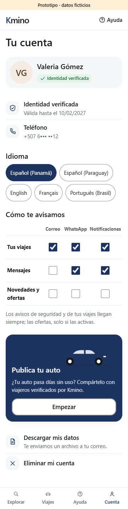

### Espace hôte (seconde demande de fusion)

#### A01 · Devenir hôte : présentation et estimation

États : [normal](captures/a01-normal-es-PA.png), [chargement](captures/a01-loading-es-PA.png), [erreur](captures/a01-error-es-PA.png), [marché pas encore ouvert](captures/a01-closed-es-PA.png). vide : sans objet dans 10b §4.1 pour cet écran (« — »). Langues : [en](captures/a01-normal-en.png), [fr](captures/a01-normal-fr.png), [pt](captures/a01-normal-pt.png), [es-PY sombre](captures/a01-normal-es-PY-dark.png).

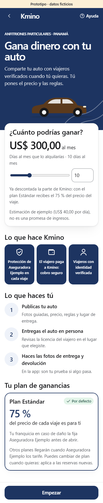

#### A07 · Devenir hôte : liste de tâches

États : [normal](captures/a07-normal-es-PA.png), [chargement](captures/a07-loading-es-PA.png), [erreur](captures/a07-error-es-PA.png), [en attente de l’ouverture](captures/a07-waiting-es-PA.png). vide : sans objet dans 10b §4.1 pour cet écran (« — »). Langues : [en](captures/a07-normal-en.png), [fr](captures/a07-normal-fr.png), [pt](captures/a07-normal-pt.png), [es-PY sombre](captures/a07-normal-es-PY-dark.png).

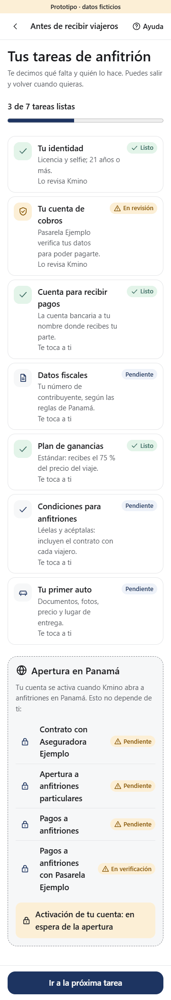

#### A10 · Inscription d’une voiture

États : [normal](captures/a10-normal-es-PA.png), [vide](captures/a10-empty-es-PA.png), [chargement](captures/a10-loading-es-PA.png), [erreur](captures/a10-error-es-PA.png), [marché pas encore ouvert](captures/a10-closed-es-PA.png). Langues : [en](captures/a10-normal-en.png), [fr](captures/a10-normal-fr.png), [pt](captures/a10-normal-pt.png), [es-PY sombre](captures/a10-normal-es-PY-dark.png).

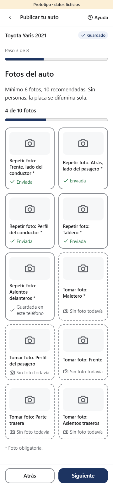

#### A11 · Règles, lieu de remise et plan

États : [normal](captures/a11-normal-es-PA.png), [chargement](captures/a11-loading-es-PA.png), [erreur](captures/a11-error-es-PA.png), [vue du voyageur](captures/a11-preview-es-PA.png). vide : sans objet dans 10b §4.1 pour cet écran (« — »). Langues : [en](captures/a11-normal-en.png), [fr](captures/a11-normal-fr.png), [pt](captures/a11-normal-pt.png), [es-PY sombre](captures/a11-normal-es-PY-dark.png).

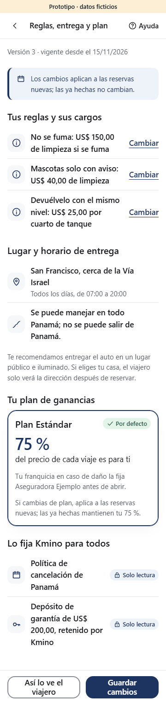

#### A13 · Profil public de l’hôte

États : [normal](captures/a13-normal-es-PA.png), [vide](captures/a13-empty-es-PA.png), [chargement](captures/a13-loading-es-PA.png), [erreur](captures/a13-error-es-PA.png), [vue du voyageur](captures/a13-preview-es-PA.png). Langues : [en](captures/a13-normal-en.png), [fr](captures/a13-normal-fr.png), [pt](captures/a13-normal-pt.png), [es-PY sombre](captures/a13-normal-es-PY-dark.png).

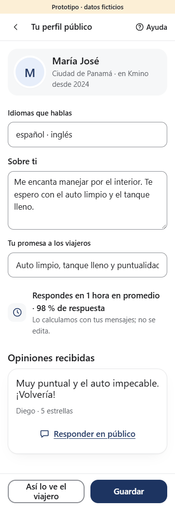

#### A02 · Espace hôte : accueil

États : [normal](captures/a02-normal-es-PA.png), [vide](captures/a02-empty-es-PA.png), [chargement](captures/a02-loading-es-PA.png), [erreur](captures/a02-error-es-PA.png), [marché pas encore ouvert](captures/a02-closed-es-PA.png), [mode demande](captures/a02-request-es-PA.png), [voyageur absent](captures/a02-noShow-es-PA.png). Langues : [en](captures/a02-normal-en.png), [fr](captures/a02-normal-fr.png), [pt](captures/a02-normal-pt.png), [es-PY sombre](captures/a02-normal-es-PY-dark.png).

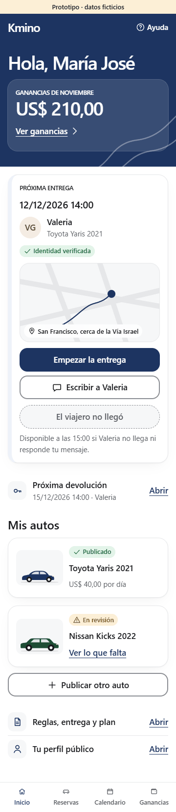

#### A05 · Réservations de l’hôte

États : [normal](captures/a05-normal-es-PA.png), [vide](captures/a05-empty-es-PA.png), [chargement](captures/a05-loading-es-PA.png), [erreur](captures/a05-error-es-PA.png), [mode demande](captures/a05-request-es-PA.png), [annulation par l’hôte](captures/a05-cancel-es-PA.png). Langues : [en](captures/a05-normal-en.png), [fr](captures/a05-normal-fr.png), [pt](captures/a05-normal-pt.png), [es-PY sombre](captures/a05-normal-es-PY-dark.png).

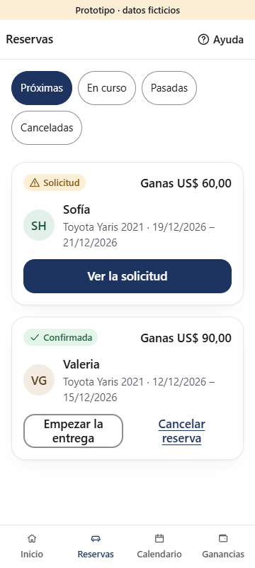

#### A06 · Calendrier et disponibilité

États : [normal](captures/a06-normal-es-PA.png), [vide](captures/a06-empty-es-PA.png), [chargement](captures/a06-loading-es-PA.png), [erreur](captures/a06-error-es-PA.png). Langues : [en](captures/a06-normal-en.png), [fr](captures/a06-normal-fr.png), [pt](captures/a06-normal-pt.png), [es-PY sombre](captures/a06-normal-es-PY-dark.png).

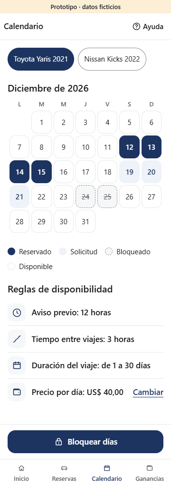

#### A03 · Remise de la voiture

États : [normal](captures/a03-normal-es-PA.png), [contrôle du permis](captures/a03-license-es-PA.png), [photos de départ](captures/a03-photos-es-PA.png), [remise des clés](captures/a03-keys-es-PA.png), [remise refusée](captures/a03-refuse-es-PA.png), [terminé](captures/a03-done-es-PA.png), [chargement](captures/a03-loading-es-PA.png), [erreur](captures/a03-error-es-PA.png). vide : sans objet dans 10b §4.1 pour cet écran (« — »). Langues : [en](captures/a03-normal-en.png), [fr](captures/a03-normal-fr.png), [pt](captures/a03-normal-pt.png), [es-PY sombre](captures/a03-normal-es-PY-dark.png).

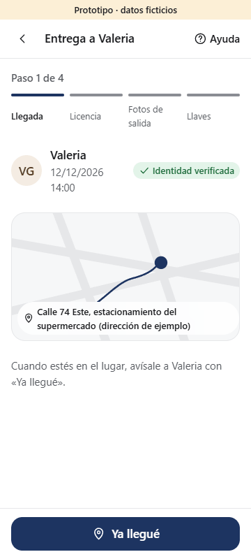

#### A04 · Retour de la voiture

États : [normal](captures/a04-normal-es-PA.png), [chargement](captures/a04-loading-es-PA.png), [erreur](captures/a04-error-es-PA.png), [frais justifiés](captures/a04-fee-es-PA.png), [terminé](captures/a04-done-es-PA.png). vide : sans objet dans 10b §4.1 pour cet écran (« — »). Langues : [en](captures/a04-normal-en.png), [fr](captures/a04-normal-fr.png), [pt](captures/a04-normal-pt.png), [es-PY sombre](captures/a04-normal-es-PY-dark.png).

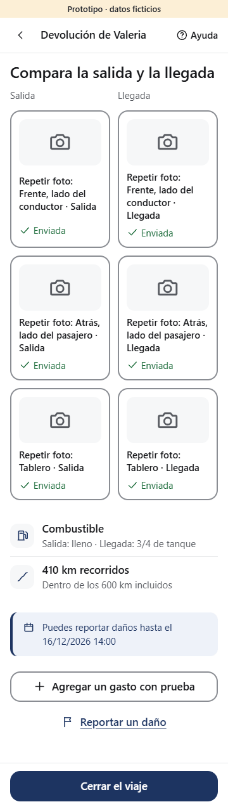

#### A12 · Avis sur le voyageur

États : [normal](captures/a12-normal-es-PA.png), [chargement](captures/a12-loading-es-PA.png), [erreur](captures/a12-error-es-PA.png), [avis envoyé](captures/a12-sent-es-PA.png). vide : sans objet dans 10b §4.1 pour cet écran (« — »). Langues : [en](captures/a12-normal-en.png), [fr](captures/a12-normal-fr.png), [pt](captures/a12-normal-pt.png), [es-PY sombre](captures/a12-normal-es-PY-dark.png).

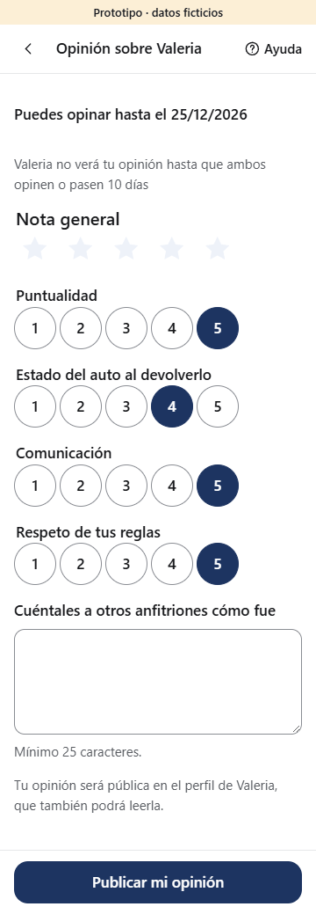

#### A08 · Gains et versements

États : [normal](captures/a08-normal-es-PA.png), [vide](captures/a08-empty-es-PA.png), [chargement](captures/a08-loading-es-PA.png), [erreur](captures/a08-error-es-PA.png), [versement retenu](captures/a08-onHold-es-PA.png), [versements pas encore ouverts](captures/a08-payoutsOff-es-PA.png). Langues : [en](captures/a08-normal-en.png), [fr](captures/a08-normal-fr.png), [pt](captures/a08-normal-pt.png), [es-PY sombre](captures/a08-normal-es-PY-dark.png).

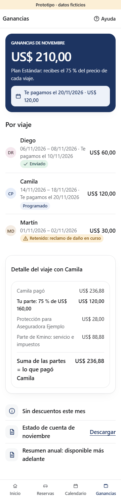

#### A09 · Dossier de dommage (hôte)

États : [normal](captures/a09-normal-es-PA.png), [chargement](captures/a09-loading-es-PA.png), [erreur](captures/a09-error-es-PA.png), [décision prise](captures/a09-decided-es-PA.png). vide : sans objet dans 10b §4.1 pour cet écran (« — »). Langues : [en](captures/a09-normal-en.png), [fr](captures/a09-normal-fr.png), [pt](captures/a09-normal-pt.png), [es-PY sombre](captures/a09-normal-es-PY-dark.png).

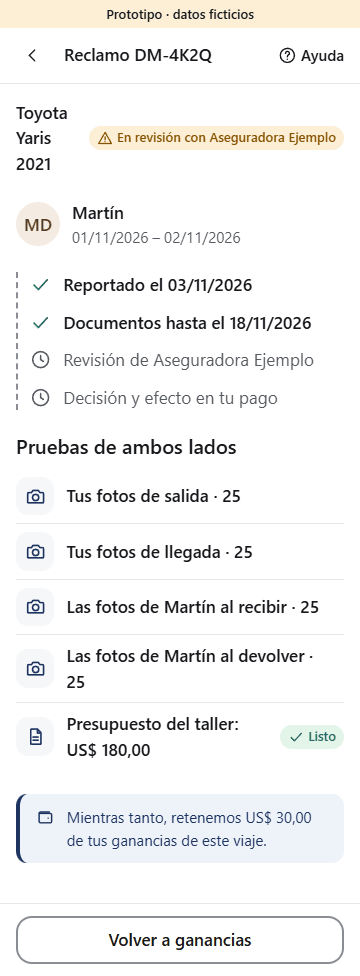

### Plateforme

#### O01 · Console ops : files de revue

États : [normal](captures/o01-normal-es-PA.png), [vide](captures/o01-empty-es-PA.png), [chargement](captures/o01-loading-es-PA.png), [erreur](captures/o01-error-es-PA.png), [fiche ouverte](captures/o01-item-es-PA.png). Langues : [en](captures/o01-normal-en.png), [fr](captures/o01-normal-fr.png), [pt](captures/o01-normal-pt.png), [es-PY sombre](captures/o01-normal-es-PY-dark.png).

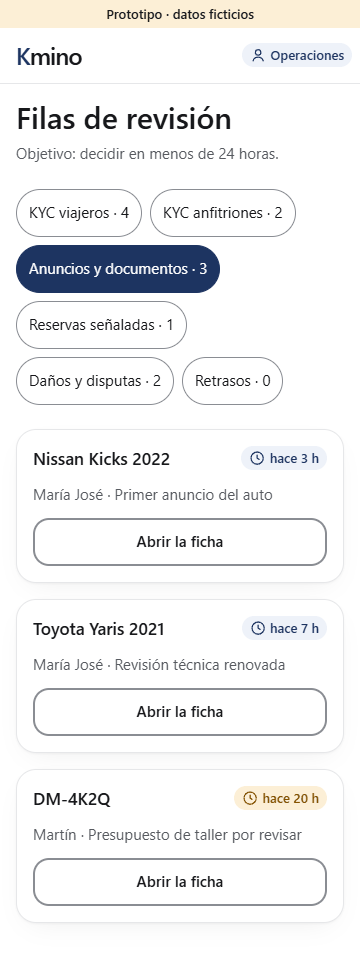

## Points de design à regarder

- **Signature Tinta** : héros « nuit » en `primary` avec le motif _camino_ en pointillés, recherche flottante sur carte surélevée, autos en illustrations maison, verre dépoli sur l'en-tête, la barre d'action et la navigation basse.
- **Prix final partout** (UX-15) : carte, fiche, barre d'action et paiement montrent le même total ; lignes (location, frais de service, protection, taxe) toujours visibles ; au paiement, le total change dès qu'on choisit un plan. La protection Básica est **obligatoire et payante** (08 BR-PROT-02, BR-PRICE-11) ; montants recalculés par l'oracle de 08 : `python -I -X utf8 docs/design/US-033/prix_oracle.py`.
- **Une silhouette par véhicule** (citadine, berline, SUV, pick-up, monospace) ; **hôte en tête de fiche** avec « identité vérifiée » et bande de confiance ; **confirmation festive** (pastille, camino, billet de remise), immobile si le mouvement est réduit.
- **Entre particuliers** : prénom et monogramme de l'hôte, ses règles avec frais, zone de remise approximative avant réservation, adresse exacte après, conseils de sécurité, check-in photo par le voyageur.
- **Accessibilité vérifiée** sur les 241 captures : aucune largeur au-delà de 360 px, aucune cible sous 44 px (48 px visés), textes et formulaires étiquetés, états annoncés (`role="status"`, `alert`), mouvement coupé par `prefers-reduced-motion`.

## Espace hôte : points de design à regarder

- **Part de l'hôte et jambes de l'oracle** : la part du plan `ESTÁNDAR` (75 %, 08 BR-PROT-06 [NOUS]) et chaque jambe (hôte, assureur, plateforme, taxe) viennent de `prix_oracle.py` (bloc `host` de `scenario.json`) ; le trip à venir de María José est **celui que paie Valeria en S05** (même total, Básica) ; dans A08, la somme des jambes est affichée égale à ce qu'a payé le voyageur. Une seule donnée de part alimente A01, A05, A07, A08, A10 et A11.
- **Ouverture du pays, telle qu'elle est** : interrupteurs à `false` et capacité PSP de versement inconnue, comme en production. A07 liste chaque condition « en attente » et l'activation bloquée ; états « marché pas encore ouvert » (A01, A02, A10), « en attente de l'ouverture » (A07), « versements pas encore ouverts » (A08, aucune date promise) ; O01 rappelle qu'approuver une annonce n'active pas l'hôte. Les états « normal » de l'espace hôte **simulent un marché ouvert**.
- **Photos** : annonce (A10) et remise (A03) suivent le gabarit d'US-031 (6 obligatoires / 10 conseillées ; 25 angles de remise) ; retour (A04) en avant / après.
- **Moments forts** : héros « nuit » d'A02 avec les gains du mois, billet de la prochaine remise, attente honnête d'A07, remise et retour terminés en plein écran (immobiles si le mouvement est réduit), calendrier en grille avec légende non portée par la seule couleur.
- **Montants fictifs hors oracle** : devis de garage (A09) et pénalité d'annulation en PYG (paramètre par devise non fixé dans 08) ; en USD, la pénalité suit BR-CXL-13 [NOUS] (25 plus de 24 h avant le départ).

## Reste

S10, S13 et S16 si l'orchestrateur les veut dans la V0 ; approbation écran par écran par le fondateur ; versement des clés PROPOSÉES dans 10b §4.3 et `@rueda/i18n` à l'implémentation. Tests d'utilisabilité V0 (10b §5.2) : protocole prêt à jouer sur ce prototype ([`TESTS-V0.md`](TESTS-V0.md)), à organiser par le fondateur.
