# US-033 — Prototype des écrans clés de la bêta (parcours voyageur)

> Prototype **cliquable**, construit avec `@rueda/ui` et les jetons **Lienzo · Tinta**, pensé pour un téléphone de **360 px**, en **espagnol, anglais, français et portugais du Brésil**. Toutes les données sont **fictives** (montants, noms, adresses, numéros). Rien n'est repris de Turo : ni visuels, ni textes, ni mise en page.
>
> **Approbation** : écran par écran dans [`APPROBATIONS.md`](APPROBATIONS.md). Tant qu'un écran est `EN ATTENTE`, la story qui l'implémente reste bloquée (DoR point 6).

## Juger sans rien installer

Les captures ci-dessous (360 px, thème clair, espagnol du Panama) sont dans [`captures/`](captures/). Chaque écran a aussi une capture **en anglais, en français, en portugais** et une en **espagnol du Paraguay, thème sombre, en guaranis** (marché sans décimale) : `captures/<écran>-normal-en.png`, `-fr.png`, `-pt.png`, `-es-PY-dark.png`.

## Ouvrir le prototype cliquable

- **En local** (depuis la racine du dépôt) : `pnpm install --frozen-lockfile`, puis `pnpm --filter @rueda/web dev`, puis ouvrir `http://localhost:3000/proto` (index) sur le téléphone ou en mode mobile du navigateur.
- **En préproduction** : l'orchestrateur définit `WEB_PROTOTYPE_ENABLED=true` (jamais en production : sans la variable, `/proto` répond 404).
- Barre « Options du prototype » en haut de chaque écran : écran, **état** (vide, chargement, erreur…), **langue** (es-PA, es-PY, en, fr, pt), thème clair / sombre, pays d'exemple.
- Adresse directe : `/proto/s05?lang=fr&state=priceChanged&theme=dark&market=guarani`. `capture=1` masque la barre.
- Parcours (10b §4.2.1 puis §4.2.4) : S01 → S02 → S03 → S15 → S04 → S05 → S06 → S07 → S08 → S09 → check-in ; S17 depuis « Ayuda » sur chaque écran. Le paiement est simulé (« Simular pago aprobado »).

## Écrans livrés dans cette demande de fusion

### S01 · Accueil et recherche

États : [normal](captures/s01-normal-es-PA.png), [vide](captures/s01-empty-es-PA.png), [chargement](captures/s01-loading-es-PA.png), [erreur](captures/s01-error-es-PA.png), [hors connexion](captures/s01-offline-es-PA.png). Langues : [en](captures/s01-normal-en.png), [fr](captures/s01-normal-fr.png), [pt](captures/s01-normal-pt.png), [es-PY sombre](captures/s01-normal-es-PY-dark.png).

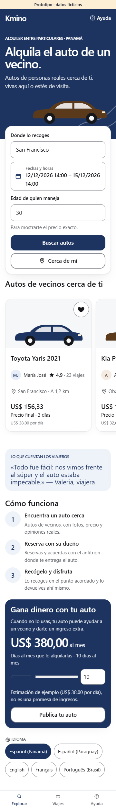

### S02 · Résultats et feuillet des filtres

États : [normal](captures/s02-normal-es-PA.png), [vide](captures/s02-empty-es-PA.png), [chargement](captures/s02-loading-es-PA.png), [erreur](captures/s02-error-es-PA.png), [hors connexion](captures/s02-offline-es-PA.png), [filtres ouverts](captures/s02-sheet-es-PA.png), [filtres sans résultat](captures/s02-sheetEmpty-es-PA.png). Langues : [en](captures/s02-normal-en.png), [fr](captures/s02-normal-fr.png), [pt](captures/s02-normal-pt.png), [es-PY sombre](captures/s02-normal-es-PY-dark.png).

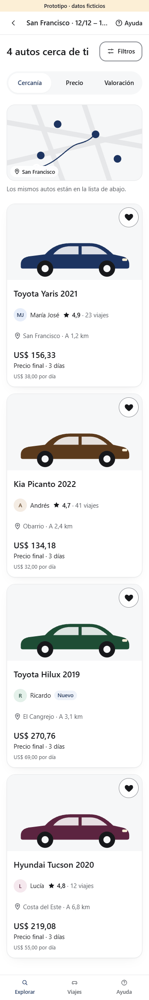

### S03 · Fiche de la voiture

États : [normal](captures/s03-normal-es-PA.png), [vide](captures/s03-empty-es-PA.png), [chargement](captures/s03-loading-es-PA.png), [erreur](captures/s03-error-es-PA.png), [mode demande](captures/s03-request-es-PA.png). Langues : [en](captures/s03-normal-en.png), [fr](captures/s03-normal-fr.png), [pt](captures/s03-normal-pt.png), [es-PY sombre](captures/s03-normal-es-PY-dark.png).

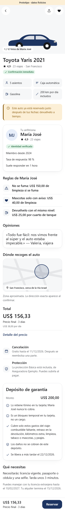

### S15 · Inscription et code (OTP)

États : [normal](captures/s15-normal-es-PA.png), [chargement](captures/s15-loading-es-PA.png), [code envoyé](captures/s15-code-es-PA.png), [erreur](captures/s15-error-es-PA.png). vide : sans objet dans 10b §4.1 pour cet écran (« — »). Langues : [en](captures/s15-normal-en.png), [fr](captures/s15-normal-fr.png), [pt](captures/s15-normal-pt.png), [es-PY sombre](captures/s15-normal-es-PY-dark.png).

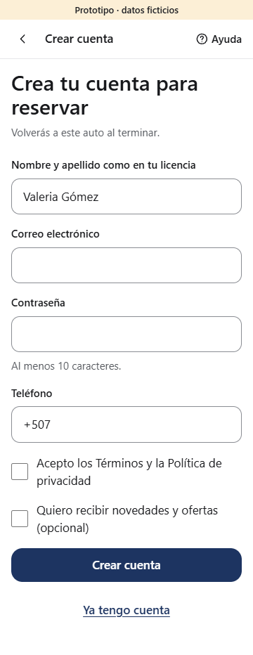

### S04 · Vérification d’identité

États : [normal](captures/s04-normal-es-PA.png), [chargement](captures/s04-loading-es-PA.png), [erreur](captures/s04-error-es-PA.png), [en cours d’examen](captures/s04-review-es-PA.png), [vérifié](captures/s04-verified-es-PA.png). vide : sans objet dans 10b §4.1 pour cet écran (« — »). Langues : [en](captures/s04-normal-en.png), [fr](captures/s04-normal-fr.png), [pt](captures/s04-normal-pt.png), [es-PY sombre](captures/s04-normal-es-PY-dark.png).

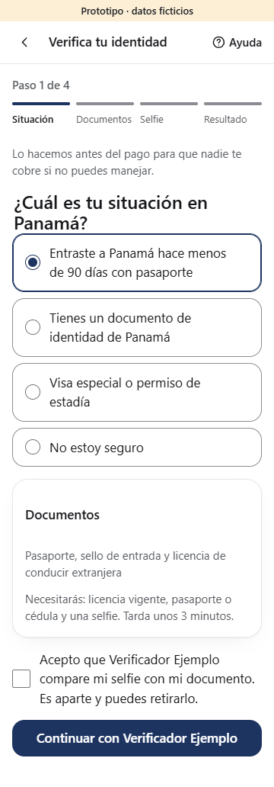

### S05 · Paiement et choix de la protection

États : [normal](captures/s05-normal-es-PA.png), [chargement](captures/s05-loading-es-PA.png), [erreur](captures/s05-error-es-PA.png), [prix modifié](captures/s05-priceChanged-es-PA.png), [dépôt impossible](captures/s05-deposit-es-PA.png), [mode demande](captures/s05-request-es-PA.png). vide : sans objet dans 10b §4.1 pour cet écran (« — »). Langues : [en](captures/s05-normal-en.png), [fr](captures/s05-normal-fr.png), [pt](captures/s05-normal-pt.png), [es-PY sombre](captures/s05-normal-es-PY-dark.png).

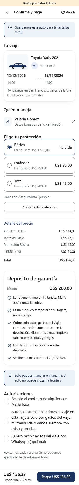

### S06 · Redirection et attente du paiement

États : [normal](captures/s06-normal-es-PA.png), [chargement](captures/s06-loading-es-PA.png), [paiement lent](captures/s06-slow-es-PA.png), [erreur](captures/s06-error-es-PA.png). vide : sans objet dans 10b §4.1 pour cet écran (« — »). Langues : [en](captures/s06-normal-en.png), [fr](captures/s06-normal-fr.png), [pt](captures/s06-normal-pt.png), [es-PY sombre](captures/s06-normal-es-PY-dark.png).

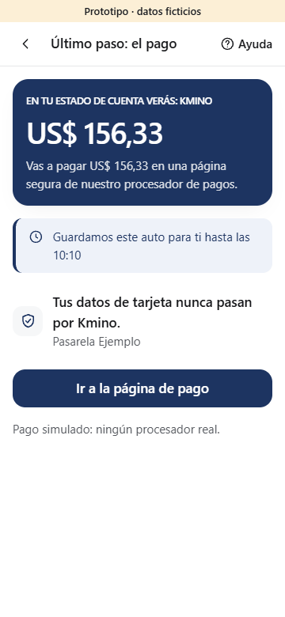

### S07 · Confirmation

États : [normal](captures/s07-normal-es-PA.png), [mode demande](captures/s07-request-es-PA.png), [erreur](captures/s07-error-es-PA.png). vide, chargement : sans objet dans 10b §4.1 pour cet écran (« — »). Langues : [en](captures/s07-normal-en.png), [fr](captures/s07-normal-fr.png), [pt](captures/s07-normal-pt.png), [es-PY sombre](captures/s07-normal-es-PY-dark.png).

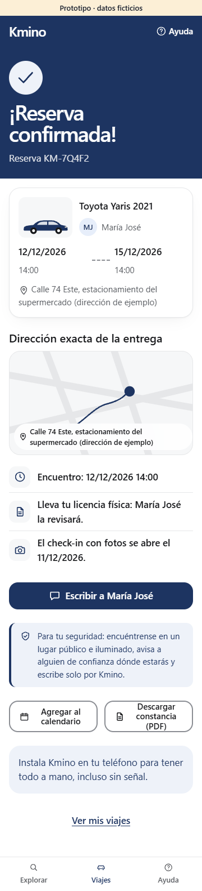

### S08 · Mes voyages

États : [normal](captures/s08-normal-es-PA.png), [vide](captures/s08-empty-es-PA.png), [chargement](captures/s08-loading-es-PA.png), [erreur](captures/s08-error-es-PA.png), [hors connexion](captures/s08-offline-es-PA.png). Langues : [en](captures/s08-normal-en.png), [fr](captures/s08-normal-fr.png), [pt](captures/s08-normal-pt.png), [es-PY sombre](captures/s08-normal-es-PY-dark.png).

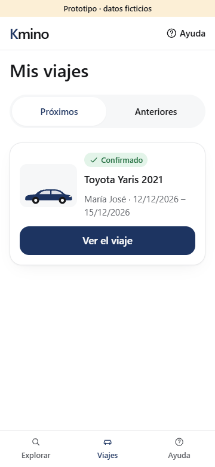

### S09 · Détail du voyage

États : [normal](captures/s09-normal-es-PA.png), [chargement](captures/s09-loading-es-PA.png), [arrivée en retard](captures/s09-late-es-PA.png), [hôte absent](captures/s09-hostNoShow-es-PA.png), [hors connexion](captures/s09-offline-es-PA.png). vide, erreur : sans objet dans 10b §4.1 pour cet écran (« — »). Langues : [en](captures/s09-normal-en.png), [fr](captures/s09-normal-fr.png), [pt](captures/s09-normal-pt.png), [es-PY sombre](captures/s09-normal-es-PY-dark.png).

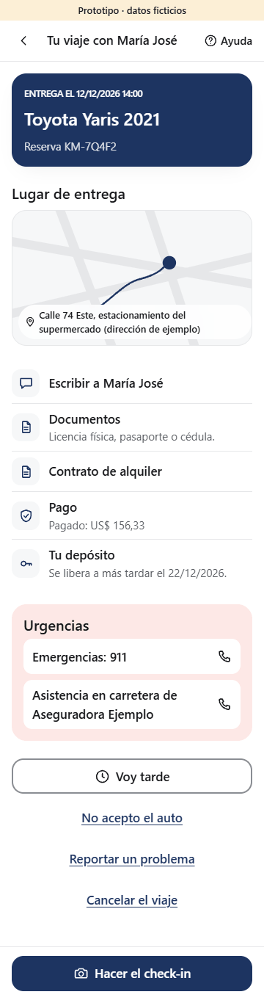

### S09 · check-in photo (feuillet)

États : [normal](captures/s09c-normal-es-PA.png), [chargement](captures/s09c-loading-es-PA.png), [erreur](captures/s09c-error-es-PA.png), [hors connexion](captures/s09c-offline-es-PA.png), [terminé](captures/s09c-done-es-PA.png). vide : sans objet dans 10b §4.1 pour cet écran (« — »). Langues : [en](captures/s09c-normal-en.png), [fr](captures/s09c-normal-fr.png), [pt](captures/s09c-normal-pt.png), [es-PY sombre](captures/s09c-normal-es-PY-dark.png).

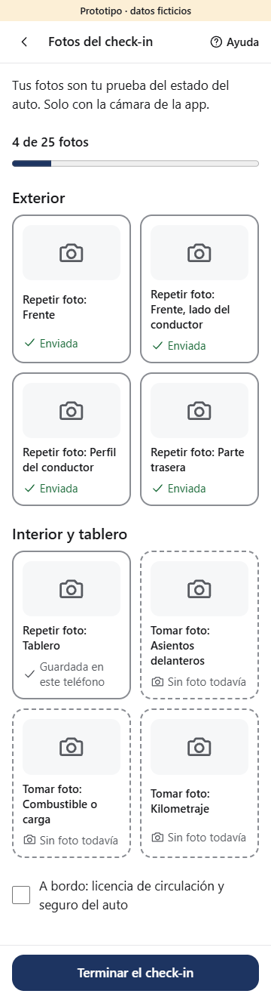

### S17 · Aide et urgences

États : [normal](captures/s17-normal-es-PA.png), [chargement](captures/s17-loading-es-PA.png), [hors connexion](captures/s17-offline-es-PA.png). vide, erreur : sans objet dans 10b §4.1 pour cet écran (« — »). Langues : [en](captures/s17-normal-en.png), [fr](captures/s17-normal-fr.png), [pt](captures/s17-normal-pt.png), [es-PY sombre](captures/s17-normal-es-PY-dark.png).

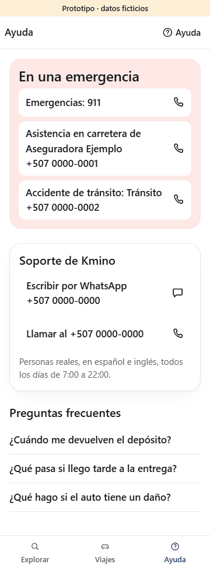

## Points de design à regarder

- **Signature Tinta** : héros « nuit » en `primary` avec le motif _camino_ en pointillés, recherche flottante sur carte surélevée, autos en illustrations maison, verre dépoli sur l'en-tête, la barre d'action et la navigation basse.
- **Prix final partout** (UX-15) : carte, fiche, barre d'action et paiement montrent le même total ; détail dépliable ; dépôt expliqué (`DepositBlock`).
- **Entre particuliers** : prénom et monogramme de l'hôte, ses règles avec frais, zone de remise approximative avant réservation, adresse exacte après, conseils de sécurité, check-in photo par le voyageur.
- **Accessibilité vérifiée** sur les 105 captures : aucune largeur au-delà de 360 px, aucune cible sous 44 px (48 px visés), textes et formulaires étiquetés, états annoncés (`role="status"`, `alert`), mouvement coupé par `prefers-reduced-motion`.

## Reste (seconde demande de fusion de US-033)

Espace hôte **A01–A13**, console ops **O01** et compte **S14** : voir la passation `docs/team/handoffs/US-033.md`. Tests d'utilisabilité V0 (10b §5.2) : protocole prêt à jouer sur ce prototype, à organiser par le fondateur.
