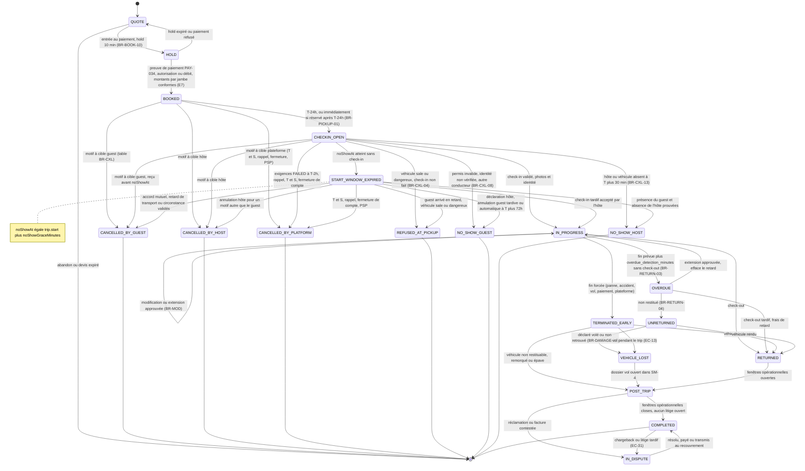
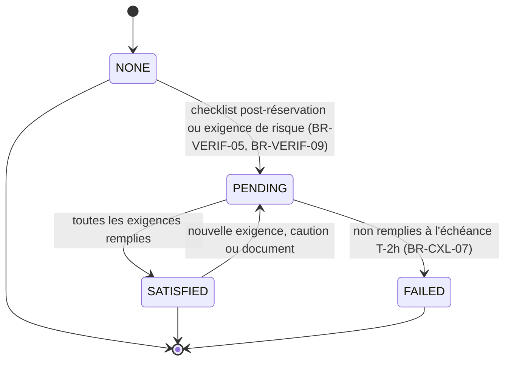
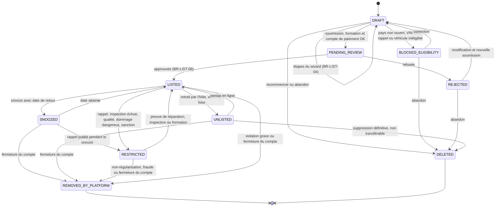
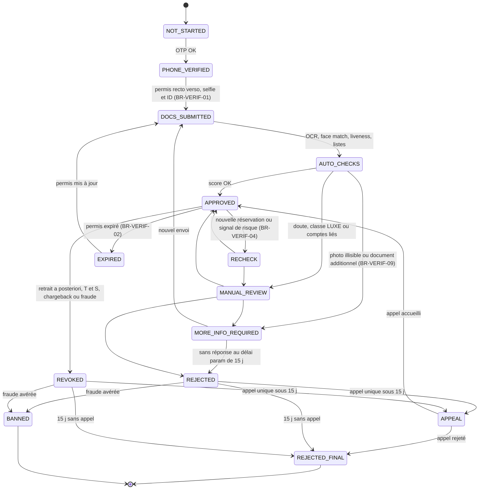
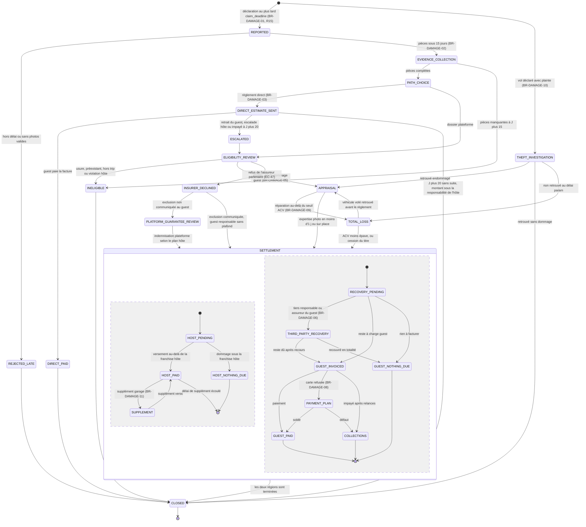
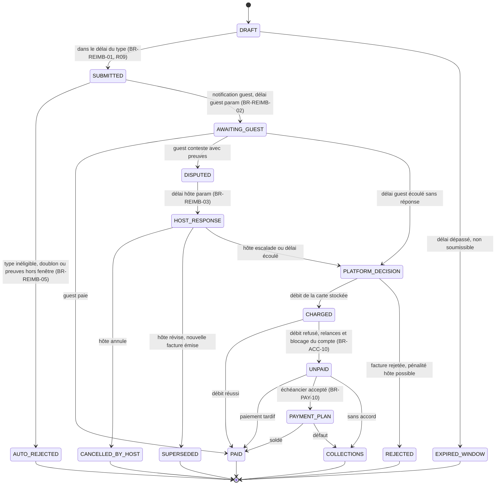
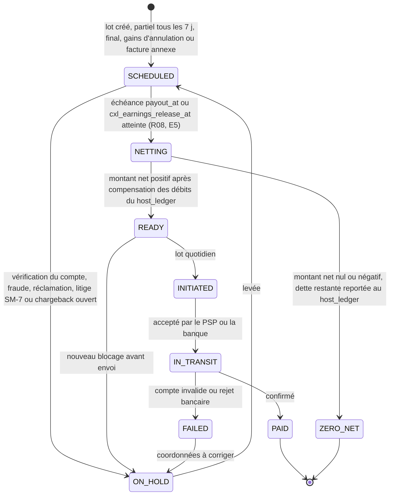
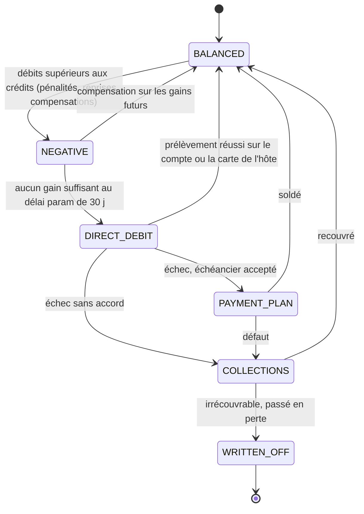
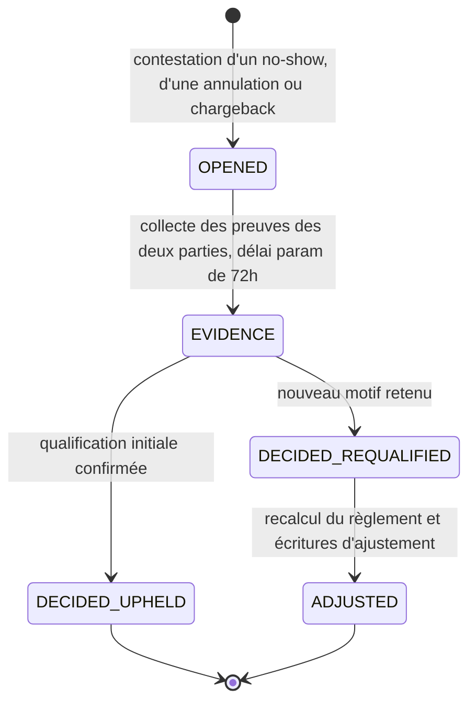
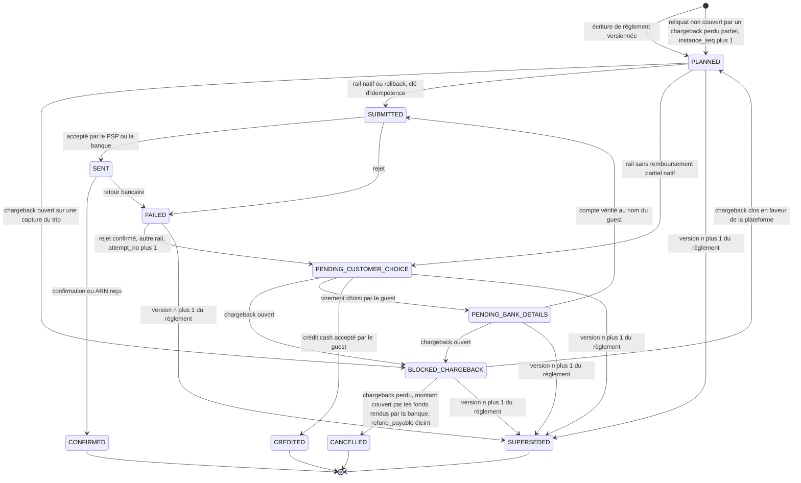

# 08 — Règles métier

> Format de chaque règle : **Fonctionnement · Conditions · Exceptions · Fonctionnalités concernées · Source · Certitude**.
> Certitude : DOCUMENTÉ (source officielle Turo) / OBSERVÉ / DIRECTEMENT TESTÉ / INFÉRÉ. Les règles proposées pour NOTRE plateforme sont marquées **[NOUS]** et ne décrivent pas Turo.
> Mise à jour Phase 4 (2026-10-30) : toutes les sections sont complétées (BR-ACC → BR-NOTIF), avec les machines à états. Les corrections de VERIF_01 sont appliquées à BR-CXL (journal en fin de section BR-CXL).
> Les corrections de **VERIF_04** (et des constats VERIF_03 F07, F08/F09, F10, F17, F18) sont appliquées le 2026-10-30 ; leur journal figure en fin de fichier.
> Statut : **COMPLET, corrigé VERIF_04** (corrigé VERIF_04-A33 : la mention contradictoire « EN COURS » est supprimée).
> **Corrections VERIF_09 (logique monétaire) et report de `09b` §8 (caution, dommages) appliqués le 2026-10-30** : chaque modification est marquée « (corrigé VERIF_09-<ID>) » ou « (reporté 09b §8) » ; journal dans le tableau final « Journal des corrections VERIF_09 ». Le moteur de règlement est désormais décrit en deux couches : le **règlement économique** (ce qui est dû, pseudo-code BR-CXL) et l'**exécution monétaire** (ce qui est encaissé, remboursé, versé : section « Exécution monétaire du règlement », E1 à E6). Tous les vecteurs T01–T48 sont recalculés à la main et par `tools/independent_settlement_check.py` (48/48 identiques).
> **Corrections VERIF_11 (exécution monétaire) appliquées le 2026-10-30** : remboursements en vol comptés comme sorties engagées, clé d'idempotence et supersession SM-8, reprise après chargeback plafonnée et isolée par devise, crédits inclus dans l'encaissé, caution limitée aux frais annexes et libérée à heure fixe ; vecteurs T49–T65 (`tools/check_t49plus.py`) ; marques « (corrigé VERIF_11-<ID>) » ; journal dans le tableau final « Journal des corrections VERIF_11 ». `platform_funded_host_compensation` vaut désormais `false` par défaut (fail-closed).
> **Deux décisions produit restent ouvertes et ne sont pas tranchées ici** : DEC-FONDATEUR-01 (compensation de l'hôte payée par la plateforme quand l'annulation est causée par la plateforme, OQ-BR-41) et OQ-BR-04 (comptage des jours et incitation retard / extension, option recommandée PROPOSÉE).
> **Consolidation 04/08/16/17 (2026-10-30)** : les 14 changements de l'annexe C de `17_DATA_MODEL_AND_ARCHITECTURE.md` sont reportés (marques « (consolidé 17-C08-xx) ») ainsi que la règle P0-A « agence inéligible au no-show » (« (consolidé VERIF_15-F3) ») ; journal en fin de fichier. **Deux autres décisions produit restaient ouvertes** (historique, **sans objet, pivot P2P**, US-055) : le TTL du hold `AGENCY_LINK` (`agency_link_hold_minutes`, PROPOSÉ 120 min, ADR-025, UXQ-09) et le sort P0-A de la retenue quand l'agence est inéligible (`p0a_ineligible_no_show_outcome`, défaut fail-closed `REFUND_GUEST`, OQ-BR-45). DEC-FONDATEUR-01 et OQ-BR-04 restent **OUVERTES**.
> **Alignement v4 (2026-10-30)** : la source de vérité de l'argent rattrape `17_DATA_MODEL_AND_ARCHITECTURE.md` v4 (VERIF_17-B13) : changements C-v3-09 à C-v3-13 (v3, VERIF_16) et C-v4-01, C-v4-02 (v4, VERIF_17) de l'annexe C de 17, marqués « (aligné v4-xx) » ; aucune règle renumérotée ; journal « Journal d'alignement v4 » en fin de fichier. Restent **OUVERTES** : DEC-FONDATEUR-01 (OQ-BR-41), OQ-BR-04, OQ-BR-45 (`p0a_ineligible_no_show_outcome` : historique, **sans objet, pivot P2P** ; reste l'avis consommation), UXQ-08 et UXQ-09 (revue avant le lien, TTL `agency_link_hold_minutes` : historique, **sans objet, pivot P2P**).
> **Révision P2P (US-055, 2026-11-02 ; demande de fusion S3 de `docs/team/impact/2026-11-02-pivot-p2p.md`)** : Kmino est une place de marché **de particulier à particulier**, hôtes particuliers uniquement, **aucune agence** (DEC-FONDATEUR-13) ; par défaut, **comme Turo** (DEC-FONDATEUR-14, 16). Le voyageur paie Kmino, marchand de référence ; un PSP de place de marché répartit chaque paiement en **jambes explicites** (hôte, assureur, plateforme, taxe pour compte de tiers), toutes calculées par le règlement (nouvelle section **E7**, vecteurs **TJ01 à TJ21** (TJ19 à TJ21 ajoutés par US-056) produits par `tools/check_legs.py`). Changements : « Règle de blocage » réécrite (le parcours de l'hôte particulier est construit ; la **mise en service** est fermée par interrupteurs par pays) ; BR-CXL-08 (retenue de l'hôte inéligible à la plateforme, comme Turo ; variante P0-A supprimée) ; hold `AGENCY_LINK` retiré (BR-BOOK-10) ; BR-PAY-06 (rail du comptoir supprimé) ; BR-PAY-08, BR-PAY-09 bis, BR-PRICE-06, 11, 12, BR-PROT-06, BR-PAYOUT, BR-TRUST-09, BR-REVIEW-01 (10 jours) ; journal « Journal de la révision P2P (US-055) » en fin de fichier. **Règle de lecture** : les notions d'agence, de loueur professionnel, de flotte pro, de comptoir, de contrat-cadre, de « Phase 0 », « P0-A », « P0-B » ou « Bêta pilote », et les identifiants `AGENCY_*`, `agency_*`, `counter_*` qui subsistent dans ce fichier sont **historiques et hors produit** : ils ne figurent plus que dans des passages marqués « (historique) » ou « sans objet (pivot P2P) », dans les journaux de corrections datés d'avant le 2026-11-02 et dans les deux lignes d'en-tête ci-dessus (consolidation et alignement v4), dont les décisions « `AGENCY_LINK` » et « `p0a_ineligible_no_show_outcome` » sont **sans objet** (UXQ-09 et la variante P0-A d'OQ-BR-45 sont closes par 22, US-053).
> **Révision « caution comme Turo » (US-063, 2026-11-12, PROPOSÉ ; ADR « caution comme Turo » de `docs/adr/`)** : comme chez Turo, **aucune caution par défaut** ; une caution n'est prise que si un **déclencheur** paramétré par pays est vrai (âge du conducteur sous un seuil sur certaines classes, classe de véhicule, signal de risque, caution imposée par le pays) ; déclencheur inconnu ⇒ caution exigée (fail-closed). Les frais après le trip restent débités par MIT sur la carte enregistrée (REQ-PAY-DMG inchangées). Passages marqués « (révisé 2026-11-12, caution comme Turo) » ; vecteurs T57–T59 précisés (déclencheur vrai), vecteurs **T69–T73** ajoutés et recalculés par `tools/check_t49plus.py` ; journal en fin de fichier.

---

## BR-CXL — Annulations, no-shows et remboursements

Source principale : https://turo.com/us/en/policies/cancellation — « Last revised: October 12, 2026 » — lue le 2026-10-30 dans le navigateur intégré (lecture humaine ; page en 403 pour les accès automatisés, EV-0011). Certitude : **DOCUMENTÉ** sauf mention. Les points recoupés par le centre d'aide sont signalés ; les autres sont « policy, non recoupé » (VERIF_01 V11/V24).
Pages sœurs du centre légal (OBSERVÉ) : Terms of service · Cancellation policy · Privacy policy · Community guidelines · Nondiscrimination policy · Additional policies · **Turo Travels Mutual** · Gift card terms.

### Définitions utilisées par les règles
- `trip_start` (`trip.start`) : date/heure de début planifiée, **dans le fuseau horaire du véhicule** (BR-CXL-00), stockée en UTC.
- `booked_at` (`trip.bookedAt`) : horodatage serveur de la réservation.
- `cancelRequestedAt` : horodatage **serveur** de réception de la demande d'annulation, ou de l'événement système qui la déclenche. C'est cette valeur qui est comparée aux bornes, et non l'heure de l'appareil (corrigé VERIF_04-R03).
- `days` : nombre de jours facturés `billable_days` (formule unique de BR-BOOK-03, corrigé VERIF_04-R01).
- **Lignes du trip** (unités mineures, version de prix en vigueur au moment de l'annulation, BR-MOD-06) : `tripPrice` (P, prix net après remises), `tripFee` (F), `protection`, `extras`, `enhancedRoadside`, `additionalDriverFee`, `youngDriverFee` (= 0 / absent en P0 : PRC-014 est P1 ; (VERIF_18, passe de cohérence finale)), `deliveryFee` (D), et les taxes par groupe fiscal. La caution n'est pas une ligne du trip : elle est traitée à part (corrigé VERIF_04-R02).
- `avg_day_cost` : formule Turo « coût moyen d'une journée » = (prix trip + trip fee) / nb jours (INFÉRÉ sur la formule exacte). **Pour le calcul, elle est remplacée par une retenue ligne par ligne** : `retenu(P) = roundHalfUp(P × j / days)` et `retenu(F) = roundHalfUp(F × j / days)`, où `j` est le nombre de jours de pénalité. La somme des deux vaut `j × avg_day_cost` à une unité mineure près. Ce découpage sépare ce qui revient à l'hôte (assiette = P seulement) de ce qui revient à la plateforme (F) (corrigé VERIF_04-A02, R02).
- `avgDayPriceHost` = P / days, **sans trip fee**. C'est l'assiette de la part hôte (corrigé VERIF_04-A02).
- **Composantes remboursées au guest** lors d'une annulation tardive ou d'un no-show **sur tarif remboursable** :
  - plan de protection, Extras, caution, frais jeune conducteur ;
  - **frais de conducteur additionnel** (BR-PRICE-08 ; pour le no-show, cas non documenté, INFÉRÉ, OQ-BR-38) (corrigé VERIF_04-A03) ;
  - **assistance routière renforcée** : DOCUMENTÉ pour le no-show ; non documenté pour l'annulation tardive, où [NOUS] la rembourse car elle n'est pas consommée (INFÉRÉ) (corrigé VERIF_04-A24) ;
  - **50 % des frais de livraison**.
- Sur tarif **non remboursable** après la grâce de 24 h : la **caution** est libérée, et les frais de conducteur additionnel sont remboursés **si aucun conducteur additionnel n'est approuvé** (BR-PRICE-08). Rien d'autre n'est remboursé (corrigé VERIF_01 V01c/V21 ; corrigé VERIF_04-A03).
- Région « 2 h » = États-Unis, Canada, Royaume-Uni. Région « 30 min » : « Australia and France » selon le centre d'aide (help:guest-trip-start-failures-HJUfENeVq, MAJ 2026-09-15), « tous les autres pays » selon la policy (non recoupé). L'application au Panama et au Paraguay est une **extrapolation INFÉRÉE**, car Turo n'y opère pas (corrigé VERIF_01 V20) → OQ-BR-33.

### BR-CXL-00 Fuseau horaire de référence
Toutes les fenêtres d'annulation se calculent dans le fuseau du **véhicule**.
→ [NOUS] Stocker `vehicle.timezone` et calculer côté serveur :
- America/Panama : UTC−5, sans heure d'été ;
- America/Asuncion : **UTC−3 permanent** depuis la loi d'octobre 2024 (Ley 7354/2024 selon VERIF_01 §2.3 ; sources timeanddate et liste IANA tz). Vérifier que la version de tzdata déployée l'intègre (OQ-BR-20).

### BR-CXL-01 Période d'annulation gratuite (guest) — tarif remboursable
| Cas | Fenêtre gratuite |
|---|---|
| Réservation faite **> 24 h** avant `trip_start` | jusqu'à **24 h avant** `trip_start` |
| Réservation faite **≤ 24 h** avant `trip_start` | **1 h après** `booked_at` |

→ Remboursement **intégral**. L'annulation prend effet immédiatement ; le guest est invité à prévenir l'hôte par la messagerie.

**Formulation exécutable [NOUS]** (corrigé VERIF_04-R03, A23) :
- `lastMinute = (trip.start − bookedAt) < lastMinuteThreshold` (25 h) ;
- `freeUntil = lastMinute ? min(bookedAt + 60 min, trip.start) : trip.start − 24 h` ;
- l'annulation est gratuite si `cancelRequestedAt ≤ freeUntil` (**borne incluse**).

Le `min(…, trip.start)` empêche qu'une réservation faite moins d'1 h avant le départ ouvre une annulation gratuite **après** l'heure de début, ce qui chevaucherait la fenêtre de no-show. Ce point n'est pas documenté chez Turo : c'est un choix [NOUS].

**Contradiction 24 h / 25 h (VERIF_01 V06)** : le seuil « dernière minute » vaut :
- **24 h** dans la cancellation policy (12/10/2026) et dans l'article guest help:canceling-a-trip-with-your-host-HJyUE4xN9 ;
- **25 h** dans l'article help:trips-canceled-by-guests-or-turo-BkGMU4gV9 (MAJ 2026-09-11, « booked less than 25 hours before the start ») et dans help:refund-timing-rkyN44gEc.

Pour une réservation faite entre 24 h et 25 h avant le départ, la règle est donc ambiguë. Explication probable (INFÉRÉ) : avec un seuil de 24 h, une réservation faite à 24 h 30 n'aurait que 30 min de fenêtre gratuite ; le seuil de 25 h garantit **toujours au moins 1 h**. **La policy officielle prime** pour décrire Turo (24 h). [NOUS] : un seul paramètre `lastMinuteThreshold` = **25 h**, qui garantit au moins 1 h de fenêtre → OQ-BR-30. Ce même seuil est utilisé dans BR-CXL-14.

Note : au checkout, le tarif Remboursable affichait « Annulation gratuite jusqu'au 13 janv. » pour un départ le 14 janv. à 10:00, ce qui est cohérent avec « 24 h avant » (OBSERVÉ).

### BR-CXL-02 Tarif non remboursable
- Annulation gratuite pendant **24 h après la réservation** (« grace period »). Ensuite, **aucun remboursement** du trip. La **caution est toujours libérée** (SRC_G 4.1.3 : « puis plus rien (sauf dépôt) »). Exception : les frais de conducteur additionnel sont remboursés si aucun conducteur additionnel n'est approuvé (BR-PRICE-08) (corrigé VERIF_04-A03).
- [NOUS] : la grâce prend fin à `min(bookedAt + 24 h, trip.start)`. Elle ne s'applique qu'aux annulations **volontaires** du guest : un no-show ou une annulation « à cause du guest » sur un tarif non remboursable n'y ouvre pas droit (INFÉRÉ, OQ-BR-38).
- Côté hôte : si le guest annule un trip non remboursable après la grâce, l'hôte reçoit **ses gains moins les frais Turo** (paiement complet). Recoupé par help:trips-canceled-by-guests-or-turo-BkGMU4gV9.
- Remise NR : **10 %** pour une réservation faite **≥ 4 jours à l'avance** (BR-PRICE-04). Écart de prix observé au checkout : le non remboursable coûte environ 9 % de moins que le remboursable (OBSERVÉ, EV-0007 ; non réconcilié, VERIF_01 V05).
- Exceptions applicables même en NR : décès ou maladie, obligation légale, hospitalisation, vol retardé (SRC_G 4.1.9).

### BR-CXL-03 Modifications et fenêtre gratuite
Une modification approuvée **ne réinitialise pas** la période d'annulation gratuite : celle-ci reste liée au `booked_at` d'origine.

### BR-CXL-04 Annulation pour propreté ou sécurité
Le guest est remboursé intégralement si, à l'inspection au départ, le véhicule n'est pas propre ou est dangereux. Trois conditions : le guest (1) n'accepte pas le véhicule, (2) **ne fait pas le check-in**, (3) contacte immédiatement le Support.

### BR-CXL-05 Annulation d'un commun accord
Remboursement intégral au guest si l'accord mutuel est **prouvé**. L'hôte **ne touche rien**, même sur un trip non remboursable.

### BR-CXL-06 Annulation guest hors période gratuite (remboursement partiel)
| Durée du trip | Retenue guest (ligne par ligne sur P et F) | Gains hôte |
|---|---|---|
| > 2 jours | **1 jour** (`retenu(P) + retenu(F)`, j = 1) | part du plan × **1 jour de prix du trip** (P/days, **sans trip fee**) + part de la ½ livraison retenue |
| ≤ 2 jours | **½ jour** (j = ½) | part du plan × **½ jour de prix du trip** + part de la ½ livraison retenue |

(corrigé VERIF_04-A02 : la part hôte ne porte **jamais** sur le trip fee, conformément à BR-PRICE-06 et à l'article officiel « your share of … one day's average trip price ».)

Le guest est remboursé intégralement de : protection, Extras, caution, frais jeune conducteur (ligne nulle en P0, PRC-014 en P1), **frais de conducteur additionnel** (BR-PRICE-08) (corrigé VERIF_04-A03), assistance routière renforcée ([NOUS], INFÉRÉ, corrigé VERIF_04-A24) et 50 % de la livraison.

**Taxes : méthode unique, au prorata de la base taxable remboursée** (corrigé VERIF_04-A04). Pour chaque groupe fiscal `g` :
`taxeRemboursée(g) = roundHalfUp(taxePayée(g) × Σ lignes taxables remboursées(g) / Σ lignes taxables payées(g))` ; si la base taxable payée du groupe est nulle (promo à 100 %, groupe vide), `taxeRemboursée(g) = 0` (corrigé VERIF_09-m02).

**Granularité de la taxe payée : par ligne** (corrigé VERIF_09-m01). `taxePayée(g) = Σ_{l ∈ g} roundHalfUp(ligne_l × taux_g)` : chaque ligne de la facture électronique (PAC au PA, SIFEN au PY) porte sa propre taxe arrondie, et la taxe du groupe est la **somme des taxes de ligne arrondies**, jamais `roundHalfUp(taux × base agrégée)`. Les deux méthodes donnent le même résultat sur les trips A, B, C, D, mais pas en général : P = F = 10,05 $ à 7 % → par ligne 0,70 + 0,70 = **1,40** ; agrégé 1,41 (vecteur T43). Le **remboursement**, lui, reste calculé une fois par groupe (prorata ci-dessus, un seul arrondi par groupe), ce qui garantit `taxe remboursée ≤ taxe payée`. Raisons du choix : cohérence avec BR-PRICE-12/14 (« taxes calculées par ligne ») et avec la facture électronique ligne à ligne ; une ligne promo négative (BR-PRICE-16, BR-PAY-07) porte une taxe négative arrondie de la même façon.

**Retenue non monotone en durée** (corrigé VERIF_09-m03) : la part de P retenue vaut 50 % (1 j), 25 % (2 j), 33 % (3 j), 25 % (4 j) en annulation tardive, et 75 %, 37,5 %, 66,7 %, 50 % en no-show. C'est la règle Turo, conservée telle quelle [NOUS] : décision documentée, à revoir seulement si la revue de droit de la consommation l'exige (OQ-BR-24).

Cette méthode remplace `taxOn(refundBase)`, qui recalculait la taxe sur des lignes peut-être non taxables. Elle ne rembourse jamais plus que la taxe payée. Les lignes taxables par pays sont définies par la table versionnée `tax_line_config[pays][type_de_ligne]` (BR-PRICE-12, R11). Pour PA (ITBMS) et PY (IVA), le contenu de cette table reste **À VALIDER** (OQ-BR-14). Une surtaxe fixe par jour (exemple floridien, BR-PRICE-12) serait une ligne distincte, hors prorata, remboursée seulement pour les jours remboursés. Aucune surtaxe de ce type n'est connue en PA/PY.

### BR-CXL-07 Étapes post-réservation non complétées (US)
Un guest **aux États-Unis** doit compléter les **étapes post-réservation** (confirmer le téléphone, téléverser et faire vérifier le permis, ajouter ou refuser une protection) **au plus tard 2 h avant `trip_start`**. Sinon, Turo **annule** le trip et applique le **remboursement partiel de BR-CXL-06**. La checklist n'existe que si la réservation est faite **plus de 3 h** avant le départ ; sinon, ces étapes se font pendant le checkout (SRC_G 1.4.5, 3.10, 4.2.6 ; corrigé VERIF_01 V22).
- Motif interne : `PLATFORM_INCOMPLETE_STEPS`.
- Si le tarif est **non remboursable** : 0, cas **non documenté** (INFÉRÉ ; corrigé VERIF_04-A25 → OQ-BR-38).
- Si l'échec vient de **notre** file de revue (motif `PLATFORM_REVIEW_DELAY`) ou d'une panne du PSP (`PSP_FAILURE`), [NOUS] rembourse intégralement le guest (corrigé VERIF_04-A11).

→ Cohérent avec le bandeau du checkout : « vous devrez fournir plus d'informations afin d'éviter l'annulation de votre voyage, ainsi que des frais » (OBSERVÉ).

### BR-CXL-08 No-show du guest
Le guest est en **no-show** (« trip start failure ») dans l'un des cas suivants :
- il n'a pas annulé et ne se présente pas dans les **2 h** suivant `trip_start` (US/CA/UK), ou dans les **30 min** (AU/FR selon le centre d'aide ; « autres pays » selon la policy → OQ-BR-33) ;
- les photos ou informations fournies au check-in ne permettent pas de vérifier le guest ou son permis ;
- il n'a **pas téléversé son permis 1 h avant** le départ et aucune rencontre avec l'hôte n'est possible (ajout VERIF_01 V21) ;
- il se présente **sans permis** ou **avec un permis invalide** ;
- il envoie un **conducteur additionnel ou une autre personne** à sa place.

Conséquences sur tarif **remboursable** :

| Durée | Retenue guest (ligne par ligne sur P et F) | Gains hôte |
|---|---|---|
| > 2 jours | **2 jours** (j = 2) | part du plan × **2 jours de prix du trip** (sans trip fee) + part de la ½ livraison retenue |
| ≤ 2 jours | **75 % d'un jour** (j = ¾) | part du plan × **¾ de jour de prix du trip** + part de la ½ livraison retenue |

(corrigé VERIF_04-A02)

Le guest est remboursé de : protection, caution, Extras, **assistance routière renforcée**, frais jeune conducteur (ligne nulle en P0, PRC-014 en P1), 50 % de la livraison, et [NOUS] frais de conducteur additionnel (INFÉRÉ, OQ-BR-38).

Tarif **non remboursable** : **aucun remboursement** du trip ; la caution est libérée (ajout VERIF_01 V21). Les frais de conducteur additionnel sont remboursés si aucun conducteur additionnel n'est approuvé.

Conditions côté hôte :
- l'hôte envoie un message et **attend 15 min** la réponse ;
- il doit **déclarer le no-show sous 72 h** après `trip_start`. Sinon, si le guest déclare ne pas être venu, l'hôte **ne touche rien** et peut payer des frais.

**Le résultat ne dépend pas de qui exécute l'annulation** (Turo ou l'hôte). Seule compte la qualification du motif (corrigé VERIF_04-A01 ; voir la table de décision ci-dessous).

**Minuteries [NOUS]** (corrigé VERIF_04-R05) :
- `noShowAt = trip.start + noShowGraceMinutes`, avec `noShowGraceMinutes` = 60 `{param}` (OQ-BR-33) ;
- l'hôte peut déclarer le no-show si `now ≥ noShowAt` **et** si un message de l'hôte remonte à au moins 15 min sans réponse ;
- fenêtre de déclaration : `[noShowAt, trip.start + 72 h]` ;
- à `trip.start + 72 h`, sans déclaration ni check-in : passage automatique en `NO_SHOW_GUEST`. Les gains de l'hôte ne sont dus que si le message de l'hôte et l'attente de 15 min sont tracés dans la messagerie ;
- une annulation guest reçue après `noShowAt` sans check-in est **requalifiée** `GUEST_NO_SHOW`. C'est cohérent avec la définition Turo : « n'a pas annulé **et** ne s'est pas présenté dans la fenêtre ».
- **Éligibilité de l'hôte aux gains de no-show** (corrigé VERIF_09-M07, fonction `hostEligible` du pseudo-code) :
  - déclaration par l'hôte ou passage automatique à `start + 72 h` : éligible **si et seulement si** un message de l'hôte (ou d'un co-hôte) au guest est tracé dans le fil du trip entre `trip.start − 1 h` `{param}` et `déclaration − 15 min`, sans réponse du guest dans les 15 min qui suivent, **et** si la déclaration tombe dans `[noShowAt, start + 72 h]` ;
  - `HOST_CANCELLED_DUE_TO_GUEST` avec preuve validée : éligible (la preuve tient lieu de protocole) ;
  - **annulation guest requalifiée** (reçue après `noShowAt`, cas T25) : éligible **sans** exigence de message, sauf si le guest a signalé une absence de l'hôte (`HOST_NO_SHOW` horodaté avant son annulation). Raison : le message et l'attente de 15 min protègent le guest contre une fausse déclaration de l'hôte ; ici, c'est le guest qui établit lui-même qu'il ne vient pas. Cela tranche l'incohérence relevée par VERIF_09 sur T25 (75,00 maintenu) ;
  - hôte inéligible : le guest est retenu comme pour un no-show, mais la retenue revient entièrement à la plateforme (vecteurs T38, T39).
- **Exécution de la retenue d'un hôte inéligible (révision P2P, US-055) — PROPOSÉ, comme Turo** (DEC-FONDATEUR-14 ; OQ-BR-45 dans 22) : le voyageur paie Kmino (marchand de référence), donc la règle T38 / T39 **s'exécute telle quelle** : la retenue va à la **jambe `PLATFORM`** (E7) et la jambe `HOST` retenue vaut 0. Comme la jambe `HOST` avait été créditée à la capture, l'ordre de règlement porte une **variation positive de la jambe `PLATFORM`** (réaffectation de la part de l'hôte vers la plateforme, avant toute libération du versement) : vecteur **TJ05** (T39 : `HOST` −131,25, `INSURER` −25,50, `PLATFORM` +18,53, remboursement 138,22). Seul reste ouvert l'**avis consommation** (ACODECO, SEDECO ; OQ-BR-45), qui bloque la mise en service, pas le build ; s'il imposait de rendre au guest la part qui serait revenue à l'hôte (T39 : 75,00), ce serait un nouveau motif ou une nouvelle version de la règle, jamais un traitement au cas par cas.
- **Sans objet (pivot P2P, DEC-FONDATEUR-13 ; historique)** : la « variante P0-A » (consolidé VERIF_15-F3), qui supposait l'encaissement par un tiers, et son paramètre `p0a_ineligible_no_show_outcome` (valeurs historiques `REFUND_GUEST`, `PROTOCOL_PENALTY`, `AGENCY_KEEPS`) sont **supprimés** ; le vecteur 16 TA11 qui les illustrait est sans objet et sera remplacé dans 16 par la demande de fusion S5 (passation US-055).

### BR-CXL-09 Exceptions aux retenues guest
Plusieurs circonstances peuvent annuler ou réduire les retenues de BR-CXL-06 et BR-CXL-08 (liste SRC_G 4.1.8) :
- retard ou annulation d'un vol ou d'un train ;
- bagage perdu ;
- problème de sécurité lié à la propreté ;
- preuve d'avoir fourni des photos de vérification valides au check-in ;
- autres circonstances exceptionnelles.

Ce n'est jamais automatique : le guest doit contacter le support. Motif interne : `EXTENUATING_CIRCUMSTANCE_APPROVED`.

### BR-CXL-10 Vols/trains retardés ou bagages perdus
- Le guest doit **écrire à l'hôte** et demander une **modification** de l'heure de début.
- **Deux formulations officielles (VERIF_01 V23)** :
  - la policy demande de prévenir l'hôte **au moins 1 h avant** `trip_start` et de notifier Turo « within at least 24 hours of the trip's scheduled start time » (formulation ambiguë) ;
  - le centre d'aide (help:managing-a-flight-delay-or-cancellation-BkGUVNx4q) demande d'écrire à l'hôte **avant le départ** et d'envoyer le justificatif au support **au plus tard 24 h après l'heure de début**.

  **La version du centre d'aide, plus précise, est retenue pour la spécification** ; la policy reste la référence contractuelle de Turo → OQ-BR-31. Preuves acceptées : capture de l'application du transporteur, photo du tableau des départs.
- Si l'annulation ou le retard survient **plus de 3 jours avant** le trip, la règle ne s'applique pas.
- L'hôte doit faire un **effort de bonne foi**, documenté dans la messagerie (`hostGoodFaith`) :
  - s'il ne peut pas ou ne veut pas accommoder le guest, celui-ci est remboursé intégralement et l'hôte touche **0** ;
  - s'il fait un effort de bonne foi sans parvenir à un accord, le guest est remboursé intégralement et l'hôte est payé **comme pour un no-show guest**. Le guest ne payant rien, ce montant est une **compensation financée par la plateforme** (INFÉRÉ sur l'origine des fonds ; corrigé VERIF_04-A02, S13).

### BR-CXL-11 Retour anticipé
Aucun remboursement pour un retour anticipé, **sauf** si le guest a soumis une **demande de modification** pour raccourcir le trip **et** qu'elle a été approuvée (détails BR-MOD-04).

### BR-CXL-12 Annulation par l'hôte (effet guest)
Le guest est remboursé **intégralement**. Deux mécanismes distincts s'appliquent (corrigé VERIF_04-A15 ; SRC_G 4.2.2–4.2.3 ; help:how-to-rebook-a-canceled-trip-guests-HyO3VDkL9, MAJ 2026-10-20) :

| Mécanisme | Règle Turo |
|---|---|
| **Fonds de l'annulation** | Disponibles **24 h** pour re-réserver, puis remboursés automatiquement ; le guest peut demander un remboursement anticipé. |
| **Crédit de rebooking** (discrétionnaire, seulement pour remplacer le trip annulé ; le support ne peut ni l'accorder ni le prolonger) | Annulation **moins de 24 h** avant le départ : crédit valable **24 h**. Annulation **entre 24 et 72 h** avant le départ : crédit valable **jusqu'à l'heure de départ d'origine**. |

[NOUS] Bornes : `start − cancelRequestedAt < 24 h` → crédit de 24 h ; de 24 h (incluse) à 72 h → crédit jusqu'à `trip.start`.

**Annulation par l'hôte « à cause du guest »** (permis, problème au départ ; ajout VERIF_01 V01b) : ce n'est pas une annulation hôte au sens de cette règle. Si le motif est validé, l'annulation est qualifiée **no-show guest** (`HOST_CANCELLED_DUE_TO_GUEST` → BR-CXL-08) :
- tarif **non remboursable** : 0 (SRC_G 4.2.1 ; help:non-refundable-trips-guests-BJk1E_Kmfl), caution libérée ;
- tarif **remboursable** : retenue no-show partielle, et non un remboursement intégral (corrigé VERIF_04-A01, scénario S7b).

Si le motif n'est pas validé (preuves insuffisantes), l'annulation est requalifiée `HOST_CANCELLED` : remboursement intégral et pénalité pour l'hôte.

### BR-CXL-13 Pénalités d'annulation hôte
| Cas | Pénalité |
|---|---|
| Annulation **moins de 24 h** avant `trip_start` (ou exactement 24 h) | **50 $** (CA$/€/£ selon le pays ; US$ ailleurs) |
| Annulation **plus de 24 h** avant | **25 $** |
| **No-show de l'hôte** (pas d'annulation, absent **30 min** après `trip_start`) | **150 $** (FR : 100 €) ; guest remboursé intégralement |
| Toute annulation | **Avis automatique publié** sur l'annonce, indiquant l'annulation et son délai d'anticipation ; **recul dans la recherche** |
| Hôte avec **20 trips réservés ou moins** | 1re annulation → annonces retirées jusqu'au **webinaire « annulations »** ; 2e → retrait de **3 jours** ; 3e → procédure de **fermeture** (ajout VERIF_01 V25) |
| Hôte avec **plus de 20 trips complétés** (US/CA/UK) | taux **> 5 %** → retrait de **7 jours** + webinaire ; **> 10 %** → fermeture (variantes AU/FR : BR-HP-03) |
| Hôte **All-Star** au moment de l'annulation | **frais annulés**, mais avis automatique maintenu (l'hôte peut y répondre) ; l'annulation compte dans les métriques (risque de perte du statut, seuil ≤ 3 %) |
| **Exemptions** (annulation excusée) | 1re annulation sur les 10 derniers trips réservés ; rebooking du même guest sous 24 h ; dommage ou retard du trip précédent ; sécurité ou malaise documenté ; catastrophe naturelle ; blessure grave ou décès ; **rappel de sécurité** (US) (ajout VERIF_01 V25) |
| Motif « **uncomfortable with this trip** » (sécurité, harcèlement, violation des règles) | revue automatique par le Support ; aucune mention explicite de pénalité (exception probable, INFÉRÉ) |
| Demander au guest d'annuler à sa place | traité comme une annulation hôte ; le guest doit refuser |

**Compteurs** (corrigé VERIF_04-A18, VERIF_03 F17) : la source distingue « 20 or fewer **booked** trips » et « more than 20 **completed** trips ». Ces deux bases de comptage laissent un trou : un hôte avec plus de 20 trips réservés mais au plus 20 trips complétés n'entre dans aucun des deux régimes. [NOUS] : un seul discriminant, `completed_trips > 20 ? RÉGIME_TAUX : RÉGIME_COMPTEUR` (R14).

**Formulation exécutable [NOUS]** (corrigé VERIF_04-R04, A26) :
- acteur : l'hôte, ou un co-hôte disposant de la permission Trip management ;
- `fee = (trip.start − cancelRequestedAt) > 24 h ? 25 : 50`, dans la devise du pays (`{param}` par devise, sans conversion). Exactement 24 h donne donc 50 ;
- la pénalité est débitée au `host_ledger` à l'horodatage de l'annulation ;
- les exemptions sont évaluées **avant** le débit, selon la table de portée ci-dessous.

**Portée d'une exemption** (corrigé VERIF_04-A06) : Turo dit seulement qu'il peut annuler « fees **and/or** remove a metrics impact », à sa discrétion (help:excusing-host-cancellation-fee-rk1bAtBB9, MAJ 2026-04-28). La portée exacte n'est **pas documentée** → OQ-BR-37. Table [NOUS] :

| Exemption | Frais annulés | Hors métriques (taux) | Dépublication levée | Avis automatique |
|---|---|---|---|---|
| 1re annulation sur les 10 derniers trips réservés | oui | **non** (compte dans le taux et dans le compteur) | oui | publié |
| Rebooking du même guest sous 24 h | oui | oui | oui | non publié |
| Dommage ou retard du trip précédent (prouvé, BR-DAMAGE-13) | oui | oui | oui | publié avec le motif |
| Sécurité ou malaise documenté (après revue) | oui | oui | oui | non publié |
| Catastrophe naturelle / événement régional | oui | oui | oui | non publié |
| Blessure grave ou décès | oui | oui | oui | non publié |
| Rappel de sécurité | oui | oui | oui | non publié |
| All-Star (règle Turo) | oui | non | non | publié |

### BR-CXL-14 Annulation par Turo
- **Trust & Safety** (motif `PLATFORM_TRUST_SAFETY`) — *policy, non recoupé par le centre d'aide (VERIF_01 V24)* :
  - Guest : remboursement **intégral** ; Turo contacte les deux parties.
  - Hôte : si l'annulation intervient **moins de 24 h** avant le départ, il est payé comme dans BR-CXL-06 : part du plan × 1 jour de **prix du trip** si le trip dure plus de 2 jours, × ½ jour sinon, + part de la ½ livraison (corrigé VERIF_04-A02). Ce montant est financé par la plateforme, puisque le guest est remboursé intégralement.
  - Hôte : **aucun gain** si l'annulation intervient **plus de 24 h** avant, ou **dans l'heure suivant la réservation** pour un trip réservé moins de 25 h avant le départ (seuil de 25 h : voir la contradiction de BR-CXL-01).
  - Les deux conditions se résument en une seule : compensation due **si et seulement si `cancelRequestedAt > freeUntil(trip)`**.
- **Étapes post-réservation non complétées** (`PLATFORM_INCOMPLETE_STEPS`) :
  - Guest : remboursement **partiel** selon BR-CXL-06 (BR-CXL-07), et non intégral (corrigé VERIF_01 V01a).
  - Hôte : non documenté explicitement (INFÉRÉ : part de la retenue, comme pour une annulation guest).
- **Fermeture du compte de l'hôte par Turo** (`HOST_ACCOUNT_CLOSED`) :
  - Guest : remboursement intégral.
  - Hôte : **0 gain quel que soit le moment** (help:trips-canceled-by-guests-or-turo-BkGMU4gV9 ; ajout VERIF_01 V24). Les trips prévus à plus de 72 h sont annulés sans gains (BR-HP-05).
- **Motifs [NOUS]** (corrigé VERIF_04-A11) : `PLATFORM_REVIEW_DELAY`, `PSP_FAILURE`, `RISK_SUSPENSION_UNPROVEN` et `REGIONAL_EVENT` donnent un remboursement intégral au guest. Voir la table de décision.

### BR-CXL-15 Extras et livraison en cas de no-show
En cas de no-show **sur tarif remboursable**, les Extras sont **toujours remboursés au guest**, ainsi que 50 % de la livraison. L'hôte ne reçoit sa part que sur les 50 % de livraison retenus.

### BR-CXL-16 Livraison retenue : articulation avec la part du plan (corrigé VERIF_04-A12)
- **Turo** : en cas d'annulation tardive ou de no-show, l'hôte reçoit « half of any delivery fee » (H84, help:trips-canceled-by-guests-or-turo-BkGMU4gV9, MAJ 2026-09-11 ; SRC_H H90). Depuis le **08/10/2026**, aux US et au Canada, la part du plan s'applique aussi à la livraison et aux Extras (BR-PROT-08 ; VERIF_03 F02). Les articles d'annulation ne disent pas si l'hôte touche 50 % **brut** ou **part × 50 %** : interaction **non documentée** → OQ-BR-36.
- **[NOUS]** : `hostDelivery = allocHost(retenu(D), delivery_share_pct)`, avec `retenu(D) = roundHalfUp(D × ½)`.
  - `delivery_share_pct` est un paramètre `{param}`. Sa valeur par défaut est la part du plan figée à la réservation (`host_share_pct_frozen`), comme dans la règle Turo US/CA en vigueur depuis le 08/10/2026. Il reste réglable à part (BR-PROT-08 [NOUS]).
  - Même logique pour les Extras retenus (cas NR) : `extras_share_pct` vaut par défaut la part du plan.

### Modèle de règlement d'une annulation [NOUS] — table de décision et pseudo-code (corrigé VERIF_04-A01, A02, A03, A04, A11, A12, A23, A24, A25, R02, R03, R05, R12)

> Remplace le pseudo-algorithme « corrigé suite à VERIF_01 V01 ». L'ancienne version routait d'abord sur `actor` (`if actor == HOST: return full(trip)`). Un no-show déclaré par l'hôte, ou une annulation par l'hôte « à cause du guest » sur un tarif remboursable, sortait donc en remboursement intégral (VERIF_04 A01, CRITIQUE). Les gains de l'hôte étaient en outre calculés sur une assiette qui incluait le trip fee (A02, CRITIQUE).
>
> **Principe** : le règlement dépend **uniquement du motif qualifié** (`reason`). L'initiateur (`initiator` ∈ GUEST, HOST, CO_HOST, PLATFORM, SYSTEM) est enregistré pour l'audit et pour l'imputation des pénalités, mais il **ne sert jamais à choisir la branche de remboursement**. L'état terminal de SM-1 est lui aussi une fonction du motif (colonne « État SM-1 »).

**Énumération fermée `CancellationReason` et table de décision**

Légende :
- Qualification : `FULL` = remboursement intégral ; `VOLUNTARY` = annulation volontaire du guest ; `FAULT_PRE_START` = faute du guest avant le départ ; `NO_SHOW` = no-show guest.
- Gains hôte : « part retenue » = `allocHost` sur les lignes retenues P, D et Extras (fonds payés par le guest) ; « compensation » = montant **financé par la plateforme**.
- `j` = jours de pénalité.

| # | Motif (`reason`) | Initiateur typique | Qualification | Guest, tarif remboursable | Guest, tarif NR | Gains hôte | Pénalité hôte | État SM-1 | Statut |
|---|---|---|---|---|---|---|---|---|---|
| 1 | `GUEST_CANCELLED` | guest | VOLUNTARY | 100 % si `≤ freeUntil` ; sinon partiel, j = 1 (> 2 j) ou ½ | 100 % si `≤ min(bookedAt + 24 h, start)` ; sinon 0 + conducteur additionnel si aucun n'est approuvé | part retenue | 0 | CANCELLED_BY_GUEST | DOCUMENTÉ (BR-CXL-01/02/06) |
| 2 | `GUEST_NO_SHOW` (absent à `noShowAt`, ou annulation reçue après `noShowAt`) | hôte, système | NO_SHOW | partiel, j = 2 (> 2 j) ou ¾ | 0 + conducteur additionnel si aucun n'est approuvé | part retenue **si** l'hôte est éligible (message + 15 min tracés ; déclaration dans `[noShowAt, start + 72 h]` ou automatique) ; sinon 0 | 0 | NO_SHOW_GUEST | DOCUMENTÉ (BR-CXL-08) ; conducteur additionnel INFÉRÉ |
| 3 | `HOST_CANCELLED_DUE_TO_GUEST`, sous-motif ∈ {permis invalide ou absent, identité non vérifiée, autre conducteur envoyé, permis non téléversé 1 h avant}, **preuve validée** | hôte, plateforme | NO_SHOW | comme n° 2 | 0 + conducteur additionnel si aucun n'est approuvé | part retenue | 0 | NO_SHOW_GUEST | DOCUMENTÉ (BR-CXL-08, BR-CXL-12) |
| 3b | idem, **preuve non validée** | hôte | requalifié n° 6 | — | — | — | — | — | [NOUS] |
| 4 | `PLATFORM_INCOMPLETE_STEPS` | système (T−2 h) | FAULT_PRE_START | partiel, j = 1 ou ½ (pas de fenêtre gratuite) | 0 (INFÉRÉ) | part retenue (INFÉRÉ) | 0 | CANCELLED_BY_PLATFORM | DOCUMENTÉ (remboursement) / INFÉRÉ (hôte, NR) |
| 5 | `GUEST_FRAUD_PROVEN` | plateforme | FAULT_PRE_START | partiel, j = 1 ou ½ | 0 | part retenue | 0 | CANCELLED_BY_PLATFORM | [NOUS] (EC-39) |
| 6 | `HOST_CANCELLED` (avec ou sans exemption) | hôte, co-hôte | FULL | 100 % + crédit de rebooking (BR-CXL-12) | 100 % | 0 | 25 / 50 sauf exemption | CANCELLED_BY_HOST | DOCUMENTÉ (BR-CXL-12/13) |
| 7 | `HOST_NO_SHOW` | guest, système | FULL | 100 % | 100 % | 0 | 150 | NO_SHOW_HOST | DOCUMENTÉ |
| 8 | `CLEANLINESS_SAFETY_VALID` | guest (au check-in) | FULL | 100 % | 100 % | 0 | 50 (BR-CSP-03) | REFUSED_AT_PICKUP | DOCUMENTÉ (BR-CXL-04) |
| 9 | `MUTUAL_AGREEMENT_PROVEN` | guest ou hôte | FULL | 100 % | 100 % | 0 | 0 | CANCELLED_BY_GUEST | DOCUMENTÉ (BR-CXL-05) |
| 10 | `TRANSPORT_DELAY_VALID` | guest + support | FULL | 100 % | 100 % | compensation no-show si `hostGoodFaith`, sinon 0 | 0 | CANCELLED_BY_GUEST | DOCUMENTÉ (BR-CXL-10) |
| 11 | `EXTENUATING_CIRCUMSTANCE_APPROVED` | support | FULL | 100 % | 100 % | 0 (INFÉRÉ) | 0 | CANCELLED_BY_GUEST | DOCUMENTÉ (guest) / INFÉRÉ (hôte) |
| 12 | `PLATFORM_TRUST_SAFETY` | plateforme | FULL | 100 % | 100 % | compensation « annulation tardive » si `cancelRequestedAt > freeUntil` | 0 | CANCELLED_BY_PLATFORM | policy, non recoupé (BR-CXL-14) |
| 13 | `HOST_ACCOUNT_CLOSED` | plateforme | FULL | 100 % | 100 % | 0 | 0 (sanctions BR-HP-05) | CANCELLED_BY_PLATFORM | DOCUMENTÉ |
| 14 | `SAFETY_RECALL` | plateforme | FULL | 100 % | 100 % | 0 | 0 | CANCELLED_BY_PLATFORM | DOCUMENTÉ (H06/H07) |
| 15 | `VEHICLE_RESTRICTED` (dommage dangereux, inspection) | plateforme | FULL | 100 % | 100 % | 0 | 0 (excusée, BR-DAMAGE-13) | CANCELLED_BY_PLATFORM | [NOUS] (corrigé VERIF_04-A11) |
| 16 | `SWAP_REFUSED` | guest (refus d'un swap) | FULL | 100 % | 100 % | 0 | 0 | CANCELLED_BY_HOST (exemptée, sans avis) | DOCUMENTÉ (BR-MOD-08) ; pénalité [NOUS] |
| 17 | `PLATFORM_REVIEW_DELAY` | système | FULL | 100 % | 100 % | compensation « annulation tardive » si `> freeUntil` | 0 | CANCELLED_BY_PLATFORM | [NOUS] (BR-VERIF-05, EC-07) |
| 18 | `PSP_FAILURE` | système | FULL | 100 % | 100 % | compensation « annulation tardive » si `> freeUntil` | 0 | CANCELLED_BY_PLATFORM | [NOUS] (EC-27, EC-29) |
| 19 | `RISK_SUSPENSION_UNPROVEN` | plateforme | FULL | 100 % | 100 % | compensation « annulation tardive » si `> freeUntil` | 0 | CANCELLED_BY_PLATFORM | [NOUS] (EC-39) |
| 20 | `REGIONAL_EVENT` | admin | FULL | 100 % | 100 % | 0 | 0 | CANCELLED_BY_PLATFORM | [NOUS] (BR-MOD-10, EC-16) |
| 21 | `PAYMENT_CAPTURE_FAILED` (Pay later non débité) | système | FULL | rien n'a été encaissé : remboursement 0, pénalité 0 (règlement FULL, encaissé 0 ⇒ aucun mouvement, E1 ; vecteur T47) | — | 0 | 0 | CANCELLED_BY_PLATFORM | [NOUS] (BR-PAY-03) |

**Holds et motifs d'annulation** (consolidé 17-C08-12 ; révision P2P, US-055) : seul existe le hold `CHECKOUT` (BR-BOOK-10) ; aucun trip n'existe avant la preuve de paiement, donc l'expiration ou la libération d'un hold ne produit **aucun règlement**. Le hold `AGENCY_LINK` (paiement par lien du PSP d'une agence, ADR-025) et le motif conditionnel `PAYMENT_NOT_CONFIRMED` qui lui était attaché sont **sans objet (pivot P2P, DEC-FONDATEUR-13 ; historique)**.

**Compensations financées par la plateforme — DEC-FONDATEUR-01, décision fondateur en attente** (corrigé VERIF_09-m07 ; OQ-BR-41). Les lignes 10, 12, 17, 18 et 19 sont **modélisées** comme chez Turo : l'hôte reçoit une compensation que la plateforme paie de sa poche, d'où un net plateforme négatif (T17 : −45,00 ; T18 : −45,00 ; T20 : −75,00). Ce net est **HT et avant frais PSP** : les frais d'encaissement non restitués au remboursement (≈ 2–4,25 % + frais fixes, 09b) alourdissent la perte réelle. Le choix n'est **pas tranché** ; il est porté par le paramètre `platform_funded_host_compensation` :

| Option | Effet | T17 (hôte / net) | T18 | T20 |
|---|---|---|---|---|
| **A — modèle Turo** (valeur modélisée dans les vecteurs, en attente) | compensation « annulation tardive » (12, 17, 18, 19) et « no-show si bonne foi » (10) payées par la plateforme | 45,00 / −45,00 | 45,00 / −45,00 | 75,00 / −75,00 |
| **B — aucune compensation** | l'hôte touche 0 dans ces cas ; net plateforme 0 (avant frais PSP) | 0,00 / 0,00 | 0,00 / 0,00 | 0,00 / 0,00 |

Variantes intermédiaires possibles (non chiffrées) : compensation limitée aux motifs imputables à la plateforme (17, 18) et retirée pour T&S (12) et transport (10) ; ou plafond par hôte et par mois. Dans tous les cas (A ou variante), la compensation n° 10 exige une **validation Support** de la trace de bonne foi (`goodfaith_comp_requires_support_validation = true` `{param}`) : l'attestation de l'hôte seule ne déclenche aucun paiement (corrigé VERIF_09-m07).

**Fins anticipées — `TerminationReason`** (corrigé VERIF_09-M06). `TERMINATED_EARLY` (SM-1) n'est pas une annulation : le trip a commencé. Le règlement porte sur les **jours non utilisés** (`computeTerminationSettlement`). `usedDays = min(days, max(1, ceil((terminatedAt − trip.start − grace_minutes) / 24 h)))`, `remDays = days − usedDays`. Lignes journalières : P, promos, F, protection, assistance renforcée, conducteur additionnel, jeune conducteur (nul en P0, PRC-014 en P1) ; la livraison et les Extras (prestations par trip) ne sont jamais remboursés. Part hôte : `allocHost` sur les lignes retenues P, D et Extras, comme pour une annulation.

| # | Motif (`reason`) | Exemple | Guest | Hôte | État SM-1 suivant | Statut |
|---|---|---|---|---|---|---|
| 22 | `TERM_BREAKDOWN_NOT_GUEST` | panne non imputable au guest (expert ou assistance), EC-11 | jours restants remboursés au prorata, taxes au prorata (T37) | part sur les jours utilisés ; frais d'assistance imputés à l'hôte si défaut d'entretien (EC-11) | `RETURNED` ou `POST_TRIP` | [NOUS] (BR-MOD-04, EC-11 ; Turo : non documenté) |
| 23 | `TERM_PLATFORM_NOT_GUEST` | rappel de sécurité, T&S non imputable au guest, fermeture du compte hôte en cours de trip | idem n° 22 | part sur les jours utilisés ; aucune compensation | `RETURNED` | [NOUS] (EC-38) |
| 24 | `TERM_GUEST_FAULT` | violation des CGU, usage interdit, fin forcée T&S imputable au guest (BR-TRUST-05) | aucun remboursement (règle Turo du retour anticipé, BR-CXL-11) | part sur tout le trip | `RETURNED` ou `UNRETURNED` | DOCUMENTÉ (retour anticipé) / [NOUS] |
| 25 | `TERM_PAYMENT_FAILURE` | segment mensuel impayé (BR-PAY-04, EC-52) | segment en cours : aucun remboursement ; segments futurs : échéances annulées (E1) | part sur le segment payé | `RETURNED` ou `UNRETURNED` | DOCUMENTÉ |
| 26 | `TERM_ACCIDENT_PENDING` | accident, vol (SM-4) | aucun remboursement immédiat ; une **version 2** du règlement est calculée quand SM-4 tranche la responsabilité : n° 22 si le guest n'est pas responsable, n° 24 sinon (E4) | idem selon la version | `RETURNED`, `VEHICLE_LOST` ou `POST_TRIP` | [NOUS] |

Règles de qualification (`qualify`) :
1. Un `GUEST_CANCELLED` reçu à `cancelRequestedAt ≥ noShowAt` sans check-in validé devient `GUEST_NO_SHOW`.
2. Un `HOST_CANCELLED_DUE_TO_GUEST` exige un sous-motif de la liste et une preuve. La preuve est validée automatiquement (données du check-in : échec du face-match, permis expiré) ou par le support. Sans validation, le motif devient `HOST_CANCELLED`.
3. Un `GUEST_NO_SHOW` ne peut pas être déclaré avant `noShowAt`, sauf sous-motif « permis invalide », « identité » ou « autre conducteur » constaté au retrait (cas n° 3).
4. Une contestation ultérieure (le guest affirme être venu, EC-01) ouvre un litige SM-7. Si le litige aboutit à une requalification, le règlement est **recalculé avec le nouveau motif** sous une **nouvelle version** (`settlement_version + 1`) ; l'écart est `delta = règlement(v n+1) − règlement(v n)`, ligne par ligne, passé en écritures (contre-passation de la version n et écritures de la version n+1, jamais de modification) : remboursement complémentaire ou débit du guest, complément ou reprise sur le `host_ledger`, ajout ou annulation de pénalité (corrigé VERIF_09-M04 ; E4, vecteur T36).
5. **Événements concurrents** (corrigé VERIF_09-M04) : le premier événement qualifiant **validé sous verrou** du trip (E4) fixe la version 1 ; tout événement ultérieur incompatible (annulation guest reçue pendant que l'hôte déclare le no-show, passage automatique à T + 72 h, rejeu de webhook) est rejeté avec `409 SETTLEMENT_EXISTS` et journalisé ; s'il conteste la qualification, il ouvre un litige SM-7.

**Pseudo-code** (corrigé VERIF_09-M07 : **toutes** les fonctions appelées sont définies ci-dessous ; corrigé VERIF_09-m01, m02, m06, M02, M06)

```text
# Money = entier en unités mineures (USD exposant 2, PYG exposant 0). Aucun flottant.
# Les ratios (j / days, pourcentages) sont des fractions exactes.
# roundHalfUp(q) = floor(q + 1/2) : entier le plus proche, demi-unité vers +∞ (aussi pour une ligne négative).
# allocHost(m, pct) = part hôte d'un partage hôte / plateforme, ARRONDIE AU PLUS PROCHE, égalité exacte → plateforme :
#   x = m × pct ; résultat = floor(x) si frac(x) ≤ 1/2, sinon ceil(x)       (BR-PRICE-14 ; vecteur T40)
#   Ce n'est pas un « plus grand reste » (corrigé VERIF_09-m06) : écart ≤ ½ unité par ligne, ≤ 1,5 unité par règlement
#   (trois lignes P, D, Extras) ; la plateforme prend toujours le complément, aucun résidu n'est perdu.

LINES = [tripPrice, promoPlatform, promoHost, tripFee, protection, extras, enhancedRoadside,
         additionalDriverFee, youngDriverFee, deliveryFee]
         # promoPlatform ≤ 0 et promoHost ≤ 0 : codes promo = lignes négatives (BR-PRICE-16, BR-PAY-07, corrigé VERIF_09-M02)
         # un crédit voyage n'est PAS une ligne : c'est un moyen de paiement (E2)
PER_DAY_LINES = [tripPrice, promoPlatform, promoHost, tripFee, protection, enhancedRoadside,
                 additionalDriverFee, youngDriverFee]                  # fin anticipée (motifs 22–26)
taxPaid[g] = Σ_{l ∈ g.taxableLines} roundHalfUp(trip[l] × g.rate)       # PAR LIGNE puis somme (corrigé VERIF_09-m01)

function allLines(trip):  return { l: trip[l] for l in LINES if trip[l] != 0 }   # caution et taxes exclues
function lines(trip):     return [ l for l in LINES if trip[l] != 0 ]

# REASONS[reason] = { qualification ∈ {VOLUNTARY, FAULT_PRE_START, NO_SHOW, FULL},
#                     hostCompensation ∈ {NONE, LATE_CXL_AFTER_FREE_WINDOW, NO_SHOW_IF_GOOD_FAITH},
#                     targetState, penaltyKind ∈ {NONE, HOST_CXL, HOST_NO_SHOW, CLEANLINESS} }   ← colonnes de la table
# TERMINATIONS[reason] = { refundUnusedDays: bool, targetState }                              ← motifs 22–26

function computeCancellationSettlement(trip, event, version):
  # trip = le SEGMENT concerné (trip ≤ 30 j : le trip entier ; sinon segment de 30 j en cours, E1)
  ev  = qualify(trip, event)                                   # ev.reason = motif qualifié, ev.origin = origine
  row = REASONS[ev.reason]
  if row.qualification == FULL:
      return settle(trip, row, ev, allLines(trip), compensation(trip, row, ev), version)
  if row.qualification == VOLUNTARY:
      if trip.rateType == NON_REFUNDABLE and ev.requestedAt <= min(trip.bookedAt + 24h, trip.start):
          return settle(trip, row, ev, allLines(trip), 0, version)
      if trip.rateType == REFUNDABLE and ev.requestedAt <= freeUntil(trip):
          return settle(trip, row, ev, allLines(trip), 0, version)
  refund = {}                                                  # remboursement HT par ligne ; ligne absente = 0
  if trip.rateType == NON_REFUNDABLE:                          # VOLUNTARY hors grâce, FAULT_PRE_START, NO_SHOW
      if not trip.additionalDriverApproved:
          refund.additionalDriverFee = trip.additionalDriverFee         # BR-PRICE-08 (corrigé VERIF_04-A03)
      return settle(trip, row, ev, refund, 0, version)
  j = penaltyDays(trip, row)                                   # tarif remboursable, remboursement partiel
  retained = { l: roundHalfUp(trip[l] * j / trip.days) for l in [tripPrice, promoPlatform, promoHost, tripFee] }
  retained.deliveryFee = roundHalfUp(trip.deliveryFee * 1/2)          # toutes les autres lignes : retenu = 0
  for l in lines(trip): refund[l] = trip[l] - (retained[l] ?? 0)
  return settle(trip, row, ev, refund, 0, version)

function computeTerminationSettlement(trip, event, version):   # SM-1 TERMINATED_EARLY (corrigé VERIF_09-M06)
  # trip = le SEGMENT qui contient terminatedAt ; trip.start = DÉBUT DU SEGMENT, jamais celui du trip entier
  # (corrigé VERIF_11-m10, vecteur T65). Minimum facturé : 1 jour, même pour une fin à +5 min (choix produit, OQ-BR-46).
  # Dépendance : si OQ-BR-04 retient billing_boundary_minutes (+2 h), grace_minutes est remplacé ici par ce paramètre.
  row  = TERMINATIONS[event.reason]
  used = min(trip.days, max(1, ceil((event.terminatedAt - trip.start - grace_minutes) / 24h)))
  rem  = trip.days - used
  refund = {}
  if row.refundUnusedDays:
      for l in PER_DAY_LINES ∩ lines(trip): refund[l] = roundHalfUp(trip[l] * rem / trip.days)
  ev = event with origin = TERMINATION
  return settle(trip, row, ev, refund, 0, version)             # hostEligible = vrai ; livraison, Extras non remboursés

function qualify(trip, event):                                 # règles de qualification 1–3 ci-dessus
  if event.reason == GUEST_CANCELLED and event.requestedAt >= noShowAt(trip) and not trip.checkinValidated:
      return event with reason = GUEST_NO_SHOW, origin = LATE_GUEST_CANCELLATION        # règle 1 (T25)
  if event.reason == HOST_CANCELLED_DUE_TO_GUEST
     and not (event.subReason in NO_SHOW_SUBREASONS and event.evidence.validated):
      return event with reason = HOST_CANCELLED, origin = REQUALIFIED_NO_EVIDENCE       # règle 2 (T08)
  if event.reason == GUEST_NO_SHOW and event.requestedAt < noShowAt(trip)
     and event.subReason not in PICKUP_SUBREASONS:
      raise REJECTED_TOO_EARLY                                 # règle 3 : ni transition, ni règlement
  return event                                                 # origin ∈ {HOST_DECLARATION, SYSTEM_AUTO_72H, PICKUP_CHECK, GUEST, PLATFORM}
  # NO_SHOW_SUBREASONS = {INVALID_LICENSE, IDENTITY_NOT_VERIFIED, OTHER_DRIVER_SENT, LICENSE_NOT_UPLOADED_1H}
  # PICKUP_SUBREASONS  = {INVALID_LICENSE, IDENTITY_NOT_VERIFIED, OTHER_DRIVER_SENT}

function noShowAt(trip):           return trip.start + noShowGraceMinutes                # 60 min {param}
function penaltyDays(trip, row):                                                         # BR-CXL-06 / BR-CXL-08
  if row.qualification == NO_SHOW: return trip.days > 2 ? 2 : 3/4
  return trip.days > 2 ? 1 : 1/2                               # VOLUNTARY hors fenêtre, FAULT_PRE_START

function freeUntil(trip):                                      # BR-CXL-01, R03
  lastMinute = (trip.start - trip.bookedAt) < lastMinuteThreshold      # 25 h {param}
  return lastMinute ? min(trip.bookedAt + 60min, trip.start) : trip.start - 24h

function hostEligible(trip, row, ev):                          # corrigé VERIF_09-M07 (BR-CXL-08)
  if ev.origin == TERMINATION: return true
  if row.qualification in {VOLUNTARY, FAULT_PRE_START}: return true
  if row.qualification == FULL: return false                   # rien n'est retenu ; seule la compensation compte
  # NO_SHOW
  if ev.reason == HOST_CANCELLED_DUE_TO_GUEST: return true     # preuve validée par qualify (règle 2)
  if ev.origin == LATE_GUEST_CANCELLATION:                     # le guest a annulé lui-même après noShowAt
      return not exists HostNoShowReport(trip, reportedAt <= ev.requestedAt)
  return hostMessageTraced(trip, ev.requestedAt)
         and noShowAt(trip) <= ev.requestedAt <= trip.start + 72h           # déclaration hôte ou SYSTEM_AUTO_72H

function hostMessageTraced(trip, declaredAt):
  return exists message m in trip.thread with m.author ∈ {host, coHost(TRIP_MANAGEMENT)}
         and trip.start - 1h <= m.sentAt <= declaredAt - 15min                # 1 h {param}
         and no guest message in (m.sentAt, m.sentAt + 15min]

function compensation(trip, row, ev):                          # financée par la plateforme (FULL) — DEC-FONDATEUR-01
  # FAIL-CLOSED (corrigé VERIF_11-m3) : tout ce qui n'est pas exactement `true` (absent, null, inconnu) vaut false
  if platform_funded_host_compensation != true: return 0        # false = option B (défaut tant que DEC-FONDATEUR-01 est OUVERTE)
                                                                # true  = option A (« modèle Turo »), vecteurs T17, T18, T20
  # cas nommé : PSP_FAILURE avant tout encaissement → en option A, compensation due alors que collected = 0 (T61)
  if row.hostCompensation == LATE_CXL_AFTER_FREE_WINDOW and ev.requestedAt > freeUntil(trip):
      return hostPartOf(trip, trip.days > 2 ? 1 : 1/2)
  if row.hostCompensation == NO_SHOW_IF_GOOD_FAITH and ev.hostGoodFaith and ev.goodFaithValidatedBySupport:
      return hostPartOf(trip, trip.days > 2 ? 2 : 3/4)
  return 0

function hostPartOf(trip, j):                                  # même assiette que la part retenue
  return max(0, allocHost(roundHalfUp(trip.tripPrice * j / trip.days), trip.hostSharePctFrozen)
              + roundHalfUp(trip.promoHost * j / trip.days)                  # promo hôte à sa charge (≤ 0)
              + allocHost(roundHalfUp(trip.deliveryFee * 1/2),        trip.deliverySharePct))
  # plancher 0 (corrigé VERIF_12-F5, T63) : une compensation n'est jamais négative, donc jamais un débit de l'hôte

function settle(trip, row, ev, refund, hostCompensation, version):
  for g in trip.taxGroups:                                     # prorata de la base taxable remboursée (A04)
      base = Σ trip[l] for l in g.taxableLines
      taxRefund[g] = (base == 0) ? 0                           # garde base nulle (corrigé VERIF_09-m02)
                     : roundHalfUp(trip.taxPaid[g] * Σ refund[l] for l in g.taxableLines / base)
  for l in lines(trip): retained[l] = trip[l] - (refund[l] ?? 0)
  hostFromGuest = hostEligible(trip, row, ev)
                  ? max(0, allocHost(retained.tripPrice,   trip.hostSharePctFrozen)   # jamais le trip fee (A02)
                         + retained.promoHost                                     # 100 % hôte (BR-PRICE-16)
                         + allocHost(retained.deliveryFee, trip.deliverySharePct) # BR-CXL-16 (A12)
                         + allocHost(retained.extras,      trip.extrasSharePct))
                  : 0                                          # promoPlatform retenue : 100 % plateforme
                  # plancher 0 (corrigé VERIF_11-m11, T63) : une promo hôte supérieure à sa part n'est jamais une dette
                  # de l'hôte dans le règlement ; le déficit est porté par la plateforme (platformNet le reflète)
  hostEarnings = hostFromGuest + hostCompensation
  s = { settlementId    = (trip.id, trip.segmentId, version),            # E4
        reason          = ev.reason, origin = ev.origin,
        refundByLine    = refund, retainedByLine = retained, taxRefundByGroup = taxRefund,
        guestRefund     = Σ refund + Σ taxRefund,               # ÉCONOMIQUE (avoir) ; mouvement de fonds : E1
        taxRefund       = Σ taxRefund,
        retainedTax     = Σ trip.taxPaid - Σ taxRefund,
        hostFromGuest   = hostFromGuest,                        # payable à l'encaissement (E1, E5)
        hostCompensation= hostCompensation,                     # payable sans condition d'encaissement
        hostEarnings    = hostEarnings,
        platformNet     = Σ retained - hostEarnings,            # HT, AVANT frais PSP (m07) ; < 0 si compensation
                                                                # ou promo plateforme supérieure à la part plateforme
        hostPenalty     = penalty(trip, row, ev),               # écriture séparée du host_ledger (BR-CXL-13, R04)
        targetState     = row.targetState,
        rebookingCredit = rebookingCredit(trip, row, ev) }      # BR-CXL-12 (A15)
  assert s.guestRefund + Σ retained + s.retainedTax == trip.total             # invariant d'équilibre
  return s

function penalty(trip, row, ev):                               # BR-CXL-13, BR-CSP-03 ; montants par devise, jamais convertis
  fee = HOST_PENALTY[trip.country]           # UNITÉS MINEURES, devise du pays (corrigé VERIF_11-m1) :
        # PA (USD, exposant 2) : cxlEarly 2 500 / cxlLate 5 000 / hostNoShow 15 000 / cleanliness 5 000  (= 25 / 50 / 150 / 50 USD)
        # PY (PYG, exposant 0) : 200 000 / 400 000 / 1 200 000 / 400 000 PYG (PROPOSÉ, m08) ; trip.currency = devise du pays
        # pays sans barème ⇒ erreur de configuration bloquante (jamais 0 silencieux, jamais une conversion)
  if exemption(trip, ev).feesWaived: return 0                  # table de portée des exemptions (BR-CXL-13), All-Star
  if row.penaltyKind == HOST_CXL:     return (trip.start - ev.requestedAt) > 24h ? fee.cxlEarly : fee.cxlLate
  if row.penaltyKind == HOST_NO_SHOW: return fee.hostNoShow
  if row.penaltyKind == CLEANLINESS:  return fee.cleanliness
  return 0

function rebookingCredit(trip, row, ev):                       # BR-CXL-12 ; crédit promo plateforme, HORS règlement
  if ev.reason != HOST_CANCELLED: return none
  lead = trip.start - ev.requestedAt
  if lead < 24h:  return { amount: rebooking_credit_amount[trip.country], validUntil: ev.requestedAt + 24h }
  if lead <= 72h: return { amount: rebooking_credit_amount[trip.country], validUntil: trip.start }
  return none                                                  # discrétionnaire ; jamais inclus dans guestRefund

function releaseDeposit(trip):                                 # appelé par l'exécution (E1), pas par settle
  # corrigé VERIF_11-M4 : la caution n'est JAMAIS suspendue par une Claim, une Invoice ou des frais d'assistance
  at depositDecisionAt(trip):                                  # = min(release_at, auth_expiry − deposit_safety_h), BR-PAY-06
      x = Σ incidentals(trip) with agreedAtCheckout and proof and notifiedAt + 48h <= now and not disputed
      x = min(x, deposit.amount)
      if x > 0 and supports_partial_capture[psp][méthode]: CAPTURE x ; VOID the rest
      else:                                                    VOID all (x passe en MIT DELAYED_CHARGES, REQ-PAY-DMG-09)
  # aucun montant de caution dans le règlement ; aucun dommage n'est jamais capturé sur la caution (REQ-PAY-DMG-02)
```

Notes d'implémentation :
- **Encaissé ≠ dû** (corrigé VERIF_09-M01) : `settle` calcule ce qui est **dû**. Les mouvements de fonds (capture partielle d'une autorisation, débit MIT, remboursement, dette guest, part hôte payable) sont calculés par la couche d'exécution E1 à partir du registre des encaissements. Les anciennes notes « Pay later non débité » et « pré-autorisation non capturée » sont remplacées par E1.
- **Tests unitaires** : un test par motif de la table (21 motifs + 3b + motifs 22–26), plus les jeux de référence T01–T68 ci-dessous. Aujourd'hui, **aucun dépôt de code ni CI n'existe** (corrigé VERIF_11-m14) : T01–T48 sont assertés par `tools/independent_settlement_check.py` et `tools/verif11_settlement.py`, T49–T65 (exécution, idempotence, reprise, crédits, caution) par `tools/check_t49plus.py` (revérifiés indépendamment par `tools/verif12_t49plus.py`), T66–T68 (imputation incrémentale, chargeback sur remboursement bloqué, nouvelles tentatives de débit) et le plancher de `hostPartOf` par `tools/check_verif12_fixes.py` (corrigé VERIF_12-F10) ; ces scripts devront être portés en tests de CI quand le dépôt existera. `tools/verify_cxl_tests.py` n'asserte rien et ne doit plus servir de garde-fou (corrigé VERIF_09-m05).
- **Paramètres pays [NOUS]** :
  - `noShowGraceMinutes` : Turo applique 120 (US/CA/UK) ou 30 (AU/FR) ; [NOUS] 60 (BR-PICKUP-04, OQ-BR-33) ;
  - `lastMinuteThreshold` : 25 h ;
  - `hostSharePctFrozen`, `deliverySharePct`, `extrasSharePct` : figés à la réservation ;
  - `HOST_PENALTY[pays]`, **en unités mineures de la devise du pays** (corrigé VERIF_11-m1) : Panama (USD) **2 500 / 5 000 / 15 000 / 5 000** cents (= 25 / 50 / 150 / 50 USD) ; Paraguay (PYG, exposant 0) **200 000 / 400 000 / 1 200 000 / 400 000 PROPOSÉ** (≈ montants USD à ~7 800 PYG/USD, arrondis à 100 000 ; À VALIDER, OQ-BR-24) (corrigé VERIF_09-m08). La colonne « Pénalité hôte » des vecteurs est en **unités majeures** (T08 : 50 = 5 000 cents ; T48 : 200 000 PYG) ;
  - `host_ledger` : **un grand livre par hôte et par devise** ; un hôte qui a des véhicules au Panama et au Paraguay a deux soldes, jamais compensés entre eux sans conversion explicite (corrigé VERIF_09-m08) ;
  - `platform_funded_host_compensation` : booléen, **défaut `false` (fail-CLOSED)** tant que **DEC-FONDATEUR-01 reste OUVERTE** (OQ-BR-41) ; `false` = option B (aucune compensation, anciennement `NONE`), `true` = option A (« modèle Turo », anciennement `TURO_MODEL`) ; valeur absente ou inconnue ⇒ `false`. Les vecteurs T17, T18, T20 sont calculés avec `true` (option A) **explicitement**, et T61 montre le défaut (corrigé VERIF_11-m3) ;
  - `refund_protection_on_nr` = faux `{param}` : en NR hors grâce, la protection et l'assistance restent acquises, comme chez Turo ; revue juridique OQ-BR-42 (corrigé VERIF_09-m09) ;
  - (historique, supprimé par US-055) `p0a_ineligible_no_show_outcome` : sans objet (pivot P2P) ; la retenue d'un hôte inéligible va à la jambe `PLATFORM` (BR-CXL-08, E7, TJ05) ;
  - **parts figées de la jambe assureur** (E7, US-055, noms PROPOSÉS) : `insurerPremiumShareFrozen` (part de la prime due à l'assureur sur la ligne protection, par niveau de protection) et `insurerRoadsideShareFrozen` (part de l'assistance renforcée portée par l'assureur), copiées à la réservation depuis `insurer_premium_share[pays][niveau]` et `insurer_roadside_share[pays]`, fixées par le contrat d'assureur ; **absentes ou inconnues ⇒ erreur de configuration bloquante** (aucune réservation avec protection dans ce pays, jamais 0 silencieux) ;
  - `collection_mode[pays]` ∈ {`SPLIT_AT_SOURCE` (variante A, préférée), `PLATFORM_MOR` (variante B)}, par jambe si la variante est mixte (E7) ; interrupteurs de mise en service `p2p_private_hosts_enabled[pays]`, `insurer_contract_active[pays]`, `funds_holding_enabled[pays]`, `payouts_enabled[pays]`, **`false` en production** (Conventions, « Règle de blocage ») ; noms PROPOSÉS, forme définitive dans 17 §7.2 (S4).
- **Paramètres de réservation et de facturation annexe** (consolidé 17-C08-14 ; 17 §7.2) :
  - `hold_ttl_minutes` = 10 (BR-BOOK-10 point 2) ; `hold_max_total_minutes` = **20** (borne de `payment_in_flight_until`, BR-BOOK-10 point 2) ;
  - (historique, supprimés par US-055 : sans objet, pivot P2P) `agency_link_hold_minutes`, `agency_link_enabled`, `max_agency_link_holds_per_guest`, `agency_payment_dual_confirm_minor` ;
  - `max_active_holds_per_guest` = 2 ; `payment_attempts_per_hold` = 3 (PAY-017) ; `payment_in_flight_margin_s` (marge de l'état « paiement en cours ») ;
  - `invoice_guest_response_h` = **72** (= BR-REIMB-02 [NOUS] 72 h ; frais annexes seulement, jamais les dommages, REQ-PAY-DMG-10 ; sous réserve de validation par l'acquéreur).
  - (aligné v4-10, C-v3-10) `payment_in_flight_margin_s` = **120 s** PROPOSÉ (au lieu de 60, à mesurer en bac à sable) ; `psp_call_timeout_s` = 20 s ; `conversion_start_tolerance_minutes` = 0 (hold `CHECKOUT` seul, US-055) ; `hold_creations_per_guest_vehicle_hour` = 3 ; `reacquire_preempts_unpaid_hold` = `false` (option « priorité au payeur » ; UXQ-09 sans objet, la valeur fail-closed est conservée) ; `webhook_raw_body_retention_days` = 90, `trip_id_evidence_retention_days` = 90, `biometric_score_retention_days` = 30 (OQ-BR-25) ;
  - (aligné v4-01, v4-02 ; US-055) `hold_max_total_minutes` = 20 (hold `CHECKOUT` seul) ; `sweep_lead_s` = 30, `sweep_grace_s` = 60 ; `disposition_sweeper_period_s` = 60, `disposition_repair_after_minutes` = 2, `disposition_alert_minutes` = 10 ; `review_hold_minutes` = 120 PROPOSÉ (revue ops avant le débit d'une réservation signalée, UXQ-08 ; type de blocage à définir dans 17 par S4, sans référence au lien de paiement).

### Jeux de tests de référence (acceptation) — recalculés à la main (corrigé VERIF_04-A01, A02, A03, A04, A23)

**Trips de référence** :
- Lignes taxables de la configuration de test : P (et ses lignes promo) et F uniquement (`tax_line_config` de test ; la configuration réelle PA/PY attend OQ-BR-14). Taxe payée **par ligne** puis sommée (corrigé VERIF_09-m01) : pour A, 8,40 + 1,26 = 9,66 ; B 5,60 + 0,84 = 6,44 ; C 7,00 + 1,05 = 8,05 ; D 100 000 + 12 550 = 112 550 — identiques à l'ancienne écriture agrégée.
- Tous les vecteurs supposent le trip **entièrement capturé** sur un seul moyen de paiement natif, sauf T28–T34, T47 et T49–T64 qui testent la couche d'exécution (E1 à E5, caution). Les vecteurs T01–T27 sont inchangés.
- Parts figées : `hostSharePct` = `deliverySharePct` = `extrasSharePct` = **75 %** (plan [NOUS] ESTÁNDAR).
- Caution hors calcul : toujours libérée quand il y en a une (sauf T57–T59, qui testent BR-PAY-06) ; T69–T73 testent les déclencheurs (révisé 2026-11-12, caution comme Turo).
- `noShowGraceMinutes` = 60 et `lastMinuteThreshold` = 25 h.
- Sauf mention contraire, la réservation est faite à T−5 j.

| Trip | Tarif | Jours | P | F | Protection | Extras | Assist. renforcée | Cond. add. | Livraison D | Taxe | Total payé |
|---|---|---|---|---|---|---|---|---|---|---|---|
| **A** (USD) | remboursable | 3 | 120,00 | 18,00 | 30,00 | 15,00 | 9,00 | 15,00 | 40,00 | 7 % × 138 = 9,66 | **256,66** |
| **B** (USD) | remboursable | 2 | 80,00 | 12,00 | 20,00 | 10,00 | 6,00 | 10,00 | 40,00 | 7 % × 92 = 6,44 | **184,44** |
| **C** (USD) | non remboursable, réservé à T−10 j | 3 | 100,00 | 15,00 | 30,00 | 15,00 | 9,00 | 15,00 | 40,00 | 7 % × 115 = 8,05 | **232,05** |
| **D** (PYG) | remboursable | 3 | 1 000 000 | 125 500 | 150 000 | 0 | 0 | 0 | 50 000 | IVA 10 % × 1 125 500 = 112 550 | **1 438 050** |

**Contrôle d'équilibre de chaque ligne** : `remboursement guest + Σ retenu HT + taxe retenue = total payé`.
- Le net plateforme est hors taxes : `Σ retenu HT − gains hôte`.
- La pénalité hôte est une écriture séparée du `host_ledger`.

| # | Entrées (trip, motif, initiateur, horodatage) | Qualification | Remb. guest TTC | dont taxes remboursées | Gains hôte | Net plateforme HT | Pénalité hôte | Détail du calcul |
|---|---|---|---|---|---|---|---|---|
| T01 | A, `GUEST_CANCELLED`, guest, à T−2 j | VOLUNTARY, ≤ freeUntil | 256,66 | 9,66 | 0,00 | 0,00 | 0 | remboursement intégral |
| T02 | A, `GUEST_CANCELLED`, guest, à **exactement** T−24 h | VOLUNTARY, borne incluse | 256,66 | 9,66 | 0,00 | 0,00 | 0 | `cancelRequestedAt = freeUntil` |
| T03 | A, `GUEST_CANCELLED`, guest, à T−10 h | VOLUNTARY, partiel, j = 1 | **187,44** | 6,44 | **45,00** | 21,00 | 0 | retenu P 40,00 + F 6,00 + D 20,00 = 66,00 ; remb. HT 181,00 (80 + 12 + 30 + 15 + 9 + 15 + 20) ; taxe 9,66 × 92/138 = 6,44 ; hôte 0,75 × 40 + 0,75 × 20 = 30 + 15 ; équilibre 187,44 + 66 + 3,22 = 256,66 |
| T04 | B, `GUEST_CANCELLED`, guest, à T−10 h | VOLUNTARY, partiel, j = ½ | **139,83** | 4,83 | 30,00 | 13,00 | 0 | retenu P 20,00 + F 3,00 + D 20,00 = 43,00 ; remb. HT 135,00 ; taxe 6,44 × 69/92 = 4,83 ; hôte 15 + 15 ; équilibre 139,83 + 43 + 1,61 = 184,44 |
| T05 | A, `GUEST_NO_SHOW` déclaré par l'**hôte** à T+70 min (message + 15 min tracés) | NO_SHOW, j = 2 | **138,22** | 3,22 | **75,00** | 37,00 | 0 | retenu P 80,00 + F 12,00 + D 20,00 = 112,00 ; remb. HT 135,00 (40 + 6 + 30 + 15 + 9 + 15 + 20) ; taxe 9,66 × 46/138 = 3,22 ; hôte 60 + 15 ; équilibre 138,22 + 112 + 6,44 = 256,66 |
| T06 | A, même no-show, déclaré **automatiquement** (initiateur SYSTEM) à T+72 h, message de l'hôte tracé | NO_SHOW, j = 2 | 138,22 | 3,22 | 75,00 | 37,00 | 0 | **invariance à l'initiateur** : résultat identique à T05 (A01) |
| T07 | A, `HOST_CANCELLED_DUE_TO_GUEST` (permis expiré constaté au retrait, preuve validée), hôte, à T+10 min | NO_SHOW, j = 2 | **138,22** | 3,22 | 75,00 | 37,00 | 0 | identique à T05. L'ancien algorithme donnait 256,66 (écart critique S7b) |
| T08 | A, `HOST_CANCELLED_DUE_TO_GUEST` **sans preuve validée**, hôte, à T+10 min | requalifié `HOST_CANCELLED` (FULL) | 256,66 | 9,66 | 0,00 | 0,00 | **50** | `start − requestedAt` = −10 min, non > 24 h → 50 |
| T09 | B, `GUEST_NO_SHOW`, hôte, à T+70 min (message + 15 min tracés, corrigé VERIF_11-m4) | NO_SHOW, j = ¾ | **127,53** | **4,03** | 37,50 | 17,00 | 0 | retenu P 80 × ¾ / 2 = 30,00 ; F 12 × ¾ / 2 = 4,50 ; D 20,00 → 54,50 ; remb. HT 123,50 ; taxe 644 × 5 750 / 9 200 = 402,5 → **403** (demi-unité vers le haut) = 4,03 ; hôte 22,50 + 15,00 ; équilibre 127,53 + 54,50 + 2,41 = 184,44 |
| T10 | C (NR), `GUEST_CANCELLED`, guest, 5 h après la réservation | VOLUNTARY, dans la grâce de 24 h | 232,05 | 8,05 | 0,00 | 0,00 | 0 | remboursement intégral |
| T11 | C (NR), `GUEST_CANCELLED`, guest, 3 j après la réservation, conducteur additionnel **approuvé** | VOLUNTARY, NR hors grâce | **0,00** | 0,00 | **116,25** | 107,75 | 0 | retenu HT 224,00 ; hôte 0,75 × 100 + 0,75 × 40 + 0,75 × 15 = 75 + 30 + 11,25 ; taxe retenue 8,05 ; équilibre 0 + 224 + 8,05 = 232,05 |
| T12 | C (NR), idem, **aucun** conducteur additionnel approuvé | VOLUNTARY, NR hors grâce | **15,00** | 0,00 | 116,25 | 92,75 | 0 | seule la ligne conducteur additionnel est remboursée (non taxable dans la config de test) ; retenu HT 209,00 ; équilibre 15 + 209 + 8,05 = 232,05 |
| T13 | C (NR), `HOST_CANCELLED_DUE_TO_GUEST` (preuve validée), hôte, à T+10 min, aucun conducteur additionnel approuvé | NO_SHOW, NR | 15,00 | 0,00 | 116,25 | 92,75 | 0 | cas V01(b) : NR → 0 hors conducteur additionnel ; pas de grâce pour un no-show |
| T14 | A, `HOST_CANCELLED`, hôte, à T−30 h | FULL | 256,66 | 9,66 | 0,00 | 0,00 | **25** | `start − requestedAt` = 30 h > 24 h → 25 ; crédit de rebooking jusqu'à T (24–72 h) |
| T15 | A, `HOST_CANCELLED`, hôte, à **exactement** T−24 h | FULL | 256,66 | 9,66 | 0,00 | 0,00 | **50** | borne : 24 h n'est pas > 24 h → 50 ; crédit jusqu'à T |
| T16 | A, `PLATFORM_INCOMPLETE_STEPS`, système, à T−2 h (réservé à T−3 j) | FAULT_PRE_START, j = 1 | 187,44 | 6,44 | 45,00 | 21,00 | 0 | même calcul que T03 (aucune fenêtre gratuite) |
| T17 | A, `PLATFORM_REVIEW_DELAY` [NOUS], système, à T−2 h | FULL + compensation | 256,66 | 9,66 | **45,00** | **−45,00** | 0 | requestedAt > freeUntil (T−24 h) → compensation 0,75 × 40 + 0,75 × 20, financée par la plateforme. **T17, T18, T20 : valeurs de l'option A de DEC-FONDATEUR-01 (`platform_funded_host_compensation = true` explicite), décision fondateur en attente ; option B, qui est le défaut fail-closed : hôte 0,00, net 0,00 (T61 ; corrigé VERIF_11-m3)** |
| T18 | A, `PLATFORM_TRUST_SAFETY`, plateforme, à T−10 h | FULL + compensation | 256,66 | 9,66 | 45,00 | −45,00 | 0 | BR-CXL-14 (< 24 h) |
| T19 | A, `PLATFORM_TRUST_SAFETY`, plateforme, à T−30 h | FULL | 256,66 | 9,66 | 0,00 | 0,00 | 0 | requestedAt ≤ freeUntil → aucun gain |
| T20 | A, `TRANSPORT_DELAY_VALID`, hôte de bonne foi sans accord | FULL + compensation no-show | 256,66 | 9,66 | **75,00** | **−75,00** | 0 | 0,75 × 80 + 0,75 × 20 (BR-CXL-10) |
| T21 | A, `TRANSPORT_DELAY_VALID`, hôte sans effort de bonne foi | FULL | 256,66 | 9,66 | 0,00 | 0,00 | 0 | `hostGoodFaith = false` |
| T22 | A, `HOST_ACCOUNT_CLOSED`, plateforme, à T−10 h | FULL | 256,66 | 9,66 | 0,00 | 0,00 | 0 | 0 gain quel que soit le moment |
| T23 | A réservé à **T−30 min**, `GUEST_CANCELLED` à T+20 min | VOLUNTARY, partiel, j = 1 | 187,44 | 6,44 | 45,00 | 21,00 | 0 | freeUntil = min(bookedAt + 60 min, T) = T ; T+20 < noShowAt (T+60) → annulation tardive (A23) |
| T24 | A réservé à T−24 h 30, `GUEST_CANCELLED` 50 min après la réservation | VOLUNTARY, ≤ freeUntil | 256,66 | 9,66 | 0,00 | 0,00 | 0 | 24 h 30 < 25 h → freeUntil = bookedAt + 60 min (S10) |
| T25 | A, `GUEST_CANCELLED` reçu à T+75 min, sans check-in | requalifié `GUEST_NO_SHOW` (origine `LATE_GUEST_CANCELLATION`) | 138,22 | 3,22 | 75,00 | 37,00 | 0 | requestedAt ≥ noShowAt → règle de qualification n° 1 ; hôte éligible sans exigence de message, aucune absence de l'hôte signalée (`hostEligible`, corrigé VERIF_09-M07) |
| T26 | A, `HOST_NO_SHOW`, guest géolocalisé, à T+31 min | FULL | 256,66 | 9,66 | 0,00 | 0,00 | **150** | BR-CXL-13 |
| T27 | **D (PYG)**, `GUEST_CANCELLED`, guest, à T−10 h | VOLUNTARY, partiel, j = 1 | **1 000 367** | **75 033** | **268 750** | **131 416** | 0 | retenu P = 1 000 000 / 3 = 333 333,33 → **333 333** ; F = 125 500 / 3 = 41 833,33 → **41 833** ; D = 25 000 → retenu HT 400 166. Remb. HT = 666 667 + 83 667 + 150 000 + 25 000 = 925 334. Taxe = 112 550 × 750 334 / 1 125 500 = 75 033,4 → **75 033**. Hôte : 0,75 × 333 333 = 249 999,75 → **250 000** (reste 0,75 > ½), + 0,75 × 25 000 = 18 750. Équilibre : 1 000 367 + 400 166 + 37 517 = 1 438 050. Aucun montant décimal |

### Jeux de tests complémentaires T28–T48 (corrigé VERIF_09-M01, M02, M04, M06, M07, m01, m04, m08)

Recalculés à la main (colonne « Détail ») puis par `tools/independent_settlement_check.py` (`python -I`, écrit indépendamment du pseudo-code de 08) : **48 / 48 identiques**, plus 20 000 cas aléatoires (avec promos, fins anticipées et encaissement partiel) sans violation d'invariant. Mêmes conventions que T01–T27 (parts 75 %, réservation à T−5 j sauf mention, taxe par ligne).

**Trips de référence ajoutés**

| Trip | Tarif | Jours | P | Promo | F | Protection | Extras | Assist. | Cond. add. | Livraison D | Taxe (par ligne) | Total payé |
|---|---|---|---|---|---|---|---|---|---|---|---|---|
| **E** (USD) — segment 1 de 30 j d'un trip de 60 j | remboursable | 30 (segment) | 1 200,00 | — | 120,00 | — | — | — | — | — | 84,00 + 8,40 = 92,40 | **1 412,40** par segment |
| **AP** (USD) = A + code promo plateforme | remboursable | 3 | 120,00 | **−20,00** (plateforme) | 18,00 | 30,00 | 15,00 | 9,00 | 15,00 | 40,00 | 8,40 − 1,40 + 1,26 = 8,26 | **235,26** |
| **A2G** (USD) = A, deux groupes fiscaux | remboursable | 3 | 120,00 | — | 18,00 | 30,00 | 15,00 | 9,00 | 15,00 | 40,00 | 7 % sur P = 8,40 ; 10 % sur F et D = 1,80 + 4,00 | **261,20** |
| **D2** (PYG) | remboursable | 3 | 1 000 002 | — | 125 500 | 150 000 | 0 | 0 | 0 | 50 000 | 100 000 + 12 550 = 112 550 | **1 438 052** |
| **G** (USD) | remboursable | 2 | 10,05 | — | 10,05 | — | — | — | — | — | 0,70 + 0,70 = **1,40** (agrégé : 1,41) | **21,50** |
| **H** (USD) | remboursable | **1** | 45,01 | — | 6,75 | 12,00 | — | — | — | 15,01 | 3,15 + 0,47 = 3,62 | **82,39** |

Moyens de paiement de T33/T34 (sur A, total 256,66) : crédit promo 20,00 (sur P), crédit cash 30,00, Yappy 56,66 (rail sans remboursement partiel natif), carte 150,00 (native).

| # | Entrées | Qualification | Remb. guest TTC (économique) | dont taxes | Gains hôte | Net plateforme HT | Pénalité | Exécution et détail du calcul |
|---|---|---|---|---|---|---|---|---|
| T28 | A réservé à T−30 h, Pay now : autorisation 256,66 **non capturée** (capture prévue à T−1 h) ; `GUEST_CANCELLED` à T−10 h | VOLUNTARY, j = 1 | 187,44 | 6,44 | 45,00 | 21,00 | 0 | règlement = T03 ; `owed` = 256,66 − 187,44 = **69,22** ; **capture partielle 69,22**, **void 187,44** ; remboursement en fonds **0** ; hôte payable 45,00 (E1) |
| T29 | T28, mais l'autorisation a expiré (capture refusée) et le débit MIT de 69,22 est refusé | idem | 187,44 (avoir) | 6,44 | 45,00, dont **0,00 payable** | 21,00 | 0 | **dette guest 69,22** (`DebtBalance`, restriction `UNPAID_BALANCE`, relances J0/J+3/J+7) ; 45,00 en `PENDING_COLLECTION` sur le `host_ledger` ; remboursement en fonds 0 |
| T30 | Trip de 60 j en deux segments E ; segment 1 encaissé (1 412,40), segment 2 non encore débité ; `GUEST_CANCELLED` à T−10 h | VOLUNTARY, j = 1 **sur le segment** (days = 30) | **1 365,32** | 89,32 | 30,00 | 14,00 | 0 | retenu P 1 200/30 = 40,00 + F 120/30 = 4,00 = 44,00 ; remb. HT 1 276,00 ; taxe 92,40 × 1 276/1 320 = 89,32 ; équilibre 1 365,32 + 44,00 + 3,08 = 1 412,40 ; remboursé en fonds 1 365,32 ≤ encaissé ; échéance du segment 2 **annulée**, aucun règlement sur ce segment |
| T31 | Même trip, `HOST_CANCELLED` à T−48 h | FULL | **1 412,40** | 92,40 | 0,00 | 0,00 | **25** | remboursement = encaissé du segment 1 ; segment 2 annulé ; l'ancien modèle (lignes du trip entier) calculait **2 824,80**, plus que l'encaissé (sonde VERIF_09) ; 48 h > 24 h → 25 |
| T32 | T29, puis le guest règle **30,00** de sa dette | — | — | — | **19,50 payable**, 25,50 en attente | — | 0 | hôte payable = floor(4 500 × 3 000 / 6 922) = floor(1 950,30) = 1 950 → 19,50 ; dette restante 39,22 ; recalcul cumulatif à chaque encaissement (E1) |
| T33 | A payé par crédit promo 20,00 + crédit cash 30,00 + Yappy 56,66 + carte 150,00 ; règlement T03 | VOLUNTARY, j = 1 | 187,44 | 6,44 | 45,00 | 21,00 | 0 | retenue TTC K = 256,66 − 187,44 = 69,22 absorbée dans l'ordre E2 : promo 20,00 (reste 49,22) → crédit cash 30,00 (reste 19,22) → Yappy 19,22. Remboursements : **carte 150,00** (natif), **Yappy 37,44** (rail alternatif, E3), crédit cash 0, promo 0. Définitions E1 (corrigé VERIF_11-M3) : `collected_total` = 256,66 (crédits inclus) ; `refund_total` = 256,66 − 69,22 = **187,44** = Σ par moyen ; **remboursement en fonds** (`refund_external`) = 187,44 ≤ `collected_external` 206,66 ; réémis en crédit 0 |
| T34 | Mêmes moyens, `HOST_CANCELLED` à T−30 h | FULL | 256,66 | 9,66 | 0,00 | 0,00 | **25** | K = 0 : carte 150,00, Yappy 56,66 (rail alternatif), **crédit cash 30,00 recréé**, **crédit promo 20,00 réémis** (échéance = max(échéance d'origine, aujourd'hui + 30 j)) ; crédit de rebooking jusqu'à T. Définitions E1 (corrigé VERIF_11-M3) : `refund_total` = **256,66** = Σ par moyen ; dont **remboursement en fonds 206,66** (carte + Yappy) et **réémis en crédit 50,00** (cash 30,00 + promo 20,00) ; « remboursement en fonds = 256,66 » était faux |
| T35 | AP (promo plateforme −20,00), `GUEST_CANCELLED` à T−10 h | VOLUNTARY, j = 1 | **173,18** | 5,51 | 45,00 | **14,33** | 0 | retenu P 40,00 + promo roundHalfUp(−20,00/3 = −6,666…) = **−6,67** + F 6,00 + D 20,00 = 59,33 ; remb. HT 227,00 − 59,33 = 167,67 ; base taxable remboursée 80,00 − 13,33 + 12,00 = 78,67 sur 118,00 : 826 × 7 867 / 11 800 = 550,69 → 5,51 ; équilibre 173,18 + 59,33 + 2,75 = 235,26 ; hôte 0,75 × 40 + 0,75 × 20 = 45,00 (la promo plateforme ne touche pas l'hôte) ; net 59,33 − 45,00 |
| T36 | A : version 1 = T08 (`HOST_CANCELLED` sans preuve, remboursement **déjà exécuté**) ; SM-7 requalifie ; version 2 = T07 (preuve validée) | **delta v2 − v1** | **−118,44** | −6,44 | **+75,00** | **+37,00** | **−50** | v1 : 256,66 / 9,66 / 0 / 0 / 50 ; v2 : 138,22 / 3,22 / 75,00 / 37,00 / 0 ; le guest doit 118,44 (débit MIT, sinon dette) ; contre-passation de v1 puis écritures v2 (E4) ; pénalité 50 annulée |
| T37 | A, `TERM_BREAKDOWN_NOT_GUEST` (panne non imputable) à T+20 h | fin anticipée : used = max(1, ceil((20 h − 29 min)/24 h)) = 1, rem = 2 | **134,44** | 6,44 | **71,25** | 47,75 | 0 | remb. P 80,00 + F 12,00 + protection 20,00 + assistance 6,00 + cond. add. 10,00 = 128,00 (Extras et livraison non remboursés) ; taxe 9,66 × 92/138 = 6,44 ; retenu HT 119,00 ; équilibre 134,44 + 119,00 + 3,22 = 256,66 ; hôte 0,75 × 40 + 0,75 × 40 + 0,75 × 15 = 30,00 + 30,00 + 11,25 |
| T38 | C (NR), `GUEST_NO_SHOW` automatique à T+72 h, **aucun message de l'hôte tracé**, cond. add. approuvé | NO_SHOW NR, **hôte inéligible** | 0,00 | 0,00 | **0,00** | **224,00** | 0 | retenu HT 224,00 + taxe 8,05 = 232,05 ; `hostMessageTraced` faux → gains 0 |
| T39 | A, `GUEST_NO_SHOW` automatique à T+72 h, aucun message de l'hôte | NO_SHOW, j = 2, **hôte inéligible** | 138,22 | 3,22 | **0,00** | **112,00** | 0 | retenue identique à T05 ; toute la retenue HT revient à la plateforme |
| T40 | D2 (PYG), `GUEST_CANCELLED` à T−10 h | VOLUNTARY, j = 1 | **1 000 368** | 75 033 | **268 750** | 131 417 | 0 | retenu P 1 000 002/3 = 333 334 (exact) ; F 41 833,33 → 41 833 ; D 25 000 → 400 167 ; remb. HT 925 335 ; taxe 112 550 × 750 335 / 1 125 502 = 75 033,37 → 75 033 ; équilibre 1 000 368 + 400 167 + 37 517 = 1 438 052 ; hôte 0,75 × 333 334 = 250 000,5 → **égalité exacte, résidu à la plateforme : 250 000** (règle de départage de `allocHost` enfin exercée) ; + 18 750 |
| T41 | D (PYG), `GUEST_NO_SHOW` déclaré par l'hôte à T+70 min (message + 15 min tracés, corrigé VERIF_11-m4) | NO_SHOW, j = 2 | **587 683** | 37 517 | **518 750** | 256 584 | 0 | retenu P 2 000 000/3 = 666 666,67 → 666 667 ; F 251 000/3 = 83 666,67 → 83 667 ; D 25 000 → 775 334 ; remb. HT 550 166 ; base taxable remboursée 333 333 + 41 833 = 375 166 ; taxe 112 550 × 375 166 / 1 125 500 = 37 516,6 → 37 517 ; équilibre 587 683 + 775 334 + 75 033 = 1 438 050 ; hôte 0,75 × 666 667 = 500 000,25 → 500 000, + 18 750 |
| T42 | H (USD, **1 jour**, centimes impairs), `GUEST_NO_SHOW` déclaré par l'hôte à T+70 min (message + 15 min tracés, corrigé VERIF_11-m4) | NO_SHOW, j = ¾ | **33,35** | 0,91 | **30,95** | 15,38 | 0 | retenu P 45,01 × ¾ = 33,7575 → 33,76 ; F 5,0625 → 5,06 ; D 7,505 → 7,51 → 46,33 ; remb. HT 32,44 ; base remboursée 11,25 + 1,69 = 12,94 sur 51,76 : 362 × 1 294 / 5 176 = 90,5 → **91** (demi vers le haut) ; équilibre 33,35 + 46,33 + 2,71 = 82,39 ; hôte 0,75 × 33,76 = 25,32 + 0,75 × 7,51 = 5,6325 → 5,63 |
| T43 | G (taxe par ligne ≠ agrégée), `GUEST_CANCELLED` à T−10 h | VOLUNTARY, j = ½ | **16,13** | 1,05 | 1,88 | 3,14 | 0 | taxe payée **1,40** (et non 1,41) ; retenu P 10,05 × ½/2 = 2,5125 → 2,51, F 2,51 → 5,02 ; remb. HT 15,08 ; taxe 140 × 1 508 / 2 010 = 105,03 → 1,05 ; équilibre 16,13 + 5,02 + 0,35 = 21,50 ; hôte 0,75 × 2,51 = 1,8825 → 1,88 |
| T44 | A2G (deux groupes fiscaux), `GUEST_CANCELLED` à T−10 h | VOLUNTARY, j = 1 | **189,80** | 8,80 | 45,00 | 21,00 | 0 | retenu 66,00 comme T03 ; groupe P : 8,40 × 80/120 = 5,60 ; groupe F + D : 5,80 × (12 + 20)/(18 + 40) = 3,20 ; équilibre 189,80 + 66,00 + 5,40 = 261,20 |
| T45 | A, `GUEST_FRAUD_PROVEN`, plateforme, à T−48 h | FAULT_PRE_START, j = 1 | 187,44 | 6,44 | 45,00 | 21,00 | 0 | même calcul que T03 : aucune fenêtre gratuite pour un motif de faute |
| T46 | C (NR), `PLATFORM_INCOMPLETE_STEPS` à T−2 h, aucun cond. add. approuvé | FAULT_PRE_START, NR | 15,00 | 0,00 | 116,25 | 92,75 | 0 | branche NR : seul le conducteur additionnel est remboursé (comme T12) |
| T47 | A, Pay later, débit différé refusé puis relance refusée → `PAYMENT_CAPTURE_FAILED` à T−24 h | FULL, **encaissé 0** | 256,66 (économique) ; **0,00 en fonds** | 9,66 | 0,00 | 0,00 | 0 | `owed` = 0 et encaissé = 0 → aucun mouvement : ni capture, ni remboursement, ni dette |
| T48 | D (PYG), `HOST_CANCELLED` à T−30 h | FULL | 1 438 050 | 112 550 | 0 | 0 | **200 000 PYG (PROPOSÉ)** | 30 h > 24 h → pénalité « annulation > 24 h » de la devise PYG ; montant à valider (OQ-BR-24) |

Contrôle d'équilibre de chaque ligne, comme pour T01–T27 : `remboursement guest + Σ retenu HT + taxe retenue = total payé du segment`. Couche d'exécution (corrigé VERIF_11-M3) : `refund_total = collected_total − owed` (crédits inclus) ; `Σ remboursements par moyen = refund_total` ; `refund[moyen] ≤ payé[moyen] − déjà remboursé[moyen]` ; `remboursement en fonds (refund_external) ≤ collected_external` ; un crédit promo n'est jamais rendu en fonds ; `part hôte payable ≤ gains hôte`.

### Jeux de tests d'exécution T49–T65 (corrigé VERIF_11-M1, M2, M3, M4, m1, m2, m3, m5, m6, m10, m11)

Recalculés à la main (colonne « Détail ») puis par **`tools/check_t49plus.py`** (`python -I`), script **nouveau** écrit à partir du texte de cette section, de E1–E5, de BR-PAY-06 et de SM-8, parce que `tools/verif11_settlement.py` et `tools/independent_settlement_check.py` ne modélisent ni SM-8, ni la supersession, ni la reprise, ni la caution (ces deux scripts n'ont pas été modifiés et donnent toujours 48 / 48 sur T01–T48). Montants en unités majeures ; notation des clés : `…:v{version}:{opération}:{moyen}:i{instance_seq}:a{attempt_no}` (E4).

| # | Entrées | Règle testée | Résultat attendu | Détail du calcul |
|---|---|---|---|---|
| T49 | A payé **entièrement par Yappy** 256,66 (non natif) ; v1 = T08 (FULL), remboursement 256,66 en `PENDING_CUSTOMER_CHOICE` ; SM-7 requalifie : v2 = T07 | M1 : supersession | instance v1 → `SUPERSEDED` ; **nouveau remboursement v2 = 138,22** (`…:v2:REFUND:yappy:i1:a1`) ; pénalité 50 annulée ; hôte payable 75,00 | `refund_committed` = 0 après supersession ; `available` = 256,66 ; `owed` v2 = 256,66 − 138,22 = 118,44 ; 256,66 − 118,44 = 138,22. Ancienne règle : 256,66 + 138,22 = **394,88** engagés sur 256,66 encaissés. Hôte : ⌊7 500 × 11 844 / 11 844⌋ = 75,00 |
| T50 | A payé par carte ; v1 = T08, remboursement 256,66 **`SENT`** (en vol) ; v2 = T07 | M1 : remboursement en vol | aucune supersession ; **débit MIT 118,44** (`…:v2:MIT_CHARGE:card:i1:a1`), sinon dette 118,44 ; hôte 0,00 payable avant le débit, 75,00 après | `refund_committed` = 256,66 ; `available` = 0 < `owed` 118,44 ⇒ `need` = 118,44 ; identique au delta T36 |
| T51 | T03 par carte ; remboursement v1 187,44 `SUBMITTED`, *timeout* ; l'outbox rejoue l'exécution | M1 : rejeu | **0 nouveau remboursement**, 0 débit ; renvoi de la même clé `…:v1:REFUND:card:i1:a1` ; une seule opération `REFUND` au registre | `available` = 256,66 − 187,44 = 69,22 = `owed` ⇒ `refund_total` = 0, `need` = 0 |
| T52 | T33 (4 moyens) ; virement Yappy de 37,44 `FAILED` (retour bancaire confirmé, aucun fonds sorti) ; le guest donne un autre compte | M1 : nouvelle tentative | même instance, **`attempt_no` = 2** (`…:v1:REFUND:yappy:i1:a2`), acceptée par le PSP ; aucune nouvelle instance ; `refund_committed` reste 187,44 | `FAILED` reste engagé (E1) ; `available` = 256,66 − 187,44 = 69,22 = `owed` |
| T53 | T03 par carte, remboursement 187,44 `CONFIRMED`, 45,00 **versés** à l'hôte ; chargeback **perdu** sur la capture entière 256,66 (USD) | M2 : plafond | **reprise 45,00** (ancienne formule : ⌊4 500 × 25 666 / 6 922⌋ = **166,85**) ; `guest_receivable` 187,44 (double remboursement) ; `chargeback_loss_expense` 24,22 | avant : `retainedCollected` = 256,66 − 187,44 = 69,22 ; après : clamp(0 − 187,44 ; 0 ; 69,22) = 0 ⇒ payable 0 ; reprise = 45,00 − 0 ; `lost_retained` = 69,22 ; 256,66 − 69,22 = 187,44 ; 69,22 − 45,00 = 24,22 = 21,00 (part plateforme) + 3,22 (taxe retenue) |
| T54 | T32 suivi d'un second paiement de 39,22 (dette soldée) ; chargeback perdu sur ces 39,22. (a) lot de 25,50 **non émis** ; (b) lot de 25,50 **versé** | M2 : part réellement versée | (a) **reprise 0,00**, lot ramené à 0 (25,50 en `PENDING_COLLECTION`), dette 39,22 rouverte ; (b) **reprise 25,50** | après : `retainedCollected` = 30,00 ⇒ payable ⌊4 500 × 3 000 / 6 922⌋ = 19,50 ; (a) versé 19,50 − 19,50 = 0 (l'ancienne formule reprenait ⌊4 500 × 3 922 / 6 922⌋ = 25,49 jamais versés) ; (b) 45,00 − 19,50 = 25,50 |
| T55 | D (PYG), règlement T27 ; carte de débit **débitée en USD** (dLocal) : capture 1 438 050 PYG = 200,00 USD ; remboursement émis en USD ; 268 750 PYG versés à l'hôte ; chargeback perdu de **50,00 USD** | M2 : devise | remboursement émis **139,13 USD** ; `lost_trip` = **359 513 PYG** ; **reprise 220 752 PYG** au `host_ledger[hôte][PYG]` ; plateforme 138 761 PYG + écart de change en `fx_difference` ; solde USD de l'hôte inchangé | remb. : roundHalfUp(1 000 367 × 20 000 / 1 438 050 = 13 912,83) = 13 913 ; perdu : roundHalfUp(5 000 × 1 438 050 / 20 000 = 359 512,5) = 359 513 ; avant 1 438 050 − 1 000 367 = 437 683 ; après 437 683 − 359 513 = 78 170 ; payable ⌊268 750 × 78 170 / 437 683⌋ = ⌊47 998,6⌋ = 47 998 ; reprise 268 750 − 47 998 = 220 752 ; 359 513 − 220 752 = 138 761 |
| T56 | A payé par **crédit cash 200,00** + carte 56,66 ; règlement T03 | M3 : crédits dans `collected` | `collected_total` 256,66 ; `refund_total` **187,44** = carte **56,66** (en fonds) + crédit cash **130,78** recréé ; aucun débit MIT ; hôte payable 45,00 | K = 69,22 absorbé par le crédit cash ; 200,00 − 69,22 = 130,78 ; `refund_external` 56,66 ≤ `collected_external` 56,66. Sans les crédits : `collected` 56,66 < `owed` 69,22 ⇒ débit MIT de 12,56 à tort |
| T57 | A sur un véhicule de classe `LUXE` (déclencheur `CLASS` vrai ; révisé 2026-11-12, caution comme Turo), caution **300,00** pré-autorisée, PSP à 7 j (V = 168 h ; expiration renvoyée par le PSP = `auth_at` + 168 h, corrigé VERIF_12-F7), `auth_at` = T − 24 h ; retour à l'heure ; carburant manquant **12,00** (barème accepté, photo, notifié à fin + 1 h, non contesté) ; l'hôte ouvre une **Claim** dommage à fin + 20 h | M4 | décision à **fin + 70 h** : **capture 12,00**, `VOID` 288,00 ; la Claim **ne suspend pas** la libération ; le dommage suit REQ-PAY-DMG (notification ≤ J+10, débit séparé) | `H_requise` = 24 + 72 + 72 = 168 h ≤ 168 ⇒ pré-autorisation unique ; `auth_expiry` = fin + 72 h ; décision = min(fin + 72 h ; fin + 72 h − 2 h) = fin + 70 h ; notifié à fin + 1 h ⇒ 48 h écoulées à fin + 49 h |
| T58 | T57 chez un PSP sans `supports_partial_capture` | M4, m6 | `VOID` **300,00** à fin + 70 h ; carburant 12,00 par débit MIT `DELAYED_CHARGES` | capacité inconnue ⇒ « non » |
| T59 | Trip de **3 j + 25 min** (facturé 3 j, tolérance 29 min), même PSP, caution exigée (classe `LUXE` ; révisé 2026-11-12, caution comme Turo ; sans déclencheur : T70) | m5 | **pas de pré-autorisation unique** ; (a) ré-autorisation si validée, sinon (b) interdit car `deposit_charge_cap` inconnu ⇒ 0, donc **réservation refusée** pour cette durée (`DEPOSIT_RAIL_UNAVAILABLE`, nom PROPOSÉ ; l'ancien rail (c) « comptoir de l'agence » est supprimé, US-055) | `H_requise` = 24 h + 72 h 25 + 72 h = 168 h 25 > 168 h, alors que la forme en jours (3 + 4 ≤ 7) disait oui : la forme en heures prévaut |
| T60 | T47 (`owed` = 0, rien encaissé) | m2 | `hostPayable` = `hostCompensation` = **0**, sans division | garde `owed = 0` |
| T61 | (a) T17 avec `platform_funded_host_compensation` **absent** ; (b) `PSP_FAILURE` à T − 2 h sur A, Pay later non débité (`collected` = 0) | m3 | (a) hôte **0,00**, net **0,00** (option B, défaut fail-closed) ; avec `true` : 45,00 / −45,00 (T17) ; (b) défaut : 0,00 ; avec `true` : compensation **45,00 payable** bien que rien n'ait été encaissé | `hostPartOf(A, 1)` = 0,75 × 40 + 0,75 × 20 = 45,00 |
| T62 | T14 (USD) et T48 (PYG) | m1 | pénalité **2 500** unités mineures (cents) = 25,00 USD ; **200 000** unités mineures = 200 000 PYG | `HOST_PENALTY[pays]` en unités mineures |
| T63 | Trip K (USD, remboursable, 2 j) : P 20,00, **code promo hôte −18,00** (hors plafond 15 % de BR-PRICE-16 : test défensif), F 3,00, sans taxe, total 5,00 ; `GUEST_CANCELLED` à T − 10 h | m11 | remb. **3,75** ; hôte **0,00** (et non −0,75) ; net plateforme **1,25** | j = ½ : retenu P roundHalfUp(2 000 × ½ / 2) = 500, promo roundHalfUp(−1 800 / 4) = −450, F 75 ⇒ 125 ; remb. 500 − 125 = 375 ; hôte max(0 ; 375 − 450) = 0 ; équilibre 3,75 + 1,25 + 0 = 5,00. Compensation (corrigé VERIF_12-F5) : `hostPartOf(K, ½)` = max(0 ; allocHost(500 ; 75 %) = 375 − 450 + 0) = **0,00** (et non −0,75) |
| T64 | T28 chez un PSP **sans capture partielle**, avec `VOID` et consentement MIT | m6 | `VOID` 256,66 (`…:v1:VOID:card:i1:a1`) puis **débit MIT 69,22** (`…:v1:MIT_CHARGE:card:i1:a1`) ; hôte payable 45,00 après le débit | repli (2) de E3 |
| T65 | Trip de 60 j (deux segments E), segment 2 encaissé (1 412,40) ; `TERM_BREAKDOWN_NOT_GUEST` à **début du segment 2 + 20 h** | m10 | remb. **1 365,32** (taxes 89,32) ; hôte 30,00 ; net 14,00 | `trip.start` = début du segment : used = max(1 ; ⌈(20 h − 29 min) / 24 h⌉) = 1, rem = 29 ; P 1 200 × 29/30 = 1 160,00 ; F 116,00 ; taxe 92,40 × 1 276 / 1 320 = 89,32 ; avec le début du trip entier : used = 30, rem = 0, remboursement 0 (erreur) |

Invariants vérifiés sur T49–T65 (corrigé VERIF_12-F3) : `refund_committed ≤ collected_total` après chaque étape **tant qu'aucun chargeback n'est perdu** ; après un chargeback perdu sur une capture dont le remboursement était déjà émis (T53 : 187,44 engagés pour 0,00 encaissé), l'excédent `refund_committed − collected_total` est égal au `guest_receivable` (double remboursement) et n'est pas une violation ; `refund[moyen] ≤ payé[moyen] − déjà engagé[moyen]` ; `reprise ≤ versé à l'hôte` ; aucune écriture entre devises ; équilibre du règlement pour T63 et T65.

### Jeux de tests T66–T68 (corrigé VERIF_12-F1, F2, F4)

Recalculés à la main (colonne « Détail ») puis par **`tools/check_verif12_fixes.py`** (`python -I`), script **nouveau** écrit à partir du texte de E1, E2, E4, E5 et SM-8 ; `tools/verif12_t49plus.py` et `tools/verif11_settlement.py` **non modifiés** et toujours conformes (38 / 38 ; 48 / 48), leur périmètre ne couvrant ni l'imputation incrémentale, ni le chargeback sur remboursement bloqué, ni les nouvelles tentatives de débit.

| # | Entrées | Règle testée | Résultat attendu | Détail du calcul |
|---|---|---|---|---|
| T66 | Moyens de T33 (promo 20,00, cash 30,00, Yappy 56,66 non natif, carte 150,00 native) ; v1 = T03 **exécutée** : carte 150,00 et Yappy 37,44 `CONFIRMED`. (a) v2 (décision SM-7) ramène la retenue TTC à 19,22 (`owed` = 19,22) ; (b) v2 = motif FULL (`EXTENUATING_CIRCUMSTANCE_APPROVED`, `owed` = 0) | F1 : imputation incrémentale | (a) complément **50,00** = Yappy **19,22** (`…:v2:REFUND:yappy:i1:a1`) + crédit cash **30,00** recréé + crédit promo **0,78** réémis ; **carte 0,00** ; (b) complément 69,22 = Yappy 19,22 + cash 30,00 + promo 20,00 ; carte 0,00 | `available` = 256,66 − 187,44 = 69,22 ; (a) `refund_total` = 69,22 − 19,22 = 50,00 ; reliquats : promo 20,00, cash 30,00, Yappy 56,66 − 37,44 = 19,22, carte 150,00 − 150,00 = 0 ; Σ = 69,22 ; K' = 69,22 − 50,00 = 19,22 absorbé par la promo ⇒ promo rendue 0,78 ; cumul par moyen : carte 150,00, Yappy 56,66, cash 30,00, promo 0,78 = 237,44 = imputation en une fois de 237,44 (K = 19,22). Ancienne règle (K sur le payé brut) : K = 256,66 − 50,00 = 206,66 ⇒ promo 20, cash 30, Yappy 56,66, carte 100,00 ⇒ **carte 50,00** alors qu'elle est remboursée à 150,00 / 150,00. (b) K' = 0 ; cumul = T34 (carte 150,00, Yappy 56,66, cash 30,00, promo 20,00) ; ancienne règle : carte 69,22 de trop |
| T67 | A (règlement T03) payé par carte 256,66 ; remboursement 187,44 encore `PLANNED` quand le guest ouvre un chargeback sur la capture entière ⇒ instance `BLOCKED_CHARGEBACK`, lot hôte 45,00 `ON_HOLD` (non émis). (a) Chargeback **perdu** sur 256,66 ; (b) chargeback perdu **partiel** de 100,00 | F2 : chargeback perdu sur remboursement bloqué | (a) instance → `CANCELLED` (187,44) ; `refund_payable` éteint ; **`guest_receivable` 0,00** (et non 187,44) ; reprise 0,00 ; part hôte 45,00 jamais versée ; `chargeback_loss_expense` net **24,22** ; aucun débit MIT ; (b) instance i1 → `CANCELLED`, **i2 = 87,44** `PLANNED` (`…:v1:REFUND:card:i2:a1`) ; guest 100,00 (banque) + 87,44 = 187,44 ; retenue intacte, hôte 45,00 libéré à la levée du gel ; perte nette 0,00 | (a) C = min(256,66 ; 187,44) = 187,44 ; après : `collected` 0, `refund_committed` 0 ; `retainedCollected` avant clamp(256,66 − 187,44) = 69,22, après 0 ⇒ `lost_retained` 69,22 ; double remboursement = 256,66 − 187,44 − 69,22 = 0 ; perte 256,66 − 187,44 (`refund_payable`) − 45,00 (part hôte annulée) = 24,22 = 21,00 + 3,22, comme T53 ; formule E5 sans la règle : créance 187,44 et 187,44 encore à rembourser (le guest aurait reçu 444,10). (b) C = min(100,00 ; 187,44) = 100,00 ; `collected` 156,66, engagé 87,44, `available` 69,22 = `owed` ⇒ ni besoin ni remboursement en plus ; `retainedCollected` après = 69,22 ⇒ `lost_retained` 0 ; double 100 − 100 − 0 = 0 ; reliquat carte 256,66 − 87,44 − 100,00 = 69,22 ≥ 0 |
| T68 | T29 (débit MIT de 69,22 dû) : refus à J0, relance J+3 en *timeout* puis refus confirmé au rejeu, relance J+7 acceptée | F4 : `attempt_no` des débits | une seule instance `MIT_CHARGE` i1 ; clés `…:v1:MIT_CHARGE:card:i1:a1` (J0, refusé), `…:a2` (J+3, *timeout*, rejoué avec **la même** clé a2), `…:a3` (J+7, accepté) ; **69,22 débités une fois** ; hôte payable 45,00 | `attempt_no` + 1 seulement après refus reçu (J0 → a2, J+3 → a3) ; le *timeout* ne l'incrémente pas ; `hostPayable` = ⌊4 500 × 6 922 / 6 922⌋ = 4 500 ; refus « ne pas réessayer » (carte volée, compte fermé) ⇒ aucune relance, dette directe |

Invariants vérifiés sur T66–T68 : `refund[moyen] ≤ payé[moyen] − déjà engagé[moyen]` à chaque version ; cumul par moyen = imputation en une fois du cumul (indépendance du chemin, sans chargeback) ; après T67, `refund_committed ≤ collected_total` (aucun remboursement émis) et fonds reçus par le guest = `guestRefund` ; un seul débit réussi par instance.

### Jeux de tests T69–T73 (révisé 2026-11-12, caution comme Turo)

Recalculés à la main puis par **`tools/check_t49plus.py`** (`python -I -X utf8`), fonction `deposit_required` écrite à partir du texte de BR-PAY-06 (« Caution conditionnelle ») ; T57–T65 inchangés. Paramètres PROPOSÉS de BR-PAY-06 sauf mention : `deposit_always_required` = `false`, `deposit_trigger_classes` = `{LUXE}`, `deposit_young_driver_age` = 30, `deposit_young_driver_classes` = `{PREMIUM, LUXE}`, `deposit_on_risk_flag` = `true`. Montants de caution = **valeurs de test du mécanisme** (OQ-BR-47 ouverte), pas des montants recommandés. Montants en unités majeures.

| # | Entrées | Règle testée | Résultat attendu | Détail du calcul |
|---|---|---|---|---|
| T69 | PA (USD) : A sur un véhicule `STANDARD`, conducteur unique de 35 ans, aucun signal ; carburant manquant **12,00** au retour (barème accepté, photo, facture SM-5 non contestée) | aucune caution par défaut ; frais par MIT | **aucune caution** (aucun `DEPOSIT_AUTH`, `H_requise` non calculée) ; débit MIT `DELAYED_CHARGES` **12,00** sur la carte enregistrée ; jambe `HOST` **12,00**, `PLATFORM` 0,00 | aucun déclencheur : pays `false`, `STANDARD` ∉ `{LUXE}`, `STANDARD` ∉ `{PREMIUM, LUXE}`, pas de signal ; carburant 100 % hôte (BR-PROT-08) : `allocHost`(1 200 ; 100 %) = 1 200 |
| T70 | PA : trip de T59 (3 j + 25 min, PSP à 7 j, `SUPPORTS_REAUTH` absente, `funds_holding_enabled` = `false`) sur un véhicule `STANDARD`, conducteur de 40 ans, aucun signal | sans caution, pas de rail | réservation **acceptée** ; jamais `DEPOSIT_RAIL_UNAVAILABLE` | aucun déclencheur ⇒ BR-PAY-06 « Mécanisme » non évalué ; même trip en `LUXE` = T59 (refusé) |
| T71 | PA : (a) `PREMIUM`, conducteur de 29 ans ; (b) `PREMIUM`, 30 ans ; (c) `STANDARD`, 22 ans ; (d) `PREMIUM`, principal de 45 ans et conducteur additionnel approuvé de 26 ans | déclencheur âge | (a) caution, `{AGE}` ; (b) aucune ; (c) aucune ; (d) caution, `{AGE}` | seuil strict : 29 < 30, 30 ≮ 30 ; (c) `STANDARD` ∉ `{PREMIUM, LUXE}` ; (d) plus jeune conducteur = 26 < 30 |
| T72 | PY (PYG) : `STANDARD`, conducteur de 45 ans. (a) `deposit_on_risk_flag[PY]` **absent**, aucun signal ; (b) paramètres PROPOSÉS, contrôle de risque **indisponible** ; (c) cas (a) avec `deposit_amount[PY][STANDARD]` **absent** | fail-closed | (a) caution exigée, `{RISK}` ; (b) caution exigée, `{RISK}` ; (c) réservation **bloquée avant le paiement** (`PARAM_MISSING`) | inconnu ⇒ déclencheur vrai ; caution exigée sans montant ⇒ `failMode` BLOCK, jamais 0 |
| T73 | PY (PYG) : (a) `LUXE`, conducteur de 27 ans, trip signalé ; `deposit_amount[PY]` de test : `LUXE` **1 500 000**, `STANDARD` **500 000** ; (b) `deposit_always_required[PY]` = `true` (variante), `STANDARD`, 45 ans, aucun signal | montant unique ; caution imposée par le pays | (a) **une** caution de **1 500 000 PYG**, `{AGE, CLASS, RISK}` (jamais 4 500 000) ; (b) caution de **500 000 PYG**, `{COUNTRY}` | trois déclencheurs vrais, montant = `deposit_amount[PY][LUXE]`, non cumulé ; (b) seul le déclencheur pays est vrai |

Invariants vérifiés sur T69–T73 : sans déclencheur vrai, aucune opération `DEPOSIT_*` ; un déclencheur inconnu ne rend jamais la caution facultative ; le montant ne dépend que du pays et de la classe ; PA en USD (centimes), PY en PYG sans décimale.

### Exécution monétaire du règlement [NOUS] (corrigé VERIF_09-M01, M02, M03, M04, M05, M06)

Le pseudo-code ci-dessus calcule ce qui est **dû**. Cette section définit ce qui **bouge réellement** : captures, annulations d'autorisation, remboursements par moyen de paiement, dettes, versements à l'hôte, écritures comptables. Tous les seuils sont des paramètres par PSP, par pays ou par réseau, jamais des constantes ; **une capacité inconnue vaut « non »** (même principe que `provider_max_hold_days` inconnu ⇒ 0, BR-PAY-06).

#### E1 — Registre des encaissements et plafonnement (corrigé VERIF_09-M01)

- **Registre** : chaque mouvement de fonds est une ligne immuable `PaymentOperation{id, trip_id, segment_id, tender_id, provider, method, network, kind ∈ {AUTH, CAPTURE, VOID, REFUND, MIT_CHARGE, CREDIT_REDEMPTION, CREDIT_REISSUE, CHARGEBACK, CHARGEBACK_REVERSAL}, amount_minor (devise du trip), amount_charged_minor, currency_charged, status, idempotency_key, provider_reference, network_tx_reference, transaction_link_id, refund_instance_id, created_at}`.
- **Opérations de loyer en plus et dispositions** (aligné v4-12, C-v3-12 ; aligné v4-02) : une opération de loyer réussie sur un hold reçoit **exactement une** `payment_disposition` (`CONVERSION` xor `COMPENSATION`) ; seule l'opération de conversion est rattachée au trip et compte dans `collected_total` ; toute autre (doublon, paiement après compensation, paiement orphelin) est remboursée en totalité par une instance d'origine `HOLD_COMPENSATION` (clé `hold:{hold_id}:v0-HOLD_COMPENSATION:REFUND:{operation_id}:…`, C08-8) et n'entre **jamais** dans `collected_total` ; le plafond « ≤ montant de l'opération − déjà engagé » est contrôlé **à la création** de l'instance (les instances `AGENCY_MANUAL` et tâches d'agence de l'ancienne variante P0-A sont sans objet, US-055).
- **Compléments du registre** (consolidé 17-C08-6 ; 17 §2.8, §3.2.7, §4.3, annexe A14) : la liste des `kind` est étendue à `DEPOSIT_AUTH`, `DEPOSIT_CAPTURE`, `DEPOSIT_VOID` (caution plateforme), `DEBT_COLLECTION` (paiement d'une dette, BR-PAY-10) ; (historique) `LINK_PAYMENT`, le paiement par lien du PSP d'une agence, est sans objet (pivot P2P, US-055) ; chaque opération porte en outre ses **montants par jambe** (E7) ; chaque ligne porte une colonne **`purpose`** ∈ {`RENT`, `RENT_SHORTFALL`, `NO_SHOW_RETENTION`, `DEPOSIT`, `INCIDENTAL`, `DAMAGE`, `DEBT`} avec un contrôle de cohérence `kind` / `purpose` (un `DEPOSIT_*` a toujours `purpose = DEPOSIT`). **`collected_total` ne somme que les lignes `purpose ∈ {RENT, RENT_SHORTFALL, NO_SHOW_RETENTION}`** : une caution capturée, un frais annexe ou un débit de dommage n'entrent jamais dans le plafond des remboursements du loyer. Ces montants ont leurs **agrégats propres** (`deposit_collected`, `incidental_collected`, `damage_collected`), avec les mêmes invariants moyen par moyen.
- **Rattachement avant la conversion** (consolidé 17-C08-7 ; 17 §2.5 étape 3, §3.2.7) : une `PaymentOperation` peut naître **avant** le trip (pendant le hold) ; elle porte alors `hold_id` renseigné et `trip_id`, `segment_id`, `tender_id` **nuls**. À la conversion du hold (BR-BOOK-10 point 4), elle est rattachée au trip par une ligne immuable `payment_operation_link(operation_id, trip_id, segment_id, tender_id, linked_at)` ; la ligne d'origine n'est jamais modifiée (registre immuable). Une opération restée sans trip suit la compensation de hold (BR-BOOK-10 point 4 ter), jamais le règlement.
- **Définitions** (corrigé VERIF_11-M1, M3 ; remplacent l'ancienne formule « − Σ `REFUND` exécutés ») :
  - `collected_total(segment)` = Σ `CAPTURE` + Σ `MIT_CHARGE` réussis + Σ `CREDIT_REDEMPTION` (crédit promo **et** crédit cash utilisés sur le segment) − Σ `CHARGEBACK` perdus + Σ `CHARGEBACK_REVERSAL`, en TTC, dans la devise du trip. `collected_external` = la même somme limitée aux moyens externes.
  - **Choix M3 : les crédits comptent dans `collected`.** Justification : (1) `segment.total` et donc `owed` sont calculés sur le prix total, crédits compris ; exclure les crédits ferait croire à un manque d'encaissement (vecteur T56 : 200,00 de crédit cash + 56,66 de carte, l'ancienne définition donnait un débit MIT de 12,56 à un guest qui a tout payé) ; (2) la répartition E2 s'applique à **tous** les moyens, la retenue absorbant d'abord les crédits ; (3) les invariants restent vrais moyen par moyen, ce qui interdit toute conversion d'un crédit en argent.
  - `refund_committed(segment)` = Σ des montants (devise du trip) des **instances SM-8** du segment dont l'état est **différent de `CANCELLED` et `SUPERSEDED`** : `PLANNED`, `BLOCKED_CHARGEBACK`, `PENDING_CUSTOMER_CHOICE`, `PENDING_BANK_DETAILS`, `SUBMITTED`, `SENT`, `FAILED` (l'obligation subsiste, seul le rail a échoué), `CONFIRMED`, `CREDITED`. Un remboursement **en vol est donc une sortie engagée**, au même titre qu'un remboursement confirmé.
  - `available_to_refund(segment)` = `collected_total − refund_committed`.
- **Supersession** (corrigé VERIF_11-M1) : à la création de la version n+1 (E4), sous le même verrou, toute instance SM-8 de la version n encore **sans mouvement de fonds** (`PLANNED`, `BLOCKED_CHARGEBACK`, `PENDING_CUSTOMER_CHOICE`, `PENDING_BANK_DETAILS`, `FAILED` après rejet confirmé) passe à `SUPERSEDED` et sort de `refund_committed` ; une instance `SUBMITTED`, `SENT`, `CONFIRMED` ou `CREDITED` ne peut pas être annulée et reste engagée. L'exécution de la version n+1 part ensuite de `available_to_refund` recalculé. Vecteurs T49 (en attente → remplacé), T50 (en vol → débit), T51 (rejeu), T52 (nouvelle tentative après échec).
- **Périmètre du règlement = un segment** : trip ≤ 30 j = un seul segment ; trip > 30 j = segments de 30 j (BR-PAY-04), chacun avec ses lignes, ses taxes par ligne, son contrat et sa facture. `days` et `j / days` se calculent **sur le segment concerné** (avant le départ : le segment 1 ; en cours de trip : celui qui contient l'événement). Segments futurs : déjà encaissés → remboursés intégralement (avoir) ; non encaissés → échéance annulée, aucun règlement. Segments passés : aucun remboursement.
- **Montant à conserver** : `owed = segment.total − settlement.guestRefund` (TTC).
- **Exécution** (règle **unique** pour une première exécution, un rejeu et une requalification ; le delta E4 est l'écriture comptable, les mouvements de fonds viennent d'ici) (corrigé VERIF_11-M1) :
  - `available_to_refund ≥ owed` → `refund_total = available_to_refund − owed`, réparti par moyen de paiement (E2) en **nouvelles** instances SM-8 ; toute autorisation restante est annulée (`VOID`). Un rejeu sur un état déjà exécuté donne `refund_total = 0` (T51).
  - `available_to_refund < owed` → `need = owed − available_to_refund` : (a) **capture partielle** de `min(need, autorisation)` sur une autorisation encore valide si `supports_partial_capture` (Pay now non capturé), puis `VOID` du reste ; (b) le solde éventuel par **débit MIT** sur la carte enregistrée (consentement BR-PAY-09) ; (a) et (b) se **cumulent** ; (c) en cas d'échec : **dette guest** `DebtBalance(solde)` (BR-PAY-10), restriction `UNPAID_BALANCE` (BR-ACC-10), relances J0 / J+3 / J+7 et échéancier (EC-28). PSP sans capture partielle : E3 (repli, T64).
  - **Invariants** (corrigé VERIF_12-F3) : `refund_committed ≤ collected_total` à tout instant **jusqu'au premier chargeback perdu** ; ensuite, l'excédent `refund_committed − collected_total` est exactement le `guest_receivable` du double remboursement (E5 ; T53 : 187,44), jamais un nouveau remboursement ; `refund[moyen] ≤ payé[moyen] − déjà engagé[moyen]` (E2, imputation incrémentale) ; `refund_external ≤ collected_external` ; jamais de remboursement d'une somme non encaissée ni d'un second remboursement d'une somme déjà engagée.
  - **Après un chargeback perdu** (corrigé VERIF_12-F2) : E1 ne déclenche **aucune** capture ni aucun débit MIT de `need` sur le moyen contesté (un montant contesté et perdu n'est jamais refacturé automatiquement au porteur) ; la retenue perdue est absorbée selon E5 (reprise, puis `chargeback_loss_expense`) ; seul le double remboursement **réellement émis** est poursuivi (`guest_receivable`) ; un recouvrement de la retenue relève d'une décision Support (BR-PAY-10), hors automatisme. Vecteurs T53, T67.
- **Part hôte et encaissement** : `hostFromGuest` n'est versable que **dans la proportion encaissée** : `retainedCollected = clamp(collected_total − refund_committed, 0, owed)` ; si `owed = 0` alors `hostPayable = hostCompensation` (**garde division par zéro**, corrigé VERIF_11-m2 ; T60), sinon `hostPayable = floor(hostFromGuest × retainedCollected / owed) + hostCompensation`. Le reste est inscrit `PENDING_COLLECTION` au `host_ledger` et libéré à chaque encaissement ultérieur (recalcul cumulatif, donc idempotent). Si la dette est passée en perte, la part non encaissée n'est jamais versée (même règle que les frais annexes, EC-28). La compensation financée par la plateforme (DEC-FONDATEUR-01) ne dépend pas de l'encaissement.
- **Taxe retenue non encaissée** : la facture électronique et l'avoir sont émis sur les montants **dus** ; le traitement fiscal d'une créance impayée (TVA / ITBMS sur encaissement ou sur facturation) reste À VALIDER (OQ-BR-14).
- **Cas couverts** : Pay now non capturé (T28) ; capture et débit MIT refusés (T29) ; dette partiellement réglée (T32) ; trip segmenté (T30, T31) ; rien d'encaissé, `PAYMENT_CAPTURE_FAILED` (T47, T60) ; Pay later non encore débité au moment du règlement : même règle (débit MIT de `owed`) ; remboursement en attente remplacé par une version n+1 (T49), en vol (T50), rejeu (T51), nouvelle tentative (T52) ; trip payé surtout en crédit (T56) ; PSP sans capture partielle (T64) (corrigé VERIF_11-M1, M3, m6).

#### E2 — Répartition par moyen de paiement (corrigé VERIF_09-M02)

**Ce qui est une ligne et ce qui est un moyen de paiement**

| Élément | Nature | Règle |
|---|---|---|
| Code promo plateforme | **ligne négative** `promoPlatform`, taxée par ligne, suit la retenue de P | 100 % à la charge de la plateforme : sans effet sur la part hôte (T35) |
| Code promo hôte (BR-PRICE-16) | **ligne négative** `promoHost`, suit la retenue de P | 100 % à la charge de l'hôte : déduite de `hostFromGuest` et de `hostPartOf` |
| Crédit voyage promotionnel (BR-PAY-07) | **moyen de paiement** `credit_promo`, utilisable sur P seulement, expirant | non remboursable en fonds |
| Crédit cash (carte cadeau, remboursement converti) | **moyen de paiement** `credit_cash`, non expirant | recréé en crédit, jamais versé en fonds sauf obligation légale |
| Carte, BNPL, wallet, QR, virement | **moyens externes** | « natif » si `supports_partial_refund[psp][méthode]` est validé (E3), sinon « non natif » |

**Règle d'imputation** (choisie ; **incrémentale**, corrigé VERIF_12-F1) : chaque nouveau `refund_total` calculé par E1 (première exécution, complément d'une version n+1, rejeu) est imputé sur le **reliquat remboursable** de chaque moyen, jamais sur le payé brut :
`refundable[m] = max(0, payé[m] − refund_committed[m] − chargeback_perdu_net[m])`, où `refund_committed[m]` = Σ des instances SM-8 du moyen `m` dans le segment, toutes versions, hors `CANCELLED` et `SUPERSEDED` (déjà remboursé **et** engagé en vol), et `chargeback_perdu_net[m]` = Σ `CHARGEBACK` perdus − Σ `CHARGEBACK_REVERSAL` sur ce moyen. La part non remboursée de ce tour, `K' = Σ refundable[m] − refund_total` (crédits compris, E1 ; corrigé VERIF_11-M3), est absorbée dans l'ordre **crédit promo → crédit cash → moyens externes non natifs → moyens externes natifs** ; à l'intérieur d'une catégorie, la capture la plus récente d'abord. Chaque moyen reçoit `refundable[m] − absorbé[m]`, donc **jamais plus que son reliquat**. À la première exécution, `refundable[m] = payé[m]` et `K' = K = Σ payé − refund_total` : T33, T34 et T56 sont inchangés. Sans chargeback, le cumul par moyen est égal à l'imputation en une fois du cumul (vecteur T66). Autrement dit, les remboursements vont d'abord vers les cartes et rails natifs, puis vers les rails non natifs, puis vers le crédit cash, et le crédit promo n'est rendu qu'en dernier ; un moyen déjà remboursé en totalité ne reçoit plus rien (T66 : le complément de 50,00 va au Yappy, au cash et à la promo, pas à la carte remboursée à 150,00 / 150,00).
- **Vocabulaire** (corrigé VERIF_11-M3) : `refund_total` = Σ des remboursements de tous les moyens ; **remboursement en fonds** = `refund_external` = part rendue sur les moyens externes ; **réémission en crédit** = part rendue en crédit cash recréé ou crédit promo réémis (`CREDIT_REISSUE`). T33 : 187,44 = 187,44 en fonds + 0 en crédit ; T34 : 256,66 = 206,66 en fonds + 50,00 en crédit.
- **Code promo à usage unique** (corrigé VERIF_11-m13) : en motif FULL, le code (ligne `promoPlatform` / `promoHost`) est **réactivé** pour le guest avec l'échéance `max(échéance d'origine, aujourd'hui + promo_reissue_min_days)` ; en remboursement partiel, il est consommé. Un code hôte n'est réactivé que si l'hôte l'a encore publié.
- **Crédit promo** : réémis seulement pour sa part non absorbée, avec l'échéance `max(échéance d'origine, aujourd'hui + promo_reissue_min_days)` (30 j `{param}`). En remboursement intégral (motif FULL) il est donc entièrement rendu (T34) ; en remboursement partiel il est consommé en premier (T33).
- **Pourquoi cet ordre** : (1) un crédit promo ne peut jamais devenir de l'argent : le remboursement d'un moyen ne dépasse jamais ce qu'il a payé ; (2) le guest récupère le maximum sur son moyen d'origine, ce que privilégient ACODECO et SEDECO ; (3) le nombre de remboursements sur des rails sans remboursement partiel (Yappy, QR, virement) est minimal ; (4) le passif promo est éteint en premier, ce qui limite les boucles « réserver, annuler, récupérer la promo » ; (5) la règle est déterministe, donc idempotente. **Alternative écartée** : le prorata entre moyens, qui multiplie les remboursements partiels sur les rails non natifs et les réémissions de promo.
- **BNPL** (hors MVP, BR-PAY-05) : le financeur est un moyen externe natif ; remboursement par son API, jamais vers la carte de garantie (EC-30). Paiement en *cuotas* de l'émetteur : c'est une carte (natif), le commerçant a reçu le montant entier.
- **Devise de débit** (corrigé VERIF_09-m08) : chaque remboursement est émis **dans la devise débitée**, au ratio de la capture d'origine : `refundCharged = roundHalfUp(refundTrip × amount_charged / amount_trip)`, le dernier remboursement d'une capture étant plafonné à son résidu. Cas dLocal : carte de débit débitée en USD pour un trip en PYG (`currency_to_charge`, 09b §3.4). L'écart de change éventuel est supporté par la plateforme (compte `fx_difference`).
- **Résidu d'arrondi des conversions partielles** (aligné v4-13, C-v3-13) : quand plusieurs remboursements ou chargebacks partiels d'une même capture sont convertis au ratio de la capture d'origine, le résidu d'arrondi cumulé est soldé vers `fx_difference` à la clôture du groupe de conversion (`conversion_group_id`) ; aucun résidu n'est laissé sur `psp_clearing`.
- **Débit en devise différente : stockage et écritures** (consolidé 17-C08-10 ; 17 §1.2, §3.5, ADR-028) : toute opération débitée dans une devise différente de celle du trip stocke **deux montants** (`amount_minor` devise du trip, `amount_charged_minor` + `currency_charged`), le **taux exact** appliqué (fraction ou décimal non arrondi), sa **source** (PSP, banque) et son **horodatage**. Comptablement, elle produit une **paire d'écritures** liées par un même `conversion_group_id` : une écriture dans la devise débitée (contre `fx_position[devise débitée]`) et une dans la devise du trip (contre `fx_position[devise du trip]`) ; le compte `fx_position[devise]` est soldé à chaque conversion et l'écart avec le relevé PSP passe en `fx_difference`. Test de cohérence : au relevé PSP, Σ `fx_difference` d'une période = Σ (montant relevé − montant calculé au taux stocké) des opérations converties ; écart non expliqué ⇒ alerte FIN (T55).

#### E3 — Rails de remboursement et capacités par PSP (corrigé VERIF_09-M03)

| Rail | Quand | Condition |
|---|---|---|
| `NATIVE_PARTIAL` | moyen natif | API de remboursement partiel validée en sandbox ; clé d'idempotence ; ARN conservé (BR-PAY-08) |
| `ROLLBACK_AND_RECHARGE` | PSP qui ne fait que l'annulation totale (Bancard vPOS : *rollback*) | carte tokenisée avec consentement MIT et fenêtre `rollback_window_h[psp]` connue (inconnue ⇒ rail interdit) : rollback total puis débit MIT de `owed` ; si le nouveau débit échoue → dette (E1) ; **message préalable au guest** (double mouvement sur le relevé) |
| `BANK_TRANSFER` | rail non natif (Yappy, QR, virement) ou échec des rails précédents | **consentement du guest** et compte vérifié **à son nom** : ACH Xpress (PA, ≤ 5 000 $ par opération ; au-delà ACH Directo), SPI / SIPAP (PY) ; montant dans la devise débitée |
| `CREDIT_CASH` | au choix du guest | **seulement avec son accord explicite** ; jamais par défaut ; un crédit cash est un solde du guest détenu par Kmino : en production, rail ouvert seulement si `funds_holding_enabled[pays]` = `true` (révision P2P, US-055) |

**Exécutant du rail `BANK_TRANSFER`** (consolidé 17-C08-11 ; révision P2P, US-055) : le virement (ACH Xpress, ACH Directo, SPI / SIPAP) est ordonné par Kmino, marchand de référence, et exécuté par le PSP (versement vers un compte vérifié au nom du guest, débité par jambe selon E7) ; s'il passe par un compte de Kmino, `funds_holding_enabled[pays]` est requis. Les rails `AGENCY_BACKOFFICE` et `AGENCY_TRANSFER` (remboursement exécuté par une agence, ancienne variante P0-A, consolidé 17-C08-9) sont **sans objet (pivot P2P, DEC-FONDATEUR-13 ; historique)**.

`supports_partial_refund[psp][méthode]` (configuration, valeur par défaut « non » tant que non validée) : Tilopay cartes (type 2 de `processModification`, montant partiel À VALIDER, OQ-PAY-03) ; Yappy via Tilopay (inconnu, OQ-PAY-22) ; Yappy via PagueloFacil (**non**, CONFIRMÉ) ; PagueloFacil cartes (remboursement oui, partiel À VALIDER) ; dLocal (remboursements sur toutes les méthodes, CONFIRMÉ ; partiel à tester en sandbox) ; EBANX (total et partiel, CONFIRMÉ) ; BAC (À VALIDER) ; Bancard vPOS (rollback ; partiel **non trouvé** ⇒ `ROLLBACK_AND_RECHARGE` ou `BANK_TRANSFER`) ; upay (`reverse_order`, partiel non trouvé). Source : `09b` §2–§3. **Blocage** : un PSP n'est retenu comme primaire que si sa capacité de remboursement (partiel ou rollback + nouveau débit) est démontrée en sandbox.

**Capacités d'autorisation** (corrigé VERIF_11-m6) : `supports_partial_capture[psp][méthode]` et `supports_void[psp][méthode]`, défaut **« non »** tant que non validés en sandbox (même règle que `supports_partial_refund`). Repli quand une autorisation non capturée doit être réduite à `need` (T28) : (1) `supports_partial_capture` → capture partielle de `need`, puis `VOID` du reste ; (2) sinon, si `supports_void` et consentement MIT → `VOID` total puis débit MIT de `need` (vecteur T64) ; (3) sinon, si `supports_partial_refund` → capture totale puis remboursement natif de `autorisation − need`, annoncé au guest ; (4) sinon l'autorisation est laissée expirer (message au guest : montant bloqué et date d'expiration) et `need` est débité par MIT, ou devient une dette. Même repli pour la caution (BR-PAY-06) : sans capture partielle, aucun frais n'est capturé sur la caution, il passe en MIT `DELAYED_CHARGES`.

Sans réponse du guest au choix du rail, aucune conversion automatique en crédit : le remboursement reste `PENDING_CUSTOMER_CHOICE` (passif `refund_payable`), avec relances à J+1, J+3 et J+7 `{param}` et visibilité dans le reçu ; délai maximal et sort des sommes non réclamées : OQ-BR-44. Cycle de vie : **SM-8**. Communication : toujours la **date d'émission**, jamais une date de réception (BR-PAY-08, reporté 09b §8).

#### E4 — Idempotence, versions et grand livre en partie double (corrigé VERIF_09-M04)

- **Version de règlement** : `settlement_id = (trip_id, segment_id, settlement_version)`, unique en base. La version 1 est créée par le premier événement qualifiant ; une requalification (SM-7), une décision de responsabilité (SM-4, motif 26) ou une modification de prix postérieure crée `version + 1`. **Un règlement n'est jamais modifié** : il est contre-passé.
- **Calcul une seule fois par version** : `computeCancellationSettlement` / `computeTerminationSettlement` est une fonction **pure** de (`trip_price_version`, événement qualifié, paramètres figés) ; son résultat et le hachage de ses entrées (`inputs_hash`) sont stockés. Un recalcul avec le même `settlement_id` doit redonner le même hachage, sinon alerte.
- **Verrou** : la transition SM-1 et la création du règlement se font dans une même transaction, sous `SELECT … FOR UPDATE` de la ligne du trip, avec contrôle de version optimiste (`trip.row_version`). Événements concurrents : règle de qualification n° 5.
- **Clé d'idempotence de chaque opération monétaire** (corrigé VERIF_11-M1) :
  - **Format** : `idem_plain = "{trip_id}:{segment_id}:v{settlement_version}:{operation_type}:{tender_id}:i{instance_seq}:a{attempt_no}"`, avec `operation_type` ∈ {`CAPTURE`, `VOID`, `REFUND`, `MIT_CHARGE`, `CREDIT_REISSUE`, `DEPOSIT_CAPTURE`, `DEPOSIT_VOID`, `DEBT_COLLECTION`} ; la valeur transmise au PSP (en-tête ou champ dédié) est `idem_plain` si sa longueur respecte la limite du PSP, sinon `hex(sha256(idem_plain))` (64 caractères) ; `idem_plain` est toujours stocké. Exemple : `trp_8f3a:1:v2:REFUND:tnd_card_01:i1:a1`.
  - **`instance_seq`** = rang de l'**instance** (SM-8 pour un remboursement, opération planifiée pour une capture, un VOID ou un débit) parmi les instances de même `(settlement_id, operation_type, tender_id)`, à partir de 1, **attribué et stocké à la création de l'instance sous le verrou du trip**. Il n'augmente que si une **nouvelle obligation** est créée (exemple : second paiement d'une dette, `DEBT_COLLECTION` i2 ; instance de remplacement du reliquat d'un remboursement bloqué partiellement annulé, `REFUND` i2, T67 b ; corrigé VERIF_12-F2), **jamais** lors d'un rejeu.
  - **`attempt_no`** = rang de la tentative de rail dans l'instance, à partir de 1, stocké dans l'instance **avant** l'envoi. Il n'augmente que sur la transition `FAILED → PENDING_CUSTOMER_CHOICE` (ou un nouveau rail) **après rejet confirmé** par le PSP ou la banque (aucun fonds sorti) ; un *timeout* ou une réponse inconnue laisse l'instance en `SUBMITTED` et le rejeu réutilise **la même clé** (EC-29). Ainsi, un rejeu de l'outbox ne crée jamais une seconde opération (T51), et une nouvelle tentative après échec n'est pas refusée par le PSP comme doublon (T52).
  - **`attempt_no` des encaissements** (`CAPTURE`, `MIT_CHARGE`, `DEBT_COLLECTION`, `DEPOSIT_CAPTURE` ; corrigé VERIF_12-F4) : une relance d'un débit refusé (J+3, J+7, EC-28) est une **nouvelle tentative de la même instance** (même obligation, même montant restant) : `attempt_no` + 1, **seulement** si le refus précédent a été **reçu** (réponse explicite du PSP, aucun fonds débité) ; un *timeout* ou une réponse inconnue n'incrémente rien et le rejeu réutilise la même clé jusqu'à obtenir un statut ; une nouvelle tentative n'est jamais émise tant qu'une tentative de l'instance est sans statut. Un refus classé « ne pas réessayer » par le réseau (carte volée ou perdue, compte fermé) arrête les relances (dette directe, BR-PAY-10) ; le nombre maximal de relances par réseau est un paramètre `max_reattempts[n]` `{param}` (À VALIDER avec les acquéreurs, OQ-PAY-18). Un paiement **partiel** volontaire du guest crée une nouvelle instance (`instance_seq` + 1), pas une nouvelle tentative. Vecteur T68.
  - **Variantes de format** (consolidé 17-C08-8 ; 17 §2.5, §3.2.7, §3.2.8) : (1) **pré-trip** (opération née pendant un hold, aucun trip encore) : `hold:{hold_id}:{AUTH | CAPTURE | LINK | VOID}:a{attempt_no}`, **une clé par tentative**, `attempt_no` + 1 seulement après un refus **reçu** (aucun fonds débité), au plus `payment_attempts_per_hold` = 3 (PAY-017) ; jamais `hold_id` seul ; (2) **hors règlement** (remboursement dont l'origine n'est pas un règlement : caution, surfacturation de dommage, révision d'un frais annexe) : `{trip_id}:{segment_id}:v0-{origin_type}-{origin_id}:REFUND:{tender_id}:i{instance_seq}:a{attempt_no}` ; (3) **compensation de hold** : `hold:{hold_id}:v0-HOLD_COMPENSATION:REFUND:{operation_id}:i{n}:a{m}`. Le segment `v0-…` ne peut jamais entrer en collision avec une version de règlement (`v1`, `v2`…).
  - Les opérations sortantes passent par une **boîte d'envoi** (outbox) rejouable, qui ne lit que des clés déjà stockées. Webhooks : dédoublonnés par `(provider, provider_event_id)` unique.
- **Garde chargeback** (BR-PAY-08) : si un chargeback est ouvert sur une capture du trip, les remboursements de ce trip passent en `BLOCKED_CHARGEBACK` (SM-8) ; le règlement est calculé et comptabilisé, son exécution attend.
- **Delta de requalification** : `delta = S(v n+1) − S(v n)`, ligne par ligne et par moyen de paiement ; il gouverne les **écritures** (contre-passation de v n, écritures de v n+1). Les **mouvements de fonds** sont toujours calculés par E1 à partir de `available_to_refund` après supersession (corrigé VERIF_11-M1) : si le remboursement de la version n est déjà exécuté ou en vol, un delta négatif devient un débit MIT ou une dette (T36, T50) ; s'il était encore en attente, il est remplacé (`SUPERSEDED`) et seul le nouveau montant est remboursé (T49). Les deux voies donnent le même résultat ; en cas d'écart, E1 prime et une alerte est levée.
- **Grand livre en partie double** (montants en unités mineures, une devise par écriture, chaque écriture équilibrée, immuable, `reverses_entry_id` pour une contre-passation). Comptes : `psp_clearing[psp]`, `guest_funds_held[trip]`, `tax_payable[pays][groupe]`, `refund_payable[guest]`, `guest_receivable[guest]`, `host_payable[hôte][devise]`, `host_pending_collection[hôte][devise]`, `host_ledger[hôte][devise]` (pénalités, reprises), `platform_revenue_fee`, `platform_revenue_commission`, `platform_penalty_revenue`, `platform_compensation_expense`, `promo_expense`, `credit_cash_liability[guest]`, `credit_promo_liability[guest]`, `fx_difference`, `chargeback_loss_expense`, `psp_fee_expense` (ces deux derniers ajoutés, corrigé VERIF_11-m8), `fx_position[devise]` (compte de passage des conversions, paire d'écritures liée par `conversion_group_id`, consolidé 17-C08-10) ; (révision P2P, US-055) `insurer_payable[assureur][devise]` (jambe `INSURER`, `insurer_ledger`) et `tax_third_party_payable[pays][groupe]` (jambe `TAX_THIRD_PARTY`), noms PROPOSÉS. **Variante A** (`SPLIT_AT_SOURCE`, E7) : ce grand livre est un **registre miroir** des soldes par jambe tenus par le PSP ; **variante B** (`PLATFORM_MOR`) : il enregistre des fonds détenus par Kmino. Dans les deux cas il reste obligatoire pour les jambes, les remboursements, les versements et les litiges ; chaque écriture `guest_funds_held → …` d'un règlement correspond à une jambe (`host_payable` = `HOST`, `insurer_payable` = `INSURER`, `tax_third_party_payable` = `TAX_THIRD_PARTY`, `platform_revenue_*` et `tax_payable` = `PLATFORM`).

Exemple T03 (USD) :

| Étape | Débit | Crédit | Montant |
|---|---|---|---|
| Capture carte | `psp_clearing` | `guest_funds_held` | 247,00 |
| Capture carte | `psp_clearing` | `tax_payable` | 9,66 |
| Règlement v1 | `guest_funds_held` | `refund_payable` | 181,00 |
| Règlement v1 | `tax_payable` | `refund_payable` | 6,44 |
| Règlement v1 | `guest_funds_held` | `host_payable` | 45,00 |
| Règlement v1 | `guest_funds_held` | `platform_revenue_fee` (F retenu) | 6,00 |
| Règlement v1 | `guest_funds_held` | `platform_revenue_commission` (P 40 − 30 ; D 20 − 15) | 15,00 |
| Remboursement exécuté | `refund_payable` | `psp_clearing` | 187,44 |

Contrôle : `guest_funds_held` est soldé (247,00 = 181,00 + 45,00 + 6,00 + 15,00) ; `tax_payable` garde 3,22 (taxe retenue). Exemple T17 (option A de DEC-FONDATEUR-01) : `guest_funds_held → refund_payable` 247,00 ; `tax_payable → refund_payable` 9,66 ; `platform_compensation_expense → host_payable` 45,00. Exemple T36 : contre-passation des écritures de v1 (y compris la pénalité `host_ledger → platform_penalty_revenue` 50), puis écritures de v2 ; `refund_payable` passe à −118,44, reclassé en `guest_receivable` et débité par MIT.

**Écritures complémentaires** (corrigé VERIF_11-m8). Règle générale : **tout montant d'écriture est strictement positif** ; une valeur négative inverse le débit et le crédit, jamais un montant négatif. La commission est toujours comptée **brute** (part plateforme de P, D, Extras) et la promo plateforme retenue passe en `promo_expense`.

| Événement | Débit | Crédit | Montant |
|---|---|---|---|
| Émission d'un crédit promo (marketing) | `promo_expense` | `credit_promo_liability[guest]` | valeur émise |
| Vente d'une carte cadeau | `psp_clearing` | `credit_cash_liability[guest]` | valeur vendue |
| Utilisation d'un crédit au paiement (`CREDIT_REDEMPTION`) | `credit_promo_liability` ou `credit_cash_liability` | `guest_funds_held` (HT) et `tax_payable` (taxe de la part payée) | montant utilisé |
| Remboursement réémis en crédit (`CREDIT_REISSUE`, T34) | `refund_payable` | `credit_cash_liability` / `credit_promo_liability` | 30,00 / 20,00 |
| Expiration d'un crédit promo | `credit_promo_liability` | `promo_expense` (contre-passation) | solde expiré |
| Promo plateforme retenue (T35 : −6,67) | `promo_expense` | `guest_funds_held` | 6,67 ; et `guest_funds_held → platform_revenue_commission` **15,00** brut (P 10,00 + D 5,00) : 227,00 − 167,67 − 45,00 − 6,00 − 15,00 + 6,67 = 0 |
| Chargeback perdu (E5) | `chargeback_loss_expense` | `psp_clearing` | `lost_trip` |
| Reprise sur l'hôte (E5) | `host_ledger[hôte][devise du trip]` | `chargeback_loss_expense` | `clawback` |
| Part « double remboursement » du chargeback (E5) | `guest_receivable[guest]` | `chargeback_loss_expense` | `lost_trip − C − lost_retained` (C = remboursements bloqués annulés ; `lost_trip − lost_retained` quand C = 0, T53) (corrigé VERIF_12-F2) |
| Annulation d'un remboursement bloqué couvert par le chargeback perdu (SM-8 `BLOCKED_CHARGEBACK → CANCELLED`, E5 ; corrigé VERIF_12-F2) | `refund_payable[guest]` | `chargeback_loss_expense` | C (T67 a : 187,44 ; T67 b : 100,00) |
| Part hôte non versée annulée après chargeback perdu (lot `ON_HOLD` recalculé à `hostPayableFromGuest_after`, E1/E5 ; corrigé VERIF_12-F2) | `host_payable[hôte][devise]` | `chargeback_loss_expense` | part retirée (T67 a : 45,00) |
| Frais PSP / frais de chargeback | `psp_fee_expense` | `psp_clearing` | montant facturé (jamais à l'hôte ; refacturable au guest selon BR-PAY-10) |
| Écart de change d'un remboursement ou d'un chargeback débité dans une autre devise | `fx_difference` | `psp_clearing` (ou inverse) | différence constatée au relevé PSP |

#### E5 — Versement des gains d'annulation et de no-show, gel et reprise (corrigé VERIF_09-M05)

**Choix retenu : versement après la fenêtre de contestation interne, avec droit de reprise jusqu'à la fin de la fenêtre de chargeback.** Garder les gains 120 à 365 jours (fenêtres de chargeback de Bancard vPOS) serait intenable pour la trésorerie des hôtes ; les verser à J+2 sans reprise exposerait la plateforme sur toute la fenêtre. Le risque est borné parce que les gains ne portent que sur des fonds encaissés (E1) et que la reprise passe par un mécanisme qui existe déjà (`host_ledger`, SM-6b).

- `cxl_earnings_release_at = max(payout_at(R08, depuis l'horodatage du règlement), notified_at + cxl_contest_window_h)`, avec `cxl_contest_window_h` = 72 h `{param}` après la notification du règlement au guest, et seulement pour la part encaissée (E1).
- **Gel** : le lot passe `ON_HOLD` (SM-6) si un litige SM-7 est ouvert sur le trip (`dispute_opened`) ou un chargeback sur une de ses captures (`chargeback_opened`) ; levée à la décision.
- **Reprise** (corrigé VERIF_11-M2) : si un chargeback est **perdu** sur une capture (ou un débit MIT) qui a financé des gains d'annulation ou de no-show, dans la fenêtre `chargeback_window_days[psp][réseau]`, le `host_ledger` est débité de la reprise ci-dessous (SM-6b). Jamais au-delà de cette fenêtre.
  - **Devise du montant perdu** : le chargeback est notifié dans la devise débitée (`currency_charged`). Il est ramené dans la **devise du trip** au **ratio de la capture d'origine**, sans taux de marché : `lost_trip = min(capture.amount_minor, roundHalfUp(lost_charged × capture.amount_minor / capture.amount_charged_minor))`. L'écart entre ce que le PSP débite réellement à la plateforme et `lost_trip` va au compte `fx_difference` (plateforme), jamais à l'hôte. Le taux réellement appliqué par le PSP au chargeback est stocké avec sa source et son horodatage, et les écritures passent par `fx_position[devise]` (paire liée par `conversion_group_id`, E2, consolidé 17-C08-10).
  - **Isolation USD / PYG** : la reprise est débitée au `host_ledger[hôte][devise du trip]` uniquement ; elle n'est **jamais compensée** avec un solde de l'hôte dans une autre devise, sauf écriture de conversion explicite, approuvée et horodatée (taux, source), qui n'est jamais automatique.
  - **Devise de versement de l'hôte** (corrigé VERIF_12-F8) : les gains d'un trip sont **toujours versés dans la devise du trip** (PA : USD ; PY : PYG), sur un compte de versement de cette devise ; **aucune conversion** n'est faite par la plateforme (un hôte PY n'est pas payé en USD pour un trip en PYG ; un compte de versement d'une autre devise est refusé à la configuration, SM-6 bloqué). Un solde négatif du `host_ledger[hôte][devise]` n'est recouvré que par compensation sur des gains futurs **de la même devise** (SM-6b), sinon par créance hors ligne (BR-PAY-10) ; jamais sur un solde d'une autre devise sans l'écriture de conversion explicite ci-dessus.
  - **Formule cumulative** (même assiette que `hostPayable`, E1) : après inscription du `CHARGEBACK` perdu, `collected_total` diminue de `lost_trip` et E1 recalcule `retainedCollected_after = clamp(collected_total − refund_committed, 0, owed)` puis `hostPayableFromGuest_after = floor(hostFromGuest × retainedCollected_after / owed)` (0 si `owed = 0`). Avec `hostPaidFromGuest` = part de `hostFromGuest` **effectivement versée** pour ce segment (lots `INITIATED`, `IN_TRANSIT` ou `PAID`, hors compensation plateforme, nette des reprises déjà passées) :
    **`clawback = max(0, hostPaidFromGuest − hostPayableFromGuest_after)`**.
    Conséquences : la reprise ne dépasse **jamais** ce que l'hôte a reçu pour ce trip (plafond) ; elle ne porte que sur la retenue (`owed`), car un chargeback au-delà de `retainedCollected` correspond à un **double remboursement** (le guest a déjà été remboursé par la plateforme) ; les lots non encore émis sont simplement recalculés (`PENDING_COLLECTION`), sans reprise ; le calcul est idempotent (recalcul cumulatif). On note `lost_retained = retainedCollected_before − retainedCollected_after` la part du chargeback qui touche la retenue.
  - **Absorption par la plateforme** : `lost_trip − reprise`, ventilé en (1) `lost_trip − lost_retained` (double remboursement) inscrit en `guest_receivable` et poursuivi auprès du guest (representment avec la preuve du remboursement, puis BR-PAY-10) ; (2) le reste (part plateforme et taxe retenues) en `chargeback_loss_expense` ; (3) les frais de chargeback en `psp_fee_expense`. Vecteurs T53 (perte totale après remboursement : reprise 45,00 au lieu de 166,85), T54 (gains partiellement versés), T55 (trip PYG débité en USD).
  - **Chargeback perdu pendant un remboursement bloqué** (corrigé VERIF_12-F2) : les fonds rendus par la banque **éteignent d'abord** les remboursements que la plateforme n'a pas encore émis. Avant la formule cumulative, `C = min(lost_trip, Σ instances BLOCKED_CHARGEBACK du segment)` est annulé : instances du moyen contesté d'abord, puis des autres moyens, par `instance_seq` décroissant ; une instance entièrement couverte passe à `CANCELLED` ; une instance partiellement couverte passe à `CANCELLED` et son reliquat est recréé en nouvelle instance `PLANNED` (`instance_seq` + 1), exécutée à la levée de la garde (si le PSP refuse un remboursement sur une capture contestée : rail `BANK_TRANSFER`, E3). `refund_committed` diminue de C et le passif `refund_payable` est éteint de C (écriture E4). La formule cumulative s'applique ensuite avec `refund_committed` réduit ; le double remboursement vaut **`lost_trip − C − lost_retained`** et n'est inscrit en `guest_receivable` que pour des remboursements **réellement émis** (`SENT`, `CONFIRMED`, `CREDITED` ; un crédit cash encore inutilisé est d'abord annulé). Résultat : le guest ne reçoit jamais plus que `guestRefund` en tout (banque + plateforme), et aucune créance n'est réclamée pour une somme que la plateforme n'a pas versée. Vecteur T67 (perte totale : créance 0,00, perte nette 24,22 ; perte partielle de 100,00 : reliquat 87,44 remboursé, perte 0,00).
- **Ventilation par jambe** (révision P2P, US-055) : la reprise ci-dessus est la seule part de la perte qui touche une jambe autre que `PLATFORM` ; `INSURER` et `TAX_THIRD_PARTY` ne sont jamais reprises (E7, règle 7 ; TJ14).
- **Pas de reprise** : (1) sur une compensation financée par la plateforme ; (2) sur les gains d'un **trip réalisé** (la plateforme porte le risque, EC-31), sauf si une décision SM-7 impute la faute à l'hôte (véhicule non remis, fausse déclaration). Cela tranche la contradiction EC-31 / SM-7 relevée par VERIF_09.
- La reprise doit figurer dans les CGU hôte (OQ-BR-43).

| `chargeback_window_days` | Valeur | Statut |
|---|---|---|
| Bancard vPOS | 365 (« jusqu'à 12 mois pour le vPOS ») | CONFIRMÉ (Règlement opérationnel sept. 2023, 09b §3.2) |
| Bancard, autres canaux | 180 | CONFIRMÉ (idem) |
| Tilopay, dLocal, PagueloFacil, BAC, EBANX | non publié → **180** par défaut | À VALIDER (OQ-BR-43) |
| Règles Visa / Mastercard LAC | non lues | À VALIDER (OQ-PAY-18, OQ-BR-43) |

#### E6 — Fin anticipée (corrigé VERIF_09-M06)

Motifs 22 à 26 et `computeTerminationSettlement` (ci-dessus). Le règlement d'une fin anticipée suit la même exécution (E1 à E5). Il est appelé à l'entrée dans `TERMINATED_EARLY` (SM-1, invariant 4). Le motif `TERM_ACCIDENT_PENDING` produit une version 1 sans remboursement ; la décision de responsabilité de SM-4 crée la version 2 (E4). Vecteur : T37. BR-MOD-04 (raccourcissement demandé par le guest) reste une **modification** et non une fin anticipée : il passe par les versions de prix (BR-MOD-06).

#### E7 — Jambes explicites : hôte, assureur, plateforme, taxe (révision P2P, US-055) [NOUS] — PROPOSÉ, comme Turo

**Principe** (DEC-FONDATEUR-13, 14 ; analyse pivot §c) : comme chez Turo, le voyageur paie **Kmino, marchand de référence** ; l'hôte particulier est versé après le trajet (BR-PAYOUT-02) ; la protection est vendue par Kmino pour l'**assureur partenaire** (BR-PROT-01). Le montage technique passe par un **PSP de place de marché**, l'hôte étant sous-marchand ou bénéficiaire ; jusqu'au lot C, seul l'adaptateur `FAKE` existe et il n'est jamais actif en production. Chaque paiement est réparti en **jambes**, et **chaque jambe est calculée par le règlement** (fonction pure versionnée, E4), jamais par le PSP.

| Jambe | Contenu (lignes `LINES` du pseudo-code) | Bénéficiaire | Compte (E4) |
|---|---|---|---|
| `HOST` | `hostFromGuest` de `settle` : `allocHost(P retenu, hostSharePctFrozen) + promoHost retenue + allocHost(D retenu, deliverySharePct) + allocHost(Extras retenus, extrasSharePct)`, plancher 0 ; **0 si l'hôte est inéligible** (BR-CXL-08) ; part selon le plan (BR-PROT-06, défaut `ESTÁNDAR` 75 %) | hôte (sous-marchand) | `host_payable[hôte][devise]` / `host_pending_collection`, `host_ledger` |
| `INSURER` | `roundHalfUp(protection retenue × insurerPremiumShareFrozen) + roundHalfUp(assistance renforcée retenue × insurerRoadsideShareFrozen)` : prime due selon le contrat d'assureur (BR-PRICE-11) | assureur partenaire ou courtier agréé | `insurer_payable[assureur][devise]` (`insurer_ledger`, nom PROPOSÉ), **séparé**, rapproché par bordereau |
| `TAX_THIRD_PARTY` | taxe retenue des groupes fiscaux marqués « collectée pour le compte d'un tiers » (`tax_group.third_party`, BR-PRICE-12) ; **défaut : aucun groupe, jambe vide** tant que l'avis fiscal (OQ-BR-14, OQ-P2P-07) n'en fait pas Kmino collecteur | fisc, via Kmino | `tax_third_party_payable[pays][groupe]` (nom PROPOSÉ) |
| `PLATFORM` | **complément** : `Σ retenu + Σ taxe retenue − HOST − INSURER − TAX_THIRD_PARTY` ; contient le trip fee (BR-PRICE-06), la part plateforme du loyer, de la livraison et des Extras, la marge de protection, le conducteur additionnel, et la taxe due par Kmino elle-même | Kmino | `platform_revenue_*`, `tax_payable[pays][groupe]` |

```text
# Jambes d'un état du règlement (US-055). Unités mineures ; mêmes roundHalfUp et allocHost uniques que settle.
function legs(trip, retained, retainedTaxByGroup, hostFromGuest):
  HOST            = hostFromGuest                                   # déjà plancher 0 ; 0 si hôte inéligible
  INSURER         = roundHalfUp(retained.protection       * trip.insurerPremiumShareFrozen)
                  + roundHalfUp(retained.enhancedRoadside * trip.insurerRoadsideShareFrozen)
  TAX_THIRD_PARTY = Σ retainedTaxByGroup[g] for g in trip.taxGroups if g.thirdParty
  TOTAL           = Σ retained + Σ retainedTaxByGroup
  PLATFORM        = TOTAL - HOST - INSURER - TAX_THIRD_PARTY        # complément : aucun résidu perdu
  return { HOST, INSURER, TAX_THIRD_PARTY, PLATFORM, TOTAL }

captureLegs(trip)  = legs(trip, toutes les lignes, trip.taxPaid, hostFromGuest(toutes les lignes, hôte éligible))
settledLegs(s)     = legs(trip, s.retainedByLine, trip.taxPaid - s.taxRefundByGroup, s.hostFromGuest)
variation(v → w)   = { L: w[L] - v[L] }    # ordre de règlement : variation signée de chaque jambe
target(L, c)       = floor(settledLegs[L] * c / owed)                 # cible cumulative, L ≠ PLATFORM (E1)
partialOrder(a)    = remplir HOST, INSURER, TAX_THIRD_PARTY de min(target(L, c + a) - porté[L], reste de a) ;
                     PLATFORM = min(reste, PLATFORM − porté) ; excédent → TAX, INSURER, HOST (reports) ; aucun incrément < 0 (règle 4, US-056)
cascade(V, ops)    = ventilation de V entre plusieurs opérations (règle 10)
```

**Règles**

1. **Montant explicite par jambe, jamais de prorata** (contrainte 4 de CLAUDE.md dans la rédaction proposée par l'analyse pivot §g.3 ; analyse §c.2) : chaque commande vers le PSP (`CAPTURE`, `MIT_CHARGE`, `DEBT_COLLECTION`, `REFUND`, `VOID` partiel, versement) porte le **montant de chaque jambe** calculé ci-dessus. Le PSP ne répartit jamais lui-même : un prorata sur la jambe `HOST` s'écarte de la règle (vecteur TJ10c : 68 535 PYG d'écart). Capacité exigée : `SUPPORTS_PER_LEG_AMOUNTS` (nom PROPOSÉ, bloquante ; liste complète des capacités bloquantes : analyse pivot §c.5, à intégrer à `psp_capability` dans 17 par S4).
2. **Capture** : `captureLegs(trip)` ; chaque jambe ≥ 0. **Capture partielle d'une autorisation** (E1, T28) : la capture porte directement `settledLegs` du règlement (TJ03).
3. **Règlement et remboursement** : l'ordre porte la **variation signée** de chaque jambe entre l'état capturé (ou la version n) et la version n+1 (E4) ; Σ variations = − remboursement du guest. Une variation **négative** débite la jambe ; une variation **positive** est une **réaffectation** vers cette jambe, exécutée dans le même ordre (cas de l'hôte inéligible : la part de l'hôte créditée à la capture passe à la plateforme, TJ05) ; elle exige `SUPPORTS_PAYOUT_ADJUSTMENT` et n'est possible que **tant que la jambe débitée n'est pas libérée** (règle 6). Exécution : la réaffectation est passée **avant** la ventilation de la règle 10, en prenant sur les jambes en baisse dans l'ordre `HOST` → `INSURER` → `TAX_THIRD_PARTY` → `PLATFORM` (TJ05b : 18,53 pris sur `HOST`, puis remboursement de 112,72 sur `HOST` et 25,50 sur `INSURER`).
3 bis. **Jambe déjà libérée ou capacité absente** (PROPOSÉ, fail-closed ; s'appuie sur BR-PAYOUT-04, SM-6b et BR-PAY-10) : si une variation **négative** (ou la source d'une réaffectation) porte sur une jambe déjà libérée (`HOST` dans un lot `INITIATED`, `IN_TRANSIT` ou `PAID` ; `INSURER` déjà portée par un bordereau), le PSP ne peut plus la débiter : l'ordre porte cette variation sur `PLATFORM` (Kmino avance le montant : le voyageur n'attend pas le recouvrement auprès de l'hôte ; seule exception, l'avance dépasserait le solde `PLATFORM` disponible moins la réserve, ou le plafond par hôte : l'ordre reste alors `PLANNED` jusqu'à la dotation ou à la décision FIN, sans réduire le remboursement, 17 §2.9 et §4.3), et le même montant devient une **créance** sur le bénéficiaire : pour l'hôte, débit du `host_ledger[hôte][devise]` recouvré par compensation sur ses versements futurs de la même devise, puis prélèvement, échéancier et recouvrement (SM-6b) ; pour l'assureur, imputation sur le bordereau suivant selon le contrat. Hors chargeback, c'est le seul chemin (le chargeback suit E5 et la règle 7). Vecteur TJ18. Si `SUPPORTS_PAYOUT_ADJUSTMENT` n'est pas (ou plus) validée pour le PSP du pays : aucune réaffectation ni ajustement n'est envoyé ; les lots de l'hôte concerné passent `ON_HOLD` (SM-6), toute nouvelle activation d'hôte du pays est refusée (`HOST_PAYOUT_RAIL_UNAVAILABLE`), le remboursement du voyageur est exécuté par avance sur `PLATFORM` (dans les mêmes limites, sinon `PLANNED`) et le cas part en revue ops et FIN.
4. **Encaissement partiel** (dette, Pay later non débité, E1 ; révisée après la revue argent) : la cible cumulative de chaque jambe non plateforme est `target(L, c) = ⌊jambe × c / owed⌋` (même assiette que `hostPayable`, E1). Un encaissement de montant `a` remplit, dans l'ordre `HOST` → `INSURER` → `TAX_THIRD_PARTY`, `min(target(L, c + a) − déjà porté[L], reste de a)` ; `PLATFORM` reçoit le reste, donc **jamais un incrément négatif**. Un manque (cible non atteinte faute de montant) est **reporté** et rattrapé par l'encaissement suivant. **Plafond de `PLATFORM`** (révisé par US-056, revue argent US-055 n° 5) : `PLATFORM` reçoit `min(reste de a, PLATFORM réglée − déjà porté[PLATFORM])` ; l'excédent éventuel comble aussitôt les reports, dans l'ordre `TAX_THIRD_PARTY` → `INSURER` → `HOST`, dans la limite de ce qui reste dû sur chaque jambe. Ainsi aucune jambe ne reçoit au cumul plus que sa valeur réglée, le solde (`c + a = owed`) solde chaque jambe exactement **sans réaffectation**, et aucun incrément n'est négatif, même quand le dernier paiement ne fait qu'une ou deux unités (la rédaction US-055 donnait alors `PLATFORM` = −1 ou −2 au solde : TJ19). Ordre de l'excédent choisi pour que la jambe `HOST` portée ne dépasse jamais `⌊HOST × c / owed⌋` = `hostPayable` de E1 (balayage de propriété de `tools/check_legs.py`). Aucun montant minimal d'encaissement n'est donc nécessaire. Sans report, le résultat est celui de l'ancienne formule (TJ07, T32) ; l'ancienne formule pouvait donner `PLATFORM` = −1 à −3 unités pour un encaissement de quelques unités (TJ17b, TJ17e).
5. **Jamais de jambe négative** : toute jambe d'un état (capture, version de règlement, cumul encaissé) est ≥ 0 ; sinon l'opération est refusée (`LEG_AMOUNT_NEGATIVE`, nom PROPOSÉ) et part en revue FIN, fail-closed. **À la capture**, le cas typique est un code promo plateforme trop fort : la promo ne réduit ni la part de l'hôte ni la prime, donc `PLATFORM` peut devenir négative ; le code est refusé au checkout et le plafond est la promo la plus forte qui laisse `PLATFORM` ≥ 0 (BR-PAY-07, BR-TRUST-08 ; vecteurs TJ13a à d, USD et PYG). **Pour un règlement**, le remboursement dû au voyageur n'est jamais réduit : l'ordre reste `PLANNED` (SM-8) jusqu'à la décision FIN sur le financement par Kmino.
6. **Libération** : `HOST` reste chez le PSP jusqu'à `payout_at` ou `cxl_earnings_release_at` (BR-PAYOUT-02, E5) et peut être gelée (`ON_HOLD`, SM-6) : capacité `SUPPORTS_DELAYED_PAYOUT_RELEASE`. `INSURER` est libérée par bordereau après la fin du trip (`insurer_settlement_at`, nom PROPOSÉ, fixé par le contrat d'assureur) ; avant, ses variations s'appliquent (protection remboursée en cas d'annulation). `TAX_THIRD_PARTY` suit l'échéance fiscale. La date de libération de `PLATFORM` (`platform_release_at` = celle de `HOST`, BR-PAYOUT-02), le financement d'une avance de Kmino (règle 3 bis, crédits de la règle 10, chargeback de la règle 7), son plafond et le passage en perte d'une créance irrécouvrable sur l'hôte sont fixés par 17 §2.9 (US-056, PROPOSÉ, fail-closed).
7. **Hors jambes du paiement du voyageur** : la pénalité de l'hôte (BR-CXL-13), sa franchise de dommages (BR-PROT-06) et un remboursement imputé à l'hôte sont des **ajustements de versement** du `host_ledger` (débit de l'hôte, crédit de la plateforme ou du bénéficiaire), exécutés sur ses versements suivants (`SUPPORTS_PAYOUT_ADJUSTMENT`, `SUPPORTS_NEGATIVE_BALANCE_RECOVERY` après versement, SM-6b) ; TJ06 en donne un exemple. La compensation financée par la plateforme (DEC-FONDATEUR-01, défaut `false`) serait un transfert du solde de la plateforme vers l'hôte : en variante A, il exige une capacité de transfert à nommer par S4, sinon la variante B. **Chargeback, jambe par jambe** (PROPOSÉ, fail-closed, choix de Kmino : 08 et les études ne documentent pas ce que fait Turo pour la prime ni pour une taxe collectée pour un tiers ; aligné sur BR-PAY-11 et E5) :
   - **ouvert** (`chargeback_opened`) : remboursements du trip `BLOCKED_CHARGEBACK` (SM-8) et lots de l'hôte `ON_HOLD` (SM-6), comme aujourd'hui ; la part `INSURER` du trip non encore portée par un bordereau est **gelée** (exclue du bordereau, `insurer_settlement_at` reporté) jusqu'à la décision ; la jambe `TAX_THIRD_PARTY` n'est **pas** gelée (l'échéance fiscale prime) ;
   - **perdu** : la perte est ventilée par jambe : `HOST` = − reprise de E5 (formule cumulative, plafonnée à ce que l'hôte a reçu, 0 sur un trip réalisé, EC-31) ; `INSURER` = 0 (jamais réduite : la prime couvre un risque porté ; la part gelée est dégelée et libérée en entier, sauf clause contraire du contrat d'assureur) ; `TAX_THIRD_PARTY` = 0 (jamais réduite automatiquement : la taxe reste due au fisc tant que l'avis OQ-BR-14 ne dit pas qu'un chargeback ouvre droit à une note de crédit) ; `PLATFORM` = le reste, ventilé en `guest_receivable` (double remboursement) et `chargeback_loss_expense` (E5) ; ce reste est une charge de Kmino sur ses propres fonds, pas un état de jambe (la règle 5 ne s'y applique pas) ;
   - **gagné** : dégel de tout. Vecteurs TJ14a à c (USD et PYG).
8. **Arrondis** : chaque jambe non plateforme est arrondie ligne par ligne (`allocHost` pour l'hôte, égalité exacte → plateforme ; `roundHalfUp` pour l'assureur et la taxe) ; la plateforme prend le complément, donc Σ jambes = montant exact de l'opération (TJ09, TJ10, TJ12 : cas à une unité mineure).
9. **Devise** : toutes les jambes d'un trip sont dans la devise du trip (USD au Panama, PYG sans décimale au Paraguay) ; aucune conversion (E5, « Devise de versement de l'hôte »).
10. **Plusieurs opérations pour un même état** (révisée après la revue architecture) : quand un même montant est exécuté en plusieurs opérations (capture répartie entre moyens de paiement, remboursement réparti par E2 en plusieurs instances SM-8, complément d'une version n+1, comme T33, T34, T66), chaque opération porte des montants par jambe obtenus par **remplissage en cascade**, sans prorata : opérations dans l'ordre des moyens **natif → non natif → crédit cash → crédit promo** (à l'intérieur d'une catégorie, `instance_seq` croissant) ; jambes dans l'ordre **`HOST` → `INSURER` → `TAX_THIRD_PARTY` → `PLATFORM`** ; chaque opération prend sur la première jambe non épuisée, puis sur la suivante, jusqu'à son montant. Ainsi Σ jambes d'une opération = son montant, Σ sur les opérations = jambes (ou variation) de l'état, et aucune opération ne porte une jambe de signe opposé (une réaffectation est passée avant, règle 3). Les soldes de jambe sont tenus **par trip, segment et jambe**, pas par moyen : un remboursement sur un moyen peut débiter une jambe alimentée par un autre moyen ; si le PSP lie le débit d'une jambe à l'opération d'origine, `SUPPORTS_PER_LEG_AMOUNTS` n'est pas validée pour ce pays (fail-closed : variante B, donc `funds_holding_enabled[pays]`). Encaissements successifs (dette, `RENT_SHORTFALL`, `DEBT_COLLECTION`) : règle 4 ; une prolongation crée une nouvelle version de prix avec ses propres jambes ; chaque segment de 30 jours a ses jambes (E1). Vecteurs TJ15 (capture en 4 moyens), TJ16 (remboursement en 2 instances, USD et PYG) et TJ20 (complément d'une version n+1, T66 b). **Deux ordres distincts** (US-056, revue architecture US-055 n° 5) : l'ordre d'**absorption** de E2 (crédit promo → crédit cash → non natif → natif) décide **combien** chaque moyen rembourse ; l'ordre de **cascade** de cette règle (natif → non natif → crédit cash → crédit promo) décide **quelles jambes** porte chaque opération ; ils ne se substituent jamais l'un à l'autre. **Crédits et jambe `PLATFORM`** (US-056, PROPOSÉ, fail-closed) : un crédit cash ou promo est une dette de Kmino envers le voyageur, payée sur les fonds de Kmino ; à la capture, la somme des crédits imputés est **plafonnée à la jambe `PLATFORM`** de l'état capturé (le reste est payé par un moyen externe, TJ21), de sorte que les crédits, placés en fin de cascade, ne tombent que sur `PLATFORM` ; au-delà, seulement si 17 §2.9 l'autorise (capacité `SUPPORTS_PLATFORM_LEG_TRANSFER` validée et `credit_beyond_platform_leg_enabled[pays]` = `true`, défaut `false`), Kmino avance l'excédent depuis sa propre jambe. Au remboursement, la part d'une réémission en crédit qui tombe sur une jambe non plateforme (TJ20b) est une **réaffectation** de cette jambe vers `PLATFORM` (règle 3 : jambe non libérée et `SUPPORTS_PAYOUT_ADJUSTMENT`, sinon règle 3 bis).
11. **Nature des comptes de E4** : en **variante A**, `guest_funds_held`, `host_payable`, `host_pending_collection`, `insurer_payable` et `tax_third_party_payable` sont des **comptes d'ordre** (registre miroir, hors bilan de Kmino) qui suivent les soldes tenus par le PSP pour chaque bénéficiaire ; ils sont rapprochés jambe par jambe avec les relevés du PSP. Restent des comptes propres de Kmino : `platform_revenue_*`, `tax_payable` (sa propre dette fiscale), `refund_payable` et `guest_receivable` (obligations du marchand de référence), `promo_expense`, `platform_compensation_expense`, `chargeback_loss_expense`, `psp_fee_expense`, `fx_*`, et les **créances** sur l'hôte ou l'assureur nées d'une avance (règle 3 bis) ou d'une reprise (E5). En **variante B**, tous ces comptes sont des comptes propres de Kmino, et les soldes des bénéficiaires sont des dettes envers des tiers (fonds de tiers, `funds_holding_enabled[pays]`). Les crédits cash et promo (`credit_*_liability`) n'existent en production que si `funds_holding_enabled[pays]` = `true` (E3).

**Variantes d'exécution, par pays et par configuration** (`collection_mode[pays]` ; les montants par jambe sont **identiques** dans les deux variantes, seul le mouvement des fonds change) :

| Variante | `collection_mode` | Mouvement des fonds | Fonds de tiers détenus par Kmino | Interrupteurs requis en production |
|---|---|---|---|---|
| **A — jambes directes** (préférée) | `SPLIT_AT_SOURCE` | à chaque capture, le PSP crédite chaque bénéficiaire du montant **que lui donne le règlement** ; le grand livre E4 est un **registre miroir** des soldes par jambe tenus par le PSP | aucun | `p2p_private_hosts_enabled[pays]`, `insurer_contract_active[pays]` (et `payouts_enabled[pays]` pour verser) |
| **B — Kmino encaisse et reverse** (montage de Turo) | `PLATFORM_MOR` | le PSP crédite le compte de Kmino, qui ordonne ensuite le versement à l'hôte et le reversement de la prime (bordereau) | part de l'hôte, prime, taxe pour compte de tiers | les mêmes **et** `funds_holding_enabled[pays]` |

Une variante **mixte** est permise (par exemple jambes directes pour l'hôte, variante B pour la prime si le PSP ne sait pas créditer l'assureur) ; **toute jambe qui passe par un compte de Kmino rend `funds_holding_enabled[pays]` obligatoire**. Il n'existe **aucun repli** vers un encaissement par l'hôte ou par une agence (analyse pivot §c.1). Un hôte n'est **activable** que si (1) toutes les capacités bloquantes sont validées pour le PSP du pays et la variante choisie, (2) `insurer_contract_active[pays]` = `true` et (3) `p2p_private_hosts_enabled[pays]` = `true` ; sinon refus `HOST_PAYOUT_RAIL_UNAVAILABLE` ou `INSURER_CONTRACT_INACTIVE` (noms PROPOSÉS). Une capacité inconnue vaut « non ».

**Jeux de tests par jambe TJ01–TJ21 (US-055 ; TJ19 à TJ21 ajoutés par US-056)** — valeurs **produites par `tools/check_legs.py`** (`python -I -X utf8`), oracle écrit à partir de cette section, de `settle` et de E1 ; le script recalcule chaque ligne et la compare au tableau ci-dessous. Configuration de test : parts hôte, livraison et Extras = 3/4 (plan `ESTÁNDAR`) ; `insurerPremiumShareFrozen` = **7/10** et `insurerRoadsideShareFrozen` = **1/2** (**valeurs de test**, à fixer par le contrat d'assureur) ; taxes par ligne des trips de référence (A, D, D2 : P et F taxables ; J, K2 : F et protection taxables ; J3 : J plus une taxe de 10 % sur P collectée pour le compte d'un tiers) ; groupes fiscaux tous « plateforme » sauf mention. Montants en unités majeures ; colonnes de jambes : montant de l'opération (capture, encaissement) ou **variation signée** (règlement, `−` = débit de la jambe, `+` = réaffectation vers la jambe).

**Trips ajoutés** : **J** (PYG, 3 j, remboursable) : P 1 000 001, F 150 000, protection 400 001, taxe 10 % sur F (15 000) et sur la protection (`roundHalfUp(40 000,1)` = 40 000), total **1 605 002** ; **J3** (PYG) = J avec, en plus, une taxe de 10 % sur P collectée pour le compte d'un tiers (`roundHalfUp(100 000,1)` = 100 000), total **1 705 002** ; **K2** (USD, **1 j**, remboursable) : P 10,02, F 5,00 (minimum de BR-PRICE-06), protection 10,05, taxe 7 % sur F (0,35) et sur la protection (`roundHalfUp(70,35)` = 0,70), total **26,12**.

| # | Entrées | Opération | `HOST` | `INSURER` | `TAX_THIRD_PARTY` | `PLATFORM` | Montant | Détail |
|---|---|---|---|---|---|---|---|---|
| TJ01 | A (USD), capture du total | capture | 131,25 | 25,50 | 0,00 | 99,91 | 256,66 | hôte : `allocHost` 90,00 (P 120,00) + 30,00 (D 40,00) + 11,25 (Extras 15,00) ; assureur : 0,7 × 30,00 = 21,00 + 0,5 × 9,00 = 4,50 ; plateforme = complément : F 18,00 + part plateforme de P, D, Extras 43,75 + protection 9,00 + assistance 4,50 + cond. add. 15,00 + taxe 9,66 |
| TJ02a | A, règlement T03 (`GUEST_CANCELLED`, j = 1) | jambes retenues (v1) | 45,00 | 0,00 | 0,00 | 24,22 | 69,22 | retenu P 40,00 + F 6,00 + D 20,00 et taxe retenue 3,22 ; hôte 30,00 + 15,00 (= gains hôte de T03) ; protection et assistance remboursées ⇒ assureur 0 ; plateforme 69,22 − 45,00 |
| TJ02b | A, règlement T03 | variation capture → v1 (remboursement) | −86,25 | −25,50 | 0,00 | −75,69 | −187,44 | TJ02a − TJ01, jambe par jambe ; somme = − remboursement de T03 (187,44) |
| TJ03 | A, T28 (autorisation 256,66 non capturée, annulation à T − 10 h) | capture partielle | 45,00 | 0,00 | 0,00 | 24,22 | 69,22 | la capture de `owed` porte directement les jambes retenues TJ02a ; `VOID` 187,44 ; aucun remboursement ensuite |
| TJ04a | A, règlement T05 (no-show, j = 2, hôte éligible) | jambes retenues (v1) | 75,00 | 0,00 | 0,00 | 43,44 | 118,44 | retenu 112,00 + taxe retenue 6,44 ; hôte 60,00 + 15,00 (T05) |
| TJ04b | A, règlement T05 | variation capture → v1 | −56,25 | −25,50 | 0,00 | −56,47 | −138,22 | somme = − remboursement de T05 |
| TJ05a | A, règlement T39 (no-show, j = 2, **hôte inéligible**) | jambes retenues (v1) | 0,00 | 0,00 | 0,00 | 118,44 | 118,44 | toute la retenue va à la plateforme (BR-CXL-08 ; ancienne variante P0-A supprimée) |
| TJ05b | A, règlement T39 | variation capture → v1 | −131,25 | −25,50 | 0,00 | +18,53 | −138,22 | la jambe hôte capturée (131,25) est entièrement débitée : 112,72 vont au remboursement du guest avec les 25,50 de l'assureur, 18,53 sont **réaffectés** à la plateforme (règle 3) ; 131,25 + 25,50 − 18,53 = 138,22 |
| TJ06 | A, règlement T14 (`HOST_CANCELLED` à T − 30 h, FULL) | variation capture → v1 | −131,25 | −25,50 | 0,00 | −99,91 | −256,66 | remboursement intégral ; la pénalité de l'hôte (25,00) n'est **pas** une jambe : ajustement de versement au `host_ledger` (débit de l'hôte, crédit `platform_penalty_revenue`), prélevé sur ses versements suivants (règle 7) |
| TJ07a | A, T29 puis T32 : dette de 69,22 (jambes TJ02a), le guest paie 30,00 | encaissement partiel | 19,50 | 0,00 | 0,00 | 10,50 | 30,00 | hôte = ⌊45,00 × 30,00 / 69,22⌋ = 19,50 (= hôte payable de T32) ; plateforme = complément |
| TJ07b | suite de TJ07a, le guest paie le solde de 39,22 | encaissement partiel | 25,50 | 0,00 | 0,00 | 13,72 | 39,22 | cumul hôte ⌊45,00 × 69,22 / 69,22⌋ = 45,00, moins 19,50 déjà portés ; cumul des deux ordres = TJ02a |
| TJ08a | D (PYG), capture du total | capture | 787 500 | 105 000 | 0 | 545 550 | 1 438 050 | hôte 750 000 + 37 500 ; assureur 0,7 × 150 000 |
| TJ08b | D, règlement T27 (`GUEST_CANCELLED`, j = 1) | variation capture → v1 | −518 750 | −105 000 | 0 | −376 617 | −1 000 367 | hôte retenu 268 750 (T27) ; plateforme retenue 400 166 + 37 517 − 268 750 = 168 933 |
| TJ09a | D2 (PYG), capture du total | capture | 787 501 | 105 000 | 0 | 545 551 | 1 438 052 | `allocHost(1 000 002 ; 3/4)` = 750 001,5 → **égalité exacte, résidu à la plateforme** : 750 001 ; + 37 500 |
| TJ09b | D2, règlement T40 (`GUEST_CANCELLED`, j = 1) | variation capture → v1 | −518 751 | −105 000 | 0 | −376 617 | −1 000 368 | hôte retenu 250 000 (égalité 250 000,5) + 18 750 = 268 750 (T40) ; la plateforme gagne l'unité à la capture et à la retenue |
| TJ10a | J (PYG), capture du total | capture | 750 001 | 280 001 | 0 | 575 000 | 1 605 002 | hôte `allocHost(1 000 001 ; 3/4)` = 750 000,75 → 750 001 (reste > ½) ; assureur `roundHalfUp(280 000,7)` = 280 001 |
| TJ10b | J, `GUEST_CANCELLED` à T − 10 h (j = 1) | variation capture → v1 | −500 001 | −280 001 | 0 | −436 666 | −1 216 668 | retenu P `roundHalfUp(333 333,67)` = 333 334, F 50 000, taxe retenue 5 000 (remboursée `roundHalfUp(55 000 × 500 001 / 550 001)` = 50 000) ; hôte retenu `allocHost(333 334 ; 3/4)` = 250 000,5 → **250 000** (égalité exacte) ; protection remboursée ⇒ assureur 0 |
| TJ10c | J, même règlement, ventilé **au prorata** par un PSP (interdit, règle 1) | contre-exemple (prorata) | −568 536 | −212 254 | 0 | −435 878 | −1 216 668 | chaque jambe non plateforme débitée de `roundHalfUp(jambe × 1 216 668 / 1 605 002)`, plateforme en complément ; écart de 68 535 PYG sur la jambe hôte par rapport à la règle (TJ10b : −500 001) |
| TJ11a | J3 (PYG, taxe sur P pour compte de tiers), capture | capture | 750 001 | 280 001 | 100 000 | 575 000 | 1 705 002 | la taxe du groupe tiers forme la jambe `TAX_THIRD_PARTY` ; les autres jambes sont celles de TJ10a |
| TJ11b | J3, `GUEST_CANCELLED` à T − 10 h (j = 1) | variation capture → v1 | −500 001 | −280 001 | −66 667 | −436 666 | −1 283 335 | taxe tiers remboursée `roundHalfUp(100 000 × 666 667 / 1 000 001)` = 66 667, retenue 33 333 ; autres jambes = TJ10b |
| TJ12a | K2 (USD, 1 j), capture du total | capture | 7,51 | 7,04 | 0,00 | 11,57 | 26,12 | hôte `allocHost(10,02 ; 3/4)` = 7,515 → **égalité exacte** → 7,51 ; assureur `roundHalfUp(7,035)` = 7,04 (demi-unité vers le haut) |
| TJ12b | K2, `GUEST_NO_SHOW` déclaré par l'hôte (message tracé), j = ¾ | variation capture → v1 | −1,87 | −7,04 | 0,00 | −5,68 | −14,59 | retenu P `roundHalfUp(7,515)` = 7,52, F 3,75, taxe retenue 0,26 (remboursée `roundHalfUp(105 × 1 130 / 1 505)` = 0,79) ; hôte retenu `allocHost(7,52 ; 3/4)` = 5,64 ; remboursement 14,59 |
| TJ13a | trip **N** (USD, 3 j) : P 100,00, promo plateforme **−90,00**, F 15,00, protection 30,00, taxe 7 % sur P, promo et F | capture **refusée** (`LEG_AMOUNT_NEGATIVE`) | 75,00 | 21,00 | 0,00 | −39,25 | 56,75 | la promo plateforme ne réduit pas la part de l'hôte (75,00) ni la prime (21,00) ; `PLATFORM` serait −39,25 < 0 ⇒ code promo refusé au checkout (règle 5), aucune capture |
| TJ13b | N avec la promo plateforme maximale admise **−53,32** | capture | 75,00 | 21,00 | 0,00 | 0,00 | 96,00 | plafond calculé par l'oracle (dichotomie) : avec −53,33, `PLATFORM` = −0,01 ⇒ refus ; avec −53,32, `PLATFORM` = 0,00 |
| TJ13c | trip **NP** (PYG, 3 j) : P 1 000 000, promo plateforme **−900 000**, F 150 000, protection 300 000, taxe 10 % sur P, promo et F | capture **refusée** (`LEG_AMOUNT_NEGATIVE`) | 750 000 | 210 000 | 0 | −385 000 | 575 000 | `PLATFORM` serait −385 000 < 0 ⇒ refus (règle 5) |
| TJ13d | NP avec la promo plateforme maximale admise **−550 000** | capture | 750 000 | 210 000 | 0 | 0 | 960 000 | avec −550 001, `PLATFORM` = −1 ⇒ refus |
| TJ14a | A, T53 : règlement T03 exécuté (remboursement 187,44 confirmé, 45,00 versés à l'hôte), puis chargeback **perdu** sur la capture de 256,66 | chargeback perdu, ventilé | −45,00 | 0,00 | 0,00 | −211,66 | −256,66 | `HOST` = − reprise de E5 (45,00, comme T53) ; `INSURER` 0 (rien de retenu, protection remboursée) ; `PLATFORM` −211,66 = `guest_receivable` 187,44 (double remboursement) + `chargeback_loss_expense` 24,22 (21,00 + taxe retenue 3,22) |
| TJ14b | A **réalisé** (jambes TJ01), aucun versement encore émis ; chargeback ouvert puis perdu sur 256,66 | chargeback perdu, ventilé | 0,00 | 0,00 | 0,00 | −256,66 | −256,66 | trip réalisé : aucune reprise sur l'hôte (E5, EC-31), lot de 131,25 dégelé et versé ; bordereau de l'assureur (25,50) **gelé** pendant le litige puis libéré en entier ; toute la perte va à la plateforme (règle 7) |
| TJ14c | J3 (PYG), règlement TJ11b exécuté (remboursement 1 283 335 confirmé, 250 000 versés à l'hôte), puis chargeback perdu sur 1 705 002 | chargeback perdu, ventilé | −250 000 | 0 | 0 | −1 455 002 | −1 705 002 | reprise 250 000 ; la taxe pour compte de tiers retenue (33 333) **reste due** au fisc, jamais réduite automatiquement ; `PLATFORM` −1 455 002 = `guest_receivable` 1 283 335 + perte 171 667 (part plateforme 138 334 + taxe tiers 33 333) |
| TJ15a | A payé comme T33 : carte 150,00 (native), Yappy 56,66, crédit cash 30,00, crédit promo 20,00 ; jambes TJ01 ventilées entre les 4 encaissements | encaissement 1 : carte | 131,25 | 18,75 | 0,00 | 0,00 | 150,00 | règle 10 : moyens dans l'ordre natif → non natif → crédit cash → crédit promo ; jambes remplies dans l'ordre `HOST` → `INSURER` → `TAX_THIRD_PARTY` → `PLATFORM` |
| TJ15b | suite de TJ15a | encaissement 2 : Yappy | 0,00 | 6,75 | 0,00 | 49,91 | 56,66 | fin de la jambe `INSURER` (25,50 − 18,75), puis `PLATFORM` |
| TJ15c | suite de TJ15a | encaissement 3 : crédit cash | 0,00 | 0,00 | 0,00 | 30,00 | 30,00 | les crédits tombent sur `PLATFORM` |
| TJ15d | suite de TJ15a | encaissement 4 : crédit promo | 0,00 | 0,00 | 0,00 | 20,00 | 20,00 | Σ TJ15a à d = TJ01 jambe par jambe |
| TJ16a | A payé comme T33, règlement T03 : remboursement 187,44 réparti par E2 en carte 150,00 et Yappy 37,44 (T33) ; variation TJ02b ventilée | instance SM-8 i1 : carte | −86,25 | −25,50 | 0,00 | −38,25 | −150,00 | même cascade que TJ15 ; les soldes de jambe sont tenus par trip et par jambe, pas par moyen |
| TJ16b | suite de TJ16a | instance SM-8 i1 : Yappy | 0,00 | 0,00 | 0,00 | −37,44 | −37,44 | Σ TJ16a + b = TJ02b |
| TJ16c | D (PYG) payé par carte 1 000 000 + crédit cash 438 050, règlement T27 : E2 donne carte 1 000 000 et cash 367 ; variation TJ08b ventilée | instance SM-8 i1 : carte | −518 750 | −105 000 | 0 | −376 250 | −1 000 000 | retenue TTC 437 683 absorbée par le crédit cash d'abord (E2) |
| TJ16d | suite de TJ16c | instance SM-8 i1 : crédit cash recréé | 0 | 0 | 0 | −367 | −367 | Σ TJ16c + d = TJ08b |
| TJ17a | A : dette de 256,66 (jambes TJ01, trip réalisé, débit Pay later refusé) ; le guest paie 0,50 | encaissement partiel | 0,25 | 0,04 | 0,00 | 0,21 | 0,50 | cibles ⌊13 125 × 50 / 25 666⌋ = 25 et ⌊2 550 × 50 / 25 666⌋ = 4 |
| TJ17b | suite : le guest paie 0,01 | encaissement partiel | 0,01 | 0,00 | 0,00 | 0,00 | 0,01 | cibles 26 et 5 : l'ancienne règle donnait `PLATFORM` = 1 − 1 − 1 = **−0,01** ; règle 4 révisée : `HOST` + 0,01, `INSURER` **reportée** (0,01 de manque), `PLATFORM` 0 |
| TJ17c | suite : le guest paie le solde de 256,15 | encaissement partiel (solde) | 130,99 | 25,46 | 0,00 | 99,70 | 256,15 | report rattrapé ; cumul TJ17a à c = TJ01 jambe par jambe, sans réaffectation |
| TJ17d | J3 (PYG) : dette de 1 705 002 (jambes TJ11a) ; le guest paie 6 | encaissement partiel | 2 | 0 | 0 | 4 | 6 | cibles 2, 0, 0 |
| TJ17e | suite : le guest paie 1 | encaissement partiel | 1 | 0 | 0 | 0 | 1 | cibles 3 et 1 : l'ancienne règle donnait `PLATFORM` −1 ; `INSURER` reportée |
| TJ17f | suite : le guest paie le solde de 1 704 995 | encaissement partiel (solde) | 749 998 | 280 001 | 100 000 | 574 996 | 1 704 995 | cumul TJ17d à f = TJ11a |
| TJ18a | A : v1 = T05 exécutée (remboursement 138,22, 75,00 **déjà versés** à l'hôte) ; SM-7 requalifie en `HOST_CANCELLED` sans preuve (v2 = T08, FULL) | variation v1 → v2 (théorique) | −75,00 | 0,00 | 0,00 | −43,44 | −118,44 | complément de remboursement 118,44 (inverse du delta de T36) ; la pénalité de 50,00 est hors jambes (règle 7) |
| TJ18b | suite : la jambe `HOST` est libérée | ordre exécuté (règle 3 bis) | 0,00 | 0,00 | 0,00 | −118,44 | −118,44 | la plateforme avance les 75,00 : créance de 75,00 au `host_ledger[hôte][USD]` (SM-6b : compensation sur les versements futurs, puis prélèvement, échéancier, recouvrement) ; le guest n'attend pas |
| TJ18c | D (PYG) : v1 = T41 exécutée (remboursement 587 683, 518 750 **déjà versés**) ; requalification FULL | variation v1 → v2 (théorique) | −518 750 | 0 | 0 | −331 617 | −850 367 | complément 1 438 050 − 587 683 = 850 367 |
| TJ18d | suite : la jambe `HOST` est libérée | ordre exécuté (règle 3 bis) | 0 | 0 | 0 | −850 367 | −850 367 | créance de 518 750 au `host_ledger[hôte][PYG]` |
| TJ19a | A : dette de 256,66 (jambes TJ01) ; le guest paie 256,65 (US-056) | encaissement partiel | 131,24 | 25,50 | 0,00 | 99,91 | 256,65 | cibles ⌊13 125 × 25 665 / 25 666⌋ = 13 124 et 2 549 ; reste 99,92 > 99,91 restant sur `PLATFORM` ⇒ `PLATFORM` plafonnée à 99,91, l'excédent de 0,01 comble le report d'`INSURER` (règle 4 révisée) |
| TJ19b | suite : le guest paie le solde de 0,01 | encaissement partiel (solde) | 0,01 | 0,00 | 0,00 | 0,00 | 0,01 | cumul TJ19a + b = TJ01 ; la rédaction US-055 donnait `HOST` + 0,01, `INSURER` + 0,01, `PLATFORM` **−0,01** |
| TJ19c | J3 (PYG) : dette de 1 705 002 (jambes TJ11a) ; le guest paie 1 705 001 | encaissement partiel | 750 000 | 280 001 | 100 000 | 575 000 | 1 705 001 | cibles 750 000, 280 000, 99 999 ; `PLATFORM` plafonnée à 575 000, l'excédent de 2 va à `TAX_THIRD_PARTY` puis à `INSURER` ; `HOST` reste à sa cible |
| TJ19d | suite : le guest paie le solde de 1 | encaissement partiel (solde) | 1 | 0 | 0 | 0 | 1 | cumul = TJ11a ; la rédaction US-055 donnait `PLATFORM` **−2** |
| TJ19e | N (USD) avec la promo maximale admise (jambes TJ13b, `PLATFORM` = 0) : dette de 96,00 ; le guest paie 0,01 | encaissement partiel | 0,00 | 0,01 | 0,00 | 0,00 | 0,01 | cibles 0 et 0 ; `PLATFORM` n'a rien à recevoir ⇒ l'unité va à `INSURER` (la rédaction US-055 la donnait à `PLATFORM`) |
| TJ19f | suite : le guest paie le solde de 95,99 | encaissement partiel (solde) | 75,00 | 20,99 | 0,00 | 0,00 | 95,99 | cumul = TJ13b ; la rédaction US-055 donnait `PLATFORM` **−0,01** |
| TJ20a | A payé comme T33 ; v1 = T03 exécutée (TJ16a et b) ; v2 = motif FULL (T66 b) : complément de 69,22 imputé par E2 incrémental en Yappy 19,22, crédit cash 30,00, crédit promo 20,00, carte 0,00 ; variation v1 → v2 = −45,00 / 0 / 0 / −24,22 (US-056) | instance SM-8 i1 (v2) : Yappy | −19,22 | 0,00 | 0,00 | 0,00 | −19,22 | cascade de la règle 10 ; la carte, déjà remboursée à 150,00 / 150,00, ne reçoit rien (T66) |
| TJ20b | suite de TJ20a | instance SM-8 i1 (v2) : crédit cash recréé | −25,78 | 0,00 | 0,00 | −4,22 | −30,00 | **ligne nette** de deux mouvements : réaffectation `HOST` → `PLATFORM` de 25,78 passée avant (règle 3 : `HOST` −25,78, `PLATFORM` +25,78), puis réémission du crédit de 30,00 sur `PLATFORM` (−30,00) ; net `PLATFORM` = +25,78 − 30,00 = −4,22 ; Kmino recrée la dette de crédit sur ses fonds (règle 10) ; l'écriture 17 §3.5 `host_payable → credit_*_liability` en est le raccourci |
| TJ20c | suite de TJ20a | instance SM-8 i1 (v2) : crédit promo réémis | 0,00 | 0,00 | 0,00 | −20,00 | −20,00 | Σ TJ20a à c = variation v1 → v2 ; (T66 a n'est pas exercé : 08 n'en donne que la retenue TTC, sans les lignes) |
| TJ21a | A : le guest demande 120,00 de crédit cash ; plafond = `PLATFORM` de TJ01 (99,91) ; le reste est payé par carte (US-056) | encaissement 1 : carte | 131,25 | 25,50 | 0,00 | 0,00 | 156,75 | règle 10 : crédits plafonnés à la jambe `PLATFORM` de la capture ; la carte porte toutes les jambes non plateforme |
| TJ21b | suite de TJ21a | encaissement 2 : crédit cash | 0,00 | 0,00 | 0,00 | 99,91 | 99,91 | le crédit ne touche que `PLATFORM` ; 20,09 de crédit restent dans le portefeuille du guest |

Invariants vérifiés par l'oracle : Σ jambes = montant de chaque opération ; chaque jambe d'une capture, d'un encaissement et d'un état réglé ≥ 0, sauf les captures refusées (TJ13a, TJ13c), où `PLATFORM` < 0 est attendu ; une promo plus forte d'une unité que le plafond rend `PLATFORM` négative (TJ13b, TJ13d) ; Σ variations = − remboursement du guest ; chargeback : `INSURER` et `TAX_THIRD_PARTY` = 0, aucune jambe positive ; cascade : Σ des opérations = état ou variation ; encaissements partiels : cumul = jambes réglées, l'ancienne formule ayant un incrément `PLATFORM` négatif dans TJ17 et la rédaction US-055 de la règle 4 un incrément `PLATFORM` négatif au solde dans TJ19 ; balayage de la règle 4 révisée (US-056) sur 6 jeux de jambes : aucun incrément négatif, cumul exact, `HOST` portée ≤ `hostPayable` de E1 ; crédits imputés ≤ `PLATFORM` (TJ21) ; jambe `HOST` retenue = « Gains hôte » des vecteurs T03, T05, T27, T39, T40, T41 ; remboursement = celui de T03, T05, T14, T27, T33, T39, T40, T41 ; reprise = celle de T53 ; aucun identifiant TJ dupliqué.

### Journal des corrections BR-CXL (Phase 4, d'après verification/VERIF_01_TURO_FUNCTIONAL.md)
| Constat | Correction appliquée |
|---|---|
| V01 (CRITIQUE) | Pseudo-algorithme réécrit : PLATFORM_INCOMPLETE_STEPS = partiel ; exception NR « hôte annule à cause du guest » ; caution toujours libérée ; taxes au prorata ; assistance renforcée remboursée en no-show. **Remplacé depuis par le modèle de règlement par motif (VERIF_04-A01).** |
| V06 | Contradiction 24 h / 25 h exposée dans BR-CXL-01 et BR-CXL-14 ; paramètre unique `lastMinuteThreshold` ; OQ-BR-30. |
| V11 | Mode d'accès à la policy précisé (navigateur intégré, lecture humaine). |
| V20 | Région « 30 min » : AU/FR (help) vs « autres pays » (policy) ; extrapolation PA/PY marquée INFÉRÉ. |
| V21 | No-show : déclencheur « permis non téléversé 1 h avant », remboursement de l'assistance renforcée, NR = 0, attente de 15 min. |
| V22 | BR-CXL-07 : échéance 2 h avant le départ, checklist seulement si réservation > 3 h avant. |
| V23 | BR-CXL-10 : deux formulations citées, version help retenue ; OQ-BR-31. |
| V24 | BR-CXL-14 : cas « fermeture du compte hôte » ajouté ; reste marqué « policy, non recoupé ». |
| V25 | BR-CXL-13 : barème de dépublication, seuils 5 %/10 %, exemptions, recul en recherche. |
| (fusion) | Anciennes sections BR-AGE, BR-HOSTSHARE, BR-PICKUP et BR-STATUS remplacées par BR-ACC-04/05, BR-PROT-07/08 + BR-PAYOUT-03, BR-PICKUP-04 et BR-HP-01. Le « 90 % livraison aéroport » est désormais marqué **contredit** (VERIF_01 V07, BR-PROT-08). Le barème jeune conducteur est requalifié « 1 trip de 3 jours » (V08, BR-PRICE-07). |

Les corrections issues de VERIF_04 sont consignées dans le tableau final « Journal des corrections VERIF_04 » en fin de fichier.

---

## Conventions de la Phase 4 (sections ajoutées après BR-CXL)

> Rédigé le 2026-10-30 (Phase 4) à partir de `sources/SRC_GUEST_DOCS.md`, `sources/SRC_HOST_DOCS.md`, `sources/SRC_TOS_NOTES.md`, des observations 05/06/09/10 et des fichiers marché 12/13.
> **Rapports de vérification** : `verification/VERIF_01_TURO_FUNCTIONAL.md` a été lu et ses constats concernant 08 ont été appliqués (V01–V10, V12–V14, V16–V17, V19–V26, V32, V37, V38 ; journal à la fin de BR-CXL et mentions « VERIF_01 Vxx » dans les règles). VERIF_03 (SRC_HOST_DOCS) a été livré après la rédaction initiale. Ses constats non encore reflétés (F07, F08/F09, F10, F17, F18) sont appliqués avec la passe VERIF_04 (corrigé VERIF_04-A05, A17–A20 ; OQ-BR-32 close). Identifiants d'annonces pseudonymisés : **VEH-A** (SUV compact 2014, Kissimmee FL) et **VEH-B** (SUV compact 2022, Miami FL) ; aucun identifiant numérique d'annonce n'est cité (VERIF_01 V37).
> Les anciennes sections partielles BR-AGE, BR-HOSTSHARE, BR-PICKUP et BR-STATUS (rédigées avant la Phase 4) ont été **fusionnées** respectivement dans BR-ACC, BR-PROTECTION/BR-PAYOUT, BR-PICKUP et BR-HOST-PERF ; tous leurs faits ont été conservés avec leur statut d'origine.

**Abréviations de source**
- `SRC_G x.y` = `sources/SRC_GUEST_DOCS.md`, ligne de tableau x.y ; chaque ligne y cite l'article `help:<slug>` = `https://help.turo.com/en_us/<slug>` (le slug est recopié ici quand il est utile).
- `SRC_H Hnn` = `sources/SRC_HOST_DOCS.md`, identifiant de source (table §12 de ce fichier : H01…H141, S1–S5, P1–P10, W1–W6).
- `TOS-xxx` = `sources/SRC_TOS_NOTES.md` (CGU US lues le 2026-10-30).
- `EV-xxxx` = `20_EVIDENCE_REGISTER.csv` ; `05 G-…` / `06 H-…` = fiches de parcours.
- `OQ-BR-xx` = question ouverte ajoutée dans `22_OPEN_QUESTIONS.md`.

**Statuts** : DIRECTEMENT TESTÉ / OBSERVÉ / DOCUMENTÉ (source officielle Turo) / DOCUMENTÉ (extrait) / DOCUMENTÉ-SECONDAIRE / INFÉRÉ (raison donnée) / PROPOSÉ = **[NOUS]**. Le back-office interne de Turo n'est jamais décrit comme un fait : toute mention de mécanisme interne est INFÉRÉE.

**Règle de résolution des contradictions** : (1) une politique légale officielle datée (cancellation policy, ToS) prime sur un article d'aide ; (2) entre deux articles d'aide officiels, le plus récemment mis à jour prime ; (3) une mesure DIRECTEMENT TESTÉE prime sur une source secondaire ; (4) chaque contradiction est signalée dans la règle et reportée dans `22_OPEN_QUESTIONS.md`.

**Paramétrage pays [NOUS]** : chaque montant ou délai marqué `{param}` doit être un paramètre de configuration par pays (`PA`, `PY`) et non une constante. Devise : `USD` (Panama, 2 décimales) ; `PYG` (Paraguay, **0 décimale**). Fuseaux : `America/Panama` (UTC−5, sans heure d'été) ; `America/Asuncion` (statut DST à vérifier, cf. BR-CXL-00 et OQ-BR-20).

**Conventions monétaires et temporelles communes [NOUS]** (corrigé VERIF_04 §4) :
- horodatages serveur en UTC, échéances calculées dans `vehicle.timezone` ;
- montants en `amount_minor` entiers (USD exposant 2, PYG exposant 0) ;
- arrondi `roundHalfUp` par ligne, partages hôte/plateforme par `allocHost` (arrondi au plus proche, égalité exacte → plateforme ; corrigé VERIF_09-m06) (BR-PRICE-14) ;
- bornes notées explicitement (`≤` = incluse) ;
- toute opération monétaire porte une clé d'idempotence et s'inscrit au grand livre en partie double ; aucune écriture n'est modifiée, elle est contre-passée (corrigé VERIF_09-M04 ; E4).

**Rapport avec `09_PRICING_PAYMENTS_AND_PAYOUTS.md`** (corrigé VERIF_09-m13) : `09` est une note d'observation « EN COURS », **non alignée** sur 08 (remise de durée appliquée en séquence au lieu de la règle additive BR-PRICE-05 ; Pay later « à J−7 » au lieu de J−2 / J−7 selon l'anticipation, BR-PAY-03 ; trip fee ≈ 23 % au lieu du barème [NOUS] de BR-PRICE-06). **En cas d'écart, 08 prime** pour toute formule. Les partenaires de paiement, la caution et les débits de dommages sont décrits dans **`09b_PAYMENT_PARTNERS_PA_PY.md`**, dont le §8 est reporté dans BR-PAY-01, 06, 08, 09, 09 bis et BR-REIMB-03.

**Prérequis bloquants P0** (corrigé VERIF_04-A10). Les questions suivantes conditionnent l'existence même de pans entiers de règles [NOUS] :
- **OQ-BR-35** : légalité du P2P. Au Panama, peut-on louer un véhicule à plaque « particular » ? Au Paraguay, quel est le statut fiscal et commercial de l'hôte particulier ?
- **OQ-BR-12** : paiements et licences.
- **OQ-BR-14** : fiscalité et facturation électronique.
- **OQ-BR-16** : qualification d'assurance des protections.
- **OQ-BR-24** : droit de la consommation.
- **OQ-BR-04** : comptage des jours.

**Règle de blocage** (réécrite par la révision P2P, US-055 ; DEC-FONDATEUR-02, 13) : ces questions bloquent la **mise en service**, **pas le build**. Le parcours de l'**hôte particulier** (BR-ACC-06, BR-LIST-01, BR-PAYOUT-01 à 05, BR-PROT-06 et 10, jambes E7) est **construit dès la bêta**, contre l'adaptateur PSP `FAKE`. La mise en service est fermée **par pays** par quatre interrupteurs de configuration (noms PROPOSÉS, forme définitive dans 17 §7.2 par S4), qui valent **`false` en production** tant que l'avis ou le contrat correspondant manque :

| Interrupteur | Ce qu'il ouvre | Condition pour passer à `true` |
|---|---|---|
| `p2p_private_hosts_enabled[pays]` | activation d'un hôte particulier et publication de ses annonces | avis favorables sur OQ-BR-35 (plaque « particular » au Panama, statut de l'hôte au Paraguay), OQ-BR-12, OQ-BR-24, OQ-BR-45 (avis consommation sur la retenue de l'hôte inéligible, BR-CXL-08), OQ-BR-17 (récupération d'un véhicule non restitué, BR-RETURN-04) et OQ-BR-19 (amendes imputées au propriétaire, BR-TT-03) |
| `insurer_contract_active[pays]` | toute réservation avec protection, donc toute réservation (protection Básica obligatoire, BR-PROT-02) | contrat signé avec l'assureur partenaire du pays (OQ-P2P-03), avis sur la qualification d'assurance (OQ-BR-16) et parts `insurer_premium_share[pays][niveau]` configurées |
| `funds_holding_enabled[pays]` | toute jambe qui passe par un compte de Kmino (variante B ou mixte, E7), caution « débit puis remboursement » (BR-PAY-06), crédit cash (E3) | avis favorable sur la détention de fonds de tiers (OQ-MK-02, OQ-MK-03, OQ-MK-04, OQ-PAY-05) ; pour la caution débitée puis restituée, **en plus** l'avis OQ-PAY-06 |
| `payouts_enabled[pays]` | versements aux hôtes (BR-PAYOUT) et reprise sur leurs gains (E5) | avis fiscal (OQ-BR-14, OQ-P2P-07, OQ-PAY-09) et clause de reprise des CGU hôte validée (OQ-BR-43) |

En cas d'écart entre ce tableau et les conditions de mise en service de `22_OPEN_QUESTIONS.md` (section « Pivot P2P » et lignes des questions citées), **22 prime**.

Seul le fondateur, après l'avis ou le contrat, passe un interrupteur à `true`, par une donnée de configuration journalisée, jamais par du code ; une valeur absente ou inconnue vaut `false`. Un avis favorable dans un pays et défavorable dans l'autre reste une configuration (ADR-024). Il n'existe **aucun repli** vers un parcours d'hôte professionnel ou d'agence (DEC-FONDATEUR-13) : l'ancienne phrase « seul le parcours hôte professionnel peut être construit » est retirée. Ce risque est repris dans `11_EDGE_CASES_AND_FAILURES.md` §0. Les autres questions P0 portent respectivement sur BR-PAY/BR-PAYOUT (OQ-BR-12), BR-PRICE-12/14 et le prorata fiscal de BR-CXL (OQ-BR-14), BR-PROT (OQ-BR-16), les sanctions et pénalités forfaitaires (OQ-BR-24) et BR-BOOK-03 (OQ-BR-04) ; elles aussi bloquent la mise en service, pas le build.

---

## BR-ACC — Comptes, inscription et éligibilité

### BR-ACC-01 Création de compte et authentification
- **Fonctionnement** : compte = prénom et nom **tels qu'écrits sur le permis**, email, mot de passe ; ou SSO Apple / Google. Le téléphone mobile et l'âge sont collectés plus tard (checkout / vérification). Connexion possible par mot de passe, Google, ou **code à usage unique** envoyé par SMS (US/CA et pays où WhatsApp est peu utilisé) ou **WhatsApp** (ailleurs, repli SMS). 2FA mentionnée.
- **Conditions** : acceptation explicite des CGU et de la politique de confidentialité (case obligatoire) ; opt-in marketing **non pré-coché**.
- **Exceptions** : réservation via l'app Uber (US hors NY/OR/WA) : identifiants Uber réutilisés ; l'app Turo reste obligatoire pour check-in/check-out.
- **Fonctionnalités concernées** : inscription, login, SSO, OTP, consentements.
- **Source** : 06 « Inscription » (EV-0009) ; SRC_G 1.1.2 (help:resolving-issues-logging-in-B1Ri4VlV9) ; SRC_G 1.1.3 ; TOS-REG.
- **Certitude** : OBSERVÉ (formulaire) + DOCUMENTÉ.
- **[NOUS] Recommandation LATAM** : OTP **WhatsApp par défaut** au Panama et au Paraguay (usage dominant), SMS en repli ; SSO Google/Apple ; nom légal saisi « comme sur la cédula/le permis » ; consentements horodatés et versionnés (Ley 81/2019 PA, Ley 7593/2025 PY).

### BR-ACC-02 Réservation sans compte préalable
- **Fonctionnement** : aux US, le premier checkout collecte prénom, nom, email (non lié à un autre compte), téléphone acceptant les SMS, âge et moyen de paiement ; le compte est créé implicitement à la réservation.
- **Conditions** : email et téléphone uniques ; consentement aux SMS automatiques en fournissant le numéro.
- **Exceptions** : non documenté hors US.
- **Fonctionnalités concernées** : checkout invité, création de compte implicite, dédoublonnage.
- **Source** : SRC_G 1.1.1 (help:booking-a-car-in-the-us-H1gxVVeE9, MAJ 2026-10-20) ; 05 G-BOOK-01 (EV-0007 : indicatif +507 présélectionné par géo-IP).
- **Certitude** : DOCUMENTÉ + OBSERVÉ.
- **[NOUS] Recommandation LATAM** : conserver le checkout invité (friction minimale) mais **exiger l'OTP du téléphone avant paiement** (fraude élevée en LATAM, cf. 12 §2 « Fraude ») ; présélection de l'indicatif par géo-IP avec correction manuelle.

### BR-ACC-03 Un compte par personne, comptes liés
- **Fonctionnement** : un email, un téléphone ou un **numéro de permis** déjà présent sur un autre compte bloque la réservation. Lien avec un compte **supprimé/banni** → refus **définitif**. Créer un nouveau compte pour contourner un problème de connexion met **tous** les comptes en attente. Créer un compte pour contourner une suspension = **5 500 $ de dommages forfaitaires**.
- **Conditions** : dédoublonnage à l'inscription et à la réservation.
- **Exceptions** : aucune documentée.
- **Fonctionnalités concernées** : anti-doublon, gestion des comptes liés, sanctions.
- **Source** : SRC_G 1.1.6 (help:multiple-or-linked-accounts-S1ZTVVlV9), 1.1.7 ; TOS-GENERAL (liquidated damages).
- **Certitude** : DOCUMENTÉ.
- **[NOUS] Recommandation LATAM** : clés d'unicité = email, téléphone E.164, **numéro de cédula / passeport** (normalisé), numéro de permis, empreinte de carte (fingerprint PSP) ; graphe de liens consulté à chaque réservation. Montant de pénalité forfaitaire à faire valider par un avocat local (clauses pénales et ACODECO/SEDECO, OQ-BR-24).

### BR-ACC-04 Âge minimum du conducteur selon la classe du véhicule
- **Fonctionnement** (US) : véhicule standard **18 ans** ; véhicule de valeur > **20 000 $** : **21 ans** ; **Deluxe** : **25 ans** ; **Super Deluxe, Classic, Specialty** : **30 ans**. L'âge est apprécié **à la date de réservation**, pas à la date du trip. Les conducteurs additionnels sont soumis aux mêmes seuils.
- **Matrice âge × classe × plan × dépôt (US, corrigée suite à VERIF_01 V10)** :

  | Classe (valeur marchande) | Âge min. | Premier | Dépôt de garantie | Frais jeune conducteur |
  |---|---|---|---|---|
  | Standard ≤ 20 000 $ | 18 | interdit < 21 ans | 0 (sauf 200 $ « système de sécurité », 500 $ NY, 250 $ San Fernando Valley) | 18–24 ans (BR-PRICE-07) |
  | Standard > 20 000 $ (et < 45 000 $) | **21** | interdit < 21 ; indisponible pour **certains** véhicules > 25 000 $ | idem | 21–24 ans |
  | Deluxe 45 000–85 000 $ | **25** | indisponible si > 60 000 $ | **750 $ si < 30 ans** | 0 (≥ 25 ans) |
  | Super Deluxe > 85 000 $ | **30** | indisponible (> 60 000 $) | **750 $ toujours** | 0 |
  | Classic (≥ 25 ans d'âge, ≤ 85 000 $) / Specialty (12–25 ans, ≤ 200 000 $) | **30** | selon valeur | non documenté | 0 |

  Si plusieurs dépôts s'appliquent, **seul le plus élevé** est retenu ; −250 $ sur le dépôt Deluxe/Super Deluxe si assurance personnelle fournie **à la réservation** (SRC_G 2.5.1–2.5.2). Premier : « isn't available to drivers under 21 » (help:summary-and-cost-of-protection-plans-or-us-guests-BJSgBNgVq, cité par VERIF_01 V10) ; SRC_G 3.2 dit « interdit aux 18–20 ans » → formulations équivalentes.
- **Conditions** : âge saisi au checkout (sélecteur 18 → 55+, OBSERVÉ) puis contrôlé par la vérification du permis.
- **Exceptions** : France : 17 ans + 2 ans de permis (et ancienneté de permis 7/12 ans pour Deluxe/Super Deluxe) ; UK : 1 an de permis.
- **Fonctionnalités concernées** : recherche (paramètre `age`, défaut 30 — OBSERVÉ G-SEARCH-02), filtres Deluxe 25+/Super Deluxe 30+ (OBSERVÉ), checkout, éligibilité.
- **Source** : SRC_G 1.2.1, 1.2.5, 1.3.5 ; 05 G-SEARCH-05 (EV-0003) ; ancienne section BR-AGE (sélecteur 18–55+ OBSERVÉ).
- **Certitude** : DOCUMENTÉ + OBSERVÉ. **Contradiction** : le seuil « 21 ans au-delà de 20 000 $ » ne s'aligne pas sur les seuils d'exclusion du plan Premier (25 000 $ / 60 000 $) ni sur la définition de la « valeur » (marchande vs totale) → OQ-BR-01.
- **[NOUS] Recommandation LATAM** : âge minimum **21 ans** au lancement (pratique de marché observée chez les loueurs PA/PY, simple référence ; 12 §3.4 et 13 §3.5), 25 ans pour la classe Premium, 30 ans pour Luxe ; seuils de valeur en USD (PA) / USD de référence convertis (PY) ; âge calculé à la **date de début du trip** (plus protecteur juridiquement que la date de réservation) — divergence volontaire avec Turo.

### BR-ACC-05 Classes de valeur Deluxe / Super Deluxe / Classic / Specialty
- **Fonctionnement** : valeur marchande estimée par un prestataire tiers. US : **Deluxe 45 000–85 000 $**, **Super Deluxe > 85 000 $** (AU A$60–99k / ≥ A$100k ; CA CA$40–85k / > CA$85k ; FR 30–60 k€ / > 60 k€ ; UK 30–60 k£ / > 60 k£). Deluxe : 25 ans min., **dépôt si < 30 ans** (UK : dépôt à tout âge), contrôles additionnels. Super Deluxe : 30 ans min., **dépôt systématique**, screening renforcé (documents supplémentaires). Classic : ≥ 25 ans d'âge, valeur ≤ 85 000 $. Specialty : 12–25 ans, ≤ 200 000 $, « luxueux, unique ou rare », inspection de sécurité.
- **Conditions** : classement automatique à l'annonce (INFÉRÉ : valeur via fournisseur tiers à la mise en ligne, SRC_H H01).
- **Exceptions** : —
- **Fonctionnalités concernées** : classification véhicule, éligibilité, dépôt, kilométrage minimal (BR-MILEAGE-01), plan Premier (BR-PROT-02).
- **Source** : SRC_G 1.2.2–1.2.4 (help:deluxe-class-and-super-deluxe-class-eligibility-Syv7H4lV5, MAJ 2026-10-27) ; SRC_H H03, H16.
- **Certitude** : DOCUMENTÉ.
- **[NOUS] Recommandation LATAM** : 3 classes `STANDARD / PREMIUM / LUXE` avec seuils paramétrables (proposition PA : < 35 000 $, 35–70 000 $, > 70 000 $ ; PY : mêmes seuils en USD de référence) ; source de valeur = déclaration hôte + barème assureur partenaire (pas de fournisseur type JD Power en PA/PY — INFÉRÉ).

### BR-ACC-06 Âge et prérequis de l'hôte
- **Fonctionnement** : hôte **21 ans minimum** (US, AU) ; **18 ans** au UK et en France. Compte Turo requis.
- **Conditions** : voir BR-LIST-01 (assurance, webinaire, Stripe).
- **Exceptions** : —
- **Fonctionnalités concernées** : onboarding hôte.
- **Source** : TOS-ELIG ; SRC_H H02, H17, H19, H20.
- **Certitude** : DOCUMENTÉ.
- **[NOUS] Recommandation LATAM** (révisée P2P, US-055) : 21 ans (`host_min_age_years`, OQ-P2P-01) ; **personne physique uniquement** (cédula), hôtes particuliers seulement (DEC-FONDATEUR-13) ; KYC de Kmino **et** KYC du PSP de place de marché (sous-marchand) ; numéro fiscal (cédula ou RUC) collecté à l'inscription ; au PY, hôte sans RUC non activable tant qu'OQ-PAY-09 est ouverte (`p2p_host_requires_tax_id[pays]` = `true`, OQ-P2P-07) ; proposer l'aide à l'obtention du RUC (13 §3.8).

### BR-ACC-07 Nom légal, prénom d'usage et nom commercial
- **Fonctionnement** : le nom légal = nom du permis ; un **prénom d'usage** (surnom, identité de genre) peut être affiché ; un hôte peut l'utiliser pour afficher son **nom commercial**. Correction du nom légal / date de naissance par formulaire, réponse sous **2–3 jours ouvrés**.
- **Conditions** : —
- **Exceptions** : —
- **Fonctionnalités concernées** : profil, compte, affichage public.
- **Source** : SRC_G 1.1.5 ; 05 G-ACCOUNT-02 (EV-0012) ; SRC_H H136.
- **Certitude** : DOCUMENTÉ + OBSERVÉ.
- **[NOUS] Recommandation LATAM** : champs `legal_first_name`, `legal_last_names` (deux apellidos fréquents), `display_name`, `business_name` ; modification du nom légal uniquement via re-vérification KYC.

### BR-ACC-08 Aptitude boîte manuelle
- **Fonctionnement** : la page Account demande « êtes-vous expert en boîte manuelle ? » (Oui/Non) ; conduire une boîte manuelle sans maîtrise est un **usage interdit** (annule la protection).
- **Conditions** : déclaration du guest.
- **Exceptions** : —
- **Fonctionnalités concernées** : compte, filtre transmission, éligibilité.
- **Source** : 05 G-ACCOUNT-02 (EV-0012) ; SRC_G 7.16.
- **Certitude** : OBSERVÉ + DOCUMENTÉ. Blocage effectif d'une réservation manuelle si « Non » : **non documenté** (INFÉRÉ probable).
- **[NOUS] Recommandation LATAM** : boîtes manuelles fréquentes (pick-ups, parc PY) → **bloquer** la réservation d'un véhicule manuel si l'aptitude n'est pas déclarée, avec case à cocher au checkout.

### BR-ACC-09 Fermeture et suppression de compte
- **Fonctionnement** : fermeture en libre-service ; elle **annule les trips à venir avec les frais d'annulation normaux** (BR-CXL). Impossible si réclamation en cours, solde dû, ou avant **72 h après la fin d'un trip**. Réouverture via support ; demandes de tiers refusées. La **suppression des données** est distincte (email dédié, après contrôle d'éligibilité, exclue si solde/réclamation). Téléchargement des données en libre-service, illimité (OBSERVÉ).
- **Conditions** : voir ci-dessus.
- **Exceptions** : « d'autres exclusions s'appliquent » (non détaillées).
- **Fonctionnalités concernées** : compte, RGPD-like, annulations en cascade.
- **Source** : SRC_G 1.6.1–1.6.2 (help:closing-your-account-SJQn4EeEq) ; 05 G-ACCOUNT-02.
- **Certitude** : DOCUMENTÉ + OBSERVÉ.
- **[NOUS] Recommandation LATAM** : mêmes garde-fous ; suppression = pseudonymisation + conservation légale des factures (SIFEN PY / PAC PA) et des pièces de sinistre pour la durée de prescription (OQ-BR-25).

### BR-ACC-10 Blocages de compte liés aux dettes et litiges
- **Fonctionnement** : une **facture impayée** bloque toute réservation ou extension jusqu'au paiement complet ; un **chargeback** restreint le compte (pas de réservation ni d'extension, véhicule en cours récupérable aux frais du guest) ; un **échéancier de paiement actif** interdit de nouvelles réservations ; une note ≤ 3★ d'un hôte bloque le guest **chez cet hôte** (sans notification).
- **Conditions** : —
- **Exceptions** : levée de la restriction chargeback sur preuve d'annulation du litige bancaire (revue « quelques jours ouvrés »).
- **Fonctionnalités concernées** : contrôle pré-réservation, extensions, recouvrement.
- **Source** : SRC_G 1.5.2–1.5.4, 7.13 ; SRC_H H106.
- **Certitude** : DOCUMENTÉ.
- **[NOUS] Recommandation LATAM** : table `account_restrictions(type, reason, created_at, lifted_at)` évaluée par un service `EligibilityService.canBook(user, vehicle, dates)` appelé à la recherche (masquage) **et** au checkout (blocage dur).

---

## BR-VERIF — Vérification du conducteur (« approved to drive »)

### BR-VERIF-01 Pièces et vérification biométrique
- **Fonctionnement** : photos du **permis physique recto/verso** + **selfie avec le permis** à côté du visage (sans chapeau ni lunettes de soleil, tête et épaules visibles) ; comparaison faciale (géométrie du visage) par prestataire tiers ; consentement biométrique là où la loi l'exige ; conservation des données biométriques **≤ 3 ans après la dernière interaction**. Photos obligatoires : pas de scans, pas de liens Drive/OneDrive. Validation possible via Apple/Google Wallet, mais permis physique exigé au check-in.
- **Conditions** : à la création/réservation, puis au check-in (BR-VERIF-07).
- **Exceptions** : documents additionnels (passeport, IDP, justificatif de domicile, relevé bancaire) exigés pour Super Deluxe, problème trust & safety, comptes liés.
- **Fonctionnalités concernées** : KYC, stockage sécurisé, consentements.
- **Source** : SRC_G 1.4.1, 1.4.2, 1.4.8 (help:account-verification-guide-SycgNVlV9) ; 10 §5 (additional policies, biometric privacy policy rév. 24/10/2024).
- **Certitude** : DOCUMENTÉ.
- **[NOUS] Recommandation LATAM** : KYC = **cédula (PA/PY) ou passeport** + permis + selfie liveness ; prestataire régional (ex. Metamap, Truora, Veriff — À VALIDER) ; consentement biométrique explicite séparé ; chiffrement des images, accès restreint, rétention paramétrable.

### BR-VERIF-02 Permis acceptés et refusés
- **Fonctionnement** : **acceptés** : permis permanent US ou permis permanent du pays d'origine ; permis temporaire papier **US/CA seulement**, valide du début à la fin du trip (sans photo → pièce d'identité officielle avec photo dont nom/prénom/date de naissance correspondent exactement). **Refusés** : permis numérique, photocopie, capture d'écran ; permis expiré, altéré, conditionnel, provisoire, restreint, probatoire (sauf probatoires FR/Québec pour un trip au Canada) ; learner's permit ; « International Driving License » acheté en ligne ; IDP utilisé seul. Si le permis expire pendant le trip : copie à jour exigée avant le début.
- **Conditions** : étranger aux US : permis d'origine suffit ; passeport ou IDP peut être demandé si alphabet non latin ou permis hors US/AU/CA/FR/UK.
- **Exceptions** : AU : IDP ou traduction si permis non anglais.
- **Fonctionnalités concernées** : KYC, check-in, conducteurs additionnels.
- **Source** : SRC_G 1.3.1–1.3.6.
- **Certitude** : DOCUMENTÉ.
- **[NOUS] Recommandation LATAM** : PA : touriste = permis étranger valide **90 jours max** depuis l'entrée (art. 110 Reglamento de Tránsito) → exiger la **date d'entrée (tampon passeport)** et bloquer si le trip dépasse J+90 ; **résident** = permis panaméen obligatoire (12 §3.4). PY : permis national Mercosur accepté ; hors Mercosur, IDP recommandé (À VALIDER, 13 §3.5) → OQ-BR-21.

### BR-VERIF-03 Contrôles de fond (background, crédit, conduite)
- **Fonctionnement** : Turo peut consulter **rapport de crédit** (personnel ou professionnel), **casier judiciaire**, **historique de conduite**, et (selon les CGU) un **score d'assurance auto** ; la création du compte vaut autorisation FCRA. Turo peut refuser une réservation ou retirer un utilisateur « pour toute autre raison », sans communiquer les motifs.
- **Conditions** : à la réservation / mise en location, ou à tout moment en cas de risque accru.
- **Exceptions** : —
- **Fonctionnalités concernées** : scoring de risque, décisions d'approbation.
- **Source** : SRC_G 1.4.1, 1.4.3, 1.4.9 ; TOS-VERIF.
- **Certitude** : DOCUMENTÉ. **Contradiction partielle** : le centre d'aide ne mentionne pas de « credit-based insurance score » (SRC_G 1.4.9) alors que les CGU listent un « score d'assurance auto » → les **CGU priment** (document contractuel) ; l'usage effectif reste INFÉRÉ → OQ-BR-02.
- **[NOUS] Recommandation LATAM** : consultation des bureaux de crédit (APC Experian PA ; Informconf/Equifax PY — À VALIDER) et des antécédents uniquement avec consentement explicite et base légale (Ley 6534/2020 PY sur les données de crédit) ; ne jamais exposer le motif d'un refus au-delà d'une catégorie générique.

### BR-VERIF-04 Moments de la vérification et durée de revue
- **Fonctionnement** : screening à la création du compte, **de nouveau à chaque réservation**, puis **en continu** ; une approbation peut être **retirée a posteriori**. Revue d'un compte en attente après envoi des documents : généralement **24–48 h**. Statut visible dans Account (« You are approved », OBSERVÉ). Chat dédié « Verification ».
- **Conditions** : —
- **Exceptions** : —
- **Fonctionnalités concernées** : statut d'approbation, file de revue manuelle, support.
- **Source** : SRC_G 1.4.4 (help:trust-and-safety-issues-SJIT4Ve4q), 1.4.7 ; 05 G-ACCOUNT-02.
- **Certitude** : DOCUMENTÉ + OBSERVÉ.
- **[NOUS] Recommandation LATAM** : SLA de revue manuelle `{param}` = 4 h ouvrées (le délai Turo de 24–48 h est incompatible avec les réservations aéroport de dernière minute) ; ré-évaluation automatique à chaque réservation (règles + score).

### BR-VERIF-05 Checklist post-réservation et échéance
- **Fonctionnement** : si la réservation est faite **> 3 h** avant le début, une **checklist** suit : confirmer le téléphone, téléverser/vérifier le permis, **ajouter ou refuser une protection**. À **≤ 3 h**, ces étapes sont faites dans le checkout. **Tout doit être terminé au plus tard 2 h avant le début, sinon Turo annule le trip** (remboursement partiel BR-CXL-06 selon BR-CXL-07).
- **Conditions** : bandeau checkout « vous devrez fournir plus d'informations afin d'éviter l'annulation… ainsi que des frais » (OBSERVÉ).
- **Exceptions** : non documenté pour les cas où la revue manuelle de Turo est elle-même en retard (INFÉRÉ : non couvert).
- **Fonctionnalités concernées** : checklist, rappels, annulation automatique.
- **Source** : SRC_G 1.4.5 (help:booking-a-car-in-the-us-H1gxVVeE9 ; help:trips-canceled-by-hosts-B1wU44x4c), 3.10, 4.2.6 ; complète BR-CXL-07 (qui renvoyait à SRC_G pour le délai).
- **Certitude** : DOCUMENTÉ.
- **[NOUS] Recommandation LATAM** : même mécanique, avec rappels WhatsApp à T−24 h, T−6 h et T−3 h.
  - Si l'échec est imputable à notre file de revue, l'annulation est **sans frais** pour le guest (règle [NOUS] explicite). Motif `PLATFORM_REVIEW_DELAY` dans la table de décision BR-CXL : remboursement intégral, et l'hôte est compensé si l'annulation intervient après `freeUntil` (corrigé VERIF_04-A11).
  - Les exigences sont portées par le drapeau `requirements_status` (SM-1b), et non par un état exclusif de SM-1 (corrigé VERIF_04-A07).

### BR-VERIF-06 Vérification du téléphone
- **Fonctionnement** : code par SMS via short code ; numéros virtuels (apps de texto) non supportés ; réception en roaming non garantie.
- **Source** : SRC_G 1.4.6. **Certitude** : DOCUMENTÉ.
- **Conditions / Exceptions** : —. **Fonctionnalités concernées** : OTP, checklist.
- **[NOUS] Recommandation LATAM** : OTP WhatsApp (fonctionne en roaming data pour les touristes) + SMS ; détection des numéros VoIP via le PSP OTP.

### BR-VERIF-07 Re-vérification au check-in (par trip)
- **Fonctionnement** : au check-in (ouvert **24 h avant**), le guest prend une photo du permis (4 coins visibles) et un **selfie avec le permis** ; ces photos d'identité ne doivent jamais apparaître dans les Trip photos ni la messagerie ; l'hôte ne les voit plus après la fenêtre. L'hôte vérifie **6 points** (nom, date de naissance, photo, validité, aucune restriction, permis temporaire avec photo) ; option de **vérification manuelle 1 h avant**. Seul le conducteur principal est vérifié par l'hôte. Pour rester éligible à son earnings plan, l'hôte **doit** vérifier le permis au retrait.
- **Conditions** : échec de vérification, permis invalide, ou **permis non téléversé 1 h avant le départ sans rencontre possible** = **no-show guest** (BR-CXL-08).
- **Exceptions** : —
- **Fonctionnalités concernées** : check-in, écran de vérification hôte, no-show.
- **Source** : SRC_G 6.1.1, 4.1.5 ; SRC_H H92, H94 ; TOS-HOST (« Disponibilité »).
- **Certitude** : DOCUMENTÉ.
- **[NOUS] Recommandation LATAM** : face-match automatique selfie du check-in ↔ selfie KYC (seuil `{param}`), l'hôte ne voit qu'un **résultat** (vert/rouge) + nom et photo de profil, jamais le numéro de cédula (minimisation des données).

### BR-VERIF-08 Conducteurs additionnels
- **Fonctionnement** : jusqu'à **8** conducteurs additionnels, ajoutables à tout moment après la réservation, y compris pendant le trip ; chacun crée son compte (email unique), confirme son téléphone, ajoute son permis et doit être **approuvé**. Invitation par lien partagé. Turo **ne communique pas** au conducteur principal le statut d'approbation d'un additionnel ; l'additionnel voit véhicule, dates, lieu mais pas les infos financières. Notification « You're ready to drive… covered… starting {heure}… {primary} must be present for pickup and return » (OBSERVÉ).
- **Conditions** : mêmes seuils d'âge que le principal (BR-ACC-04).
- **Exceptions** : —
- **Fonctionnalités concernées** : invitations, KYC, contrat de partage (mis à jour à chaque ajout), notifications.
- **Source** : SRC_G 2.9.1, 2.9.4, 10.2 ; 05 G-INBOX-01 (EV-0014).
- **Certitude** : DOCUMENTÉ + OBSERVÉ.
- **[NOUS] Recommandation LATAM** : limiter à 3 conducteurs au lancement ; informer le principal du statut (« approuvé / en attente / refusé » sans motif) — divergence volontaire : la non-information crée des no-shows et des conduites non couvertes.

### BR-VERIF-09 Exigences dynamiques selon le risque
- **Fonctionnement** : avant réservation ou avant départ, Turo peut imposer : **caution**, **autorisation** sur le moyen de paiement, **second moyen de paiement**, **niveau de protection minimum obligatoire** (guest) ou **plan imposé** (hôte), documents supplémentaires. Exemple documenté : dépôt de **200 $** si le « système de sécurité » sélectionne le trip.
- **Conditions** : décision du système de risque (Turo Risk Score depuis avril 2020 aux US, S-1).
- **Exceptions** : —
- **Fonctionnalités concernées** : moteur de règles de risque, checkout, checklist.
- **Source** : TOS-REG ; SRC_G 2.5.1 ; SRC_H S1.
- **Certitude** : DOCUMENTÉ (existence) ; **règles internes INFÉRÉES** (non publiées).
- **[NOUS] Recommandation LATAM** : moteur `RiskRequirementsEngine` produisant pour chaque réservation une liste `requirements[] = {DEPOSIT(amount), SECOND_PAYMENT_METHOD, MIN_PROTECTION(level), EXTRA_DOC(type), MANUAL_REVIEW}` ; chaque exigence a une échéance et une conséquence (annulation) ; journaliser la règle déclenchante (auditabilité ACODECO/SEDECO).

### BR-VERIF-10 Interdiction pour l'hôte de collecter des documents
- **Fonctionnement** : l'hôte ne doit collecter aucune information/document du guest au-delà de la vérification du permis (pas d'assurance perso, pas de background check par l'hôte).
- **Source** : TOS-HOST (« Engagements ») ; TOS-PROHIBITED (collecte de données, background checks). **Certitude** : DOCUMENTÉ.
- **Conditions / Exceptions** : —. **Fonctionnalités concernées** : messagerie (détection), modération.
- **[NOUS] Recommandation LATAM** : détection automatique dans la messagerie des demandes « envíame foto de tu cédula / pasaporte » + avertissement ; c'est la plateforme qui porte le KYC.

### BR-VERIF-11 Sanction, suspension et appel
- **Fonctionnement** : en cas de violation, email indiquant la règle enfreinte et si/quand un appel est possible ; **sans mention d'appel, décision définitive** ; avertissement préalable ou retrait immédiat possibles. Le support ne connaît pas et ne communique pas les raisons d'un refus d'approbation.
- **Source** : SRC_G 1.5.1, 1.4.4. **Certitude** : DOCUMENTÉ.
- **Conditions / Exceptions** : appel prévu au UK et en FR pour les fermetures de compte hôte (SRC_H H107).
- **Fonctionnalités concernées** : notifications de sanction, workflow d'appel.
- **[NOUS] Recommandation LATAM** : **toujours** offrir un appel (1 fois, 15 jours, revue par une autre personne) — exigence probable du droit de la consommation (ACODECO / SEDECO) → OQ-BR-24.

---

## BR-BOOK — Réservation, disponibilité et concurrence

### BR-BOOK-01 Book Instantly universel
- **Fonctionnement** : le système accepte **automatiquement** toute réservation compatible avec les jours, heures et lieux disponibles et les réglages de l'hôte ; l'hôte n'accepte ni ne refuse ; il doit honorer tout trip accepté, sous peine de pénalité (jusqu'à 50 $ selon l'article de réservation ; barème annulation BR-CXL-13).
- **Conditions** : respect du préavis, du tampon, des durées min/max, des horaires et lieux.
- **Exceptions** : les **modifications** peuvent encore partir en demande à l'hôte (BR-MOD-02).
- **Fonctionnalités concernées** : checkout (« Book trip », OBSERVÉ), calendrier, absence de file de demandes.
- **Source** : SRC_H H21 (help:using-book-instantly-BJvHz8yIq, MAJ 2026-09-04) ; SRC_G 2.1.1–2.1.4 ; W1/P1 (annonce 2023, communiqué 26/06/2024).
- **Certitude** : DOCUMENTÉ. **Contradiction** : une copie tierce non datée décrit un flux « demande » avec **8 h** pour accepter (DOCUMENTÉ-SECONDAIRE) et H113/H114 mentionnent encore « accepter les réservations » → la source officielle la plus récente (H21, 2026-09-04) **prime** ; vocabulaire hérité probable → OQ-BR-03.
- **[NOUS] Recommandation LATAM** (révisée P2P, US-055 ; OQ-P2P-10, comme Turo) : Book Instantly **par défaut** (`p2p_default_booking_mode` = `INSTANT`) ; mode `REQUEST` optionnel, **au choix de l'hôte** (confiance faible, marché nouveau), avec expiration `{param}` = 4 h et repli automatique vers véhicules similaires ; mode `REQUEST` interdit sur les annonces aéroport.

### BR-BOOK-02 Pas de contact avant réservation, masquage des coordonnées
- **Fonctionnement** : le guest **ne peut pas** contacter l'hôte avant de réserver (pratique recommandée : réserver, poser la question, annuler dans la fenêtre gratuite). Noms, numéros et lieux exacts révélés **après** réservation ; adresse approximative avant (ville + code postal, OBSERVÉ). Interdit de publier adresse, email, téléphone, réseaux sociaux dans l'annonce.
- **Source** : SRC_G 2.1.5, 8.6 ; 10 §4 ; SRC_H H02 ; 05 G-LISTING-02. **Certitude** : DOCUMENTÉ + OBSERVÉ.
- **Conditions / Exceptions** : —. **Fonctionnalités concernées** : messagerie, fiche véhicule, modération d'annonces.
- **[NOUS] Recommandation LATAM** : autoriser des **questions pré-réservation filtrées** (masquage automatique des numéros/emails/liens WhatsApp) — l'interdiction totale pénalise un marché habitué à négocier par WhatsApp ; c'est aussi un rempart contre le marché gris (BR-TRUST-02).

### BR-BOOK-03 Durée, granularité et trips longs
- **Fonctionnement** : unité minimale facturée **1 jour** ; heures de début/fin libres (sélecteur par pas de **30 min**, OBSERVÉ) ; durées min/max fixées par l'hôte ; **aucune durée maximale imposée par Turo aux US** (maxima légaux FR 12 mois, Québec, UK). Au-delà de **30 jours**, la réservation devient une **série de segments de 30 jours** renouvelés automatiquement, chacun avec son contrat.
- **Conditions** : —
- **Exceptions** : US/AU : si l'hôte accepte une extension au-delà de son max, le guest peut ensuite dépasser ce max à chaque nouvelle extension.
- **Fonctionnalités concernées** : sélecteur de dates, calcul du nombre de jours, trips mensuels.
- **Source** : SRC_G 2.2.1–2.2.4 ; SRC_H H22, H29 ; 05 G-LISTING-02.
- **Certitude** : DOCUMENTÉ + OBSERVÉ. Règle de calcul du nombre de jours facturés (ex. 24 h + 1 min = 2 jours ?) : **non documentée** → INFÉRÉ : tranche de 24 h entamée = 1 jour (OQ-BR-04).
- **[NOUS] Recommandation LATAM** (corrigé VERIF_04-A13, R01) :
  - Formule : `billable_days = max(1, ceil((end − start − grace_minutes) / 24 h))`.
  - **Deux paramètres liés** ((VERIF_18, passe de cohérence finale), aligné sur 16 R10 et 17 §7.2) : `grace_minutes` = **29** `{param}` (jours facturés, 0–29 min gratuites de BR-RETURN-03 ; OQ-BR-04 ouverte) et `overdue_detection_minutes` = `grace_minutes` + 1 (détection du retard) ; les formules de 08 utilisent directement `grace_minutes` et `overdue_detection_minutes` (l'ancien alias `graceMinutes` est retiré, VERIF_19-m6). L'ancienne tolérance de 59 min, présentée à tort comme « cohérente » avec 29 min, est supprimée.
  - La durée est calculée en UTC et ne dépend donc pas d'un éventuel changement d'heure.
  - Exemples : 24 h 29 → 1 jour ; 24 h 30 → 2 jours.
  - **Asymétrie résiduelle signalée** : réserver 30 min de plus coûte 1 jour, alors que rendre le véhicule 30 min en retard coûte ½ jour + 3 % (BR-RETURN-03). Cela incite à réserver 24 h et à rendre en retard. Alternative : n'accepter que des durées réservables multiples de 24 h et laisser l'excédent à BR-RETURN-03. Décision liée à **OQ-BR-04** (P0, décision utilisateur).
  - **Option recommandée — PROPOSÉ, décision fondateur en attente (OQ-BR-04 ; non appliquée aux vecteurs)** (corrigé VERIF_09, suivi de VERIF_04-A13) :
    1. **frontière de jour facturé à +2 h au-delà des multiples de 24 h** : `billable_days = max(1, ceil((end − start − billing_boundary_minutes) / 24 h))` avec `billing_boundary_minutes` = 120 `{param}` (17 §7.2), distinct de `grace_minutes` = 29 (qui ne servirait plus qu'à la franchise de retard, détectée à `overdue_detection_minutes`). Exemples : 24 h → 1 j ; 25 h 59 → 1 j ; 26 h → 1 j ; 26 h 01 → 2 j ; 50 h → 2 j ;
    2. **frais de retard toujours ≥ coût de l'extension équivalente** : `lateFee = max(grille BR-RETURN-03, prix(trip prolongé jusqu'à checkout_at) − prix(trip réservé))`, frais de gestion compris. Il n'est donc jamais moins cher de rendre en retard que de prolonger ou de réserver plus long.
    - Effet : réserver 1 h de plus ne coûte plus un jour, et le retard ne peut plus être une « extension au rabais ». Coût : une révision de la constante unique de VERIF_04-A13 (deux paramètres au lieu d'un) et un manque à gagner sur les réservations de 24 h + 30 min à 26 h.
    - Tant que la décision n'est pas prise, la formule en vigueur reste celle ci-dessus (`grace_minutes` = 29).
  - Segments de 30 jours pour les trips mensuels (exigés pour le paiement échelonné et la facturation électronique mensuelle).

### BR-BOOK-04 Préavis minimum (advance notice)
- **Fonctionnement** : délai minimum entre la réservation et le début, réglable **par lieu** (domicile, livraison, personnalisé). Les réservations du jour même avec préavis < 24 h reçoivent un **« last-minute boost » de +5 %** par défaut (ajustable).
- **Conditions** : le système bloque toute réservation hors préavis.
- **Exceptions** : UK : véhicule > 15 000 £ → préavis ≥ 1 jour obligatoire, sinon protection annulée.
- **Fonctionnalités concernées** : disponibilité, pricing.
- **Source** : SRC_H H22, H28, H109 ; SRC_G 2.2.2, 2.2.5. **Certitude** : DOCUMENTÉ.
- **[NOUS] Recommandation LATAM** : préavis par défaut 3 h (domicile) / 12 h (livraison aéroport) ; préavis minimal **imposé** de 24 h pour la classe LUXE (risque de fraude des réservations immédiates).

### BR-BOOK-05 Tampon entre trips (trip buffer)
- **Fonctionnement** : nombre d'heures bloquées entre deux trips ; bloque réservations **et** modifications (une demande d'extension en conflit avec le tampon ne peut même pas être soumise).
- **Source** : SRC_H H22 ; SRC_G 5.2. **Certitude** : DOCUMENTÉ.
- **Conditions / Exceptions** : —. **Fonctionnalités concernées** : calendrier, extensions.
- **[NOUS] Recommandation LATAM** : tampon par défaut 2 h, appliqué **après** la fin prévue de chaque trip (et non avant le début du suivant) pour que le calcul d'indisponibilité soit un simple intervalle `[start, end + buffer)`.

### BR-BOOK-06 Horaires de prise et de retour
- **Fonctionnement** : par défaut **7 h–22 h en semaine, 7 h–19 h le week-end**, modifiables par lieu.
- **Source** : SRC_H H23. **Certitude** : DOCUMENTÉ.
- **Conditions / Exceptions** : —. **Fonctionnalités concernées** : sélecteur d'heures, disponibilité.
- **[NOUS] Recommandation LATAM** : mêmes défauts ; option « 24/7 » réservée aux véhicules avec remise sans contact (boîte à clés sécurisée ou serrure connectée) ; calendrier des jours fériés nationaux par pays.

### BR-BOOK-07 Calendrier, blocages, ajustement automatique
- **Fonctionnement** : blocage en mode journalier ou horaire, sur un ou plusieurs véhicules ; **Snooze** (remise en ligne automatique à une date) ou **Unlist** (illimité). Côté guest, si les dates chevauchent un blocage : message « non disponible du … au … » et **toast « End time was updated based on availability »** (le front ajuste l'heure de fin).
- **Source** : SRC_H H23, H132 ; 05 G-LISTING-02 (EV-0005). **Certitude** : DOCUMENTÉ + OBSERVÉ.
- **Conditions / Exceptions** : —. **Fonctionnalités concernées** : calendrier hôte, fiche véhicule.
- **[NOUS] Recommandation LATAM** (révisée P2P, US-055) : idem ; tout blocage hôte qui chevauche un trip confirmé est **refusé** (l'hôte doit annuler explicitement, BR-CXL-13). La synchronisation iCal reste possible plus tard pour un hôte particulier qui publie aussi sa voiture ailleurs (P1) ; l'ancien motif « loueurs professionnels, modèle pro-first » est sans objet (pivot P2P).

### BR-BOOK-08 Un guest, un véhicule à la fois ; pas de réservation pour autrui
- **Fonctionnement** : deux trips d'un même guest ne peuvent pas se chevaucher ; on ne réserve pas pour quelqu'un d'autre (le titulaire est le conducteur principal, non modifiable).
- **Source** : SRC_G 2.1.6, 2.9.2. **Certitude** : DOCUMENTÉ.
- **Conditions / Exceptions** : —. **Fonctionnalités concernées** : contrôle au checkout, comptes entreprise (inexistants chez Turo, SRC_G 10.11).
- **[NOUS] Recommandation LATAM** : même règle pour les particuliers ; prévoir plus tard un **compte entreprise** (réservation pour des employés désignés comme conducteurs principaux).
- **[NOUS] Tous hôtes et tous pays confondus** (aligné v4-11, C-v3-11 ; révisé US-055) : le contrôle `GUEST_OVERLAP` et la limite de 2 holds vivants portent sur le guest **tous hôtes et tous pays confondus** (contraintes non soumises à la RLS et fonction de garde de 17 §2.3) ; un guest du Paraguay qui réserve au Panama est compté une seule fois.
- **[NOUS] Portée du contrôle : les trips, pas les holds** (consolidé 17-C08-4 ; 17 §2.5) : le contrôle « un guest, un véhicule à la fois » porte sur les **trips** (table `guest_occupancy`, période sans tampon, **trips seulement**, contrainte d'exclusion `guest_no_overlap` évaluée à la conversion du hold). Deux holds chevauchants d'un même guest sur deux véhicules sont **permis** (comparaison de deux véhicules, dans la limite de 2 holds vivants, BR-BOOK-10 point 3) ; seul le **premier payé** devient un trip ; un second paiement éventuel est **compensé** (motif `GUEST_OVERLAP`, BR-BOOK-10 point 4 ter). À la pose du hold, le code `GUEST_OVERLAP` (BR-BOOK-11) n'est renvoyé que si un **trip** confirmé du guest chevauche.

### BR-BOOK-09 Lieux de prise et de retour
- **Fonctionnement** : retrait au domicile du véhicule, **livraison** (jusqu'à **10 points d'intérêt** : aéroports, hôtels, gares) ou livraison personnalisée dans un rayon à vol d'oiseau ; **pas de one-way à la réservation** (lieu de retour différent seulement après réservation, vers un lieu proposé par l'hôte ou dans son rayon ; ou via un Extra one-way). Le domicile du véhicule ne peut pas être placé sur un aéroport.
- **Conditions** : aéroports sous permis : règles BR-PICKUP-09.
- **Exceptions** : —
- **Fonctionnalités concernées** : recherche (filtre Pickup Options), checkout (`reservationLocationType=HOME`, OBSERVÉ), lieux hôte.
- **Source** : SRC_G 2.3.1–2.3.3 ; SRC_H H27, H110 ; 05 G-BOOK.
- **Certitude** : DOCUMENTÉ + OBSERVÉ.
- **[NOUS] Recommandation LATAM** : lieux = `HOME`, `POI` (Tocumen PTY, Albrook, Silvio Pettirossi ASU, terminal de ómnibus, centres commerciaux), `CUSTOM_DELIVERY` ; one-way interdit au lancement.

### BR-BOOK-10 Concurrence : deux utilisateurs réservent le même véhicule
- **Ce qui est DOCUMENTÉ** : le système « accepte automatiquement les réservations selon les jours, heures et lieux **disponibles** » (H21) ; un véhicule indisponible empêche même de soumettre une modification (SRC_G 5.2) ; si un BNPL n'aboutit pas, remboursement automatique sous **20 min** (SRC_G 2.6.5) — indice qu'une réservation peut échouer après l'étape de paiement.
- **Ce qui est OBSERVÉ** : la fiche ajuste l'heure de fin selon la disponibilité (EV-0005) ; le checkout `turbo-book` est une page unique qui ne montre **aucun compte à rebours de blocage** (EV-0007).
- **Ce qui est INFÉRÉ** : Turo ne publie pas son mécanisme de verrouillage. Le comportement le plus probable : vérification de disponibilité **au moment de la soumission** (premier arrivé, premier servi), le second utilisateur recevant une erreur « plus disponible » et son autorisation de paiement étant libérée. Aucun « hold » de panier n'est documenté.
- **Fonctionnalités concernées** : checkout, inventaire, paiement, calendrier, extensions, blocages hôte, synchronisation iCal.
- **Source** : SRC_H H21 ; SRC_G 2.6.5, 5.2 ; EV-0005, EV-0007.
- **Certitude** : DOCUMENTÉ (principe) / **INFÉRÉ (mécanisme)**.
- **[NOUS] Conception de verrouillage (PROPOSÉ)** :
  1. **Source de vérité unique** : table `vehicle_occupancy(vehicle_id, kind ∈ {TRIP, HOLD, HOST_BLOCK, BUFFER}, source ∈ {CHECKOUT, MANUAL, ICAL, SYSTEM}, period tstzrange, active, ref_type, ref_id, expires_at, deactivated_reason)` avec contrainte PostgreSQL `EXCLUDE USING gist (vehicle_id WITH =, period WITH &&) WHERE (active)`. Le tampon (BR-BOOK-05) est matérialisé dans `period` (`[start, end + buffer)`) ; `kind = BUFFER` est réservé aux tampons **autonomes** (ex. maintenance après un trip terminé tôt) et n'est **jamais** produit ni touché par la conversion d'un hold (consolidé 17-C08-1 ; 17 annexe A6). Le cycle du hold est porté par la table `checkout_hold` (`kind` = `CHECKOUT`, seul type depuis la révision P2P, US-055 ; `status ∈ {ACTIVE, PAYMENT_IN_FLIGHT, CONVERTED, EXPIRED, RELEASED}`, `expires_at`, `payment_in_flight_until`, `occupancy_id`) (consolidé 17-C08-2).
     - (aligné v4-09, C-v3-09) Statut terminal supplémentaire **`COMPENSATED`** : posé dans la **même transaction** que la première compensation du hold ; aucune transition n'en sort ; un hold `COMPENSATED` ne devient **jamais** un trip, même si le créneau redevient libre. Table **`payment_disposition`** : une ligne au plus par opération de paiement de loyer reçue sur un hold (`CONVERSION` **ou** `COMPENSATION`, jamais les deux : invariant XOR) ; seule une opération de **paiement** de loyer peut en recevoir une, jamais un remboursement (aligné v4-01, VERIF_17-B5).
     - (aligné v4-01, VERIF_17-A1, A2) **Aucune écriture directe** du guest sur ses holds ni sur les occupations : création, annulation et intention de paiement passent par des commandes contrôlées côté serveur (17 §2.3, ADR-035), qui calculent elles-mêmes `expires_at`, `status`, `kind`, `payment_in_flight_until` et l'organisation ; le guest ne peut ni prolonger, ni changer de type, ni supprimer un hold.
  2. **Hold de checkout** : à l'entrée dans l'étape paiement, insertion d'un `HOLD` d'une durée `{param}` = **10 min** (une seule tentative de paiement en cours par hold). L'insertion échoue (violation d'exclusion) si un trip ou un hold actif chevauche → message « Ce véhicule vient d'être réservé pour ces dates » + suggestions similaires.
     - **Type de hold** (consolidé 17-C08-2 ; révisé US-055) : `CHECKOUT`, page de paiement créée par Kmino, marchand de référence, chez le PSP de place de marché (TTL `hold_ttl_minutes` = 10). Le type `AGENCY_LINK` (lien de paiement du PSP d'une agence) est sans objet (pivot P2P ; point 9).
     - (aligné v4-09, C-v3-09 ; aligné v4-01, VERIF_17-B11) **Ordre des opérations** : `PAYMENT_IN_FLIGHT` est posé **avant** l'appel au PSP, par une mise à jour conditionnelle (`status = ACTIVE` et `expires_at` non dépassé ; zéro ligne ⇒ aucun appel PSP), avec la borne provisoire `min(now + psp_call_timeout_s + ORDER_TTL_SECONDS[psp][méthode] + payment_in_flight_margin_s, created_at + hold_max_total_minutes)`, puis affinée vers le bas après la réponse ; `hold_max_total_minutes` = 20. L'horloge faisant foi est celle de la **base de données** (`platform.now()`, 17 §1.3).
     - **État « paiement en cours »** (consolidé 17-C08-2 ; formule précisée par le point ci-dessus) : à la création de l'ordre PSP, le hold passe `PAYMENT_IN_FLIGHT` avec `payment_in_flight_until = min(now + ORDER_TTL_SECONDS[psp][méthode] + payment_in_flight_margin_s, created_at + hold_max_total_minutes)` ; `hold_max_total_minutes` = **20** `{param}` (même borne que le test du point 8) ; un ordre dont le TTL est inconnu prend la borne de 20 min. Un hold `PAYMENT_IN_FLIGHT` **n'est pas expiré** tant que `payment_in_flight_until` n'est pas dépassé, même si `expires_at` l'est.
     - **Garde de durée** (consolidé 17-C08-2) : un moyen de paiement n'est proposé au checkout que si `hold_ttl ≥ ORDER_TTL_SECONDS[psp][méthode] + marge` (Yappy : ordre de 300 s, 09b §2.1) ; sinon il n'est pas proposé.
  3. **Un seul hold actif par (guest, véhicule)** ; un guest ne peut détenir que 2 holds simultanés (anti-squatting).
     - (consolidé 17-C08-2) « Hold vivant » = `ACTIVE` ou `PAYMENT_IN_FLIGHT` ; limite `max_active_holds_per_guest` = 2, contrôlée sous verrou consultatif sur le guest (pas de course entre deux onglets). **Aucun hold n'est inscrit dans `guest_occupancy`** (trips seulement, BR-BOOK-08).
  4. **Séquence** : `HOLD` → autorisation de paiement (clé d'idempotence = `hold_id`) → transaction unique qui transforme le `HOLD` en `TRIP` (UPDATE de `kind`, la contrainte reste satisfaite) et crée la réservation `BOOKED`. Si l'autorisation échoue : suppression du hold. Si le hold a expiré pendant le 3-D Secure : nouvelle tentative d'insertion ; en cas de conflit, **annulation/void immédiate** de l'autorisation et message d'excuse (cible < 20 min, aligné sur Turo).
     - **Remplacé par la conversion gardée** (consolidé 17-C08-1 ; 17 §2.5 étape 4 ; la formulation ci-dessus « UPDATE de `kind`, la contrainte reste satisfaite » est **fausse** si le hold a été désactivé par l'expiration : un `UPDATE` de `kind` seul sur une ligne inactive créerait un trip hors contrainte, donc une double réservation silencieuse). La clé d'idempotence est **par tentative** (`hold:{hold_id}:{AUTH | CAPTURE | LINK}:a{attempt_no}`, E4), jamais `hold_id` seul. À la réception de la **preuve de paiement** (PAY-034 : webhook signé ou IPN confirmé par `getOperation`), dans **une** transaction et dans cet ordre :
       1. `SELECT … FROM checkout_hold WHERE id = $hold FOR UPDATE` (verrou de ligne ; la tâche d'expiration saute les lignes verrouillées) ; si `status = CONVERTED` ⇒ renvoyer le trip existant (rejeu idempotent) ;
       2. contrôle de la preuve : opération `SUCCEEDED`, montant et devise = devis, **montants par jambe = `captureLegs` du devis** (E7), compte PSP = celui de Kmino (marchand de référence) pour le pays du véhicule, avec l'hôte du véhicule comme sous-marchand ;
       3. selon `status` : `ACTIVE` ou `PAYMENT_IN_FLIGHT` (même si `expires_at` est dépassé) ⇒ `UPDATE vehicle_occupancy SET kind = 'TRIP', active = true, expires_at = NULL, ref_type = 'TRIP', ref_id = $trip WHERE id = $occupancy AND kind = 'HOLD'` — **une** ligne attendue ; l'écriture `active = true` fait **réévaluer la contrainte d'exclusion** ; `EXPIRED` ou `RELEASED` ⇒ **ré-acquisition sous la contrainte** : même `UPDATE` dans un `SAVEPOINT` ; succès ⇒ conversion normale (événement `booking.hold.reacquired`) ; violation `23P01` ⇒ `ROLLBACK TO SAVEPOINT` puis **compensation** (point 4 ter), aucun trip ; zéro ligne mise à jour ⇒ compensation + alerte P1 ;
       4. insertion du trip `BOOKED`, du segment, du tender, des liens `payment_operation_link` (E1) et de la ligne `guest_occupancy` (trip, sans tampon) ; violation de `guest_no_overlap` ⇒ `ROLLBACK TO SAVEPOINT`, compensation motif `GUEST_OVERLAP` ;
       5. `checkout_hold.status = CONVERTED`, `converted_trip_id` ; outbox `booking.hold.converted` et `booking.trip.booked` (seul déclencheur du contrat, de la constancia et de NTF-007) ;
       6. `COMMIT` : le trigger de contrainte **différé** `trip_has_active_occupancy` vérifie l'invariant **I-OCC**.
     - **Compléments de la conversion** (aligné v4-09, C-v3-09 ; aligné v4-01, VERIF_17) :
       0. verrous du guest puis du véhicule ; si l'opération a déjà une `payment_disposition` ⇒ rejeu exact du résultat décidé ;
       1 bis. hold `CONVERTED` et opération **différente** de celle qui a converti (lien réutilisable, double clic, deux tentatives réussies) ⇒ aucun second rattachement : compensation motif **`DUPLICATE_PAYMENT`** (remboursement total) ; l'opération n'entre **jamais** dans `collected_total` ; hold `COMPENSATED` ⇒ jamais de trip : même opération ⇒ journalisée et ignorée ; autre opération ⇒ compensation `LATE_PAYMENT_AFTER_COMPENSATION` ; **une seule opération convertit un hold** ;
       2 bis. **contrôles à la conversion** : début du trip non dépassé (`conversion_start_tolerance_minutes` = 0 ; l'ancienne tolérance « comptoir » du hold `AGENCY_LINK`, VERIF_17-B10, est sans objet), annonce `LISTED`, véhicule non restreint, police valide, guest toujours éligible (BR-BOOK-11), devis inchangé ; échec ⇒ pas de trip, compensation `ELIGIBILITY_CHANGED` ou `START_PASSED` ;
       3 bis. ré-acquisition d'un hold `EXPIRED` / `RELEASED` : d'abord expiration ciblée des holds échus **du véhicule** (un hold concurrent échu non encore balayé ne fait pas échouer la ré-acquisition, VERIF_17 T3) ; en cas de conflit (`23P01`) avec le **hold vivant H2 du même guest** sur le même véhicule, **sans** paiement réussi (le guest a ré-essayé après l'expiration de H1) ⇒ H2 est libéré (`SUPERSEDED_BY_PAID_HOLD`, annulation de son ordre par la boîte d'envoi) et H1 est converti par son paiement, **sans compensation** ; si H2 est déjà payé, ou si le conflit est un trip du même guest sur le même créneau ⇒ compensation `DUPLICATE_PAYMENT` ; tout autre conflit ⇒ compensation `SLOT_LOST_AFTER_EXPIRY` / `_RELEASE` (VERIF_17-A4) ;
       5 bis. `payment_disposition(opération, CONVERSION, trip)` et `conversion_operation_id` écrits dans la même transaction ; toute branche de compensation écrit dans **une** transaction `hold_compensation`, `payment_disposition(COMPENSATION)`, `status = COMPENSATED` et l'occupation inactive ;
       7. reprise après `40P01` / `40001` : transaction rejouée au plus 3 fois ; **aucun effet externe** (appel PSP, notification) dans une transaction rejouable : tout effet externe est une commande ou un événement écrit dans la transaction et exécuté après le `COMMIT` (VERIF_17-A5).
     - **Invariant I-OCC** (consolidé 17-C08-1) : tout trip non terminal (de `BOOKED` à `OVERDUE` / `UNRETURNED`) possède exactement une occupation `kind = TRIP`, `active = true`, `ref_id = trip.id`. Vérifié par le trigger différé (une violation annule toute la transaction : jamais de trip sans créneau) et par un **oracle nocturne** (alerte P1). Une occupation de trip n'est désactivée que par un état terminal ou un raccourcissement, **jamais** par l'expiration d'un hold ni par la conversion.
     - **Lecture de « suppression du hold »** (consolidé 17-C08-1 ; 17 annexe A13) : un hold n'est jamais supprimé physiquement (preuve) ; « suppression » se lit `status = RELEASED` (échec d'autorisation, abandon, libération) ou `EXPIRED` (TTL), avec l'occupation `active = false` mise à jour dans la même instruction.
  4 bis. **Tentatives de paiement** (consolidé 17-C08-2, C08-8 ; 17 §2.5 étape 3) : création de l'ordre PSP **synchrone** dans la requête du guest ; **un seul paiement en cours par hold** ; `attempt_no` n'augmente qu'après un refus **reçu** (aucun fonds débité), au plus `payment_attempts_per_hold` = 3 (PAY-017) ; *timeout* ou réponse illisible ⇒ statut `UNKNOWN`, **même clé** au rejeu et `getOperation` avant toute nouvelle tentative ; sans capacité `SUPPORTS_LOOKUP_BY_MERCHANT_REF` validée, **aucune** nouvelle tentative : escalade ops, hold conservé jusqu'à `payment_in_flight_until`.
     - (aligné v4-01, VERIF_17-B1) Un « payer » qui trouve le hold déjà `PAYMENT_IN_FLIGHT` n'est **pas** une expiration : ordre vivant connu ⇒ renvoyer l'URL de l'ordre existant (même clé) ; aucun ordre connu ⇒ même clé après lecture du PSP, jamais un second ordre sans lecture ; seuls `EXPIRED`, `RELEASED`, `COMPENSATED` donnent « reserva expirada ».
     - (aligné v4-01, VERIF_17 T2) Si la preuve de paiement est arrivée **avant** l'enregistrement de l'ordre (hold déjà `CONVERTED` ou `COMPENSATED`), rien n'est annulé et l'opération réussie n'est jamais rétrogradée.
  4 ter. **Compensation d'un paiement sans créneau** (consolidé 17-C08-1 ; 17 §2.5 étape 5, table `hold_compensation`, événement `booking.hold.compensation_required`) : le paiement a abouti mais le créneau n'a pas pu être (ré)acquis. Motifs (aligné v4-12, C-v3-12) : `SLOT_LOST_AFTER_EXPIRY`, `SLOT_LOST_AFTER_RELEASE`, `GUEST_OVERLAP`, `INVARIANT_VIOLATION`, `DUPLICATE_PAYMENT`, `LATE_PAYMENT_AFTER_COMPENSATION`, `ELIGIBILITY_CHANGED`, `START_PASSED`, `ORPHAN_PAYMENT` ; le hold passe `COMPENSATED` dans la même transaction ; le remboursement est plafonné à « montant de l'opération compensée − déjà engagé », contrôlé **à la création** de l'instance, et débite chaque jambe du montant qu'elle a reçu (E7). **Aucun trip, aucun règlement, aucune pénalité, aucune compensation hôte.** Le guest est notifié aussitôt (excuse, véhicules similaires, date d'émission du remboursement) ; l'ops est alertée. Action selon la capacité **validée** du PSP et du moyen (fail-closed) :

     | Situation du paiement | Capacité | Action | Exécutant |
     |---|---|---|---|
     | autorisation seule (capture manuelle) | `SUPPORTS_VOID` validé | `VOID`, clé `hold:{hold_id}:VOID:a1` | Kmino (API du PSP) |
     | autorisation seule | pas de `VOID` | laisser expirer, aucune capture ; message « montant bloqué jusqu'au {date} » (E3, repli 4) | — |
     | débit capturé (capture automatique, Yappy ou autre débit immédiat) | `SUPPORTS_REFUND` validé | remboursement total `refund_instance` origine `HOLD_COMPENSATION` (rail `NATIVE_PARTIAL` ou total), chaque jambe débitée de son montant (E7) | Kmino (API du PSP) |
     | Yappy (aucun `VOID` ; remboursement API inconnu, OQ-PAY-22) | `SUPPORTS_REFUND[YAPPY]` non validé | rail `BANK_TRANSFER` (E3) avec choix du rail par le guest (SM-8 `PENDING_CUSTOMER_CHOICE`) ; jamais de crédit par défaut ; moyen non proposé au checkout tant que ni le remboursement API ni le virement ne sont validés (fail-closed) | Kmino (PSP) |
     | état inconnu (`UNKNOWN`) | `SUPPORTS_LOOKUP_BY_MERCHANT_REF` | `getOperation` ; sans lookup : file ops ; aucun remboursement avant un statut faisant foi | ops |

     (historique) Les lignes « mode (b) sans API » et « virement de l'agence » (rails `AGENCY_BACKOFFICE`, `AGENCY_TRANSFER`, tâche `agency_refund_task`) sont sans objet (pivot P2P, US-055). Option P1 (hors bêta) : transfert du paiement vers un véhicule similaire, au même prix ou moins, avec l'accord explicite du guest.
  5. **Expiration** : job toutes les 60 s qui désactive les holds expirés ; la contrainte n'évalue que les lignes actives (index partiel).
     - (consolidé 17-C08-2) L'expiration se fait en **une seule instruction** qui met à jour le hold (`EXPIRED`) **et** son occupation (`active = false`, `deactivated_reason = HOLD_EXPIRED`), en sautant les lignes verrouillées (`FOR UPDATE SKIP LOCKED` : un hold en conversion n'est jamais expiré), avec le filtre `kind = 'HOLD'` (une ligne déjà convertie en `TRIP` n'est **jamais** désactivée) et en excluant les holds `PAYMENT_IN_FLIGHT` dont `payment_in_flight_until` n'est pas dépassé. Elle est exécutée **aussi** de façon ciblée à chaque pose de hold, sur le véhicule puis sur le guest (un guest dont le hold vient d'expirer peut réessayer aussitôt) ; le job de 60 s, par lots, n'est qu'un filet de sécurité. Le prédicat d'un index partiel ne contient jamais `now()`.
     - (aligné v4-01, VERIF_17-A3) **Balayage avant libération** : un hold qui porte une opération de loyer non terminale n'est ni expiré ni libéré tant que le PSP n'a pas été lu après `payment_in_flight_until` (lecture anticipée `sweep_lead_s` = 30 s PROPOSÉ) ou que `sweep_grace_s` (60 s PROPOSÉ) n'est pas écoulé ; une réponse « payé » est convertie **avant** toute libération (cas Yappy payé à la dernière minute, IPN perdu).
     - (aligné v4-01, VERIF_17-A6) **Borne de 20 min tenue activement** : tâche `disposition_sweeper` (toutes les 60 s) : toute opération de loyer réussie sans disposition depuis plus de 2 min est rejouée par le point 4 depuis sa preuve enregistrée ; alerte P1 à 10 min ; le hold d'une telle opération n'est pas libéré entre-temps.
  5 bis. **Libération** (aligné v4-09, C-v3-09 ; aligné v4-01, VERIF_17-A5) : guest qui abandonne, refus définitif. Aucun ordre PSP vivant ⇒ libération immédiate (`RELEASED`). Ordre vivant annulable ⇒ **deux temps** : (1) demande de libération enregistrée et commande d'annulation écrite dans la boîte d'envoi (clé stockée) ; (2) après confirmation d'annulation par le PSP (« déjà annulé » = succès), libération si le hold n'a pas été converti entre-temps ; « déjà payé » ⇒ conversion (point 4). Ordre vivant non annulable (Yappy) ⇒ **libération différée** jusqu'à `payment_in_flight_until` (message « liberando tu reserva… »). Un paiement arrivant après la libération suit le point 4 (ré-acquisition ou compensation).
  6. **Modifications et extensions** : même mécanisme (hold sur la seule période ajoutée).
  7. **Sources externes** (iCal d'un hôte qui publie aussi sa voiture ailleurs, P1 ; révisé US-055) : import toutes les 15 min en `HOST_BLOCK` ; en cas de conflit créé par un import tardif, le trip confirmé **prime** et l'hôte est alerté (il doit annuler ou échanger le véhicule, avec pénalité normale).
  8. **Tests d'acceptation** : 100 requêtes concurrentes sur le même créneau → exactement 1 réservation, 99 erreurs `409 VEHICLE_UNAVAILABLE`, 0 autorisation de paiement restée ouverte après 20 min.
     - **Compléments** (consolidé 17-C08-3 ; 17 §2.5, plan C1–C20, plus RLS-1 à RLS-20 et L0-01 à L0-10 de 17 §11 sous les rôles de production (VERIF_18, passe de cohérence finale), sur PostgreSQL réel, horloge virtuelle et barrières pour forcer chaque entrelacement ; le test de 100 requêtes seul ne détecte pas la double réservation silencieuse) : C2 expiration **pendant** la conversion (la tâche saute le hold verrouillé ; trip `BOOKED` avec occupation active) ; C3 expiration avant la preuve, sans concurrent (ré-acquisition, `booking.hold.reacquired`) ; C4 expiration avant la preuve, **avec** concurrent converti (aucun trip pour A, `hold_compensation` selon la capacité, une seule occupation active) ; C5 hold concurrent pendant `PAYMENT_IN_FLIGHT` (`409`, hold de A non expiré) ; C6 webhooks en double simultanés (un seul trip) ; C7 deux holds chevauchants d'un même guest payés (un trip, second paiement compensé `GUEST_OVERLAP`) ; C8 libération par le guest concurrente de la preuve (conversion **ou** compensation, jamais les deux ; ex-test « libération d'un `AGENCY_LINK` », révisé US-055) ; C9 nouvel essai du guest juste après l'expiration (hold accepté) ; C10 extension `OVERDUE` concurrente d'un nouveau hold (aucun chevauchement actif, trip suivant marqué à risque) ; C11 fuzz ≥ 10 000 entrelacements sur 3 véhicules × 4 guests (jamais deux occupations actives chevauchantes ; I-OCC pour chaque trip non terminal ; tout paiement de loyer `SUCCEEDED` rattaché à un trip **ou** à une `hold_compensation` en moins de 20 min virtuelles ; aucun trip sans preuve de paiement) ; C12 oracle de production. Critère ajouté : **0 paiement encaissé sans trip ni compensation après 20 min**.
     - (aligné v4-09, C-v3-09 ; aligné v4-01) Tests ajoutés (17 §2.5) : C13 preuve tardive après compensation (jamais de trip) ; C14 paiements multiples sur un hold (`DUPLICATE_PAYMENT`) ; C15 et C15 bis ordre des opérations du paiement, balayage contre libération, double clic ; C16 interblocage et rejeu sans second appel d'annulation ; C17 `disposition_sweeper` ; C18 paiement tardif de H1 contre H2 du même guest ; C19 adaptateur `FAKE` refusé en production ; C20 début dépassé à la conversion (`START_PASSED` ; ex-cas « comptoir », révisé US-055). Tous exécutés sur PostgreSQL réel **sous les rôles de production** (17 §11, L0-01 à L0-10).
  9. **(historique) Hold `AGENCY_LINK`** — **sans objet (pivot P2P, DEC-FONDATEUR-13 ; US-055)** : ce hold de « mode b » (lien de paiement du PSP d'une agence, confirmation du paiement par l'agence, ADR-025, UXQ-09) et ses paramètres (`agency_link_hold_minutes`, `max_agency_link_holds_per_guest`, `agency_link_enabled`, `agency_payment_dual_confirm_minor`) sont retirés. Seul reste le hold `CHECKOUT` (`hold_max_total_minutes` = 20). Le blocage du véhicule pendant la **revue ops** d'une réservation signalée (UXQ-08, revue avant le débit) est un type de blocage à définir dans 17 par S4, sans référence au lien de paiement ; sa durée reste `review_hold_minutes` = 120 PROPOSÉ ; revue refusée ou hors délai ⇒ libération sans règlement.
  10. **Course entre paiement, expiration et libération — règles** (consolidé 17-C08-1, C08-3, C08-4 ; 17 §2.5) :
     1. **Expiration contre paiement** : un hold verrouillé par une conversion n'est jamais expiré (`SKIP LOCKED`) ; un hold `PAYMENT_IN_FLIGHT` n'est pas expiré avant `payment_in_flight_until` ; l'expiration ne désactive jamais une ligne `TRIP`.
     2. **Paiement après expiration, créneau libre** ⇒ **ré-acquisition** sous la contrainte (`SAVEPOINT`) puis conversion normale (`booking.hold.reacquired`).
     3. **Paiement après expiration, créneau repris** ⇒ **compensation** (point 4 ter), aucun trip.
     4. **Rejeu de webhook ou deux webhooks simultanés** ⇒ idempotent : la seconde preuve trouve `CONVERTED` sous le verrou et renvoie le trip existant ; jamais deux trips.
     5. **Libération concurrente de la preuve** (guest qui abandonne) ⇒ soit conversion (la preuve a pris le verrou d'abord), soit libération puis ré-acquisition ou compensation ; **jamais les deux**, jamais un trip sans occupation.
     6. **Deux holds chevauchants d'un même guest** (deux véhicules, mêmes dates) ⇒ le **premier payé** devient un trip ; le second paiement est compensé, motif `GUEST_OVERLAP` (BR-BOOK-08).
     7. **Paiement à l'état inconnu** ⇒ aucune nouvelle tentative ni aucun remboursement avant un statut faisant foi (point 4 bis).
     8. **Borne** : tout paiement de loyer `SUCCEEDED` est rattaché à un trip ou à une `hold_compensation` en moins de 20 min (oracle C12).
     9. (aligné v4-09) **Hold compensé** ⇒ jamais de trip ; toute autre opération réussie sur ce hold est compensée (`LATE_PAYMENT_AFTER_COMPENSATION`).
     10. (aligné v4-09) **Une seule opération convertit un hold** ; toute autre opération réussie ⇒ `DUPLICATE_PAYMENT` (remboursement total).
     11. (aligné v4-01, VERIF_17-A4) **Même guest, deux holds successifs sur le même créneau** ⇒ le paiement tardif de H1 supplante H2 non payé (aucune compensation) ; si les deux sont payés, le second est compensé `DUPLICATE_PAYMENT`.
     12. (aligné v4-01, VERIF_17-A3, A6) **Libération contre preuve** : aucune libération avant la lecture du PSP ou la fin de `sweep_grace_s` ; aucune opération réussie laissée sans disposition au-delà de 2 min sans rejeu actif.
- **[NOUS] Recommandation LATAM** (révisée P2P, US-055) : indispensable dès qu'un hôte particulier publie aussi sa voiture ailleurs ou la prête à ses proches (blocages manuels, iCal en P1) ; l'ancien motif « flottes pro multi-canal » est sans objet.

### BR-BOOK-11 Contrôles bloquants à la réservation
- **Fonctionnement** : la réservation est refusée si : compte non approuvé ou approbation retirée ; âge/classe incompatibles ; facture impayée ; restriction chargeback ; échéancier actif ; guest bloqué par cet hôte (note ≤ 3★) ; chevauchement avec un autre trip du guest ; véhicule restreint (rappel, inspection, qualité).
- **Source** : agrégation de BR-ACC-04, BR-ACC-10, BR-VERIF-04, BR-BOOK-08, BR-LIST-07/08. **Certitude** : DOCUMENTÉ (chaque élément) ; ordre et messages d'erreur INFÉRÉS.
- **Conditions / Exceptions** : —. **Fonctionnalités concernées** : checkout, recherche.
- **[NOUS] Recommandation LATAM** : codes d'erreur stables (`ACCOUNT_NOT_APPROVED`, `AGE_CLASS_MISMATCH`, `UNPAID_BALANCE`, `CHARGEBACK_RESTRICTION`, `PAYMENT_PLAN_ACTIVE`, `HOST_BLOCKED_GUEST`, `GUEST_OVERLAP`, `VEHICLE_RESTRICTED`) ; le motif `HOST_BLOCKED_GUEST` est affiché comme « non disponible » (ne pas révéler le blocage).

### BR-BOOK-12 Contrat de partage par trip
- **Fonctionnement** : chaque trip génère un **contrat de partage de véhicule** (un par segment de 30 jours), mis à jour à l'ajout d'un conducteur, accessible depuis l'onglet Help du trip ; il sert de preuve d'autorisation (ex. frontière). Au checkout, le guest accepte de payer le total, les CGU, la politique d'annulation et la politique de confidentialité (OBSERVÉ).
- **Source** : SRC_G 10.2 ; 05 G-BOOK-01 §8. **Certitude** : DOCUMENTÉ + OBSERVÉ.
- **Conditions / Exceptions** : —. **Fonctionnalités concernées** : génération PDF, versionnage, signature.
- **[NOUS] Recommandation LATAM** : contrat **en espagnol** (obligatoire pour ACODECO/SEDECO et la police), version anglaise/portugaise informative ; signature électronique simple (Ley 51/2008 PA ; Ley 6822/2021 PY) horodatée ; inclure l'**autorisation de conduite** nominative exigible lors des contrôles routiers (13 §3.4).

### BR-BOOK-13 Canaux de distribution tiers
- **Fonctionnement** : réservation depuis l'app Uber (US hors NY/OR/WA) ; app Turo dans ChatGPT et connecteur Turo pour Claude (recherche ; réservation finalisée dans l'app ou le site).
- **Source** : SRC_G 10.6, 10.7 ; SRC_H H129. **Certitude** : DOCUMENTÉ.
- **Conditions / Exceptions** : —. **Fonctionnalités concernées** : API de recherche, deep links, attribution.
- **[NOUS] Recommandation LATAM** : prévoir une API de recherche publique en lecture (deep links avec `searchId` pour l'attribution, cf. G-LISTING-01) ; réservation toujours finalisée chez nous.

---

## BR-PAY — Paiement, autorisations, dépôts, crédits et remboursements

### BR-PAY-01 Moyens de paiement acceptés
- **Fonctionnement** : **acceptés** : carte de crédit Visa/Mastercard/Amex/Discover **au nom du guest principal** ; carte de débit Visa/Mastercard bancaire standard ; prépayée **Revolut uniquement** ; Apple Pay (iOS) ; Google Pay (Android, US/CA). Avec Apple/Google Pay, une **carte de secours** est obligatoire. **Refusés** : PayPal, Venmo, autres prépayées. Une carte reste exigée même si une carte cadeau couvre 100 % du montant ; avec une carte de débit, une carte de crédit peut être demandée.
- **Conditions** : New York : carte de crédit au nom figurant sur le permis.
- **Exceptions** : —
- **Fonctionnalités concernées** : checkout, wallet, vérification de carte.
- **Source** : SRC_G 2.6.7 (help:payment-methods-turo-accepts-B1kfEutwee, MAJ 2026-08-26), 2.6.8.
- **Certitude** : DOCUMENTÉ.
- **[NOUS] Recommandation LATAM** : PA : cartes internationales + **Clave** (via dLocal/PagueloFacil) + **Yappy** ; PY : cartes via **Bancard vPOS**/dLocal + **QR Bancard** + Tigo Money (12 §2, 13 §2). Stripe indisponible pour une entité PA/PY → abstraction `PaymentProvider` multi-PSP dès le MVP. Un moyen « garantissable » (carte permettant une pré-autorisation) reste **obligatoire** pour les frais post-trip ; les paiements non réversibles (Yappy, QR, virement) servent au prix du trip et éventuellement à une **caution versée et restituée** (à faire valider : OQ-BR-12).
  - [NOUS] Stocker la marque de réseau de la carte de garantie (Visa, Mastercard, Amex) pour appliquer les délais par réseau ; stocker `network_tx_reference` et, pour Mastercard, `transaction_link_id` (corrigé VERIF_08-V8-10) (reporté 09b §8).
  - [NOUS] Chaque moyen de paiement est enregistré avec sa capacité de remboursement `supports_partial_refund[psp][méthode]` (inconnue ⇒ non) ; un trip peut être payé par plusieurs moyens (crédits, carte, wallet) et le remboursement est réparti selon l'ordre E2 (corrigé VERIF_09-M02, M03).

### BR-PAY-02 Pay now (autorisation puis capture)
- **Fonctionnement** : autorisation du total à la réservation ; **débit 40 h après l'autorisation ou 1 h avant le départ**, au premier des deux termes. Non disponible au-delà de 30 jours. Une annulation **avant** le débit libère l'autorisation sans ligne de débit sur le relevé.
- **Conditions** : —
- **Exceptions** : —
- **Fonctionnalités concernées** : orchestration paiement, remboursements.
- **Source** : SRC_G 2.6.2, 2.6.6 (help:paying-for-your-trip-guests-HkumVNgVq ; help:refund-timing-rkyN44gEc).
- **Certitude** : DOCUMENTÉ.
- **[NOUS] Recommandation LATAM** : vérifier la durée de validité des pré-autorisations chez chaque acquéreur (paramètre `provider_max_hold[psp][pays][réseau]`, BR-PAY-06 et `09b` §5.1 bis : 7 j Tilopay et dLocal via Braintree, ~5 j EBANX, inconnue ⇒ 0) ; capture `min(auth + {param}=40h, start − 1h, auth_expiry − 1h)` ; si l'acquéreur ne supporte pas l'autorisation séparée (QR, Yappy) → débit immédiat. Une annulation avant la capture déclenche la capture partielle du montant dû et l'annulation du reste (E1, T28) (corrigé VERIF_09-M01).

### BR-PAY-03 Pay later (tarif remboursable)
- **Fonctionnement** : réservation **3 à 13 jours** à l'avance → débit **2 jours avant** le départ ; **14 jours** ou plus → débit **7 jours avant**. Borne ambiguë dans la source : SRC_G 2.6.3 dit « 3 à 13 jours » puis « **plus de** 14 jours », si bien que 14 jours exactement n'est pas couvert. Nous retenons ≥ 14 (INFÉRÉ ; corrigé VERIF_04-A22 → OQ-BR-40). Affiché comme « aucune avance à régler si vous choisissez Remboursable » (OBSERVÉ).
- **Conditions** : tarif remboursable ; moyen de paiement enregistré.
- **Exceptions** : réservation < 3 jours avant : option non proposée (INFÉRÉ : l'article ne couvre pas ce cas → Pay now).
- **Fonctionnalités concernées** : checkout, planificateur de débits, relances.
- **Source** : SRC_G 2.6.3 ; 05 G-LISTING-02 n°10.
- **Certitude** : DOCUMENTÉ + OBSERVÉ.
- **[NOUS] Recommandation LATAM** : option utile en PA (cartes de crédit). Prévoir l'échec du débit différé : relance à 24 h, puis annulation automatique (motif `PAYMENT_CAPTURE_FAILED`, table BR-CXL ; corrigé VERIF_04-A11). Rien n'a été payé, donc rien n'est remboursé, et la **pénalité est nulle**. L'hôte est notifié et le créneau est libéré. Si le guest annule lui-même hors fenêtre gratuite avant que le débit différé n'ait abouti, la retenue est débitée (débit MIT de `owed`), et son échec crée une dette guest ; la part hôte n'est versée qu'à l'encaissement (E1, T29, T32) (corrigé VERIF_09-M01).

### BR-PAY-04 Pay as you go (trips > 30 jours)
- **Fonctionnement** : carte uniquement ; **versements égaux tous les 30 jours** (prix journalier moyen, après imputation des crédits). Départ < 7 jours → 1er versement à la réservation. Versements suivants : **7 jours avant** chaque segment (remboursable) ou **30 jours avant** (non remboursable, le 2e tombe donc au jour 1). Rappel email **3 jours avant**. **Échec de paiement → trip raccourci** et retour du véhicule ; un véhicule non rendu après raccourcissement peut être déclaré volé (TOS-GUEST).
- **Conditions** : —
- **Exceptions** : —
- **Fonctionnalités concernées** : échéancier, segments de 30 jours, contrats par segment.
- **Source** : SRC_G 2.6.4 (help:paying-for-your-trip-guests-HkumVNgVq MAJ 2026-08-26 ; help:additional-terms-for-monthly-trips-B1ytIevall) ; SRC_H H30 ; TOS-GUEST.
- **Certitude** : DOCUMENTÉ. **Contradiction** : H30 (help:offering-discounts-rJJHrVxVq, MAJ 2026-06-29) résume « 30 jours payés à la réservation, puis tranches débitées 30 jours à l'avance » ; l'article guest (MAJ 2026-08-26, plus récent et plus détaillé) **prime** → OQ-BR-05.
- **[NOUS] Recommandation LATAM** : segment = 30 jours ; débit `{param}` = 5 jours avant le segment ; échec → 2 relances WhatsApp/48 h puis fin anticipée planifiée (motif `TERM_PAYMENT_FAILURE`), alerte GPS si le véhicule n'est pas rendu. **Chaque segment est un périmètre de règlement** : ses lignes, ses taxes et sa facture lui sont propres ; une annulation ou une fin anticipée ne règle que le segment en cours, rembourse les segments futurs déjà encaissés et annule les échéances non encaissées (E1, T30, T31) (corrigé VERIF_09-M01).

### BR-PAY-05 Pay over time (BNPL)
- **Fonctionnement** : **Affirm, Klarna (WebBank) ou Afterpay** (US) ; trips **≤ 30 jours**, se terminant **dans les 120 jours**, **sans dépôt** ; éligibilité décidée par Turo ; pas de bascule vers/depuis le BNPL après réservation ; **surcoûts ultérieurs sur la carte enregistrée**, **remboursements chez le financeur** ; si la réservation n'aboutit pas, remboursement automatique **sous 20 min**. Une carte enregistrée est exigée avant le départ (OBSERVÉ : CTA « Continue » puis choix du fournisseur).
- **Conditions** : voir ci-dessus.
- **Exceptions** : trip avec dépôt (Deluxe < 30 ans, Super Deluxe, NY…) → BNPL indisponible.
- **Fonctionnalités concernées** : checkout, intégration BNPL, remboursements partiels.
- **Source** : SRC_G 2.5.4, 2.6.5 (help:paying-over-time-with-affirm-afterpay-or-klarna-us-guests-B1Jgr4U5xg) ; 05 G-BOOK-04 (le fournisseur était « non identifié » à l'observation ; identifié par la doc, VERIF_01 V18).
- **Certitude** : DOCUMENTÉ + OBSERVÉ.
- **[NOUS] Recommandation LATAM** : BNPL hors MVP (offre locale limitée ; à étudier : paiement en cuotas sans intérêt des cartes de crédit PY/PA, qui est un BNPL porté par l'émetteur). Remboursement partiel d'un BNPL = remboursement au financeur, qui recalcule l'échéancier (EC-30).

### BR-PAY-06 Dépôt de garantie (security deposit)
- **Fonctionnement** : US : **750 $** (Deluxe, guest < 30 ans), **750 $** (tout Super Deluxe), **500 $** (véhicule situé à New York), **250 $** (San Fernando Valley), **200 $** (trip sélectionné par le « système de sécurité ») ; **seul le plus élevé** s'applique ; −**250 $** sur Deluxe/Super Deluxe si assurance personnelle fournie **à la réservation** (impossible ensuite). **Libération automatique 80 h après la fin du trip**, sauf dommage signalé, facture éligible impayée ou frais d'assistance dus ; ni Turo ni l'hôte ne peuvent « retirer » un dépôt. Raccourcissement : dépôt rendu 80 h après la **nouvelle** fin.
- **Conditions** : incompatibles avec le BNPL.
- **Exceptions** : distinct du **dépôt dommage** prélevé à la déclaration d'un sinistre (BR-DAMAGE-05).
- **Fonctionnalités concernées** : pré-autorisation, libération planifiée, capture des frais annexes acceptés (corrigé VERIF_11-M4).
- **Source** : SRC_G 2.5.1–2.5.4, 5.7 (help:security-deposits-us-HkbE44lE9, MAJ 2026-04-21) ; SRC_H H125.
- **Hors des États-Unis** (révisé 2026-11-12, caution comme Turo) : pages d'aide de Turo relues le 2026-11-12 (help:security-deposits-uk-S1gSwqPR6, MAJ 2026-10-14 ; help:security-deposits-canada-ryCqIcvAT, MAJ 2026-10-14 ; help:bank-pre-authorization-and-security-deposits-france-HyfyD9DC6, MAJ 2026-10-14 ; help:deluxe-class-and-super-deluxe-class-eligibility-Syv7H4lV5, MAJ 2026-10-27). Synthèse, reformulée : **aucune caution n'est prise par défaut** ; elle ne s'applique qu'à certains trips (classe Deluxe pour un conducteur de moins de 30 ans aux US, au Canada et en Australie, à tout âge au Royaume-Uni ; classe Super Deluxe pour tous ; certaines zones aux US ; voyage vers l'UE depuis le Royaume-Uni ; trip retenu par le système de sécurité) ; si plusieurs s'appliquent, **seule la plus élevée** est prise ; elle est affichée au checkout avant la réservation et rendue 80 h après le trip. Les classes Deluxe et Super Deluxe sont définies par des tranches de valeur du véhicule propres à chaque pays. En France, l'ancienneté du permis remplace l'âge et une pré-autorisation bancaire forfaitaire peut s'y ajouter. Les frais après le trip (carburant, péages, dommages) sont recouvrés par facture puis débit de la carte enregistrée (BR-PAY-09, BR-REIMB-03).
- **Certitude** : DOCUMENTÉ. Mécanisme technique (pré-autorisation vs débit) : **non documenté** (INFÉRÉ : pré-autorisation renouvelée ou débit+remboursement selon durée).
- **[NOUS] Recommandation LATAM** : ~~caution systématique sur PREMIUM/LUXE et sur les guests à risque~~ **remplacé (révisé 2026-11-12, caution comme Turo)** par la caution conditionnelle ci-dessous.
  - **Caution conditionnelle, aucune par défaut** (révisé 2026-11-12, caution comme Turo) (**PROPOSÉ comme Turo**, OQ-P2P-04, ADR « caution comme Turo » (`docs/adr/`, US-063)) : un trip n'a de caution que si au moins un **déclencheur** est vrai au checkout. Déclencheurs, tous paramétrés par pays `{param}` (aucune constante de pays dans le code) :
    1. **Pays** (`COUNTRY`) : `deposit_always_required[pays]` = `true` impose une caution à tout trip du pays (cas du Royaume-Uni chez Turo pour la classe Deluxe) ; valeur PROPOSÉE PA `false`, PY `false`.
    2. **Classe du véhicule** (`CLASS`) : `value_class` (catalogue `STANDARD`, `PREMIUM`, `LUXE`, US-115, US-119) ∈ `deposit_trigger_classes[pays]` ; valeur PROPOSÉE PA `{LUXE}`, PY `{LUXE}` (équivalent de la classe Super Deluxe de Turo).
    3. **Âge** (`AGE`) : âge, au début du trip, du **plus jeune conducteur approuvé** (principal ou additionnel, BR-VERIF) < `deposit_young_driver_age[pays]`, sur un véhicule dont la classe ∈ `deposit_young_driver_classes[pays]` ; valeurs PROPOSÉES PA et PY : 30 ans, `{PREMIUM, LUXE}` (équivalent de la règle Deluxe « moins de 30 ans » de Turo ; le critère français d'ancienneté du permis n'est pas repris).
    4. **Signal de risque** (`RISK`) : le trip est signalé au checkout par le contrôle de risque (exigence `DEPOSIT` de BR-VERIF-09, réservation signalée ADM-029) et `deposit_on_risk_flag[pays]` = `true` ; valeur PROPOSÉE PA `true`, PY `true`.
  - **Fail-closed** (révisé 2026-11-12, caution comme Turo) : un paramètre de déclencheur absent ou illisible, une classe inconnue, un âge inconnu ou un contrôle de risque indisponible rend le déclencheur correspondant **vrai** : la caution est **exigée**, jamais omise faute de donnée (vecteur T72). Si la caution est exigée et que `deposit_amount[pays][classe]` est absent, la réservation est **bloquée avant le paiement** (`PARAM_MISSING`, `failMode` BLOCK du registre) ; aucune caution n'est jamais inventée ni ramenée à 0.
  - **Montant unique, jamais cumulé** (révisé 2026-11-12, caution comme Turo) : quels que soient le nombre et la nature des déclencheurs vrais, le trip porte **une** caution, de montant `deposit_amount[pays][classe]` (formule ci-dessous, OQ-BR-47) ; c'est l'équivalent de « seule la plus élevée s'applique » de Turo, notre montant ne dépendant que de la classe (vecteur T73). Les déclencheurs vrais sont figés dans `deposit_hold.triggers` (17 §3.2.7) pour la preuve (ACODECO, SEDECO).
  - **Moment de l'évaluation** (révisé 2026-11-12, caution comme Turo) : au devis et au checkout, montant et déclencheurs affichés **avant** le paiement (comme Turo) ; réévaluation à toute modification du trip (dates, véhicule, conducteur additionnel approuvé). Un signal de risque levé après la réservation suit la revue ops d'ADM-029 et n'ajoute pas seul une caution.
  - **Sans caution** (révisé 2026-11-12, caution comme Turo) : aucune opération `DEPOSIT_*`, aucun calcul de `H_requise`, jamais `DEPOSIT_RAIL_UNAVAILABLE` (vecteur T70) ; l'instrument de garantie (carte enregistrée avec consentement MIT, BR-PAY-09) reste **obligatoire** pour tout trip, et les frais annexes constatés après le trip sont débités par MIT `DELAYED_CHARGES` avec facture SM-5 (REQ-PAY-DMG-09, délai `invoice_guest_response_h`), les dommages par BR-PAY-09 bis, avec leurs jambes (point « Jambes des frais annexes ») (vecteur T69). Les points suivants ne s'appliquent qu'**à un trip avec caution**.
  - **Finalité de la caution — choix tranché** (corrigé VERIF_11-M4 ; remplace l'ancienne suspension par Claim) : la caution est une **garantie limitée aux frais annexes acceptés au checkout**, et à eux seuls. Liste fermée, affichée et acceptée avec REQ-PAY-DMG-01 : carburant ou recharge manquants (BR-FUEL-01, BR-EV-01), retard (BR-RETURN-03), kilométrage excédentaire (BR-MILEAGE-03), nettoyage, tabac ou animaux (BR-CSP-01/02/04), péages déjà connus au check-out (transpondeur, BR-TT-02), chacun au barème du contrat accepté. **Jamais** un dommage, une franchise, une amende reçue plus tard, ni des frais d'assistance non prévus au contrat : un dommage est **toujours** une transaction séparée selon BR-PAY-09 bis (REQ-PAY-DMG-02, 04 à 07) sur la carte enregistrée (consentement MIT au checkout), y compris le dépôt dommage de BR-DAMAGE-05. Option écartée : une caution « garantie de dommages » conservée jusqu'à J+10 ou au-delà, parce que (1) les réseaux interdisent d'inclure les dommages dans l'autorisation estimée (09b §3 bis, §5.1 ter), (2) les PSP accessibles plafonnent l'autorisation à 5–7 jours (09b §5.1 bis), ce qui rendrait la caution impossible pour presque tout trip, (3) bloquer les fonds du guest sans pouvoir s'en servir expose à ACODECO / SEDECO. Le terme « imputation » désigne désormais **uniquement** la capture de frais annexes de cette liste.
  - **Libération à heure fixe, jamais suspendue** (corrigé VERIF_11-M4 ; corrigé VERIF_04-R07) : `release_at = (checkout_at ?? scheduled_end) + 72 h` `{param}` ; la décision a lieu à `deposit_decision_at = min(release_at, auth_expiry − deposit_safety_h)` (`deposit_safety_h` = 2 h `{param}`, **valeur par défaut À VALIDER avec chaque PSP en sandbox**, OQ-PAY-02 ; corrigé VERIF_12-F7), **quel que soit l'état** d'une `Claim` (SM-4), d'une `Invoice` (SM-5) ou de frais d'assistance. À cette heure : capture partielle des seuls frais annexes de la liste **prouvés** (photo ou relevé horodaté), **notifiés au guest au moins 48 h avant** (délai BR-REIMB-03) et **non contestés**, plafonnés au montant de la caution, si `supports_partial_capture` (E3) ; `VOID` du reste. Frais contestés, notifiés plus tard, non capturables (PSP sans capture partielle) ou postérieurs (péages et amendes reçus ensuite) : débit MIT `DELAYED_CHARGES` séparé (REQ-PAY-DMG-09) avec leur propre facture SM-5, ou dette. Un retour tardif ne prolonge jamais l'autorisation : il avance au besoin la décision avant `auth_expiry` (marge `deposit_safety_h`), ce qui règle la tolérance nulle de `marge = 0 h` (corrigé VERIF_11-m5 ii). **`auth_expiry`** (corrigé VERIF_12-F7) = l'horodatage d'expiration **renvoyé par le PSP** à l'autorisation quand il existe ; sinon `auth_at_réel + V`, où `auth_at_réel` est l'heure d'acceptation de l'autorisation (pas `scheduled_start − 24 h`) et, quand le PSP exprime la validité en jours calendaires (Tilopay : « 7 jours calendaires »), on retient la lecture prudente `min(auth_at_réel + V, 00:00 du jour date(auth_at_réel) + V_j, fuseau du PSP)` (le jour de l'autorisation compté comme le premier). Le message au guest annonce la libération « **au plus tard** 72 h après le retour » (70 h dans le cas T57). Vecteurs T57 (capture partielle et Claim ouverte sans effet), T58 (PSP sans capture partielle).
  - **Montant de la caution** (corrigé VERIF_12-F9 ; **PROPOSÉ**, À VALIDER, OQ-BR-47) : puisqu'elle ne garantit plus que des frais annexes, la caution est **dimensionnée sur ces frais**, non sur les montants hérités du modèle dommages (750 / 500 / 250 / 200 $ de Turo US, ci-dessus, qui restent la référence Turo). Paramètres par pays et par classe de véhicule `{param}`, en unités mineures de la devise du pays : `deposit_amount[pays][classe] = arrondi_sup(fuel_refill_max[classe] + tolls_estimate[pays] + late_fee_cap[pays][classe] + csp_fee_max[pays], deposit_rounding[pays])`, plafonné par `deposit_max[pays][classe]`, avec `fuel_refill_max` = capacité du réservoir (ou charge EV) × prix au barème BR-FUEL-01 / BR-EV-01, `tolls_estimate` = péages connus au check-out (transpondeur) estimés sur la durée, `late_fee_cap` = plafond contractuel des frais de retard (BR-RETURN-03, au plus un jour de tarif), `csp_fee_max` = barème nettoyage / tabac / animaux **seulement si** leur inclusion dans l'autorisation estimée est validée par l'acquéreur (OQ-PAY-18), sinon 0 et ces frais passent en MIT `DELAYED_CHARGES`. Le kilométrage excédentaire reste capturable dans la limite du montant. Ordre de grandeur indicatif (non sourcé, à recalculer avec les barèmes réels) : PA, citadine, réservoir 45 L ⇒ quelques dizaines de dollars de carburant, plus péages et un jour de retard, soit ~100 $ plutôt que 300 $. Le montant 300,00 de T57 est une **valeur de test du mécanisme**, pas un montant recommandé.
  - **Articulation avec la fenêtre de dommages** : la caution est libérée à J+3 alors que la notification de dommage peut arriver jusqu'à J+10 (`damage_notice_days`) et le débit jusqu'à J+30 / J+90 (REQ-PAY-DMG-07) : c'est voulu. Le recouvrement d'un dommage repose sur la carte enregistrée et le consentement REQ-PAY-DMG-01/05, puis sur BR-PAY-10, jamais sur la caution.
  - **Mécanisme** (corrigé VERIF_08-V8-01) (reporté 09b §8) (portée (révisé 2026-11-12, caution comme Turo) : trips avec caution seulement) : la caution est posée à `auth_at` (défaut `scheduled_start − 24 h` `{param}`) et doit rester valable jusqu'à `release_at`. `H_requise = (scheduled_start − auth_at) + (scheduled_end − scheduled_start) + release_delay (72 h) + marge (0 h)` `{param}`. Soit `V = provider_max_hold[psp][pays][réseau]` la validité contractuelle de l'autorisation (inconnue ⇒ 0). **Pré-autorisation unique si `H_requise ≤ V`, calculé en heures** ; la forme « en jours » `durée_trip_j + 4 ≤ V_j` n'est qu'un repère d'affichage, et **la forme en heures prévaut** (corrigé VERIF_11-m5 i) : un trip de 3 j + 25 min (facturé 3 j grâce à la tolérance de 29 min) donne `H_requise` = 24 h + 72 h 25 + 72 h = 168 h 25 > 168 h, donc pas de pré-autorisation unique chez un PSP à 7 j malgré 3 + 4 ≤ 7 (vecteur T59). Sinon : (a) ré-autorisation planifiée à `auth_expiry − 24 h` si le PSP la supporte et qu'elle est validée (`SUPPORTS_REAUTH`, OQ-PAY-17) ; (b) sinon débit puis remboursement, montant ≤ `deposit_charge_cap[pays]` `{param}`, **inconnu ⇒ 0, donc rail (b) interdit** (corrigé VERIF_11-m5 iii) ; défaut PROPOSÉ (US-055, OQ-P2P-04) : en préproduction, `deposit_charge_cap[pays]` = `deposit_max[pays][classe]` (valeur de test) ; en production, rail (b) ouvert seulement si `funds_holding_enabled[pays]` = `true` **et** si l'avis OQ-PAY-06 (licéité de la caution débitée puis restituée) est favorable, car les fonds débités sont des fonds du voyageur détenus jusqu'à la restitution ; (c) sinon **réservation refusée** pour les durées non couvertes (`DEPOSIT_RAIL_UNAVAILABLE`, nom PROPOSÉ), message affiché **avant** le paiement avec les durées possibles (vecteur T59). L'ancien rail (c) « caution au comptoir de l'agence ou carte de crédit exigée » est **supprimé** (pivot P2P, US-055) : il n'y a pas de comptoir, et une carte de crédit ne prolonge pas la validité de l'autorisation. Toute modification du trip recalcule `H_requise` ; jamais de capture après `auth_expiry`. Valeurs par PSP et par pays : `09b` §5.1 bis.
  - **Débit puis remboursement** (corrigé VERIF_08-V8-02) (reporté 09b §8) : le remboursement est **émis** à `deposit_decision_at`, diminué des frais annexes retenus selon la règle ci-dessus si `supports_partial_refund`, sinon remboursement total et frais en MIT ; le crédit apparaît sous 3–10 jours ouvrés (BR-PAY-08). Frais PSP non refacturés au guest. Message avant paiement : montant, date d'émission, délai bancaire, avertissement carte de débit.
  - **Usage de la caution** (corrigé VERIF_08-V8-03 ; VERIF_11-M4) : la pré-autorisation ne couvre que les frais annexes de la liste ci-dessus ; **aucun dommage n'est capturé sur la caution** ; les dommages suivent BR-PAY-09 bis.
  - **Preuve** : ACODECO a sanctionné des débits de caution non prouvés (12 §3.7). Toute capture de frais annexes sur la caution exige donc une preuve photo ou un relevé horodaté, notifiés au guest.
  - **Portée de la règle « frais annexes seulement »** (consolidé 17-C08-13 ; révisé US-055) : elle vise **la** caution du produit, prise par Kmino chez le PSP de place de marché (pré-autorisation ou débit, opérations `DEPOSIT_*` d'E1). La caution d'agence prise au comptoir (PAY-035, `counter_deposit_record`, UXQ-02) est **sans objet (pivot P2P, DEC-FONDATEUR-13 ; historique)**. La caution n'est pas une jambe : elle n'est répartie qu'au moment où des frais annexes sont **capturés** dessus (point suivant).
  - **Jambes des frais annexes** (révision P2P, US-055, PROPOSÉ comme Turo) : chaque frais annexe capturé (sur la caution, par MIT `DELAYED_CHARGES` ou par une facture SM-5) est une ligne avec sa part hôte (BR-PROT-08 : 100 % à l'hôte pour carburant, recharge, péages, nettoyage, tabac ; part du plan figée pour le retard et le kilométrage, BR-PROT-07) ; les frais administratifs de BR-PRICE-15 vont à la jambe `PLATFORM` ; la plateforme prend le complément (E7, `allocHost` par ligne).
  - **Hors règlement d'annulation** : la caution n'est jamais une ligne du règlement ; sa libération est planifiée par `releaseDeposit` lors de l'exécution (E1), et une caution débitée puis remboursée suit SM-8 comme tout remboursement (idempotence, devise de débit) (corrigé VERIF_09-M03).

### BR-PAY-07 Crédit voyage, promo codes, cartes cadeaux
- **Fonctionnement** : **crédit voyage** de 3 types (promotionnel — prix du véhicule seulement, **expiration possible à 180 jours** ; carte cadeau ; geste commercial) **appliqué automatiquement à la prochaine réservation**, impossible à mettre de côté ou à imputer à un trip déjà réservé. **Promo codes** : saisis au checkout, usage unique, dans la devise du pays, réservation initiale seulement, non cumulables, non transférables, **sur le prix du véhicule seulement** ; pas de codes permanents ; le support ne peut ni en donner ni modifier un prix. **Cartes cadeaux** : e-cartes 25–2 000 $, sans expiration, transférables tant que non utilisées, versées en crédit voyage. Remboursement impossible sur le moyen d'origine → **crédit voyage** (TOS). Interdiction de transactions promotionnelles avec famille, foyer, amis ou collègues. Programme fidélité arrêté le 24/07/2025.
- **Conditions** : compte approuvé (cartes cadeaux : adresse et moyen de paiement US).
- **Exceptions** : —
- **Fonctionnalités concernées** : wallet, moteur de promotions, comptabilité (passif de crédit).
- **Source** : SRC_G 2.7.4–2.7.7, 9.1, 9.4 (help:travel-credit-SJuRUbG60 ; help:faqs-promotions-and-discounts-SkjNVElN5) ; TOS-FEES ; 05 G-ACCOUNT-02 (OBSERVÉ : « Travel credit will automatically apply towards your next trip. Promo codes must be entered at checkout »).
- **Certitude** : DOCUMENTÉ + OBSERVÉ.
- **[NOUS] Recommandation LATAM** : séparer comptablement `credit_promo` (non remboursable, expirant) et `credit_cash` (gift card / remboursement converti, non expirant) ; permettre au guest de **choisir** d'appliquer ou non son crédit (divergence volontaire, meilleure UX) ; crédits libellés dans la devise du pays d'émission, non convertibles PA↔PY.
  - **Promo code = ligne, crédit = moyen de paiement** (corrigé VERIF_09-M02) : un code promo est une ligne négative du trip (`promoPlatform` ou `promoHost`), qui suit la retenue de P et porte sa taxe par ligne ; un crédit voyage est un moyen de paiement. En cas d'annulation, la retenue est imputée d'abord sur le crédit promo, puis sur le crédit cash, puis sur les moyens externes (E2) : le crédit promo n'est **jamais** converti en argent, il est réémis seulement pour sa part non consommée (échéance au moins +30 j `{param}`). Un code promo à usage unique est réactivé en motif FULL et consommé en remboursement partiel (E2 ; corrigé VERIF_11-m13). Les crédits utilisés comptent dans l'encaissé `collected_total` (E1 ; corrigé VERIF_11-M3).
  - Ne pas créer de solde interne remboursable en espèces (`credit_cash` reste un crédit d'achat) : au PY, un tel solde pourrait relever de la monnaie électronique (09b §3.6).

### BR-PAY-08 Délais et canaux de remboursement
- **Fonctionnement** : banque : Apple/Google Pay 3–10 jours ouvrés, crédit 3–5, débit et Revolut 10 ; Turo ne voit plus le statut une fois émis. Annulation par l'hôte : les **fonds** restent disponibles **24 h** pour re-réserver, puis sont remboursés automatiquement ; le guest peut déclencher un remboursement anticipé. Il ne faut pas confondre ces fonds avec le **crédit de rebooking** discrétionnaire, dont la durée dépend du moment de l'annulation : 24 h si elle intervient moins de 24 h avant le départ, jusqu'à l'heure de départ si elle intervient entre 24 et 72 h avant (BR-CXL-12 ; corrigé VERIF_04-A15). BNPL : remboursé au financeur. Chargeback en cours : remboursements Turo bloqués (jusqu'à 90 jours).
- **Conditions** : —
- **Exceptions** : crédit de rebooking discrétionnaire (BR-CXL-12, SRC_G 4.2.3).
- **Fonctionnalités concernées** : remboursements, notifications, support.
- **Source** : SRC_G 2.6.9, 4.2.2, 7.18. **Certitude** : DOCUMENTÉ.
- **[NOUS] Recommandation LATAM** (révisée P2P, US-055) : Kmino, marchand de référence, **ordonne tous les remboursements** ; le PSP de place de marché les exécute en débitant chaque jambe du montant que donne le règlement (E7, `SUPPORTS_PER_LEG_AMOUNTS`), jamais au prorata. Pour Yappy / QR / virement (pas de remboursement natif de carte) : **virement ACH Xpress (PA) / SIPAP (PY)** vers un compte au nom du guest, exécuté par le PSP (E3, rail `BANK_TRANSFER`), ou crédit cash avec l'accord du guest (en production, seulement si `funds_holding_enabled[pays]` = `true`) ; collecter le compte bancaire du guest au moment du remboursement (OQ-BR-12). L'ancien rail « virement par l'agence » (C08-11, variante P0-A) est sans objet (pivot P2P). Délai d'émission : celui de SM-8 et de la vue du guest ; UXQ-10 (délai d'une agence) est sans objet.
  - [NOUS] Toute communication parle d'**émission** du remboursement à une date donnée, jamais de remboursement reçu à cette date (corrigé VERIF_08-V8-02) (reporté 09b §8).
  - **Rails et consentement** (corrigé VERIF_09-M03) : rail choisi par moyen de paiement selon E3 (`NATIVE_PARTIAL`, `ROLLBACK_AND_RECHARGE`, `BANK_TRANSFER`, `CREDIT_CASH`) ; tout rail autre que le natif exige le **consentement du guest** ; la conversion en crédit n'est jamais faite par défaut ; montant dans la devise débitée ; cycle de vie SM-8 (`PENDING_CUSTOMER_CHOICE`, `PENDING_BANK_DETAILS`, `SUBMITTED`, `SENT`, `CONFIRMED`, `FAILED`, `BLOCKED_CHARGEBACK`).
  - **Garde chargeback** : la règle « remboursements bloqués pendant un chargeback » est exécutée par le moteur (état `BLOCKED_CHARGEBACK` de SM-8), pas seulement par le Support (corrigé VERIF_09-M04).

### BR-PAY-09 Débits post-trip et carte stockée
- **Fonctionnement** : la carte stockée peut être débitée pour : coûts du trip, frais de retard, cautions, autorisations, frais de traitement, coûts de réclamation et frais administratifs ; **account updater** des réseaux (renouvellement automatique). Factures annexes : le guest a 48 h pour payer ou contester ; sans réponse, Turo tranche et **peut débiter la carte** (BR-REIMB-03).
- **Source** : TOS-FEES ; SRC_G 6.9.1. **Certitude** : DOCUMENTÉ.
- **Conditions / Exceptions** : —. **Fonctionnalités concernées** : vault de cartes (tokenisation PSP), débits MIT (merchant-initiated).
- **[NOUS] Recommandation LATAM** : consentement explicite aux débits ultérieurs (MIT / credential-on-file) au checkout, en espagnol ; vérifier la compatibilité MIT des cartes Clave et des débits Bancard (OQ-BR-12).
  - [NOUS] Le délai de 48 h ne s'applique pas aux dommages (BR-PAY-09 bis) ; pour les frais annexes, il est conservé sous réserve de validation par l'acquéreur (corrigé VERIF_08-V8-03) (reporté 09b §8).
  - [NOUS] Stocker la marque de réseau de la carte de garantie (Visa, Mastercard, Amex) pour appliquer les délais par réseau ; stocker `network_tx_reference` et, pour Mastercard, `transaction_link_id` (corrigé VERIF_08-V8-10) (reporté 09b §8).
  - Chaque débit MIT porte une clé d'idempotence et s'inscrit au registre des encaissements (E1, E4) (corrigé VERIF_09-M04).
  - (révisé 2026-11-12, caution comme Turo) La carte enregistrée et le consentement MIT sont exigés pour **tout** trip, avec ou sans caution (BR-PAY-06, « Caution conditionnelle ») : comme chez Turo, les frais après le trip (carburant, péages, retard, nettoyage) sont débités par MIT `DELAYED_CHARGES` sur cette carte et les dommages par BR-PAY-09 bis, avec les notifications et délais de REQ-PAY-DMG, inchangés (vecteur T69).

### BR-PAY-09 bis Débits de dommages après location [NOUS] (reporté 09b §8 ; corrigé VERIF_08-V8-03)
- **Fonctionnement** :
  - Transaction séparée de la caution et du loyer, autorisée après le constat, montant ≤ montant accepté et ≤ valeur du véhicule.
  - Conditions acceptées à la réservation dans la même fenêtre que la confirmation, envoyées par e-mail ; franchise acceptée explicitement.
  - Notification écrite au guest sous `damage_notice_days` = 10 jours après le retour (photos, rapport, deux devis pour Visa, part assurance, paiement par carte optionnel).
  - Accord écrit postérieur au constat obligatoire pour Mastercard et Amex ; pour Visa, à défaut d'accord, préavis d'objection de `visa_objection_days` = 20 jours.
  - Délai maximal `damage_charge_deadline_days` : Mastercard 30, Visa 90, Amex 90 (depuis le retour) ; au-delà, recouvrement hors carte (BR-PAY-10).
  - Écart remboursé sous 30 jours si le coût final est inférieur.
  - Frais annexes (péages, amendes, carburant) : MIT `DELAYED_CHARGES` avec justificatif ; Visa / Amex 90 jours après le retour, Mastercard 30 jours après la notification de l'autorité.
- **Source** : règles d'acquéreurs Rapyd / Teya (DOC-SEC) ; validité LAC À VALIDER (OQ-PAY-18). Exigences détaillées : `09b` §5.1 ter, reprises ci-dessous.
- **Certitude** : DOC-SEC (règles d'acquéreurs européens reprenant Visa / Mastercard / Amex) ; application LAC et par PSP **À VALIDER** (OQ-PAY-18, P0).
- **Fonctionnalités concernées** : module « consentement dommages » (distinct du module « fenêtre de rétention » de la caution), dossier de preuve, débit MIT séparé, minuteries par réseau.
- **Exigences** (paramètres par réseau `n` = marque de la carte enregistrée) :

  | ID | Exigence | Paramètre |
  |---|---|---|
  | REQ-PAY-DMG-01 | Conditions de location (franchise, caution **quand elle est exigée** (révisé 2026-11-12, caution comme Turo), frais) affichées **dans la même fenêtre** que la confirmation de réservation et envoyées par e-mail avec la confirmation ; acceptation explicite (signature électronique ou initiales numériques au poste « franchise »), en espagnol, horodatée et archivée. | — |
  | REQ-PAY-DMG-02 | La pré-autorisation de caution (BR-PAY-06), **quand un déclencheur l'exige** (révisé 2026-11-12, caution comme Turo), ne couvre **que** les frais annexes de la liste fermée acceptée au checkout (carburant, retard, kilométrage, nettoyage / tabac / animaux, péages connus au check-out) ; **aucune capture de dommage sur cette autorisation** ; la caution est libérée à `release_at` sans attendre une Claim (corrigé VERIF_11-M4). | — |
  | REQ-PAY-DMG-03 | Constat de retour (photos horodatées, kilométrage, carburant) ; si le locataire est présent, signature du constat. | — |
  | REQ-PAY-DMG-04 | **Notification écrite** du dommage au plus tard `damage_notice_days` après le retour, avec photos, rapport (police / assurance s'il y a lieu), **deux devis d'ateliers agréés pour Visa (le plus bas s'applique)**, part assurance / locataire et motif, et mention que le paiement par carte est **optionnel** avec un autre moyen proposé. | `damage_notice_days` = 10 |
  | REQ-PAY-DMG-05 | **Accord écrit postérieur au constat** sur le montant (signature électronique) : obligatoire pour Mastercard et Amex ; pour Visa, à défaut d'accord, débit seulement après un préavis d'objection. | `visa_objection_days` = 20 |
  | REQ-PAY-DMG-06 | Débit de dommage = **transaction séparée** (MIT distinct, ni capture de la caution ni complément du loyer), autorisée après le constat, montant ≤ montant accepté et ≤ valeur du véhicule. | — |
  | REQ-PAY-DMG-07 | **Délai maximal** de débit par réseau, compté depuis le retour ; au-delà, le système bloque le débit carte et oriente vers le recouvrement hors carte (BR-PAY-10). | `damage_charge_deadline_days[n]` : Mastercard 30, Visa 90, Amex 90 |
  | REQ-PAY-DMG-08 | Si le coût final est inférieur au montant débité : remboursement de l'écart. | `damage_overcharge_refund_days` = 30 |
  | REQ-PAY-DMG-09 | Frais annexes (péages, amendes, carburant) : MIT `DELAYED_CHARGES` avec justificatif de l'autorité (immatriculation, date, lieu, montant, devise) ; frais de traitement seulement s'ils figurent au contrat accepté. | `incidental_charge_deadline_days[n]` : Visa / Amex 90 après le retour ; Mastercard 30 après la notification de l'autorité |
  | REQ-PAY-DMG-10 | Le délai de contestation de 48 h (BR-REIMB-03) **ne s'applique pas** aux dommages. | — |
  | REQ-PAY-DMG-11 | Dossier de preuve (contrat signé, constat, devis, notifications, accord) conservé et exportable. **Point de départ** (corrigé VERIF_11-m7) : la date de la **dernière opération monétaire** du trip (débit de dommage ou de frais annexes, remboursement d'écart, chargeback) ou la clôture du dernier litige SM-7, la plus tardive. **Durée** : au moins la fenêtre de chargeback la plus longue des PSP et réseaux utilisés (`max chargeback_window_days`, vPOS Bancard : 365 j) + 90 j de marge pour le representment, soit **≥ 15 mois** après ce point de départ ; un débit vPOS à J+90 après le retour porte donc la conservation au-delà de 18 mois après le trip. Une durée légale ou fiscale plus longue prévaut. | `evidence_retention_months` ≥ 15, depuis la dernière opération |

- **Conséquence de calendrier** : carte Mastercard **sans** accord du locataire → aucun débit de dommage possible ; Visa sans accord → débit au plus tôt à **date de notification + 20 j** (`visa_objection_days`), soit entre J+20 (notification le jour du retour) et J+30 (notification au dernier jour, J+10), dans la fenêtre de 90 j (corrigé VERIF_11-m5 iv). La caution, libérée à J+3 (BR-PAY-06), n'intervient jamais dans ce calendrier (corrigé VERIF_11-M4). Le dépôt dommage de BR-DAMAGE-05 est un débit de dommage au sens de cette règle : il suit REQ-PAY-DMG-04 à 07.
- Chaque débit de dommage est une opération du registre E1, avec clé d'idempotence (E4) ; le remboursement de l'écart (REQ-PAY-DMG-08) suit SM-8 (corrigé VERIF_09-M04).
- **Jambes d'un débit de dommage** (révision P2P, US-055 ; PROPOSÉ comme Turo) : le montant débité au guest, plafonné par son plan de protection (BR-DAMAGE-06 : tiers responsable, puis assureur, puis guest dans la limite de son plan), est réparti par le dossier de sinistre en montants explicites : (1) jambe `HOST`, réparation ou perte de l'hôte non couverte par ailleurs ; (2) jambe `INSURER`, si l'assureur partenaire a déjà indemnisé l'hôte (subrogation, selon le contrat) ; (3) jambe `PLATFORM`, frais de traitement (BR-DAMAGE-07) et sa taxe. Aucun prorata : la décision du dossier (SM-4) donne chaque montant et l'ordre MIT les porte (E7, règle 1). La franchise de l'hôte (BR-PROT-06) n'est jamais débitée au guest : c'est un ajustement de versement de l'hôte (E7, règle 7). Le débit de dommage est hors caution (REQ-PAY-DMG-02) et reste soumis à `SUPPORTS_MIT`, capacité bloquante pour l'activation d'un hôte (analyse pivot §c.5).

### BR-PAY-10 Impayés, recouvrement et échéanciers
- **Fonctionnement** : impayé → plusieurs relances sur quelques semaines → **agence de recouvrement** (US : FCR / FedChex, contact sous 2 semaines), avocats, **signalement aux bureaux de crédit** ; frais de recouvrement et de chargeback refacturés ; une fois au recouvrement, Turo ne gère plus rien. **Payment plan** possible pour les frais annexes et sinistres : pas un prêt, **sans intérêts ni frais**, échéancier confirmé par email (dommages : BR-DAMAGE-09).
- **Source** : SRC_G 6.9.3, 7.13 ; TOS-FEES ; 10 §5 (payment plan terms rév. 06/11/2024). **Certitude** : DOCUMENTÉ.
- **Conditions / Exceptions** : —. **Fonctionnalités concernées** : `DebtBalance`, `PaymentPlan`, export recouvrement.
- **[NOUS] Recommandation LATAM** : signalement à APC (PA) / Informconf (PY) **seulement si légalement permis et annoncé dans les CGU** (OQ-BR-24) ; échéancier en cuotas avec débit automatique.

### BR-PAY-11 Chargeback
- **Fonctionnement** : interdit par les CGU ; restriction immédiate du compte (pas de réservation/extension ; véhicule en cours récupérable aux frais du guest) ; levée sur annulation du litige auprès de la banque + document via formulaire ; revue « quelques jours ouvrés » ; peut mener au recouvrement.
- **Source** : SRC_G 1.5.3, 7.18 (help:chargeback-policy-guest-S1reGLMee). **Certitude** : DOCUMENTÉ.
- **Conditions / Exceptions** : —. **Fonctionnalités concernées** : webhooks PSP, restrictions, dossier de preuve (representment).
- **[NOUS] Recommandation LATAM** : constitution automatique du dossier de contestation (contrat signé, photos check-in/out, géolocalisation, messages) ; voir EC-31.
  - **Effets monétaires** (corrigé VERIF_09-M04, M05) : webhook `chargeback_opened` → remboursements du trip en `BLOCKED_CHARGEBACK` (SM-8), lots de versement non émis du trip en `ON_HOLD` (SM-6) ; chargeback perdu → écriture `CHARGEBACK` au registre (E1) et, s'il portait sur des gains d'annulation ou de no-show, reprise sur le `host_ledger` dans la fenêtre `chargeback_window_days` (E5) ; trip réalisé : pas de reprise sur l'hôte (EC-31), sauf faute établie par SM-7. Remboursements encore bloqués au moment de la perte : annulés à hauteur des fonds rendus par la banque, sans créance guest (E5, T67 ; corrigé VERIF_12-F2).
  - **Par jambe** (révision P2P, US-055 ; E7 règle 7) : à l'ouverture, la part `INSURER` non encore portée par un bordereau est gelée, `TAX_THIRD_PARTY` ne l'est pas ; à la perte, seule la jambe `HOST` est reprise (E5), `INSURER` et `TAX_THIRD_PARTY` ne sont jamais réduites, et le reste est à la charge de la plateforme (TJ14).

---

## BR-PRICE — Composantes du prix

### BR-PRICE-01 Prix journalier et tarification dynamique
- **Fonctionnement** : l'hôte fixe ses prix, mais **Turo applique la tarification dynamique à toutes les annonces** (facteurs : marque/modèle/valeur, recherches en temps réel, historique de prix et d'utilisation, offre/demande locale et saisonnière, coûts de l'hôte, facteurs propriétaires). Modifier ses prix exige un **tutoriel obligatoire** ; prix par date, plage ou ensemble de dates, sur un ou plusieurs véhicules ; **alerte** si prix ≥ 20 % au-dessus du recommandé (jours surlignés, risque de moindre visibilité) ; recommandations à **90 jours** mises à jour quotidiennement ; prix recommandés par défaut (US, CA, UK). Prix du trip = somme des prix journaliers, remises appliquées.
- **Conditions** : —
- **Exceptions** : —
- **Fonctionnalités concernées** : calendrier de prix, moteur de recommandation, ranking (un prix proche de la recommandation améliore le score, H111).
- **Source** : SRC_H H24, H28 (help:setting-your-vehicle-price-S12VrVlVc, MAJ 2026-07-15), H29, H111.
- **Certitude** : DOCUMENTÉ ; algorithme INFÉRÉ (non publié).
- **[NOUS] Recommandation LATAM** : MVP = prix fixe par jour + prix week-end + saisons manuelles ; recommandation simple (médiane des annonces similaires de particuliers, avec les tarifs des loueurs du marché comme simple repère de prix) ; dynamique ML seulement quand le volume le permet. Prix stockés en **unités mineures entières** (cents USD ; guaraníes entiers PYG).

### BR-PRICE-02 Last-minute boost
- **Fonctionnement** : +5 % par défaut sur les réservations du jour même quand le préavis est < 24 h ; ajustable.
- **Source** : SRC_H H28. **Certitude** : DOCUMENTÉ.
- **Conditions / Exceptions** : —. **Fonctionnalités concernées** : pricing.
- **[NOUS] Recommandation LATAM** : paramètre hôte, désactivé par défaut au lancement (transparence).

### BR-PRICE-03 Remises de durée obligatoires
- **Fonctionnement** : remises **activées d'office** pour 3 jours, 1 semaine, 2 semaines, 3 semaines et 1 mois ; **minimums imposés 3 % / 5 % / 10 % / 15 % / 20 %** ; elles doivent croître avec la durée ; pour échapper à une remise, l'hôte réduit sa durée max (ex. 29 jours pour exclure le mensuel). Remise mensuelle recommandée abaissée à **45 %**. Une remise hebdo ≥ 15 % ou mensuelle ≥ 45 % autorise une distance réduite (BR-MILEAGE-02). Observé : « Réduction pour 3 jours ou plus — 7 $ » ; 6,80 $ / 123,08 $ = 5,5 % (VEH-B).
- **Conditions** : —
- **Exceptions** : —
- **Fonctionnalités concernées** : paramètres de prix, checkout (ligne « Trip Savings »).
- **Source** : SRC_H H30 (help:offering-discounts-rJJHrVxVq, MAJ 2026-06-29), P2 ; 05 G-BOOK-02 (EV-0007).
- **Certitude** : DOCUMENTÉ + DIRECTEMENT TESTÉ. **Incohérence** : H30 dit « égale ou supérieure » puis « strictement inférieure » sur l'ordre des remises (SRC_H §11.5) → OQ-BR-06.
- **[NOUS] Recommandation LATAM** : remises **facultatives** mais suggérées (grilles semaine / mois proposées par défaut à l'hôte particulier ; révisé US-055) ; validation monotone (`d3 ≤ d7 ≤ d14 ≤ d21 ≤ d30`).

### BR-PRICE-04 Remise non remboursable
- **Fonctionnement** : remise de **10 %** obligatoirement offerte par tous les hôtes, pour les réservations faites **≥ 4 jours à l'avance** ; fixe (l'hôte ne peut ni la modifier ni s'en retirer) ; l'hôte garde ses gains si le guest annule après la grâce de 24 h (BR-CXL-02). Observé (VEH-B, trip 3 jours réservé ~2,5 mois à l'avance) : écart remboursable − non remboursable = 15,46 $ (−8,97 % du total remboursable) ; libellé « Économisez 15 $. Offre limitée dans le temps ».
- **Conditions** : ≥ 4 jours d'anticipation.
- **Exceptions** : —
- **Fonctionnalités concernées** : checkout (« Booking rate »), politique d'annulation.
- **Source** : SRC_G 2.7.1 (help:trip-pricing-ByXmVNgN5 ; help:non-refundable-trips-guests-BJk1E_Kmfl) ; SRC_H H30 ; 05 G-BOOK-01 n°5 ; VERIF_01 V05.
- **Certitude** : DOCUMENTÉ + OBSERVÉ. **Non réconcilié** (VERIF_01 V05) : la décomposition observée n'affiche pas de ligne de remise NR ; le sous-total remboursable reconstitué ((172,41 − 3,21)/1,07 = 158,13 $) donne un écart HT de 14,45 $, non égal à 10 % du prix (11,63 $) ; « offre limitée » contredit le caractère permanent → OQ-BR-07 (re-tester en relevant les deux décompositions).
- **[NOUS] Recommandation LATAM** : remise NR paramétrable `{param}` = 10 %, ≥ 4 jours ; affichée comme une ligne distincte du récapitulatif.

### BR-PRICE-05 Cumul des remises
- **Fonctionnement** : **deux versions officielles** : (a) **additive** — 10 % (NR) + 5 % (3 jours) = 15 % (help:trip-pricing-ByXmVNgN5, MAJ 2026-04-16, retenue par VERIF_01 V05) ; (b) **séquentielle** — remise de durée d'abord, puis NR sur le montant restant (H30, help:offering-discounts-rJJHrVxVq, MAJ 2026-06-29).
- **Conditions** : —
- **Exceptions** : —
- **Fonctionnalités concernées** : moteur de prix.
- **Source** : SRC_G 2.4.2 ; SRC_H H29, H30, §11.4.
- **Certitude** : DOCUMENTÉ, **contradictoire**. Selon notre règle de résolution, l'article le plus récent (H30, séquentiel) prime pour décrire Turo ; l'écart est faible (15 % vs 14,5 % pour 10 % et 5 %) → OQ-BR-06.
- **[NOUS] Recommandation LATAM** : choisir et **documenter** une seule règle, **additive**, plus simple à expliquer au guest et à auditer (corrigé VERIF_04-R10) :
  - `discount_pct = min(duration_pct + nr_pct + promo_pct, 60 %)` `{param}`, appliqué au **sous-total des prix journaliers** ;
  - une ligne par remise sur le reçu, chaque montant valant `roundHalfUp(subtotal × pct_de_la_remise)`. Si le plafond est atteint, la dernière remise appliquée est réduite pour que le total respecte le plafond ;
  - le trip fee est calculé **après** les remises, sur le prix net P.

### BR-PRICE-06 Trip fee (frais de service guest)
- **Fonctionnement** : **pourcentage variable** du prix du trip, plus élevé pour un véhicule cher, une réservation tardive et un trip court, plus faible pour un trip long, plus élevé à New York ; **non remboursable** en fin de trip ; non négociable ; aucune formule publiée ; présenté comme couvrant « les services de la plateforme, notamment le Service Clients 24/7 » (OBSERVÉ). Fixé en temps réel par le **Turo Risk Score** (S-1). Nul pour les trips ≥ 30 jours depuis le 28/03/2025 (sauf zones de LA/NY) — connu par extrait. Observé : 27,40 $ sur 116,28 $ = **23,6 % sur cet exemple seulement** (VERIF_01 V16). Le trip fee **n'est pas partagé** avec l'hôte (DOCUMENTÉ : la part hôte porte sur le « trip price », VERIF_01 V15).
- **Conditions** : —
- **Exceptions** : remboursé dans les annulations gratuites (BR-CXL).
- **Fonctionnalités concernées** : moteur de frais, reçu.
- **Source** : SRC_G 2.4.3–2.4.5 (help:trip-costs-Syxm4NeNq, MAJ 2026-10-28) ; SRC_H H124, S1, S2 ; EV-0007.
- **Certitude** : DOCUMENTÉ (principe) / DIRECTEMENT TESTÉ (1 point) / DOCUMENTÉ-SECONDAIRE (fourchette 2,5–100 %, min. 15 $).
- **[NOUS] Recommandation LATAM** : trip fee = `clamp(base% × f(durée, anticipation, classe), min, max)` avec table publiée en interne ; MVP : 15 % (trip ≤ 6 j), 12 % (7–29 j), 8 % (≥ 30 j), minimum 5 USD / 35 000 PYG `{param}`. Soumis à ITBMS 7 % (PA) / IVA 10 % (PY) en tant que service de la plateforme (À VALIDER, OQ-BR-14).
  - **Jambe** (révision P2P, US-055 ; appliqué tel quel, comme Turo, Q-004) : le trip fee et sa taxe vont **entièrement** à la jambe `PLATFORM` (E7) ; ils ne sont jamais partagés avec l'hôte ni avec l'assureur ; la taxe sur le trip fee est une dette fiscale propre de Kmino (`tax_payable`), jamais une jambe `TAX_THIRD_PARTY`. Retenue en annulation : ligne par ligne (`retenu(F)`, BR-CXL), à la plateforme (TJ02, TJ10).

### BR-PRICE-07 Frais jeune conducteur
- **Fonctionnement** : facturés si le **conducteur principal** a **18–24 ans** (US/AU/UK), < 26 ans (FR), jamais au Canada ni pour les conducteurs additionnels ; varient selon la durée « et d'autres facteurs » ; ni excusables ni remboursables après le trip ; âge retenu = âge à la réservation ; revenu Turo. **Observé sur un seul trip de 3 jours (VEH-B)** : 18–20 ans +150 $ (= 50 $/j), 21–24 ans +60 $ (= 20 $/j), 25+ : 0 ; les frais **ne font pas varier le trip fee** (écarts de sous-total exactement 150 et 60) et sont taxés à 7 %. Remboursés intégralement en cas d'annulation partielle (BR-CXL-06).
- **Conditions** : —
- **Exceptions** : —
- **Fonctionnalités concernées** : checkout (sélecteur d'âge), reçu.
- **Source** : SRC_G 2.4.6–2.4.7 ; SRC_H H124 ; 05 G-BOOK-02 (EV-0007) ; ancienne section BR-AGE ; VERIF_01 V08.
- **Certitude** : DOCUMENTÉ (principe) / DIRECTEMENT TESTÉ (1 trip de 3 jours, **non généralisable**). **Contradiction** : sources tierces 30 $/j pour 21–24 ans, ou 20 % du prix → la mesure directe prime pour ce cas ; le barème réel selon la durée reste inconnu (tester 7 j et 30 j) → OQ-BR-08.
- **[NOUS] Recommandation LATAM** : 21–24 ans uniquement (âge min. 21) ; `{param}` = 10 USD/j (PA) ou équivalent PYG, plafonné à 7 jours par trip ; affiché comme ligne distincte.

### BR-PRICE-08 Frais de conducteur additionnel
- **Fonctionnement** : **5 $/jour, plafonné à 25 $ par trip**, calculé sur la durée totale du trip quelle que soit la date d'ajout. Remboursés si aucun conducteur n'est approuvé en fin de trip, ou en cas d'annulation d'un trip remboursable ; non remboursés si trip NR annulé > 24 h après réservation avec conducteur approuvé ; toujours remboursés si l'hôte ou Turo annule ; à repayer en cas de rebooking.
- **Source** : SRC_G 2.4.8, 2.9.3 ; SRC_H H124. **Certitude** : DOCUMENTÉ.
- **Conditions / Exceptions** : voir ci-dessus. **Fonctionnalités concernées** : invitations, reçu, remboursements.
- **[NOUS] Recommandation LATAM** : même structure, montants `{param}` (5 USD/j, plafond 25 USD ; PYG équivalent arrondi au millier).

### BR-PRICE-09 Livraison et frais d'aéroport
- **Fonctionnement** : livraison **gratuite** ou payante jusqu'à un **maximum par lieu** fixé par l'hôte ; livraison gratuite possible au-delà d'une durée minimale (non acquise si la durée n'est atteinte que par extension). Interdits : facturer le carburant de livraison ou le parking de récupération, encaisser hors Turo, demander à être raccompagné. **Frais d'aéroport** (US/CA, aéroports sous permis Turo) : fixés par l'aéroport, **reversés intégralement sans marge**, libellés « Airport permit fee », « Concession recovery fee », « License recovery fee » ou « Operator fee » ; non négociables ; ne couvrent pas le parking. Frais de livraison aéroport plafonnés par aéroport. **Part hôte sur la livraison** : voir **BR-PROT-08** (contradiction 90 % vs part du plan ; corrigé VERIF_04-A16, l'ancien renvoi visait à tort BR-PROT-09). En cas d'annulation : BR-CXL-16.
- **Conditions** : —
- **Exceptions** : Hawaii operations fee (Lihue).
- **Fonctionnalités concernées** : lieux hôte, checkout, entité `AirportPermit`.
- **Source** : SRC_G 2.3.3–2.3.4, 2.3.7, 5.4 ; SRC_H H27, H124 ; 06 H-AIRPORT.
- **Certitude** : DOCUMENTÉ.
- **[NOUS] Recommandation LATAM** : livraison à Tocumen (PTY) et Silvio Pettirossi (ASU) au cœur du MVP ; frais aéroport éventuels (concession) modélisés en pass-through `AirportPermit.fee` ; tant qu'aucun accord aéroport n'existe, remise dans un parking public proche (12 §4 « Remise des clés »).

### BR-PRICE-10 Extras
- **Fonctionnement** : catégories « Conveniences » et « Gear » ; **liste fermée de plus de 50 items** ; prix fixé par l'hôte de **0 à 999 $**, par jour ou par trip, avec stock (« 1 available », OBSERVÉ) ; **prepaid refuel activé par défaut** ; le guest ajoute/retire un Extra sans accord **jusqu'au début du trip, jamais après** ; Extra non fourni au départ = remboursé. **Interdits** : objets illégaux/obscènes, nourriture, alcool, drogues, armes, logement, **dépôts ou frais déguisés**, remorquage, FSD Tesla, **Extra obligatoire**. Extras **non couverts** par les protections ; litige sur un Extra endommagé réglé hors Turo (exception au marché gris). Pet extra n'exonère pas de la pénalité de nettoyage.
- **Source** : SRC_G 2.8.1–2.8.4 ; SRC_H H26 (MAJ 2026-10-28) ; 05 G-LISTING-02 n°16, G-BOOK-03. **Certitude** : DOCUMENTÉ + OBSERVÉ.
- **Conditions / Exceptions** : voir ci-dessus. **Fonctionnalités concernées** : catalogue d'Extras, stock, checkout.
- **[NOUS] Recommandation LATAM** : ajouter des Extras locaux : **chauffeur** (« con chofer » — attention : requalification en transport de passagers en PA, à exclure tant que non validé, OQ-BR-15), **autorisation de sortie Mercosur** (PY, phase 2), télépéage **Panapass** prépayé (PA), glacière, siège enfant, 4x4 kit.

### BR-PRICE-11 Prix des protections guest et add-ons
- **Fonctionnement** : observé (VEH-B, trip 3 jours) : Premier **25,19 $/j**, Standard **15,50 $/j**, Minimum **9,69 $/j** ; assistance routière améliorée **2,99 $/j**. Ces prix valent **exactement 65 % / 40 % / 25 % du prix journalier net du trip hors trip fee** (116,28 / 3 = 38,76 $ ; 0,65 × 38,76 = 25,19 ; 0,40 × 38,76 = 15,50 ; 0,25 × 38,76 = 9,69), ce qui corrobore les pourcentages tiers (Premier 65–100 %, Standard ~40 %, Minimum 25 % sous 250 $ / 15 % au-delà) et explique des prix identiques à 22 et 30 ans (base hors frais jeune conducteur). Le **plancher tiers de 10 $/j pour Minimum est contredit** (9,69 < 10). L'hypothèse antérieure « prix fonction de la valeur du véhicule » est **remplacée** (VERIF_01 V09). Turo se réserve le droit de changer ses prix à tout moment.
- **Conditions** : —
- **Exceptions** : —
- **Fonctionnalités concernées** : moteur de prix des protections.
- **Source** : 10 §1 (OBSERVÉ) ; SRC_G 3.13 (DOCUMENTÉ-SECONDAIRE) ; VERIF_01 V09 (calcul).
- **Certitude** : OBSERVÉ + **INFÉRÉ fort** (calcul exact sur 1 trip) ; à confirmer sur un véhicule > 60 000 $ et un trip > 250 $ → OQ-BR-09.
- **[NOUS] Recommandation LATAM** : prix de protection = `% × prix journalier net` par niveau, avec plancher/plafond par jour, la grille étant **fixée avec l'assureur partenaire** (le prix est une prime ou un coût de garantie selon le montage juridique, OQ-BR-16).
  - **Jambe de l'assureur** (révision P2P, US-055 ; PROPOSÉ, OQ-P2P-03) : montage retenu = produit d'assurance de l'assureur partenaire distribué par un courtier agréé (BR-PROT-01) ; le montage « contrat de limitation de responsabilité » où Kmino garderait la prime est écarté. La **prime due** est `roundHalfUp(protection retenue × insurerPremiumShareFrozen)` (part figée à la réservation depuis `insurer_premium_share[pays][niveau]`, fixée par le contrat), versée à la jambe `INSURER` ; le reste de la ligne protection (marge de distribution) va à la jambe `PLATFORM` ; idem pour l'assistance renforcée avec `insurerRoadsideShareFrozen` (E7, TJ01, TJ10, TJ12). Sans contrat signé dans le pays, `insurer_contract_active[pays]` = `false` : aucune réservation (Règle de blocage).

### BR-PRICE-12 Taxes
- **Fonctionnement** : Turo collecte la sales tax ou d'autres taxes dans **tous les États sauf le Delaware** (marketplace facilitator ou loi P2P) ; montants **affichés séparément** ; l'hôte ne doit pas collecter les mêmes taxes ; une modification peut déclencher la taxe ; pas d'exonération au niveau du compte (remboursement a posteriori sur justificatif). Texas : taxe sur la seule part facturée par Turo ; Hawaï : GET + RMVST. **Floride (observé VEH-B, corrigé VERIF_01 V04)** : taxe = **7 % × (prix net + trip fee + frais jeune conducteur) + surtaxe P2P de 1 $/jour, elle-même taxée à 7 %** ; vérifié au centime : 0,07 × 143,68 + 3 × 1,07 = 13,27 ; 0,07 × 203,68 + 3,21 = 17,47 ; 0,07 × 293,68 + 3,21 = 23,77. L'ancienne inférence « composante fixe ≈ 5,13 $ » est **abandonnée**. Le libellé « TVA » vu à l'écran est une traduction d'interface (sales tax).
- **Conditions** : —
- **Exceptions** : Delaware.
- **Fonctionnalités concernées** : moteur fiscal, reçus, reporting fiscal (1099-K, DAC7, SERR).
- **Source** : SRC_G 2.4.9 (help:sales-tax-or-guests-B1AEVNeE9) ; SRC_H H56, H57, H127 ; TOS-FEES ; 05 G-BOOK-02 ; VERIF_01 V04 (Fla. Stat. 212.0606(3)).
- **Certitude** : DOCUMENTÉ + DIRECTEMENT TESTÉ (formule floridienne : INFÉRÉ fort, exact au centime sur 3 mesures).
- **[NOUS] Recommandation LATAM** : moteur fiscal par pays : PA **ITBMS 7 %** (application à la location P2P et à la commission : À VALIDER ; projet de loi 30-26 sur les plateformes numériques) ; PY **IVA 10 %** (taux réduit éventuel À VALIDER), retenues IRP/INR possibles ; facture électronique **PAC (PA)** / **SIFEN (PY)** par transaction ; taxe calculée **par ligne**, arrondie par ligne (BR-PRICE-14) → OQ-BR-14.
  - Table versionnée `tax_line_config[pays][line_type] → {taxable, rate_group}` (corrigé VERIF_04-R11). Calcul : `tax_line = roundHalfUp(line_amount × rate)`, total = Σ lignes + Σ taxes.
  - **Décision de granularité** (corrigé VERIF_09-m01) : la taxe d'un groupe est **la somme des taxes de ligne arrondies**, jamais l'arrondi du taux appliqué à la base agrégée (vecteur T43 : 1,40 et non 1,41). Les lignes promo négatives portent une taxe négative arrondie par `roundHalfUp` (demi-unité vers +∞).
  - **Remboursements** : une seule méthode, le prorata de la base taxable remboursée par groupe fiscal (BR-CXL-06 ; corrigé VERIF_04-A04).
  - **Taxe pour compte de tiers** (révision P2P, US-055) : chaque groupe fiscal de `tax_line_config` porte un booléen `third_party` (taxe collectée par Kmino pour le compte d'un tiers, par exemple la taxe sur le loyer de l'hôte si l'avis OQ-BR-14 / OQ-P2P-07 fait de Kmino un collecteur) ; **défaut `false`** : la taxe est une dette propre de Kmino et reste dans la jambe `PLATFORM`. Un groupe `third_party` forme la jambe `TAX_THIRD_PARTY` (E7, TJ11) ; il s'agit de fonds de tiers, donc d'une variante B pour cette jambe tant que le PSP ne sait pas la verser lui-même.

### BR-PRICE-13 Transparence des prix affichés
- **Fonctionnement** : les prix des résultats de recherche incluent tous les frais obligatoires (« price transparency ») ; affichage « prix barré + Total de X + Hors taxes » (OBSERVÉ) ; filtre de prix sur le **total hors taxes** du séjour ; livraison incluse dans le prix affiché pour les recherches aéroport (« all-in pricing »).
- **Source** : SRC_G 2.4.1 ; 05 G-SEARCH-03/05 ; 06 H-AIRPORT. **Certitude** : DOCUMENTÉ + OBSERVÉ.
- **Conditions / Exceptions** : —. **Fonctionnalités concernées** : recherche, fiche, checkout.
- **[NOUS] Recommandation LATAM** : afficher le **total TTC** (protection minimale incluse si obligatoire) — usage attendu par les consommateurs PA/PY et plus sûr vis-à-vis d'ACODECO/SEDECO ; PY : montant PYG + équivalent USD indicatif.

### BR-PRICE-14 Arrondis et devise
- **Fonctionnement** : montants **arrondis à l'unité de devise la plus proche** (sauf interdiction légale) ; devise affichée selon le lieu de recherche, du véhicule et/ou de l'hôte ; Turo applique les **mêmes montants nominaux** en A$, CA$, €, £ (ex. 150 $ → 150 €… sauf FR nettoyage 50 €) et US$ ailleurs.
- **Source** : TOS-GENERAL (« rounding; currency ») ; SRC_G conventions ; BR-CXL-13. **Certitude** : DOCUMENTÉ. Règle d'arrondi exacte (demi-unité, par ligne ou au total) : **non documentée** (INFÉRÉ).
- **Conditions / Exceptions** : —. **Fonctionnalités concernées** : tout le moteur monétaire.
- **[NOUS] Recommandation LATAM** : (1) type `Money{amount_minor: bigint, currency}` ; USD exposant 2, **PYG exposant 0** (ISO 4217) ; (2) arrondi **half-up par ligne** de facture, taxes calculées par ligne puis sommées ; (3) répartitions hôte / plateforme par **arrondi au plus proche de la part hôte, la plateforme prenant le complément** (ce n'est pas une « allocation au plus grand reste », corrigé VERIF_09-m06), pour que la somme des parts soit égale au total exact. En cas d'égalité (demi-unité exacte), le résidu va à la plateforme : `allocHost(m, pct) = floor(x)` si `frac(x) ≤ ½`, sinon `ceil(x)`, avec `x = m × pct` (corrigé VERIF_04-R11 ; exemples PYG : T27, et T40 pour l'égalité exacte). Écart à la part exacte : ≤ ½ unité par ligne, ≤ 1,5 unité par règlement (P, D, Extras), dans un sens ou dans l'autre. La répartition d'un remboursement entre moyens de paiement suit E2 (imputation ordonnée, sans arrondi) ; (4) PYG : prix hôte saisis en multiples de 1 000 PYG `{param}`, montants calculés arrondis au guaraní (affichage sans décimales, séparateur de milliers « . ») ; (5) **pas de conversion** de devise dans un trip (devise = pays du véhicule) ; (6) montants forfaitaires (pénalités) définis séparément par devise, jamais convertis à la volée. Voir EC-32.

### BR-PRICE-15 Frais administratifs Turo sur les frais annexes
- **Fonctionnement** : **3 %** de frais administratifs ajoutés aux frais annexes (retard, kilométrage, carburant, nettoyage, tabac, retour non conforme, péages si Turo intervient, usage professionnel interdit…) plus les frais d'aéroport éventuels.
- **Source** : SRC_G 6.2.1, 6.3.1, 6.4.2, 6.5.1, 6.6.1, 6.6.3, 6.7.1, 7.16. **Certitude** : DOCUMENTÉ.
- **Conditions / Exceptions** : —. **Fonctionnalités concernées** : factures annexes.
- **[NOUS] Recommandation LATAM** : frais de gestion `{param}` = 5 % (coût PSP local plus élevé), plafonné.

### BR-PRICE-16 Codes promo de l'hôte après trip
- **Fonctionnement** : proposés au moment de noter le guest : **5, 10 ou 15 %**, plafonnés à **100 $**, valables **90 jours**, usage unique, valables sur tous les véhicules de l'hôte.
- **Source** : SRC_H H30 ; SRC_G 2.7.2. **Certitude** : DOCUMENTÉ. **Contradiction** : H30 (MAJ 2026-06-29) les dit **cumulables** ; l'article guest FAQ promotions (MAJ 2026-07-13, plus récent) les dit **non cumulables** → la version guest **prime** → OQ-BR-10.
- **Conditions / Exceptions** : —. **Fonctionnalités concernées** : promotions, fidélisation hôte.
- **[NOUS] Recommandation LATAM** : codes hôte non cumulables avec un autre code ; financés à 100 % par l'hôte (déduits de sa part).
  - **Modélisation** (corrigé VERIF_09-M02) : le code est une ligne négative `promoHost` du trip, taxée par ligne et retenue au même prorata que P en cas d'annulation ; sa part retenue est **entièrement** déduite des gains de l'hôte (`settle`, `hostPartOf`), la part plateforme de P restant inchangée. Un code de la plateforme est une ligne `promoPlatform`, entièrement à la charge de la plateforme (T35).

### BR-PRICE-17 Tarif du kilométrage supplémentaire
- **Fonctionnement** : **calculé par Turo**, et non fixé par l'hôte (correction VERIF_01 V02) : **prix journalier ÷ distance journalière incluse**, au moment de la réservation, remises comprises (exemple Turo : 300 $ pour 600 mi → 0,50 $/mi). L'hôte choisit la distance incluse (≥ minimums, BR-MILEAGE-01) et s'il facture ou non le dépassement. Observé : « 600 mi — 0,22 $/mi » (VEH-B) et « 800 mi — 0,12 $/mi » (VEH-A) ; non réconcilié avec le prix journalier du checkout (41,03 / 200 = 0,205) — dates de consultation probablement différentes (prix dynamique).
- **Source** : SRC_G 6.4.2 (help:distance-limits-and-additional-distance-SkWUrEgVc, MAJ 2026-06-29) ; SRC_H H25 ; 05 G-LISTING-02 n°11 ; VERIF_01 V02.
- **Certitude** : DOCUMENTÉ ; observations non réconciliées (OQ-BR-11).
- **Conditions / Exceptions** : voir BR-MILEAGE. **Fonctionnalités concernées** : fiche (« Distance included »), facture de dépassement.
- **[NOUS] Recommandation LATAM** : même formule, figée dans la réservation (`excess_rate_minor` stocké, jamais recalculé) ; PYG arrondi au guaraní.

---

## BR-MOD — Modifications, extensions, retours anticipés

### BR-MOD-01 Toute modification passe par « Change trip »
- **Fonctionnement** : toute modification (dates, heures, lieu, durée) doit être soumise dans l'app ; un accord oral ou par message **n'est pas valable**, et l'hôte **perd sa protection** s'il s'en contente.
- **Source** : SRC_G 5.1 ; SRC_H H85. **Certitude** : DOCUMENTÉ.
- **Conditions / Exceptions** : départ jusqu'à 1 h plus tôt et fin anticipée ≤ 3 h : accord informel admis (BR-MOD-05/06).
- **Fonctionnalités concernées** : écran de modification, contrat (avenant).
- **[NOUS] Recommandation LATAM** : idem ; détecter dans la messagerie les accords hors système (« te la dejo hasta el lunes ») et proposer le bouton de modification.

### BR-MOD-02 Approbation automatique vs demande à l'hôte
- **Fonctionnement** : **acceptation automatique** des changements de date/heure, extensions, fins anticipées et changements de lieu si le véhicule est disponible et que la demande respecte les réglages de l'hôte (préavis, horaires, tampon, durée) ; sinon, la demande part à l'hôte. Un véhicule indisponible ou un conflit avec le tampon **empêche de soumettre**. Délais de réponse de l'hôte : **8 h** pour un changement de lieu (moins si l'échéance est proche), **12 h** pour une extension ou un raccourcissement ; **l'absence de réponse vaut refus**.
- **Source** : SRC_G 5.2, 5.3, 5.9 ; SRC_H H85, H86. **Certitude** : DOCUMENTÉ.
- **Conditions / Exceptions** : —. **Fonctionnalités concernées** : workflow de demande, minuteries, notifications.
- **[NOUS] Recommandation LATAM** : mêmes règles (corrigé VERIF_04-R13).
  - `response_deadline = min(submitted_at + D, affected_time − 1 h)`, avec D = 8 h `{param}` pour un changement de lieu et 12 h `{param}` pour une extension ou un raccourcissement.
  - `affected_time` = début du trip pour un changement de lieu ou d'heure de départ ; fin prévue pour une extension ou un raccourcissement.
  - Si `response_deadline ≤ submitted_at`, la demande est refusée immédiatement avec un message explicite.
  - À l'expiration, la demande est **refusée automatiquement** et les deux parties sont notifiées.

### BR-MOD-03 Extension
- **Fonctionnement** : demandable avant, pendant et **jusqu'à 24 h après la fin prévue** ; une extension approuvée **efface le retard** ; réponse immédiate le plus souvent, sinon sous 12 h. **Causes de refus** : solde impayé, fonds insuffisants, indisponibilité, chargeback. **Prix** : jours ajoutés au tarif du jour de l'hôte avec **leurs propres remises de durée** (pas celles du trip d'origine) ; trip fee et protection **recalculés** ; frais de livraison inchangés ; extension d'un trip NR = NR ; livraison gratuite liée à une durée non acquise par extension. Kilométrage : BR-MILEAGE-05. Taxes recalculées.
- **Source** : SRC_G 5.3–5.5 (help:how-to-extend-a-trip-guests-BypBE4eVc ; help:trip-extension-approvals-costs-and-mileage-guests-BkC6WX9Qfl ; help:faqs-trip-extensions-guests-B1uzMQ9Qfg) ; SRC_H H30, H86. **Certitude** : DOCUMENTÉ.
- **Conditions / Exceptions** : US/AU : au-delà du max de l'hôte si accepté (BR-BOOK-03).
- **Fonctionnalités concernées** : extension, paiement complémentaire, contrat.
- **[NOUS] Recommandation LATAM** : paiement de l'extension **capturé avant** l'approbation définitive (évite les extensions impayées) ; extension post-fin autorisée seulement ≤ `{param}` = 2 h après la fin (au-delà = retard, BR-RETURN-03).

### BR-MOD-04 Fin anticipée et raccourcissement
- **Fonctionnement** : fin jusqu'à **3 h** d'avance : accord écrit de l'hôte par message suffisant, **aucun remboursement**. Au-delà de 3 h : demande système, réponse de l'hôte sous **12 h**. Un **retour anticipé non approuvé** laisse le guest responsable des dommages **jusqu'à la fin prévue** et des PV/fourrières **jusqu'à 24 h après la fin prévue**. Raccourcissement approuvé : remise recalculée (un **solde peut être dû** si le trip passe sous un seuil) ; NR : aucun remboursement ; dépôt rendu 80 h après la nouvelle fin ; raccourcissement en cours de segment mensuel NR = perte du versement. Problème mécanique : appeler Turo (pas de facturation au guest).
- **Source** : SRC_G 5.6, 5.7 (help:shortening-or-ending-a-trip-early-H1Cv8RnVC) ; SRC_H H86 ; BR-CXL-11. **Certitude** : DOCUMENTÉ.
- **Conditions / Exceptions** : voir ci-dessus. **Fonctionnalités concernées** : modification, check-out, recalcul.
- **[NOUS] Recommandation LATAM** : remboursement des jours non utilisés **si demandé ≥ 24 h à l'avance** sur tarif remboursable (divergence volontaire, plus favorable au consommateur), sinon règle Turo. Le raccourcissement demandé par le guest est une **modification** (nouvelle version de prix, BR-MOD-06) ; une fin **imposée** (panne, accident, vol, impayé, plateforme) est une fin anticipée `TERMINATED_EARLY` réglée par les motifs 22–26 de la table BR-CXL (corrigé VERIF_09-M06).

### BR-MOD-05 Départ anticipé
- **Fonctionnement** : départ jusqu'à **1 h** avant, sans demande système, si l'hôte et le véhicule sont prêts ; check-in complet dans l'app obligatoire ; accès au véhicule avant l'heure de début interdit sans cela (TOS-GUEST).
- **Source** : SRC_G 5.8 ; SRC_H H86 ; TOS-GUEST. **Certitude** : DOCUMENTÉ.
- **Conditions / Exceptions** : —. **Fonctionnalités concernées** : check-in.
- **[NOUS] Recommandation LATAM** : départ anticipé ≤ 1 h via bouton hôte « véhicule prêt » qui avance l'heure de début et la couverture (traçabilité assurance).

### BR-MOD-06 Recalcul et remboursement des différences
- **Fonctionnement** : un changement qui **baisse** le prix d'un trip remboursable entraîne le remboursement automatique de la différence ; rien en NR (sauf dans les 24 h de grâce pour lieu, protection et raccourcissement). Une modification **ne réinitialise pas** la fenêtre d'annulation gratuite (BR-CXL-03).
- **Source** : SRC_G 5.10, 4.1.3 ; BR-CXL-03. **Certitude** : DOCUMENTÉ.
- **Conditions / Exceptions** : —. **Fonctionnalités concernées** : moteur de prix, remboursements.
- **[NOUS] Recommandation LATAM** : stocker chaque version de prix (`trip_price_versions`) ; le remboursement/complément = différence entre versions, taxes recalculées par ligne.

### BR-MOD-07 Changement de lieu
- **Fonctionnement** : réponse de l'hôte sous **8 h** ; si seul le **retour** change : nouveaux frais = **50 % des frais du lieu d'origine + 50 % de ceux du nouveau lieu**.
- **Source** : SRC_G 5.9 (help:changing-delivery-location-ryKBEVl49). **Certitude** : DOCUMENTÉ.
- **Conditions / Exceptions** : lieu dans le rayon/POI de l'hôte. **Fonctionnalités concernées** : modification, livraison.
- **[NOUS] Recommandation LATAM** : idem.

### BR-MOD-08 Échange de véhicule (swap)
- **Fonctionnement** : **avant** le trip : proposé par l'hôte (maintenance, retard d'un autre guest), **une seule fois**, conditions inchangées (prix, km, protection, Extras, conducteurs, boîte), classe **égale ou inférieure**, gains de l'hôte inchangés, pas d'upgrade forcé plus cher ; **refus du guest = annulation intégralement remboursée**. **Pendant** le trip : accord mutuel par message puis appel au support (alignement de prix attendu). Conducteurs additionnels à réajouter. La part hôte variable est conservée.
- **Source** : SRC_G 4.2.7, 5.11 (help:requests-for-vehicle-swaps-guests-rkkqZP6age) ; SRC_H H95, H33 ; TOS-HOST. **Certitude** : DOCUMENTÉ.
- **Conditions / Exceptions** : voir ci-dessus. **Fonctionnalités concernées** : swap, contrat, protection.
- **[NOUS] Recommandation LATAM** (révisée P2P, US-055) : swap entre deux véhicules d'un même hôte sans intervention du support ; transfert automatique des conducteurs approuvés (divergence volontaire). Un refus de swap par le guest est enregistré avec le motif `SWAP_REFUSED` (table BR-CXL) : remboursement intégral, gains hôte 0, annulation hôte exemptée et sans avis automatique (corrigé VERIF_04-A11).

### BR-MOD-09 Changement de protection
- **Fonctionnement** : ajout, changement ou retrait d'un plan **jusqu'à l'heure de début**, jamais après ; en NR, changement remboursé seulement dans les 24 h suivant la réservation ; le support ne peut pas forcer un plan indisponible.
- **Source** : SRC_G 3.10 (help:adding-or-updating-a-protection-plan-SyNLEEe4c). **Certitude** : DOCUMENTÉ.
- **Conditions / Exceptions** : —. **Fonctionnalités concernées** : checklist, protection.
- **[NOUS] Recommandation LATAM** : idem ; si l'assureur partenaire impose une protection minimale, elle ne peut pas être retirée.

### BR-MOD-10 Prolongation pour circonstances exceptionnelles
- **Fonctionnement** : seule l'heure de retour est étendue ; le kilométrage d'origine reste inchangé ; frais d'annulation excusés au cas par cas (décès/maladie grave avec justificatif, obligations gouvernementales, perturbation aérienne ; sans justificatif : catastrophe naturelle, état d'urgence, épidémie OMS/CDC, action gouvernementale). Il faut contacter le support (jamais automatique).
- **Source** : SRC_G 4.1.8–4.1.9 (help:extenuating-circumstances-policy-or-guests-rkoBEVlVc). **Certitude** : DOCUMENTÉ.
- **Conditions / Exceptions** : —. **Fonctionnalités concernées** : support, modification forcée.
- **[NOUS] Recommandation LATAM** : déclaration d'**événement régional** par un admin (inondation, fermeture de route, grève) qui ouvre automatiquement l'annulation ou la prolongation sans frais pour les trips d'une zone et d'une période (EC-16). Motif `REGIONAL_EVENT` (table BR-CXL) : guest remboursé intégralement, gains hôte 0, aucune pénalité (corrigé VERIF_04-A11).

### BR-MOD-11 Entretien pendant les trips longs
- **Fonctionnement** : trip **> 30 jours ou > 3 000 mi** : entretien courant à la charge de l'hôte (vidange, filtres, rotation des pneus, essuie-glaces, liquides) ; soit le guest le gère (délai par défaut **2 semaines**, remboursement), soit l'hôte fait un swap ; le refus des deux options peut entraîner la **fin du trip**.
- **Source** : SRC_G 5.12 ; 06 H-MONTHLY (corrigé par VERIF_01 V26 : « > 30 jours ou > 3 000 mi »). **Certitude** : DOCUMENTÉ.
- **Conditions / Exceptions** : —. **Fonctionnalités concernées** : demandes d'entretien, remboursements hôte→guest.
- **[NOUS] Recommandation LATAM** : seuil `{param}` = 30 jours ou 5 000 km (routes dégradées, 12 §4).

---

## BR-PICKUP — Retrait et check-in
(remplace l'ancienne section partielle BR-PICKUP ; la « fenêtre de 2 h » OBSERVÉE y est conservée en BR-PICKUP-04)

### BR-PICKUP-01 Ouverture du check-in et app obligatoire
- **Fonctionnement** : le check-in ouvre **24 h avant** le début ; le site web permet de réserver, mais **l'app est obligatoire** pour le check-in et le check-out.
- **Source** : SRC_G 1.1.4, 6.1.1. **Certitude** : DOCUMENTÉ.
- **Conditions / Exceptions** : —. **Fonctionnalités concernées** : app mobile, check-in.
- **[NOUS] Recommandation LATAM** : check-in possible en **PWA mobile** (pas d'app obligatoire au MVP) avec accès caméra et géolocalisation ; mode hors ligne avec envoi différé (couverture réseau faible hors villes, EC-15).

### BR-PICKUP-02 Photos d'identité au check-in
- **Fonctionnement** : photo du permis (4 coins) et selfie avec le permis ; réservées au check-in (jamais dans les Trip photos ni la messagerie) ; l'hôte ne les voit plus après la fenêtre. Voir BR-VERIF-07.
- **Source** : SRC_G 6.1.1. **Certitude** : DOCUMENTÉ.
- **Conditions / Exceptions** : —. **Fonctionnalités concernées** : check-in, stockage KYC.
- **[NOUS] Recommandation LATAM** : idem, avec face-match automatique.

### BR-PICKUP-03 Photos du véhicule au départ
- **Fonctionnement** : guest invité à faire **≥ 15 photos extérieures et 8 intérieures**, plus carburant/charge et compteur ; **métadonnées date, heure, géolocalisation** exigées ; photos de départ prises **au plus tôt 24 h avant** le début et téléversées **au plus tard 24 h après** le début. L'hôte fait aussi ses photos avant trip (condition de toute réclamation). Les CGU présument que tout dommage non photographié au départ est survenu pendant la location.
- **Source** : SRC_G 6.1.2 (help:trip-photos-guide-or-guests-HytcE4g49 ; help:taking-damage-photos-Hk6tLVlN5) ; SRC_H H73, H80, H81 ; TOS-GUEST (« État du véhicule »). **Certitude** : DOCUMENTÉ.
- **Conditions / Exceptions** : —. **Fonctionnalités concernées** : capture photo guidée, horodatage serveur, stockage.
- **[NOUS] Recommandation LATAM** : capture **dans l'app uniquement** (pas d'import galerie) avec gabarit d'angles, horodatage serveur + géolocalisation + hash ; c'est la preuve exigée par ACODECO/SEDECO pour tout débit de caution.

### BR-PICKUP-04 Fenêtre de retrait et attente
- **Fonctionnement** : promesse « **2-hour pickup window** — pas besoin de modifier le trip sauf retard > 2 h » (OBSERVÉ sur les fiches) ; cohérente avec le seuil de no-show guest de **2 h** (US/CA/UK ; **30 min** AU/FR selon le centre d'aide, « autres pays » selon la policy — non vérifiable, VERIF_01 V20 → **OQ-BR-33**, corrigé VERIF_04-A10). Minuteries exécutables : BR-CXL-08 (R05). L'hôte attend **15 min** la réponse à son message avant de déclarer le no-show. Hôte absent **30 min** après l'heure de début = no-show hôte (BR-CXL-13).
- **Source** : 05 G-LISTING-02 n°15 ; SRC_G 4.1.5 ; SRC_H H90, H91 ; BR-CXL-08. **Certitude** : OBSERVÉ + DOCUMENTÉ.
- **Conditions / Exceptions** : —. **Fonctionnalités concernées** : minuteries de no-show, messagerie.
- **[NOUS] Recommandation LATAM** : `noShowGraceMinutes` = 60 `{param}` (compromis entre 2 h et 30 min ; trafic de Panama City) ; bouton « je suis en retard » qui notifie l'hôte et étend la fenêtre de 30 min une fois.

### BR-PICKUP-05 Modes de remise des clés
- **Fonctionnement** : 3 modes : **en personne** ; **boîte à clés** dont le code **change à chaque trip** et n'est communiqué par message **qu'après vérification d'identité** ; **déverrouillage à distance via l'app du constructeur** (Tesla, FordPass, Kia, Mercedes, BMW…) **avec une clé physique dans une pochette anti-RF** à l'intérieur. L'hôte doit toujours remettre une clé physique ou y donner accès. **Cachettes interdites** (passage de roue, trappe à carburant, sous l'essuie-glace, paillasson, extérieur) : vol non couvert. Variantes : LAX lockbox interdite (déverrouillage constructeur obligatoire) ; UK lockbox dans le véhicule obligatoire ; AU lockbox de vitre interdite. **Turo Go** (Bluetooth, 2018) : aucun article dédié dans le centre d'aide actuel. Le terme ne survit que dans un résumé hérité, celui de H90 (« Turo Go guest … 12 hours »), et dans le S-1/A n° 12. Il a probablement été abandonné (INFÉRÉ ; corrigé VERIF_04-A17, VERIF_03 F07).
- **Source** : SRC_G 6.1.3–6.1.4 ; SRC_H H93 (help:how-to-grant-remote-vehicle-access-to-guests-hosts-BycSSE_cn, MAJ 2026-10-02), S1 ; 05 G-HOW. **Certitude** : DOCUMENTÉ.
- **Conditions / Exceptions** : voir ci-dessus. **Fonctionnalités concernées** : instructions de retrait, messages programmés, intégrations constructeur.
- **[NOUS] Recommandation LATAM** : **en personne par défaut** (risque de vol, 12 §4 et 13 §4.1) ; boîte à clés autorisée seulement en lieu sécurisé (parking gardé) ; serrures connectées plus tard (P1-E10, `p2p_contactless_handover_enabled` = `false` en bêta, OQ-P2P-05) ; code de boîte à clés révélé **après** check-in validé.

### BR-PICKUP-06 Conformité du véhicule au départ
- **Fonctionnement** : à bord (US) : immatriculation, carte d'assurance personnelle de l'hôte, **carte d'information d'incident Turo** (version NY distincte) ; défaut = **100 $** de pénalité hôte. Motifs de refus du guest : immatriculation manquante, phares/rétros cassés, pneus lisses, pneus « hiver » sans symbole 3PMSF, voyants. Véhicule sale, malodorant ou dangereux : **ne pas faire le check-in**, photos, support → remboursement intégral ou rebooking (BR-CXL-04).
- **Source** : SRC_G 6.1.5, 4.1.6 ; SRC_H H131, H109. **Certitude** : DOCUMENTÉ.
- **Conditions / Exceptions** : —. **Fonctionnalités concernées** : checklist de départ, signalement.
- **[NOUS] Recommandation LATAM** : documents à bord PA : registro vehicular, póliza (au moins SOBAT), revisado vigente ; PY : cédula verde, habilitación municipal, autorisation de conduite (contrat) ; checklist cochable dans le check-in.

### BR-PICKUP-07 Seul le conducteur principal retire et rend
- **Fonctionnement** : le conducteur principal doit prendre **et** rendre le véhicule ; envoyer un additionnel ou un tiers = **no-show** ; laisser conduire un non-approuvé **annule la protection** ; seul le principal peut déclarer un dommage ; responsabilité solidaire de tous les conducteurs, le principal en premier.
- **Source** : SRC_G 2.9.2 ; 05 G-INBOX-01 (OBSERVÉ « must be present for pickup and return ») ; BR-CXL-08. **Certitude** : DOCUMENTÉ + OBSERVÉ.
- **Conditions / Exceptions** : —. **Fonctionnalités concernées** : check-in, check-out, no-show.
- **[NOUS] Recommandation LATAM** : retour possible par un conducteur additionnel **approuvé** (divergence volontaire, réduit les retours manqués) ; retrait toujours par le principal.

### BR-PICKUP-08 Vérification du permis par l'hôte
- **Fonctionnement** : l'hôte vérifie le permis **avant le départ** (6 points) ; condition d'éligibilité à son earnings plan ; option de vérification manuelle 1 h avant ; permis non téléversé 1 h avant sans rencontre possible → annulation (= no-show guest).
- **Source** : SRC_H H92, H94 ; TOS-HOST ; BR-VERIF-07. **Certitude** : DOCUMENTÉ.
- **Conditions / Exceptions** : —. **Fonctionnalités concernées** : écran hôte de vérification.
- **[NOUS] Recommandation LATAM** : vérification d'abord automatique (face-match) ; l'hôte confirme visuellement en remise en main propre.

### BR-PICKUP-09 Retrait à l'aéroport
- **Fonctionnement** : aéroports sous permis : emplacement exact (parking + photo) affiché **1 h avant** le départ ; guidage in-app ; crédit parking aéroport (heures avant le début en parking horaire, ou 1 jour en parking journalier) remboursé après check-in ou 2 h après le début, au premier terme, en crédit voyage si payé en crédit ; pas de crédit si remise au trottoir ou transpondeur. Livraison hors zones approuvées interdite (amendes hôte 100 $ stationnement / 250 $ activité interdite). Aéroport sans permis : point de rencontre hors emprise. Chiffres de couverture divergents : « 100+ aéroports » (how-turo-works) vs « 170+ » (airport-delivery) — VERIF_01 V19 → **OQ-BR-34** (corrigé VERIF_04-A10).
- **Source** : SRC_G 2.3.5–2.3.6 ; SRC_H H124, H135 ; 05 G-HOW ; 06 H-AIRPORT. **Certitude** : DOCUMENTÉ.
- **Conditions / Exceptions** : —. **Fonctionnalités concernées** : `AirportPermit`, instructions, notifications T−1 h.
- **[NOUS] Recommandation LATAM** : entité `AirportPermit(airport, zones[], curbside_allowed, fee, delivery_cap)` ; PTY et ASU : négociation de concession = chantier P0/P1 ; en attendant, POI « parking public proche » et rencontre en personne.

### BR-PICKUP-10 Parking payant au lieu de retrait
- **Fonctionnement** : l'hôte doit annoncer par **message programmé juste après la réservation** tout frais de parking au retrait ; sinon le guest est remboursé **sur les gains de l'hôte** ; l'hôte peut laisser du liquide dans la voiture (seule exception au paiement hors plateforme) ; lien de paiement tiers interdit ; parking « Park My Share » payé par l'hôte.
- **Source** : SRC_G 2.3.9 ; SRC_H H70. **Certitude** : DOCUMENTÉ.
- **Conditions / Exceptions** : —. **Fonctionnalités concernées** : messages programmés, remboursement sur gains.
- **[NOUS] Recommandation LATAM** : champ structuré « frais de parking au retrait » sur le lieu (affiché avant réservation), plutôt qu'un message.

### BR-PICKUP-11 Dispositifs de suivi
- **Fonctionnement** : GPS/télématique autorisés ; **AirTags interdits** ; caméra intérieure ou audio : **consentement écrit du guest** par message ; données utilisables pour récupération, conduite dangereuse, assureurs, police. Seuils tracker : US ≥ 125 000 $ (OEM actif, sinon jusqu'à 20 % de retenue sur les dommages couverts). Mention « Vehicle may have a device that collects driving and location data… » sur la fiche (OBSERVÉ).
- **Source** : SRC_G 6.1.6 ; SRC_H H15, H31 ; TOS-GUEST (« Télématique ») ; 05 G-LISTING-02 n°19. **Certitude** : DOCUMENTÉ + OBSERVÉ.
- **Conditions / Exceptions** : —. **Fonctionnalités concernées** : fiche, consentements, intégrations GPS.
- **[NOUS] Recommandation LATAM** : **GPS obligatoire** pour pick-ups/4x4 et classes PREMIUM/LUXE (vols ciblés, exfiltration CR/Chili/Brésil) ; consentement explicite (Ley 81 PA / Ley 7593 PY) ; géofencing frontières (BR-GEO-02).

---

## BR-RETURN — Retour, check-out et retards

### BR-RETURN-01 Photos et check-out
- **Fonctionnement** : photos de retour : extérieur, intérieur, carburant/charge, compteur, **clé à l'emplacement**, **boîte à clés fermée**, **véhicule verrouillé** ; prises et téléversées **au plus tard 24 h après la fin** ; le check-out **met fin au trip**.
- **Source** : SRC_G 6.1.2, 6.2.2 ; SRC_H H81, H92. **Certitude** : DOCUMENTÉ.
- **Conditions / Exceptions** : —. **Fonctionnalités concernées** : check-out, clôture du trip.
- **[NOUS] Recommandation LATAM** : idem ; check-out horodaté serveur = heure de fin effective pour le calcul du retard.

### BR-RETURN-02 Retour conforme et frais de retour non conforme
- **Fonctionnement** : suivre les instructions de l'hôte ; rendre à l'heure et au bon lieu (zones approuvées des aéroports sous permis ; numéro de place + photo en parking ; stationnement légal **24 h** dans la rue) ; fermer pochette à clé et boîte à clés ; verrouiller ; **répondre aux messages dans les 2 h** suivant la fin. Sinon **50 $** de frais de retour non conforme **+ 3 %** + frais d'aéroport. Pénalité aussi si injoignable, abandon du véhicule ou annulation provoquée. Faux signalement de l'hôte : 50 $.
- **Source** : SRC_G 6.2.1 (help:returning-a-vehicle-and-checking-out-SymM4ExE9) ; SRC_H H96. **Certitude** : DOCUMENTÉ.
- **Conditions / Exceptions** : —. **Fonctionnalités concernées** : signalement hôte, facturation.
- **[NOUS] Recommandation LATAM** : idem, montant `{param}` = 25 USD / équivalent PYG.

### BR-RETURN-03 Retard (« additional usage »)
- **Fonctionnement** : **0–29 min** : gratuit ; **30 min–1 h 59** : **½ prix journalier moyen** ; **≥ 2 h** : **1 prix journalier moyen + 20 $** ; **≥ 24 h** : indemnisation supplémentaire de l'hôte fixée par Turo ; **+ 3 %** de frais administratifs + frais d'aéroport ; la **protection peut être annulée**. L'hôte attend au moins **30 min** avant de signaler, et signale **sous 24 h** ; revue par le support en **48 h**. Une extension approuvée efface le retard. La part hôte (y compris variable) s'applique aux frais de retard.
- **Source** : SRC_G 6.3.1–6.3.2 (help:additional-usage-policy-or-guests-BkyC4Vx49) ; SRC_H H68, H69, H33. **Certitude** : DOCUMENTÉ.
- **Écart entre sources** (corrigé VERIF_04-A21) : la version hôte H69 (MAJ 2026-07-09) ajoute au barème de retard « **50 $ de frais de retour non conforme** ». La version guest SRC_G 6.3.1 (MAJ 2026-04-28) ne les mentionne pas.
  - INFÉRÉ : les 50 $ ne s'ajoutent que si le retour est **aussi** non conforme au sens de BR-RETURN-02 (lieu, clés, injoignable). Le cumul automatique avec tout retard de 2 h ou plus n'est pas démontré → OQ-BR-39.
  - [NOUS] : pas de cumul automatique ; les frais de retour non conforme sont une ligne distincte, soumise aux conditions de BR-RETURN-02.
- **Conditions / Exceptions** : retard non imputable (panne, accident) : non documenté explicitement (INFÉRÉ : traité par le support).
- **Fonctionnalités concernées** : détection de retard (check-out/GPS), facturation, signalement.
- **[NOUS] Recommandation LATAM** : détection **automatique** (check-out ou GPS) au lieu du signalement par l'hôte ; au-delà de 6 h sans réponse, procédure de véhicule non restitué (BR-RETURN-04). Formulation exécutable (corrigé VERIF_04-R06) :
  - `late = checkout_at − scheduled_end`, où `checkout_at` est la fin de check-out côté serveur ; à défaut de check-out, l'heure où le GPS montre le véhicule hors du lieu prévu.
  - Grille, avec `avgDayPriceHost` = P / days, sans trip fee :

    | Retard | Frais |
    |---|---|
    | `[0, 30 min)` | 0 (franchise : le retard n'est détecté qu'à `overdue_detection_minutes` = 30 ; paramètre distinct de `grace_minutes` = 29 des jours facturés de BR-BOOK-03, VERIF_19-m6) |
    | `[30 min, 2 h)` | 0,5 × `avgDayPriceHost` |
    | `[2 h, 24 h)` | 1 × `avgDayPriceHost` + 20 `{param}` |
    | `≥ 24 h` | `ceil(late / 24 h)` × `avgDayPriceHost` + 20 `{param}`, et passage en `UNRETURNED` (SM-1) |

  - Frais de gestion de `{param}` % par ligne (BR-PRICE-15). La part du plan s'applique (BR-REIMB-04).
  - **Option PROPOSÉE, décision fondateur en attente (OQ-BR-04)** : `lateFee = max(grille ci-dessus, coût de l'extension équivalente)`, avec la frontière de jour facturé à +2 h (BR-BOOK-03). Non appliquée tant que la décision n'est pas prise.

### BR-RETURN-04 Non-restitution
- **Fonctionnement** : non-retour au lieu/à l'heure sans prolongation obtenue via l'app, trip raccourci pour échec de paiement et véhicule non rendu, retour à un autre lieu (risques à la charge du guest jusqu'à l'inspection) → **signalement de vol à la police** possible, **annulation de la protection**, **frais administratifs de 500 $** si le véhicule doit être déclaré volé, frais d'enquête privée, **rapatriement sans préavis** aux frais du guest. Hôte : contacter Turo immédiatement, plainte **sous 24 h** après instruction de Turo.
- **Source** : TOS-GUEST (« Vol / non-restitution »), TOS-HOST (« Véhicule disparu »). **Certitude** : DOCUMENTÉ (CGU ; non recoupé par un article d'aide — VERIF_01 §2.4).
- **Conditions / Exceptions** : —. **Fonctionnalités concernées** : escalade, GPS, dossier police.
- **[NOUS] Recommandation LATAM** : escalade graduée : T+2 h appel + WhatsApp ; T+6 h localisation GPS et mise en demeure ; T+24 h plainte (denuncia) par l'hôte avec dossier pré-rempli par la plateforme ; coupure moteur à distance seulement à l'arrêt et selon avis juridique (OQ-BR-17).

### BR-RETURN-05 Propreté au retour
- **Fonctionnement** : le guest n'a pas à laver le véhicule (« No car wash necessary, but keep the vehicle tidy ») ; pénalités seulement pour les cas éligibles (BR-CSP-01).
- **Source** : SRC_G 6.2.3 ; 05 G-LISTING-02 n°15. **Certitude** : DOCUMENTÉ + OBSERVÉ.
- **Conditions / Exceptions** : —. **Fonctionnalités concernées** : —.
- **[NOUS] Recommandation LATAM** : idem ; exception « boue/terre » sur routes non revêtues à préciser (BR-CSP-01).

### BR-RETURN-06 Retour à l'aéroport et passerelles
- **Fonctionnement** : liste des zones de retour autorisées affichée **24 h après le début**, rappel **24 h avant la fin** ; retour hors zone = frais de retour non conforme. CBX (San Diego–Tijuana) : lots autorisés A, B, C (J en débordement), retour au plus tôt 4 h avant la fin.
- **Source** : SRC_G 2.3.5, 2.3.8. **Certitude** : DOCUMENTÉ.
- **Conditions / Exceptions** : —. **Fonctionnalités concernées** : notifications, instructions.
- **[NOUS] Recommandation LATAM** : idem pour PTY/ASU.

### BR-RETURN-07 Responsabilités résiduelles après la fin
- **Fonctionnement** : PV de stationnement imputables **jusqu'à 24 h après la fin** ; retour anticipé non approuvé : dommages jusqu'à la fin prévue, PV/fourrière jusqu'à 24 h après la fin prévue ; dépôt libéré 80 h après la fin (valeur Turo, non reprise : nous 72 h, BR-PAY-06 ; VERIF_19-m7).
- **Source** : SRC_G 5.6, 6.7.2, 2.5.3. **Certitude** : DOCUMENTÉ.
- **Conditions / Exceptions** : —. **Fonctionnalités concernées** : imputation des amendes, dépôt.
- **[NOUS] Recommandation LATAM** : idem ; « fin » = check-out horodaté, ou fin prévue si pas de check-out.

---

## BR-FUEL / BR-EV — Carburant et recharge

### BR-FUEL-01 Retour au même niveau de carburant
- **Fonctionnement** : véhicule rendu avec **le même niveau** qu'au départ ; sinon facture = carburant manquant **+ 10 $** de frais d'inconvénient **+ 3 %** ; reçu de carburant daté d'au plus **72 h après la fin** ; le guest a **48 h** pour payer ou contester. **Délai pour l'hôte : 72 h après la fin du trip** (corrigé VERIF_04-A05, VERIF_03 F10).
  - C'est la règle Turo retenue : H59 (help:reimbursement-invoice-guidelines-hosts-SyCDS4eVc, MAJ **2026-09-21**) est l'article le plus récent, et il dit « no more than 72 hours after a trip ends », sans aucune fenêtre par plan. H62 et H63 (29/07/2026) disent aussi 72 h.
  - **Versions contredites** : H31 (18/08/2026) et H32 (21/05/2026), plus anciens, indiquent 72 / 96 / 120 h selon le plan US (More earnings / Balanced / More peace of mind ; la page insurance disait « +0 / +1 / +2 jours » ; VERIF_01 V13).
- **Conditions** : photos de jauge avant/après avec métadonnées.
- **Exceptions** : Extra prepaid refuel (BR-FUEL-02).
- **Fonctionnalités concernées** : facture carburant, photos, contestation.
- **Source** : SRC_G 6.5.1 (help:how-to-charge-guests-for-vehicle-refueling-hosts-S1d_r4xV5, MAJ 2026-07-29) ; SRC_H H31, H32, H59, H62 ; 10 §3.
- **Certitude** : DOCUMENTÉ. **Contradiction ouverte** entre 72 h (H59, le plus récent) et la fenêtre du plan (H31/H32, plus anciens). L'ancienne conclusion « le plan, plus spécifique, prime » est **retirée** : elle violait la règle de résolution n° 2 et n'était pas démontrée (corrigé VERIF_04-A05) → OQ-BR-13, remontée en **P1**. Pour la conception, 72 h est un plancher sûr.
- **[NOUS] Recommandation LATAM** : fenêtre de facturation **72 h fixes** `{param}` après `end_effective`, identique pour tous les plans (R09) ; relevé de jauge en huitièmes à la photo ; prix du litre = reçu, ou prix officiel (PY : prix Petropar ; PA : précios tope de la Secretaría de Energía) + frais fixes `{param}`.

### BR-FUEL-02 Carburant prépayé
- **Fonctionnement** : Extra « prepaid refuel » (**activé par défaut**) : retour à n'importe quel niveau, **aucune facture carburant** possible, pas de remboursement du carburant non utilisé.
- **Source** : SRC_G 2.8.2, 6.5.5 ; SRC_H H26 ; 05 G-LISTING-02 n°16 (OBSERVÉ « Prepaid refuel 50 $/trip »). **Certitude** : DOCUMENTÉ + OBSERVÉ.
- **Conditions / Exceptions** : —. **Fonctionnalités concernées** : Extras, blocage de facture.
- **[NOUS] Recommandation LATAM** : idem.

### BR-FUEL-03 Cas non facturables et mauvais carburant
- **Fonctionnement** : ne peuvent pas être facturés au guest : retour anticipé causé par le véhicule ou l'hôte, swap, incident dont le guest n'est pas responsable ; facture à tort = **50 $** de pénalité hôte. Mettre le **mauvais carburant** est un usage interdit (annule protection et assistance).
- **Source** : SRC_G 6.5.4, 7.16. **Certitude** : DOCUMENTÉ.
- **Conditions / Exceptions** : —. **Fonctionnalités concernées** : validation des factures.
- **[NOUS] Recommandation LATAM** : type de carburant affiché en gros dans les instructions (diesel fréquent sur pick-ups).

### BR-EV-01 Barème de recharge électrique
- **Fonctionnement** : selon l'écart de batterie : **0–10 % : 0 $ ; 11–30 % : 5 $ ; 31–60 % : 15 $ ; 61–80 % : 20 $ ; ≥ 81 % : 25 $** ; + **10 $** de frais d'inconvénient ; + **20 $** de frais de batterie faible si le niveau rendu est **< 20 %**.
- **Source** : SRC_G 6.5.2 (help:how-to-charge-guests-for-ev-costs-hosts-HklyFMHSfx). **Certitude** : DOCUMENTÉ.
- **Conditions / Exceptions** : photos batterie + compteur ; captures de l'app Tesla refusées comme preuve. **Fonctionnalités concernées** : facture VE.
- **[NOUS] Recommandation LATAM** : parc VE marginal au lancement ; garder la grille paramétrable.

### BR-EV-02 Superchargeurs et trips longs
- **Fonctionnement** : les Superchargeurs Tesla facturent le compte de l'hôte, qui refacture (automatiquement si compte Tesla lié) ; frais d'inactivité/congestion remboursables **jusqu'à 500 $** (déclenchés si le véhicule n'est pas déplacé dans les 5 min) ; trips > **60 jours** : facturation possible en cours de trip (une facture ouverte à la fois). Panne de batterie VE : remorquage gratuit avec l'assistance renforcée.
- **Source** : SRC_G 6.5.3, 7.2 ; SRC_H H59, H65. **Certitude** : DOCUMENTÉ.
- **Conditions / Exceptions** : —. **Fonctionnalités concernées** : intégrations constructeur, facturation récurrente.
- **[NOUS] Recommandation LATAM** : hors MVP.

---

## BR-MILEAGE — Distance incluse et dépassement

### BR-MILEAGE-01 Minimums journaliers imposés
- **Fonctionnement** : minimum journalier imposé selon la classe et le pays ; l'hôte peut augmenter ou offrir l'illimité, **jamais descendre en dessous** : **US/UK 200 mi (standard) / 100 mi (Deluxe) / 75 mi (Super Deluxe)** ; FR 200/150/100 km ; AU/CA 300/200/100 km. Affiché comme distance par trip (« 600 mi », OBSERVÉ).
- **Source** : SRC_G 6.4.1 ; SRC_H H25 (help:distance-limits-and-additional-distance-SkWUrEgVc, MAJ 2026-06-29) ; 05 G-LISTING-02 n°11. **Certitude** : DOCUMENTÉ + OBSERVÉ.
- **Conditions / Exceptions** : —. **Fonctionnalités concernées** : paramètres d'annonce, fiche, checkout.
- **[NOUS] Recommandation LATAM** : minimum `{param}` = 250 km/j (STANDARD), 200 (PREMIUM), 150 (LUXE) ; distances en **km**.

### BR-MILEAGE-02 Limites hebdomadaires et mensuelles
- **Fonctionnement** : hebdo : minimum **1 050 mi/semaine** (150/j) si remise hebdo **≥ 15 %**, sinon journalier × 7. Mensuel : si remise mensuelle **≥ 45 %**, minimum **3 300 mi/mois** (110/j) pour un véhicule **standard** et **1 800 mi/mois** pour **Deluxe et Super Deluxe** (AU/CA 2 700 km ; FR/UK 1 800 km). Limite applicable : journalière (< 7 j), hebdomadaire (7–30 j), mensuelle (> 30 j).
- **Source** : SRC_G 6.4.1, 5.5 ; SRC_H H25, H30. **Certitude** : DOCUMENTÉ. **Correction (VERIF_01 V03)** : la page host-hub « monthly trips » (06 H-MONTHLY, lue en navigateur) annonce « 45 % → limite réduite de 1 800 mi/mois » sans distinction de classe ; l'article d'aide daté du 2026-06-29 **prime** (1 800 mi = Deluxe/Super Deluxe seulement) → OQ-BR-11.
- **Conditions / Exceptions** : —. **Fonctionnalités concernées** : calcul de la distance incluse.
- **[NOUS] Recommandation LATAM** : mensuel `{param}` = 3 000 km/mois standard.

### BR-MILEAGE-03 Facturation du dépassement
- **Fonctionnement** : tarif **calculé par la plateforme** (BR-PRICE-17) ; l'hôte facture **sous 72 h** après la fin (H59, 2026-09-21, le plus récent ; les fenêtres 72/96/120 h par plan de H31/H32, plus anciens, sont **contredites** → OQ-BR-13 ; corrigé VERIF_04-A05) ; compteur pré-rempli (photos du compteur) ; montant = km en excès × tarif ; l'hôte touche ce montant × **sa part hôte** (y compris part variable) ; + 3 % si frais Turo et frais d'aéroport.
- **Source** : SRC_G 6.4.2 ; SRC_H H25, H33, H63. **Certitude** : DOCUMENTÉ.
- **Conditions / Exceptions** : Extra « unlimited miles » → pas de facture. **Fonctionnalités concernées** : facture kilométrique.
- **[NOUS] Recommandation LATAM** : relevé du compteur automatique par **OCR** de la photo + GPS/télématique en contrôle croisé ; facture générée automatiquement à la clôture (pas d'action hôte requise).

### BR-MILEAGE-04 Kilométrage illimité
- **Fonctionnement** : via réglage de l'hôte ou Extra « Unlimited distance » (ex. 150 $/trip, OBSERVÉ) ; **aucun filtre de recherche « kilométrage illimité »** (un curseur « Mileage included 100 mi/day and more » existe, OBSERVÉ).
- **Source** : SRC_G 2.8.2, 2.8.5 ; 05 G-SEARCH-05, G-LISTING-02. **Certitude** : DOCUMENTÉ + OBSERVÉ.
- **Conditions / Exceptions** : —. **Fonctionnalités concernées** : filtres, Extras.
- **[NOUS] Recommandation LATAM** : ajouter le filtre « kilometraje ilimitado » (demandé par les voyageurs road-trip).

### BR-MILEAGE-05 Kilométrage d'une extension
- **Fonctionnement** : sur un trip **illimité**, recalcul sur la base de **300 mi/jour** (US/UK) ou **500 km/jour** (AU/CA/FR) pour les jours d'origine ; sinon application de la limite journalière / hebdo / mensuelle correspondant à la nouvelle durée. Prolongation pour circonstances exceptionnelles : kilométrage inchangé.
- **Source** : SRC_G 5.5, 4.1.8. **Certitude** : DOCUMENTÉ (formulation « pour les jours d'origine » ambiguë → OQ-BR-11).
- **Conditions / Exceptions** : —. **Fonctionnalités concernées** : extension.
- **[NOUS] Recommandation LATAM** : distance incluse = somme des distances incluses de chaque version du trip (règle simple et explicable).

---

## BR-GEO — Zone de circulation et frontières (section ajoutée : sources suffisantes et enjeu critique LATAM)

### BR-GEO-01 Zone de circulation
- **Fonctionnement** : le guest peut rouler **partout dans le pays d'origine** du trip ; l'hôte ne peut pas interdire de changer d'État/province ni restreindre géographiquement par le kilométrage. Usages interdits : tout-terrain, courses (BR-TRUST-07).
- **Source** : SRC_H H25, H128 ; SRC_G 6.4.3. **Certitude** : DOCUMENTÉ.
- **Conditions / Exceptions** : —. **Fonctionnalités concernées** : règles de l'annonce, contrat.
- **[NOUS] Recommandation LATAM** : autoriser l'hôte à **exclure des zones** (PA : Darién, routes non revêtues ; PY : Chaco hors routes asphaltées) si le véhicule n'est pas 4x4 ; zones listées dans le contrat (12 §4, 13 §4.3).

### BR-GEO-02 Passage de frontière
- **Fonctionnement** : US↔Canada autorisé (le contrat de partage sert de preuve d'autorisation) ; **Mexique interdit** (y compris via CBX à pied seulement) ; Canada → US autorisé.
- **Source** : SRC_G 6.4.3, 10.2, 10.12 (help:driving-across-borders-r1rjLfrgi) ; SRC_H H37. **Certitude** : DOCUMENTÉ.
- **Conditions / Exceptions** : —. **Fonctionnalités concernées** : contrat, géofencing (non documenté chez Turo).
- **[NOUS] Recommandation LATAM** : **sortie du territoire interdite par défaut** (PA→Costa Rica par Paso Canoas ; PY→Brésil, Argentine, Bolivie) : clause contractuelle + géofencing GPS avec alerte à `{param}` = 20 km des postes frontières (Paso Canoas, Ponte da Amizade/CDE, Encarnación–Posadas, Clorinda, Pedro Juan Caballero) ; franchissement = violation grave (protection annulée, pénalité, procédure non-restitution). Option « Mercosur » en phase 2 (autorisation notariée, carta verde/RC Mercosur), cf. 13 §4.7 → OQ-BR-18.

---

## BR-TOLLS-TICKETS — Péages, amendes, fourrière, parking

### BR-TT-01 Transpondeur
- **Fonctionnement** : le transpondeur de l'hôte doit rester dans le véhicule ; le guest ne peut ni le retirer ni utiliser le sien ; liaison possible du compte de péage de l'hôte (transpondeur prioritaire sur la plaque ; option « Don't track ») ; mandat limité donné à Turo pour récupérer les données du compte de péage.
- **Source** : SRC_G 6.7.1 ; SRC_H H71 ; TOS-HOST. **Certitude** : DOCUMENTÉ.
- **Conditions / Exceptions** : —. **Fonctionnalités concernées** : intégration péage, facturation automatique.
- **[NOUS] Recommandation LATAM** : PA : **Panapass** obligatoire sur les corredores (sans solde : amende ATTT 10 $ par passage, cumul, blocage du paz y salvo — 12 §4) → exiger un Panapass avec solde minimum `{param}` et refacturer la consommation ; PY : péages payés sur place en espèces/carte (13 §4.4) → pas de refacturation sauf amende.

### BR-TT-02 Facturation des péages
- **Fonctionnement** : l'hôte facture **sous 90 jours** (facture automatique **7 jours** après le trip si compte de péage lié) ; au-delà, via le support **sous 30 jours** après notification et au plus tard **180 jours** ; le guest peut donc recevoir une demande **jusqu'à ~185 jours** après la fin ; **48 h** pour payer/contester ; **3 %** de frais si Turo intervient ; l'hôte touche **100 %**. Péage urbain NYC facturable.
- **Source** : SRC_G 6.7.1 (help:how-to-charge-guests-for-tolls-hosts-SkCOrNlE9) ; SRC_H H61. **Certitude** : DOCUMENTÉ.
- **Conditions / Exceptions** : photo (date, lieu, plaque ou VIN) si non lié. **Fonctionnalités concernées** : factures tardives, carte stockée.
- **[NOUS] Recommandation LATAM** : idem, délai `{param}` = 120 jours (lenteur des avis ATTT).

### BR-TT-03 Amendes (PV)
- **Fonctionnement** : mêmes délais (90 jours, puis 180 + 30) ; AU/CA jusqu'à 365 jours pour certains ; photo du PV + reçu payé ; frais admin ; PV de stationnement imputables **jusqu'à 24 h après la fin** ; PV **liés au véhicule** (immatriculation expirée, vitres teintées, « fix-it ») **non imputables** ; **transfert de responsabilité** possible aux US pour les infractions à points (données strictement nécessaires).
- **Source** : SRC_G 6.7.2 ; SRC_H H64. **Certitude** : DOCUMENTÉ.
- **Conditions / Exceptions** : —. **Fonctionnalités concernées** : factures, transfert de responsabilité.
- **[NOUS] Recommandation LATAM** : PA : certaines infractions sont **imputées au propriétaire** même s'il ne conduisait pas (DE 11/2025) et les fotomultas arrivent → refacturation contractuelle + déclaration de conducteur quand la procédure existe (OQ-BR-19) ; PY : règles municipales hétérogènes (13 §4.5).

### BR-TT-04 Fourrière
- **Fonctionnement** : **399 $** forfaitaires si Turo récupère un véhicule mis en fourrière par la faute du guest (stationnement illégal, violation, abandon), même avec l'assistance renforcée.
- **Source** : SRC_G 6.7.3 (help:impound-fee-us-and-canada-guests-H11J6Onvfl). **Certitude** : DOCUMENTÉ.
- **Conditions / Exceptions** : —. **Fonctionnalités concernées** : facture forfaitaire.
- **[NOUS] Recommandation LATAM** : forfait `{param}` + frais réels de grúa/patio refacturés sur justificatif.

### BR-TT-05 Parking non refacturable
- **Fonctionnement** : ne sont pas refacturables : le parking payé par l'hôte pour récupérer son véhicule, le stationnement « Park My Share ».
- **Source** : SRC_G 6.7.4 ; SRC_H H60, H70. **Certitude** : DOCUMENTÉ.
- **Conditions / Exceptions** : —. **Fonctionnalités concernées** : validation des factures.
- **[NOUS] Recommandation LATAM** : idem.

---

## BR-CLEAN-SMOKE-PETS — Propreté, tabac, animaux (préfixe d'ID : BR-CSP)

### BR-CSP-01 Pénalité de nettoyage
- **Fonctionnement** : **150 $** (50 € en FR) **+ 3 %** + frais d'aéroport, voire **retrait du compte**. **Éligible** : fluides biologiques, déversement dans les aérations/portières, taches nécessitant shampoing ou préparation complète, boue ou insectes nécessitant un détailing, poils d'animaux importants, terre rouge à Hawaï (zones listées + preuve de géolocalisation). **Non éligible** : petits déchets, poussière aspirable, saleté qu'un lavage enlève, petites taches, **odeurs désagréables**. Signalement d'incident (pas une facture) **sous 72 h**, photos dans les fenêtres de 24 h, revue en ~48 h ; l'hôte touche 100 %.
- **Source** : SRC_G 6.6.1–6.6.2, 6.9.2 (help:cleaning-and-disinfection-policy-or-guests-rkLCVVeVq ; help:reporting-a-cleaning-issue-rkmuBNeEq) ; SRC_H H66 ; 05 G-LISTING-02 n°19 (OBSERVÉ « 150 $ si déraisonnablement sale »). **Certitude** : DOCUMENTÉ + OBSERVÉ.
- **Conditions / Exceptions** : —. **Fonctionnalités concernées** : signalement d'incident, revue support.
- **[NOUS] Recommandation LATAM** : forfait `{param}` = 60 USD / équivalent PYG ; préciser que la **boue normale** d'une route non revêtue autorisée n'est pas éligible.

### BR-CSP-02 Interdiction de fumer
- **Fonctionnement** : tabac, cannabis, cigarette électronique, vapoteuse interdits : **150 $** (50 € FR) **+ 3 %**, voire fermeture du compte ; preuves recevables : brûlures, mégot fumé, cendres, aveu ; signalement **sous 72 h** avec photos dans les fenêtres de 24 h ; revue ~48 h. Usage interdit (annule la protection).
- **Source** : SRC_G 6.6.3, 7.16 ; SRC_H H67 ; 05 G-LISTING-02 n°19. **Certitude** : DOCUMENTÉ + OBSERVÉ.
- **Conditions / Exceptions** : l'odeur seule n'est pas une preuve (INFÉRÉ à partir de la liste des preuves). **Fonctionnalités concernées** : signalement.
- **[NOUS] Recommandation LATAM** : idem ; capteur de qualité d'air optionnel pour l'hôte qui le souhaite (preuve objective ; révisé US-055).

### BR-CSP-03 Véhicule sale ou enfumé au départ
- **Fonctionnement** : odeur de fumée, saleté ou danger au check-in → le guest **ne fait pas le check-in**, photographie et contacte le support → remboursement intégral ou rebooking (BR-CXL-04). Hôte : pénalité « nettoyage (annulation) » 50 $.
- **Source** : SRC_G 4.1.6, 6.6.4 ; SRC_H H109 ; BR-CXL-04. **Certitude** : DOCUMENTÉ.
- **Conditions / Exceptions** : —. **Fonctionnalités concernées** : bouton « refuser le véhicule » au check-in.
- **[NOUS] Recommandation LATAM** : bouton explicite « No acepto el vehículo » dans le check-in, avec photos obligatoires et annulation sans frais immédiate pour le guest, revue a posteriori.

### BR-CSP-04 Animaux
- **Fonctionnement** : **animaux d'assistance** admis dans tous les véhicules, sans caisse ; **animaux de compagnie** (y compris soutien émotionnel) seulement en véhicule « pet friendly » (filtre) ou avec l'**accord écrit** de l'hôte, **en caisse** ; sinon pénalité de nettoyage ; le pet Extra n'exonère pas de la pénalité ; animal non autorisé = usage interdit.
- **Source** : SRC_G 6.6.5, 2.8.2, 7.16 (help:service-animal-and-pet-policy-or-guests-H1Y0N4eVq). **Certitude** : DOCUMENTÉ.
- **Conditions / Exceptions** : —. **Fonctionnalités concernées** : filtre, Extras, messagerie (accord écrit).
- **[NOUS] Recommandation LATAM** : idem ; accord hôte enregistré comme **avenant** (pas un simple message).

---

## BR-REIMB — Demandes de remboursement de l'hôte (factures annexes)

### BR-REIMB-01 Types, délais et preuves
| Type | Délai hôte | Preuves | Montant (US) | Part hôte |
|---|---|---|---|---|
| Carburant | **72 h** (H59, 2026-09-21, le plus récent) ; les 72/96/120 h selon le plan (H31/H32, plus anciens) sont **contredits** (corrigé VERIF_04-A05) | jauge avant/après (métadonnées), reçu ≤ 72 h après la fin | manquant + 10 $ (+3 %) | 100 % |
| Recharge VE | idem | auto si compte Tesla lié ; sinon photos batterie + compteur | barème BR-EV-01 | 100 % |
| Kilométrage | idem | compteur pré-rempli ou photos | tarif BR-PRICE-17 | part du plan |
| Péages | 90 j ; tardif ≤ 30 j après avis et ≤ 180 j | auto 7 j si compte lié ; sinon photo (date, lieu, plaque/VIN) | 100 % (+3 % si Turo) | 100 % |
| PV | 90 j (AU/CA jusqu'à 365 j) | photo du PV + reçu payé | 100 % + frais admin | 100 % |
| Nettoyage / tabac | 72 h (signalement d'incident) | photos dans les fenêtres de 24 h | 150 $ (+3 %) | 100 % |
| Retard | signalé après 30 min, **sous 24 h** ; facturé sous 72 h | — | BR-RETURN-03 | part du plan |
- **Fonctionnement** : rien n'est ajouté automatiquement (sauf comptes liés péage/Tesla) : l'hôte doit envoyer la facture ; motif de refus le plus fréquent : **photos hors délai**. Trips ≥ 60 jours : facturation en cours de trip (recharge, péages, PV), une facture ouverte à la fois.
- **Source** : SRC_H H31, H51, H59–H69 ; SRC_G 6.3–6.9. **Certitude** : DOCUMENTÉ (contradiction fenêtre carburant/km : OQ-BR-13).
- **Conditions / Exceptions** : voir tableau. **Fonctionnalités concernées** : formulaire de facture, pièces jointes, minuteries.
- **[NOUS] Recommandation LATAM** : génération **automatique** des factures carburant, km et retard à partir des données de check-out ; l'hôte valide ou rejette sous 72 h. Cela réduit la charge des hôtes particuliers.
  - **Échéances exécutables** (corrigé VERIF_04-R09), avec `end_effective = checkout_at ?? scheduled_end` :
    - `deadline = end_effective + 72 h` `{param}` pour le carburant, la recharge, les km, le nettoyage, le tabac et le retard ;
    - `deadline = end_effective + 120 j` `{param}` pour les péages et les PV (Turo : 90 j, BR-TT-02).
  - Au-delà de l'échéance, le serveur refuse la soumission (état `EXPIRED_WINDOW`, SM-5). Une facture tardive est un objet lié au trip et ne rouvre pas son état (corrigé VERIF_04-A08).

### BR-REIMB-02 Réponse du guest sous 48 h
- **Fonctionnement** : le guest a **48 h** pour **payer ou contester** chaque facture ; sans réponse, Turo tranche et peut débiter la carte ; la fenêtre de 48 h **ne peut pas être rouverte**. Facture impayée → blocage des réservations/extensions (BR-ACC-10) puis recouvrement (BR-PAY-10).
- **Source** : SRC_G 6.9.1 (help:how-to-pay-an-invoice-or-unpaid-balance-guests-ryLNV4g4c). **Certitude** : DOCUMENTÉ.
- **Conditions / Exceptions** : —. **Fonctionnalités concernées** : minuteries, débit automatique, notifications.
- **[NOUS] Recommandation LATAM** : 72 h `{param}` (rappel WhatsApp à H+24 et H+60).
- **Consolidation** (consolidé 17-C08-14 ; 17 annexe A7) : le titre « sous 48 h » décrit Turo ; **notre** paramètre est `invoice_guest_response_h` = **72 h**, limité aux **frais annexes** (les dommages suivent BR-PAY-09 bis / REQ-PAY-DMG-10), sous réserve de validation par l'acquéreur ; 04 CLM-021 est aligné sur 72 h.

### BR-REIMB-03 Contestation et escalade
- **Fonctionnement** : contestation avec description et photos à métadonnées ; l'hôte a **72 h** pour **annuler, réviser ou escalader** ; sans réponse : **escalade automatique** au support, qui tranche.
- **Source** : SRC_G 6.9.1 (help:how-to-dispute-an-invoice-from-your-host-guests-H1NEN4eE5) ; SRC_H H59. **Certitude** : DOCUMENTÉ.
- **Conditions / Exceptions** : —. **Fonctionnalités concernées** : workflow de litige, file support.
- **[NOUS] Recommandation LATAM** : SLA de décision support `{param}` = 5 jours ouvrés ; décision motivée envoyée aux deux parties (exigence de transparence ACODECO/SEDECO).
  - [NOUS] Le délai de 48 h ne s'applique pas aux dommages (BR-PAY-09 bis) ; pour les frais annexes, il est conservé sous réserve de validation par l'acquéreur (corrigé VERIF_08-V8-03) (reporté 09b §8).

### BR-REIMB-04 Frais Turo et répartition
- **Fonctionnement** : frais administratifs **3 %** sur les frais annexes traités par Turo ; reversés **100 %** à l'hôte : carburant, recharge, PV, péages, nettoyage, tabac ; **part du plan** (y compris variable) : kilométrage, usage additionnel, retard.
- **Source** : SRC_H H33 (help:earnings-and-host-share-r1zDrNlNc, MAJ 2026-10-19) ; SRC_G 6.3–6.7. **Certitude** : DOCUMENTÉ.
- **Conditions / Exceptions** : —. **Fonctionnalités concernées** : ventilation comptable.
- **[NOUS] Recommandation LATAM** : idem ; frais de gestion facturés au guest (pas prélevés sur l'hôte).

### BR-REIMB-05 Factures inéligibles et sanctions
- **Fonctionnement** : interdites : usure, dommage préexistant, parking de récupération, doublons, montant non justifié, véhicule en perte totale, nettoyage/tabac/retard sous forme de facture (ce sont des signalements d'incident), clé perdue (réclamation dommage). Pénalités hôte : **50 $** (1re), **200 $** (2e), **500 $** (chaque récidive) + reprise du remboursement ; fausses preuves (« material misrepresentation ») **200–2 000 $**.
- **Source** : SRC_G 6.9.2, 6.9.4 ; SRC_H H60, H121. **Certitude** : DOCUMENTÉ.
- **Conditions / Exceptions** : —. **Fonctionnalités concernées** : validation automatique, sanctions.
- **[NOUS] Recommandation LATAM** : validation automatique en amont (types et délais) plutôt que sanction après coup.

### BR-REIMB-06 Facturation après fermeture du compte hôte
- **Fonctionnement** : après fermeture par Turo : péages et PV encore facturables 90 jours, autres frais 72 h.
- **Source** : SRC_H H107. **Certitude** : DOCUMENTÉ.
- **Conditions / Exceptions** : —. **Fonctionnalités concernées** : droits résiduels.
- **[NOUS] Recommandation LATAM** : idem.

---

## BR-DAMAGE — Dommages, sinistres, vol

### BR-DAMAGE-01 Déclaration
- **Fonctionnement** : **hôte** : déclarer **au plus tard 24 h après la fin du trip** (CGU : après la fin **prévue**) ; **guest** : signaler immédiatement tout dommage ; accident avec véhicule roulant : prévenir l'hôte et déclarer **sous 24 h** au centre de déclaration ; avec tiers : identité, plaque, assureur, photos, témoins, remettre la carte d'incident ; **rapport de police obligatoire** en cas de collision (US/UK/AU ; CA si > 2 000 $ ; FR : constat) ; **interdiction de continuer à rouler après un dommage plus que mineur sans accord de Turo** ; retard de déclaration → protection réduite/annulée. Seul le conducteur principal peut déclarer.
- **Source** : SRC_G 7.5, 7.7 (help:reporting-and-resolving-damage-or-us-hosts-SymY8VlN5, MAJ 2026-10-12) ; SRC_H H72, H73 ; TOS-GUEST, TOS-HOST. **Certitude** : DOCUMENTÉ.
- **Conditions / Exceptions** : dispense de photos pour panne mécanique, remorquage, fourrière. **Fonctionnalités concernées** : déclaration de sinistre (guest et hôte), restriction automatique du véhicule dangereux.
- **Ambiguïté sur la « fin du trip »** : fin prévue (CGU) ou fin réelle (centre d'aide). [NOUS] retient `claim_deadline = max(scheduled_end, checkout_at) + 24 h` (corrigé VERIF_04-R15). C'est la lecture la plus protectrice pour l'hôte, et elle est cohérente avec les photos post-trip à 24 h. Au-delà : `REJECTED_LATE` (SM-4), sauf en cas de vol (BR-DAMAGE-10).
- **[NOUS] Recommandation LATAM** : PA : en cas d'accident, ne pas déplacer le véhicule et attendre le **Tránsito/l'assureur** (pratique locale du « parte » ; à confirmer) ; PY : constat Policía Caminera/PMT ; formulaire guidé dans l'app avec géolocalisation.

### BR-DAMAGE-02 Preuves et délais de pièces
- **Fonctionnement** : photos avant trip prises dans les **24 h avant** le départ et téléversées **jusqu'à 24 h après** ; photos après trip prises et téléversées **sous 24 h** ; **métadonnées obligatoires** ; toutes les pièces **sous 15 jours** après la déclaration ; diagnostic mécanique sur **papier à en-tête** (un devis ne suffit pas). Sinistre sans photos valides : pénalité **25 $**.
- **Source** : SRC_H H72, H73, H80, H109. **Certitude** : DOCUMENTÉ.
- **Conditions / Exceptions** : —. **Fonctionnalités concernées** : dossier de sinistre, pièces jointes.
- **[NOUS] Recommandation LATAM** : idem ; devis de garage local sur papier à en-tête + RUC du garage.

### BR-DAMAGE-03 Deux parcours : règlement direct ou dossier plateforme
- **Fonctionnement** : l'hôte saisit un devis ; Turo affiche ce qu'il toucherait **en direct** et **via un dossier Turo**. **Direct** : pas de frais d'expertise/traitement ; devis **sous 72 h** ; montant plafonné au reste à charge du plan du guest (caution incluse, sauf assurance perso du guest) ; le guest paie via une **facture Turo** (jamais hors plateforme) ; il peut se retirer du règlement direct **sous 20 jours** après la fin ; l'hôte peut escalader dans les mêmes **20 jours** ; facture impayée après 20 jours et supérieure à la responsabilité de l'hôte : **escalade automatique**. Dans un dossier Turo, l'hôte ne peut pas récupérer sa franchise auprès du guest.
- **Source** : SRC_G 7.11 (help:resolving-damage-with-your-host-Hy4fBNlN5) ; SRC_H H31, H74, H78. **Certitude** : DOCUMENTÉ.
- **Conditions / Exceptions** : —. **Fonctionnalités concernées** : tableau de bord sinistres, factures dommage.
- **[NOUS] Recommandation LATAM** : garder les deux parcours ; parcours direct limité à `{param}` = 500 USD.

### BR-DAMAGE-04 Instruction d'un dossier plateforme
- **Fonctionnement** : contact par un chargé de dossier ; vérification d'**éligibilité en 3 jours ouvrés max** (survenu pendant le trip ? usure ? violation ?) ; expertise **photo** par un expert tiers (souvent < 1 jour) ou **sur place** (**5–7 jours**) ; décompte détaillé puis débit de la carte du guest ou recours contre son assureur ; paiement de l'hôte par lien électronique, reçu en ~**4 jours ouvrés** ; versement par Visa Debit/chèque via Stripe ou directement au garage.
- **Source** : SRC_G 7.8 (help:managing-a-damage-claim-through-turo-or-us-guests-HJhZBElNc) ; SRC_H H31, H72, H75. **Certitude** : DOCUMENTÉ. **Contradiction** sur le délai de premier contact : 1 jour ouvré (guest, SRC_G 7.7), 24 h ouvrées (H72, MAJ 2026-10-12), 2–3 jours ouvrés (H75, MAJ 2026-05-21), « 1 à 3 jours » (page insurance, non vérifiable) → H72, le plus récent, **prime** → OQ-BR-22.
- **Conditions / Exceptions** : —. **Fonctionnalités concernées** : workflow sinistre (cf. machine à états).
- **[NOUS] Recommandation LATAM** : expertise réalisée par l'**assureur partenaire** ou son réseau (ASSA, MAPFRE… PA ; Mapfre, Aseguradora del Este… PY) ; SLA contractuels avec l'assureur.

### BR-DAMAGE-05 Dépôt dommage à la déclaration
- **Fonctionnement** : prélevé au guest lors de la déclaration : **Standard 500 $** ; **Minimum et Decline 500 $, ou 3 000 $ si le véhicule n'est plus roulant** ; aucun pour **Premier**.
- **Source** : SRC_G 3.3–3.5, 7.8. **Certitude** : DOCUMENTÉ.
- **Conditions / Exceptions** : —. **Fonctionnalités concernées** : débit carte, imputation.
- **[NOUS] Recommandation LATAM** : débit seulement après **acceptation de l'éligibilité** (pas à la simple déclaration) pour limiter les contestations ACODECO. Ce débit est un débit de dommage au sens de BR-PAY-09 bis : transaction séparée, notification sous 10 j, accord postérieur (Mastercard, Amex) ou préavis de 20 j (Visa), délai maximal par réseau ; jamais une capture de la caution (reporté 09b §8).

### BR-DAMAGE-06 Ordre de recouvrement et responsabilité du guest
- **Fonctionnement** : ordre : **tiers responsable** → **assureur personnel du guest** (quand la protection est secondaire) → **guest** dans la limite du plafond de son plan. Exemple Turo : 2 050 $ de coût total, 900 $ payés par l'assureur, dépôt 500 $ → facture finale 650 $. Le guest est responsable **qu'il soit fautif ou non** (vandalisme compris), mais pas de l'usure ni des dommages préexistants documentés ; dommage préexistant : Turo verse la **différence** entre devis avant/après. Toute violation des CGU **annule le plafond** du plan.
- **Source** : SRC_G 7.9–7.10 (help:guest-charges-for-damage-claims-BkPzrVgN9) ; SRC_H H77 ; TOS-GUEST. **Certitude** : DOCUMENTÉ.
- **Conditions / Exceptions** : —. **Fonctionnalités concernées** : calcul de la facture dommage.
- **[NOUS] Recommandation LATAM** : en PA, rappeler la **responsabilité solidaire du propriétaire** envers les tiers (art. 234 Reglamento) → RC plateforme élevée indispensable ; en PY, absence d'assurance obligatoire → RC tiers incluse obligatoirement dans chaque trip.

### BR-DAMAGE-07 Frais de traitement
- **Fonctionnement** : « jusqu'à **150 $** par réclamation » (remboursés si un tiers accepte 100 % de la faute et que son assureur traite le dossier) ; ailleurs « frais de traitement **jusqu'à 575 $** ».
- **Source** : SRC_G 3.7, 7.8. **Certitude** : DOCUMENTÉ, **contradictoire** (deux natures de frais probables : traitement vs expertise/administration — INFÉRÉ) → OQ-BR-23.
- **Conditions / Exceptions** : —. **Fonctionnalités concernées** : facture dommage.
- **[NOUS] Recommandation LATAM** : un seul frais de gestion forfaitaire `{param}`, publié dans les CGU.

### BR-DAMAGE-08 Échéancier de paiement des dommages
- **Fonctionnement** : si la carte est refusée : mise en place **sous 30 jours** après la facture ; **≤ 5 000 $ : 2, 4 ou 8 mois** ; **> 5 000 $ : 4, 6 ou 8 mois** ; prélèvement bancaire automatique ; **un seul échéancier actif** ; pas de nouvelle réservation avant solde ; sans intérêts ni frais ; défaut → recouvrement.
- **Source** : SRC_G 7.13 (help:payment-plans-for-damage-claims-r1O2jEmykl) ; SRC_H H82 ; 10 §5. **Certitude** : DOCUMENTÉ.
- **Conditions / Exceptions** : —. **Fonctionnalités concernées** : `PaymentPlan`, prélèvements récurrents.
- **[NOUS] Recommandation LATAM** : échéances mensuelles par débit de carte ou ACH/SIPAP ; plafond 12 mois.

### BR-DAMAGE-09 Perte totale et valeur (ACV)
- **Fonctionnement** : côté guest : **perte totale** si la réparation dépasse **75 % de l'ACV** ; Decline = responsabilité jusqu'à l'ACV + frais annexes. Côté hôte : remboursement au choix de Turo — coût de réparation, ou **ACV plafonnée à 200 000 $** ; en perte totale : **cession du titre** (et livraison du véhicule si demandé) **ou** ACV diminuée de la valeur de l'épave (meilleure offre tierce) ; pas d'assurance GAP ; **pas de moins-value**, **pas de perte de revenus**, **pas de véhicule de remplacement** (US) ; pièces remplacées propriété de Turo ; paiement possible au créancier si véhicule financé.
- **Source** : SRC_G 3.5 ; SRC_H H31, H40, H41, H42 ; TOS-HOST. **Certitude** : DOCUMENTÉ.
- **Conditions / Exceptions** : UK : véhicule de courtoisie et perte de revenus sur le plan Peace of mind (H36, H41). **Fonctionnalités concernées** : règlement sinistre, gestion des épaves.
- **[NOUS] Recommandation LATAM** : valeur de référence = **valeur assurée** dans la police partenaire ; option payante « perte de revenus » pour l'hôte (à étudier avec l'assureur ; révisé US-055).

### BR-DAMAGE-10 Vol et disparition
- **Fonctionnement** : guest : rendre **la clé d'origine** à l'hôte, **plainte à la police au plus tard 12 h** après la découverte, coopération totale ; vol/dommage quand le véhicule est laissé ouvert, en marche ou clés non sécurisées → protection annulée. Hôte : contacter Turo immédiatement, plainte **sous 24 h** après instruction de Turo. Enquête de **30 jours** à compter du rapport de police ; réclamation traitée à la récupération ou à J+30. Clé cachée dans un emplacement interdit → vol non couvert.
- **Source** : TOS-GUEST, TOS-HOST ; SRC_G 7.12 ; SRC_H H72, H93. **Certitude** : DOCUMENTÉ (12 h et 500 $ : CGU seulement, non recoupés — VERIF_01 §2.4).
- **Conditions / Exceptions** : —. **Fonctionnalités concernées** : déclaration de vol, GPS, assureur.
- **[NOUS] Recommandation LATAM** : PA : denuncia au Ministerio Público / DIJ ; PY : Policía Nacional ; GPS + coupure moteur pour la récupération (13 §4.6) ; délai d'enquête `{param}` = 30 jours aligné sur l'assureur.

### BR-DAMAGE-11 Suppléments, pièces, garages et fraude
- **Fonctionnement** : supplément (dommage découvert en réparation) déposé **par le garage sous 45 jours** après le premier paiement, véhicule au garage ; impossible si l'hôte a été payé par le guest. Pièces : véhicule ≤ 2 ans **et** < 24 000 mi → OEM ; sinon la moins chère (aftermarket, LKQ, OEM). Gardiennage plafonné **2 500 $** (sauf retard imputable à Turo). ~47 garages exclus depuis le 18/08/2026. Prestataires préférés (vitrage, clés) : remboursement plafonné à leur tarif. Fraude présumée : mode **« reimbursement-only »** (factures détaillées, preuves de paiement ; espèces insuffisantes), réinspection. Véhicule ≥ 125 000 $ sans tracker OEM actif : retenue **jusqu'à 20 %**. Embrayage : prorata de la vie restante (base 75 000 mi) avec certificat ASE.
- **Source** : SRC_H H31, H43, H44, H45, H76. **Certitude** : DOCUMENTÉ.
- **Conditions / Exceptions** : —. **Fonctionnalités concernées** : back-office sinistres (INFÉRÉ : non visible), liste de garages.
- **[NOUS] Recommandation LATAM** : réseau de **talleres** agréés par l'assureur ; liste noire de garages ; paiement direct au garage par défaut.

### BR-DAMAGE-12 Clés perdues et pneus
- **Fonctionnement** : remplacement d'une clé = **réclamation dommage** (pas une facture annexe), prestataire de référence possible ; assistance (remorquage) gratuite avec l'option renforcée, sinon jusqu'à 199 $ ; aucun forfait « clé perdue » publié. Crevaison : à la charge du guest si accident, vandalisme ou usage interdit (après analyse des photos) ; Premier US/CA/AU : aucun coût ; pneus défectueux, < 4/32", craquelés ou ≥ 6 ans : responsabilité de l'hôte.
- **Source** : SRC_G 6.8.1–6.8.2, 3.14, 7.15 ; SRC_H H79. **Certitude** : DOCUMENTÉ / INFÉRÉ (absence de forfait clé).
- **Conditions / Exceptions** : —. **Fonctionnalités concernées** : sinistre, assistance.
- **[NOUS] Recommandation LATAM** : forfait clé publié par classe (évite les litiges) ; pneus : âge et profondeur relevés à l'inspection annuelle.

### BR-DAMAGE-13 Restriction du véhicule endommagé
- **Fonctionnement** : restriction automatique si un dommage rend le véhicule dangereux ; levée sur preuve de réparation ; trips futurs affectés : annulation hôte excusée si « dommage ou retard du trip précédent » (H87).
- **Source** : SRC_H H73, H87. **Certitude** : DOCUMENTÉ.
- **Conditions / Exceptions** : —. **Fonctionnalités concernées** : statut d'annonce, annulations en cascade.
- **[NOUS] Recommandation LATAM** : proposition automatique de swap ou de rebooking aux guests suivants. Si le guest n'accepte pas, l'annulation porte le motif `VEHICLE_RESTRICTED` (table BR-CXL) : remboursement intégral, gains hôte 0, annulation excusée (corrigé VERIF_04-A11).

---

## BR-PROTECTION — Protections guest et plans de gains hôte (préfixe d'ID : BR-PROT)

### BR-PROT-01 Nature juridique des protections guest
- **Fonctionnement** : les protections guest **ne sont pas de l'assurance** : contrats limitant la responsabilité du guest pour les dommages **physiques** (exception : État de Washington, assurance achetée par Turo, police captive) ; Turo peut restreindre les plans proposés (âge, véhicule, trip) ou **interdire de décliner** ; aucun plan n'est obligatoire par défaut. Turo Insurance Agency, LLC distribue certains produits (courtier, 10 §5).
- **Source** : SRC_G 3.1 ; SRC_H H126, S1 ; 10 §5. **Certitude** : DOCUMENTÉ.
- **Conditions / Exceptions** : —. **Fonctionnalités concernées** : checkout, mentions légales.
- **[NOUS] Recommandation LATAM** : la qualification « contrat de limitation de responsabilité » vs **assurance** (activité réglementée SSRP Panama / Superintendencia de Seguros BCP) doit être tranchée par un avocat **avant** le lancement → OQ-BR-16 ; hypothèse de travail : produits d'assurance de l'assureur partenaire distribués par un courtier agréé.

### BR-PROT-02 Plans guest US et éligibilité
- **Fonctionnement** : **Premier** : 0 $ de reste à charge (dommages physiques) ; indisponible pour certains véhicules > 25 000 $ et **tous** les > 60 000 $ ; **interdit aux moins de 21 ans**. **Standard** : plafond **500 $** (frais annexes compris), accessible aux 18–20 ans. **Minimum** : plafond **3 000 $**. **Decline** : responsabilité jusqu'à l'ACV + frais annexes. Prix : BR-PRICE-11. Libellés observés : « Premier — aucun reste à charge… sauf dommages mécaniques et intérieurs ».
- **Source** : SRC_G 3.2–3.5 (help:summary-and-cost-of-protection-plans-or-us-guests-BJSgBNgVq, MAJ 2026-10-21) ; 10 §1. **Certitude** : DOCUMENTÉ + OBSERVÉ.
- **Conditions / Exceptions** : —. **Fonctionnalités concernées** : sélecteur de protection.
- **[NOUS] Recommandation LATAM** : 3 niveaux (Básica obligatoire = RC + franchise élevée ; Estándar ; Total), **pas de refus total** au lancement (parc PY assuré à 25–30 % seulement, 13 §3.3).

### BR-PROT-03 Exclusions communes
- **Fonctionnement** : exclus de tous les plans : dommages **intérieurs** et **mécaniques** (sauf usure normale ou panne non causée par le guest), kilométrage, péages, PV, carburant, Extras, effets personnels ; toute violation des CGU ou usage interdit **annule le plafond** ; conducteur non approuvé = protection annulée ; retard ≥ 2 h peut annuler la protection.
- **Source** : SRC_G 3.6, 2.8.4, 2.9.2, 6.3.1 ; TOS-GUEST. **Certitude** : DOCUMENTÉ.
- **Conditions / Exceptions** : —. **Fonctionnalités concernées** : mentions au checkout, décision sinistre.
- **[NOUS] Recommandation LATAM** : exclusions alignées sur la police partenaire ; ajouter : sortie du territoire, routes exclues, conduite sous influence (alcool : SOBAT PA couvre quand même les tiers, 12 §3.2).

### BR-PROT-04 Responsabilité civile et assurances complémentaires
- **Fonctionnement** : RC tiers incluse dans tous les trips sans surcoût : **Travelers Excess and Surplus Lines** aux minima de l'État, **secondaire** par rapport à l'assurance du guest (primaire au **Maryland** et à **New York**) ; NY : 1 250 000 $ avant le 17/06/2026, minima P2P depuis ; sinistres gérés par Constitution State Services ; PIP et UM/UIM aux minima ou renonciation. **SLI** optionnelle (Mobilitas, courtier Porter & Curtis) jusqu'à 300 000 $, résidents US. L'assurance personnelle du guest est **primaire** dans la plupart des États ; aucune assurance perso requise pour réserver ; carte de crédit couvrant « très improbablement » le P2P. L'hôte ne peut pas offrir d'assurance RC. Côté hôte : RC jusqu'à **750 000 $** (NY : minima / 300 000 $ sur More peace of mind).
- **Source** : SRC_G 3.8–3.11 ; SRC_H H31 ; TOS-GUEST ; 10 §1, §3. **Certitude** : DOCUMENTÉ.
- **Conditions / Exceptions** : usage professionnel (VTC) : couverture en excédent de toute police perso/commerciale. **Fonctionnalités concernées** : mentions légales, carte d'incident.
- **[NOUS] Recommandation LATAM** : **RC primaire** fournie par la plateforme via l'assureur partenaire (l'assurance perso du guest est rare et exclut la location — avenant Ancón « Auto de Alquiler », 12 §3.2) ; montant `{param}` ≥ 100 000 USD par événement → OQ-BR-16.

### BR-PROT-05 Assistance routière
- **Fonctionnement** : assistance 24/7 incluse pour pannes mécaniques et accidents (réparation sur place ou remorquage vers le lieu choisi par l'hôte ; remorquage gratuit après accident sauf usage interdit). **Problèmes non mécaniques** (crevaison, carburant, démarrage, véhicule verrouillé, gonflage, batterie VE vide, clé perdue, absence de roue de secours) : gratuits avec l'**assistance renforcée** (2,99 $/j, OBSERVÉ), sinon **jusqu'à 199 $** par service (VERIF_01 V17 : DOCUMENTÉ, et non INFÉRÉ comme dans 10 §1) ; « gone on arrival » **40 $** ; exclue en cas de violation, conducteur non autorisé, troubles civils, guerre ; ne couvre ni carburant, ni assurance, ni péages. Côté hôte : intervention due à l'entretien **60 $**, remorquage entretien/usure **350 $** (+ éventuellement 100 $), > 75 mi demandé 350 $ ; sans réponse de l'hôte sous 24 h : gardiennage à sa charge. L'assistance renforcée est remboursée en cas de no-show (guest-trip-start-failures) bien que décrite comme « non remboursable » (VERIF_01 V38 : non remboursable une fois le trip commencé, INFÉRÉ).
- **Source** : SRC_G 7.1–7.4, 4.1.5 ; SRC_H H97 ; 10 §1. **Certitude** : DOCUMENTÉ + OBSERVÉ.
- **Conditions / Exceptions** : voir ci-dessus. **Fonctionnalités concernées** : bouton d'assistance, add-on, facturation hôte.
- **[NOUS] Recommandation LATAM** : prestataire ASSA Móvil / Panamá Asistencia (PA), assistance de l'assureur (PY, couverture faible au Chaco) ; contact **WhatsApp + téléphone** ; coût répercuté sur l'hôte si la panne est liée à l'entretien.

### BR-PROT-06 Plans de gains hôte (US)
- **Fonctionnement** : plan **obligatoire pour chaque véhicule** ; par défaut **More peace of mind** (US/AU/CA), plan 85 (FR), Balanced (UK) ; modifiable à tout moment, par véhicule ou pour la flotte, **effet sur les nouveaux trips seulement**.

  | Plan | Part hôte | Responsabilité dommages par sinistre | Fenêtre factures carburant/recharge/km selon H31/H32 — **contredite par H59** (72 h fixes, 2026-09-21, plus récent ; corrigé VERIF_04-A05, BR-FUEL-01) | Insights |
  |---|---|---|---|---|
  | More peace of mind | **70 %** | **250 $** | **120 h (5 j)** | trimestriels |
  | Balanced | **80 %** | **1 500 $** | **96 h (4 j)** | semestriels |
  | More earnings | **90 %** | **2 750 $** | **72 h (3 j)** | annuels |

  La responsabilité de l'hôte s'applique à **tous** les dommages (extérieur, intérieur, pneus, vitrage, mécanique) et n'est jamais remboursée ; remboursement contractuel (pas une assurance) au-delà, plafonné au moindre de la réparation jusqu'à l'ACV ou 200 000 $. Avant le 07/01/2026 : 5 plans 60/75/80/85/90 (franchises 0/250/750/1 625/2 500 $). Renommés « earnings plans » le 31/03/2026. Les « frais Turo » du reçu hôte couvrent la plateforme **et** le coût du plan.
- **Source** : SRC_H H31–H35 ; 10 §3 ; 06 H-ACQ. **Certitude** : DOCUMENTÉ.
- **Conditions / Exceptions** : —. **Fonctionnalités concernées** : choix de plan, calcul des gains, sinistres.
- **[NOUS] Recommandation LATAM** (révisée P2P, US-055 ; OQ-P2P-11, comme Turo) : plan **obligatoire par véhicule**, modifiable à tout moment, **effet sur les nouveaux trips seulement** (comme Turo) ; la part est figée dans `hostSharePctFrozen` à la réservation et forme la jambe `HOST` (E7) ; `commission_rate_bps` est sans objet. Plan **par défaut `ESTÁNDAR` 75 %** (`host_default_plan` = `ESTÁNDAR`), franchise hôte moyenne `{param}` fixée avec l'assureur. **Adaptation LATAM PROPOSÉE** : Turo propose par défaut son plan à **70 %** (More peace of mind, tableau ci-dessus) ; Kmino retient **75 %** au lancement pour attirer des hôtes particuliers sur un marché neuf, sans offre de plans plus risqués tant que l'assureur ne les a pas tarifés (choix journalisé dans `docs/team/COMME_TURO.md`). Le plan `PRO` 85 % « pour flottes avec leur propre assurance commerciale » et l'idée « Bring your own insurance » pour les loueurs pros sont **sans objet (pivot P2P, DEC-FONDATEUR-13)**. D'autres plans (par exemple 85 % avec franchise élevée) pourront être ajoutés par configuration quand l'assureur les aura tarifés.

### BR-PROT-07 Part hôte variable selon l'anticipation
- **Fonctionnement** : dans 9 marchés US (Austin, Dallas, Detroit, Las Vegas, Maui, Philadelphie, Phoenix, San Diego, Seattle) :

  | Anticipation de la réservation | Peace of mind | Balanced | More earnings |
  |---|---|---|---|
  | 0–2 jours | 65 % | 75 % | 85 % |
  | 3–13 jours | 70 % | 80 % | 90 % |
  | 14–27 jours | 75 % | 85 % | 95 % |
  | ≥ 28 jours | 80 % | 90 % | 100 % |

  S'applique aussi aux **frais de distance supplémentaire, d'usage additionnel et de retard** ; **figée à la réservation** (non modifiée par un changement ultérieur) ; conservée en cas de swap.
- **Source** : SRC_H H33 (help:earnings-and-host-share-r1zDrNlNc, MAJ 2026-10-19) ; 10 §3 ; VERIF_01 V14. **Certitude** : DOCUMENTÉ.
- **Conditions / Exceptions** : —. **Fonctionnalités concernées** : calcul des gains.
- **[NOUS] Recommandation LATAM** : hors MVP ; stocker `host_share_pct` figé dans chaque réservation dès le départ.

### BR-PROT-08 Assiette de la part hôte (livraison, Extras) — contradiction
- **Fonctionnement** : selon le centre d'aide (H33, MAJ 2026-10-19 ; H26, H27) : aux **US et au Canada**, la part du plan (ou part variable) s'applique au prix du trip **et aux Extras et à la livraison** (trips réservés depuis le 08/10/2026 ; France depuis le 19/10/2026) ; **AU et UK : 90 %** des Extras et de la livraison. Reversés à **100 %** : carburant, recharge, PV, péages, nettoyage, tabac. **Version contradictoire** : la page host-hub « airport delivery » (lue en navigateur, non recoupable) annonce que l'hôte touche **90 % des frais de livraison** pour chaque trip aéroport, indépendamment du plan (06 H-AIRPORT ; ancienne section BR-HOSTSHARE).
- **Source** : SRC_H H26, H27, H33 ; 06 H-AIRPORT ; VERIF_01 V07.
- **Certitude** : DOCUMENTÉ, **contradictoire**. Le centre d'aide, daté et plus récent, **prime** pour les US : la règle « 90 % aéroport » est **CONTREDITE** et ne doit pas être implémentée comme règle US. OQ-BR-26 est **close** : le centre d'aide prime (VERIF_03 F02 ; corrigé VERIF_04-A34).
- **Conditions / Exceptions** : l'effet sur la ½ livraison retenue lors d'une annulation n'est pas documenté → BR-CXL-16, OQ-BR-36 (corrigé VERIF_04-A12). **Fonctionnalités concernées** : calcul des gains.
- **[NOUS] Recommandation LATAM** : part hôte sur la livraison `delivery_share_pct` `{param}`. Par défaut, elle vaut la part du plan figée à la réservation, alignée sur la règle Turo US/CA depuis le 08/10/2026. Elle peut être fixée à part (par exemple 90 %) pour inciter à la livraison aéroport. La même valeur s'applique à la ½ livraison retenue en cas d'annulation (BR-CXL-16).

### BR-PROT-09 Exclusions côté hôte et période couverte
- **Fonctionnement** : couverture = **période de réservation** ; pendant la livraison : RC seulement, aucun remboursement de dommages physiques ; retour vers l'hôte non couvert. Exclusions : préexistant ; usure intérieure ; **usure extérieure ≤ 3"** (même cumulée) ; détérioration (rouille, décoloration, courroies…) ; pannes mécaniques (sauf faute du guest) ; tout dommage pendant/après une violation des CGU ; objets personnels ; pneus < 4/32", sous-gonflés ou ≥ 6 ans ; dessous de pare-chocs et soubassement ; intérieur des bennes et fourgons ; toits Jeep non peints < 3" ; Extras et équipements aftermarket non fixes. **Toute fausse information sur le véhicule annule le plan**, même sans lien avec le dommage.
- **Source** : SRC_H H31, H27 ; TOS-HOST. **Certitude** : DOCUMENTÉ.
- **Conditions / Exceptions** : —. **Fonctionnalités concernées** : décision sinistre.
- **[NOUS] Recommandation LATAM** : couvrir la **livraison** (trajets hôte→aéroport fréquents) dans la police partenaire.

### BR-PROT-10 Assurance personnelle de l'hôte et documents
- **Fonctionnement** : l'hôte doit avoir une assurance auto personnelle ou commerciale **nommant le véhicule** (au moins le minimum légal) et vérifier que l'autopartage est permis ; carte grise + attestation à bord ; Turo devient **mandataire** (attorney-in-fact) pour les réclamations et la récupération du véhicule.
- **Source** : SRC_H H11, H131 ; TOS-HOST. **Certitude** : DOCUMENTÉ.
- **Conditions / Exceptions** : AU : CTP. **Fonctionnalités concernées** : onboarding, documents.
- **[NOUS] Recommandation LATAM** : PA : SOBAT minimum + attestation ; PY : aucune assurance obligatoire → la police de l'assureur partenaire, vendue par Kmino, couvre le trip (jambe `INSURER`, E7), mais l'hôte doit déclarer s'il a une police hors trip (13 §3.3). Aucun hôte n'est activé dans un pays sans contrat d'assureur signé (`insurer_contract_active[pays]`, révisé US-055).

### BR-PROT-11 Plans hors US (référence)
| Pays | Plans (part hôte / responsabilité hôte) | Particularités |
|---|---|---|
| UK | 60 % / £0 ; 70 % / £250 ; 80 % / £1 750 | plafond £70 000 ; véhicule de courtoisie et perte de revenus sur Peace of mind |
| Canada | 65 % / CA$0 ; 75 % / CA$250 ; 85 % / CA$2 000 | assurance réelle (Definity ex-Economical, ICBC) ; RC CA$2 M ; couvre la livraison (sauf C.-B.) |
| Australie | 65 % / A$100 ; 75 % / A$750 ; 85 % / A$2 500 | Turo Travels Mutual ; RC A$20 M |
| France | 80 % / 0 € ; 85 % / 500 € ; 90 % / 1 000 € | Baloise ; franchise 25 000 € si politique tracker non respectée |
- **Source** : SRC_H H36–H39 ; VERIF_01 V32 (Definity). **Certitude** : DOCUMENTÉ.
- **Conditions / Exceptions** : —. **Fonctionnalités concernées** : modèle de plans paramétrable.
- **[NOUS] Recommandation LATAM** : la diversité des montages (mutuelle AU, assureur réel CA/FR, contrat US) montre qu'un **moteur de plans paramétrable par pays** est indispensable.

---

## BR-PAYOUT — Versements aux hôtes
(intègre l'ancienne section BR-HOSTSHARE pour la partie « paiements partiels »)

### BR-PAYOUT-01 Moyen de versement et compte de paiement
- **Fonctionnement** : **seul moyen : virement bancaire via Stripe** (numéro de compte + routing) ; compte **Stripe Connect** créé avec vérification d'identité lors de la première annonce (généralement < 1 min, documents supplémentaires possibles) ; Turo peut changer de prestataire ; aucun PayPal documenté. Versements de sinistres : Visa Debit ou chèque via Stripe, parfois directement au garage ; versés à l'hôte enregistré (même si co-hôte ou véhicule financé ; paiement possible au créancier).
- **Source** : SRC_H H46, H48, H49, H31 ; TOS-HOST. **Certitude** : DOCUMENTÉ.
- **Conditions / Exceptions** : —. **Fonctionnalités concernées** : onboarding paiement, KYC hôte.
- **[NOUS] Recommandation LATAM** : Stripe indisponible pour une entité PA/PY (à nuancer pour les versements : Stripe Global Payouts annonce `py_bank_account` le 27/05/2026, à valider, OQ-PAY-20) → payouts **ACH Directo/Xpress** (PA, plafond Xpress 5 000 $) et **SIPAP** ou wallets Tigo Money/Personal (PY) via dLocal / Localpayment / banque locale ; KYC hôte = cédula/RUC + compte au nom de l'hôte ; vérifier le risque de qualification « remesas »/fintech de la détention de fonds (12 §2) → OQ-BR-12.
  - **Montage P2P** (révision P2P, US-055 ; PROPOSÉ comme Turo, OQ-P2P-08) : l'hôte particulier est **sous-marchand ou bénéficiaire** du PSP de place de marché de Kmino (KYC du PSP en plus du nôtre) ; le versement est exécuté **par le PSP**, sur ordre de Kmino, à partir de la jambe `HOST` (E7) ; en variante B, Kmino verse depuis son propre compte, ce qui exige `funds_holding_enabled[pays]`. Capacités **bloquantes** pour activer un hôte : `SUPPORTS_SUBMERCHANT`, `SUPPORTS_INDIVIDUAL_SUBMERCHANT`, `SUPPORTS_B2C_PAYOUT` (par devise), `SUPPORTS_DELAYED_PAYOUT_RELEASE`, `SUPPORTS_PAYOUT_ADJUSTMENT`, `SUPPORTS_NEGATIVE_BALANCE_RECOVERY`, `SUPPORTS_PER_LEG_AMOUNTS` (noms PROPOSÉS, analyse pivot §c.5 ; 17 par S4) ; inconnue ⇒ « non » ⇒ hôte non activable (`HOST_PAYOUT_RAIL_UNAVAILABLE`). Aucun versement dans un pays tant que `payouts_enabled[pays]` = `false` (production) : les gains restent au `host_ledger` et chez le PSP. Le compte de versement est dans la devise du pays (E5).

### BR-PAYOUT-02 Calendrier des versements
- **Fonctionnement** : US : **1er trip → versement initié ~3 jours ouvrés** après la fin ; **trips suivants → 3 heures** après la fin ; une seule opération par jour (regroupements) ; banque **3–5 jours ouvrés** ensuite ; premier versement après saisie des coordonnées : jusqu'à **14 jours**. Hors US : ~3 jours ouvrés de traitement + 3–5 jours bancaires ; devise locale.
- **Source** : SRC_H H46, H47, H49 (help:getting-paid-SyALrVeN9, MAJ 2026-05-04). **Certitude** : DOCUMENTÉ.
- **Conditions / Exceptions** : voir BR-PAYOUT-04. **Fonctionnalités concernées** : planificateur de versements.
- **[NOUS] Recommandation LATAM** : versement à **J+2 ouvrés** après la fin, ce qui laisse passer la fenêtre de déclaration de dommages de 24 h et la contestation des frais annexes ; 1er versement à J+5 ouvrés (contrôle anti-fraude). Formulation exécutable (corrigé VERIF_04-R08) :
  - `payout_at` = 2ᵉ jour ouvré **du pays du véhicule** après `trip.end_effective`, selon le calendrier des fériés PA ou PY versionné ;
  - lot quotidien à 10:00 heure locale `{param}` ;
  - 1er versement d'un hôte : 5ᵉ jour ouvré ;
  - les gains d'annulation et de no-show sont versés à `cxl_earnings_release_at = max(payout_at depuis l'horodatage du règlement, notification au guest + cxl_contest_window_h)` (72 h `{param}`), **pour la seule part encaissée** (E1), puis restent soumis à un droit de reprise jusqu'à la fin de `chargeback_window_days[psp][réseau]` (E5) (corrigé VERIF_09-M05, M01) ;
  - versement bloqué (`ON_HOLD`) si une réclamation est ouverte, si un litige SM-7 est ouvert sur le trip (`dispute_opened`) ou si un chargeback est ouvert sur une de ses captures (`chargeback_opened`) (corrigé VERIF_09-M05) ;
  - (révision P2P, US-055) montant du lot = jambes `HOST` encaissées des trips du lot (E7, part encaissée E1), moins les ajustements de versement du `host_ledger` (pénalités, franchise, remboursements imputés, reprises ; E7 règle 7) ; la jambe `HOST` reste chez le PSP jusqu'à `payout_at` ; recommandation LATAM J+2 / J+5 conservée (écart assumé avec Turo, environ 3 h après la fin, pour laisser passer la fenêtre de déclaration de dommages de 24 h ; OQ-P2P-08, `docs/team/COMME_TURO.md`) ; aucun versement si `payouts_enabled[pays]` = `false`.

### BR-PAYOUT-03 Versements partiels hebdomadaires
- **Fonctionnement** : trips **de plus d'une semaine** : versement partiel **tous les 7 jours** (jours 7, 14…), sans attendre la fin du trip.
- **Source** : SRC_H H46, H47 ; 06 H-MONTHLY ; ancienne section BR-HOSTSHARE ; VERIF_01 §2.2 (confirmé). **Certitude** : DOCUMENTÉ.
- **Conditions / Exceptions** : —. **Fonctionnalités concernées** : versements récurrents, trips mensuels.
- **[NOUS] Recommandation LATAM** : idem, chaque versement partiel conditionné à l'encaissement effectif du segment (Pay as you go).

### BR-PAYOUT-04 Compensations, retenues et suspensions
- **Fonctionnement** : Turo verse le montant encaissé **moins les frais Turo** ; peut **compenser les dettes** de l'hôte (envers Turo ou un **prêteur tiers**) sur ses gains, débiter son compte bancaire ou ses cartes, ou facturer. Écarts de versement expliqués par : changement de plan, frais d'annulation ou de violation, remboursements accordés au guest (ex. parking non annoncé), versements partiels, livraison gratuite ou remises. Versements **suspendus** si une nouvelle vérification Stripe est nécessaire. Compte fermé par Turo : versements maintenus par virement + récapitulatif fiscal annuel.
- **Source** : TOS-HOST (« Prix et paiements ») ; SRC_H H49, H51, H70, H107. **Certitude** : DOCUMENTÉ.
- **Conditions / Exceptions** : —. **Fonctionnalités concernées** : grand livre hôte, retenues.
- **[NOUS] Recommandation LATAM** : grand livre en partie double par hôte (`host_ledger`) : crédits (gains), débits (pénalités, compensations, remboursements guest imputés), solde négatif reporté sur les versements suivants ; retenue préventive `{param}` sur un versement si une réclamation guest contre l'hôte est ouverte.
  - (révision P2P, US-055) Chaque retenue ou réduction est un **ajustement de versement** d'un montant explicite, ordonné par Kmino au PSP avant libération (`SUPPORTS_PAYOUT_ADJUSTMENT`) ; après versement, la reprise passe par les versements futurs de la même devise (`SUPPORTS_NEGATIVE_BALANCE_RECOVERY`, SM-6b). Kmino ne compense jamais une dette de l'hôte en tant que voyageur avec ses gains d'hôte sans accord écrit (OQ-P2P-09).
  - **Un `host_ledger` par hôte et par devise** ; écritures immuables, contre-passées en cas de correction ; comptes `host_payable` (versable), `host_pending_collection` (gains sur des fonds non encore encaissés, E1) ; reprises de chargeback limitées par E5 ; plan de comptes complet en E4 (corrigé VERIF_09-M04, M05, m08).

### BR-PAYOUT-05 Affichage, export et fiscalité
- **Fonctionnement** : gains affichés **hors TVA et taxe de vente** (depuis le 15/12/2023) ; export CSV, historique des transactions, section fiscale ; 1099-K (US : 20 000 $ brut **et** 200 transactions, ou seuil plus bas selon l'État), W-9/W-8 validé en temps réel auprès de l'IRS ; déclarations plateformes CA/AU (SERR)/UE (DAC7).
- **Source** : SRC_H H50, H52–H55 ; TOS-FEES. **Certitude** : DOCUMENTÉ.
- **Conditions / Exceptions** : —. **Fonctionnalités concernées** : tableau de bord gains, reporting fiscal.
- **[NOUS] Recommandation LATAM** : relevé mensuel par hôte ; retenues fiscales éventuelles (PY : IRP/IVA, plateforme agent de retenue ? ; PA : retenues non-résidents) → OQ-BR-14 ; collecte du RUC/cédula fiscale à l'onboarding.
  - (révision P2P, US-055 ; OQ-P2P-07, fail-closed) : tant que l'avis fiscal manque, **aucun versement** dans le pays (`payouts_enabled[pays]` = `false` en production) ; relevé annuel des gains par hôte ; si l'avis fait de Kmino un agent de retenue, la retenue est un ajustement de versement explicite et la taxe collectée pour le compte du fisc passe par la jambe `TAX_THIRD_PARTY` (BR-PRICE-12, E7).

---

## BR-REVIEW — Avis et notes

### BR-REVIEW-01 Fenêtre de notation
- **Fonctionnement** : le guest peut noter **à partir de 3 h avant la fin et jusqu'à 10 jours après** ; l'hôte a **10 jours** et n'est pas obligé de noter.
- **Source** : SRC_G 8.1, 8.3 (help:how-to-rate-and-review-a-trip-guests-ByTKNVgEq, MAJ 2026-09-04). **Certitude** : DOCUMENTÉ.
- **Conditions / Exceptions** : —. **Fonctionnalités concernées** : invitations à noter, rappels.
- **[NOUS] Recommandation LATAM** (révisée P2P, US-055 ; OQ-P2P-06, comme Turo) : **10 jours** pour le voyageur et pour l'hôte (`review_window_days` = 10 `{param}`), comme Turo et comme REV-004 (J+10) ; publication quand les deux ont noté ou à J+10 (BR-REVIEW-02) ; avis de l'hôte sur le voyageur **publics** sur son profil et consultables par lui (droit d'accès, Ley 81). L'ancienne recommandation de 14 jours est abandonnée.

### BR-REVIEW-02 Publication simultanée (double aveugle)
- **Fonctionnement** : publication quand **les deux parties ont noté**, ou à **J+10**, au premier des deux termes ; ni modification ni prolongation de la fenêtre.
- **Source** : SRC_G 8.2 ; help:writing-and-responding-to-reviews-SJhhHEx49. **Certitude** : DOCUMENTÉ.
- **Conditions / Exceptions** : —. **Fonctionnalités concernées** : publication différée.
- **[NOUS] Recommandation LATAM** : idem — principal rempart contre les représailles (EC-42).

### BR-REVIEW-03 Dimensions de notation
- **Fonctionnement** : guest → trip/hôte : note globale 1–5 + sous-notes **propreté, communication, praticité, exactitude de l'annonce, entretien** ; un 5★ global sans sous-notes compte comme 5★ en entretien et propreté (depuis le 08/10/2024). Hôte → guest : note globale (sous-dimensions **non documentées**, INFÉRÉ absentes ou non publiques).
- **Source** : SRC_G 8.1 ; SRC_H H101 ; 06 H-PERF-01. **Certitude** : DOCUMENTÉ.
- **Conditions / Exceptions** : —. **Fonctionnalités concernées** : formulaire d'avis, métriques hôte.
- **[NOUS] Recommandation LATAM** : guest → hôte : mêmes 5 dimensions ; hôte → guest : ponctualité, état de restitution, communication, respect des règles.

### BR-REVIEW-04 Texte obligatoire
- **Fonctionnement** : guest : note de **1 à 4★** → texte d'au moins **25 caractères** ; hôte : texte obligatoire de **1 à 3★** (longueur minimale non documentée).
- **Source** : SRC_G 8.1, 8.3. **Certitude** : DOCUMENTÉ.
- **Conditions / Exceptions** : —. **Fonctionnalités concernées** : validation de formulaire.
- **[NOUS] Recommandation LATAM** : texte ≥ 25 caractères dès 3★ et moins, pour les deux rôles (symétrie).

### BR-REVIEW-05 Conséquences des notes
- **Fonctionnement** : note hôte ≤ **3★** → le guest **ne peut plus réserver chez cet hôte** (automatique, sans notification) ; guests régulièrement mal notés exclus ; trip non noté exclu de la moyenne (mais compté dans les taux All-Star, BR-HP-01) ; standards qualité hôte (BR-HP-04).
- **Source** : SRC_G 1.5.2, 8.3 ; SRC_H H10, H106. **Certitude** : DOCUMENTÉ.
- **Conditions / Exceptions** : —. **Fonctionnalités concernées** : blocage hôte↔guest, scoring.
- **[NOUS] Recommandation LATAM** : idem ; seuil d'exclusion guest `{param}` (ex. moyenne < 3,5 sur ≥ 3 trips) avec revue humaine.

### BR-REVIEW-06 Avis automatique d'annulation et réponses publiques
- **Fonctionnement** : toute annulation hôte publie un **avis automatique** sur l'annonce (avec le délai d'anticipation) ; l'hôte peut **répondre publiquement** aux avis (OBSERVÉ sous les avis) ; All-Star : avis maintenu même si les frais sont annulés.
- **Source** : SRC_G 8.4 ; BR-CXL-13 ; 05 G-LISTING-02 n°17. **Certitude** : DOCUMENTÉ + OBSERVÉ.
- **Conditions / Exceptions** : annulation excusée : avis maintenu ? **non documenté** (OQ-BR-27). **Fonctionnalités concernées** : avis système, réponses.
- **[NOUS] Recommandation LATAM** : avis automatique non publié si l'annulation est excusée (rappel, catastrophe).

### BR-REVIEW-07 Retrait d'un avis
- **Fonctionnement** : seulement si : trip n'ayant pas eu lieu, extorsion, grossièreté, avis incité (paiement/remise), données personnelles, ou critère de délai (« publié dans les 30 jours suivant la fin », ambigu) ; demande par **formulaire**, **examen unique**, décision **définitive** ; retrait proactif en cas de violation des CGU. Commercialiser des avis est interdit.
- **Source** : SRC_G 8.5 (help:how-to-request-removal-of-a-rating-or-review-guests-H1e7FqjKle) ; TOS-PROHIBITED. **Certitude** : DOCUMENTÉ (critère de délai ambigu → OQ-BR-27).
- **Conditions / Exceptions** : —. **Fonctionnalités concernées** : signalement d'avis, modération.
- **[NOUS] Recommandation LATAM** : idem + détection automatique des données personnelles (téléphones, noms complets) avant publication.

---

## BR-HOST-PERF — Performance de l'hôte (préfixe d'ID : BR-HP)
(intègre l'ancienne section BR-STATUS)

### BR-HP-01 All-Star Host
- **Fonctionnement** : évaluation **trimestrielle** sur les **365 derniers jours**, sans candidature ; tous critères requis : compte **sans violation active** ; **≥ 20 trips** (annonces supprimées comprises) **ou 80 jours de location sur ≥ 5 trips** ; taux de 5★ global **≥ 85 %** ; taux 5★ entretien **≥ 80 %** ; propreté **≥ 80 %** (**trips non notés inclus** dans les taux) ; annulations **≤ 3 %**. Avantages : badge, bannière, **filtre de recherche**, frais d'annulation hôte annulés (avis automatique maintenu), priorisation lors des rebookings ; **code promo de 100 $** seulement après **4 trimestres consécutifs** (envoyé le 15 du dernier mois du trimestre, **valable 180 jours**) ; statut conservé tout le trimestre. Le taux de réponse n'est plus un critère (INFÉRÉ par absence).
- **Source** : SRC_H H101 (help:all-star-host-program-r18TBExV5, MAJ 2026-04-21) ; 06 H-PERF-01 ; VERIF_01 V12 (corrige « 100 $/an »). **Certitude** : DOCUMENTÉ. Mois d'évaluation (« mi-janvier, avril, juillet, octobre ») : page turo.com non recoupée.
- **Conditions / Exceptions** : —. **Fonctionnalités concernées** : batch trimestriel, badges, filtres.
- **[NOUS] Recommandation LATAM** : statut « Anfitrión Destacado », seuils réduits au lancement (≥ 10 trips) puis alignés.

### BR-HP-02 Power Host
- **Fonctionnement** (US, sur invitation) : critères All-Star + **≥ 4 véhicules** avec au moins un trip sur 365 jours + ≥ 1 véhicule listé + **≥ 36 000 $** de gains sur 365 jours (UK 3 véhicules/£10 000 ; CA 3/CA$20 000 ; AU 4/A$15 000). Avantages : équipe Host Success, support dédié 7j/7 6 h–20 h PT, sinistres revus en 2–3 jours ouvrés, **vitrage jusqu'à 100 $ et pneus jusqu'à 200 $ sans franchise**, financement, accès anticipé. Nuances (corrigé VERIF_04-A20, VERIF_03 F08/F09) :
  - au **UK**, au **Canada** et en **Australie**, les seuils doivent être tenus pendant **3 mois ou plus** ; ce n'est pas le cas aux US ;
  - l'avantage vitrage/pneus vaut aux US « regardless of the earnings plan », mais au Canada il est réservé aux sinistres du plan **More earnings** (H102, H104).
- **Source** : SRC_H H102–H105. **Certitude** : DOCUMENTÉ.
- **Conditions / Exceptions** : —. **Fonctionnalités concernées** : segmentation hôtes, support.
- **[NOUS] Recommandation LATAM** (révisée P2P, US-055) : statut de performance des hôtes particuliers seulement ; l'ancien programme « Flota Pro » du modèle pro-first est **sans objet (pivot P2P, DEC-FONDATEUR-13)**.

### BR-HP-03 Seuils d'annulation de l'hôte
- **Fonctionnement** : pénalités financières : BR-CXL-13. Sanctions de visibilité : **≤ 20 trips réservés** : 1re annulation → annonces retirées jusqu'au **webinaire « annulations »** ; 2e → retrait **3 jours** ; 3e → procédure de **fermeture**. **> 20 trips complétés** (US/CA/UK ; corrigé VERIF_04-A18, VERIF_03 F17 : deux bases de comptage différentes) : taux **> 5 %** → retrait **7 jours** + webinaire ; **> 10 %** → fermeture (AU : 5 % → 7 j ; 10 % → fermeture ; FR : 5 % → 7 j + webinaire ; 10 % → 7 j ; 15 % → fermeture). Remise en ligne **24–48 h** après le webinaire. **Exemptions** (annulation excusée) : dommage ou retard du trip précédent ; guest qui re-réserve sous 24 h ; **1re annulation sur les 10 derniers trips** ; sécurité/malaise documenté ; catastrophe naturelle ; blessure grave ou décès ; rappel de sécurité (US) ; All-Star (frais). « Profiteering » (annuler pour relouer plus cher) : **250 $** ou l'écart de gains. Demander au guest d'annuler = annulation hôte. Recul dans la recherche.
- **Source** : SRC_G 4.2.4–4.2.5 ; SRC_H H83, H87, H88, H109 ; VERIF_01 V25. **Certitude** : DOCUMENTÉ.
- **Conditions / Exceptions** : voir ci-dessus. **Fonctionnalités concernées** : métriques, sanctions automatiques, webinaires.
- **[NOUS] Recommandation LATAM** : mêmes paliers ; « webinaire » = module e-learning court + quiz. Formulation exécutable (corrigé VERIF_04-R14, A18) :
  - `regime = completed_trips > 20 ? TAUX : COMPTEUR`. Un seul discriminant, qui comble le trou de la source (« réservés » d'un côté, « complétés » de l'autre).
  - Une annulation est **comptée** si elle n'est pas excusée, ou si elle l'est au seul titre de « 1re annulation sur les 10 derniers trips réservés ». Cette exemption lève les frais et la dépublication, mais l'annulation reste dans les métriques (table de portée de BR-CXL-13).
  - Régime TAUX : `rate = cancellations_by_host_counted(365 j glissants) / trips_booked(365 j glissants)`. Seuils : `> 5 %` → retrait de 7 jours + module ; `> 10 %` → fermeture.
  - Régime COMPTEUR : nombre d'annulations hôte comptées **sur la vie du compte**. Paliers : 1 → module ; 2 → retrait de 3 jours ; 3 → fermeture. Les paliers ne s'appliquent pas à une annulation dont la dépublication est levée par une exemption.
  - Recalcul quotidien à 00:00 UTC.

### BR-HP-04 Standards de qualité (seuils de fermeture)
- **Fonctionnement** : taux de 5★ sur **90 jours** : **65 %** au 14/09/2026, **67,5 %** au 04/01/2027, **70 %** au 26/04/2027 ; en dessous : **fermeture du compte**. Le vocabulaire de H10 est ambigu : le texte dit « accounts removed », mais le tableau parle de « Deadline to avoid hosting **restriction** » (corrigé VERIF_04-A19, VERIF_03 F18). Taux d'entretien sur les **10 derniers trips** : doit dépasser **50 %** (depuis le 14/09/2026, 30 % avant) puis **60 %** (04/01/2027) ; sinon **blocage automatique** jusqu'à une inspection physique. Standards d'entretien : batterie ≤ 5 ans (sinon test 12,1 V), plaquettes ≥ 3 mm, pneus ≥ 4/32" et < 6 ans, aucun voyant, impacts de pare-brise < 1", carrosserie < 3", clim/chauffage fonctionnels.
- **Source** : SRC_H H10 (help:quality-standards-SJ10p9JEJl, MAJ 2026-10-08). **Certitude** : DOCUMENTÉ.
- **Conditions / Exceptions** : —. **Fonctionnalités concernées** : batch qualité, restrictions.
- **[NOUS] Recommandation LATAM** : seuils `{param}` avec préavis et plan d'amélioration avant fermeture (risque juridique moindre).

### BR-HP-05 Fermeture du compte hôte par Turo
- **Fonctionnement** : motifs (discrimination, annonce trompeuse, marché gris, annulations, qualité) ; préavis de **30 jours** (ou **90 jours après le dernier trip** s'il en reste) ; **immédiate en cas de fraude** ; trips prévus à **plus de 72 h** annulés **sans gains** ; aucun trip possible ensuite en tant que guest ; appel possible au UK et en FR. Côté guest d'un trip annulé pour fermeture de compte hôte : 0 gain pour l'hôte quel que soit le moment (VERIF_01 V24).
- **Source** : SRC_H H107 (date d'article anormale « 2026-11-9 », SRC_H §11.10), H84. **Certitude** : DOCUMENTÉ.
- **Conditions / Exceptions** : —. **Fonctionnalités concernées** : offboarding, annulations en masse, rebooking des guests.
- **[NOUS] Recommandation LATAM** : rebooking prioritaire + crédit de compensation pour les guests impactés (EC-38).

### BR-HP-06 Barème des pénalités hôte
- **Fonctionnement** : avertissement formel puis **500 $ / 1 000 $** ; marché gris **150 $ + 5 500 $** de dommages forfaitaires ; fausse déclaration sur le véhicule **100 $** (+ 200 $ si dépannage) ; fausse localisation 100 $ ; annulation pour véhicule sale 50 $ ; entretien US 100 $ + 350 $ ; absence de carte d'incident 100 $ ; aéroport 100 $ / 250 $ ; facture inéligible 50/200/500 $ ; fausse preuve 200–2 000 $ ; sinistre sans photos 25 $, abusif 50 $ ; no-show 150 $ (FR 100 €).
- **Source** : SRC_H H109 (help:host-fees-r1aIIExV5, MAJ 2026-06-04), H118–H121. **Certitude** : DOCUMENTÉ.
- **Conditions / Exceptions** : —. **Fonctionnalités concernées** : catalogue de pénalités, grand livre hôte.
- **[NOUS] Recommandation LATAM** : catalogue `penalty_types(code, amount_by_currency, escalation)` ; montants publiés dans les CGU locales.

### BR-HP-07 Classement en recherche
- **Fonctionnement** : modèle ML (photos, prix proche de la recommandation, livraison aéroport, moyenne des notes, activité, réactivité aux modifications) ; règle officielle « Relevance » : paramètres de recherche, localisation, détails, prix, conditions de livraison, notes et **« commitment rate »**, statut All-Star, nombre d'annonces correspondantes ; **pas d'annonces sponsorisées ni de classement payant** ; mise à jour en ~5 min.
- **Source** : SRC_H H111 ; TOS-HOST (« Ranking »). **Certitude** : DOCUMENTÉ (poids INFÉRÉS).
- **Conditions / Exceptions** : —. **Fonctionnalités concernées** : moteur de recherche.
- **[NOUS] Recommandation LATAM** : score transparent pondéré (distance, prix, note, taux d'engagement) publié dans les CGU (exigence de transparence plateforme probable).

---

## BR-LISTING — Annonces et éligibilité des véhicules (préfixe d'ID : BR-LIST)

### BR-LIST-01 Prérequis de l'hôte avant mise en ligne
- **Fonctionnement** : compte Turo ; âge (BR-ACC-06) ; assurance nommant le véhicule (BR-PROT-10) ; véhicule leasé/financé : vérifier que le contrat autorise l'autopartage ; immatriculé au nom de l'hôte **ou** d'un propriétaire qui l'autorise ; acceptation de la politique de tracking ; **webinaire d'orientation obligatoire** ; compte Stripe vérifié.
- **Source** : SRC_H H01, H02, H11, H12, H48. **Certitude** : DOCUMENTÉ.
- **Conditions / Exceptions** : —. **Fonctionnalités concernées** : wizard, checklist d'onboarding.
- **[NOUS] Recommandation LATAM** : pièces : cédula, registro único vehicular / cédula verde (PY), póliza, autorisation notariée du propriétaire si différent ; module e-learning au lieu du webinaire.

### BR-LIST-02 Éligibilité du véhicule (US)
- **Fonctionnement** : situé aux US ; plaques permanentes, temporaires ou équivalentes (**plaques concessionnaire interdites**) ; **≤ 12 ans** (sauf classique/spécialité) ; **< 130 000 miles** à la mise en ligne (un véhicule déjà listé peut rester au-delà s'il est en excellent état) ; **valeur ≤ 200 000 $** (au-delà : support) ; compteur fonctionnel ; titre **clean** ; types exclus : limousines, tout-terrain, motos, camping-cars, dépanneuses, la plupart des 3-roues, permis commercial requis, **≥ 16 places** (Californie : 10 max) ; box trucks : sauf Oregon, sans freins pneumatiques, PTAC ≤ 10 000 lb (NY, SC) ou 14 000 lb. NY : vignette d'inspection.
- **Source** : SRC_H H01 (help:vehicles-we-accept-rylmrNl45, MAJ 2026-07-13), H05, H08 ; SRC_G 10.10. **Certitude** : DOCUMENTÉ.
- **Conditions / Exceptions** : autres pays : SRC_H §1.3 (UK ≤ £70 000, CA ≤ CA$150 000 < 200 000 km, FR ≤ 18 ans pour rester…). **Fonctionnalités concernées** : validation de l'annonce.
- **[NOUS] Recommandation LATAM** : ≤ 10 ans `{param}` (parc plus ancien mais risque mécanique), < 200 000 km, revisado vehicular (PA) / inspección técnica (PY) à jour ; pas de motos au lancement.

### BR-LIST-03 Titres interdits et historique
- **Fonctionnement** : interdits : salvage, written-off, lemon/buyback, junk, reconstructed/rebuilt, odometer rollback, inondation/eau/feu/grêle, titre « washed », historique Carfax non propre, mauvais HPI (UK), véhicule **jamais** déclaré perte totale ; sanctions : retrait, annulation de la protection, suspension.
- **Source** : SRC_H H04 (help:ineligible-vehicle-titles-B1DvLEe49, MAJ 2026-04-28), H01. **Certitude** : DOCUMENTÉ. **Contradiction** : H04 liste « véhicule avec financement en cours » parmi les titres interdits alors que H02 autorise les véhicules financés sous réserve du contrat → OQ-BR-28 (H01/H02 plus généraux ; H04 vise probablement les titres grevés).
- **Conditions / Exceptions** : —. **Fonctionnalités concernées** : déclaration de l'hôte, contrôles.
- **[NOUS] Recommandation LATAM** : vérifier les gravámenes/prendas (Registro Público PA, DNRA PY) et les signalements de vol (DIJ/Policía) à l'onboarding (À VALIDER : accès API).

### BR-LIST-04 Données requises et wizard
- **Fonctionnement** (OBSERVÉ + DOCUMENTÉ) : pré-étape **adresse** (Google Places **restreint aux pays opérés**, saisie manuelle possible, épingle ajustable ; **adresse au Panama refusée** : « Turo hasn't launched car sharing in your country yet ») ; wizard **9 étapes** : Your car (**VIN 17 caractères**, case « plus ancien que 1981 ») · Your goals · Monthly trips · Car availability · Vehicle details · Car photos · Payout · Safety & quality standards · Submit. Données : plaque, marque, modèle, année, finition (équipements **ajoutés automatiquement selon la finition**, non supprimables ; « Additional options » et « Custom features » en texte libre, ces derniers après la mise en ligne), photos, prix, plan, disponibilités, préférences, puis optionnellement remises, livraison, Extras ; règles/instructions via messages programmés. **Interdit** dans l'annonce : téléphone, adresse, réseaux sociaux, frais/cautions/restrictions non prévus ; mentions suggérant une conduite autonome non surveillée retirées.
- **Source** : 06 H-ONB-02 (EV-0013) ; SRC_H H02, H06, H14, H97. **Certitude** : DIRECTEMENT TESTÉ (jusqu'au VIN) + DOCUMENTÉ ; contenu exact des étapes 2–9 : DOCUMENTÉ partiellement / INFÉRÉ (SRC_H §11.16).
- **Conditions / Exceptions** : —. **Fonctionnalités concernées** : wizard d'annonce.
- **[NOUS] Recommandation LATAM** : identifiant principal = **plaque + numéro de châssis (VIN)** ; décodage VIN + saisie manuelle ; OCR de la carte d'immatriculation ; restriction aux pays/villes ouverts.

### BR-LIST-05 Photos d'annonce
- **Fonctionnement** : **≥ 1** obligatoire, **10 recommandées** (extérieur tous angles + intérieur) ; recadrage auto ~20 % ; interdits : images IA ou retouchées par IA, photos de stock, texte en surimpression, publicités, remorquage, contenu indécent/haineux ; masquer la plaque autorisé ; programme optionnel de photographes Turo (Turo détient les droits).
- **Source** : SRC_H H13, H111 ; TOS-HOST (« Turo photography »). **Certitude** : DOCUMENTÉ.
- **Conditions / Exceptions** : —. **Fonctionnalités concernées** : upload, modération d'images.
- **[NOUS] Recommandation LATAM** : ≥ 6 photos obligatoires `{param}` ; détection automatique de numéros de téléphone/QR WhatsApp dans les images.

### BR-LIST-06 Rappels de sécurité
- **Fonctionnement** : VIN contrôlé à la mise en ligne puis en continu ; **impossible de finaliser l'annonce** si un rappel est ouvert ; après avis de rappel, retrait **au plus tard 72 h** après notification (sinon plan annulé pour les trips effectués) ; Turo envoie **email et SMS** et **restreint** le véhicule ; Californie et Hawaï : Turo annule sans pénalité les trips **7 jours avant** leur début, ou immédiatement s'ils commencent dans les 7 jours ; annulation pour rappel **sans pénalité** ; levée automatique quand la base **NHTSA** montre la réparation, sinon justificatif du concessionnaire.
- **Source** : SRC_H H06, H07, H83, H87. **Certitude** : DOCUMENTÉ.
- **Conditions / Exceptions** : —. **Fonctionnalités concernées** : intégration rappels, restriction, annulations.
- **[NOUS] Recommandation LATAM** : pas de base NHTSA locale → déclaration de l'hôte + consultation des avis constructeurs/importateurs (À VALIDER) ; règle de retrait 72 h conservée (EC-10).

### BR-LIST-07 Inspection annuelle
- **Fonctionnement** : US/CA : inspection de sécurité annuelle par un mécanicien qualifié, à soumettre **sous 14 jours** ; échéance 12 mois (fin de mois) ; nouvelle annonce d'un modèle N-1 ou plus récent : 12 mois ; **autres nouvelles annonces : 6 mois** ; échéance manquée : **retrait de la recherche** (NY : restriction puis annulation des trips) ; inspection virtuelle possible ; 16 États exemptés ; UK : entretien annuel + MOT. Remise en ligne après restriction : formulaire + inspection complète.
- **Source** : SRC_H H08, H09, H134. **Certitude** : DOCUMENTÉ.
- **Conditions / Exceptions** : —. **Fonctionnalités concernées** : échéancier d'inspection, restrictions.
- **[NOUS] Recommandation LATAM** : aligner sur le revisado (PA) / inspección técnica vehicular (PY) + check-list plateforme photo.

### BR-LIST-08 Approbation et délais
- **Fonctionnement** : processus **hybride** : automatique pour l'éligibilité (VIN, valeur via fournisseur tiers, rappels, box trucks), manuel pour classiques, spécialité, importés, > 200 000 $ et certains trackers ; après le webinaire, Turo examine l'annonce et la met en ligne **sous 24–48 h**.
- **Source** : SRC_H H01, H03, H05, H12, H15. **Certitude** : DOCUMENTÉ (délai) / INFÉRÉ (assemblage du processus).
- **Conditions / Exceptions** : —. **Fonctionnalités concernées** : file de revue.
- **[NOUS] Recommandation LATAM** : revue manuelle de **toutes** les annonces au lancement (SLA 24 h) + inspection physique pour PREMIUM/LUXE.

### BR-LIST-09 Statuts d'une annonce
- **Fonctionnement** (assemblage) : brouillon (wizard en cours, « Start over ») → soumise/en revue → **listée** ; **snoozée** (date de remise en ligne automatique) ; **non listée** (durée illimitée) ; **restreinte** (rappel, inspection, qualité, dommage dangereux, sanctions d'annulation) ; **retirée par Turo** ; **supprimée** (définitif ; une annonce **ne peut pas être transférée** à un autre hôte).
- **Source** : SRC_H H23, H06, H08, H10, H73, H83, H132, H133 ; 06 H-ONB-02. **Certitude** : DOCUMENTÉ (chaque statut) ; **modèle d'états INFÉRÉ**.
- **Conditions / Exceptions** : effet sur les trips futurs d'un unlist/suppression : **non documenté** (INFÉRÉ : l'hôte doit honorer ou annuler avec pénalités) → OQ-BR-29, EC-37. **Fonctionnalités concernées** : cf. machine à états.
- **[NOUS] Recommandation LATAM** : interdire `UNLISTED`/`DELETED` tant qu'il existe des trips futurs non annulés (l'hôte doit d'abord les annuler ou les échanger).

---

## BR-COHOST — Co-hôtes et équipes

### BR-COHOST-01 Équipes d'hébergement
- **Fonctionnement** : nombre d'équipes illimité ; chaque équipe : ≥ 1 co-hôte vérifié, ≥ 1 véhicule, ≥ 1 permission ; invitation valable **30 jours** ; le co-hôte crée et vérifie son propre compte ; **l'hôte principal reste responsable** de leurs actes ; co-hôtes jamais salariés de Turo ; retrait possible à tout moment par l'hôte ou le co-hôte ; Turo peut exiger des documents (sécurité sociale, déclarations fiscales) sur la relation.
- **Source** : SRC_H H112, H113, H115 ; TOS-HOST. **Certitude** : DOCUMENTÉ.
- **Conditions / Exceptions** : « custodian » historique à réinviter comme co-hôte. **Fonctionnalités concernées** : équipes, invitations.
- **[NOUS] Recommandation LATAM** (révisée P2P, US-055) : co-hôte particulier désigné par l'hôte (par exemple un proche qui fait la remise des clés), avec des permissions limitées ; l'ancienne liste de rôles « flottes pro » est sans objet. Les gains restent versés à l'hôte titulaire (jambe `HOST`).

### BR-COHOST-02 Permissions
- **Fonctionnement** : **2 lots non séparables** : « **Trip management** » (par défaut) : photos, check-in/check-out (app), support, messages, proposition de swap, notifications, réponses aux demandes, facturation des frais, consultation des trips ; « **Pricing & availability** » : prix, remises, disponibilités, calendrier. **Interdit aux co-hôtes** : déclarer un sinistre, programmer des messages, voir les réglages, données business et performance, reçus, gains, fiscalité. Factures émises au nom de l'hôte principal ; versements à l'hôte principal.
- **Source** : SRC_H H113, H114. **Certitude** : DOCUMENTÉ.
- **Conditions / Exceptions** : —. **Fonctionnalités concernées** : RBAC.
- **[NOUS] Recommandation LATAM** : RBAC fin (permissions unitaires) ; autoriser la déclaration de sinistre par un co-hôte « gérant ».

### BR-COHOST-03 Outils de flotte et API
- **Fonctionnement** : calendrier multi-véhicules, prix et blocages en masse, groupes de véhicules par lieu, changement de plan pour la flotte ; **pas d'API publique** (accès tiers coupé en avril 2023), exports CSV et iCal.
- **Source** : SRC_H H23–H27, H34 ; P6–P8 (DOCUMENTÉ-SECONDAIRE pour l'API). **Certitude** : DOCUMENTÉ / DOCUMENTÉ-SECONDAIRE.
- **Conditions / Exceptions** : —. **Fonctionnalités concernées** : back-office hôte.
- **[NOUS] Recommandation LATAM** (révisée P2P, US-055) : pas d'API partenaire ; l'ancienne « API partenaire pour loueurs pros » du modèle pro-first est **hors produit (pivot P2P, DEC-FONDATEUR-13)** ; exports CSV pour l'hôte.

---

## BR-TRUST — Confiance, fraude et sanctions

### BR-TRUST-01 Score de risque
- **Fonctionnement** : **Turo Risk Score** (IA/ML) depuis avril 2020 (US) et juin 2023 (CA) : fixe les frais guest en temps réel et filtre au paiement ; déclenche dépôts et exigences (BR-VERIF-09) ; « We screen each guest » ; cookies nécessaires incluant la détection de comportements irréguliers ; reCAPTCHA Enterprise.
- **Source** : SRC_H S1 ; 10 §4–5 ; TOS-ACCOUNT. **Certitude** : DOCUMENTÉ (existence) ; **variables et seuils INFÉRÉS** (non publiés).
- **Conditions / Exceptions** : —. **Fonctionnalités concernées** : scoring, checkout.
- **[NOUS] Recommandation LATAM** : MVP par règles (âge du compte, pays de la carte vs pays de l'IP, BIN prépayé, vélocité, classe du véhicule, réservation < 3 h, trajet aéroport→frontière), puis ML ; journal explicable des décisions.

### BR-TRUST-02 Marché gris (paiements hors plateforme)
- **Fonctionnement** : interdit de conclure ou payer hors plateforme après mise en relation (Bitcoin, espèces, PayPal, Venmo…) ; exceptions : parking remboursé en liquide par l'hôte, Extra endommagé, dommage réglé hors Turo ; sanctions : restriction, bannissement, **dommages-intérêts forfaitaires jusqu'à 5 500 $** (hôte : 150 $ + 5 500 $) ; le guest que l'hôte invite à annuler doit refuser.
- **Source** : SRC_G 7.17, 4.2.4 ; SRC_H H109, H118 ; TOS-PROHIBITED, TOS-GENERAL. **Certitude** : DOCUMENTÉ.
- **Conditions / Exceptions** : voir ci-dessus. **Fonctionnalités concernées** : modération messagerie, sanctions.
- **[NOUS] Recommandation LATAM** : risque très élevé (culture du cash et de WhatsApp) : masquage automatique des coordonnées, détection de mots-clés (« efectivo », « por fuera », « Yappy directo »), protection annulée hors plateforme, pénalité forfaitaire validée localement (EC-40).

### BR-TRUST-03 Dommages-intérêts forfaitaires
- **Fonctionnement** : **5 500 $ par manquement** : marché gris ; usage de la marque ; actions en justice interdites ; hôte avec immatriculation expirée/papiers absents ; véhicule signalé volé ; véhicule dangereux ; annuler/modifier un trip pour manipuler le prix ; créer/utiliser un compte pour contourner une suspension.
- **Source** : TOS-GENERAL (non recoupé sauf gray market, VERIF_01 §2.4). **Certitude** : DOCUMENTÉ (CGU).
- **Conditions / Exceptions** : —. **Fonctionnalités concernées** : sanctions, recouvrement.
- **[NOUS] Recommandation LATAM** : validité des clauses pénales en droit de la consommation PA/PY à confirmer → OQ-BR-24.

### BR-TRUST-04 Usages interdits
- **Fonctionnement** : excès de vitesse, tout-terrain, courses, remorquage, mauvais carburant, conduite sous influence, boîte manuelle sans maîtrise, conducteur non approuvé, tabac, animal non autorisé, surcharge, matières dangereuses → protection et assistance annulées, pénalités ou bannissement ; **VTC/livraison** autorisés aux US sauf CA, MN, NY, OR, interdits hors US (**150 $ + 3 %**) ; **usage commercial** (permis professionnel) toujours interdit (150 $ + 3 %) sauf autorisation écrite du service juridique ; armes à retirer du véhicule par l'hôte.
- **Source** : SRC_G 7.16 (help:prohibited-uses-Hyi0E4l49 ; help:professional-uses-policy-HJmiAoQfyg ; help:commercial-uses-policy-BkCR4VlN9) ; TOS-GUEST, TOS-HOST. **Certitude** : DOCUMENTÉ.
- **Conditions / Exceptions** : —. **Fonctionnalités concernées** : contrat, télématique, sinistres.
- **[NOUS] Recommandation LATAM** : catégorie **VTC** dédiée (location hebdo aux chauffeurs Uber/InDrive/Bolt, 12 §1.4, 13 §5) avec assurance adaptée ; interdite sur les annonces standard.

### BR-TRUST-05 Restrictions, suspensions et fin de trip forcée
- **Fonctionnement** : déclencheurs : chargeback, impayé, violations, mauvaises notes répétées, discrimination (tolérance zéro), comptes liés ; notification par email avec la règle (BR-VERIF-11) ; **Turo peut mettre fin au trip à tout moment et récupérer le véhicule** ; suspension/retrait d'annonces « for any reason or no reason » dans les limites légales ; obligations antérieures maintenues.
- **Source** : SRC_G 1.5 ; TOS-GUEST, TOS-GENERAL. **Certitude** : DOCUMENTÉ. Effet d'une suspension sur les trips en cours/à venir : **non documenté** côté guest (INFÉRÉ) → EC-38/39.
- **Conditions / Exceptions** : —. **Fonctionnalités concernées** : restrictions, annulations en masse.
- **[NOUS] Recommandation LATAM** : suspension = blocage des nouvelles actions ; trips en cours maintenus sauf danger ; trips à venir annulés avec remboursement intégral si la suspension vise l'hôte, selon BR-CXL si elle vise le guest pour faute.

### BR-TRUST-06 Communications et fraude externe
- **Fonctionnement** : toute communication doit passer par la messagerie (trace pour les litiges) ; domaines officiels publiés ; signalement de spoofing ; Turo ne demande jamais de code ni de paiement par carte cadeau ; interdiction de collecter des données d'autres membres et de démarcher pour un service concurrent.
- **Source** : SRC_G 8.6, 8.10 ; TOS-PROHIBITED. **Certitude** : DOCUMENTÉ.
- **Conditions / Exceptions** : —. **Fonctionnalités concernées** : messagerie, sécurité.
- **[NOUS] Recommandation LATAM** : numéro WhatsApp Business **vérifié** unique, publié ; jamais de demande de paiement par WhatsApp.

### BR-TRUST-07 Contrôles anti-fraude côté hôte
- **Fonctionnement** : réinspections, mode « reimbursement-only », métadonnées photo obligatoires, liste noire de garages, pénalités de fausse déclaration (200–2 000 $), recherche bancaire (jusqu'à 50 $).
- **Source** : SRC_H H31, H43, H121. **Certitude** : DOCUMENTÉ.
- **Conditions / Exceptions** : —. **Fonctionnalités concernées** : back-office sinistres.
- **[NOUS] Recommandation LATAM** : idem.

### BR-TRUST-08 Abus de promotions
- **Fonctionnement** : interdiction des transactions promotionnelles avec famille, foyer, amis ou collègues ; promo codes non transférables.
- **Source** : SRC_G 2.7.7. **Certitude** : DOCUMENTÉ.
- **Conditions / Exceptions** : —. **Fonctionnalités concernées** : moteur de promotions.
- **[NOUS] Recommandation LATAM** : détection par graphe (même appareil, même adresse, même carte).

### BR-TRUST-09 Hôte défaillant après paiement — PROPOSÉ (révision P2P, US-055 ; remplace « Agence défaillante après encaissement (P0-A) », ajouté A24-14)
- **Fonctionnement** : comme chez Turo, le voyageur paie Kmino et l'hôte n'est versé qu'**après** le trajet (BR-PAYOUT-02) : la jambe `HOST` reste chez le PSP jusqu'à `payout_at` (E7, règle 6). Si l'hôte ne remet pas le véhicule (`HOST_NO_SHOW`, `HOST_CANCELLED`), disparaît ou voit son compte fermé, le voyageur est **remboursé intégralement** par le règlement (motifs FULL de BR-CXL : variation négative de toutes les jambes, vecteur TJ06), sans attendre l'hôte ; la pénalité de l'hôte (BR-CXL-13) et toute dette passent au `host_ledger` en ajustement de versement (E7, règle 7), puis SM-6b.
- **Source** : A24-14 (24) ; EC-57 (11) ; analyse pivot §b.5. **Certitude** : PROPOSÉ (aucune validation juridique ni assurantielle).
- **Conditions / Exceptions** : un hôte défaillant **après** un versement (trip réalisé puis litige SM-7 qui lui impute la faute) relève de la reprise de E5 et de SM-6b, dans la limite de ce qu'il a reçu.
- **Obligations de la plateforme (PROPOSÉ)** : vérifier l'hôte et le véhicule avant publication (KYC, titre, plaque, châssis, assurance ; BR-ACC-06, BR-LIST-01, OQ-P2P-01, 02) ; suspendre les nouvelles réservations d'un hôte défaillant ; prévenir les voyageurs concernés et proposer des véhicules similaires ; conserver les preuves pour les autorités (ACODECO / SEDECO).
- **Atténuations (PROPOSÉ)** : versement à J+2 ouvrés et premier versement à J+5 (BR-PAYOUT-02) ; gel `ON_HOLD` en cas de litige ; sanctions des seuils d'annulation de l'hôte (BR-HP-03) ; crédit de rebooking (BR-CXL-12).
- **Fonctionnalités concernées** : KYC hôte (VER-001 à 005), console ops (ADM-004), versements (SM-6), notifications.
- **(historique) Sans objet (pivot P2P, DEC-FONDATEUR-13)** : la version « agence défaillante après encaissement (P0-A) », où l'agence encaissait sur son propre PSP, avec ses obligations (KYB de l'agence, contrat-cadre LEG-025, OQ-MK-11) et ses atténuations (`agency_new_prepay_cap_minor`, garantie bancaire, relogement chez une autre agence).

---

## BR-NOTIF — Catalogue des notifications

> Canaux observés sur le compte (EV-0012) : **Email** (obligatoire pour « Voyage et compte ») et **SMS** (optionnel), par catégorie : voyage et compte · messages · recommandations · offres · actualités ; **push** géré dans l'app (non visible sur le web) ; **inbox in-app** (onglets Messages / Notifications, flux « Activity », EV-0014) ; **WhatsApp** documenté pour le code de connexion. Langues : 9 locales dont es-US et pt-BR. Les lignes « INFÉRÉ » décrivent un événement certain dont le canal n'est pas documenté.

| ID | Événement déclencheur | Destinataire(s) | Canal Turo | Statut | Source |
|---|---|---|---|---|---|
| NOTIF-01 | Code de connexion / vérification téléphone | utilisateur | SMS ou WhatsApp | DOCUMENTÉ | SRC_G 1.1.2, 1.4.6 |
| NOTIF-02 | Réservation confirmée | guest, hôte | email + push (INFÉRÉ push) | INFÉRÉ (canal) | Book Instantly H21 |
| NOTIF-03 | Checklist post-réservation à compléter / rappel avant échéance T−2 h | guest | email/push/SMS (INFÉRÉ) | DOCUMENTÉ (existence) | SRC_G 1.4.5 |
| NOTIF-04 | Trip annulé par Turo (étapes non faites, T&S) | guest, hôte | email | INFÉRÉ | SRC_G 4.2.6 |
| NOTIF-05 | Annulation par une partie ; lien « Book another car » ; fonds disponibles 24 h ; crédit de rebooking de 24 h (annulation moins de 24 h avant le départ) ou jusqu'au départ (annulation 24–72 h avant) (corrigé VERIF_04-A15) | guest, hôte | email + in-app | DOCUMENTÉ (lien) | SRC_G 4.2.2–4.2.3 |
| NOTIF-06 | Message programmé de l'hôte (instructions, parking) juste après réservation | guest | messagerie | DOCUMENTÉ | SRC_H H70 |
| NOTIF-07 | Conducteur additionnel invité / ajouté (« You're ready to drive… ») | additionnel | inbox Notifications + email (INFÉRÉ) | OBSERVÉ | EV-0014 |
| NOTIF-08 | Débit Pay later (2 j / 7 j avant) ; capture Pay now | guest | email (INFÉRÉ) | INFÉRÉ | SRC_G 2.6.2–2.6.3 |
| NOTIF-09 | Rappel versement Pay as you go 3 jours avant | guest | email | DOCUMENTÉ | SRC_G 2.6.4 |
| NOTIF-10 | Échec de paiement d'un segment → raccourcissement | guest, hôte | email (INFÉRÉ) | INFÉRÉ | SRC_G 2.6.4 |
| NOTIF-11 | Check-in ouvert (T−24 h) | guest | push (INFÉRÉ) | INFÉRÉ | SRC_G 6.1.1 |
| NOTIF-12 | Emplacement exact aéroport (T−1 h) | guest | in-app | DOCUMENTÉ | SRC_G 2.3.5 |
| NOTIF-13 | Zones de retour aéroport (T+24 h) et rappel (fin −24 h) | guest | in-app / push (INFÉRÉ) | DOCUMENTÉ | SRC_G 2.3.5 |
| NOTIF-14 | Demande de modification soumise / approuvée / refusée / expirée (8 h, 12 h) | guest, hôte | push + email (INFÉRÉ) | DOCUMENTÉ (délais) | SRC_G 5.2–5.9 |
| NOTIF-15 | Proposition de swap | guest | messagerie | DOCUMENTÉ | SRC_G 5.11 |
| NOTIF-16 | Hôte absent / guest absent (message + 15 min d'attente) | guest/hôte | messagerie | DOCUMENTÉ | SRC_H H90 |
| NOTIF-17 | Retard signalé ; frais d'usage additionnel | guest | email (INFÉRÉ) | INFÉRÉ | SRC_G 6.3.2 |
| NOTIF-18 | Facture annexe reçue ; rappel avant fin des 48 h ; décision | guest, hôte | email + in-app | DOCUMENTÉ (fenêtres) | SRC_G 6.9.1 |
| NOTIF-19 | Contestation d'une facture → hôte 72 h ; escalade | hôte | email (INFÉRÉ) | INFÉRÉ | SRC_H H59 |
| NOTIF-20 | Libération du dépôt (80 h : valeur Turo ; nous : 72 h, BR-PAY-06) | guest | email (INFÉRÉ) | INFÉRÉ | SRC_G 2.5.3 |
| NOTIF-21 | Invitation à noter (dès fin −3 h) ; publication des avis | guest, hôte | email/push (INFÉRÉ) | DOCUMENTÉ (fenêtre) | SRC_G 8.1–8.2 |
| NOTIF-22 | Code promo hôte post-trip | guest | email (INFÉRÉ) | DOCUMENTÉ (existence) | SRC_H H30 |
| NOTIF-23 | Sinistre déclaré ; contact du chargé de dossier ; décompte ; lien de paiement | guest, hôte | email (« répondre à l'email du chargé ») | DOCUMENTÉ | SRC_G 7.8, 7.14 |
| NOTIF-24 | Échéancier de paiement confirmé | guest | email | DOCUMENTÉ | 10 §5 |
| NOTIF-25 | Impayé : relances puis transfert au recouvrement | guest | email (« plusieurs relances ») | DOCUMENTÉ | SRC_G 6.9.3 |
| NOTIF-26 | Chargeback → restriction | guest | email (INFÉRÉ) | INFÉRÉ | SRC_G 1.5.3 |
| NOTIF-27 | Violation de politique / suspension / appel | utilisateur | email | DOCUMENTÉ | SRC_G 1.5.1 |
| NOTIF-28 | Rappel de sécurité sur un véhicule | hôte | email + SMS | DOCUMENTÉ | SRC_H H06 |
| NOTIF-29 | Inspection annuelle due / manquée | hôte | email (INFÉRÉ) | INFÉRÉ | SRC_H H08 |
| NOTIF-30 | Recommandations de prix (bannières mensuelles, push) | hôte | in-app + push | DOCUMENTÉ | SRC_H H28 |
| NOTIF-31 | Versement initié / partiel hebdomadaire | hôte | email (INFÉRÉ) | INFÉRÉ | SRC_H H46 |
| NOTIF-32 | Statut All-Star obtenu/perdu ; code 100 $ | hôte | email (INFÉRÉ) | DOCUMENTÉ (code) | SRC_H H101 |
| NOTIF-33 | Sanction d'annulation (dépublication, webinaire) | hôte | email (INFÉRÉ) | INFÉRÉ | SRC_H H83 |
| NOTIF-34 | Fermeture de compte par Turo (préavis 30 j) | hôte | email | DOCUMENTÉ (préavis) | SRC_H H107 |
| NOTIF-35 | Formulaire fiscal (1099-K avant le 31/01) | hôte | email | DOCUMENTÉ | SRC_H H52 |
| NOTIF-36 | Invitation co-hôte (valable 30 j) | co-hôte | email/lien | DOCUMENTÉ | SRC_H H112 |
| NOTIF-37 | Fonctionnalités et offres (marketing, opt-in) | utilisateur | email/SMS | OBSERVÉ | EV-0012 |
| NOTIF-38 | « Recent updates » (nouveautés produit) | utilisateur | in-app | DOCUMENTÉ | SRC_H H137 |

- **[NOUS] Recommandation LATAM** : canal transactionnel principal = **WhatsApp Business** (gabarits approuvés) + email (preuve légale) + push ; SMS en repli ; matrice catégorie × canal reprise ; gabarits **testés automatiquement avec toutes les variables** (bug `{6}` observé chez Turo, EV-0014) ; langue = langue du destinataire (es, en, pt ; guaraní pour le support oral PY).

---

## Machines à états

> **Statut : [NOUS] — PROPOSÉ.** Ces modèles sont **notre** conception, dérivée des comportements Turo documentés (renvois BR entre parenthèses). Ils ne décrivent **pas** l'implémentation interne de Turo, qui n'est pas observable. Les noms d'états sont ceux à utiliser dans notre code. Toute transition est horodatée côté serveur dans le fuseau UTC, et les échéances sont calculées dans le fuseau du véhicule (BR-CXL-00).

> **Conventions des diagrammes** (corrigé VERIF_04-A31, A32) :
> - noms d'états en `MAJUSCULES_SOULIGNÉES`, sans accent ni espace ;
> - libellés sans `<`, `>`, `;`, `{`, `}`, `#` ni deux-points internes ;
> - seuls les **paramètres [NOUS]** figurent dans les libellés. Les valeurs Turo restent dans les règles BR citées ;
> - diagrammes relus à la main. Les blocs n'ont pas été compilés : un contrôle CI `mmdc` est à ajouter dès qu'un dépôt de code existe.

### SM-1 Réservation / Trip (corrigé VERIF_04-A07, A08, A27)

**Invariants** :
1. `IN_PROGRESS` exige un check-in validé **et** une approbation conducteur valide.
2. Aucune transition vers `CANCELLED_*` depuis `IN_PROGRESS` : on passe par `TERMINATED_EARLY`.
3. **L'état d'annulation cible est une fonction du motif qualifié** (colonne « État SM-1 » de la table de décision BR-CXL), jamais de l'initiateur. Par exemple, un hôte qui annule « à cause du guest » avec une preuve validée mène à `NO_SHOW_GUEST`, et non à `CANCELLED_BY_HOST` (corrigé VERIF_04-A01).
4. Chaque transition d'annulation ou de no-show appelle `computeCancellationSettlement` (BR-CXL), et l'entrée dans `TERMINATED_EARLY` appelle `computeTerminationSettlement` (motifs 22–26) ; chacune calcule remboursement, gains hôte, net plateforme et pénalité **une seule fois par `(trip, segment, settlement_version)`**, dans la même transaction que la transition, sous verrou du trip ; un rejeu de la même transition retrouve le règlement existant au lieu d'en créer un second ; l'exécution (captures, remboursements, versements) passe ensuite par la boîte d'envoi idempotente (E1–E4) (corrigé VERIF_09-M04, M06).
   - Depuis `START_WINDOW_EXPIRED`, l'état d'annulation suit la même règle « état = fonction du motif qualifié » ; une annulation guest volontaire y est toujours requalifiée `GUEST_NO_SHOW` (règle de qualification n° 1), seuls les motifs FULL à cible guest (accord mutuel, transport, circonstance) mènent à `CANCELLED_BY_GUEST` (corrigé VERIF_09-M06).
   - `TERMINATED_EARLY` porte un `TerminationReason` obligatoire (motifs 22–26) ; sans motif, la transition est refusée (corrigé VERIF_09-M06).
5. **Fenêtres qui conditionnent `COMPLETED`** (corrigé VERIF_04-A08) : déclaration de dommage (`claim_deadline`, R15), factures annexes à 72 h (R09), libération de la caution (R07) et fenêtre d'avis (BR-REVIEW-01).
6. **Hors de SM-1**, des **objets liés** suivent leur propre machine **sans rouvrir le trip** (corrigé VERIF_04-A08) :
   - péages et PV jusqu'à 120 j : factures SM-5 ;
   - suppléments de garage : SM-4 ;
   - contestations d'une annulation ou d'un no-show : litiges SM-7.

   Seuls un chargeback ou un litige portant sur un trip réalisé font passer `COMPLETED → IN_DISPUTE`.
7. Les états d'annulation et de no-show restent terminaux. Une contestation ouvre un litige SM-7. Si ce litige aboutit à une requalification, l'état terminal est corrigé par une **écriture d'audit** (ancien état, nouvel état, motif, auteur), et non par une transition métier (corrigé VERIF_04-A27).
8 bis. (aligné v4-09, C-v3-09) **Note** : un hold `COMPENSATED` ne mène jamais à `BOOKED` ; la conversion n'est possible qu'une fois par hold et par une seule opération (BR-BOOK-10 points 4 et 10).
8. **`HOLD → BOOKED`** (consolidé 17-C08-5 ; 17 §2.5) : la garde est la **preuve de paiement** (PAY-034) — autorisation (capture manuelle) ou débit immédiat (Yappy), avec les montants par jambe du devis (E7) — et non « autorisation OK » ; la transition est la **conversion gardée** de BR-BOOK-10 point 4 (hold `CHECKOUT` ; aucun trip n'existe avant). La confirmation de paiement par une agence (hold `AGENCY_LINK`) est sans objet (pivot P2P, US-055). **Paiement tardif après `HOLD → QUOTE`** (hold expiré ou libéré) : ré-acquisition du créneau (le trip naît alors directement `BOOKED`) ou **compensation** du paiement (BR-BOOK-10 points 4 ter et 10) ; ce traitement est **hors SM-1** (aucun état de trip, aucun règlement BR-CXL).

### SM-1b Exigences pré-départ (région orthogonale du trip ; corrigé VERIF_04-A07)
`requirements_status` est un **drapeau indépendant** de l'état SM-1. Il remplace l'ancien état exclusif `PENDING_REQUIREMENTS`, qui ne permettait pas d'avoir à la fois des exigences en attente et un check-in ouvert, ni d'annuler pendant que la checklist était ouverte.

L'évaluation a lieu à `T − 2 h`. Elle tombe toujours en `CHECKIN_OPEN`, puisque le check-in ouvre à T−24 h ou dès la réservation si celle-ci est faite après T−24 h. `FAILED` déclenche `CHECKIN_OPEN → CANCELLED_BY_PLATFORM`, avec un motif qui dépend de la cause :
- `PLATFORM_INCOMPLETE_STEPS` si l'échec est imputable au guest ;
- `PLATFORM_REVIEW_DELAY` si notre file de revue était en retard ;
- `PSP_FAILURE` si la caution n'a pas pu être autorisée à cause d'une panne du PSP.

Pendant `PENDING`, le guest et l'hôte peuvent annuler normalement.

### SM-2 Annonce (Listing) (corrigé VERIF_04-A28)

Invariant [NOUS] : `LISTED → UNLISTED/DELETED` est interdit tant qu'il existe des trips `BOOKED` ou `CHECKIN_OPEN` (BR-LIST-09). `RESTRICTED` bloque les nouvelles réservations ; l'effet sur les trips existants dépend de la cause (rappel : motif `SAFETY_RECALL` ; dommage : `VEHICLE_RESTRICTED`).

### SM-3 Vérification du conducteur (corrigé VERIF_04-A29)

- `REJECTED_FINAL` : le compte subsiste, mais sans droit de conduire. `BANNED` : le compte est fermé et ne peut pas être recréé (BR-ACC-03).
- Par trip (sous-état indépendant) : `TRIP_ID_PENDING → TRIP_ID_OK | TRIP_ID_FAILED` au check-in (BR-VERIF-07). `TRIP_ID_FAILED` mène à `NO_SHOW_GUEST` dans SM-1 (motif `HOST_CANCELLED_DUE_TO_GUEST` ou `GUEST_NO_SHOW`, sous-motif « identité »).
- **Lien avec SM-1** : un passage à `REVOKED` alors que le guest a des trips `BOOKED` ou `CHECKIN_OPEN` déclenche leur annulation (EC-39), avec le motif `GUEST_FRAUD_PROVEN` (fraude avérée) ou `RISK_SUSPENSION_UNPROVEN` (risque non prouvé).

### SM-4 Réclamation dommage (Claim) — régions parallèles hôte / guest (corrigé VERIF_04-A09, A31)

- **Parallélisme** : le paiement de l'hôte (région 1) et la facturation du guest (région 2) progressent **indépendamment**. L'hôte peut être payé avant que le guest ait payé. `CLOSED` exige que **les deux** régions aient atteint leur état final. L'ancienne transition `GUEST_PAID → CLOSED`, qui pouvait fermer un dossier dont l'hôte n'avait pas été payé, est supprimée.
- Point LATAM : les états `ELIGIBILITY_REVIEW` et `APPRAISAL` sont **délégués à l'assureur partenaire**. Les états `INSURER_DECLINED` et `PLATFORM_GUARANTEE_REVIEW`, cités par EC-47, sont désormais présents dans le diagramme.
- Les frais de traitement (BR-DAMAGE-07) sont une ligne de `GUEST_INVOICED`.
- **Caution et dépôt dommage** (corrigé VERIF_09-m12) : action de sortie `release_damage_deposit` à l'entrée dans `INELIGIBLE`, `REJECTED_LATE`, `GUEST_NOTHING_DUE` et `CLOSED` (dépôt non imputé rendu, écart remboursé sous 30 j, REQ-PAY-DMG-08) ; la caution de BR-PAY-06 n'est **jamais** suspendue par une Claim : elle est libérée à heure fixe (corrigé VERIF_11-M4). `GUEST_INVOICED` et `GUEST_PAID` sont des débits de dommage au sens de BR-PAY-09 bis (notification, accord, délais par réseau). Un chargeback après `GUEST_PAID` n'ouvre pas de nouvel état SM-4 : il ouvre un litige SM-7 et une écriture `CHARGEBACK` au registre (E1) ; l'indemnisation déjà versée à l'hôte n'est pas reprise (risque plateforme, E5).

### SM-5 Demande de remboursement de l'hôte (facture annexe) (corrigé VERIF_04-A30, A32)

- Une révision par l'hôte n'est **pas** une réouverture de la facture d'origine, dont la fenêtre ne peut pas être rouverte (BR-REIMB-02). C'est une **nouvelle instance** de facture, liée à l'originale (`supersedes_id`), avec son propre délai guest ; l'originale passe à `SUPERSEDED`.
- La facture est un objet **lié au trip** : elle ne modifie pas l'état SM-1, même sur un trip `COMPLETED` (EC-24).

### SM-6 Versement à l'hôte (Payout) — une instance par lot (corrigé VERIF_04-A14, A32)

- **Une instance de `Payout` par lot** : versement partiel hebdomadaire (BR-PAYOUT-03), versement final, gains d'annulation ou de no-show (BR-CXL), part d'une facture annexe. Le trip en cours n'est pas un état du versement. Les gains s'accumulent dans le `host_ledger`, et chaque lot partiel crée sa propre instance. Il n'y a donc pas de « retour en ACCRUING » à modéliser.
- Un lot partiel peut passer en `ON_HOLD` comme un lot final (A14c).
- **Les gains d'annulation ont une entrée explicite** (A14a) : ils sont créés à l'horodatage de l'annulation et payés selon R08.
- Les valeurs Turo (délais de versement US) sont dans BR-PAYOUT-02 et ne figurent pas dans ce diagramme [NOUS] (A32).
- **Gel et reprise** (corrigé VERIF_09-M05, m11) : `dispute_opened` (SM-7) et `chargeback_opened` gèlent les lots **non encore émis** du trip concerné ; un lot `INITIATED` ou `IN_TRANSIT` ne peut plus être gelé : un blocage qui arrive après l'émission devient, si nécessaire, une **reprise** sur le `host_ledger` (SM-6b) dans les limites de E5. `PAID` n'a pas de transition de reprise : tout recouvrement passe par le `host_ledger`. Un lot de gains d'annulation n'inclut que la part encaissée (E1).
- **Idempotence** : chaque lot porte `payout_batch_id` et une clé d'idempotence par virement ; un rejeu du lot quotidien ne crée jamais un second virement (E4).
- **Jambe et exécutant** (révision P2P, US-055) : un lot verse la jambe `HOST` (E7) des trips concernés, nette des ajustements de versement ; l'ordre est donné par Kmino et exécuté par le PSP de place de marché (variante A) ou depuis le compte de Kmino (variante B, `funds_holding_enabled[pays]`) ; `SCHEDULED → NETTING` n'a pas lieu tant que `payouts_enabled[pays]` = `false`.

### SM-6b Solde hôte négatif (`host_ledger`) — chemin de recouvrement (corrigé VERIF_04-A14)

`NEGATIVE_BALANCE` n'est plus un état terminal du versement. Le solde négatif est une **écriture du `host_ledger`**, reportée sur les lots suivants (`NETTING`). En parallèle, il suit ce chemin de recouvrement : débit direct autorisé par les CGU hôte (BR-PAYOUT-04), puis échéancier, puis recouvrement.
- **Reprise après chargeback** (corrigé VERIF_11-M2) : une reprise n'entre dans ce `host_ledger` que pour `clawback = max(0, hostPaidFromGuest − hostPayableFromGuest_after)` (E5), donc jamais plus que ce que l'hôte a reçu pour ce trip, et uniquement dans le `host_ledger[hôte][devise du trip]` : un solde négatif en PYG n'est jamais compensé par des gains en USD (ni l'inverse) sans écriture de conversion explicite et approuvée.

### SM-7 Litige lié à un trip (Dispute) [NOUS] (corrigé VERIF_04-A08, A27)

- **Requalification** : `computeCancellationSettlement` est relancé avec le nouveau motif, sous `settlement_version + 1` (corrigé VERIF_09-M04). L'écart est **`delta = S(v n+1) − S(v n)`**, ligne par ligne, par moyen de paiement et par compte ; il est passé par contre-passation des écritures de la version n puis écritures de la version n+1 (jamais par modification) :
  - remboursement complémentaire au guest (`delta.guestRefund > 0`), ou débit MIT au guest (`< 0`, dette en cas d'échec) ;
  - reprise sur le `host_ledger`, ou complément pour l'hôte (`delta.hostEarnings`) ;
  - annulation ou ajout d'une pénalité (`delta.hostPenalty`).
  Vecteur T36 : delta −118,44 / −6,44 / +75,00 / +37,00 / pénalité −50.
- Une contestation SM-7 doit être ouverte dans `cxl_contest_window_h` (72 h `{param}` après la notification du règlement) ; pendant le litige, les lots de versement du trip sont `ON_HOLD` (SM-6, E5).
- L'état SM-1 est corrigé par une écriture d'audit (invariant 7).

### SM-8 Exécution d'un remboursement [NOUS] (corrigé VERIF_09-M03, M04 ; VERIF_11-M1, m12)
Une instance par **(règlement versionné, moyen de paiement, `instance_seq`)** ; sert aussi au remboursement d'une caution débitée et de l'écart d'un débit de dommage. Son montant compte dans `refund_committed` (E1) dans **tous les états sauf `CANCELLED` et `SUPERSEDED`**.

- **Origines, exécutants et rails** (consolidé 17-C08-9 ; 17 §2.8, §3.2.7, §3.4) : chaque instance porte `origin_type` ∈ {`SETTLEMENT`, `DEPOSIT`, `DAMAGE_OVERCHARGE`, `INCIDENTAL_REVISION`, `HOLD_COMPENSATION`} et `origin_id` ; `settlement_id` est **nul hors règlement** (clé `v0-{origine}`, E4). Exécutant (révisé US-055) : `PLATFORM_API` seulement : Kmino, marchand de référence, ordonne le remboursement au PSP de place de marché, avec le montant de chaque jambe (E7). La transition `PENDING_CUSTOMER_CHOICE → CREDITED` (crédit cash) n'est ouverte en production que si `funds_holding_enabled[pays]` = `true` (E3). (historique) L'exécutant `AGENCY_MANUAL`, la tâche `agency_refund_task` et les rails `AGENCY_BACKOFFICE`, `AGENCY_TRANSFER` de l'ancienne variante P0-A sont sans objet (pivot P2P). (aligné v4-12, C-v3-12) Pour `origin_type = HOLD_COMPENSATION`, `origin_id` = `hold_compensation.id`, motif parmi ceux de BR-BOOK-10 point 4 ter (dont `DUPLICATE_PAYMENT`, `LATE_PAYMENT_AFTER_COMPENSATION`, `ELIGIBILITY_CHANGED`, `START_PASSED`, `ORPHAN_PAYMENT`) ; montant = total de l'opération compensée, plafonné à la création.
- Le montant est exprimé dans la **devise débitée** (E2). Chaque passage vers `SUBMITTED` utilise la clé `idem` de E4 (`…:REFUND:{tender_id}:i{instance_seq}:a{attempt_no}`) ; un rejeu renvoie l'opération existante.
- **Supersession** (corrigé VERIF_11-M1) : à la création de la version n+1, sous le verrou du trip, les instances de la version n sans mouvement de fonds (`PLANNED`, `PENDING_CUSTOMER_CHOICE`, `PENDING_BANK_DETAILS`, `BLOCKED_CHARGEBACK`, `FAILED`) passent à `SUPERSEDED` ; les instances `SUBMITTED`, `SENT`, `CONFIRMED`, `CREDITED` ne sont pas annulables et restent engagées ; la version n+1 crée ses propres instances à partir de `available_to_refund` (T49, T50). Un remboursement `SUBMITTED` sans réponse (*timeout*) reste `SUBMITTED` : il n'est ni remplacé ni recompté.
- **Garde chargeback** (corrigé VERIF_11-m12) : `BLOCKED_CHARGEBACK` est atteignable depuis tout état **sans mouvement de fonds** (`PLANNED`, `PENDING_CUSTOMER_CHOICE`, `PENDING_BANK_DETAILS`) ; une instance déjà `SUBMITTED` ou `SENT` ne peut plus être retenue : elle suit son cours et le chargeback est contesté avec la preuve du remboursement (E5, double remboursement).
- **Chargeback perdu sur une instance bloquée** (corrigé VERIF_12-F2) : les instances `BLOCKED_CHARGEBACK` sont annulées à hauteur de `C = min(lost_trip, Σ bloqué)` (E5) : entièrement couverte → `CANCELLED` ; partiellement couverte → `CANCELLED` et reliquat recréé en `PLANNED` (`instance_seq` + 1) ; non couverte → `PLANNED` (garde levée). Aucune créance guest n'est créée pour la part annulée ; écriture `refund_payable → chargeback_loss_expense` de C (E4). Chargeback gagné : toutes les instances bloquées reviennent à `PLANNED`. Vecteur T67.
- `PENDING_CUSTOMER_CHOICE` n'expire pas en crédit : relances `{param}` à J+1, J+3, J+7 ; sort des sommes non réclamées : OQ-BR-44.
- Le guest voit l'état et la **date d'émission** (jamais une date de réception, BR-PAY-08).

---

## Journal des corrections VERIF_04 (2026-10-30)

Source : `verification/VERIF_04_RULES_EDGECASES.md`, ainsi que `verification/VERIF_03_HOST_DOCS.md` (F07, F08/F09, F10, F17, F18). Les constats VERIF_04 dont la correction porte sur 11 ou 22 figurent dans ce même journal, comme ceux qui portent sur 08.

Statuts :
- **Corrigé** : appliqué tel que proposé.
- **Corrigé (adapté)** : appliqué sous une autre forme, justifiée.
- **Partiel** : appliqué en partie, le reste étant hors périmètre.
- **Rejeté** : non appliqué, avec justification.

| ID | Gravité | Emplacement | Correction | Statut |
|---|---|---|---|---|
| A01 | CRITIQUE | BR-CXL (algorithme), BR-CXL-08, BR-CXL-12, SM-1 | Routage par **motif qualifié** (énumération fermée de 21 motifs + 3b, table de décision). `initiator` limité à l'audit et aux pénalités. `HOST_CANCELLED_DUE_TO_GUEST` qualifié en no-show. Invariance à l'initiateur testée (T05/T06/T07). | Corrigé |
| A02 | CRITIQUE | `computeHostEarnings` → `settle`/`hostPartOf` ; BR-CXL-06/08/14 ; EC-01 | Assiette hôte = P seulement, retenu ligne par ligne, jamais le trip fee. EC-01 : 75,00 (0,75 × 80 + 0,75 × 20), au lieu d'une part de 92. | Corrigé |
| A03 | MAJEUR | Algorithme, BR-CXL-02/06/08, définitions | Conducteur additionnel remboursé (remboursable) ; en NR, remboursé si aucun conducteur n'est approuvé ; no-show : INFÉRÉ → OQ-BR-38. Tests T03, T11, T12. | Corrigé |
| A04 | MAJEUR | BR-CXL-06, algorithme, BR-PRICE-12 | **Méthode unique** : prorata de la base taxable remboursée, par groupe fiscal. `taxOn()` supprimé. La variante « ligne par ligne » proposée par VERIF_04 est rejetée au profit de la méthode imposée par le donneur d'ordre ; les deux coïncident à une unité mineure près avec un taux unique. | Corrigé (adapté) |
| A05 | MAJEUR | BR-FUEL-01, BR-MILEAGE-03, BR-REIMB-01, BR-PROT-06, SM-1 ; OQ-BR-13 | 72 h (H59, 2026-09-21) = règle Turo ; fenêtres par plan marquées « contredites » ; [NOUS] 72 h fixes ; OQ-BR-13 passée en P1. | Corrigé |
| A06 | MAJEUR | BR-CXL-13 ; EC-36 ; OQ-BR-37 | Table de portée des exemptions [NOUS] ; EC-36 réécrit (deux critères) ; portée Turo marquée non documentée. | Corrigé |
| A07 | MAJEUR | SM-1, SM-1b, BR-VERIF-05, EC-27, EC-43 | `PENDING_REQUIREMENTS` remplacé par le drapeau orthogonal `requirements_status` (SM-1b) ; `CHECKIN_OPEN → CANCELLED_BY_PLATFORM` ajoutée ; annulations possibles pendant `PENDING`. | Corrigé |
| A08 | MAJEUR | SM-1, SM-7, EC-13, EC-24, EC-31, EC-48 | `UNRETURNED/TERMINATED_EARLY → VEHICLE_LOST → POST_TRIP` ; `TERMINATED_EARLY → POST_TRIP` ; `COMPLETED → IN_DISPUTE` (chargeback) ; factures tardives et suppléments en objets liés ; liste des fenêtres conditionnant `COMPLETED`. | Corrigé |
| A09 | MAJEUR | SM-4, EC-47 | Régions parallèles hôte / guest ; `CLOSED` exige les deux ; sorties `EVIDENCE_COLLECTION → INELIGIBLE`, `THEFT_INVESTIGATION → CLOSED` ; ajout de `INSURER_DECLINED` et `PLATFORM_GUARANTEE_REVIEW`. | Corrigé |
| A10 | MAJEUR | Conventions 08 ; 11 §0 ; BR-CXL-08, BR-PICKUP-04/09 | Bloc « Prérequis bloquants P0 » et règle de blocage OQ-BR-35 ; OQ-BR-33 et OQ-BR-34 désormais citées. | Corrigé |
| A11 | MAJEUR | Table de décision ; BR-VERIF-05, BR-MOD-08/10, BR-DAMAGE-13, BR-PAY-03 ; EC-07/16/27/39 | Motifs `PLATFORM_REVIEW_DELAY`, `PSP_FAILURE`, `RISK_SUSPENSION_UNPROVEN`, `REGIONAL_EVENT`, `SWAP_REFUSED`, `VEHICLE_RESTRICTED`, `PAYMENT_CAPTURE_FAILED`. Tests T17 (et un test unitaire par motif exigé). | Corrigé |
| A12 | MAJEUR | BR-CXL-16, BR-PROT-08 ; OQ-BR-36 | ½ livraison × `delivery_share_pct` (par défaut, la part du plan) ; interaction Turo non documentée → OQ-BR-36. | Corrigé |
| A13 | MAJEUR | BR-BOOK-03 | Constante unique `graceMinutes = 29` ; asymétrie résiduelle signalée et liée à OQ-BR-04. | Corrigé |
| A14 | MAJEUR | SM-6, SM-6b | Une instance par lot ; entrée pour les gains d'annulation ; `ON_HOLD` pour les partiels ; solde négatif = écriture du ledger avec chemin de recouvrement. | Corrigé |
| A15 | MINEUR | BR-CXL-12, BR-PAY-08, NOTIF-05 ; EC-02, EC-36 | Fonds 24 h distincts du crédit (24 h / jusqu'au départ). | Corrigé |
| A16 | MINEUR | BR-PRICE-09 | Renvoi BR-PROT-09 → **BR-PROT-08**. | Corrigé |
| A17 | MINEUR | BR-PICKUP-05 | Turo Go : formulation VERIF_03 F07. | Corrigé |
| A18 | MINEUR | BR-CXL-13, BR-HP-03 | Trips « réservés » / « complétés » ; discriminant unique [NOUS]. | Corrigé |
| A19 | MINEUR | BR-HP-04 | Ambiguïté « removed » / « restriction ». | Corrigé |
| A20 | MINEUR | BR-HP-02 | Seuils tenus ≥ 3 mois au UK, au CA et en AU ; vitrage/pneus réservés au plan More earnings au CA. | Corrigé |
| A21 | MINEUR | BR-RETURN-03 ; OQ-BR-39 | Écart H69 / SRC_G 6.3.1 sur les 50 $ signalé ; pas de cumul automatique [NOUS]. | Corrigé |
| A22 | MINEUR | BR-PAY-03 ; OQ-BR-40 | Borne des 14 jours marquée ambiguë (INFÉRÉ ≥ 14). | Corrigé |
| A23 | MINEUR | BR-CXL-01, algorithme | `freeUntil = min(bookedAt + 60 min, start)` ; test T23. | Corrigé |
| A24 | MINEUR | Définitions, BR-CXL-06 | Assistance renforcée remboursée en annulation tardive : INFÉRÉ, [NOUS]. | Corrigé |
| A25 | MINEUR | BR-CXL-07, table (n° 4) | NR + étapes non faites = 0, marqué INFÉRÉ → OQ-BR-38. | Corrigé |
| A26 | MINEUR | BR-CXL-13 | Borne de 24 h, horodatage serveur, devise, acteur (R04) ; tests T14/T15. | Corrigé |
| A27 | MINEUR | SM-1, SM-7 | `QUOTE → [*]` ; `START_WINDOW_EXPIRED` ; litiges sur les annulations via SM-7 (requalification) plutôt que par transitions depuis des états terminaux. | Corrigé (adapté) |
| A28 | MINEUR | SM-2 | Transitions ajoutées : `SNOOZED/UNLISTED/RESTRICTED → REMOVED_BY_PLATFORM`, `SNOOZED → RESTRICTED`, `DRAFT → DELETED`, `REJECTED/BLOCKED_ELIGIBILITY → DELETED`. | Corrigé |
| A29 | MINEUR | SM-3 | `REJECTED_FINAL`, expirations de 15 j, `MORE_INFO_REQUIRED` avec délai, lien avec SM-1. | Corrigé |
| A30 | MINEUR | SM-5 | Révision = nouvelle facture (`SUPERSEDED`) ; `UNPAID → PAYMENT_PLAN`. | Corrigé |
| A31 | MINEUR | SM-4, conventions des diagrammes | `<1 j` → « moins d'1 j » ; aucun caractère à risque. Contrôle CI `mmdc` non ajouté (aucun dépôt de code ni CI dans ce dossier). | Partiel |
| A32 | MINEUR | SM-5, SM-6 | Valeurs Turo retirées des libellés de diagrammes [NOUS]. | Corrigé |
| A33 | MINEUR | En-tête de 08 | Ligne « EN COURS » supprimée. | Corrigé |
| A34 | MINEUR | 22 : OQ-BR-26, OQ-BR-32 ; BR-PROT-08 | Les deux questions sont closes avec leur justification. | Corrigé |
| A35 | MINEUR | EC-01 | Critère : `noShowGraceMinutes = 60`, ½ livraison, montants complets. | Corrigé |
| A36 | MINEUR | EC-18 | Paramètres cités dans le Given. | Corrigé |
| R01 | — | BR-BOOK-03 | Appliquée. | Corrigé |
| R02 | — | Définitions BR-CXL | Appliquée en adaptant : retenue **ligne par ligne** (`roundHalfUp(P × j / days)` et `roundHalfUp(F × j / days)`) au lieu d'un `avgDayCostGuest` arrondi puis multiplié. L'écart est d'au plus 1 unité mineure, et l'assiette hôte est séparée par construction. | Corrigé (adapté) |
| R03 | — | BR-CXL-01 | Appliquée. | Corrigé |
| R04 | — | BR-CXL-13 | Appliquée. | Corrigé |
| R05 | — | BR-CXL-08 | Appliquée ; ajout : gains hôte en déclaration automatique conditionnés à la trace du message de l'hôte (règle Turo « l'hôte ne touche rien s'il ne déclare pas »). | Corrigé |
| R06 | — | BR-RETURN-03 | Appliquée. | Corrigé |
| R07 | — | BR-PAY-06 | Appliquée. | Corrigé |
| R08 | — | BR-PAYOUT-02 | Appliquée ; les gains d'annulation sont ajoutés au calendrier. | Corrigé |
| R09 | — | BR-REIMB-01 | Appliquée (120 j [NOUS] pour les péages et PV). | Corrigé |
| R10 | — | BR-PRICE-05 | Appliquée ; ajout : réduction de la dernière remise si le plafond est atteint. | Corrigé |
| R11 | — | BR-PRICE-12, BR-PRICE-14 | Appliquée ; règle d'égalité explicitée (`allocHost`). | Corrigé |
| R12 | — | Algorithme (`settle`, `compensation`) | Appliquée et généralisée : part retenue + compensation financée par la plateforme, par motif. | Corrigé |
| R13 | — | BR-MOD-02 | Appliquée. | Corrigé |
| R14 | — | BR-HP-03 | Appliquée, avec un discriminant unique (`completed_trips`) pour combler le trou réservés / complétés. | Corrigé |
| R15 | — | BR-DAMAGE-01, SM-4 | Appliquée. | Corrigé |
| F07, F08/F09, F17, F18 (VERIF_03) | MINEUR | voir A17, A20, A18, A19 | Reflétés. | Corrigé |
| F10 (VERIF_03) | MINEUR | voir A05 | Reflété. | Corrigé |

**Restent ouverts** :
- les comportements Turo non documentés, renvoyés vers OQ-BR-13, OQ-BR-33, OQ-BR-36 à OQ-BR-40 ;
- le contrôle CI `mmdc` (A31) ;
- les « autres règles vagues » listées par VERIF_04 §4 :
  - BR-PAY-02 : validité des autorisations ;
  - BR-REVIEW-05 : base de la moyenne ;
  - BR-TT-02 : origine des 90 j, désormais fixée par R09 (`end_effective`) ;
  - BR-VERIF-04 : « 4 h ouvrées » ;
  - BR-PICKUP-09 : préavis de 12 h.

  Elles n'étaient pas dans le périmètre des 15 réécritures prioritaires.

---

## Journal des corrections VERIF_09 et du report de 09b §8 (2026-10-30)

Sources : `verification/VERIF_09_MONEY_LOGIC.md` (0 CRITIQUE, 7 MAJEUR, 13 MINEUR) ; `09b_PAYMENT_PARTNERS_PA_PY.md` §8 (textes issus de VERIF_08 V8-01, V8-02, V8-03, V8-10). Vérification : `tools/independent_settlement_check.py` étendu (taxe par ligne, lignes promo, éligibilité, fin anticipée, encaissement, moyens de paiement, segments, delta), exécuté avec `python -I` : **T01–T48 : 48 / 48 identiques aux calculs manuels**, plus les vecteurs d'exécution T28, T29, T32, T33, T34, T36, T47 et 20 000 cas aléatoires sans violation d'invariant.

| ID | Gravité | Emplacement | Correction | Statut |
|---|---|---|---|---|
| M01 | MAJEUR | Pseudo-code (notes), E1, BR-PAY-02/03/04, BR-PAYOUT-02/03 | Règlement économique (dû) séparé de l'exécution (encaissé) ; registre des opérations ; périmètre = segment de 30 j ; `cashRefund ≤ collected` ; capture partielle, débit MIT, dette guest ; part hôte payable au prorata de l'encaissé. Vecteurs T28–T32, T47. | Corrigé |
| M02 | MAJEUR | E2, BR-PAY-07, BR-PRICE-16, pseudo-code (`LINES`, `settle`, `hostPartOf`) | Promo code = ligne négative (plateforme ou hôte) ; crédit = moyen de paiement ; ordre d'imputation crédit promo → crédit cash → externe non natif → externe natif, justifié ; promo jamais convertie en argent ; devise de débit. Vecteurs T33–T35. | Corrigé |
| M03 | MAJEUR | E3, SM-8, BR-PAY-01/06/08 | Rails `NATIVE_PARTIAL` / `ROLLBACK_AND_RECHARGE` / `BANK_TRANSFER` / `CREDIT_CASH`, consentement du guest, capacités par PSP (inconnue ⇒ non), blocage du choix d'un PSP sans capacité prouvée ; machine SM-8. | Corrigé |
| M04 | MAJEUR | E4, règles de qualification 4–5, SM-1 (invariant 4), SM-6, SM-7, BR-PAY-08/09/11 | `settlement_id = (trip, segment, version)`, calcul unique par version, verrou, clé d'idempotence par opération, outbox, dédoublonnage des webhooks, grand livre en partie double avec contre-passation, garde chargeback, delta de requalification. Vecteur T36, écritures T03 / T17 / T36. | Corrigé |
| M05 | MAJEUR | E5, BR-PAYOUT-02/04, SM-6, BR-PAY-11 | Choix : versement après la fenêtre de contestation interne (72 h), puis droit de reprise jusqu'à `chargeback_window_days[psp][réseau]` ; gels `dispute_opened` et `chargeback_opened` ; pas de reprise sur une compensation ni sur un trip réalisé (sauf faute SM-7) : contradiction EC-31 / SM-7 tranchée. | Corrigé |
| M06 | MAJEUR | SM-1, table (motifs 22–26), `computeTerminationSettlement`, E6, BR-MOD-04 | Transitions `START_WINDOW_EXPIRED → CANCELLED_BY_HOST / CANCELLED_BY_PLATFORM / CANCELLED_BY_GUEST / REFUSED_AT_PICKUP` ; `TerminationReason` obligatoire ; remboursement des jours non utilisés au prorata pour les fins non imputables au guest. Vecteur T37. | Corrigé |
| M07 | MAJEUR | Pseudo-code, BR-CXL-08 | Toutes les fonctions définies (`allLines`, `lines`, `qualify`, `noShowAt`, `penaltyDays`, `hostEligible`, `hostMessageTraced`, `compensation`, `hostPartOf`, `settle`, `penalty`, `rebookingCredit`, `releaseDeposit`, structure de `REASONS`) ; T25 tranché : éligibilité sans message pour une annulation guest requalifiée. Vecteurs T38, T39 (hôte inéligible). | Corrigé |
| m01 | MINEUR | BR-CXL-06, BR-PRICE-12, pseudo-code | Taxe payée = somme des taxes de ligne arrondies ; remboursement au prorata, un arrondi par groupe. Vecteur T43 (1,40 contre 1,41). | Corrigé |
| m02 | MINEUR | `settle`, BR-CXL-06 | Garde base taxable nulle (`taxRefund = 0`). | Corrigé |
| m03 | MINEUR | BR-CXL-06 | Non-monotonie documentée, règle Turo conservée par décision explicite. | Corrigé |
| m04 | MINEUR | Vecteurs T38–T48 | Ajoutés : égalité exacte de `allocHost` (T40), no-show PYG (T41), trip d'1 jour et centimes impairs (T42), deux groupes fiscaux (T44), `GUEST_FRAUD_PROVEN` (T45), NR + faute (T46), `PAYMENT_CAPTURE_FAILED` (T47), pénalité PYG (T48), hôte inéligible (T38, T39), multi-moyens (T33, T34), encaissement partiel (T28–T32). | Corrigé |
| m05 | MINEUR | Notes d'implémentation | `verify_cxl_tests.py` déclassé ; `independent_settlement_check.py` (assertions) désigné comme test d'acceptation à exécuter en CI. | Corrigé |
| m06 | MINEUR | Pseudo-code, BR-PRICE-14, conventions | « Plus grand reste » renommé en arrondi au plus proche, égalité → plateforme ; borne ≤ 1,5 unité par règlement. | Corrigé |
| m07 | MINEUR | Table (DEC-FONDATEUR-01), `settle`, `compensation` | Net « HT avant frais PSP » ; validation Support de la bonne foi ; **décision de compenser l'hôte laissée ouverte** (options A / B chiffrées, OQ-BR-41). | Corrigé (décision ouverte) |
| m08 | MINEUR | Paramètres pays, E2, BR-PAYOUT-04 | Pénalités PYG PROPOSÉES (200 000 / 400 000 / 1 200 000 / 400 000) ; un `host_ledger` par devise ; remboursement dans la devise débitée. | Corrigé (montants PYG à valider) |
| m09 | MINEUR | Paramètres pays | `refund_protection_on_nr` = faux, revue juridique OQ-BR-42. | Corrigé (question ouverte) |
| m10 | MINEUR | Conventions des diagrammes | SM-1, SM-4, SM-6 modifiés et SM-8 ajouté avec les mêmes contraintes de libellés ; compilation `mmdc` toujours absente (aucun dépôt de code). | Partiel |
| m11 | MINEUR | SM-6 | « Net nul ou négatif » ; lots émis non gelables, blocage tardif = reprise. | Corrigé |
| m12 | MINEUR | SM-4 | Action `release_damage_deposit` ; `TOTAL_LOSS → APPRAISAL` ; chargeback après `GUEST_PAID` via SM-7. | Corrigé |
| m13 | MINEUR | Conventions | `09` déclaré non aligné, 08 prime ; renvoi à `09b` pour les partenaires. `09` lui-même n'est pas modifié (hors périmètre). | Partiel |
| 09b §8.1 | — | BR-PAY-06 | Puces « Mécanisme », « Débit puis remboursement », « Usage de la caution » appliquées mot pour mot ; ancienne puce « trips de plus de 7 jours » supprimée. | Reporté |
| 09b §8.2 | — | BR-PAY-09 bis (nouvelle) | Règle « Débits de dommages après location » + REQ-PAY-DMG-01 à 11 ; lien avec BR-DAMAGE-05. | Reporté |
| 09b §8.3 | — | BR-REIMB-03, BR-PAY-09 | Phrase « 48 h ne s'applique pas aux dommages ». | Reporté |
| 09b §8.4 | — | BR-PAY-08 | Phrase « émission du remboursement ». | Reporté |
| 09b §8.5 | — | BR-PAY-01, BR-PAY-09 | Marque de réseau, `network_tx_reference`, `transaction_link_id`. | Reporté |
| 09b §8.6 | — | `12` §2, `13` §2 | Stripe Global Payouts PY → À VALIDER ; Localpayment = enregistrement SBP (LBC, MP-012), pas une licence. | Reporté (dans 12 et 13) |

**Restent ouverts** (non tranchés volontairement) : **DEC-FONDATEUR-01** (OQ-BR-41) ; **OQ-BR-04** (option PROPOSÉE « frontière de jour à +2 h et frais de retard ≥ coût de l'extension ») ; montants de pénalité PYG ; capacités de remboursement et fenêtres de chargeback par PSP (OQ-BR-43, OQ-PAY-03/12/22) ; sort des remboursements non réclamés (OQ-BR-44) ; contrôle CI `mmdc`.

---

## Journal des corrections VERIF_11 (2026-10-30)

Source : `verification/VERIF_11_MONEY_EXECUTION.md` (0 CRITIQUE, 4 MAJEUR, 14 MINEUR). Vérification : `tools/verif11_settlement.py` et `tools/independent_settlement_check.py` **non modifiés**, relancés avec `python -I` : T01–T48 toujours 48 / 48 (les corrections ne changent aucun résultat de règlement). Les comportements nouveaux (SM-8, supersession, clés, reprise, crédits, caution) ne sont couverts par aucun de ces deux scripts : **nouveau script `tools/check_t49plus.py`**, écrit à partir du texte, T49–T65 : 0 écart ; chaque vecteur a d'abord été recalculé à la main (colonne « Détail »). Ce script doit être revérifié indépendamment.

| ID | Gravité | Emplacement | Correction | Statut |
|---|---|---|---|---|
| M1 | MAJEUR | E1, E4, SM-8, vecteurs T49–T52 | `collected_total`, `refund_committed` (toute instance SM-8 sauf `CANCELLED` / `SUPERSEDED`, donc remboursements en vol inclus) et `available_to_refund` ; règle d'exécution unique (première exécution, rejeu, requalification), le delta E4 ne gouvernant que les écritures ; clé `{trip}:{segment}:v{version}:{opération}:{moyen}:i{instance_seq}:a{attempt_no}` avec définition de `instance_seq` (rang d'instance, jamais un compteur de rejeu) et `attempt_no` (+1 seulement après rejet confirmé) ; état et transitions `SUPERSEDED` dans SM-8. | Corrigé |
| M2 | MAJEUR | E5, SM-6b, grand livre E4, EC-31, vecteurs T53–T55 | Reprise `max(0, hostPaidFromGuest − hostPayableFromGuest_after)` : plafonnée à ce que l'hôte a reçu, limitée à la retenue ; montant perdu ramené dans la devise du trip au ratio de la capture d'origine, écart en `fx_difference` ; reprise au `host_ledger[hôte][devise du trip]`, aucune compensation entre devises sans conversion explicite ; absorption plateforme ventilée (double remboursement en `guest_receivable`, reste en `chargeback_loss_expense`, frais en `psp_fee_expense`). | Corrigé |
| M3 | MAJEUR | E1, E2, BR-PAY-07, T33, T34, contrôle des vecteurs, vecteur T56 | Choix : les crédits (promo et cash) **comptent** dans `collected_total` (justifié) ; `refund_total` = Σ par moyen ; « remboursement en fonds » = `refund_external` ; T33 (187,44 en fonds) et T34 (206,66 en fonds + 50,00 réémis en crédit) réécrits ; invariants par moyen. | Corrigé |
| M4 | MAJEUR | BR-PAY-06, `releaseDeposit`, REQ-PAY-DMG-02, BR-PAY-09 bis, SM-4, vecteurs T57–T58 | Choix : caution = garantie limitée aux **frais annexes acceptés au checkout** (liste fermée) ; jamais un dommage ; libération à heure fixe `min(fin + 72 h, auth_expiry − 2 h)`, **jamais suspendue** par une Claim, une Invoice ou des frais d'assistance ; dommages sur la carte enregistrée selon REQ-PAY-DMG ; option « garantie de dommages jusqu'à J+10 » écartée (règles réseau, validité PSP de 5–7 j, 09b). | Corrigé |
| m1 | MINEUR | `penalty`, paramètres pays, vecteur T62 | `HOST_PENALTY[pays]` en unités mineures de la devise du pays (PA : 2 500 / 5 000 / 15 000 / 5 000 cents ; PY : PYG) ; colonne des vecteurs en unités majeures. | Corrigé |
| m2 | MINEUR | E1 (`hostPayable`), vecteur T60 | Garde `owed = 0` ⇒ `hostPayable = hostCompensation`. | Corrigé |
| m3 | MINEUR | `compensation`, paramètres, OQ-BR-41, vecteur T61 | `platform_funded_host_compensation` booléen, **défaut `false` (fail-closed)**, absent ou inconnu ⇒ `false` ; correspondance options A / B ; cas `PSP_FAILURE` sans encaissement nommé. **DEC-FONDATEUR-01 reste OUVERTE.** | Corrigé (décision ouverte) |
| m4 | MINEUR | T09, T41, T42 | Message de l'hôte tracé indiqué dans les entrées. | Corrigé |
| m5 | MINEUR | BR-PAY-06, BR-PAY-09 bis, vecteur T59 | Forme en heures prévaut sur la forme en jours ; marge de décision `deposit_safety_h` avant `auth_expiry` ; `deposit_charge_cap` inconnu ⇒ 0 ; Visa sans accord : débit au plus tôt à notification + 20 j (J+20 à J+30). | Corrigé |
| m6 | MINEUR | E3, E1, vecteur T64 | `supports_partial_capture` et `supports_void` (défaut « non ») ; repli ordonné ; capture partielle et MIT cumulables. | Corrigé |
| m7 | MINEUR | REQ-PAY-DMG-11 | Point de départ = dernière opération monétaire ou clôture du dernier litige ; durée ≥ fenêtre de chargeback maximale + 90 j, soit ≥ 15 mois. | Corrigé |
| m8 | MINEUR | E4 (grand livre) | Écritures des crédits (émission, utilisation, réémission, expiration), promo plateforme en `promo_expense` avec commission brute (T35 équilibré), chargeback, reprise, frais PSP, change ; montants toujours positifs. | Corrigé |
| m9 | MINEUR | 22 (OQ-BR-45) | Rétention intégrale par la plateforme quand l'hôte est inéligible (T38, T39) ouverte comme décision ACODECO / SEDECO. | Corrigé (question ouverte) |
| m10 | MINEUR | `computeTerminationSettlement`, 22 (OQ-BR-46), vecteur T65 | `trip.start` = début du segment ; minimum d'un jour et assistance au prorata ouverts (OQ-BR-46) ; dépendance à OQ-BR-04 signalée. | Corrigé (choix produit ouvert) |
| m11 | MINEUR | `settle`, vecteur T63 | Plancher `hostFromGuest ≥ 0`. | Corrigé |
| m12 | MINEUR | SM-8 | `BLOCKED_CHARGEBACK` depuis `PENDING_CUSTOMER_CHOICE` et `PENDING_BANK_DETAILS` ; instance en vol non bloquable ; échéance de `PENDING_CUSTOMER_CHOICE` toujours ouverte (OQ-BR-44). | Partiel (OQ-BR-44 ouverte) |
| m13 | MINEUR | E2, BR-PAY-07 | Code promo à usage unique réactivé en motif FULL, consommé en remboursement partiel. | Corrigé |
| m14 | MINEUR | Notes d'implémentation | « Assertés en CI » remplacé : aucun dépôt ni CI, scripts à porter en tests ; `verify_cxl_tests.py` déclassé mais **non supprimé** (suppression laissée à l'utilisateur). | Partiel |

**Restent ouverts** : **DEC-FONDATEUR-01** (OQ-BR-41, défaut fail-closed `false`) ; OQ-BR-04 ; OQ-BR-44 ; OQ-BR-45 ; OQ-BR-46 ; capacités `supports_partial_capture` / `supports_void` / `supports_partial_refund` par PSP (OQ-PAY-03/22) ; revérification indépendante de `tools/check_t49plus.py`.

---

## Journal des corrections VERIF_12 (2026-10-30)

Source : `verification/VERIF_12_T49PLUS.md` (0 CRITIQUE, 2 MAJEUR, 8 MINEUR). Modifications ciblées, sans renumérotation. Vérification : `tools/verif12_t49plus.py` (38 / 38), `tools/check_t49plus.py` (T49–T65 : 0 écart), `tools/verif11_settlement.py` et `tools/independent_settlement_check.py` (T01–T48 : 48 / 48, 0 écart) **non modifiés** et relancés en `python -I` : aucun résultat existant ne change. Les comportements nouveaux sont hors de leur périmètre : **nouveau script `tools/check_verif12_fixes.py`**, écrit à partir du texte (T33, T34, T56 non régressés ; T53 non régressé ; T63, T66–T68 ; fuzz 2 × 20 000 cas, 0 violation) ; chaque vecteur a d'abord été recalculé à la main (colonne « Détail »). Ce script doit être revérifié indépendamment.

| ID | Gravité | Emplacement | Correction | Statut |
|---|---|---|---|---|
| F1 | MAJEUR | E2 (règle d'imputation), E1 (invariants), vecteur T66 | Imputation **incrémentale** : `refundable[m] = max(0, payé[m] − refund_committed[m] − chargeback_perdu_net[m])`, `K' = Σ refundable − refund_total` absorbé promo → cash → non natif → natif ; un moyen ne reçoit jamais plus que son reliquat ; première exécution identique (T33, T34, T56) ; T66 : complément de 50,00 = Yappy 19,22 + cash 30,00 + promo 0,78, carte 0,00 (l'ancienne règle donnait carte 50,00 sur une carte déjà remboursée à 150,00 / 150,00) ; cumul = imputation en une fois. | Corrigé |
| F2 | MAJEUR | E5 (nouvelle puce), E1 (après un chargeback perdu), E4 (`instance_seq`, grand livre), SM-8 (transitions et note), BR-PAY-11 via E5, 11 EC-31, vecteur T67 | Chargeback perdu pendant un remboursement `BLOCKED_CHARGEBACK` : `C = min(lost_trip, Σ bloqué)` annulé d'abord (`CANCELLED`, reliquat recréé en `PLANNED` i+1), `refund_payable` éteint de C, double remboursement = `lost_trip − C − lost_retained`, créance guest seulement sur des remboursements réellement émis ; aucun débit MIT de `need` sur un moyen contesté ; écritures `refund_payable → chargeback_loss_expense` et `host_payable → chargeback_loss_expense`. T67 a : créance 0,00 (et non 187,44), perte nette 24,22 ; T67 b (perte partielle 100,00) : reliquat 87,44 remboursé, perte 0,00. | Corrigé |
| F3 | MINEUR | E1 (invariants), texte sous T49–T65 | `refund_committed ≤ collected_total` vrai jusqu'au premier chargeback perdu ; ensuite l'excédent est exactement le `guest_receivable` du double remboursement (T53 : 187,44). | Corrigé |
| F4 | MINEUR | E4 (`attempt_no` des encaissements), vecteur T68 | Relance d'un débit refusé = même instance, `attempt_no` + 1 seulement après refus reçu ; *timeout* = même clé ; refus « ne pas réessayer » arrête les relances ; `max_reattempts[n]` À VALIDER (OQ-PAY-18) ; paiement partiel volontaire = nouvelle instance. Points (ii) identifiant de capture dans la clé et (iii) limite de longueur par PSP : **non traités** dans cette passe (hors mandat), restent ouverts. | Partiel |
| F5 | MINEUR | `hostPartOf`, vecteur T63 | Plancher `max(0, …)` ; `hostPartOf(K, ½)` = 0,00 au lieu de −0,75 ; T17, T18, T20, T61 inchangés. | Corrigé |
| F6 | MINEUR | `09b` (en-tête, §0, §5.1, §5.1 bis, §5.1 ter, §5.2, §5.3, §8, §10) | 09b aligné sur 08 : caution jamais suspendue par une réclamation ; preuves ≥ 15 mois ; Visa sans accord au plus tôt notification + 20 j (J+20 à J+30 : **08 était juste**) ; libération « au plus tard » 72 h, décision à `min(retour + 72 h ; auth_expiry − 2 h)` = 70 h dans T57 (**08 était juste**, 09b imprécis) ; §8 de 09b marqué historique. | Corrigé |
| F7 | MINEUR | BR-PAY-06 (libération, `auth_expiry`), T57, 22 (OQ-PAY-02) | `deposit_safety_h` = 2 h marqué **À VALIDER** avec chaque PSP ; `auth_expiry` = horodatage renvoyé par le PSP, sinon `auth_at` réel et lecture prudente des jours calendaires ; T57 précise que l'expiration renvoyée vaut `auth_at` + 168 h (résultat inchangé). | Corrigé (validation PSP ouverte) |
| F8 | MINEUR | E5 (devise de versement), `tools/check_verif12_fixes.py` | Gains toujours versés dans la devise du trip, aucune conversion, compte d'une autre devise refusé ; solde négatif recouvré dans la même devise seulement, sinon créance hors ligne ; test négatif USD / PYG. | Corrigé |
| F9 | MINEUR | BR-PAY-06 (montant), 09b §5.1, 22 (OQ-BR-47) | Montant de caution paramétré par pays et classe : `deposit_amount = arrondi_sup(carburant plein + péages estimés + plafond de retard + nettoyage / tabac / animaux si validé)`, plafonné ; **PROPOSÉ**, ordre de grandeur non sourcé ; 300,00 de T57 = valeur de test. Montants Turo US conservés comme référence documentaire. | Corrigé (valeurs ouvertes, OQ-BR-47) |
| F10 | MINEUR | Notes d'implémentation, `tools/check_verif12_fixes.py` | Vecteurs F1, F2, F5 et invariants (reliquat par moyen, indépendance du chemin, créance ≤ émis, fonds reçus par le guest, grand livre T67 équilibré, un seul débit réussi par instance) assertés dans le nouveau script ; `tools/check_t49plus.py` non modifié (rejeu de reprise et grand livre de la supersession toujours non assertés par lui). | Partiel |

**Restent ouverts** : DEC-FONDATEUR-01 (OQ-BR-41) ; OQ-BR-47 (montants de caution) ; OQ-PAY-02 (`deposit_safety_h`, expiration PSP) ; F4 (ii) et (iii) ; revérification indépendante de `tools/check_verif12_fixes.py`.

## Journal de consolidation 04/08/16/17 (2026-10-30)

Source : `17_DATA_MODEL_AND_ARCHITECTURE.md` v2, annexe C « Dans 08 » (C08-1 à C08-14), §2.5 et annexe A (A6, A7, A13) ; `verification/VERIF_15_PRD.md` F3. Aucune règle n'a été renumérotée : les ajouts sont des sous-points (« 4 bis », « 4 ter », « 9 », « 10 ») ou des paragraphes marqués « (consolidé 17-C08-xx) » / « (consolidé VERIF_15-F3) ».

| Item | Changement | Emplacement | Statut |
|---|---|---|---|
| C08-1 | Conversion gardée (verrou `FOR UPDATE`, `UPDATE … SET kind = 'TRIP', active = true` sous la contrainte, ré-acquisition sous `SAVEPOINT`, compensation), invariant I-OCC (trigger différé + oracle), « suppression du hold » = `RELEASED` / `EXPIRED`, `BUFFER` jamais produit par la conversion | BR-BOOK-10 points 1, 4, 4 ter | Appliqué |
| C08-2 | État « paiement en cours » (`PAYMENT_IN_FLIGHT`, borne 20 min), types `CHECKOUT` / `AGENCY_LINK`, garde `hold_ttl ≥ ORDER_TTL + marge`, holds hors `guest_occupancy`, expiration en une instruction `SKIP LOCKED` | BR-BOOK-10 points 1, 2, 3, 4 bis, 5 | Appliqué |
| C08-3 | Tests C2 à C12 et « 0 paiement encaissé sans trip ni compensation après 20 min » (test des 100 requêtes conservé) | BR-BOOK-10 point 8 | Appliqué |
| C08-4 | « Un guest, un véhicule » porte sur les trips ; deux holds chevauchants permis, second paiement compensé (`GUEST_OVERLAP`) | BR-BOOK-08 ; BR-BOOK-10 point 10.6 | Appliqué |
| C08-5 | `HOLD → BOOKED` sur preuve de paiement (PAY-034) ; paiement tardif hors SM-1 | SM-1 (diagramme + invariant 8) | Appliqué |
| C08-6 | `kind` `DEPOSIT_AUTH`, `DEPOSIT_CAPTURE`, `DEPOSIT_VOID`, `DEBT_COLLECTION`, `LINK_PAYMENT` ; colonne `purpose` ; `collected_total` limité au loyer ; agrégats distincts | E1 | Appliqué |
| C08-7 | `PaymentOperation.hold_id`, FK trip / segment / tender nullables, `payment_operation_link` | E1 | Appliqué |
| C08-8 | Formats de clé pré-trip (par tentative), hors règlement (`v0-{origine}`), compensation de hold | E4 ; BR-BOOK-10 point 4 bis | Appliqué |
| C08-9 | SM-8 : origines, `settlement_id` nul hors règlement, exécutant `AGENCY_MANUAL` et lecture de ses états, rails `AGENCY_BACKOFFICE` / `AGENCY_TRANSFER`, `CREDIT_CASH` interdit en P0-A | SM-8 ; E3 | Appliqué |
| C08-10 | Deux montants + taux exact, source, horodatage ; `fx_position[devise]` ; `conversion_group_id` ; test `fx_difference` | E2, E4 (plan de comptes), E5 | Appliqué |
| C08-11 | `BANK_TRANSFER` (ACH Xpress) = P0-B ; P0-A = virement par l'agence | E3 | Appliqué |
| C08-12 | Aucun motif nouveau avec `AGENCY_LINK` ; `PAYMENT_NOT_CONFIRMED` seulement si l'alternative « trip impayé » est retenue | BR-CXL (après la table des motifs) ; BR-BOOK-10 point 9 | Appliqué |
| C08-13 | « Frais annexes seulement » = caution plateforme ; caution d'agence au comptoir : OQ-PAY-06 | BR-PAY-06 | Appliqué |
| C08-14 | Paramètres `hold_max_total_minutes`, `agency_link_hold_minutes`, `max_agency_link_holds_per_guest`, `invoice_guest_response_h` (= BR-REIMB-02, 72 h) | Notes d'implémentation (paramètres) ; BR-REIMB-02 | Appliqué |
| AGENCY_LINK | Règle du hold de mode (b) (ADR-025) : TTL PROPOSÉ 120 min, 1 par guest, KYC approuvé, aucun trip avant preuve, confirmation par OWNER / MANAGER avec double confirmation, libération sans règlement | BR-BOOK-10 point 9 | Appliqué (TTL : décision produit ouverte) |
| Course de paiement | Huit règles explicites (expiration contre paiement, ré-acquisition, compensation, idempotence, libération concurrente, `GUEST_OVERLAP`, état inconnu, borne de 20 min) | BR-BOOK-10 point 10 | Appliqué |
| VERIF_15-F3 | Sort P0-A de la retenue quand l'agence est inéligible : `p0a_ineligible_no_show_outcome`, défaut `REFUND_GUEST` (fail-closed), alternatives `PROTOCOL_PENALTY` et `AGENCY_KEEPS`, vecteur 16 TA11 | BR-CXL-08 ; paramètres | Appliqué (PROPOSÉ ; décision ouverte OQ-BR-45) |

**Restent ouverts** : DEC-FONDATEUR-01 (OQ-BR-41) ; OQ-BR-04 ; TTL `agency_link_hold_minutes` (UXQ-09, ADR-025) et revue avant émission du lien (UXQ-08) ; `p0a_ineligible_no_show_outcome` (OQ-BR-45, avec OQ-BR-24 et OQ-MK-06 pour l'alternative pénalité) ; seuil `agency_payment_dual_confirm_minor` (J-ADM-031) ; capacités `SUPPORTS_VOID`, `SUPPORTS_REFUND[YAPPY]`, `SUPPORTS_LOOKUP_BY_MERCHANT_REF`, `SUPPORTS_ORDER_CANCEL` par PSP (OQ-PAY-03, OQ-PAY-22).

## Journal d'alignement v4 (2026-10-30)

Source : `17_DATA_MODEL_AND_ARCHITECTURE.md` v4, annexe C (C-v3-09 à C-v3-13, C-v4-01, C-v4-02) ; `verification/VERIF_17_ARCH_V3.md` (A1–A7, B1, B5, B10, B11, B13, T2, T3) ; contradictions résiduelles R3, R5, R9 de 16. Aucune règle renumérotée ; ajouts marqués « (aligné v4-xx) ».

| Item | Changement | Emplacement | Statut |
|---|---|---|---|
| C-v3-09 | `COMPENSATED` terminal ; `payment_disposition` (XOR) ; une seule opération convertit ; `PAYMENT_IN_FLIGHT` avant l'appel PSP ; libération différée ; contrôles à la conversion ; horloge de la base ; tests C13–C16 | BR-BOOK-10 points 1, 2, 4, 5 bis, 8, 10 ; SM-1 (8 bis) | Appliqué |
| C-v3-10 | Paramètres `payment_in_flight_margin_s` (120 s), `psp_call_timeout_s`, `conversion_start_tolerance_minutes`, `hold_creations_per_guest_vehicle_hour`, `reacquire_preempts_unpaid_hold`, rétentions | Notes d'implémentation (paramètres) | Appliqué |
| C-v3-11 | « Toutes agences confondues » | BR-BOOK-08 | Appliqué |
| C-v3-12 | Motifs de compensation étendus ; opération en plus hors `collected_total` ; plafonds à la création | E1, BR-BOOK-10 point 4 ter, SM-8 | Appliqué |
| C-v3-13 | Résidu d'arrondi vers `fx_difference` | E2 | Appliqué |
| C-v4-01 | Commandes seulement (A1, A2) ; borne par type (B11) ; T1 à zéro ligne (B1) ; T2 ramifiée ; balayage avant libération (A3) ; libération en deux temps (A5) ; `disposition_sweeper` (A6) ; H1 contre H2 du même guest (A4) ; tolérance de début par type (B10) ; tests C15 bis à C20 | BR-BOOK-10 points 1, 2, 4, 4 bis, 5, 5 bis, 8, 10 | Appliqué |
| C-v4-02 | Disposition limitée aux paiements de loyer (B5) ; paramètres v4 | E1 ; paramètres | Appliqué |
| 16 R3 | Voie de repli ops pour la confirmation de paiement d'agence (double validation) | BR-BOOK-10 point 9 | Appliqué |
| 16 R5 | Hold de revue conditionnel (UXQ-08 ouverte) | BR-BOOK-10 point 9 | Appliqué (définition conditionnelle) |

**Restent ouverts** : DEC-FONDATEUR-01 (OQ-BR-41) ; OQ-BR-04 ; OQ-BR-45 ; UXQ-08, UXQ-09 ; valeurs mesurées de `payment_in_flight_margin_s`, `sweep_grace_s` et capacités PSP (OQ-PAY-03, OQ-PAY-22) ; vecteurs PYG produits par un oracle indépendant à reporter ici au lot 0 (17 §10 principe 2 bis).

## Journal — passe de cohérence finale VERIF_18 (2026-10-30)

Source : `verification/VERIF_18_GLOBAL_CONSISTENCY.md`. Aucune règle renumérotée, aucun montant ni vecteur T modifié.

| Item | Changement | Emplacement | Statut |
|---|---|---|---|
| F-07 | Plan de tests C1–C12 → C1–C20, RLS-1 à RLS-20, L0-01 à L0-10 | BR-BOOK-10 (compléments) | Appliqué |
| F-13 | Virement ACH Xpress / SIPAP qualifié « P0-B seulement » ; P0-A = virement de l'agence (C08-11) | BR-PAY-08 (recommandation) | Appliqué |
| F-18 | `graceMinutes` unique → `grace_minutes` et `overdue_detection_minutes` (= grace + 1) | BR-BOOK-03 (jours facturés) | Appliqué |
| F-23 | Frais jeune conducteur nul en P0 (PRC-014 en P1), formules inchangées | Définitions, cas n° 1 et 4, fins anticipées | Appliqué |
| F-24 | « 80 h » étiqueté valeur Turo (nous : 72 h) | NOTIF-20 | Appliqué |
| Section 5 | Nuance Stripe Global Payouts (OQ-PAY-20) pour les versements | BR-PAYOUT | Appliqué |

## Journal de la révision P2P (US-055, 2026-11-02)

Source : `docs/team/impact/2026-11-02-pivot-p2p.md` (§b.5, §c, §g ligne S3, §g.1) ; `22_OPEN_QUESTIONS.md`, section « Pivot P2P » (OQ-P2P-01 à 12) ; passation US-053 (« Écarts à reprendre par S3 à S5 ») ; DEC-FONDATEUR-13 à 16. Aucune règle renumérotée ; **aucun vecteur T01–T68 modifié dans ses montants** (T59 : seul le rail de repli change de libellé). Les choix « comme Turo » sont journalisés dans `docs/team/COMME_TURO.md`. Les journaux ci-dessus, datés d'avant le 2026-11-02, sont **historiques** : leurs mentions d'agence, de comptoir, de P0-A / P0-B, de Bêta pilote, d'`AGENCY_*` et de `p0a_ineligible_no_show_outcome` sont sans objet.

| Item | Changement | Emplacement | Statut |
|---|---|---|---|
| P2P-01 | « Règle de blocage » réécrite : parcours de l'hôte particulier construit ; mise en service fermée par `p2p_private_hosts_enabled`, `insurer_contract_active`, `funds_holding_enabled`, `payouts_enabled` (par pays, `false` en production) ; phrase « seul le parcours hôte professionnel » retirée | Conventions | Appliqué (PROPOSÉ) |
| P2P-02 | Convention des **jambes explicites** `HOST`, `INSURER`, `TAX_THIRD_PARTY`, `PLATFORM` ; montant explicite par jambe dans chaque ordre PSP, jamais de prorata ; variantes A / B / mixte ; vecteurs **TJ01–TJ18** produits par `tools/check_legs.py` | E7 (nouvelle) ; E1, E3, E4 | Appliqué (PROPOSÉ) |
| P2P-03 | Retenue de l'hôte inéligible à la jambe `PLATFORM` (comme Turo, T38, T39, TJ05) ; variante P0-A et `p0a_ineligible_no_show_outcome` (`REFUND_GUEST`, `PROTOCOL_PENALTY`, `AGENCY_KEEPS`) supprimés ; 16 TA11 sans objet (S5) | BR-CXL-08 ; paramètres | Appliqué |
| P2P-04 | Hold `AGENCY_LINK` retiré (TTL, nombre, confirmation d'agence, paramètres) ; seul reste `CHECKOUT` ; revue ops (UXQ-08) à typer dans 17 | BR-BOOK-10 points 2, 3, 4, 4 ter, 5 bis, 9, 10 ; motifs BR-CXL ; paramètres ; SM-1 | Appliqué |
| P2P-05 | Rails `AGENCY_BACKOFFICE`, `AGENCY_TRANSFER` et exécutant `AGENCY_MANUAL` supprimés ; `CREDIT_CASH` et `BANK_TRANSFER` soumis à `funds_holding_enabled` quand des fonds passent par Kmino | E1, E3, BR-PAY-08, SM-8 | Appliqué |
| P2P-06 | Caution : rail (c) « comptoir de l'agence » supprimé ; rail (b) débit puis remboursement soumis à `funds_holding_enabled` et à l'avis OQ-PAY-06 ; sinon refus `DEPOSIT_RAIL_UNAVAILABLE` (T59) ; jambes des frais annexes | BR-PAY-06 ; T59 | Appliqué (PROPOSÉ) |
| P2P-07 | Jambes d'un débit de dommage (hôte, assureur, plateforme) | BR-PAY-09 bis | Appliqué (PROPOSÉ) |
| P2P-08 | Trip fee à la jambe `PLATFORM` ; prime à la jambe `INSURER` (`insurerPremiumShareFrozen`) ; groupes fiscaux `third_party` | BR-PRICE-06, 11, 12 | Appliqué (PROPOSÉ) |
| P2P-09 | Plan par défaut `ESTÁNDAR` 75 % (adaptation LATAM de la valeur Turo de 70 %) ; plan `PRO` (flottes) sans objet | BR-PROT-06 ; BR-PROT-10 | Appliqué (PROPOSÉ) |
| P2P-10 | Versements : hôte sous-marchand, versement par le PSP depuis la jambe `HOST`, capacités bloquantes, ajustements de versement, `payouts_enabled` | BR-PAYOUT-01, 02, 04, 05 ; SM-6 | Appliqué (PROPOSÉ) |
| P2P-11 | « Agence défaillante (P0-A) » remplacée par « Hôte défaillant après paiement » | BR-TRUST-09 | Appliqué (PROPOSÉ) |
| P2P-12 | Fenêtre d'avis : 10 jours (OQ-P2P-06), et non 14 | BR-REVIEW-01 | Appliqué |
| P2P-14 | Revues QA, architecture et argent : refus d'une jambe négative et plafond de promo (TJ13) ; chargeback par jambe, gel du bordereau de l'assureur, taxe pour compte de tiers jamais réduite (TJ14, BR-PAY-11, E5) ; ventilation en cascade entre opérations (règle 10, TJ15, TJ16) ; encaissement partiel sans incrément négatif, avec report (règle 4, TJ17) ; jambe déjà libérée ou capacité absente (règle 3 bis, TJ18) ; nature des comptes en variante A (règle 11) ; tableau des interrupteurs complété ; en-têtes balisés ; oracle : contrôle des identifiants dupliqués et comparaison exacte de TJ10c | E7 ; BR-PAY-11 ; E5 ; Conventions ; en-tête | Appliqué (PROPOSÉ) |
| P2P-15 | (US-056, paquet S4) Règle 4 : `PLATFORM` plafonnée à son reste, excédent aux reports (`TAX_THIRD_PARTY` → `INSURER` → `HOST`) ; plus de réaffectation au solde ni d'incrément négatif (TJ19, balayage de propriété) ; règle 10 : deux ordres distincts (absorption E2, cascade), crédits plafonnés à `PLATFORM` (TJ21), réémission en crédit sur une jambe non plateforme = réaffectation (TJ20, T66 b) ; règle 6 : renvoi à 17 §2.9 (libération de `PLATFORM`, avance de Kmino, plafond, passage en perte) | E7 règles 4, 6, 10 ; TJ19 à TJ21 | Appliqué (PROPOSÉ) |
| P2P-13 | Mentions « loueurs pros », « flottes pro », « Flota Pro », « API partenaire », iCal « pro-first » reformulées pour l'hôte particulier ou marquées sans objet ; hôte = personne physique ; Book Instantly par défaut, `REQUEST` au choix de l'hôte | BR-ACC-04, 06 ; BR-BOOK-01, 07, 08, 10 ; BR-PRICE-01, 03 ; BR-MOD-08 ; BR-PICKUP-05 ; BR-CSP-03 ; BR-DAMAGE-09 ; BR-HP-02 ; BR-COHOST-02, 03 | Appliqué |

**Restent ouverts** : DEC-FONDATEUR-01 (OQ-BR-41) ; OQ-BR-04 ; l'avis consommation d'OQ-BR-45 ; UXQ-08 ; les avis et contrats qui conditionnent les interrupteurs (OQ-BR-12, 14, 16, 24, 35 ; OQ-MK-02, 03, 04 ; OQ-PAY-05, 06, 09 ; contrat d'assureur ; contrat du PSP) ; les valeurs réelles de `insurer_premium_share[pays][niveau]` et `insurer_roadside_share[pays]` (contrat d'assureur). Écarts à reprendre par 17 (S4) et 16 (S5) : `docs/team/handoffs/US-055.md`.

## Journal de la révision « caution comme Turo » (US-063, 2026-11-12)

Source : constat du fondateur (Turo ne prend pas de caution par défaut) ; pages d'aide Turo citées dans BR-PAY-06 ; contrainte 9 de CLAUDE.md (« comme Turo », PROPOSÉ) ; ADR « caution comme Turo » (`docs/adr/`, US-063). Aucune règle renumérotée ; T01–T68 et TJ01–TJ21 inchangés en valeur ; REQ-PAY-DMG-03 à 11 inchangées.

| Item | Changement | Emplacement | Statut |
|---|---|---|---|
| CT-01 | Aucune caution par défaut ; déclencheurs par pays (pays, classe, âge, signal de risque) ; fail-closed (inconnu ⇒ caution) ; montant unique non cumulé | BR-PAY-06 | Appliqué (PROPOSÉ) |
| CT-02 | Sans caution : ni `DEPOSIT_*`, ni `H_requise`, ni `DEPOSIT_RAIL_UNAVAILABLE` ; « Mécanisme » limité aux trips avec caution | BR-PAY-06 | Appliqué (PROPOSÉ) |
| CT-03 | Carte enregistrée et consentement MIT pour tout trip ; frais post-trip par MIT | BR-PAY-09 ; REQ-PAY-DMG-01, 02 (portée seulement) | Appliqué (PROPOSÉ) |
| CT-04 | T57 et T59 : déclencheur `CLASS` vrai explicité (valeurs inchangées) ; T69–T73 ajoutés, recalculés par `tools/check_t49plus.py` | vecteurs | Appliqué |

**Restent ouverts** : OQ-BR-47 (montants), OQ-P2P-04 (déclencheurs et seuils, PROPOSÉS), avis consommation PA / PY sur une caution réservée à certains profils (âge).
