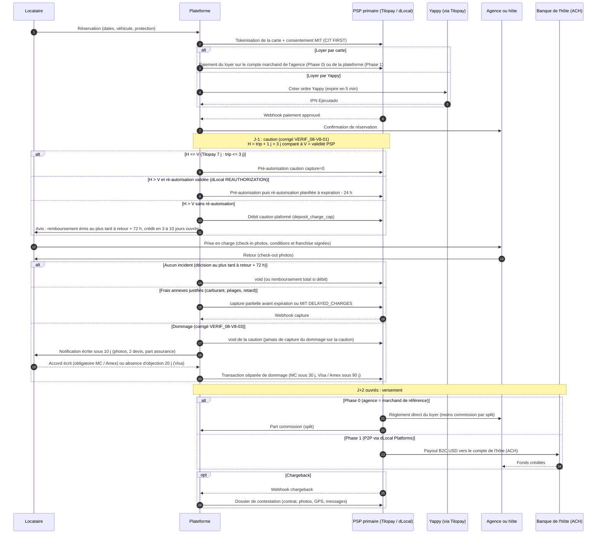
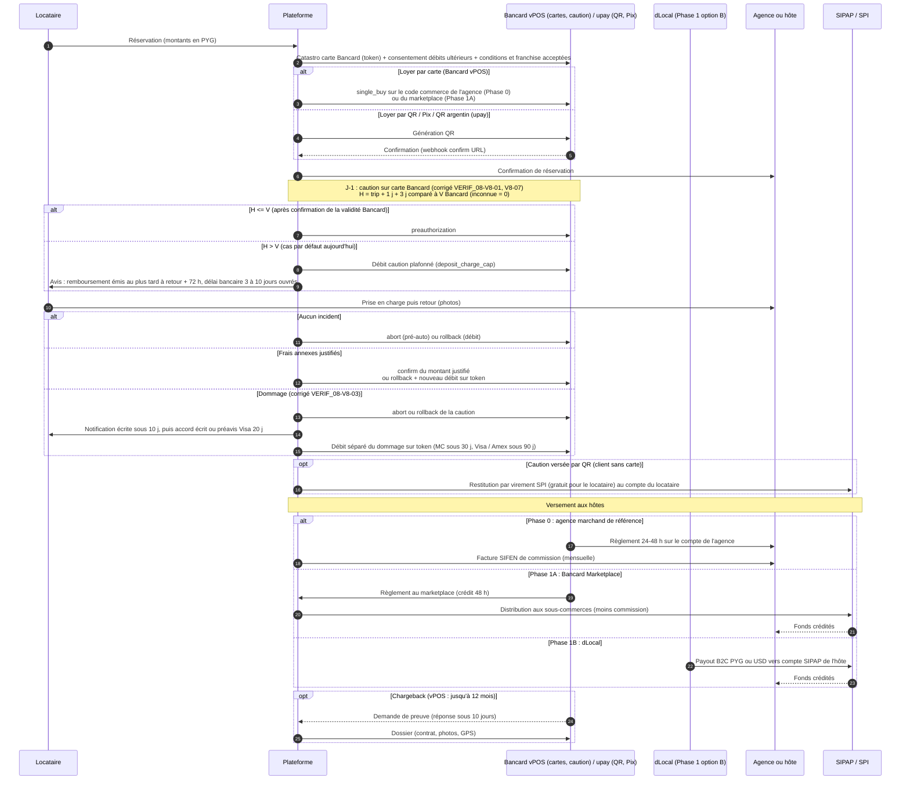

# 09b — Partenaires de paiement Panama et Paraguay (encaissement, caution, remboursements, versements)

> Statut : **Phase 5, recherche documentaire du 30/10/2026.** Complète `09_PRICING_PAYMENTS_AND_PAYOUTS.md`, `12_PANAMA_MARKET.md` §2 et §9.3, `13_PARAGUAY_MARKET.md` §2 et §9.3, `08_BUSINESS_RULES.md` (BR-PAY, BR-PAYOUT) et `verification/VERIF_05_MARKET_DECISION.md` (V5-01, V5-02, V5-20).
> Méthode : recherche web (sites officiels, documentation développeurs, PDF réglementaires et contrats publics, presse). **Aucun contact avec une entreprise, aucun formulaire, aucune inscription, aucun contournement de blocage.** Pages inaccessibles : bcp.gov.py (403, lu via extraits de recherche), ferrere.com (403), soporte.pagopar.com (DNS), docs.kushki.com (404), pages yappy.com.pa rendues en JavaScript (titres et extraits seulement). Un résultat de recherche contenait du texte injecté demandant d'appeler une URL : il a été ignoré.
>
> **Corrections VERIF_08 appliquées le 30/10/2026** (1 CRITIQUE, 6 MAJEUR, 12 MINEUR ; revérification web du jour : changelog Stripe du 27/05/2026 et liste des pays Global Payouts, Résolution SBP-PSO-R-2024-00010 lue en PDF, règles « car rental » Rapyd et Teya, fiche plugin Tilopay, page tarifs Tilopay, doc MIT dLocal, pages Bancard vPOS et upay). Chaque passage modifié porte la mention « (corrigé VERIF_08-<ID>) ». Les changements à reporter dans `08_BUSINESS_RULES.md` (en cours d'audit, non modifié) sont listés en §8.
>
> **Alignement sur 08 après VERIF_12 (30/10/2026)** (corrigé VERIF_12-F6) : pour la caution et les dommages, **`08_BUSINESS_RULES.md` fait foi** (BR-PAY-06, BR-PAY-09 bis, REQ-PAY-DMG-01 à 11). Ce fichier est aligné sur quatre points : (i) la libération de la caution n'est **jamais suspendue** par une réclamation ; (ii) conservation des preuves **≥ 15 mois** depuis la dernière opération monétaire ; (iii) Visa sans accord : débit au plus tôt à **notification + 20 j**, soit entre J+20 et J+30 ; (iv) décision de libération à `min(retour + 72 h ; auth_expiry − 2 h)`, soit **au plus tard** 72 h après le retour (70 h pour un trip de 3 j chez un PSP à 7 j, vecteur T57 de 08). Le §8 est historique.
>
> **Tags** : **CONFIRMÉ** = lu dans un texte du régulateur, du réseau de cartes, un contrat daté ou une spécification technique officielle (OpenAPI, documentation développeur) · **CONFIRMÉ-VENDOR** = déclaration du fournisseur lui-même (page marketing, fiche de plugin, page « licences »), non vérifiée par contrat ni sandbox (corrigé VERIF_08-V8-14) · **DOC-SEC** = DOCUMENTÉ-SECONDAIRE (presse, tiers, SDK non officiel) · **INFÉRÉ** = déduction · **À VALIDER** = à obtenir auprès du fournisseur ou d'un conseil. « Non trouvé » = aucune source publique identifiée.

---

## 0. Synthèse

1. **« Weno Pay » n'existe pas** sous ce nom (aucun produit « Weno Pay », « WenoPay » ou « Weno » trouvé, au Paraguay ou ailleurs — recherche négative, CONFIRMÉ au sens « non trouvé »). Le fondateur désigne très probablement **ueno** (prononcé « ueno » / « weno »), banque numérique paraguayenne, et plus précisément son bras de paiement **upay**, **ex-Pagopar** : `pagopar.com` redirige vers `upay.com.py/pagopar` (CONFIRMÉ) et les présentations investisseurs de ueno (T2-2025 : apport irrévocable de 82,2 M$ ; T1-2026 : 98 M$) indiquent qu'ueno **devrait détenir 86,0 % de l'entité Upay** une fois l'apport converti (CONFIRMÉ, document ueno ; participation attendue, pas une participation dans « Pagopar » ; « bras de paiement de ueno » reste INFÉRÉ) (corrigé VERIF_08-V8-12). Il n'existe pas de marque « ueno pay » (non trouvé). **À confirmer avec le fondateur.**
2. **Yappy** (Panama, Banco General) est incontournable pour la clientèle locale (> 1,8 M d'utilisateurs, > 60 % des adultes, 36 000 commerces, 8 banques interopérables en oct. 2026 — DOC-SEC), **mais ce n'est qu'un rail d'encaissement « push »** : pas de carte, **pas de pré-autorisation possible** (ordre expirant en 5 min), **pas d'API de remboursement trouvée**, **pas d'API de versement**. Il sert au paiement du loyer, **jamais à la caution ni aux frais post-trip**.
3. **La caution doit reposer sur une carte.** Les réseaux autorisent une autorisation estimée de **30 jours** pour la location de véhicules (Visa : « Vehicle Rental – 30 days », CONFIRMÉ guide Visa **région US**, validité LAC non vérifiée, MCC loueur requis ; Mastercard : 30 jours, DOC-SEC), **mais les PSP accessibles plafonnent bien plus bas** : dLocal via Braintree **7 jours** (CONFIRMÉ), Tilopay **7 jours** (CONFIRMÉ-VENDOR), EBANX **~5 jours** (CONFIRMÉ docs, « typically »), BAC, Bancard, upay, PagueloFacil : durée non trouvée. **Règle corrigée (corrigé VERIF_08-V8-01)** : la caution est posée à J-1 et libérée **au plus tard** 72 h après le retour (décision à `min(retour + 72 h ; auth_expiry − 2 h)`, BR-PAY-06 de 08 ; corrigé VERIF_12-F6), donc elle doit tenir **`durée_trip + 4 jours`**. **Pré-autorisation seulement si `durée_trip_j + délai_pose_j (1) + délai_libération_j (3) + marge_j (0) ≤ validité_max_PSP_j`**, soit **trips ≤ 3 jours** chez un PSP à 7 jours, **≤ 1 jour** chez EBANX (5 j), **aucun** tant que la validité n'est pas connue (Bancard, upay, BAC, PagueloFacil). Au-delà : ré-autorisation planifiée si le PSP la supporte (MIT `REAUTHORIZATION` dLocal), sinon débit puis remboursement (coût et délai pour le client, §5.1 bis), sinon caution prise au comptoir par l'agence. Formule et tables par PSP et par pays en §5.1 bis. L'ancien seuil « ≤ 5 jours » était faux (rétention réelle de 9 jours) et incohérent avec « ≤ 7 j » (§5.2) et « > 7 jours » (BR-PAY-06). **Portée (révisé 2026-11-12, caution comme Turo)** : comme chez Turo, **aucune caution par défaut** ; elle n'est prise que si un déclencheur paramétré par pays est vrai (BR-PAY-06 de 08, ADR « caution comme Turo » (`docs/adr/`, US-063)). Cette règle de durée ne s'applique donc qu'aux trips **avec caution** ; un trip sans caution n'a ni pré-autorisation ni limite de durée liée à la caution, et ses frais post-trip sont débités par MIT sur la carte enregistrée (§5.1 ter).
3 bis. **Les débits de dommages sont une transaction distincte de la caution** (corrigé VERIF_08-V8-03) : selon des règles d'acquéreurs européens calquées sur Visa / Mastercard / Amex (Rapyd, Teya ; DOC-SEC, région LAC À VALIDER), l'autorisation estimée **ne peut pas inclure** dommages ni franchise ; un débit de dommage exige un **consentement écrit** du porteur, une **transaction séparée** autorisée après le constat, et, pour Visa, une **notification écrite sous 10 jours** puis **20 jours de préavis d'objection**, dans un délai maximal de **90 jours** (Visa, Amex) ou **30 jours (Mastercard, selon Rapyd seulement)**. Exigences produit en §5.1 ter.
4. **Aucun partenaire ne porte à lui seul encaissement + caution + split + versements à des particuliers dans les deux pays.** Le plus complet sur le papier est **dLocal** (PA et PY : cartes, auth/capture partielle, MIT « DELAYED_CHARGES », produit *Platforms* de split, payouts B2B/B2C, règlement offshore en USD) — mais Yappy n'y figure pas, la couverture PA/PY de *Platforms* et ses licences locales ne sont pas publiées (À VALIDER).
5. **Recommandation** :
   - **Panama Phase 0** : l'**agence reste marchand de référence** (MoR) ; primaire **Tilopay** (cartes + Yappy + `capture=0` + tokenisation + **endpoint de split** ; pré-autorisation de caution pour trips ≤ 3 jours), secours **dLocal** (cartes, cross-border ; **Clave via Braintree uniquement**, À VALIDER en direct, corrigé VERIF_08-V8-09). La plateforme ne détient pas le loyer (évite la question *casa de remesas*, VERIF_05 V5-20).
   - **Panama Phase 1 (P2P)** : primaire **dLocal Platforms** (split + payouts B2C USD ; couverture PA non publiée, **NON VALIDÉ** tant qu'OQ-PAY-04 et OQ-PAY-05 ne sont pas levées). **Aucun secours équivalent sans détention de fonds n'a été identifié** (corrigé VERIF_08-V8-06) : le montage Tilopay (encaissement) + Localpayment (payouts ACH J+0) obligerait la plateforme à **détenir les fonds** entre l'encaissement et le payout (Localpayment n'a pas de pay-in au Panama et ses payouts sont alimentés par un solde préfinancé) ; il n'est retenu que comme **option conditionnée à un avis juridique favorable** (OQ-PAY-05, OQ-PAY-21). Repli opérationnel : rester en modèle Phase 0 (hôtes professionnels MoR). Localpayment est **enregistré à la SBP comme émetteur de moyens de paiement, sujet obligé LBC (code MP-012)**, pas licencié (corrigé VERIF_08-V8-05). Stripe Global Payouts seulement si l'avis MTL est favorable (et il suppose aussi un solde détenu par la plateforme).
   - **Paraguay Phase 0** (corrigé VERIF_08-V8-07) : agence MoR ; primaire **Bancard vPOS** pour **cartes, catastro et caution** (pré-autorisation décrite sur la page officielle, CONFIRMÉ-VENDOR ; durée À VALIDER, donc débit puis remboursement tant qu'elle n'est pas connue) ; **upay (ueno, « Weno Pay »)** pour **QR, Pix et QR argentin** ; secours indépendant **dLocal** (entité US, cartes + wallets + QR). upay s'appuyant sur le traitement Bancard (DOC-SEC), il n'est pas un secours indépendant de Bancard côté processeur. **Ne pas dépendre de ueno** (enquête BCP de sept. 2026, perspective Fitch négative le 16/10/2026 ; déclencheurs de bascule en §3.1).
   - **Paraguay Phase 1 (P2P)** : **programme « MARKETPLACE / PAYMENT FACILITATOR » de Bancard** (CONFIRMÉ, Règlement opérationnel ch. VI ; clause 40.1.1 « ne pas être déjà commerçant Bancard » à résoudre, OQ-PAY-23) **avec enregistrement probable comme PSP « subadquirente » auprès du BCP** (Rés. 25/2025), ou **dLocal** (pay-ins PY + payouts PYG/USD B2C) ; payouts de secours **Localpayment (SIPAP/SPI temps réel, solde préfinancé)** ; rail à valider **Stripe Global Payouts PY** (ajouté au changelog Stripe du 27/05/2026, absent de la liste des pays au 30/10/2026 ; corrigé VERIF_08-V8-04).

---

## 1. Rappel des contraintes (fichiers 08, 09, 12, 13, VERIF_05)

| Contrainte | Conséquence pour le choix des partenaires | Réf. |
|---|---|---|
| Stripe indisponible pour une entité PA ou PY ; Stripe Global Payouts : PA oui (USD, virement, sociétés et particuliers, CONFIRMÉ liste des pays) ; **PY : `py_bank_account` ajouté par le changelog Stripe du 27/05/2026 (API `2026-05-27.preview`, CONFIRMÉ) mais Paraguay absent de la page « Supported recipient countries » relue le 30/10/2026 → non confirmé, À VALIDER** (corrigé VERIF_08-V8-04) ; exige Treasury et, pour une marketplace qui gère les fonds de ses clients, possiblement des MTL | Stripe n'est au mieux qu'un rail de versement de Phase 1 au Panama, et peut-être au Paraguay, sous condition juridique US | 12 §2, VERIF_05 V5-01 |
| Panama : *casa de remesas* (Ley 48/2003, licence MICI, capital minimum B/. 50 000, CONFIRMÉ texte de loi) ; réserve du commerce de détail (art. 288) | Préférer un flux où l'agence encaisse et la plateforme facture une commission (Phase 0) | 12 §2, §9.1, §10.3 ; V5-20 |
| Paraguay : Ley 7503/2025 ; **Rés. BCP n° 25, Acta 58 du 18/12/2025** (rôles, registre obligatoire des PSP) ; Rés. 7 et 8, Acta 31 du 13/07/2026 (assujettis, tarifs) | Une plateforme qui encaisse pour compte de tiers est probablement un **subadquirente** à enregistrer | 13 §2 ; VERIF_05 V5-10 |
| Caution, débits post-trip (carburant, péages, amendes, dommages), carte enregistrée, MIT | Exige un PSP cartes avec auth/capture, tokenisation et MIT ; les rails push (Yappy, QR, virement) ne suffisent pas | BR-PAY-01/02/06/09 |
| Plafonds PY : crédit 3 %, débit 2 % depuis le 1/07/2026 ; QR par virement 1,5 % TTC ; virements simples gratuits **pour l'utilisateur** (Ley 7503 ; le BCP ne traite ni les comptes d'entreprise, ni les lots, ni les payouts de PSP) | Coûts d'encaissement bas au PY ; remboursement de caution par virement SIPAP gratuit pour le locataire, **frais de la banque de la plateforme à vérifier** (corrigé VERIF_08-V8-17) | 13 §2 |
| Versement J+2 ouvrés, grand livre hôte, retenues | Le PSP doit permettre de retarder / retenir un versement ou un split | BR-PAYOUT-02/04 |

---

## 2. Panama — fiches par fournisseur

### 2.1 Yappy (Banco General ; opéré par Yappy, S.A.)
- **Encaissement** : paiement wallet par numéro de téléphone ou QR ; **« Botón de Pago » web v2** (deux appels backend « validar comercio » → jeton, puis « crear orden » ; composant web chargé depuis le CDN Yappy ; IPN GET avec hash à valider) — CONFIRMÉ (page développeurs, via extrait) https://www.yappy.com.pa/comercial/desarrolladores/boton-de-pago-yappy-nueva-integracion/ ; détail technique DOC-SEC https://grupocodev.com/integrar-yappy-boton-de-pago-api/. **Pas de carte.** États : Ejecutado / Rechazado / Cancelado / Expirado ; **ordre valable 5 minutes** (DOC-SEC). Environnements test et production (DOC-SEC). L'ancien bouton a été arrêté le 31/12/2025 et n'encaisse plus depuis le 30/04/2026 (DOC-SEC ; avis d'abandon visible sur la page officielle, CONFIRMÉ via extrait). Plugins : Shopify/Wix/WooCommerce/Magento/VTEX **via l'alliance Tilopay** (CONFIRMÉ, extrait page officielle ; app Shopify « Yappy por Tilopay » du 15/10/2025 https://apps.shopify.com/tilopay-yappy-v2), module Adobe Commerce Onetree, PagueloFacil Checkout.
- **Caution / pré-autorisation** : **impossible** (paiement push confirmé par le payeur) — INFÉRÉ, aucune mention trouvée.
- **Remboursement** : **aucune API de remboursement trouvée** (absence de preuve, À VALIDER) ; **voie Tilopay : inconnue** (ni l'app « Yappy por Tilopay » ni les guides ne le disent ; OQ-PAY-22) (corrigé VERIF_08-V8-16). Via PagueloFacil : « les transactions Yappy ne peuvent pas être remboursées » — CONFIRMÉ https://soporte.paguelofacil.com/portal/en/kb/articles/frequently-asked-questions-yappy. Fonction « devolución inmediata » côté consommateur (P2P reçu par erreur, avril 2024, DOC-SEC). Contournement : renvoi P2P manuel ou ACH Xpress depuis le compte du marchand (INFÉRÉ).
- **Versements** : **pas d'API de versement** (non trouvé) ; envoi P2P interbancaire uniquement dans l'application (INFÉRÉ).
- **Tarifs** : ~**1 % + ITBMS** sur la part Yappy (PagueloFacil : « 1 % PagueloFacil + 1 % Yappy », CONFIRMÉ sur sa FAQ ; Onetree, DOC-SEC) ; tarif officiel en contrat direct non trouvé (À VALIDER).
- **Règlement / onboarding** : fonds versés sur le compte **Yappy Comercial** du marchand (même via PagueloFacil, CONFIRMÉ) ; identifiants (ID marchand, clé secrète) liés à un domaine enregistré. Exigences (compte Banco General ? RUC ? capital étranger ?) : non trouvé ; très probablement une entité panaméenne avec RUC, Aviso de Operación et compte dans une banque connectée (INFÉRÉ).
- **Échelle** : **487 M de transactions en 2024 = 431 M P2P + 56 M commerçants (11,5 %, soit ≈ 4,7 M/mois)** (La Prensa, DOC-SEC ; pas de communiqué Banco General) ; l'indicateur d'adoption marchande est ce volume commerçant, **pas** le total (corrigé VERIF_08-V8-13). Chiffres 2026 : > 1,8 M d'utilisateurs, ~70 M de tx/mois dont 18 % commerçants (La Prensa, 25/08/2026) puis 78 M/mois selon une note La Prensa plus récente (date non relevée), > 36 000 commerces (DOC-SEC https://www.prensa.com/economia/fintech-y-pagos-digitales-los-retos-de-panama-como-centro-financiero-regional/) ; Banistmo intégré à son app en oct. 2026 (> 600 000 clients) ; banques : Banco General, Banistmo, St. Georges, Caja de Ahorros, Credicorp, Davivienda, MetroBank, Banisi (La Estrella, 07/10/2026, DOC-SEC https://www.laestrella.com.pa/economia/asi-funcionara-la-integracion-de-yappy-en-la-banca-movil-de-banistmo-DO26288649).
- **Partenariats / précédents** : intégration officiellement déléguée à Tilopay et PagueloFacil (CONFIRMÉ) ; PedidosYa accepte Yappy (DOC-SEC https://dplnews.com/?p=190210). Uber/InDrive/loueurs avec Yappy : non trouvé (Uber a ajouté Clave en 2020, DOC-SEC). Copa : SafetyPay via UATP (déc. 2024), pas de Yappy trouvé.
- **Correction du fondateur** : le nom est **Yappy** (et non « Yapi »).

### 2.2 Nequi Panamá — **fermé**
Fermeture le **31/12/2024** (recharges arrêtées le 30/11/2024), > 190 000 utilisateurs basculés vers la Cuenta Express de Banistmo — DOC-SEC https://www.bloomberglinea.com/latinoamerica/panama/confirmada-la-fecha-en-que-dejara-de-funcionar-nequi-en-panama-por-que/ ; https://www.prensa.com/economia/nequi-el-banco-digital-dejara-de-operar-a-partir-del-31-de-diciembre/. Banistmo en cours de cession à Inversiones Cuscatlán (accord déc. 2025, 1,418 Md$, DOC-SEC). **À exclure.** (Corrige 12 §2, qui le disait colombien seulement.)

### 2.3 PagueloFacil (agrégateur / PSP panaméen)
- **Encaissement** : Visa/MC crédit, débit, prépayées ; **Clave** ; app PagueloFacil ; espèces PuntoPago ; crypto ; paiements one-click, tokenisés, récurrents — CONFIRMÉ https://wordpress.org/plugins/paguelofacil/. Yappy seulement dans le produit Checkout (CONFIRMÉ, FAQ). Amex et cartes étrangères : non précisé (À VALIDER ; source tierce : +1 % cartes internationales, 12 §2).
- **Caution** : « Pre-Autorización », annulation d'autorisation, capture et remboursement depuis l'admin (ajoutés le 25/08/2021) — CONFIRMÉ-VENDOR (changelog de la fiche plugin, corrigé VERIF_08-V8-14) ; SDK non officiels : Authorization / ReverseAuthorization / Capture / ReverseCapture / Recurrent, sandbox (DOC-SEC https://www.npmjs.com/package/paguelofacil.js). Durée de validité, capture partielle : non trouvé.
- **Remboursements** : cartes oui (CONFIRMÉ) ; **Yappy non** (CONFIRMÉ). Chargebacks : non trouvé.
- **Versements / split** : non trouvé ; carte prépayée « Tarjeta Business » (Mastercard) comme instrument de versement possible (INFÉRÉ, À VALIDER) https://en.paguelofacil.com/tarjeta-business.
- **Développeurs** : pas de portail développeur public officiel ; centre d'aide + SDK tiers ; avis 2026 : webhooks non signés, support peu réactif (DOC-SEC, avis utilisateurs). Plugins VTEX, Wix, Shopify, Odoo.
- **Tarifs** : **3,5 % + 0,50 $** (fiche Shopify, CONFIRMÉ https://apps.shopify.com/paguelofacil) ; Yappy via PagueloFacil 2 %. Délai de règlement : non trouvé. Compte « jurídica » obligatoire au-delà de 3 000 $ (CONFIRMÉ https://soporte.paguelofacil.com/en/articles/8992561-difference-between-a-personal-and-business-account).
- **Partenariat** : non trouvé.

### 2.4 Tilopay (PSP régional basé au Costa Rica ; partenaire officiel Yappy)
- **Couverture** : Panama listé sur la page tarifs (CONFIRMÉ) ; entité ou licence panaméenne : non trouvé (À VALIDER).
- **API (la mieux documentée du marché local)** : spécification **OpenAPI publique** https://tilopay.com/developers/openapi.json (CONFIRMÉ) :
  - `processPayment` (page hébergée) avec champ **`capture` 1/0 → autorisation seule possible** ;
  - `processModification` type 1 = capture, 2 = remboursement, 3 = annulation (*reversal*), avec `amount` (partiel non explicite, À VALIDER) ;
  - **`orders/liquidation/split`** : « répartir le règlement d'une commande approuvée » entre marchands identifiés par email et montant, le reste allant au marchand propriétaire (CONFIRMÉ) ;
  - tokenisation (`processTokenize`, `user/card-remove`), paiements récurrents, plans, liens de paiement avec `webhook_url`, webhooks d'abonnement, débit de cartes enregistrées avec `capture` 0/1 (CONFIRMÉ).
  - Pas d'hôte sandbox séparé : mode test activé dans le portail (CONFIRMÉ).
- **Caution** : autorisation seule CONFIRMÉ (OpenAPI) ; **capture dans les 7 jours calendaires, annulation automatique ensuite** (passé ce délai, le paiement autorisé est « automatically cancelled », fiche https://wordpress.org/plugins/tilopay/, relue le 30/10/2026 ; publiée sous le compte « hnanne », qui renvoie à la doc et au support Tilopay ; aussi https://woocommerce.com/products/tilopay/) — **CONFIRMÉ-VENDOR, non contractuel, À VALIDER** (corrigé VERIF_08-V8-11). **Validité retenue pour la règle de caution : 7 j → trips ≤ 3 j** (§5.1 bis). Ré-autorisation ou autorisation incrémentale : non trouvée.
- **Remboursements** : type 2 de `processModification` (CONFIRMÉ) ; délais et chargebacks : non trouvé.
- **Versements** : pas d'API de versement à des tiers ; seul le split vers d'autres **marchands Tilopay** (INFÉRÉ : chaque bénéficiaire doit être marchand Tilopay).
- **Tarifs** : Visa/MC/Amex **4,25 % + 0,35 $**, sans mensualité, fréquence de versement au choix, prix « susceptible de varier » par pays (CONFIRMÉ-VENDOR https://tilopay.com/tarifas). **Tarif indicatif, très probablement costaricien** : la page ne nomme aucun pays, affiche une ligne SINPE Móvil (système du Costa Rica) à 2 % + 0,35 $ et des cuotas BAC / Credix ; le Panama figure dans la liste des pays sans tarif propre ; la page renvoie à un conseiller (revérifié le 30/10/2026, corrigé VERIF_08-V8-11). **Tarifs Panama et Yappy non publiés (À VALIDER, OQ-PAY-03).** Restitution des frais lors d'un remboursement : non trouvé (OQ-PAY-19).
- **Partenariat** : alliance officielle Yappy (CONFIRMÉ) ; précédent mobilité/location : non trouvé.

### 2.5 BAC Credomatic Panamá (Compra Click, E-commerce)
- **Produits** : **Compra Click** (lien de paiement) et **E-commerce** (intégration site/app) ; exigences : Aviso de Operación, inscription DGI, site avec panier, TLS 1.2, politiques de livraison, remboursement et confidentialité ; demande via afiliados@pa.bac.net, agence ou banque en ligne — CONFIRMÉ https://ayuda.baccredomatic.com/para_empresas_o_negocios/comercios_afiliados/compra-click?country=es-pa. Passerelles régionales FAC (tokenisation, Kount) et **Cybersource** (CONFIRMÉ : « BAC Credomatic Panama » dans la liste des processeurs Cybersource https://developer.cybersource.com/docs/cybs/en-us/processor-names/reference/all/na/processor-names.html).
- **Contrat e-commerce Panama F-PAN-0000182 v7** (CONFIRMÉ, PDF lu https://www.baccredomatic.com/sites/default/files/2022-09/pan-contrato-procesamiento-comercio-electronico.pdf) : **autorisation puis « conversión a venta » (capture)** dans la Sucursal Electrónica ; la banque n'est pas tenue de payer les clôtures non faites **dans les 2 jours naturels suivant la conversion** ; Visa, MC, Amex, JCB, Discover et **Clave** ; remboursements par la plateforme, remboursement en espèces interdit ; **chargebacks à la charge du commerçant sauf transaction authentifiée 3-D Secure** (pas de chargeback pour fraude dans ce cas). Durée de validité d'une autorisation : non trouvé.
- **Versements** : banque d'entreprise avec Pago de Planillas, Pago de Proveedores, « API BAC » (Tesorería Corporativa Digital), H2H — CONFIRMÉ https://www.baccredomatic.com/es-pa/empresas ; API de décaissement documentée publiquement : non trouvé.
- **Tarifs** : MDR Panama non trouvé.
- **Rôle** : acquéreur bancaire **pour une entité panaméenne** ; pas de split marketplace trouvé (À VALIDER).

### 2.6 Banco General (e-commerce/CyberSource), Credicorp, Banistmo, Global Bank
**Aucune documentation publique** sur l'acquisition e-commerce, la pré-autorisation ou les cartes enregistrées — non trouvé ; l'offre développeur publique de Banco General se limite à Yappy (bgeneral.com/desarrolladores redirige vers yappy.com.pa, CONFIRMÉ). À obtenir par contact commercial (hors périmètre).

### 2.7 ACH Directo / ACH Xpress (Telered) — versements
- ACH Xpress : instantané 24/7, **5 000 $ par transaction** (depuis sept. 2024), 18–21 banques selon les sources, paiement par numéro de mobile depuis mars 2025 (jusqu'à 3 banques par numéro), > 2 M d'utilisateurs — DOC-SEC (Telemetro, Prensa, Summa ; 12 §2).
- **Origination réservée aux banques participantes** (INFÉRÉ) ; **aucune API Telered ouverte aux non-banques** (non trouvé). Paiements en masse via portails bancaires (BAC Pago de Proveedores / Planillas, CONFIRMÉ). API H2H de banques panaméennes : non trouvé (À VALIDER).
- Usage : rail sous-jacent des payouts de dLocal/Localpayment, ou versements manuels/en lot depuis le compte local de l'entité (si entité locale).

### 2.8 dLocal (cross-border ; Panama)
- **Encaissement** : Visa, Visa Débit, MC, MC Débit, Amex, Discover, JCB (DIRECT/REDIRECT), espèces Punto Pago (≤ 7 j) et PayCash ; USD, minimum 1 $ ; `payer.document` obligatoire pour les espèces — CONFIRMÉ https://docs.dlocal.com/docs/panama. **Clave débit : uniquement via Braintree** (liste des débits Panama du guide Braintree → dLocal, 3DS supporté, CONFIRMÉ https://developer.paypal.com/braintree/docs/guides/orchestration/dlocal/ ; exige un compte Braintree, donc une entité US) ; **absente de la page dLocal Panama directe** (À VALIDER en direct) ; annonce dLocal oct. 2020 (DOC-SEC) (corrigé VERIF_08-V8-09). **Yappy : non trouvé** (À VALIDER). Virement : non listé.
- **Caution** : `card.capture=false` sur `/secure_payments`, **capture partielle autorisée**, annulation `POST /payments/{id}/cancel`, vérification à 0 $ — CONFIRMÉ https://docs.dlocal.com/docs/authorization-and-capture.md ; **durée et pays non publiés** (À VALIDER). Via Braintree : **capture sous 7 jours**, capture partielle « dans tous les pays » après activation, **pas d'autorisation incrémentale ni de sur-capture**, annulation totale seulement (CONFIRMÉ). Spreedly signale qu'une annulation après capture renvoie « success » sans effet (DOC-SEC).
- **Carte enregistrée / MIT** : types `CARD_ON_FILE`, `UNSCHEDULED_CARD_ON_FILE`, **`NO_SHOW`, `DELAYED_CHARGES`, `REAUTHORIZATION`**, etc. ; première transaction CIT ; `network_tx_reference` à conserver ; **TLID Mastercard (`transaction_link_id`) : à conserver depuis la CIT et à renvoyer sur les MIT Mastercard ; renvoyé par dLocal depuis le 3/09/2026 ; le 23/10/2026 marque le début du suivi de conformité Mastercard — la doc se contredit (« requis » dans l'encadré, « not required for approval » dans le tableau)** (corrigé VERIF_08-V8-10) ; tokens réseau — CONFIRMÉ https://docs.dlocal.com/docs/merchant-initiated-transactions.md (relu le 30/10/2026). `REAUTHORIZATION` est défini comme « Extend an expired authorization » ; conditions d'usage (CIT préalable, délai, pays PA/PY, comportement de l'émetteur) **non documentées (À VALIDER, OQ-PAY-17)**. **Ce sont les types qu'il faut pour les frais post-trip et pour une caution longue par ré-autorisation**, sous réserve d'acceptation par l'acquéreur local.
- **Remboursements / chargebacks** : remboursement sur toutes les méthodes ; webhooks signés, `GET /chargebacks/{id}`, **API de contestation** (PDF base64 < 1 Mo), simulateur sandbox — CONFIRMÉ https://docs.dlocal.com/docs/chargebacks.md. Délais et frais non publiés.
- **Versements** : BANK_TRANSFER USD vers comptes courants/épargne, flux **B2C (particulier), B2B, P2P** ; RUC 5–15 caractères — CONFIRMÉ https://docs.dlocal.com/docs/panama-payouts-v3.md. Pas de wallet. Délais, plafonds, frais : non publiés.
- **Marketplace** : produit **Platforms** (compte plateforme, comptes utilisateurs par sous-marchand, compte « liable » optionnel, **KYC des comptes utilisateurs par dLocal**, split vers plusieurs comptes, fonds « en transit » jusqu'au règlement, remboursements et chargebacks suivant le split, sur une autorisation le split ne calcule que les frais) — CONFIRMÉ https://docs.dlocal.com/docs/platforms-overview.md ; https://docs.dlocal.com/docs/split-payments-platforms.md. **Couverture PA/PY de Platforms, rôle de MoR et licence locale : non publiés** (À VALIDER). Licences : > 30 dans le monde (FCA UK 2025, EAU, Philippines, Turquie, DOC-SEC) ; **aucune licence PA ou PY trouvée**.
- **Développeurs** : docs complètes, sandbox, environnements payouts (CONFIRMÉ https://docs.dlocal.com/llms.txt).
- **Commercial** : modèle cross-border (encaissement local, **règlement en USD/EUR offshore**, ~48 h, DOC-SEC) → compatible avec une **entité US sans entité locale** (INFÉRÉ, À VALIDER pour PA/PY). Tarifs non publics (référence Mexique ~2,49 % + 0,20 $, DOC-SEC). Volume minimum, délai d'onboarding : non trouvé.
- **Précédents mobilité/voyage** : inDrive (paiements sans espèces, mai 2026) et Trip.com (déc. 2025) — DOC-SEC ; Uber/Didi/Airbnb/Booking souvent cités mais **non sourcés ici** (À VALIDER) ; aucun précédent de location de voitures trouvé.

### 2.9 Localpayment (versements)
- **Encaissement PA** : non listé dans la couverture globale (CONFIRMÉ https://docs.localpayment.com/docs/global-coverage) ; une page V3 « Panama payin » (virement) existe mais n'a pas été lue (À VALIDER).
- **Versements PA** : ACH USD, **le jour même**, cut-off 14 h, min 1 $, sans maximum (CONFIRMÉ https://docs.localpayment.com/docs/payouts-overview) ; virement bancaire seulement.
- **Statut réglementaire (corrigé VERIF_08-V8-05)** : la page Localpayment se dit « Licenciado » comme « Emisor de Medios de Pago — SBP y UAF » (CONFIRMÉ-VENDOR https://localpayment.com/licenses.php). Le texte officiel, **Résolution SBP-PSO-R-2024-00010 du 5/01/2024** (lue le 30/10/2026 https://superbancos.gob.pa/documents/laws_regulations/resolution_prevention_REDEMP/2024/Resolution_00010-2024.pdf), **formalise l'enregistrement** de LOCALPAYMENT PAN, S.A. « as a means of payment issuer and consequently a financial reporting entity » supervisée par la SBP **exclusivement en matière de prévention du blanchiment** (Ley 23/2015 art. 22, Acuerdo 5-2015), **code MP-012** — CONFIRMÉ. **Ce n'est pas une licence prudentielle** de transmission de fonds ni de casa de remesas. Objet social déclaré : encaissement transfrontalier et « distribution of funds from abroad to Panamanian sellers or contractors » (utile, mais ne tranche pas la qualification de la plateforme, OQ-PAY-05).
- **Financement des payouts** : solde préfinancé par le client (guide Wire-In, docs Localpayment) et **aucun pay-in au Panama** → en secours de dLocal, **la plateforme détiendrait les fonds** entre encaissement et versement (corrigé VERIF_08-V8-06 ; OQ-PAY-21).
- Caution, split, chargebacks : non documentés (rail de versement uniquement).

### 2.10 Kushki, EBANX, PayPal/Braintree, Mercado Pago, Ualá et autres (Panama)
| Fournisseur | Constat | Tag |
|---|---|---|
| **Kushki** | Couvre MX, CO, PE, CL, EC ; Panama annoncé « bientôt » (page indexée puis 404) ; projet d'expansion PA/CR/GT en 2021. API de pré-autorisation/réautorisation existante (`card/v1/preAuthorization`) mais docs pays en 404 | DOC-SEC / À VALIDER — **non disponible aujourd'hui** (INFÉRÉ) |
| **EBANX** | **Cartes seulement** (crédit/débit), USD/PAB https://docs.ebanx.com/docs/pay-in/processing/payment-methods/country-specific/panama/panama-country-overview ; `auto_capture:false` puis `/ws/capture` dans une fenêtre « **typically 5 days** » ; remboursement total/partiel (5–10 j ouvrés) ; contestations ; carte enregistrée et tokens réseau ; **pas de payouts PA** ; pas de split (seulement « Sub Accounts ») ; lancé au Panama en 2021 | CONFIRMÉ (docs) / DOC-SEC (lancement) |
| **PayPal / Braintree** | Braintree ne fait pas d'acquisition locale : il **route vers dLocal ou EBANX** (connecteurs officiels PA et PY, cartes, vault) ; exige un compte Braintree dans un pays supporté (entité US, INFÉRÉ) + contrat dLocal/EBANX. PayPal wallet : retrait vers **banque locale panaméenne 1 % (min. 15 $)**, vers banque US 3 %, conversion 3,5–4,5 % https://www.paypal.com/pa/digital-wallet/paypal-consumer-fees | CONFIRMÉ |
| **Cybersource (Visa Acceptance)** | Passerelle, exige un acquéreur local (BAC Credomatic Panama listé) | CONFIRMÉ |
| **Adyen** | Couverture PA non trouvée | À VALIDER |
| **PayU** | Panama : API cartes, **débit en une étape seulement** ; pas d'autorisation/capture selon Spreedly | DOC-SEC — **inadapté** |
| **Nuvei** | Acquisition locale listée, **payouts non supportés au Panama** | DOC-SEC |
| **Mercado Pago** | Non disponible au Panama (pays officiels : AR, BR, CL, CO, MX, PE, UY) | DOC-SEC / INFÉRÉ |
| **Ualá** | Aucune opération au Panama trouvée (présent AR, MX, CO) | DOC-SEC / INFÉRÉ |
| **Airwallex** | Page payout Panama (local ou SWIFT) existe, détails non lisibles https://www.airwallex.com/docs/payouts/payout-network/panama | DOC-SEC / À VALIDER |
| **Payoneer, Rapyd, Thunes** | Couverture PA non confirmée | À VALIDER |

### 2.11 Tableau comparatif — Panama

| Critère | **Yappy** | **PagueloFacil** | **Tilopay** | **BAC (Compra Click / E-com)** | **dLocal** | **Localpayment** | **EBANX** | **Stripe (entité US) + Global Payouts** |
|---|---|---|---|---|---|---|---|---|
| 1. Cartes locales / étrangères | Non (wallet) | Visa/MC, Clave ; étrangères À VALIDER | Visa/MC/Amex ; Clave À VALIDER | Visa, MC, Amex, JCB, Discover, **Clave** (CONFIRMÉ) | Visa/MC/Amex/Discover/JCB, Clave via Braintree (CONFIRMÉ) | — | Cartes crédit/débit (CONFIRMÉ) | Cartes internationales ; pas Clave ni Yappy |
| 1. Wallet / QR / virement | **Oui (Yappy, QR)** | Yappy (Checkout), espèces | **Yappy (partenaire officiel)** | Non | Espèces Punto Pago/PayCash ; pas Yappy | — | Non | Non |
| 1. Tokenisation / récurrent | Non | Oui (CONFIRMÉ) | Oui (CONFIRMÉ) | Via FAC/Cybersource (À VALIDER PA) | Oui + MIT (CONFIRMÉ) | — | Oui (CONFIRMÉ) | Oui |
| 2. Pré-autorisation (validité → trip max en pré-autorisation `= validité − 4 j`, §5.1 bis ; corrigé VERIF_08-V8-01) | **Impossible** | Oui (CONFIRMÉ-VENDOR) ; durée non trouvée → **0 j** | Oui (`capture=0`) ; **7 j** (CONFIRMÉ-VENDOR) → **≤ 3 j** | Auth puis « conversión a venta » (CONFIRMÉ) ; durée non trouvée → **0 j** | Oui, partielle ; **7 j via Braintree** → **≤ 3 j** ; MIT `REAUTHORIZATION` | — | Oui, ~5 j → **≤ 1 j** | Oui (hors périmètre local) |
| 3. Remboursement / chargeback | **Pas d'API trouvée** | Cartes oui ; Yappy non | Oui ; chargebacks non trouvé | Oui ; chargeback commerçant sauf 3DS | Oui + API de contestation | — | Total/partiel + contestation | Oui |
| 4. Versements / split | Non | Non trouvé | **Split vers marchands Tilopay** | Non (banque : planillas/proveedores) | **Platforms (split) + payouts B2B/B2C USD** | **Payouts ACH J+0 ; solde préfinancé ; enregistrement SBP LBC (MP-012), pas une licence** (corrigé VERIF_08-V8-05) | Pas de payouts PA | Global Payouts PA (MTL + Treasury) |
| 5. API / sandbox / webhooks | Botón v2, IPN, test | Pas de portail officiel ; SDK tiers | **OpenAPI publique**, webhooks, mode test | Contrat ; Cybersource docs | Complet | Complet | Complet | Complet |
| 6. Tarifs | ~1 % + ITBMS | 3,5 % + 0,50 $ | 4,25 % + 0,35 $ (liste indicative, probablement Costa Rica ; Panama À VALIDER, corrigé VERIF_08-V8-11) | Non trouvé | Non publics | Non publics | Non publics | Non pertinents ici |
| 6. Onboarding étranger | Entité PA probable | Compte jurídica > 3 000 $ | Non trouvé | Entité PA (Aviso, DGI) | Entité US possible (À VALIDER) | À VALIDER | Entité étrangère probable | Entité US/UK |
| 7. Partenariats / précédents | Tilopay, PagueloFacil, PedidosYa | Non trouvé | Yappy | — | inDrive, Trip.com | — | — | — |

---

## 3. Paraguay — fiches par fournisseur

### 3.1 « Weno Pay » = ueno / upay (ex-Pagopar)

**Verdict** : aucun produit nommé « Weno Pay » (non trouvé). **ueno** est la banque ; **upay** (ex-Pagopar) est son agrégateur/acquéreur affilié. **Le partenariat suggéré par le fondateur se traduirait donc par : compte bancaire ueno + encaissement upay.** INFÉRÉ (fort) — à confirmer avec le fondateur.

**ueno bank S.A.**
- Banque supervisée par le BCP ; a absorbé Visión Banco (Rés. BCP 22, Acta 27 du 21/06/2024, DOC-SEC) ; l'une des quatre banques systémiques (CONFIRMÉ, présentation investisseurs) ; OTP Bank (Hongrie) actionnaire fin 2025 (DOC-SEC https://rdn.com.py/2025/12/23/otp-bank-expands-into-paraguay-through-ueno-bank-investment/) ; ~7,14 % de Bancard selon des fournisseurs de données (DOC-SEC, À VALIDER).
- Échelle (CONFIRMÉ, présentation T2-2026 https://www.ueno.com.py/inversores/wp-content/uploads/sites/3/2026/07/Ueno-Bank-Q22026-Earnings-Presentation.pdf) : **2,94 M de clients (~63 % des adultes)**, 362 M de transactions (+76 %), **28 % des virements instantanés SPI**, 4,2 Md$ d'actifs ; premier par clients, cartes et transactions.
- Produits : comptes, cartes Visa/MC débit et crédit, QR, NFC, virements, giros (CONFIRMÉ, site) ; **Cuenta Mipymes** (mai 2026) ouverte en ligne en < 4 min avec RUC, encaissement QR et cartes, virements SPI/LBTR, sans frais de tenue (DOC-SEC https://www.lanacion.com.py/negocios/2026/05/07/ueno-bank-lanza-cuenta-mipymes-para-transformar-el-sector/).
- **API publique, portail développeur, open banking, API de versement en masse : non trouvé.**
- **Risque de contrepartie (important)** : **enquête du BCP ouverte en sept. 2026** sur un possible financement indirect de sociétés liées (≥ 4 mois) ; **Fitch : BB maintenu, perspective négative le 16/10/2026** ; syndicats demandant à l'IPS de retirer > 300 M$ de dépôts le 27/10/2026 (revendication ; montant non confirmé) — DOC-SEC https://www.riotimesonline.com/paraguay-unions-urge-pension-exit-from-ueno-bank-2026/. Motifs Fitch rapportés par la presse : croissance rapide du bilan et poids des intangibles (capital de base net des intangibles 10,3 % fin juin 2026) ; communiqué Fitch intégral non lu (corrigé VERIF_08-V8-08). **Conséquence : ne pas faire de ueno/upay le seul partenaire ni le seul dépositaire des fonds ; upay n'est plus primaire pour les cartes (§5.3).**
- **Déclencheurs objectifs de bascule** (corrigé VERIF_08-V8-08 ; INFÉRÉ, à valider par le trésorier, OQ-PAY-11) : (1) dégradation de note par Fitch ou une autre agence, ou mise sous surveillance négative ; (2) mesure du BCP (intervention, plan de régularisation, sanction) issue de l'enquête ; (3) gel, limitation de retraits ou retard de règlement upay > 1 jour ouvré au-delà du délai publié ; (4) retrait massif de dépôts confirmé. Effet : routage de 100 % des QR vers une autre passerelle (Bancard QR, dLocal QR), solde maximal chez ueno ramené à 0 hors règlement en cours.

**upay (ex-Pagopar)**
- **Encaissement** (CONFIRMÉ https://upay.com.py/pagopar) : débit, crédit, prépayées **y compris internationales** ; QR « de toute banque ou wallet », **Pix et QR argentin** (utile pour les touristes argentins et brésiliens venus en voiture, 13 §1.3) ; liens de paiement, terminaux uPOS, utap (NFC Android), abonnements avec relances ; plugins WooCommerce, PrestaShop, Shopify, Wix. Récurrent « via Bancard/Pagopar » → upay s'appuie sur le traitement Bancard (DOC-SEC). Carte enregistrée (catastro) : client → carte → « Confirmar tarjeta », `alias_token` temporaire (DOC-SEC).
- **Caution** : opérations **preauthorize / confirm / cancel** dans un SDK non officiel seulement (DOC-SEC https://pypi.org/project/pagopar-sdk/) ; **la page officielle upay.com.py/pagopar (relue le 30/10/2026) ne mentionne ni pré-autorisation, ni split, ni marketplace** ; durée et capture partielle : non trouvé (base de connaissances inaccessible). **upay n'est donc pas retenu pour la caution** (corrigé VERIF_08-V8-07).
- **Remboursement** : `reverse_order(hash_pedido)` (DOC-SEC) ; partiel, délais, chargebacks : non trouvé.
- **Split / versements à des tiers** : **non trouvé** (À VALIDER). Règlement au marchand : **24 h ouvrées** (débit, QR local), **48 h ouvrées** (crédit, prépayée, Pix, QR argentin), « 24 h avec ueno » (CONFIRMÉ).
- **Tarifs** (CONFIRMÉ-VENDOR, grille publique ; incohérence 2,9 / 3 % dans la même page, corrigé VERIF_08-V8-14) : débit 2 % ; crédit 2,9 % (3 % selon les rubriques) ; crédit/prépayée internationale 3 % ; QR ueno/autres 2 % ; Pix/QR argentin 2,9 % ; taxes et retenues en sus. Le 2 % QR semble supérieur au plafond BCP de 1,5 % pour le QR par virement (À VALIDER : le plafond vise peut-être seulement le QR SIP). Devise PYG.
- **Onboarding** : inscription en ligne (CONFIRMÉ) ; exigences pour une société à capital étranger : non trouvé.
- **Précédent** : premier QR argentin interopérable au Paraguay selon upay (contenu sponsorisé, DOC-SEC).

### 3.2 Bancard (acquéreur/processeur dominant ; réseau Infonet)
- **Produits** (CONFIRMÉ https://www.bancard.com.py/) : POS, Tokefon, QR, acceptation Pix, **vPOS** (web/app), Tpago, Orden Telefónica, Débito Automático, Infonet Cobranzas ; portail https://comercios.bancard.com.py/.
- **Encaissement** : vPOS 2.0 en iframe ; crédit, débit, Zimple, wallets ; **3-D Secure optionnel ; « catastro » (carte enregistrée, paiement en un clic) ; cartes internationales acceptées** (CONFIRMÉ https://www.bancard.com.py/vpos), **sous réserve d'une approbation préalable et d'une formation risque** par l'équipe Risk & Compliance (CONFIRMÉ, Règlement opérationnel §34.1.6.4). QR intégré au checkout vPOS 2.0, lisible par > 70 entités (DOC-SEC). Marques en ligne : Visa, MC, Amex, Diners, Discover, Bancard Check, Credifielco, JCB (CONFIRMÉ §32.1). Floor limit 0 (CONFIRMÉ §33.1).
- **Caution** : **« pre-autorización » qui retient les fonds sur la carte jusqu'à confirmation** (« Disponibilidad de solución de pre-autorización », page vPOS relue le 30/10/2026) — **CONFIRMÉ-VENDOR** : phrase marketing orientée contrôle de stock, pas une spécification pour une caution de location ; le Règlement opérationnel (sept. 2023) ne contient pas la notion (corrigé VERIF_08-V8-14). C'est néanmoins **la seule source officielle de pré-autorisation au Paraguay**, d'où Bancard primaire pour la caution (§5.3) ; SDK tiers : preauthorization / confirm / abort / rollback (DOC-SEC https://github.com/franbenz/bancard). **Durée, capture partielle, règles location de voitures : non trouvé** (le Règlement n'a pas de section pré-autorisation).
- **Remboursements / chargebacks** (CONFIRMÉ, **Règlement opérationnel, version sept. 2023** https://www.bancard.com.py/storage/app/media/ro-cus-actualizacion-set-2023.pdf) : rollback d'un `single_buy` (DOC-SEC, SDK) ou demande par email (§34.1.10.4) ; **remboursement partiel : non trouvé** ; délai de réclamation 180 jours en général, **jusqu'à 12 mois pour le vPOS**, conservation des commandes ≥ 1 an (§9.1, §35) ; **en e-commerce, le commerçant porte 100 % du risque de chargeback pour fraude/désaveu, même sur transaction autorisée** (§9.1.14, §35) ; réponse aux demandes de preuve sous 10 jours calendaires ; **Bancard peut retenir les paiements jusqu'à 120 jours** ; récupération sur ventes suivantes ou débit du compte (§9.7) ; politique d'annulation publiée obligatoire (§5.7, §41.13).
- **Versements / marketplace — point clé** (CONFIRMÉ, Règlement ch. VI) : deux rôles définis :
  - **MARKETPLACE** : commerçant qui « réunit plusieurs vendeurs et/ou sous-commerces… et distribue les paiements » (vPOS uniquement) ;
  - **PAYMENT FACILITATOR** : tiers qui affilie des commerces pour le compte de Bancard et peut recevoir et redistribuer les paiements.
  - **Éligibilité (§40)** : ne pas être déjà commerçant Bancard, avoir certifié la dernière technologie Bancard, modèle single-buy sous un code client, **au moins 5 sous-commerces pré-approuvés**.
  - **Obligations (§41–43)** : KYC, contrôle crédit/risque, LBC/FT et approbation par un dirigeant pour chaque sous-commerce, au moins une inspection ; **sous-commerces « établis légalement au Paraguay »** (hôtes particuliers : RUC probablement requis, INFÉRÉ) ; rapports trimestriels ; versement intégral et à temps aux sous-commerces avec relevés ; **la marketplace absorbe les chargebacks** ; **interdiction de facturer aux sous-commerces moins que le MDR Bancard du secteur** ; exclusion des « grands comptes » et des commerces > 500 000 $/an de ventes cartes ; garantie bancaire possible ; Bancard peut retenir des fonds ou contracter directement avec les sous-commerces.
  - Règlement : **débit « en ligne », crédit 48 h**, sur le compte bancaire du commerçant (CONFIRMÉ).
  - **Clauses qui pèsent sur la Phase 1** (CONFIRMÉ, Règlement sept. 2023 lu par pdftotext ; corrigé VERIF_08-V8-18) : **40.1.1** le Marketplace ne doit **pas être déjà commerçant Bancard** — or en Phase 0 ce sont les agences qui sont commerçantes, pas la plateforme ; la transition (entité plateforme distincte, agences qui deviennent sous-commerces et perdent ou gardent leur propre code) n'est pas décrite (OQ-PAY-23) ; **41.2.3** interdiction de facturer au sous-commerce **moins que le MDR du secteur** → plancher sur la commission plateforme ; **41.2.7** interdiction de **surcharge** par rapport au prix comptant (pas de frais carte répercutés au locataire) ; **41.2.2** formulation ambiguë sur les commerces > 500 000 $/an. En positif : « alquileres de autos » figure parmi les rubriques autorisées en vente par correspondance ou téléphone (§11). Règlement **antérieur à la Rés. BCP 25/2025**.
- **Développeurs** : pas de documentation publique officielle (fournie après signature) ; **staging 2 mois** après émission du code client puis **certification obligatoire** (CONFIRMÉ §33) ; sandbox `vpos.infonet.com.py:8888` et webhook de confirmation POST (DOC-SEC, SDK) ; SDK communautaires Laravel/PHP/Flutter.
- **Tarifs** : plans vPOS **11 $/mois TTC (≤ 100 tx/mois)** ou **38,5 $/mois illimité** + MDR du secteur (CONFIRMÉ §37) ; MDR non publié mais **plafonné à 3 % crédit / 2 % débit depuis le 1/07/2026** (DOC-SEC, 13 §2) ; MCC 5262 (marketplace) : 5 % / 3 % si exigences non remplies (CONFIRMÉ §41.2.4 ; conflit possible avec les plafonds 2026, À VALIDER).
- **Onboarding** (CONFIRMÉ /vpos) : formulaire d'adhésion, pièces des associés, **RUC**, statuts/actes notariés, **compte courant ou d'épargne au nom de la société** → **entité locale et compte bancaire local obligatoires** (confirmé aussi par un tiers : « business located in Paraguay », DOC-SEC). Délai : non trouvé. La location de voitures ne figure pas parmi les secteurs interdits en ligne (CONFIRMÉ §36).
- **Précédents** : PedidosYa (promotion débit 2021, DOC-SEC), Fenicio (QR), Pix via PagBrasil ; processeurs de Bolt/Uber/MUV/Localiza : non trouvé.

### 3.3 Autres acteurs paraguayens
| Acteur | Constat | Tag |
|---|---|---|
| **Bepsa / Dinelco** | Dinelco = marque réseau de Bepsa (depuis 1990, pas Itaú) ; Dinelco Checkout (bouton e-commerce), lien et passerelle de paiement, portail, QR y c. « QR SIP » du BCP, Pix ; e-commerce via **Cybersource/Visa** ; 14 000–20 000 commerces. Pré-autorisation, split, docs, tarifs : non trouvé | DOC-SEC https://infonegocios.com.py/default/dinelco-lo-hace-diferente-estreno-link-y-pasarela-de-pago-pagos-qr-y-portal-de-comercios |
| **Infonet** | Réseau Bancard et canal de recouvrement en espèces (Infonet Cobranzas) ; méthode cash chez dLocal ; pas une passerelle indépendante | CONFIRMÉ |
| **Tigo Money** | EMPE licenciée BCP depuis 2008, historiquement dominante ; alliance QR avec Bancard ; PedidosYa depuis 2022. **API marchande publique ou versements en masse au Paraguay : non trouvé** | DOC-SEC |
| **Billetera Personal, Zimple, Wally, Giros Claro** | Wallets licenciés ; acceptés en pay-in via Bancard vPOS (Zimple) et dLocal ; pas d'API marchande ni de versement publique | DOC-SEC / CONFIRMÉ (dLocal) |
| **eko** | App de banque numérique de **Banco Familiar** (débit Mastercard, QR, virements) ; **pas une passerelle marchande** | DOC-SEC https://apps.apple.com/py/app/eko/id1545426761 |
| **AdamsPay** | Passerelle avec clé API, « slug » et webhooks selon une intégration GitHub ; site officiel non lu | DOC-SEC / À VALIDER |
| **Banco Continental** | Acquéreur Mastercard additionnel depuis 2020 | DOC-SEC |

### 3.4 dLocal, Localpayment, EBANX, PayPal (Paraguay)
- **dLocal** (CONFIRMÉ https://docs.dlocal.com/docs/paraguay) : Visa, Visa Débit, MC, MC Débit, Amex ; espèces Infonet, Practipago, Wepa, Giros Claro ; **wallets Tigo Money, Zimple, Billetera Personal, Wally** ; **QR** (DIRECT, min. 1 PYG ; logos de banques dont Bancard dans l'exemple de réponse → QR interopérable probable, INFÉRÉ) ; **virement** ; PYG 0 décimale, **cartes de débit débitables en USD** (`currency_to_charge`) ; minimum 7 500 PYG hors QR ; CI obligatoire ; **récurrent non supporté sur Visa Crédit** ; remboursements sur toutes les méthodes ; chargebacks cartes. Auth/capture : mécanisme général (§2.8), restriction PY non publiée (À VALIDER). **Payouts** (CONFIRMÉ https://docs.dlocal.com/docs/paraguay-payouts-v3.md) : BANK_TRANSFER, **PYG ou USD au bénéficiaire** (`currency_to_pay: USD`), flux B2C, B2B, P2P, compte SIPAP 16 chiffres, CI 6–15 ou RUC 6–9. Pas de wallet en payout. **C'est le seul acteur trouvé qui encaisse wallets + QR + cartes ET verse à des particuliers au Paraguay.**
- **Stripe Global Payouts** (corrigé VERIF_08-V8-04) : le changelog du 27/05/2026 ajoute `py_bank_account` (Paraguay) parmi 20 destinations (API `2026-05-27.preview`, CONFIRMÉ https://docs.stripe.com/changelog/dahlia/2026-05-27/cross-border-payouts-20-new-bank-account-types.md) ; la page « Supported recipient countries » relue le 30/10/2026 **ne liste pas** le Paraguay (CONFIRMÉ https://docs.stripe.com/global-payouts/send-money/recipient-countries) → **PY non confirmé, À VALIDER (OQ-PAY-20)** ; mêmes réserves MTL / Treasury qu'au Panama, et solde détenu par la plateforme.
- **Localpayment** : pas de pay-in PY ; **payouts SIPAP temps réel en PYG** (« 24/7 » non retrouvé littéralement ; solde préfinancé) (rail standard 1–5 M PYG, rail haute valeur au-delà) — CONFIRMÉ ; au Paraguay seulement **sujet obligé LBC enregistré auprès de la SEPRELAD**, pas de licence de paiement (CONFIRMÉ https://localpayment.com/licenses.php).
- **EBANX** : cartes crédit/débit + stablecoins (USDC/USDT), PYG seulement, **pas de QR Bancard ni de wallets ni d'espèces** ; auth/capture ~5 j ; **pas de payouts PY** (CONFIRMÉ https://docs.ebanx.com/docs/pay-in/processing/payment-methods/country-specific/paraguay/paraguay-country-overview).
- **PayPal** : page de frais PY sans ligne « retrait vers banque » (CONFIRMÉ) ; tiers : pas de retrait vers banque locale (DOC-SEC) → **mauvais rail de versement**. Braintree → dLocal/EBANX couvre PY (CONFIRMÉ).
- **Kushki** : rien pour le Paraguay. **PayU** : pas de couverture PY. **Mercado Pago** : non officiel au PY. **Nuvei** : cartes via connecteur Zuora, pas de payouts PY. **Airwallex** : page payout PY (PYG local) non lisible (À VALIDER).

### 3.5 SIPAP / SPI — versements et remboursements
- **Virements simples « entre cuentas » gratuits pour l'utilisateur, y compris de personne à personne** (Ley 7503, confirmé par le BCP selon La Nación 20/07/2026, DOC-SEC ; **l'article ne traite ni les comptes d'entreprise, ni les lots, ni les payouts de PSP : la gratuité pour la plateforme n'est pas démontrée**, corrigé VERIF_08-V8-17 ; plafonds cartes 3 % / 2 % issus de résolutions BCP fondées sur la Ley 5476/15, pas d'un décret ; date d'entrée en vigueur du plafond 1,5 % non indiquée ; https://www.lanacion.com.py/negocios/2026/07/20/bcp-ratifica-gratuidad-de-transferencias-y-aclara-a-quienes-aplican-los-nuevos-topes-de-tarifas/) ; services à valeur ajoutée aux commerçants (prélèvement, initiation, demande de paiement, QR SIP) plafonnés à **1,5 % TTC** ; participant parrain 1 % (max. 5 500 Gs) ; plafonds applicables à « 6 opérateurs de moyens de paiement et ~12 sous-acquéreurs ».
- **Plafond SPI par transaction relevé de 5 M à 10 M Gs** (mars 2026, DOC-SEC https://www.lanacion.com.py/negocios/2026/03/13/sipap-bcp-eleva-a-g-10-millones-el-limite-de-transferencias-instantaneas/), 24/7, crédit instantané.
- Paiements en masse : fichiers ACH par lot, LBTR pour les gros montants (DOC-SEC) ; **aucune API bancaire publique de versement en masse** (ueno, Itaú, Continental : non trouvé).
- Régime PISP : des fintechs peuvent initier des paiements sur le SPI (Rés. 15, Acta 35 du 27/08/2025, DOC-SEC https://www.ultimahora.com/plataformas-de-pagos-podran-operar-a-traves-del-spi).

### 3.6 Réglementation paraguayenne (qui porte la charge ?)
- **Ley 7503/2025** : BCP autorité d'application ; couvre les PSP opérant « en tout ou partie » au Paraguay ; art. 4 d) : **le BCP décide quels PSP et services il régule** (DOC-SEC) ; décret d'application signalé vers janvier 2026, numéro non trouvé.
- **Rés. BCP n° 25, Acta 58 du 18/12/2025** : rôles **Adquirente, Emisor, Pasarela de Pagos, Procesador, Proveedor de Billetera Digital, Subadquirente** (intermédiaires qui affilient des commerces sous le réseau d'un acquéreur principal) ; **registre obligatoire, seuls les PSP enregistrés peuvent opérer** (DOC-SEC https://www.ultimahora.com/como-son-los-roles-en-el-sistema-de-pagos-tras-la-regulacion-del-bcp). Règle d'enregistrement : Rés. G.G. 87 du 02/07/2026 (ou 72, numérotation incohérente) ; **Rés. 7, Acta 31** (assujettis) et **Rés. 8, Acta 31** (tarifs) du 13/07/2026 (extraits de https://www.bcp.gov.py/resoluciones-sis-pagos, 403 ; À VALIDER). **Aucun rôle « agregador » ou « facilitador » vu** ; l'équivalent fonctionnel est le **subadquirente** (INFÉRÉ).
- **EMPE (BCP 2014)** : monnaie électronique non bancaire (wallets télécoms) ; **sans objet pour la marketplace sauf si elle émet des soldes prépayés** (INFÉRÉ) → ne pas créer de « wallet » interne remboursable en cash.
- **Lecture (INFÉRÉ fort, À VALIDER avocat)** : si la plateforme **encaisse le loyer pour le compte des hôtes et le redistribue** (programme Marketplace/PayFac de Bancard), elle fait ce que le BCP appelle un **subadquirente** → **enregistrement PSP probable**. Si chaque agence/hôte est **marchand de référence** chez un acquéreur ou sous-acquéreur enregistré (Bancard direct, upay) et que la plateforme ne vend que son service, **le PSP enregistré porte la charge**.

---

### 3.7 Tableau comparatif — Paraguay

| Critère | **upay (ueno, « Weno Pay »)** | **ueno bank** | **Bancard vPOS** | **Bancard Marketplace / PayFac** | **Bepsa / Dinelco** | **dLocal** | **Localpayment** | **EBANX** | **Tigo Money / wallets** |
|---|---|---|---|---|---|---|---|---|---|
| 1. Cartes locales / étrangères | Oui / **oui (internationales)** | Émetteur (pas acquéreur public) | Oui / oui **après approbation risque** | Idem vPOS | Oui (Cybersource) | Visa/MC/Amex ; débit en USD | — | Cartes, PYG | Non |
| 1. QR / wallet / virement | **QR, Pix, QR argentin** | QR, SPI | QR, Zimple, Pix | Idem | QR, QR SIP, Pix | **QR, Tigo, Personal, Zimple, Wally, virement, cash** | — | Stablecoins | Wallet |
| 1. Tokenisation | Catastro (DOC-SEC) | — | **Catastro** (CONFIRMÉ) | Idem | Non trouvé | Oui + MIT (sauf récurrent Visa Crédit) | — | Oui | — |
| 2. Pré-autorisation (validité → trip max en pré-autorisation `= validité − 4 j`, §5.1 bis ; corrigé VERIF_08-V8-01/V8-07) | SDK non officiel seulement (DOC-SEC) ; absente de la page officielle → **non retenu** | — | **Oui** (CONFIRMÉ-VENDOR) ; durée non trouvée → **0 j tant qu'inconnue** | Idem | Non trouvé | Oui (général) ; 7 j via Braintree → **≤ 3 j** ; PY À VALIDER | — | ~5 j → **≤ 1 j** | Impossible |
| 3. Remboursement / chargeback | reverse_order ; partiel non trouvé | — | Rollback ; partiel non trouvé ; **commerçant 100 % risque fraude e-com** ; retenue ≤ 120 j | **Marketplace absorbe les chargebacks** | Non trouvé | Oui + API de contestation | — | Oui | Non trouvé |
| 4. Versements / split | **Split non trouvé** ; règlement 24–48 h | Virements SPI ; pas d'API | Au compte du commerçant (crédit 48 h) | **Distribution aux sous-commerces (≥ 5, légalement établis)** ; clause 40.1.1 (corrigé VERIF_08-V8-18) | Non trouvé | **Payouts B2B/B2C PYG ou USD** ; Platforms À VALIDER | **SIPAP/SPI PYG** (solde préfinancé) | Pas de payouts PY | Pas d'API de versement |
| 5. API / sandbox | SDK tiers, KB inaccessible | Non trouvé | Docs après signature ; staging 2 mois + certification | Idem | Non trouvé | Complet | Complet | Complet | Non trouvé |
| 6. Tarifs | **Débit 2 %, crédit 2,9–3 %, intl 3 %, QR 2 %** (CONFIRMÉ-VENDOR) | Cuenta Mipymes sans frais | 11 $ ou 38,5 $/mois + MDR (≤ 3 %/2 %) | MDR ≥ MDR secteur (plancher de commission, 41.2.3) ; pas de surcharge (41.2.7) ; 5 %/3 % si non conforme | Non trouvé | Non publics | Non publics | Non publics | — |
| 6. Onboarding étranger | En ligne ; capital étranger non trouvé | Entité locale | **Entité PY + RUC + compte local** | Idem + garantie possible | Entité locale probable | Entité US possible (À VALIDER) | À VALIDER | Entité étrangère | — |
| 7. Partenariat / risque | Groupe ueno ; **risque contrepartie (enquête BCP, Fitch négatif)** | Idem | Acteur dominant ; PedidosYa | **Programme formel existant** | — | inDrive, Trip.com | — | — | PedidosYa |
| Statut réglementaire | Sous-acquéreur probable (À VALIDER) | Banque BCP | Acquéreur/processeur | Plateforme = **subadquirente probable → registre PSP BCP** | Réseau | Pas de licence PY trouvée | SEPRELAD seulement | — | EMPE |

---

## 4. Règles des réseaux pour la caution (location de véhicules, MCC 7512 / 3351–3500)

| Réseau | Règle | Tag | Source |
|---|---|---|---|
| Visa | Autorisation estimée valable **30 jours** pour « Lodging, Vehicle Rental, Cruise Line » ; autres catégories de location 10 j ; CNP initiée par le porteur 10 j ; carte présente 5 j ; **les autorisations incrémentales n'allongent pas la validité** (une nouvelle autorisation est nécessaire) ; l'autorisation estimée ne doit pas inclure de marge pour dommages ou franchise | CONFIRMÉ (guide Visa ©2024, **région US** ; validité LAC non vérifiée) / DOC-SEC (Braintree, walletto) — **suppose un MCC de location de véhicules (7512 / 3351–3500) attribué à l'accepteur** ; une plateforme P2P peut être classée autrement (corrigé VERIF_08-V8-15) | https://usa.visa.com/content/dam/VCOM/regional/na/us/support-legal/documents/authorization-and-reversal-processing-best-practices-for-merchants.pdf |
| Mastercard | Pré-autorisation : règlement sous **30 jours** après la dernière autorisation ; sans pré-autorisation 7 j ; chaque incrémentale (même à 0) remet le compteur à 30 j | DOC-SEC | Cybersource https://developer.cybersource.com/docs/cybs/en-us/payments/developer/cmcic/rest/payments/payments-final-auth-indicator-preauth.html ; Checkout.com https://www.checkout.com/docs/payments/manage-payments/authorize-a-payment/adjust-an-estimated-authorization |
| PSP accessibles | dLocal via Braintree **7 j**, pas d'incrémentale, MIT `REAUTHORIZATION` côté dLocal direct ; EBANX **~5 j** ; Tilopay **7 j** (CONFIRMÉ-VENDOR) ; BAC : clôture ≤ 2 j après conversion ; Bancard, upay, PagueloFacil : durée non trouvée | CONFIRMÉ / CONFIRMÉ-VENDOR / DOC-SEC | §2–§3 |

**Ces 30 jours valent pour une autorisation estimée du loyer et des frais prévisibles, pas pour une caution forfaitaire de dommages** (corrigé VERIF_08-V8-15, V8-03). **À VALIDER** avec chaque acquéreur : MCC attribuable à la plateforme ou à l'agence, indicateur « preauth / estimated », validité, capture partielle, ré-autorisation (OQ-PAY-02, OQ-PAY-17).

### 4.1 Règles d'acquéreurs et de réseaux sur les débits de dommages après location (corrigé VERIF_08-V8-03)

Sources lues le 30/10/2026 : règles « Rules on car rental » de Rapyd (ex-Valitor/Borgun, Islande ; publiées avril 2021, « based on American Express, Mastercard and Visa regulations ») https://www.rapyd.net/wp-content/uploads/2023/06/rules-on-car-rentals_Rapyd.pdf (PDF lu par pdftotext) ; Teya (ex-SaltPay/Borgun) https://www.teya.com/legal/visa-car-hire-policies et https://www.teya.com/legal/mastercard-car-hire-policies. **Tag : DOC-SEC** (acquéreurs européens qui reprennent les règles des réseaux) ; **règles applicables dans la région LAC et chez Tilopay, dLocal, BAC, Bancard : À VALIDER (OQ-PAY-18, P0).** Le texte des Visa Core Rules et du Mastercard Rulebook n'a pas été lu.

| Règle | Visa | Mastercard | Amex | Sources |
|---|---|---|---|---|
| L'autorisation estimée au départ peut-elle inclure dommages / franchise ? | **Non** (aussi dans le guide Visa US) | **Non** (Rapyd, règle commune) | **Non** | Rapyd ; guide Visa |
| Débit de dommage = transaction **séparée** du loyer | Oui | Oui | Oui | Rapyd ; Teya |
| Consentement écrit du porteur | **Toujours requis** ; accord signé de la franchise au contrat (signature sur la page des conditions, initiales au poste franchise) | **Accord écrit après l'évaluation du dommage** (reçu signé, déclaration de responsabilité) ; **une clause du contrat ne suffit pas** | Idem Mastercard | Rapyd ; Teya |
| Notification écrite au porteur | **Sous 10 jours après le retour**, avec estimation, preuves (photos, rapport, police, assurance), **deux devis d'ateliers agréés (le plus bas s'applique)**, part assurance / porteur, et mention que le paiement par carte est optionnel | Non précisé (consentement postérieur exigé) | Non précisé | Rapyd ; Teya |
| Préavis d'objection avant débit | **20 jours** | — | — | Rapyd ; Teya |
| Autorisation du débit | Après le dommage, pour le montant estimé ou accepté ; jamais plus que le montant accepté ni que la valeur du véhicule | Idem | Idem | Rapyd |
| Délai maximal pour débiter le dommage | **90 jours** après le retour (Teya : après le débit du loyer) | **30 jours** après le retour (Rapyd seulement ; Teya ne fixe pas de délai) | **90 jours** | Rapyd ; Teya |
| Autres frais (péages, amendes, carburant) | 90 jours après le retour | 30 jours **après la notification de l'autorité** | 90 jours | Rapyd |
| Remboursement de l'écart si coût réel inférieur | Sous **30 jours** | Sous **30 jours** | Sous 30 jours | Rapyd ; Teya |
| Non-respect | Débit annulé sur contestation (motif Mastercard 4834 « Loss, Theft or Damages », DOC-SEC chargebacks911) ; recouvrement par voie judiciaire | Idem | Idem | Rapyd |

**Conséquences pour le produit** : la caution par pré-autorisation (§5.1 bis) ne sert qu'à garantir le loyer et les frais prévisibles (carburant, péages, retard, km, nettoyage) ; **un dommage n'est jamais capturé sur la pré-autorisation de caution** ; il suit le parcours séparé du §5.1 ter. Le délai de contestation de 48 h (BR-REIMB-03, repris de Turo aux États-Unis) est **incompatible** avec la notification à 10 j + préavis de 20 j de Visa ; il ne peut s'appliquer qu'aux frais annexes non liés aux dommages, sous réserve de validation.

---

## 5. Architecture recommandée

### 5.1 Principes communs (toutes phases)
1. **Couche `PaymentProvider` multi-PSP** dès le MVP (déjà prévu BR-PAY-01) : un adaptateur par PSP (`authorize`, `capture(partial)`, `void`, `refund(partial)`, `chargeMIT`, `split`, `payout`), un grand livre interne en partie double (BR-PAYOUT-04).
2. **Deux instruments par réservation** : (a) **loyer** payable par carte **ou** rail local (Yappy / QR / Pix) ; (b) **instrument de garantie = carte obligatoire** (crédit de préférence ; débit accepté avec caution prélevée), tokenisée avec consentement MIT en espagnol (BR-PAY-09). Sans carte : réservation possible seulement chez les agences qui acceptent une **caution en espèces ou par virement au comptoir** (option agence, hors plateforme).
3. **Caution** (révisé 2026-11-12, caution comme Turo) : prise **seulement si un déclencheur de BR-PAY-06 est vrai** (pays, classe, âge, signal de risque ; inconnu ⇒ caution) ; sinon aucune caution, et les points ci-dessous propres à la caution ne s'appliquent pas, la carte de garantie (point 2) restant exigée pour les frais post-trip et les dommages. Montant dimensionné sur les seuls frais annexes, par pays et par classe de véhicule (formule `deposit_amount` de BR-PAY-06, PROPOSÉE, OQ-BR-47 ; corrigé VERIF_12-F9). **Mécanisme choisi par la formule paramétrée du §5.1 bis** (corrigé VERIF_08-V8-01), jamais par un seuil codé en dur :
   - **Pré-autorisation unique** si `durée_trip_j + 4 ≤ validité_max_PSP_j` (pose à J-1, libération au plus tard 72 h après le retour ; corrigé VERIF_12-F6) : aujourd'hui **trips ≤ 3 jours** chez Tilopay et dLocal-via-Braintree (7 j), **≤ 1 jour** chez EBANX (~5 j), **aucun** chez Bancard, BAC, PagueloFacil et upay tant que la validité n'est pas connue ; annulation (`void`) à `deposit_decision_at = min(release_at ; auth_expiry − deposit_safety_h)` si aucun incident, **jamais suspendue** par une réclamation ; capture partielle **uniquement pour des frais annexes** de la liste fermée de BR-PAY-06 (carburant, péages connus, retard, km ; nettoyage / tabac / animaux sous réserve OQ-PAY-18), prouvés, notifiés 48 h avant et non contestés, jamais pour un dommage (§4.1) (corrigé VERIF_12-F6).
   - **Sinon**, dans cet ordre : (a) **ré-autorisation planifiée** avant expiration si le PSP la supporte et qu'elle est validée (MIT `REAUTHORIZATION` dLocal ; nouvelle autorisation Visa ; incrémentale à 0 Mastercard si le PSP la propose) ; (b) **débit puis remboursement** plafonné, avec coût et délai annoncés au client (§5.1 bis, corrigé VERIF_08-V8-02) ; (c) **caution prise au comptoir par l'agence** à la prise en charge (Phase 0, hors plateforme).
   - **Dommages** : transaction séparée, consentement écrit, notification ≤ 10 j, fenêtres réseau 30 / 90 j (§5.1 ter, corrigé VERIF_08-V8-03).
   - **Frais annexes après libération** (péages, amendes, carburant) : débit MIT `DELAYED_CHARGES` sur la carte enregistrée, avec facture et justificatif ; délai de contestation de 48 h (BR-REIMB-03) **limité à ces frais**, sous réserve de validation acquéreur ; délais réseau du §5.1 ter.
   - **Caution par Yappy/QR** (option de repli pour clients sans carte) : encaisser comme paiement, restituer par **ACH Xpress (PA, ≤ 5 000 $)** ou **virement SPI (PY, gratuit pour le locataire ; frais de la banque de la plateforme à vérifier)** vers un compte au nom du locataire ; jamais d'imputation sans accord ou preuve. À faire valider (OQ-PAY-06).
4. **Phase 0 : la plateforme ne détient pas le loyer.** L'agence est marchand de référence et émet sa facture électronique (PAC au PA, SIFEN au PY) ; la plateforme facture sa commission (prélevée par split si le PSP le permet, sinon facturée mensuellement). Conforme à VERIF_05 V5-20 ; réduit l'exposition *casa de remesas* / PSP.
5. **Versements** : J+2 ouvrés après la fin du trip (BR-PAYOUT-02), retenue possible si litige ouvert.

### 5.1 bis Règle de caution paramétrée (corrigé VERIF_08-V8-01, V8-02)

**Portée (révisé 2026-11-12, caution comme Turo)** : la règle ci-dessous (formule, rails, refus `DEPOSIT_RAIL_UNAVAILABLE`) ne s'applique **qu'aux trips avec caution**, c'est-à-dire quand au moins un déclencheur de BR-PAY-06 de 08 est vrai. Sans caution, `H_requise_h` n'est pas calculée et aucune durée de trip n'est refusée pour une raison de caution (vecteur T70 de 08).

**Formule.** Pour une réservation, un PSP `p`, un pays `c` et un réseau `n` :

```
H_requise_h  = (scheduled_start - auth_at)          # délai de pose ; défaut 24 h (pose à J-1)
             + (scheduled_end - scheduled_start)    # durée du trip
             + release_delay_h                      # défaut 72 h (BR-PAY-06 [NOUS])
             + marge_h                              # défaut 0 h {param}
V_h          = provider_max_hold_h[p][c][n]         # validité contractuelle ; inconnue => 0

pré-autorisation unique        si H_requise_h <= V_h
sinon ré-autorisation          si supports_reauth[p][c][n] = VALIDÉ
                               (nouvelle autorisation planifiée à auth_expiry - reauth_lead_h, défaut 24 h)
sinon débit puis remboursement si deposit_charge_allowed[c] (montant <= deposit_charge_cap[c])
sinon caution au comptoir (agence) ou carte de crédit exigée / réservation refusée
```

En jours, avec les défauts : **pré-autorisation si `durée_trip_j + 4 ≤ validité_max_PSP_j`**, soit `durée_trip_max_j = validité_max_PSP_j − 4`. La durée du trip est arrondie au jour supérieur. Toute modification (prolongation, retour tardif) recalcule `H_requise_h` ; une réclamation (Claim, facture annexe) **ne suspend jamais** la libération et ne modifie pas `H_requise_h` (corrigé VERIF_12-F6 ; BR-PAY-06 de 08) ; si la nouvelle valeur dépasse `V_h`, on bascule vers la ré-autorisation ou, à défaut, on **capture avant expiration** les frais prévisibles déjà constatés puis on rembourse le solde (jamais de capture après expiration : l'autorisation ne garantit plus les fonds et expose à un chargeback d'autorisation). `marge_h` reste à 0 par défaut, ce qui ne laisse aucune marge pour un trip de 3 j chez un PSP à 7 j : **à relever (ex. 12 h) dès que les validités contractuelles sont connues** (OQ-PAY-02). La décision de libération est de toute façon avancée à `auth_expiry − deposit_safety_h` (2 h par défaut, **À VALIDER** avec chaque PSP en sandbox, OQ-PAY-02) ; `auth_expiry` = horodatage d'expiration renvoyé par le PSP s'il existe, sinon lecture prudente des « jours calendaires » (08, BR-PAY-06 ; corrigé VERIF_12-F7). Ré-autorisation : la nouvelle autorisation est demandée avant l'annulation de l'ancienne (double blocage bref, à annoncer) ; en cas de refus, le locataire est prévenu et dispose de `reauth_fallback_h` (défaut 24 h) pour fournir une autre carte, faute de quoi on applique le débit puis remboursement si la carte l'accepte, sinon l'agence est alertée (INFÉRÉ).

**Exemples (défauts)** : trip 1 j → 5 j de validité requis ; 2 j → 6 j ; 3 j → 7 j ; 4 j → 8 j ; 5 j → 9 j ; 7 j → 11 j ; 14 j → 18 j ; 26 j → 30 j.

**Table des paramètres par PSP (configuration, pas code)**

| PSP (voie) | Pays | `provider_max_hold_days` | Source / tag | `durée_trip_max_j` en pré-autorisation | Ré-autorisation | Repli par défaut |
|---|---|---|---|---|---|---|
| Tilopay | PA | **7** | Fiche plugin, CONFIRMÉ-VENDOR | **3** | Non trouvée | Débit puis remboursement |
| dLocal via Braintree | PA, PY | **7** | Guide Braintree, CONFIRMÉ | **3** | Non (pas d'incrémentale) | Débit puis remboursement |
| dLocal direct | PA, PY | Non publiée → **0** | — | **0** jusqu'au contrat | MIT `REAUTHORIZATION` (« Extend an expired authorization », CONFIRMÉ-VENDOR ; conditions À VALIDER, OQ-PAY-17) | Ré-autorisation si validée, sinon débit puis remboursement |
| EBANX | PA, PY | **~5** (« typically ») | Docs EBANX, CONFIRMÉ | **1** | Non trouvée | Débit puis remboursement |
| BAC Compra Click / E-com | PA | Non trouvée → **0** | — | **0** | Non trouvée | Débit puis remboursement |
| PagueloFacil | PA | Non trouvée → **0** | — | **0** | Non trouvée | Débit puis remboursement |
| Bancard vPOS | PY | Non trouvée → **0** | Pré-autorisation CONFIRMÉ-VENDOR | **0** jusqu'à confirmation | Non trouvée | Débit puis remboursement (rollback ; remboursement partiel non trouvé) |
| upay | PY | — | SDK non officiel | **non retenu** pour la caution | — | — |
| Plafond réseau Visa / Mastercard « vehicle rental » | US (LAC À VALIDER) | 30 | Guide Visa US, CONFIRMÉ ; MC DOC-SEC | 26 | Visa : nouvelle autorisation ; MC : incrémentale à 0 | Atteignable seulement si l'acquéreur accorde MCC 7512 et l'indicateur « estimated » |

**Application par pays (Phase 0)**

| Pays | PSP de caution | `durée_trip_max_j` aujourd'hui | Trips plus longs | Condition de révision |
|---|---|---|---|---|
| **Panama** | Tilopay (agence MoR) ; secours dLocal | **≤ 3 j** | Débit puis remboursement chez Tilopay (plafond `deposit_charge_cap[PA]`), ou ré-autorisation dLocal si validée, ou caution au comptoir de l'agence | Validité contractuelle Tilopay / dLocal ; MCC 7512 (OQ-PAY-02, OQ-PAY-17) |
| **Paraguay** | Bancard vPOS (agence MoR) ; secours dLocal | **0 j** (validité inconnue) | Débit puis remboursement (rollback total + nouveau débit des frais justifiés) pour tous les trips, ou caution au comptoir | Dès que Bancard confirme une validité `V` : `durée_trip_max_j = V − 4` |

**Coût du débit puis remboursement pour le client et pour l'agence (corrigé VERIF_08-V8-02)**
- **Frais PSP** : aucune source ne dit qu'ils sont restitués lors d'un remboursement (guide des remboursements Tilopay muet ; OQ-PAY-19). Hypothèse prudente : **perdus**. Sur une caution de 300 $ : ≈ **13,10 $** chez Tilopay (4,25 % + 0,35 $, tarif indicatif), ≈ **11,00 $** chez PagueloFacil (3,5 % + 0,50 $), ≈ **9 $ (crédit) / 6 $ (débit)** au plafond MDR paraguayen de 3 % / 2 % (Bancard). Sur une caution plafonnée à 150 $ : ≈ 6,73 $ / 5,75 $ / 4,50 $ / 3,00 $.
- **Délai** : le remboursement est **émis** à `deposit_decision_at` (au plus tard 72 h après le retour ; corrigé VERIF_12-F6) mais n'apparaît sur le relevé qu'après **3 à 10 jours ouvrés** selon la banque (BR-PAY-08) : immobilisation réelle ≈ trip + 1 j + 3 j + 3 à 14 jours calendaires.
- **Carte de débit** (Clave, débit Bancard) : l'argent sort réellement du compte du locataire.
- **Mitigations (exigences produit)** : (1) plafond `deposit_charge_cap[c]` {param} pour la caution débitée (ex. ≤ 150 $ ou équivalent PYG), inférieur à la caution pré-autorisée ; (2) **frais PSP non refacturés au locataire** (absorbés par l'agence ou intégrés au prix ; au PY la surcharge carte est de toute façon interdite en marketplace Bancard, 41.2.7) ; (3) message avant paiement, en espagnol : montant débité, date d'**émission** du remboursement, délai bancaire 3–10 jours ouvrés, avertissement spécifique carte de débit — ne jamais écrire « remboursement à J+3 » ; (4) préférer la carte de crédit et proposer une caution réduite selon la protection choisie ; (5) remboursement émis automatiquement à `release_at`, sans action du locataire ; (6) référence de remboursement (ARN) communiquée au locataire sur demande.
- **Licéité** : aucune règle réseau ni texte ACODECO / SEDECO interdisant explicitement le débit puis remboursement n'a été trouvé, mais la pratique n'est pas non plus documentée comme conforme (À VALIDER, OQ-PAY-06, OQ-PAY-18).

### 5.1 ter Exigences produit pour les débits de dommages et frais post-location (corrigé VERIF_08-V8-03)

Tirées du §4.1 (DOC-SEC ; à confirmer pour la région LAC et pour chaque acquéreur, OQ-PAY-18). Paramètres par réseau `n` (marque de la carte enregistrée) :

| ID | Exigence | Paramètre |
|---|---|---|
| REQ-PAY-DMG-01 | Conditions de location (franchise, caution, frais) affichées **dans la même fenêtre** que la confirmation de réservation et envoyées par e-mail avec la confirmation ; acceptation explicite (signature électronique ou initiales numériques au poste « franchise »), en espagnol, horodatée et archivée. | — |
| REQ-PAY-DMG-02 | La pré-autorisation de caution (§5.1 bis) ne couvre **que** les frais annexes de la liste fermée acceptée au checkout (BR-PAY-06 de 08) ; **aucune capture de dommage sur cette autorisation** ; la caution est libérée à heure fixe sans attendre une réclamation (corrigé VERIF_12-F6). | — |
| REQ-PAY-DMG-03 | Constat de retour (photos horodatées, kilométrage, carburant) ; si le locataire est présent, signature du constat. | — |
| REQ-PAY-DMG-04 | **Notification écrite** du dommage au plus tard `damage_notice_days` après le retour, avec photos, rapport (police / assurance s'il y a lieu), **deux devis d'ateliers agréés pour Visa (le plus bas s'applique)**, part assurance / locataire et motif, et mention que le paiement par carte est **optionnel** avec un autre moyen proposé. | `damage_notice_days` = 10 |
| REQ-PAY-DMG-05 | **Accord écrit postérieur au constat** sur le montant (signature électronique) : obligatoire pour Mastercard et Amex ; pour Visa, à défaut d'accord, débit seulement après un préavis d'objection. | `visa_objection_days` = 20 |
| REQ-PAY-DMG-06 | Débit de dommage = **transaction séparée** (MIT distinct, ni capture de la caution ni complément du loyer), autorisée après le constat, montant ≤ montant accepté et ≤ valeur du véhicule. | — |
| REQ-PAY-DMG-07 | **Délai maximal** de débit par réseau, compté depuis le retour ; au-delà, le système bloque le débit carte et oriente vers le recouvrement hors carte (BR-PAY-10). | `damage_charge_deadline_days[n]` : Mastercard 30, Visa 90, Amex 90 |
| REQ-PAY-DMG-08 | Si le coût final est inférieur au montant débité : remboursement de l'écart. | `damage_overcharge_refund_days` = 30 |
| REQ-PAY-DMG-09 | Frais annexes (péages, amendes, carburant) : MIT `DELAYED_CHARGES` avec justificatif de l'autorité (immatriculation, date, lieu, montant, devise) ; frais de traitement seulement s'ils figurent au contrat accepté. | `incidental_charge_deadline_days[n]` : Visa / Amex 90 après le retour ; Mastercard 30 après la notification de l'autorité |
| REQ-PAY-DMG-10 | Le délai de contestation de 48 h (BR-REIMB-03) **ne s'applique pas** aux dommages. | — |
| REQ-PAY-DMG-11 | Dossier de preuve (contrat signé, constat, devis, notifications, accord) conservé et exportable, depuis la **dernière opération monétaire** du trip ou la clôture du dernier litige (la plus tardive), pendant au moins la fenêtre de chargeback la plus longue (vPOS Bancard : 12 mois) + 90 j de representment, soit **≥ 15 mois** ; une durée légale ou fiscale plus longue prévaut (aligné sur 08 ; corrigé VERIF_12-F6). | `evidence_retention_months` ≥ 15 |

Conséquence de calendrier : pour une carte Mastercard **sans** accord du locataire, aucun débit de dommage n'est possible (accord obligatoire) ; pour Visa sans accord, le débit le plus précoce intervient à **date de notification + 20 j** (`visa_objection_days`), soit entre **J+20** (notification le jour du retour) et **J+30** (notification au dernier jour permis, J+10), dans la fenêtre de 90 j (aligné sur BR-PAY-09 bis de 08 ; corrigé VERIF_12-F6). L'architecture doit donc **séparer** le module « fenêtre de rétention » (§5.1 bis) du module « consentement dommages » (VERIF_08 §5).

### 5.2 Panama

| Phase | Encaissement | Caution | Versement / commission | Primaire | Secours | Charge réglementaire |
|---|---|---|---|---|---|---|
| **Phase 0 (pro-first)** — GO CONDITIONNEL | Cartes (Visa/MC/Amex ; Clave si confirmée chez Tilopay) + **Yappy** (via Tilopay ; remboursement inconnu, OQ-PAY-22) | Pré-autorisation `capture=0` si `durée_trip_j + 4 ≤ 7` (**trips ≤ 3 j**) ; au-delà débit puis remboursement plafonné ou caution au comptoir ; dommages en transaction séparée (§5.1 ter) (corrigé VERIF_08-V8-01) | **Commande créée sur le compte marchand de l'agence** ; commission reversée à la plateforme par `orders/liquidation/split` (INFÉRÉ, à valider avec Tilopay) ; sinon facture mensuelle de commission | **Tilopay** (agences = marchands Tilopay ; tarif Panama À VALIDER) | **dLocal** (cartes cross-border, entité US ; **Clave via Braintree uniquement**, corrigé VERIF_08-V8-09) pour les agences sans Tilopay et les cartes étrangères ; **BAC Compra Click/E-com** pour les agences déjà affiliées BAC | Portée par le PSP et l'agence (INFÉRÉ) ; avis avocat sur le split et art. 288 |
| **Phase 1 (P2P vérifié)** — NON VALIDÉ | Idem + Yappy | Idem (formule §5.1 bis par PSP) ; caution plus élevée pour hôtes particuliers | **dLocal Platforms** : split loyer → compte utilisateur hôte (KYC dLocal) ; payouts **B2C USD** vers compte bancaire de l'hôte ; commission retenue au split | **dLocal** (Platforms + payouts ; couverture PA non publiée, OQ-PAY-04) | **Aucun secours équivalent sans détention de fonds** (corrigé VERIF_08-V8-06). Option sous condition juridique : Tilopay (encaissement) + **Localpayment** (payouts ACH J+0 ; enregistrement SBP LBC MP-012, pas une licence ; solde préfinancé) ⇒ **la plateforme détient les fonds** ; idem **Stripe Global Payouts** (Treasury, MTL). Repli opérationnel : rester en modèle Phase 0 (hôtes professionnels MoR) | **Question ouverte n° 1** : *casa de remesas* (Ley 48/2003). Seul le montage dLocal Platforms (si dLocal détient les fonds) évite la détention ; toute option de secours est **soumise à OQ-PAY-05 / OQ-PAY-21 avant développement** |

**Remarques Panama**
- Yappy ne doit être intégré **que via Tilopay (ou PagueloFacil)**, pas en direct : l'intégration directe exige un compte Yappy Comercial et n'apporte ni split ni remboursement (INFÉRÉ).
- PagueloFacil n'est pas retenu en primaire : pas de portail développeur officiel, pas de split trouvé, Yappy non remboursable, avis 2026 défavorables (DOC-SEC) ; il reste une option pour les agences qui l'utilisent déjà.
- Clave : à confirmer chez Tilopay ; chez dLocal, **documentée via Braintree uniquement** (CONFIRMÉ), absente de la page dLocal Panama directe (À VALIDER, corrigé VERIF_08-V8-09). Clave étant une carte de débit, une caution débitée sort réellement du compte (§5.1 bis ; OQ-PAY-13).



### 5.3 Paraguay

| Phase | Encaissement | Caution | Versement / commission | Primaire | Secours | Charge réglementaire |
|---|---|---|---|---|---|---|
| **Phase 0 (pro-first)** — remanié (corrigé VERIF_08-V8-07) | Cartes locales et internationales (Bancard vPOS, catastro), **QR**, **Pix / QR argentin** (touristes, upay) | **Bancard vPOS** : pré-autorisation seulement quand sa validité `V` sera connue et que `durée_trip_j + 4 ≤ V` ; **d'ici là, débit puis remboursement plafonné** (rollback total + nouveau débit des frais justifiés, le remboursement partiel n'étant pas trouvé) ou caution au comptoir ; dommages en transaction séparée (§5.1 ter) | **Chaque agence encaisse sur son propre compte marchand** (code commerce Bancard vPOS pour les cartes ; compte upay pour QR / Pix) via l'intégration de la plateforme ; commission facturée mensuellement par la plateforme (facture SIFEN) | **Bancard vPOS** (cartes, catastro, caution) **+ upay** (QR, Pix, QR argentin) | **dLocal** (entité US ; cartes, wallets, QR) en secours **indépendant** de Bancard ; upay n'est pas un secours de Bancard (même processeur, DOC-SEC) ; bascule hors ueno selon les déclencheurs du §3.1 | Portée par l'acquéreur / sous-acquéreur ; la plateforme n'encaisse pas pour compte de tiers |
| **Phase 1 (P2P vérifié)** — GO CONDITIONNEL | Idem + wallets (Tigo Money, Personal, Zimple via dLocal) | Idem (formule §5.1 bis par PSP) | **Option A** : programme **MARKETPLACE de Bancard** (plateforme = commerçant marketplace, hôtes = sous-commerces légalement établis, ≥ 5 ; clause 40.1.1, plancher MDR 41.2.3, pas de surcharge 41.2.7) avec **enregistrement PSP « subadquirente » au BCP** ; **Option B** : **dLocal** (pay-ins PY + payouts B2C PYG/USD vers compte SIPAP) | **Bancard Marketplace** (si entité PY, clause 40.1.1 et enregistrement PSP résolus) | **dLocal** (cross-border) ; payouts de secours **Localpayment SIPAP/SPI** (solde préfinancé ⇒ détention de fonds) ; rail à valider **Stripe Global Payouts PY** (changelog 27/05/2026, absent de la liste des pays ; MTL / Treasury) (corrigé VERIF_08-V8-04) ; restitutions de caution par **virement SPI** (gratuit pour le locataire) | **Question ouverte n° 1** : enregistrement PSP (Rés. 25/2025) ; hôtes particuliers sans RUC exclus du programme Bancard (INFÉRÉ) |

**Remarques Paraguay**
- **ueno/upay est un rail de collecte QR / Pix, pas le primaire cartes ni le partenaire de caution** (corrigé VERIF_08-V8-07, V8-08) : pré-autorisation absente de la page officielle, risque de contrepartie documenté (enquête BCP, perspective Fitch négative, oct. 2026), split non documenté, API non publique. Bancard vPOS (réseau dominant, pré-autorisation affichée officiellement, programme marketplace formel) porte les cartes ; la trésorerie de la plateforme reste dans une seconde banque ; déclencheurs de bascule au §3.1.
- Le tarif QR upay de 2 % pourrait dépasser le plafond BCP de 1,5 % TTC s'il s'agit d'un QR par virement (OQ-PAY-10).
- **Pix et QR argentin via upay** répondent à la clientèle touristique dominante (Argentins et Brésiliens, 13 §1.3) mieux que les cartes étrangères (INFÉRÉ).
- Devise : PYG par défaut (0 décimale) ; USD possible en payout dLocal et sur cartes de débit (dLocal).



### 5.4 Piles recommandées après VERIF_08 (récapitulatif)

| Pays / phase | Encaissement loyer | Caution (formule §5.1 bis) | Dommages | Versements / commission | Primaire | Secours | Verdict |
|---|---|---|---|---|---|---|---|
| **Panama Phase 0** | Cartes + Yappy (Tilopay) | Pré-autorisation Tilopay si trip ≤ 3 j ; sinon débit puis remboursement plafonné, ré-autorisation dLocal si validée, ou caution au comptoir | Transaction séparée, §5.1 ter | Agence MoR ; commission par split Tilopay ou facture mensuelle | **Tilopay** | **dLocal** (cartes cross-border ; Clave via Braintree uniquement) ; BAC pour les agences déjà affiliées | GO CONDITIONNEL |
| **Panama Phase 1** | Cartes + Yappy | Idem, par PSP | Idem | dLocal Platforms (split + payouts B2C USD) | **dLocal Platforms** | **Aucun secours sans détention de fonds** ; Tilopay + Localpayment ou Stripe Global Payouts seulement après avis juridique (OQ-PAY-05, OQ-PAY-21) ; repli : modèle Phase 0 | NON VALIDÉ |
| **Paraguay Phase 0** | Cartes (Bancard vPOS) ; QR / Pix / QR argentin (upay) | Bancard vPOS : débit puis remboursement plafonné tant que la validité est inconnue, puis pré-autorisation si trip ≤ `V − 4` | Idem | Agence MoR ; facture SIFEN mensuelle | **Bancard vPOS** (cartes, caution) **+ upay** (QR, Pix) | **dLocal** (indépendant de Bancard) ; bascule hors ueno sur déclencheurs §3.1 | À REMANIER → remanié |
| **Paraguay Phase 1** | Idem + wallets via dLocal | Idem, par PSP | Idem | A : Bancard Marketplace (subadquirente BCP) ; B : dLocal payouts B2C | **Bancard Marketplace** | **dLocal** ; Localpayment SIPAP (solde préfinancé) ; Stripe Global Payouts PY à valider | GO CONDITIONNEL |

Architecture commune : couche `PaymentProvider` multi-PSP, deux instruments par réservation, grand livre, **plus un module « fenêtre de rétention »** (paramètres §5.1 bis par PSP / pays / réseau) **et un module « consentement dommages »** (§5.1 ter) (corrigé VERIF_08-V8-01, V8-03).

---

## 6. Questions juridiques et commerciales restantes (résumé ; détail en `22_OPEN_QUESTIONS.md`, OQ-PAY-01 à OQ-PAY-23)

- **Panama** : qualification *casa de remesas* d'un split ou d'un payout opéré par un PSP pour le compte de la plateforme ; effet du projet de loi fintech n° 314 (ou 487 de 2026 selon Chambers, numérotation à vérifier) qui viserait les « agrégateurs et passerelles » ; portée de l'**enregistrement SBP (LBC, MP-012)** de Localpayment, qui n'est pas une licence, et détention de fonds par la plateforme dans tout secours de dLocal (OQ-PAY-21) ; MTL US pour Stripe Global Payouts ; facture électronique de l'agence vs de la plateforme.
- **Paraguay** : enregistrement PSP « subadquirente » (Rés. 25/2025) pour le programme Marketplace de Bancard ; texte exact de la définition et des seuils ; RUC exigé pour les hôtes particuliers ; agent de retenue IRP/IVA.
- **Réseaux et acquéreurs (P0)** : règles LAC sur les débits de dommages (consentement écrit, transaction séparée, notification 10 j, préavis Visa 20 j, fenêtres Mastercard 30 j / Visa 90 j) (OQ-PAY-18) ; restitution des frais PSP sur un remboursement de caution (OQ-PAY-19) ; ré-autorisation (OQ-PAY-17).
- **Commercial (les deux pays)** : durée de validité des pré-autorisations (paramètre `provider_max_hold_days`) et capture partielle chez chaque PSP ; MCC 7512 ; Clave chez Tilopay ; split Tilopay « agence propriétaire » ; Platforms dLocal en PA/PY ; split chez upay ; remboursement Yappy via Tilopay (OQ-PAY-22) ; Stripe Global Payouts Paraguay (OQ-PAY-20) ; clause Bancard 40.1.1 (OQ-PAY-23) ; tarifs et délais d'onboarding pour une entité à capital étranger ; risque de contrepartie ueno.

## 7. Sources principales (lues ou extraites le 30/10/2026)
- Yappy : https://www.yappy.com.pa/comercial/desarrolladores/ ; https://grupocodev.com/integrar-yappy-boton-de-pago-api/ ; Prensa 25/08/2026 ; La Estrella 07/10/2026.
- PagueloFacil : https://wordpress.org/plugins/paguelofacil/ ; https://apps.shopify.com/paguelofacil ; FAQ Yappy https://soporte.paguelofacil.com/portal/en/kb/articles/frequently-asked-questions-yappy
- Tilopay : https://tilopay.com/developers/openapi.json ; https://tilopay.com/tarifas
- BAC : contrat F-PAN-0000182 v7 ; https://ayuda.baccredomatic.com/ ; https://www.baccredomatic.com/es-pa/empresas
- dLocal : https://docs.dlocal.com/docs/panama ; https://docs.dlocal.com/docs/paraguay ; payouts PA/PY v3 ; authorization-and-capture ; merchant-initiated-transactions ; chargebacks ; platforms-overview ; split-payments-platforms.
- Braintree : https://developer.paypal.com/braintree/docs/guides/orchestration/dlocal/ ; https://developer.paypal.com/braintree/docs/guides/ebanx/integration-guide
- Localpayment : https://docs.localpayment.com/docs/global-coverage ; https://localpayment.com/licenses.php
- EBANX : pages pays Panama et Paraguay ; payment-lifecycle.
- Bancard : https://www.bancard.com.py/vpos ; Règlement opérationnel sept. 2023 https://www.bancard.com.py/storage/app/media/ro-cus-actualizacion-set-2023.pdf
- upay / ueno : https://upay.com.py/pagopar ; présentations investisseurs ueno T2-2025 et T2-2026 ; https://www.riotimesonline.com/paraguay-unions-urge-pension-exit-from-ueno-bank-2026/
- Régulation : Ley 48/2003 https://mici.gob.pa/wp-content/uploads/2021/09/03-01-ley48.pdf ; https://www.ultimahora.com/como-son-los-roles-en-el-sistema-de-pagos-tras-la-regulacion-del-bcp ; https://lexlatin.com/entrevistas/anteproyecto-ley-314-panama-regular-fintech-inversion ; La Nación 20/07/2026 (gratuité des virements).
- Réseaux : guide Visa *Authorization and reversal processing best practices* ; Checkout.com, Cybersource, Adyen (secondaires).
- Ajouts VERIF_08 (relus le 30/10/2026) : Stripe changelog https://docs.stripe.com/changelog/dahlia/2026-05-27/cross-border-payouts-20-new-bank-account-types.md et liste https://docs.stripe.com/global-payouts/send-money/recipient-countries ; Résolution SBP-PSO-R-2024-00010 https://superbancos.gob.pa/documents/laws_regulations/resolution_prevention_REDEMP/2024/Resolution_00010-2024.pdf ; Rapyd « Rules on car rental » https://www.rapyd.net/wp-content/uploads/2023/06/rules-on-car-rentals_Rapyd.pdf ; Teya https://www.teya.com/legal/visa-car-hire-policies et https://www.teya.com/legal/mastercard-car-hire-policies ; Tilopay https://wordpress.org/plugins/tilopay/ et https://tilopay.com/tarifas ; dLocal MIT https://docs.dlocal.com/docs/merchant-initiated-transactions.md ; Bancard https://www.bancard.com.py/vpos ; upay https://upay.com.py/pagopar ; Localpayment https://docs.localpayment.com/docs/payouts-overview.

---

## 8. Changements à reporter dans 08 (BR-PAY-06 et liés)

`08_BUSINESS_RULES.md` est en cours d'audit et **n'a pas été modifié**. Texte à appliquer lors de la prochaine passe de correction (corrigé VERIF_08-V8-01, V8-02, V8-03, V8-10, V8-19) :

> **Historique, remplacé** (corrigé VERIF_12-F6) : ce texte a été reporté puis corrigé dans 08 (VERIF_11-M4, m5, m7 ; VERIF_12). En particulier, « suspension de la libération » ci-dessous est **caduc** (la caution n'est jamais suspendue), la pré-autorisation ne couvre que les frais annexes de la liste fermée, et le remboursement est émis à `deposit_decision_at`. Ne pas implémenter depuis ce §8 : la référence est BR-PAY-06 / BR-PAY-09 bis de 08.

**1. BR-PAY-06, bloc « [NOUS] Recommandation LATAM » — remplacer les puces « Mécanisme » et « Pour les trips de plus de 7 jours… » par :**

> - **Mécanisme** (corrigé VERIF_08-V8-01) : la caution est posée à `auth_at` (défaut `scheduled_start − 24 h` `{param}`) et doit rester valable jusqu'à `release_at`. `H_requise = (scheduled_start − auth_at) + (scheduled_end − scheduled_start) + release_delay (72 h) + marge (0 h)` `{param}`. Soit `V = provider_max_hold[psp][pays][réseau]` la validité contractuelle de l'autorisation (inconnue ⇒ 0). **Pré-autorisation unique si `H_requise ≤ V`**, soit en jours `durée_trip_j + 4 ≤ V_j` (trips ≤ 3 j chez un PSP à 7 j, ≤ 1 j chez un PSP à 5 j). Sinon : (a) ré-autorisation planifiée à `auth_expiry − 24 h` si le PSP la supporte et qu'elle est validée ; (b) sinon débit puis remboursement, montant ≤ `deposit_charge_cap[pays]` `{param}` ; (c) sinon caution au comptoir de l'agence ou carte de crédit exigée. Toute modification du trip ou suspension de la libération recalcule `H_requise` ; jamais de capture après `auth_expiry`. Valeurs par PSP et par pays : `09b` §5.1 bis.
> - **Débit puis remboursement** (corrigé VERIF_08-V8-02) : le remboursement est **émis** à `release_at` ; le crédit apparaît sous 3–10 jours ouvrés (BR-PAY-08). Frais PSP non refacturés au guest. Message avant paiement : montant, date d'émission, délai bancaire, avertissement carte de débit.
> - **Usage de la caution** (corrigé VERIF_08-V8-03) : la pré-autorisation ne couvre que le loyer estimé et les frais prévisibles ; **aucun dommage n'est capturé sur la caution** ; les dommages suivent BR-PAY-09 bis.

**2. Après BR-PAY-09 — ajouter une règle BR-PAY-09 bis « Débits de dommages après location » :**

> - Transaction séparée de la caution et du loyer, autorisée après le constat, montant ≤ montant accepté et ≤ valeur du véhicule.
> - Conditions acceptées à la réservation dans la même fenêtre que la confirmation, envoyées par e-mail ; franchise acceptée explicitement.
> - Notification écrite au guest sous `damage_notice_days` = 10 jours après le retour (photos, rapport, deux devis pour Visa, part assurance, paiement par carte optionnel).
> - Accord écrit postérieur au constat obligatoire pour Mastercard et Amex ; pour Visa, à défaut d'accord, préavis d'objection de `visa_objection_days` = 20 jours.
> - Délai maximal `damage_charge_deadline_days` : Mastercard 30, Visa 90, Amex 90 (depuis le retour) ; au-delà, recouvrement hors carte (BR-PAY-10).
> - Écart remboursé sous 30 jours si le coût final est inférieur.
> - Frais annexes (péages, amendes, carburant) : MIT `DELAYED_CHARGES` avec justificatif ; Visa / Amex 90 jours après le retour, Mastercard 30 jours après la notification de l'autorité.
> - Source : règles d'acquéreurs Rapyd / Teya (DOC-SEC) ; validité LAC À VALIDER (OQ-PAY-18). Exigences détaillées : `09b` §5.1 ter (REQ-PAY-DMG-01 à 11).

**3. BR-REIMB-03 et BR-PAY-09 (« le guest a 48 h pour payer ou contester ») — ajouter :** « [NOUS] Le délai de 48 h ne s'applique pas aux dommages (BR-PAY-09 bis) ; pour les frais annexes, il est conservé sous réserve de validation par l'acquéreur (corrigé VERIF_08-V8-03). »

**4. BR-PAY-08 — ajouter :** « [NOUS] Toute communication parle d'**émission** du remboursement à une date donnée, jamais de remboursement reçu à cette date (corrigé VERIF_08-V8-02). »

**5. BR-PAY-01 / BR-PAY-09 — ajouter :** « [NOUS] Stocker la marque de réseau de la carte de garantie (Visa, Mastercard, Amex) pour appliquer les délais par réseau ; stocker `network_tx_reference` et, pour Mastercard, `transaction_link_id` (corrigé VERIF_08-V8-10). »

**6. Références croisées hors 08 (pour information)** : `12_PANAMA_MARKET.md` §2 et `13_PARAGUAY_MARKET.md` §2 reprennent « Stripe Global Payouts : PY non » et « Localpayment licencié SBP » ; à mettre à jour comme en §1 et §2.9 de ce fichier (V8-04, V8-05). Non modifiés dans cette passe (hors périmètre).

---

## 9. Journal des corrections VERIF_08 (30/10/2026)

| ID | Gravité | Statut | Où |
|---|---|---|---|
| V8-01 | CRITIQUE | Corrigé : formule paramétrée `durée_trip_j + 4 ≤ validité_max_PSP_j`, tables par PSP et par pays, seuils alignés (3 j Tilopay / dLocal-Braintree, 1 j EBANX, 0 j si inconnu), diagrammes mis à jour ; texte pour 08 en §8 | §0 pt 3, §2.4, §2.11, §3.7, §4, §5.1, §5.1 bis, §5.2, §5.3, §5.4, §8 |
| V8-02 | MAJEUR | Corrigé : coûts chiffrés, délais, carte de débit, mitigations ; OQ-PAY-19 | §5.1 bis, §8 |
| V8-03 | MAJEUR | Corrigé : règles revérifiées (PDF Rapyd, pages Teya), 11 exigences REQ-PAY-DMG ; OQ-PAY-18 ; Mastercard 30 j confirmé par Rapyd seulement (Teya ne fixe pas de délai) | §0 pt 3 bis, §4.1, §5.1 ter, §8 |
| V8-04 | MAJEUR | Corrigé : changelog revérifié (PY ajouté) et liste des pays revérifiée (PY absent) → À VALIDER ; Stripe ajouté en rail PY Phase 1 à valider ; OQ-PAY-20 | §0, §1, §3.4, §5.3, §5.4 |
| V8-05 | MAJEUR | Corrigé : résolution SBP lue (enregistrement LBC, code MP-012) ; « atout réglementaire unique » retiré | §0, §2.9, §2.11, §5.2 |
| V8-06 | MAJEUR | Corrigé : secours Phase 1 Panama requalifié (détention de fonds par la plateforme), soumis à avis juridique ; OQ-PAY-21 | §0, §2.9, §5.2, §5.4 |
| V8-07 | MAJEUR | Corrigé : Bancard vPOS primaire cartes / caution, upay QR / Pix, dLocal secours (revérification : page upay sans pré-autorisation, page Bancard avec) | §0, §3.1, §3.7, §5.3, §5.4 |
| V8-08 | MINEUR | Corrigé : détails Fitch, déclencheurs de bascule ; OQ-PAY-11 en P0 | §3.1 |
| V8-09 | MINEUR | Corrigé : « Clave via Braintree uniquement » | §0, §2.8, §5.2 |
| V8-10 | MINEUR | Corrigé : TLID reformulé (doc dLocal contradictoire, revérifiée) | §2.8, §8 |
| V8-11 | MINEUR | Corrigé : tarif Tilopay « indicatif, probablement Costa Rica » (revérifié) ; 7 j retaggés CONFIRMÉ-VENDOR | §2.4, §2.11 |
| V8-12 | MINEUR | Corrigé : 86 % = participation attendue dans Upay, document ueno | §0 pt 1 |
| V8-13 | MINEUR | Corrigé : ventilation 431 M / 56 M, chiffres 70 / 78 M datés | §2.1 |
| V8-14 | MINEUR | Corrigé : tag CONFIRMÉ-VENDOR introduit et appliqué (Bancard pré-autorisation, PagueloFacil, Localpayment, upay tarifs, Tilopay 7 j et tarifs) ; dLocal Platforms, contrat BAC 2022 et « Weno Pay » gardent leurs réserves existantes | en-tête, §2–§3 |
| V8-15 | MINEUR | Corrigé : « région US », « MCC loueur requis », portée des 30 j | §0 pt 3, §4 |
| V8-16 | MINEUR | Corrigé : remboursement Yappy via Tilopay inconnu ; OQ-PAY-22 | §2.1 |
| V8-17 | MINEUR | Corrigé : « gratuit pour l'utilisateur ; frais de la banque de la plateforme à vérifier » | §1, §3.5, §5.1 |
| V8-18 | MINEUR | Corrigé : clauses 40.1.1, 41.2.3, 41.2.7, 41.2.2, §11 ; OQ-PAY-23 | §3.2, §3.7, §5.3 |
| V8-19 | MINEUR | Corrigé : OQ-PAY-17 à 23 ajoutées, OQ-PAY-05 reformulée, OQ-PAY-10 / 11 en P0 | `22_OPEN_QUESTIONS.md` |

## 10. Journal des corrections VERIF_12 (30/10/2026)

Source : `verification/VERIF_12_T49PLUS.md` (F6, F7, F9). Référence : BR-PAY-06, BR-PAY-09 bis et REQ-PAY-DMG de `08_BUSINESS_RULES.md`, qui font foi.

| ID | Gravité | Statut | Où |
|---|---|---|---|
| F6 (i) | MINEUR | Corrigé : « réclamation qui suspend la libération » retiré ; la caution n'est jamais suspendue ; REQ-PAY-DMG-02 aligné (frais annexes de la liste fermée seulement) | en-tête, §5.1 pt 3, §5.1 bis, §5.1 ter, §8 (marqué historique) |
| F6 (ii) | MINEUR | Corrigé : conservation des preuves ≥ 15 mois depuis la dernière opération monétaire (au lieu de ≥ 12 mois) | §5.1 ter REQ-PAY-DMG-11 |
| F6 (iii) | MINEUR | Corrigé : Visa sans accord, débit au plus tôt à notification + 20 j, soit J+20 à J+30 (« J+30 environ » ne valait que pour une notification à J+10) ; la règle de 08 est la bonne (notification ≤ 10 j après le retour, puis 20 j de préavis, §4.1) | §5.1 ter |
| F6 (iv) | MINEUR | Corrigé : libération « au plus tard » 72 h après le retour, décision à `min(retour + 72 h ; auth_expiry − 2 h)` (70 h dans T57 : 08 est juste, 09b était imprécis) | en-tête, §0 pt 3, §5.1 pt 3, §5.1 bis, §5.2, §5.3 |
| F7 | MINEUR | Corrigé : marge `deposit_safety_h` = 2 h À VALIDER avec chaque PSP (OQ-PAY-02) ; expiration renvoyée par le PSP prioritaire | §5.1 bis |
| F9 | MINEUR | Corrigé : montant de caution dimensionné sur les frais annexes (formule PROPOSÉE de BR-PAY-06, OQ-BR-47) | §5.1 pt 3 |

## 11. Révision « caution comme Turo » (US-063, 2026-11-12)

| Item | Changement | Emplacement |
|---|---|---|
| CT-01 | Aucune caution par défaut ; caution seulement si un déclencheur de BR-PAY-06 (08) est vrai ; la règle de durée des pré-autorisations ne vaut que pour les trips avec caution | §0 pt 3, §5.1 pt 3, §5.1 bis |
