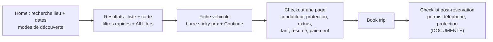
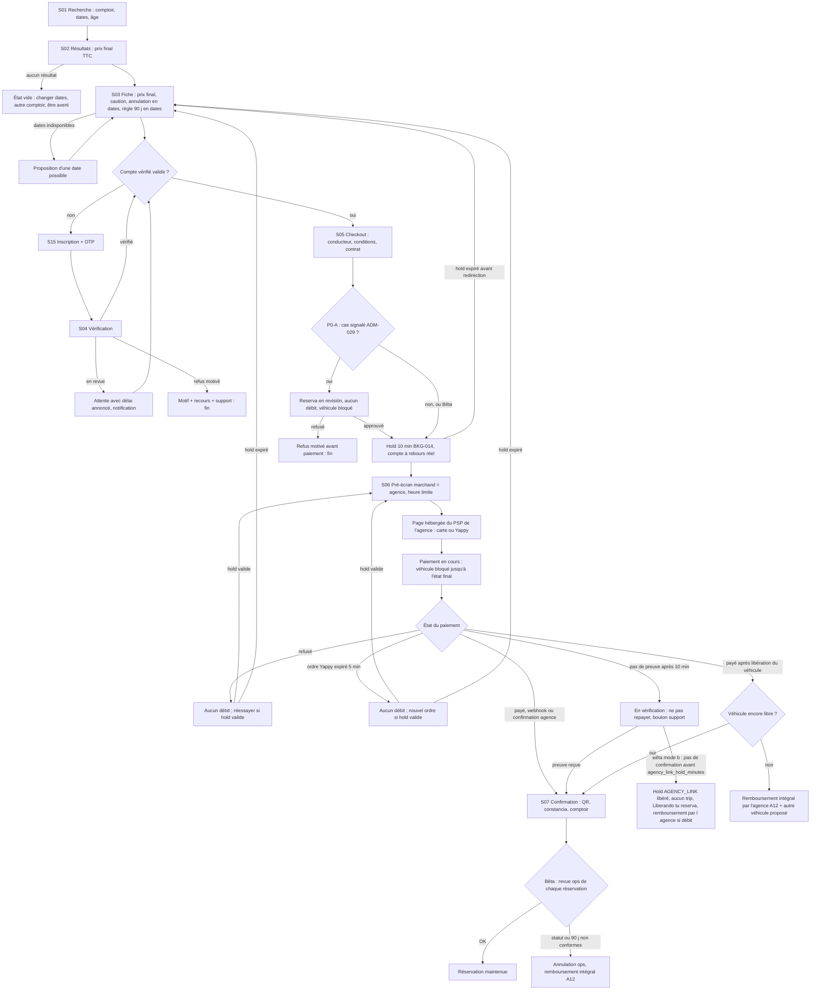
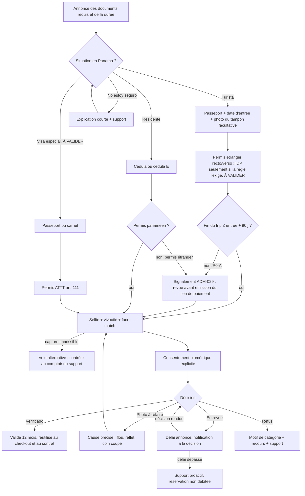
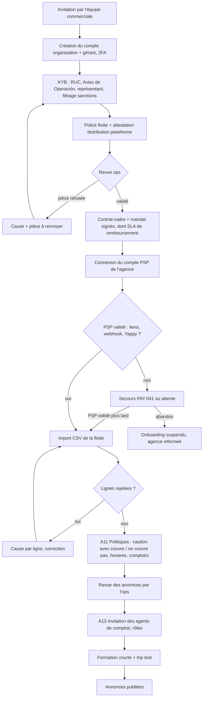
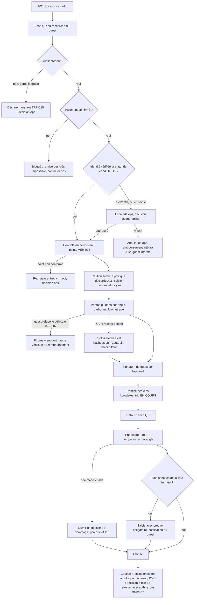
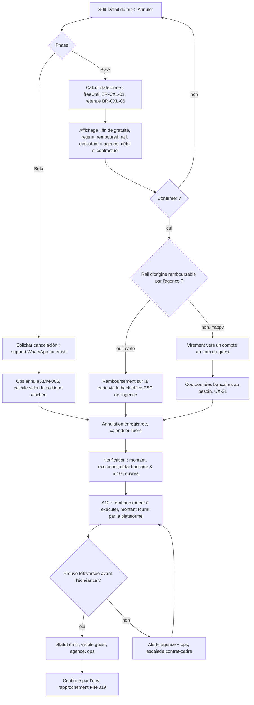
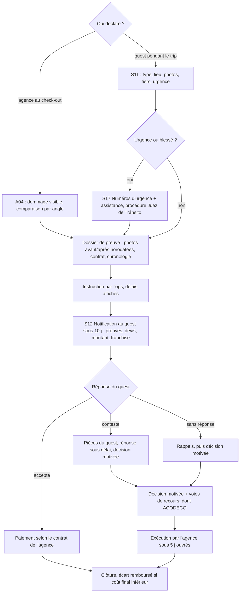
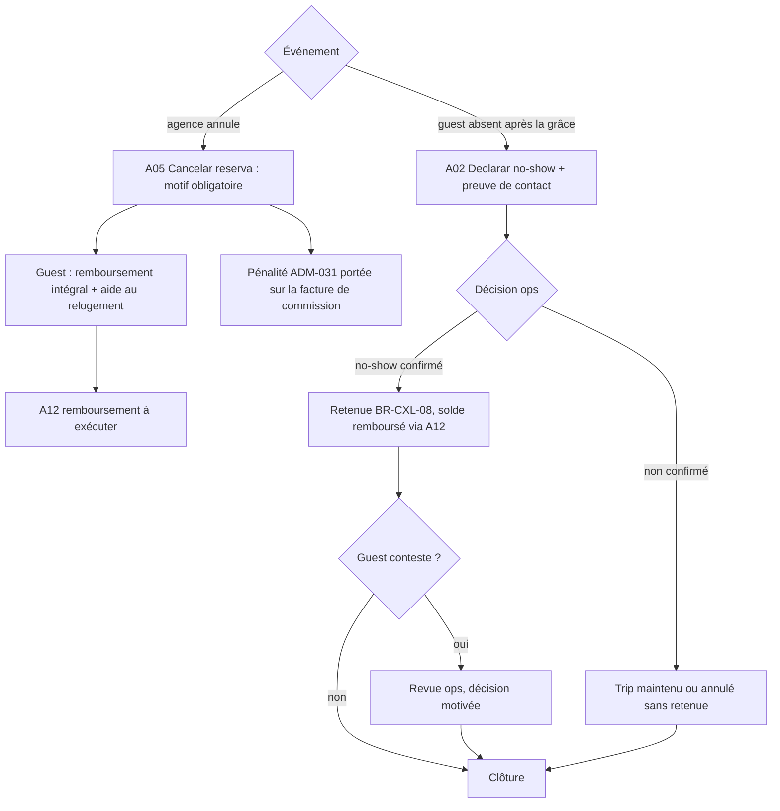

# 10b — Analyse UX/UI de Turo et principes UX de notre marketplace (Panama d'abord, pro-first)

> **Alignement v4 (2026-10-30)** : écran S06 (libération du hold AGENCY_LINK au lieu d'une « annulation », messages de libération différée, C-v3-17) et proposition BKG-014 du §7 (hold AGENCY_LINK distinct) alignés sur 17 v4 ; marques « (aligné v4 — 16 Rx) ».
> **Statut : EN COURS, version 2 du 2026-10-30** (version 1 corrigée après l'audit `verification/VERIF_13_UX.md` : 8 MAJEUR et 14 MINEUR traités ; chaque modification est marquée « (corrigé VERIF_13-<ID>) »). Rédigé par la recherche UX à partir des observations déjà consignées ; **aucune nouvelle navigation sur turo.com**.
> **Sources lues** : `03_SITEMAP_AND_NAVIGATION.md`, `05_GUEST_JOURNEYS.md`, `06_HOST_JOURNEYS.md`, `09_PRICING_PAYMENTS_AND_PAYOUTS.md`, `10_INSURANCE_TRUST_AND_SAFETY.md`, `sources/SRC_GUEST_DOCS.md` (survolé : §1.4, §4, §6, §7, §8), `15_PRODUCT_IMPROVEMENTS.md`, `18_MVP_AND_ROADMAP.md` (§0, §1.0–§1.3, §2), `12_PANAMA_MARKET.md` §2, §3.4, §3.7, §9–§10, `08_BUSINESS_RULES.md` (BR-PAY-06, BR-PAY-08, BR-PAY-09 bis, BR-PRICE-13, BR-CXL-01/06/07/08/12 et table de décision), **`04_FEATURE_INVENTORY.csv`** (colonnes `phase_mvp`, `lot_p0a`, `beta_pilote` et `notes` des lignes citées) et **`09b_PAYMENT_PARTNERS_PA_PY.md`** §0 et §2.1 (Yappy : ordre valable 5 min, pas d'API de remboursement trouvée) (corrigé VERIF_13-V13-18).
> **Règle de phase** (corrigé VERIF_13-V13-02, V13-13) : une exigence n'est marquée **[Bêta]** que si la ligne 04 correspondante a `beta_pilote` = OUI ou SIMPLIFIÉ ; si elle est MANUEL ou DIFFÉRÉ, l'exigence est marquée [P0-A] et la forme Bêta (opération manuelle) est décrite à côté.
> **Règle d'identité** : notre plateforme a **sa propre identité visuelle**. Ce document analyse des **principes** (structure, hiérarchie, contenu, comportement) ; il ne décrit ni ne recommande de reproduire la mise en page, la palette, la typographie, l'iconographie, les noms de composants, les libellés commerciaux ou les badges de Turo. Quand un mécanisme est jugé bon, on en retient la **fonction**, pas la forme.

## 0. Conventions

| Étiquette | Sens dans ce document |
|---|---|
| **OBSERVÉ** | Vu à l'écran lors des sessions du 2026-10-30 (y compris « DIRECTEMENT TESTÉ » dans 05/06) ; référence = identifiant de section (ex. G-BOOK-02). |
| **DOCUMENTÉ** | Écrit dans la documentation Turo (centre d'aide, pages officielles), via `SRC_GUEST_DOCS` (noté SRC_G) ou 06/10. |
| **INFÉRÉ** | Déduit d'observations ou de documents, non vérifié directement. |
| **PROPOSÉ** | Recommandation pour notre produit. |

Limites de l'observation : sessions sur le **marché US** uniquement, **navigateur web en viewport étroit (~530 px, layout mobile web)** ; **la version desktop et les applications natives iOS/Android n'ont pas été observées** ; parcours connecté observé en lecture seule (compte guest sans véhicule) ; **aucune réservation, aucun check-in, aucune annulation, aucune déclaration de dommage réalisés** (ces parcours sont DOCUMENTÉS, pas OBSERVÉS). Aucun audit d'accessibilité instrumenté (lecteur d'écran, contraste mesuré) n'a été mené : les constats d'accessibilité de la §1.12 sont donc **INFÉRÉS** à partir de ce qui a été vu.

Abréviations : « nous » = notre plateforme ; « agence » = loueur professionnel partenaire (P0-A) ; « guest » = locataire ; P0-A, Bêta pilote, P0-B, P1 = phases de `18_MVP_AND_ROADMAP.md`.

---

## 1. Analyse UX/UI de Turo

### 1.1 Architecture de navigation

| # | Constat | Statut | Réf. |
|---|---|---|---|
| N1 | URL hiérarchique `/{pays}/{langue}/…` ; fiche véhicule = catégorie + lieu + marque + modèle + ID numérique. Navigation et SEO sont la même structure (pages catégorie × ville, aéroport, marque, modèle). | OBSERVÉ | 03 §1 ; G-LISTING-01 |
| N2 | Header non connecté minimal : logo, barre de recherche (lieu / début / fin), « Earn on Turo », assistant conversationnel, menu. La promotion de l'offre hôte (bannière de revenus) est placée **au-dessus** de la recherche guest. | OBSERVÉ | 03 §2 |
| N3 | Menu connecté guest : Favorites · Trips · Inbox — Profile · Account · Earn — Help / Legal — Log out. Pas d'outils hôte tant qu'il n'y a pas d'annonce. | OBSERVÉ (+ INFÉRÉ pour le menu hôte) | G-ACCOUNT-01 |
| N4 | Inbox à deux onglets : Messages (humains) et Notifications (flux d'activité). | OBSERVÉ | G-INBOX-01 |
| N5 | Découverte par **modes** (All / Airports / Monthly / Nearby / Delivered / Cities) plutôt que par seule saisie ; mémoire de la dernière recherche **sans compte** (« Continue searching »). | OBSERVÉ | G-SEARCH-01 |
| N6 | Footer dense (corporate, lieux, explorer, hosting, réseaux, stores, sélecteur de langue, liens CCPA). | OBSERVÉ | 03 §4 |
| N7 | Deep-link de retour après inscription (`sign-up?next=…`) : l'utilisateur revient là où il était. | OBSERVÉ | H-ONB |
| N8 | Wizard d'annonce à URL unique avec en-tête de progression « 1 of 9 · Next: … · Start over · View all steps ». | OBSERVÉ | H-ONB-02 |

**Lecture UX (INFÉRÉ)** : l'architecture sert deux publics (guest et hôte particulier) dans un même header, avec une priorité marketing donnée au recrutement d'hôtes. Pour un guest touriste arrivé avec une intention précise (dates + aéroport), la recherche reste accessible en un tap, ce qui est l'essentiel. La séparation Messages / Notifications est saine (le transactionnel ne noie pas la conversation).

### 1.2 Hiérarchie de l'information

**Résultats** (G-SEARCH-03) — ordre de lecture d'une carte : photo → modèle/année → note + nombre d'avis (ou « nouvelle annonce ») → badge hôte → ville + distance → prix (barré + total + « hors taxes »). OBSERVÉ. Le compteur « 200+ cars available » et la carte avec marqueurs de prix (total hors taxes) donnent l'échelle de l'offre. OBSERVÉ.

**Fiche véhicule** (G-LISTING-02, 21 blocs observés) — la fiche fait remonter **avant** les caractéristiques détaillées : les dates du trip, le lieu approximatif, la remise de durée déjà appliquée, la politique d'annulation, l'option de paiement différé, la distance incluse et l'assurance (blocs 5 à 12). Les éléments « réassurance plateforme » (« Included with your trip », bloc 15) et les règles avec amendes (bloc 19) viennent après les avis. Une barre sticky porte en permanence le prix et le CTA (bloc 20). OBSERVÉ.

**Lecture UX (INFÉRÉ)** : la hiérarchie privilégie la **décision transactionnelle** (dates, prix, conditions) sur la description du véhicule, ce qui est adapté à un achat de commodité. Points faibles : (1) la fiche mobile est **très longue** (21 blocs), et les informations qui conditionnent le coût réel (caution, frais jeune conducteur, trip fee, taxes) n'y figurent pas ou seulement en fin de parcours ; (2) les règles assorties d'amendes (tabac 150 $, saleté 150 $) arrivent tard, après l'engagement émotionnel.

### 1.3 Tunnel de conversion (home → recherche → fiche → checkout)

| Étape | Constat | Statut | Réf. |
|---|---|---|---|
| Home → résultats | 3 champs (lieu, début, fin) ; heure optionnelle « Add time ». Âge implicite = 30 dans l'URL de recherche. | OBSERVÉ / INFÉRÉ (sens du paramètre) | G-SEARCH-01, G-SEARCH-02 |
| Résultats | Filtres rapides en chips défilantes + panneau complet avec **compteur sur le CTA** (« View 200+ results », valeur plafonnée) ; la mise à jour en direct du compteur selon les filtres n'est pas démontrée (INFÉRÉ) (corrigé VERIF_13-V13-09). Filtre prix sur le **total hors taxes**. Fin de liste avec conseil de relance. | OBSERVÉ (compteur live : INFÉRÉ) | G-SEARCH-04, G-SEARCH-05, G-SEARCH-03 |
| Fiche | Dates modifiables sur place ; gestion de l'indisponibilité avec ajustement automatique de l'heure de fin + toast. | OBSERVÉ | G-LISTING-02 #5, #7 |
| Checkout | **Une seule page**, sections empilées ; CTA sticky « Book trip » ; en mode BNPL, le CTA devient « Continue » (étape supplémentaire). | OBSERVÉ | G-BOOK-01, G-BOOK-04 |
| Après réservation | Checklist (permis, téléphone, protection) à compléter **au plus tard 2 h avant le départ**, sinon annulation. | DOCUMENTÉ | SRC_G 1.4.5 ; G-BOOK-01 (bandeau) |

**Lecture UX (INFÉRÉ)** : tunnel court (4 écrans jusqu'au paiement) et optimisé pour la conversion. Le prix de l'âge (frais jeune conducteur) et la protection **dépendent d'un champ saisi au checkout** (âge), donc le prix vu en recherche peut augmenter de +60 $ ou +150 $ sur 3 jours au dernier écran (G-BOOK-02). La friction a été déplacée **après** le paiement (vérification), ce qui maximise la conversion mais crée un risque d'annulation tardive.

### 1.4 Friction d'inscription et de vérification

| # | Constat | Statut | Réf. |
|---|---|---|---|
| F1 | **Checkout invité sans compte** : prénom et nom « tels que sur le permis », téléphone, email, âge ; bouton « Log in » secondaire. | OBSERVÉ | G-BOOK-01 |
| F2 | Indicatif téléphonique **pré-rempli** (PA +507 et format « 6123-4567 » observés). La cause (géolocalisation IP) est une **déduction** de 05, pas une observation (corrigé VERIF_13-V13-09). | OBSERVÉ (pré-remplissage) / INFÉRÉ (cause IP) | G-BOOK-01 |
| F3 | Bandeau : il faudra fournir plus d'informations **après** la réservation « afin d'éviter l'annulation de votre voyage, ainsi que des frais ». | OBSERVÉ | G-BOOK-01 |
| F4 | Vérification : photos du permis recto/verso + selfie ; screening à chaque réservation ; revue 24–48 h ; le support **ne communique pas les raisons** d'un refus. | DOCUMENTÉ | SRC_G 1.4.1–1.4.4 |
| F5 | Échéance : tout terminé **2 h avant le départ**, sinon annulation. Le SMS en roaming n'est pas garanti ; les numéros virtuels sont refusés. | DOCUMENTÉ | SRC_G 1.4.5, 1.4.6 |
| F6 | Invité : 2 options de paiement ; connecté : 3 (Pay now / Pay later J−7 / Pay over time). | OBSERVÉ | G-BOOK-06 |
| F7 | Inscription : Apple / Google / email ; formulaire email = nom du permis, email, mot de passe, opt-in marketing **non pré-coché**, CGU cochées explicitement ; téléphone et date de naissance absents du formulaire (leur collecte « plus tard », au checkout ou à la vérification, est déduite par 06 : INFÉRÉ, corrigé VERIF_13-V13-09). | OBSERVÉ (formulaire) / INFÉRÉ (« plus tard ») | H-ONB (Inscription) |
| F8 | Nom légal (permis) distinct du **prénom préféré**, modifiable plus tard ; un hôte peut y mettre son nom commercial. | OBSERVÉ | G-BOOK-01, G-ACCOUNT-02 |

**Lecture UX (INFÉRÉ)** : le principe « réserver d'abord, se vérifier ensuite » est très efficace pour la conversion US, où la plupart des guests sont éligibles. Il est **mal adapté** à notre contexte : au Panama l'éligibilité dépend du **statut migratoire** (art. 110/111, 12 §3.4) et un touriste qui apprend après paiement qu'il ne peut pas conduire vit le pire scénario (refus + remboursement + plainte ACODECO possible). La phrase du bandeau F3 mêle menace (annulation, frais) et flou (« plus d'informations ») : elle inquiète sans dire quoi préparer.

### 1.5 Conception des formulaires

| # | Constat | Statut | Réf. | Appréciation |
|---|---|---|---|---|
| FO1 | Libellés explicites « First name on license » + aide « Preferred name can be added later ». | OBSERVÉ | G-BOOK-01 | Bon : explique *pourquoi* ce format. |
| FO2 | Âge en liste 18 → 55+ ; protections masquées tant que l'âge n'est pas choisi (« Select your age to see options »). | OBSERVÉ | G-BOOK-01 | Ambivalent : séquence logique, mais l'âge est demandé tard alors qu'il change le prix. |
| FO3 | Sélecteur d'heures par pas de 30 min (Midnight … 11:30 PM), format 12 h. | OBSERVÉ | G-LISTING-02 #5 | Correct US ; pour nous, format 24 h ou 12 h selon locale. |
| FO4 | Extras : stepper − 0 + borné par le stock ; option explicite « I don't want any extras ». | OBSERVÉ | G-BOOK-03 | Bon : refus explicite, pas d'ajout par défaut. |
| FO5 | Adresse : autocomplete Google ; repli « I don't see my address » → formulaire manuel ; puis confirmation du **pin** sur carte. | OBSERVÉ | H-ONB-02 | Bon : repli manuel + vérification visuelle. |
| FO6 | Bouton « Next » désactivé tant que tous les champs ne sont pas remplis (adresse manuelle). | OBSERVÉ | H-ONB-02 | Risque (INFÉRÉ) : un bouton désactivé n'explique pas ce qui manque. |
| FO7 | VIN : champ 17 caractères + case « older than 1981 » + aide « Where can I find it? » (emplacements). | OBSERVÉ | H-ONB-02 | Bon : aide contextuelle au moment exact du besoin. |
| FO8 | Consentement SMS automatique « By providing a phone number, you consent… » (pas de case). | OBSERVÉ | G-BOOK-01 | À éviter chez nous : consentement implicite, non conforme à notre principe d'opt-in (IMP-06, Ley 81/2019). |
| FO9 | Lien « Ajouter un code promo » sans effet visible en non connecté. | OBSERVÉ | G-BOOK-05 | Défaut probable (INFÉRÉ) : un contrôle qui ne réagit pas. |

### 1.6 Messages d'erreur, états vides et retours système

| # | Message ou état | Statut | Réf. | Appréciation |
|---|---|---|---|---|
| E1 | Indisponibilité : texte rouge « Cette voiture n'est pas disponible du {date} au {date} » + toast « End time was updated based on availability ». | OBSERVÉ | G-LISTING-02 #7 | Bon : le système corrige au lieu de bloquer. Risques (INFÉRÉ) : modification silencieuse d'une donnée saisie, toast éphémère, couleur comme signal principal, mélange FR/EN dans le même échange. |
| E2 | Pays non opéré : « Unfortunately, Turo hasn't launched car sharing in your country yet. » + Next désactivé. | OBSERVÉ | H-ONB-02 | Clair, mais **sans issue** (ni liste d'attente, ni alternative). |
| E3 | Fin de résultats : « No more cars available — Try changing your filters, adjusting your dates, or exploring the map ». | OBSERVÉ | G-SEARCH-03 | Bon : état vide actionnable avec trois leviers. |
| E4 | Trips vide : « No upcoming trips yet … Start searching ». Profil sans avis : « hasn't received a review on Turo yet ». | OBSERVÉ | G-TRIPS-01, G-PROFILE-01 | Bon : état vide avec CTA. |
| E5 | Refus de vérification : raisons non communiquées par le support. | DOCUMENTÉ | SRC_G 1.4.4 | À éviter : décision opaque, source de tickets et de recours. |

### 1.7 Confirmations et engagements

- Récapitulatif complet (véhicule, dates, lieu) en tête de checkout ; consentement unique « J'accepte de payer le montant total affiché, ainsi que les Conditions de service, les Conditions d'annulation et l'avis de confidentialité » ; CTA final « Book trip ». OBSERVÉ (G-BOOK-01 #1, #8, #9).
- Mode BNPL : le CTA change de libellé pour signaler l'étape supplémentaire. OBSERVÉ (G-BOOK-04). Bon signal d'état.
- Paiement différé : date de débit explicite (« automatically charged … on Thu, Jan 7 ») = J−7. OBSERVÉ (G-BOOK-06). Très bon : date précise, pas de « plus tard ».
- La page de confirmation post-réservation n'a pas été observée (aucune réservation). NON OBSERVÉ.

### 1.8 Notifications

| # | Constat | Statut | Réf. |
|---|---|---|---|
| NO1 | Matrice catégorie × canal (Email / SMS) ; « Voyage et compte » en email **obligatoire** ; push non visible sur le web. | OBSERVÉ | G-ACCOUNT-02 §2 |
| NO2 | Langue des notifications réglable : **8 locales listées** (en-US, en-AU, en-CA, en-GB, es-US, fr-CA, fr-FR, pt-BR). 05 écrit « 9 locales » mais n'en énumère que 8 : écart de la source, non résolu (corrigé VERIF_13-V13-09). | OBSERVÉ | G-ACCOUNT-02 §2 |
| NO3 | Notification réelle « conducteur additionnel » : contenu utile (heure de début de couverture, obligation de présence du primary guest) **mais placeholder non résolu `{6}`** et un champ mal substitué (prénom à la place du lieu). | OBSERVÉ | G-INBOX-01 |
| NO4 | SMS de vérification par short code, non garanti en roaming. | DOCUMENTÉ | SRC_G 1.4.6 |

**Lecture UX (INFÉRÉ)** : la granularité des préférences est bonne et la règle « transactionnel obligatoire » est saine. Le défaut NO3 montre l'absence de test automatique des gabarits : dans une notification de **couverture d'assurance**, une variable erronée touche directement la confiance et la compréhension des droits.

### 1.9 Éléments de confiance

| Élément | Statut | Réf. | Fonction UX |
|---|---|---|---|
| Note + nombre de trips, sous-notes (propreté, entretien…), réponses publiques de l'hôte aux avis, avis multilingues | OBSERVÉ / DOCUMENTÉ | G-LISTING-02 #2, #17 ; SRC_G 8.1 | Preuve sociale vérifiable. |
| Badge de programme hôte (critères publics et trimestriels) + filtre de recherche associé | OBSERVÉ / DOCUMENTÉ | G-LISTING-02 #2, #18 ; H-PERF-01 | Signal de qualité **gagné**, critères publiés. |
| Ancienneté de l'hôte (« 9 years of hosting ») | OBSERVÉ | G-LISTING-02 #18 | Continuité. |
| Liste « Included with your trip » (sans comptoir, fenêtre de retrait de 2 h, assistance 24/7) | OBSERVÉ | G-LISTING-02 #15 | Promesse plateforme homogène sur toutes les fiches. |
| Lien « Report listing » sur chaque fiche | OBSERVÉ | G-LISTING-02 #13 | Contrôle donné à l'utilisateur. |
| Mention télématique (collecte de données de conduite) | OBSERVÉ | G-LISTING-02 #19 | Transparence, mais placée en bas de fiche. |
| Coordonnées masquées avant réservation | DOCUMENTÉ | 10 §4 | Sécurité + anti-marché gris. |
| Badges « Verified » email/téléphone sur le profil | OBSERVÉ | G-PROFILE-01 | Confiance bilatérale. |
| Export de données en libre-service, fermeture de compte | OBSERVÉ | G-ACCOUNT-02 §7–8 | Contrôle des données. |
| « Turo is not an insurance company » (remboursement contractuel) | DOCUMENTÉ | H-ACQ | Honnêteté juridique, mais nuance difficile à comprendre pour un non-initié. |

### 1.10 Présentation du prix

| # | Constat | Statut | Réf. |
|---|---|---|---|
| P1 | En recherche et sur la fiche : **prix barré + « Total de X » + « Hors taxes »** ; marqueurs de carte en total hors taxes. La cause du prix barré n'est pas expliquée sur la carte. | OBSERVÉ | G-SEARCH-03, G-LISTING-02 #20 |
| P2 | Filtre prix sur le **total hors taxes** du séjour (et non sur le prix/jour). | OBSERVÉ | G-SEARCH-05 |
| P3 | Checkout : barre sticky « Total de X — **Taxes et frais inclus** ». Le libellé du total change donc entre fiche (hors taxes) et checkout (TTC). | OBSERVÉ | G-BOOK-01 #9 |
| P4 | **Trip fee** ≈ 22–24 % du net, formule non linéaire, visible seulement dans le détail du sous-total ; frais jeune conducteur révélés par le champ âge (+60 $ / +150 $ sur 3 jours). | OBSERVÉ | G-BOOK-02, G-BOOK-06 ; 09 §3 |
| P5 | Remise « non remboursable » (−10 %) **intégrée dans la ligne de base**, sans ligne dédiée ; le libellé commercial « Économisez 15 $US » correspond à l'écart TTC. | OBSERVÉ | G-BOOK-06 |
| P6 | Remise de durée affichée comme ligne (« Réduction pour 3 jours ou plus — 7 $US ») dès la fiche. | OBSERVÉ | G-LISTING-02 #8 ; G-BOOK-02 |
| P7 | **Nudges** : encart « Réservez rapidement pour éviter la hausse des prix… » dans la liste ; badge « Bonne affaire ! Prix inférieur aux options similaires » ; « Offre limitée dans le temps » sur le tarif non remboursable. | OBSERVÉ | G-SEARCH-03, G-LISTING-02 #4, G-BOOK-01 #5 |
| P8 | Livraison incluse dans le prix affiché en recherche (« all-in pricing ») pour l'aéroport. | DOCUMENTÉ | 08 BR-PRICE-13 (SRC_G 2.4.1) ; la formule ne figure pas dans 06 H-AIRPORT (corrigé VERIF_13-V13-09) |

**Lecture UX (INFÉRÉ)** : le total du séjour est affiché tôt (bonne pratique), mais il n'est pas final : **taxes, trip fee détaillé, frais d'âge et protection** s'ajoutent ou se révèlent au checkout. Le prix barré sans cause visible et la remise intégrée à la base rendent la décomposition difficile à vérifier par l'utilisateur. Les nudges d'urgence (« hausse des prix », « offre limitée ») relèvent d'une pression temporelle générique, non personnalisée ; dans notre contexte, ils seraient contraires au positionnement « precio final, sin sorpresas » (IMP-05) et exposés aux règles de protection du consommateur (ACODECO, 12 §3.7).

### 1.11 Clarté des conditions (annulation, protection, caution)

| Sujet | Ce que voit l'utilisateur | Statut | Réf. | Clarté (INFÉRÉ) |
|---|---|---|---|---|
| Annulation sur la fiche | « Annulation gratuite — Remboursement complet dans les 24 heures suivant la réservation. Options plus flexibles lors du paiement. » | OBSERVÉ | G-LISTING-02 #9 | Moyenne : la fiche montre la règle la plus restrictive et renvoie au checkout. |
| Annulation dans la liste | « Annulation gratuite possible (sous conditions) pour tous les voyages. » | OBSERVÉ | G-SEARCH-03 | Faible : « sous conditions » n'est pas expliqué. |
| Annulation au checkout | Deux tarifs avec dates explicites (« jusqu'au 13 janv. (veille du départ) ») | OBSERVÉ | G-BOOK-01 #5 | Bonne : date concrète calculée pour le trip. |
| Règles complètes | ½ ou 1 journée retenue, 50 % de la livraison remboursés, fuseau du véhicule, incohérence 24 h / 25 h dans la doc | DOCUMENTÉ | SRC_G 4.1.1–4.1.3 | Complexe ; non visible en entier au moment du choix. |
| Protection | 3 plans + refus ; « aucun reste à charge… sauf dommages mécaniques et intérieurs » ; RC « on an excess basis » | OBSERVÉ | 10 §1 | Moyenne : franchises chiffrées (bien), jargon assurantiel (mal), exclusions résumées en une incise. |
| Caution | Non affichée sur le trip testé ; montants et libération à 80 h documentés (valeur Turo, non reprise : 72 h chez nous, BR-PAY-06) | DOCUMENTÉ | BR-PAY-06 ; SRC_G 2.5 | Non évaluable à l'écran. |

### 1.12 Desktop vs mobile web

- **Mobile web (OBSERVÉ, ~530 px)** : la barre de recherche se réduit à « Search anywhere » (G-SEARCH-01) ; filtres en chips horizontales défilantes (G-SEARCH-04) ; fiche en colonne unique avec **barre sticky** prix + CTA (G-LISTING-02 #20) ; checkout empilé avec CTA sticky (G-BOOK-01 #9) ; assistant flottant sur les résultats (G-SEARCH-03).
- **Desktop : NON OBSERVÉ.** Toute comparaison serait spéculative ; on note seulement que la carte avec marqueurs de prix est présente en layout étroit (G-SEARCH-03), ce qui implique une bascule liste/carte (INFÉRÉ).
- **Lecture UX (INFÉRÉ)** : le mobile web est traité comme un vrai canal de conversion (checkout complet sans app), ce qui valide notre choix PWA. Risques (INFÉRÉS) : **empilement possible** d'éléments flottants — barre sticky (fiche G-LISTING-02 #20, checkout G-BOOK-01 #9), assistant flottant (résultats, G-SEARCH-03), bannière cookies (accueil, 03 §3) — qui pourraient masquer du contenu ou le focus clavier. Ces éléments ont été **observés séparément, sur des écrans différents** ; aucune superposition n'a été capturée (corrigé VERIF_13-V13-07) ; chips défilantes dont l'existence au-delà du bord n'est pas toujours perceptible.

### 1.13 Accessibilité (INFÉRÉ, aucun audit outillé)

| Constat | Base | Risque / point positif |
|---|---|---|
| Bouton icône avec libellé explicite (« Add car to favorites ») | OBSERVÉ (libellé relevé, G-SEARCH-03) ; exposition comme nom accessible **non vérifiée** (INFÉRÉ) (corrigé VERIF_13-V13-09) | Positif si le libellé est bien le nom accessible. |
| Indisponibilité signalée en **rouge** + toast auto-disparaissant | OBSERVÉ (G-LISTING-02 #7) | Risque WCAG 1.4.1 (couleur seule) et 4.1.3 (message d'état non annoncé) si le toast n'est pas en région live. |
| Boutons désactivés sans explication | OBSERVÉ (H-ONB-02) | Risque 3.3.1 / 3.3.2 (identification des erreurs, instructions). |
| Éléments sticky et flottants superposés | INFÉRÉ : éléments observés séparément (G-LISTING-02 #20, G-SEARCH-03, 03 §3), superposition non observée (corrigé VERIF_13-V13-07) | Risque 2.4.11 (focus non masqué, WCAG 2.2). |
| Carte et carrousels ; curseur de kilométrage | OBSERVÉ (carte, carrousels : G-SEARCH-03) ; curseur « probable » selon 05 G-SEARCH-05 : INFÉRÉ (corrigé VERIF_13-V13-09) | Risque 2.5.7 (alternative au glisser) à vérifier. |
| Mélange de langues dans un même écran | OBSERVÉ (G-SEARCH-03, G-LISTING-02, G-BOOK-01) | Risque 3.1.2 (langue des passages) : un lecteur d'écran prononce le français avec une voix anglaise. |
| Exigence de selfie + photos de permis | DOCUMENTÉ (SRC_G 1.4.1) | Barrière possible pour personnes malvoyantes ou à mobilité réduite des mains ; aucune voie alternative documentée. |

### 1.14 Problèmes de cohérence

| # | Problème | Statut | Réf. |
|---|---|---|---|
| C1 | **Mélange FR/EN** sur `/us/en` non connecté : encarts éditoriaux, badge prix, annulation, checkout en français ; titres, CTA, toasts en anglais. Connecté, tout repasse en anglais (préférence du compte). Cause probable (INFÉRÉ, corrigé VERIF_13-V13-09) : les composants suivent soit la langue du navigateur, soit la locale de l'URL. | OBSERVÉ (mélange) / INFÉRÉ (cause) | G-SEARCH-03, G-LISTING-02 #4/#7/#9, G-BOOK-01, G-BOOK-06 |
| C2 | **Placeholder `{6}` non résolu** et variable mal substituée dans une notification de couverture. | OBSERVÉ | G-INBOX-01 |
| C3 | Libellé du total qui passe de « Hors taxes » (fiche) à « Taxes et frais inclus » (checkout). | OBSERVÉ | G-LISTING-02 #20, G-BOOK-01 #9 |
| C4 | Nombre d'options de paiement différent invité / connecté (2 vs 3) sans explication. | OBSERVÉ | G-BOOK-06 |
| C5 | Documentation contradictoire (24 h vs 25 h de délai d'annulation ; 90 % vs part du plan sur la livraison ; 1 800 vs 3 300 mi). | DOCUMENTÉ | SRC_G 4.1.1 ; H-AIRPORT ; H-MONTHLY |
| C6 | Nom de l'assistant (« Ask Turo ») absent de la documentation d'aide. | OBSERVÉ / DOCUMENTÉ | 03 §2 ; SRC_G 8.7 |
| C7 | Lien « code promo » inactif en invité. | OBSERVÉ | G-BOOK-05 |

---

## 2. Ce qui fonctionne et ce qu'il faut éviter

### 2.1 Ce qui fonctionne (principes à retenir, sous notre propre forme)

| # | Principe | Pourquoi ça marche | Réf. | Statut |
|---|---|---|---|---|
| W1 | Total du séjour affiché dès la recherche, pas seulement un prix/jour | Le guest compare ce qu'il paiera vraiment ; filtre prix cohérent avec ce total. | G-SEARCH-03, G-SEARCH-05 | OBSERVÉ |
| W2 | Checkout invité, une seule page, CTA persistant | Moins d'abandons ; aucune création de mot de passe avant l'intention d'achat. | G-BOOK-01 | OBSERVÉ |
| W3 | Pré-remplissage intelligent (indicatif pays, format local du numéro) | Réduit les erreurs de saisie de téléphone, champ critique pour les OTP. | G-BOOK-01 | OBSERVÉ (pré-remplissage) ; source du pays (IP) INFÉRÉE (corrigé VERIF_13-V13-09) |
| W4 | Le système corrige au lieu de rejeter (heure de fin ajustée à la disponibilité) | Évite une impasse. | G-LISTING-02 #7 | OBSERVÉ |
| W5 | Dates concrètes dans les conditions (« jusqu'au 13 janv. », « débité le 7 janv. ») | Une date se comprend mieux qu'une règle relative (« 24 h avant »). | G-BOOK-01 #5, G-BOOK-06 | OBSERVÉ |
| W6 | Compteur de résultats sur le CTA du panneau de filtres (pour nous : mis à jour en direct) | Évite l'état « 0 résultat » découvert après coup. | G-SEARCH-05 | OBSERVÉ (« View 200+ results », valeur plafonnée) ; mise à jour en direct INFÉRÉE (corrigé VERIF_13-V13-09) |
| W7 | États vides actionnables (3 leviers proposés) | L'utilisateur sait quoi faire ensuite. | G-SEARCH-03, G-TRIPS-01 | OBSERVÉ |
| W8 | Refus explicite (« I don't want any extras », « Refuser la protection ») | Pas d'ajout par défaut, choix libre et visible. | G-BOOK-03, 10 §1 | OBSERVÉ |
| W9 | Nom légal séparé du nom d'usage / commercial | Cohérence KYC sans imposer le nom légal partout ; utile aux agences (nom commercial). | G-ACCOUNT-02 | OBSERVÉ |
| W10 | Opt-in marketing non pré-coché, CGU cochées explicitement | Consentement libre. | H-ONB, G-BOOK-06 | OBSERVÉ |
| W11 | Wizard avec progression, étape suivante nommée, vue de toutes les étapes, recommencer | L'utilisateur sait combien il reste et peut s'orienter. | H-ONB-02 | OBSERVÉ |
| W12 | Aide contextuelle au moment du besoin (où trouver le VIN) | Réduit l'abandon sur un champ technique. | H-ONB-02 | OBSERVÉ |
| W13 | Repli manuel + confirmation sur carte pour l'adresse | Les adresses LATAM sont souvent mal géocodées (INFÉRÉ). | H-ONB-02 | OBSERVÉ |
| W14 | Préférences de notification par catégorie × canal, transactionnel obligatoire | Respecte l'utilisateur sans casser le service. | G-ACCOUNT-02 | OBSERVÉ |
| W15 | Signaux de qualité **gagnés** selon des critères publics | Crédibles parce que vérifiables. | H-PERF-01 | DOCUMENTÉ |
| W16 | Mémoire de recherche sans compte | Reprise rapide, utile aux touristes qui préparent sur plusieurs sessions. | G-SEARCH-01 | OBSERVÉ |

### 2.2 Ce qu'il faut éviter

Les anti-modèles sont numérotés **AM01–AM15** (anciennement A1–A15) pour ne pas être confondus avec les écrans agence A01–A13 ; les renvois « anti-AMxx » de la §3 suivent cette numérotation (corrigé VERIF_13-V13-17).

| # | Anti-modèle | Pourquoi l'éviter (pour nous) | Réf. | Statut |
|---|---|---|---|---|
| AM01 | Prix « hors taxes » en recherche puis TTC au checkout ; frais révélés tard (trip fee, âge) | Rupture de confiance au dernier écran ; contraire à IMP-05 et au positionnement face aux prix d'appel des agrégateurs (12 §1.4). | G-SEARCH-03, G-BOOK-02 | OBSERVÉ |
| AM02 | Prix barré sans cause visible, remise noyée dans la ligne de base | Non vérifiable par l'utilisateur ; risque ACODECO sur la « référence » de prix (INFÉRÉ). | G-SEARCH-03, G-BOOK-06 | OBSERVÉ |
| AM03 | Urgence générique (« hausse des prix », « offre limitée ») | Pression non fondée sur une donnée du trip ; dégrade la confiance d'un public déjà méfiant envers les loueurs (12 §3.7). | G-SEARCH-03, G-BOOK-01 #5 | OBSERVÉ |
| AM04 | Vérification d'éligibilité **après** paiement avec menace d'annulation et de frais | Au Panama, l'éligibilité dépend du statut (art. 110/111) : refus tardif = pire expérience + litige. | G-BOOK-01, SRC_G 1.4.5 | OBSERVÉ / DOCUMENTÉ |
| AM05 | Refus sans motif communiqué | Génère tickets, recours, réputation de « boîte noire ». | SRC_G 1.4.4 | DOCUMENTÉ |
| AM06 | Mélange de langues dans une même vue | Incompréhension, perte de crédibilité, défaut d'accessibilité. | C1 | OBSERVÉ |
| AM07 | Gabarits de notification non testés (`{6}`) | Une variable erronée dans un message de couverture ou de paiement peut être juridiquement trompeuse. | G-INBOX-01 | OBSERVÉ |
| AM08 | Consentement SMS implicite par saisie du numéro | Contraire à l'opt-in explicite Ley 81/2019 que nous retenons (IMP-06). | G-BOOK-01 | OBSERVÉ |
| AM09 | Correction silencieuse d'une donnée saisie (heure de fin) annoncée par un toast éphémère | L'utilisateur peut ne pas voir que son créneau a changé. | G-LISTING-02 #7 | OBSERVÉ |
| AM10 | Contrôles désactivés ou inactifs sans explication (Next grisé, lien promo muet) | Impasse silencieuse. | H-ONB-02, G-BOOK-05 | OBSERVÉ |
| AM11 | Impasse « pays non opéré » sans alternative | Perte d'un lead ; chez nous : proposer la liste d'attente ou une autre agence. | H-ONB-02 | OBSERVÉ |
| AM12 | Jargon assurantiel non expliqué (« excess basis », « actual cash value ») | Notre public lit souvent en langue seconde ; les exclusions doivent être lisibles (IMP-14). | 10 §1, H-ACQ | OBSERVÉ / DOCUMENTÉ |
| AM13 | Fiche très longue, règles à amende en bas de page | Les conditions qui coûtent de l'argent doivent être vues avant l'engagement. | G-LISTING-02 #19 | OBSERVÉ |
| AM14 | Superposition de couches flottantes en mobile | Masquage du contenu et du focus. | 03 §3, G-SEARCH-03, G-LISTING-02 #20 (éléments vus séparément) | INFÉRÉ (corrigé VERIF_13-V13-07) |
| AM15 | Dépendance au SMS par short code pour l'OTP | Échecs en roaming pour les touristes. | SRC_G 1.4.6 | DOCUMENTÉ |

---

## 3. Nos principes et exigences UX

Les identifiants `UX-xx` sont des exigences **PROPOSÉES** ; elles renvoient aux lignes de `04_FEATURE_INVENTORY.csv` citées dans 18 quand elles existent. La phase est indiquée entre crochets : **[Bêta]** = Bêta pilote, **[P0-A]**, **[P0-B]**, **[P1]**.

### 3.0 Principes directeurs (PROPOSÉ)

1. **Prix final dès le premier écran.** Le chiffre vu en recherche est celui payé au comptoir, hors options choisies ensuite.
2. **Éligibilité connue avant paiement ; à défaut, aucun coût pour le guest.** Le guest sait **avant de payer** ce qu'on va vérifier et si son trip respecte la règle des 90 jours (rendue en dates) ; un refus décidé par notre revue après paiement est **remboursé intégralement**. La forme dépend de la phase (corrigé VERIF_13-V13-01) :

| Phase | Ce qui est contrôlé avant paiement | Ce qui est contrôlé après | Si refus |
|---|---|---|---|
| **Bêta pilote** (04 : VER-001 OUI, VER-002/003/005/007 MANUEL, BKG-012 SIMPLIFIÉ, ADM-029 SIMPLIFIÉ) | Identité vérifiée par le parcours hébergé du fournisseur KYC, **décision par l'ops** dans son portail ; âge minimum ; boîte manuelle (BKG-012 Bêta). La règle des 90 jours est **annoncée** en dates sur la fiche et au checkout, sans contrôle automatique. | **Toutes** les réservations passent en revue humaine (ADM-029 Bêta, délai 2 h ouvrées) : l'ops contrôle statut et date d'entrée (VER-007 MANUEL) et signale les dépassements ; pas de refus automatique avant l'avis OQ-BR-21. | L'ops annule avec **remboursement intégral** (ADM-029), assimilé au motif `PLATFORM_REVIEW_DELAY` de BR-CXL-07 / table BR-CXL n° 17 (08) ; exécution par l'agence (PAY-021 MANUEL), suivie dans A12. |
| **P0-A** (VER-007 lot 2, BKG-012, ADM-029) | Statut et date d'entrée **collectés avant paiement** (UX-33) ; KYC hébergé ; contrôles BKG-012. Un cas signalé (fin de trip > entrée + 90 j, résident avec permis étranger, autre règle ADM-029) met la réservation **en revue avant émission du lien de paiement** (branche par défaut de UXQ-08, paramètre `flagged_booking_payment_order` = `REVIEW_BEFORE_LINK`, fail-closed ; (VERIF_18, passe de cohérence finale)) : état « Reserva en revisión — no se te cobró nada », véhicule bloqué pendant la revue (PROPOSÉ ; précision à reporter dans BKG-012/ADM-029, §7 ; décision UXQ-08). | Revue manuelle des seuls cas signalés. | Refus motivé **avant** tout débit ; si un refus intervient malgré tout après paiement (revue tardive), remboursement intégral (`PLATFORM_REVIEW_DELAY`). |
| **Cible** (après avis OQ-BR-21) | Règle 90 jours / art. 111 appliquée automatiquement avant paiement, avec proposition de la date de fin maximale (IMP-09, EC-50). | Revue limitée aux exceptions. | Refus avant paiement, motif de catégorie et recours. |
3. **Une date, pas une règle.** Chaque délai (annulation, débit, libération de caution) est rendu en date et heure locales du trip.
4. **Le réseau est une option.** Les moments critiques (comptoir, check-in, urgence) fonctionnent avec un réseau faible, et dégradent proprement sans réseau.
5. **Espagnol d'abord, une langue par écran.** Aucune vue ne mélange les langues.
6. **Le comptoir est un utilisateur de premier rang.** L'agent d'agence a ses propres écrans, optimisés pour la vitesse et la preuve.
7. **Transparence sur l'argent bloqué.** Toute somme retenue est expliquée : combien, pourquoi, qui la détient, jusqu'à quand, comment elle revient.
8. **Identité propre.** Système de design original (tokens de couleur, typographie, iconographie, ton de voix, illustrations) défini par notre marque ; aucune reprise des patterns visuels identifiables de Turo (palette, badges, noms de programmes, libellés commerciaux).

### 3.1 PWA mobile-first

| ID | Exigence | Phase |
|---|---|---|
| UX-01 | Conception à 360 px de large d'abord (Android d'entrée de gamme), puis 768 px et 1280 px. Aucune fonctionnalité réservée au desktop côté guest ; la console agence est **tablette d'abord** (comptoir), utilisable sur desktop. | [Bêta] |
| UX-02 | Budget de poids : premier chargement < 2 Mo (IMP-35), JS critique < 200 Ko compressé, LCP < 2,5 s et INP < 200 ms mesurés sur profil « 3G rapide » ; images en formats modernes avec tailles adaptées. | [P0-A] (budget), [P1] (PWA complète, IMP-35) |
| UX-03 | Installable (manifest, icône, écran de démarrage) **sans l'exiger** : tout le parcours fonctionne dans le navigateur. Invitation à installer seulement après la réservation (moment où l'app hors ligne a une valeur). | [P0-A] |
| UX-04 | iOS : ne pas dépendre des notifications push web ni du stockage persistant ; tester le comportement d'éviction du stockage et de la caméra en PWA iOS (TRP-056). Notifications critiques via WhatsApp/SMS/email, jamais via push seul. | [Bêta] (test TRP-056) |
| UX-05 | Une seule couche flottante à la fois en bas d'écran (barre d'action) ; assistant ou aide accessible depuis l'en-tête plutôt que flottant. **Bêta : aucune bannière de consentement** (aucun cookie non essentiel, 18 §2) ; quand une bannière existera (P1), elle ne se superposera jamais à la barre d'action (corrigé VERIF_13-V13-13). | [Bêta] (couche unique) / [P1] (bannière) |

### 3.2 Check-in hors ligne et faible bande passante

| ID | Exigence | Phase |
|---|---|---|
| UX-06 | Mise en cache dès la confirmation : contrat et constancia PDF, adresse et plan du comptoir, horaires, téléphone d'urgence, référence de réservation (QR), checklist des documents à présenter (IMP-35, IMP-12). | [P0-A] |
| UX-07 | Assistant photo guidé par angle avec silhouette de cadrage, compteur « 7 / 18 », contrôle de netteté local, horodatage et position de l'appareil, **empreinte SHA-256 calculée à la prise** (IMP-10, TRP-002). | [Bêta] en ligne au comptoir ; [P0-A] hors ligne (TRP-057) |
| UX-08 | File d'envoi visible : chaque photo porte un état (*en attente*, *envoi*, *envoyée*, *échec – réessayer*) ; reprise automatique au retour du réseau ; l'utilisateur ne peut pas clôturer l'état des lieux comme « synchronisé » tant que toutes les photos ne sont pas envoyées, mais peut le clôturer comme « enregistré sur l'appareil ». | [P0-A] |
| UX-09 | Mode « datos bajos » : vignettes compressées en liste, photos HD à la demande, carte statique en repli de la carte interactive. | [P1] |
| UX-10 | Jamais de perte de saisie : brouillon local de chaque formulaire long (checkout, KYC, état des lieux) restauré après coupure ou fermeture d'onglet. | [P0-A] |

### 3.3 Langue et ton : espagnol d'abord, espagnol neutre LATAM

| ID | Exigence | Phase |
|---|---|---|
| UX-11 | Langue par défaut `es` (espagnol neutre d'Amérique latine, validé par un relecteur panaméen), `en` complet ; détection par `Accept-Language` puis choix explicite mémorisé ; sélecteur visible dans l'en-tête. **Une vue = une langue** : aucun composant ne suit une autre source de langue que la préférence courante (anti-C1). Attribut `lang` correct sur la page et sur les passages cités dans une autre langue (avis). | [Bêta] (I18N-003, I18N-004) |
| UX-12 | Tutoiement (« tú ») dans l'interface et les messages, vouvoiement (« usted ») dans le contrat, les décisions de litige et les textes juridiques : **hypothèse à tester** en §5 auprès de résidents panaméens et d'agents. Jamais de voseo ni de « vosotros ». | [Bêta] (test) |
| UX-13 | Glossaire contrôlé (extrait) : *auto* (neutre ; « carro » accepté en PA dans le support oral), *alquiler*, *licencia de conducir*, *cédula*, *pasaporte*, *sello de entrada*, *depósito de garantía* (jamais « fianza », réservé à la caution-assurance IMP-02), *retiro* / *devolución*, *mostrador*, *ITBMS*, *precio final*, *cancelación gratuita hasta…*, *cargo* (débit), *reembolso emitido* (jamais « recibido », BR-PAY-08). Glossaire EN aligné. | [Bêta] |
| UX-14 | Les avis, messages et descriptions d'agence restent dans leur langue d'origine, avec mention de la langue ; traduction automatique proposée à la demande et étiquetée comme telle. | [P1] |

### 3.4 Prix tout compris en USD et en PYG (les deux construits dès le départ, DEC-FONDATEUR-04)

| ID | Exigence | Phase |
|---|---|---|
| UX-15 | Prix affiché en liste, sur la carte et sur la fiche = **total du trip TTC** (loyer + taxe du pays — ITBMS 7 % au Panama, IVA 10 % au Paraguay, lignes taxables À VALIDER, 08 OQ-BR-14 — + tout frais obligatoire de l'agence) pour les dates saisies, libellé « Precio final · {n} días » ; prix/jour en secondaire. **Le même chiffre et le même libellé** figurent sur la barre d'action de la fiche et du checkout (anti-C3). En P1, inclure la protection minimale obligatoire (IMP-05, PRC-026). | [Bêta] (SRC-042, PRC-021) |
| UX-16 | Format monétaire : « US$ 145.00 » en `es-PA` et `en`, deux décimales au checkout, arrondi à l'unité accepté en liste si toutes les valeurs sont arrondies de la même façon. Paraguay (construit dès le départ, DEC-FONDATEUR-04) : « ₲ 1.250.000 » sans décimale + équivalent indicatif « ≈ US$ 160 (referencial) » (EC-32). | [Bêta] (USD et PYG) |
| UX-17 | Détail déroulant ligne par ligne, toujours accessible (fiche et checkout) : loyer (prix/jour × jours), remises (une ligne par remise, avec sa cause), frais de l'agence, ITBMS, total. **Aucune remise intégrée silencieusement dans une autre ligne** (anti-AM02). | [Bêta] |
| UX-18 | Prix barré autorisé **seulement** si la référence est le prix du même véhicule pour les mêmes dates sans la remise, et si la cause est écrite à côté (« −10 % por 7 días o más »). | [P1] (remises de durée, PRC-008) |
| UX-19 | Pas de nudge d'urgence générique. Seuls des signaux **factuels et spécifiques** au trip sont autorisés (ex. « Última unidad de esta categoría para tus fechas en esta agencia », calculé) ; jamais de minuteur artificiel. | [P0-A] |
| UX-20 | Le prix est recalculé et réaffiché quand une donnée change (âge, conducteur additionnel, option) avec un message d'état annoncé aux lecteurs d'écran (« El precio final cambió a US$ 162.00 »). Toute variation entre fiche et checkout est un défaut suivi (métrique M-PRIX-01, §5). | [Bêta] |

### 3.5 Explication transparente de la caution (dépôt de garantie)

Référence : BR-PAY-06 (08), IMP-02, PAY-035, BR-PAY-08, BR-PAY-09 bis. En **P0-A** (et en Bêta, PAY-035 OUI), c'est **l'agence** qui prend et restitue la caution, hors plateforme, selon une politique déclarée et affichée (PAY-035 : montant par catégorie, moyens acceptés, délai de restitution) ; en **P0-B**, la plateforme pose une pré-autorisation selon les règles BR-PAY-06 (caution limitée aux frais annexes de la liste fermée). **La règle « frais annexes seulement » est celle de la caution plateforme (P0-B)** : en P0-A, ni PAY-035 ni 08 ne l'imposent à l'agence, et la plateforme ne peut pas promettre au guest ce que l'agence n'a pas déclaré (ACODECO, 12 §3.7) (corrigé VERIF_13-V13-03).

| ID | Exigence | Phase |
|---|---|---|
| UX-21 | Bloc « Depósito de garantía » sur la fiche **et** au checkout, avec 6 réponses fixes : **cuánto** (montant), **quién lo retiene** (nom de l'agence en P0-A ; la plateforme via son PSP en P0-B), **cómo** (pré-autorisation carte de crédit / carte de débit / espèces / Yappy ou virement restitué, selon les modes déclarés par l'agence dans PAY-035), **qué cubre**, **qué no cubre**, **cuándo vuelve** (délai déclaré par l'agence en P0-A, rendu en date ; date calculée en P0-B). **Couverture (corrigé VERIF_13-V13-03)** : en **P0-A/Bêta**, « qué cubre / qué no cubre » est affiché **uniquement à partir de la déclaration de l'agence** — liste fermée à cocher dans A11 (carburant, retard, kilométrage, nettoyage / tabac / animaux, péages, **dommages : oui / non**), **champ obligatoire à ajouter à PAY-035 et au contrat-cadre** (§7) ; tant que ce champ n'existe pas ou n'est pas rempli, le bloc affiche « Lo que cubre el depósito depende de la política de {agencia}: ver condiciones » avec lien vers le texte de l'agence, et **jamais** « los daños no se cobran de este depósito ». En **P0-B**, liste fermée de BR-PAY-06 et mention « Los daños no se cobran de este depósito » (procédure séparée avec preuve et notification). | [Bêta] (PAY-035 : montant, moyens, délai) ; couverture : après ajout du champ dans PAY-035 / [P0-B] (PAY-011, PAY-036) |
| UX-22 | P0-B : date de libération affichée comme date **au plus tard** : la décision est prise à `min(release_at, auth_expiry − 2 h)` avec `release_at = fin effective + 72 h` (BR-PAY-06) ; la libération peut donc être plus tôt que la date affichée, et le préavis de retenue (≥ 48 h) est calculé sur la date de décision réelle. Si le trip change, la date est recalculée et notifiée. Toute retenue partielle est **notifiée au moins 48 h avant** la décision, avec photo ou relevé horodaté, et peut être contestée depuis la notification (corrigé VERIF_13-V13-10). | [P0-B] |
| UX-23 | Avertissement carte de débit (avant paiement) : « Con tarjeta de débito, el depósito se cobra y luego se reembolsa. El reembolso se emite el {fecha}; tu banco puede tardar de 3 a 10 días hábiles en mostrarlo. » (BR-PAY-08 : on parle d'**émission**, jamais de réception). En P0-B, **option « débit puis remboursement » sous réserve de validation PSP** : interdite tant que `deposit_charge_cap[pays]` est inconnu (inconnu ⇒ 0, 09b §5.1 bis) (corrigé VERIF_13-V13-10). | [P0-B] sous réserve PSP ; en P0-A seulement si l'agence a déclaré ce mode |
| UX-24 | Filtre et badge factuel « Sin tarjeta de crédito » pour les agences qui acceptent une caution par d'autres moyens (18 §1.1, PAY-035) ; explication des conditions au clic. | [P0-A] |
| UX-25 | Après le retour, écran de suivi « Tu depósito » avec une frise : bloqué → (frais annexes notifiés, s'il y en a, avec date limite de contestation) → liberado / reembolso emitido (date). **Pas d'étape « en revue »** : en P0-B la libération n'est **jamais suspendue** par une réclamation (BR-PAY-06), le dommage suit sa propre procédure (S12) (corrigé VERIF_13-V13-10). Aucune formulation qui laisse croire que la plateforme peut « garder » la caution. | [P0-B] (écran à numéroter en P0-B) ; [P0-A]/[Bêta] : statut saisi par l'agence au check-out (TRP-052), sinon « Consulta con {agencia} » |

### 3.6 UX des paiements locaux (Yappy via PSP, carte enregistrée)

En Bêta et P0-A, le paiement se fait **par lien ou page hébergée du PSP de l'agence** ; la réservation n'est confirmée **qu'à réception de la preuve de paiement** : webhook, ou en Bêta (PAY-033 mode b) confirmation par l'agence dans son back-office ; sans confirmation, le hold `AGENCY_LINK` est **libéré** après `agency_link_hold_minutes` (PROPOSÉ 120 min, UXQ-09 ouverte), **aucun trip n'est créé** et le guest voit « Liberando tu reserva » (17 ADR-025 ; PAY-033, PAY-034) (VERIF_18, passe de cohérence finale) ; Yappy n'est proposé que si la page hébergée du PSP le propose (PAY-004 DIFFÉRÉ en Bêta, 18 §1.0).

**Cycle des minuteries (corrigé VERIF_13-V13-04)** — trois durées distinctes, à ne pas confondre à l'écran :

| Minuterie | Durée | Source | Ce que voit le guest |
|---|---|---|---|
| Hold de checkout (véhicule bloqué avant paiement) | **10 min** | BKG-014 (Bêta SIMPLIFIÉ : expiration par tâche planifiée) | compte à rebours réel jusqu'à la redirection vers le PSP : « Guardamos este auto para ti hasta las {hora} » |
| Ordre Yappy (dans la page du PSP) | **5 min** (états Ejecutado / Rechazado / Cancelado / Expirado) | 09b §2.1 ; PAY-004 | instructions du PSP, non réinterprétées ; au retour : état final lu sur le webhook / IPN |
| Attente de preuve après paiement | jusqu'au webhook ; en mode b, jusqu'à la confirmation de l'agence ou la libération du hold `AGENCY_LINK` (`agency_link_hold_minutes`, PROPOSÉ 120 min, UXQ-09) | PAY-033, PAY-034 | « Pago en verificación », pas de second paiement possible pendant qu'un ordre est **actif** |

Règles PROPOSÉES : (1) au moment où le guest quitte notre site pour la page du PSP, la réservation passe en « paiement en cours » et le véhicule reste bloqué **jusqu'à l'état final du paiement** (ordre Yappy expiré ou payé, refus carte, ou délai mode b), même si les 10 min du hold sont écoulées — à reporter dans BKG-014 (§7, UXQ-09) ; en mode b, le blocage est un hold AGENCY_LINK distinct (17 §2.5, aligné v4 — 16 R2) ; (2) **ordre Yappy expiré** : « Tu orden de Yappy venció. No se hizo ningún cargo. » + bouton « Generar una nueva orden » si le hold (ou le blocage « paiement en cours ») est encore valide, sinon retour à la fiche avec dates conservées ; (3) **paiement reçu après libération du véhicule** (webhook tardif, cas limite) : confirmer si le véhicule est encore disponible, sinon **remboursement intégral** par l'agence (PAY-021, Yappy par virement sous 5 j ouvrés, PAY-004) et notification immédiate avec proposition d'un autre véhicule ; (4) **sortie de l'attente** : au-delà de 10 min sans preuve, bouton « Hablar con soporte » + numéro de réservation ; en mode b, à l'expiration de `agency_link_hold_minutes` (PROPOSÉ 120 min, UXQ-09), hold `AGENCY_LINK` libéré sans trip, notification « Liberando tu reserva: no se confirmó tu pago; si se te cobró, {agencia} te lo reembolsa » (17 ADR-025).

| ID | Exigence | Phase |
|---|---|---|
| UX-26 | Avant la redirection : écran court qui annonce le **nom du marchand qui apparaîtra sur le relevé** (l'agence, pas la plateforme), le montant exact, les moyens disponibles (carte, Yappy si proposé) et le fait que l'on quitte notre site pour une page sécurisée du PSP. | [Bêta] |
| UX-27 | Retour du PSP : état « Pago en verificación » avec indicateur de progression et texte « Esto suele tardar menos de un minuto. No pagues de nuevo. » ; **jamais** d'écran « confirmé » avant le webhook ; au-delà de 2 min, message « Seguimos esperando la confirmación de tu banco » + numéro de réservation + promesse de notification ; au-delà de 10 min, sortie vers le support (règle 4 ci-dessus) ; bouton « Pagar de nuevo » **désactivé seulement tant qu'un ordre est actif** (ordre Yappy ≤ 5 min, autorisation carte en cours), réactivé dès un état final non payé (refusé, annulé, expiré) — anti double paiement, idempotence PAY-019 (corrigé VERIF_13-V13-04). | [Bêta] |
| UX-28 | Yappy sur mobile : prévoir le retour depuis l'app Yappy (deep link) et le cas « l'utilisateur ne revient pas » (le webhook / IPN confirme quand même ; notification envoyée) ; afficher que l'ordre **expire en 5 minutes** et gérer l'état « Expirado » (règle 2). Sur desktop : afficher les instructions du PSP (QR ou numéro) sans les réinterpréter. | [P0-A] (PAY-004) ; Bêta : seulement si la page du PSP de l'agence propose Yappy, sans écran propre |
| UX-29 | Échec de paiement : message en trois parties (ce qui s'est passé, ce qui n'a **pas** été débité, que faire), conservation du véhicule jusqu'à la fin du hold de **10 min** (BKG-014) avec compte à rebours **réel** et heure limite affichée (corrigé VERIF_13-V13-04). | [Bêta] |
| UX-30 | Carte enregistrée pour frais annexes (P0-B, MIT) : case de consentement séparée, non pré-cochée, en espagnol, qui liste les frais possibles et rappelle que les dommages suivent une procédure distincte avec notification (BR-PAY-09, BR-PAY-09 bis, REQ-PAY-DMG-01) ; affichage des 4 derniers chiffres et de la marque. En P0-A, si l'agence exige une carte au comptoir, la fiche le dit avant réservation. | [P0-B] / [P0-A] (affichage) |
| UX-31 | Remboursements : choix du rail présenté au guest quand le natif est impossible (Yappy, virement), sans conversion en crédit par défaut (BR-PAY-08, SM-8) ; collecte des coordonnées bancaires au moment du besoin seulement. **Données financières personnelles** (corrigé VERIF_13-V13-19) : finalité « remboursement » à inscrire au registre Ley 81 (LEG-010), responsable du traitement à désigner (plateforme qui transmet à l'agence, ou agence seule qui collecte) — À VALIDER (avocat, UXQ-11) ; coordonnées masquées après usage, transmises à la seule agence concernée, jamais par WhatsApp. En Bêta (PAY-021 MANUEL), pas de formulaire dans l'app : l'ops et l'agence traitent le cas, la preuve d'exécution est consignée (A12). | [P0-A] (calcul plateforme, exécution agence) |

### 3.7 Vérification d'identité selon le statut (touriste, résident, résidence spéciale)

Référence : IMP-09, 12 §3.4 (art. 109, 110, 111), 18 §1.0 (KYC par le parcours hébergé du fournisseur, contrôle des 90 jours **en mode signalement** en P0-A, revue manuelle), 04 VER-001 (Bêta OUI), VER-002/003/005 (Bêta MANUEL : inclus dans le parcours hébergé du fournisseur, décision par l'ops), VER-004 (SIMPLIFIÉ), VER-007 (lot 2, Bêta MANUEL : l'ops contrôle statut et date d'entrée à la revue de chaque réservation), ADM-029 (Bêta SIMPLIFIÉ : toutes les réservations en revue humaine). Voir le principe n° 2 (§3.0) pour le moment du paiement (corrigé VERIF_13-V13-01, V13-02).

| ID | Exigence | Phase |
|---|---|---|
| UX-32 | Vérification d'identité **avant le paiement**, réutilisable 12 mois (IMP-09) ; annoncée dès la fiche (« Necesitarás: licencia vigente, pasaporte o cédula, una selfie. Tarda unos 3 minutos. ») ; progression visible. **Bêta** : parcours hébergé du fournisseur KYC (permis, pièce, selfie), décision par l'ops dans le portail du fournisseur, délai annoncé ; progression en 3 étapes (documents, selfie, décision). **P0-A** : 4 étapes avec la question de statut (UX-33) en tête. | [Bêta] (VER-001, VER-004 ; VER-002/003/005 inclus dans le parcours hébergé) / [P0-A] (4 étapes) |
| UX-33 | Première question, en langage clair, avec aide : « ¿Cuál es tu situación en Panamá? » → **Turista** (« Entraste a Panamá hace menos de 90 días con pasaporte ») / **Residente** (« Tienes cédula panameña o cédula E ») / **Visa especial o permiso de estadía** (exemple de catégorie **retiré du texte guest** tant que OQ-BR-21 est ouvert : la catégorie « visa de trabajador remoto » est « vraisemblable, À VALIDER » selon 12 §3.4, corrigé VERIF_13-V13-20). Un lien « No estoy seguro » ouvre une explication courte et propose le support. **Bêta** (VER-007 MANUEL) : pas d'écran construit ; l'ops obtient statut et date d'entrée à la revue de la réservation (message au guest, réponse consignée). Option à reporter dans 04 si retenue : deux champs simples (statut, date d'entrée) dans le checkout Bêta, sans règle, lus par l'ops (§7, UXQ-03). | [P0-A] (VER-007, lot 2) ; Bêta : collecte par l'ops (corrigé VERIF_13-V13-02) |
| UX-34 | Documents demandés selon le statut : **touriste** = passeport + date d'entrée (saisie + photo du tampon) + permis étranger valide ; **résident** = cédula ou cédula E + permis panaméen ; **visa spécial** = passeport ou carnet + **permis délivré par l'ATTT** (art. 111). L'IDP est demandé seulement si la règle l'exige (À VALIDER, 12 §3.4 : sources contradictoires). **Bêta** : pièces collectées par le parcours hébergé du fournisseur (passeport ou cédula + permis) ; photo du tampon et permis ATTT demandés par l'ops si nécessaire. | [Bêta] (collecte hébergée, VER-001/005) ; [P0-A] (documents selon statut, VER-007) |
| UX-35 | Contrôle des 90 jours rendu **en dates** : « Puedes manejar con tu licencia extranjera hasta el {fecha_entrada + 90 días}. Tu alquiler termina el {fecha_fin}. » **Bêta** : la règle est **affichée** en texte fixe sur la fiche et au checkout (« Si eres turista, tu licencia extranjera vale 90 días desde tu entrada; revisaremos tu reserva ») ; contrôle par l'ops à la revue ; dépassement → l'ops contacte le guest, puis approuve ou annule avec remboursement intégral (principe n° 2). **P0-A** (signalement) : si dépassement, message « Tu reserva necesita una revisión (máx. 2 horas hábiles). No se te cobrará nada hasta entonces. », lien de paiement émis après décision (branche par défaut `REVIEW_BEFORE_LINK` du paramètre `flagged_booking_payment_order`, fail-closed, tant que UXQ-08 est ouverte). **Cible** (après avis OQ-BR-21) : refus avant paiement avec proposition de la date maximale (IMP-09, EC-50). | [P0-A] (signalement) ; Bêta : affichage + revue ops ; cible après OQ-BR-21 (corrigé VERIF_13-V13-01, V13-02) |
| UX-36 | Capture : guide de cadrage, détection des reflets et du flou avant envoi, recto puis verso, selfie avec détection du vivant ; **voie alternative** pour qui ne peut pas réaliser la capture (vérification au comptoir par l'agent, contact support) ; consentement biométrique explicite et séparé (Ley 81/2019). | [Bêta] (fournisseur hébergé) |
| UX-37 | Résultat : *Verificado* / *En revisión* (délai annoncé en heures, notification à la décision) / *Necesitamos otra foto* (cause précise : flou, reflet, coin coupé) / *No podemos aprobarte* avec **motif de catégorie** (document expiré, permis non valable pour ton statut…) et voie de recours (anti-AM05). **Ce que voit l'agent de comptoir** (corrigé VERIF_13-V13-14) : statut KYC (Verificado / En revisión), nom légal tel que sur le permis, date de naissance, statut de conduite (OK / alerte 90 jours), et la liste des **6 points VER-015** à contrôler sur le permis physique (nom identique au compte, date de naissance, photo, validité, restrictions, permis provisoire) ; il ne voit **ni le numéro de pièce ni les images des pièces** (minimisation, PROPOSÉ, conforme à VER-015 « l'agent voit le résultat du KYC, pas le n° de pièce ») et ne les photographie pas (BR-VERIF-10 interdit à l'hôte de collecter des documents). Bêta (VER-015 SIMPLIFIÉ) : 6 cases à cocher, sans rapprochement automatique. | [Bêta] |
| UX-38 | OTP par WhatsApp en premier pour les numéros étrangers, **repli SMS après 60 s** ou échec de livraison, email en dernier recours ; code à 6 chiffres collable, **valable 10 min, 5 essais puis blocage 1 h** (VER-013) ; renvoi proposé à 60 s (corrigé VERIF_13-V13-11) ; WCAG 3.3.8 : pas de test cognitif, copier-coller autorisé (anti-AM15). Écran : S15. | [Bêta] (SMS/email, VER-013 SIMPLIFIÉ) / [P0-A] (WhatsApp, NTF-002) |

### 3.8 Back-office agence : parcours de l'agent de comptoir

Référence : IMP-19, ADM-001, TRP-052, 18 §1.1 (« l'agent comptoir contrôle le permis, prend la caution, fait les photos et remet les clés »).

| ID | Exigence | Phase |
|---|---|---|
| UX-39 | Écran d'accueil « Hoy en mostrador » : départs et retours du jour, triés par heure, avec quatre statuts lisibles sans ouvrir la fiche : **identidad** (verificado / en revisión / alerta 90 días), **pago** (confirmado par webhook / pendiente), **depósito** (a cobrar / cobrado), **contrato** (firmado / pendiente). Un trip ne peut pas passer à la remise des clés si le paiement n'est pas confirmé (critère S2 de 18 §1.1). Objectif de TRP-052 : **≤ 5 écrans et ≤ 10 min par remise** (corrigé VERIF_13-V13-11). | [Bêta] (TRP-052) |
| UX-40 | Recherche instantanée par nom, numéro de réservation ou scan du QR de la constancia du guest. | [Bêta] |
| UX-41 | Check-in comptoir en étapes fixes : 1) contrôle visuel du permis en 6 points (VER-015) contre les données vérifiées affichées (UX-37 ; l'agent coche, ne photographie pas les pièces ; refus → TRP-007) ; 2) caution selon la politique de l'agence ; 3) état des lieux photo guidé + carburant + kilométrage ; 4) signature du guest sur l'appareil ; 5) remise des clés, horodatée. Chaque étape affiche ce qui bloque et pourquoi. | [Bêta] (TRP-002, TRP-004, TRP-033, VER-015) |
| UX-42 | Check-out comptoir symétrique avec **comparaison côte à côte** des photos de départ par angle, saisie des frais annexes de la liste fermée avec preuve obligatoire, clôture. | [Bêta] (CLM-034) |
| UX-43 | Rôles et sécurité : 2FA à la connexion, verrouillage de session après inactivité configurable (poste partagé), journal d'audit visible par le gérant (ADM-001, ADM-005). Le rôle « agent de comptoir » ne voit ni la commission ni les relevés. **Bêta** (FLT-001/FLT-003 MANUEL) : un seul rôle agence, comptes des employés créés par l'ops ; la séparation des rôles et l'écran A13 sont [P0-A] (corrigé VERIF_13-V13-02). | [Bêta] (2FA, verrouillage) / [P0-A] (rôles, A13) |
| UX-44 | Cibles tactiles ≥ 44 px, contraste élevé (comptoir éclairé, parkings sombres), utilisation à une main, aucun survol nécessaire, aucune saisie libre quand une liste suffit. | [Bêta] |
| UX-45 | Onboarding agence : liste de tâches avec statut (KYB, police flotte, contrat-cadre et mandat, compte PSP connecté, import de flotte, première annonce publiée) et propriétaire de chaque tâche (agence ou ops) ; en Bêta, la plupart sont faites par l'ops, l'écran les affiche quand même pour que l'agence sache où elle en est. | [Bêta] (manuel ops) / [P0-A] |

### 3.9 Points de contact WhatsApp

Référence : IMP-06, NTF-001, NTF-002 (gabarits WhatsApp **DIFFÉRÉS** en Bêta, repli SMS/email).

| Moment | Contenu minimal | Canal principal → repli | Phase |
|---|---|---|---|
| Code de vérification | OTP, durée de validité | WhatsApp → SMS → email | [P0-A] |
| Réservation confirmée | véhicule ou catégorie, agence, adresse du comptoir, dates/heures locales, total payé, lien constancia | WhatsApp → email + SMS court | [Bêta] email/SMS |
| Paiement en attente / échoué | état, montant, action | WhatsApp → SMS | [Bêta] SMS |
| Vérification : décision ou photo à refaire | statut, cause, lien | WhatsApp → email | [Bêta] email |
| Rappel J−1 et H−2 | heure, adresse, documents à présenter, lien carte | WhatsApp → SMS | [P0-A] |
| Retard détecté | heure prévue, frais applicables, contact agence | WhatsApp + SMS (doublé) | [Bêta] SMS (TRP-035) |
| Fin de trip, caution | date de libération, frais retenus avec preuve | WhatsApp → email | [P0-B] |
| Dommage déclaré | notification formelle avec preuves, délais, lien de réponse | **email + WhatsApp** (preuve écrite) | [P0-A] |
| Support | conversation humaine en horaires annoncés | WhatsApp | [Bêta] (SUP-020) |

Règles : opt-in WhatsApp explicite et séparé au checkout **à partir du P0-A** (en Bêta, NTF-002 DIFFÉRÉ : pas de case WhatsApp, messages transactionnels par SMS/email ; le support humain par WhatsApp Business reste possible, SUP-011) (corrigé VERIF_13-V13-13) ; langue = préférence du profil ; aucune pièce d'identité dans WhatsApp ; tout message critique (sécurité, non-restitution, dommage) doublé SMS/email ; chaque message journalisé dans le dossier du trip (IMP-06). PROPOSÉ.

### 3.10 Accessibilité : cible WCAG 2.2 niveau AA

| ID | Exigence | Phase |
|---|---|---|
| UX-46 | Conformité **WCAG 2.2 AA** sur les parcours guest et comptoir, vérifiée à chaque release par tests automatiques (axe ou équivalent) + revue manuelle TalkBack (Android) et VoiceOver (iOS). | [Bêta] parcours critiques ; [P0-A] complet |
| UX-47 | Critères WCAG 2.2 à surveiller spécialement : **2.4.11** focus non masqué par la barre d'action ; **2.5.7** alternative au glisser (carte : liste équivalente ; curseurs : champs numériques) ; **2.5.8** cibles ≥ 24 × 24 px (nous visons 44 px) ; **3.2.6** aide au même endroit sur tous les écrans ; **3.3.7** pas de ressaisie (données KYC réutilisées au checkout et au contrat) ; **3.3.8** authentification sans test cognitif (OTP collable, gestionnaires de mots de passe acceptés). | [Bêta] |
| UX-48 | Messages d'état (prix recalculé, paiement en vérification, photo envoyée) en région live polie ; erreurs en région assertive ; jamais la couleur seule (icône + texte). | [Bêta] |
| UX-49 | Contrastes ≥ 4,5:1 (texte) et ≥ 3:1 (composants), y compris dans le thème sombre s'il existe ; texte redimensionnable à 200 % sans perte ; mise en page sans défilement horizontal à 320 px (1.4.10). | [Bêta] |
| UX-50 | Formulaires : libellés visibles, aide sous le champ, erreurs liées au champ (`aria-describedby`), récapitulatif d'erreurs en tête avec liens, bouton principal **jamais désactivé** : il déclenche la validation et dit ce qui manque (anti-AM10). | [Bêta] |
| UX-51 | Documents générés (contrat, constancia) en PDF balisé ou en HTML accessible équivalent. | [P0-A] |

### 3.11 Lignes directrices de contenu

| ID | Règle |
|---|---|
| UX-52 | Phrases courtes (≤ 20 mots), voix active, verbe d'action dans les boutons (« Pagar US$ 145.00 », « Confirmar devolución »), jamais « Aceptar » / « OK » pour une action engageante. |
| UX-53 | Montants, dates et heures toujours explicites, au fuseau du comptoir (`America/Panama`), format `es-PA` : « vie. 14 ene., 10:00 » ; en anglais « Fri, Jan 14, 10:00 AM ». |
| UX-54 | Une condition = qui, quoi, combien, jusqu'à quand. Exemple (trip de 4 jours, départ jeu. 14 ene. 10:00, réservé plus de 25 h avant) : « Cancelación gratuita hasta el mié. 13 ene., 10:00. Después, se retiene 1 día de alquiler: US$ {monto_1_día}. » La date vient de `freeUntil` (BR-CXL-01 : `trip.start − 24 h`, ou `min(bookedAt + 60 min, trip.start)` si réservé moins de `lastMinuteThreshold` = 25 h avant, OQ-BR-30) et le montant de BR-CXL-06 (1 jour si trip > 2 jours, ½ jour sinon : retenue non proportionnelle à la durée) ; jamais de montant fixe codé dans le texte (corrigé VERIF_13-V13-06). |
| UX-55 | Pas de jargon non défini ; les termes juridiques (franquicia, responsabilidad civil) ont une infobulle d'une phrase et un exemple chiffré (« Si hay un daño de US$ 800 y tu franquicia es US$ 500, pagas US$ 500. »). Les exclusions de la police flotte sont reprises **mot pour mot** dans un dépliant (IMP-14). |
| UX-56 | Pas d'urgence artificielle, pas de culpabilisation (« No, prefiero pagar más »), pas de case pré-cochée. |
| UX-57 | Nommer l'agence partout où elle est l'acteur (loueur, encaisseur, détenteur de la caution) : le guest doit savoir qui est son cocontractant (18 §0, art. 288 / positionnement d'intermédiaire LEG-020). |
| UX-58 | Toutes les chaînes passent par le système de traduction ; une chaîne absente dans une langue bloque la release (pas de repli silencieux vers l'autre langue, anti-C1). |

### 3.12 Modèles de messages d'erreur

Structure obligatoire : **[ce qui s'est passé] + [ce qui n'a pas changé / ce qui est sauvegardé] + [que faire maintenant]**, sans code technique en premier plan (code de support en petit, copiable). PROPOSÉ.

| Situation | Exemple (es) | Exemple (en) |
|---|---|---|
| Champ invalide | « El número debe tener 8 dígitos, por ejemplo 6123-4567. » | « Enter an 8-digit number, for example 6123-4567. » |
| Dates indisponibles | « Este auto no está disponible el sáb. 16 ene. Te proponemos devolverlo el vie. 15 ene. a las 18:00. ¿Usar esta fecha? » (la modification est **proposée**, jamais appliquée en silence, anti-AM09) | « This car isn't available on Sat, Jan 16. We suggest returning it Fri, Jan 15 at 6:00 PM. Use this date? » |
| Paiement refusé | « Tu banco rechazó el pago. No se hizo ningún cargo. Guardamos tu reserva hasta las {hora_fin_hold} (10 minutos desde que empezaste a pagar): prueba otra tarjeta o Yappy. » (hold BKG-014 = 10 min ; corrigé VERIF_13-V13-04) | « Your bank declined the payment. You weren't charged. We're holding your booking until {hold_end_time} (10 minutes from when you started paying): try another card or Yappy. » |
| Ordre Yappy expiré | « Tu orden de Yappy venció a los 5 minutos. No se hizo ningún cargo. Genera una nueva orden antes de las {hora_fin_hold}. » (09b §2.1 ; corrigé VERIF_13-V13-04) | « Your Yappy order expired after 5 minutes. You weren't charged. Create a new order before {hold_end_time}. » |
| Paiement reçu après libération du véhicule | « Recibimos tu pago, pero el auto ya no estaba reservado para ti. {agencia} te reembolsa US$ {monto} completo; te proponemos estos autos similares. » (corrigé VERIF_13-V13-04) | « We received your payment, but the car was no longer held for you. {agency} will refund the full US$ {amount}; here are similar cars. » |
| Réseau absent | « Sin conexión. Tus fotos están guardadas en este teléfono y se enviarán solas cuando vuelva la señal. » | « You're offline. Your photos are saved on this phone and will upload when you're back online. » |
| Photo KYC refusée | « La foto de tu licencia salió con reflejo. Inclínala un poco y evita la luz directa. » | « There's glare on your license photo. Tilt it slightly and avoid direct light. » |
| Zone non desservie | « Todavía no operamos en {ciudad}. Déjanos tu correo y te avisamos al abrir. » (anti-AM11) | « We're not in {city} yet. Leave your email and we'll let you know. » |
| Erreur serveur | « Algo falló de nuestro lado. No se perdió nada de lo que escribiste. Inténtalo de nuevo; si sigue, escríbenos por WhatsApp con el código {código}. » | « Something went wrong on our side. Nothing you entered was lost. Try again; if it continues, message us on WhatsApp with code {code}. » |

### 3.13 Gabarits de notification : tests (toutes variables résolues)

Réponse directe au défaut observé `{6}` (G-INBOX-01). PROPOSÉ, critère d'acceptation de NTF-001 / NTF-007.

| ID | Exigence |
|---|---|
| UX-59 | Chaque gabarit déclare un **schéma de variables typées** (nom, type, obligatoire, format : date locale, montant, nom propre). Variables **nommées** uniquement (`{{fecha_inicio}}`), jamais positionnelles (`{6}`). |
| UX-60 | Test automatique en CI pour **chaque gabarit × chaque langue × chaque canal** avec jeux de données réalistes (dont noms accentués, noms longs, montant à 0, trip de plus de 30 jours) : le rendu échoue si une variable manque, si un motif `{…}`, `{{…}}`, `%s`, `undefined`, `null` ou `NaN` subsiste, ou si une variable de type « lieu » reçoit une valeur d'un autre type. |
| UX-61 | Contrôle de longueur par canal : SMS en espagnol : l'alphabet GSM-7 contient é, è, ù, ì, ò, ñ, Ñ, ü, ¿, ¡ mais **pas á, í, ó, ú** (très fréquents en espagnol) ; un seul de ces caractères fait passer le message en **UCS-2 (70 caractères par segment au lieu de 160)**, ce qui est le cas de la plupart des gabarits → budget de segments par gabarit calculé sur l'encodage réel (corrigé VERIF_13-V13-15) ; titres d'email ≤ 60 caractères ; gabarits WhatsApp conformes au modèle approuvé chez le fournisseur (variables à la même position). |
| UX-62 | Revue humaine bilingue avant toute nouvelle version ; captures de rendu archivées ; version du gabarit enregistrée avec chaque envoi (preuve dans le dossier du trip). |
| UX-63 | Surveillance en production : échantillonnage des messages envoyés, alerte si un motif de placeholder est détecté ; métrique M-NTF-02 = 0 (§5). |

---

## 4. Écrans clés du P0-A et parcours

> **Écrans conçus sans observation de Turo** (ajouté A24-08) : les écrans de trip (check-in, check-out, extension), de réclamation et de litige, de vérification KYC, de calendrier et de versements (modules TRP, CLM, VER, CAL, PYO) sont des **conceptions nôtres** nourries par le centre d'aide de Turo (DOCUMENTÉ), **pas des benchmarks d'interfaces observées** : aucun trip réel, aucune réclamation, aucun KYC ni tableau de bord hôte avec annonce n'a été vu (02 « Limites connues »).

### 4.1 Liste des écrans clés (P0-A ; marque [Bêta] si dans la tranche pilote)

États communs à tous les écrans (sauf mention) : **chargement** = squelettes de contenu (pas de spinner plein écran au-delà de 1 s) ; **hors ligne** = en Bêta (en ligne seulement, TRP-057 MANUEL), bandeau « Sin conexión » + action de reprise, sans contenu en cache ; à partir du P0-A, bandeau persistant + données en cache (UX-06) ; **erreur** = modèle §3.12 avec action de reprise (corrigé VERIF_13-V13-13).

**32 écrans** : 17 guest (S01–S17), 13 agence (A01–A13), 2 plateforme (O01 ops, O02 Apparence / Marque, ajouté par la passe VERIF_18 pour DEC-FONDATEUR-07). Les écrans S15, S16, S17, A10, A11, A12 et A13 sont ajoutés (corrigé VERIF_13-V13-05). Les pages statiques (CGU, confidentialité, politique d'annulation, mentions de l'assureur et licences : LEG-011, PRT-013, Bêta SIMPLIFIÉ) suivent un gabarit de contenu unique et ne sont pas détaillées ici. **Écran ops** (corrigé VERIF_13-V13-21) : O01 regroupe les files de travail ; les vues ADM-003 (annonces), ADM-004 (KYB), ADM-007 (remboursements et gestes), ADM-008 (arbitrage), CLM-006 (instruction) et ADM-022 (retards) sont des **outils internes hors périmètre de cette analyse** (persona utilisateur) ; leur conception relève d'un document ops.

| # | Écran | But | Composants principaux | Vide | Chargement | Erreur |
|---|---|---|---|---|---|---|
| S01 | Accueil / recherche [Bêta] | Lancer une recherche par comptoir et dates | sélecteur de comptoir (liste en Bêta, SRC-002 différé), dates/heures, âge du conducteur (pour le prix exact), choix de langue | Première visite : comptoirs proposés (aéroport PTY, ville) | — | Comptoirs non chargés → réessayer |
| S02 | Résultats [Bêta] | Comparer les véhicules disponibles | cartes (SRC-011) : photo, marque-modèle-année, catégorie, transmission, places, nom commercial de l'agence, **nombre de trips ou badge « Nuevo » sans avis** (Bêta REV-010 : nombre de trips seulement ; note moyenne en P0-A), lieu de retrait, **prix final TTC du trip** et prix/jour, montant de la caution et mention « sin tarjeta de crédito » si PAY-035 le permet ; filtres de base ; carte avec marqueurs [P0-A] (SRC-008 Bêta : liste sans carte) (corrigé VERIF_13-V13-12) | « Sin autos para estas fechas » + 3 actions (changer dates, autre comptoir, être averti) | squelettes de cartes | Échec → réessayer, filtres conservés |
| S03 | Fiche véhicule [Bêta] | Décider en connaissant le coût et les conditions | galerie, données clés, **prix final + détail**, bloc caution (UX-21, couverture selon déclaration de l'agence), annulation en dates (BR-CXL-01), distance incluse, police flotte (RC, franchise ; Bêta : texte saisi par l'ops, LST-013), documents requis, **règle des 90 jours rendue en dates pour les touristes** (UX-35), agence (adresse, horaires), règles avec frais **avant** les avis ; barre d'action unique | — | squelettes | Dates indisponibles → proposition (§3.12 ; LST-008 [P0-A], Bêta : message simple) |
| S04 | Vérification d'identité [Bêta : parcours hébergé ; P0-A : par statut] | Établir l'éligibilité avant paiement (principe n° 2) | **Bêta** : annonce des pièces et de la durée, consentement biométrique séparé (VER-004), redirection vers le parcours hébergé du fournisseur (permis, pièce, selfie), retour avec état « En revisión » (décision ops, délai annoncé), progression 3 étapes. **P0-A** : question de statut (UX-33), documents selon statut (UX-34), contrôle des 90 jours en dates (UX-35), progression 4 étapes (corrigé VERIF_13-V13-02) | — | « Verificando… » avec délai annoncé | photo à refaire avec cause ; revue manuelle annoncée avec délai |
| S05 | Checkout [Bêta] | Confirmer conducteur, conditions et montant | récapitulatif, conducteur (pré-rempli KYC, UX-47 3.3.7), conducteur additionnel (en Bêta via ops), conditions en dates, **case obligatoire « Sé manejar caja manual »** pour un véhicule à boîte manuelle (BKG-025, Bêta OUI), **rappel des clauses géographiques et de l'interdiction de sortie du territoire** (BKG-023, Bêta texte fixe), **acceptation du contrat** (BKG-008, BKG-019), consentements séparés (marketing non pré-coché ; **opt-in WhatsApp [P0-A]**, absent en Bêta car NTF-002 DIFFÉRÉ), total final ; Bêta : sans Extras ni protection (BKG-001) (corrigé VERIF_13-V13-12, V13-13) | — | recalcul du prix annoncé (UX-20) | hold expiré → relancer ; prix changé → nouvelle acceptation ; contrôle BKG-012 en échec → motif + code |
| S06 | Redirection et attente du paiement [Bêta] | Payer sur la page du PSP de l'agence et attendre la preuve | pré-écran marchand (UX-26) avec heure limite du hold, état « Pago en verificación » (UX-27), état « Orden de Yappy vencida » + « Generar una nueva orden » (si la page PSP propose Yappy), sortie « Hablar con soporte » après 10 min (corrigé VERIF_13-V13-04) | — | progression + texte d'attente | refus ; ordre Yappy expiré ; paiement tardif après libération (remboursement) ; mode b sans confirmation dans gency_link_hold_minutes → **libération du hold AGENCY_LINK** (aucun trip n'existe, rien à annuler) et message « No se confirmó tu pago; si se te cobró, {agencia} te lo reembolsa » ; libération différée tant qu'un ordre peut être payé : « Liberando tu reserva… » ; « Si se te cobró y no recibes confirmación en {agency_link_hold_minutes} minutos, escríbenos » (aligné v4 — 16 R1, 17 C-v3-17) |
| S07 | Confirmation [Bêta] | Rassurer et préparer le retrait | numéro, QR, constancia PDF (LEG-026), adresse et carte du comptoir, documents à apporter, caution à prévoir, ajouter au calendrier ; invitation à installer la PWA [P0-A] | — | — | constancia indisponible → envoi par email |
| S08 | Mes réservations [Bêta] | Retrouver ses trips | à venir / passés, statut, action principale | « Aún no tienes reservas » + CTA recherche | squelettes | Bêta : réessayer ; [P0-A] : liste en cache hors ligne (UX-06) (corrigé VERIF_13-V13-13) |
| S09 | Détail du trip [Bêta] | Tout ce qu'il faut le jour J | horaires, comptoir, documents, contrat, paiement, caution (statut), contact agence (via S16), **urgence (S17)**, actions : annuler (S10), signaler (S11), **« No acepto el vehículo »** (TRP-007, voir §4.1 bis) ; Bêta (BKG-027 SIMPLIFIÉ) : reçu, contrat, constancia, toute modification par le support | — | — | Bêta : réessayer + numéros d'urgence toujours affichés en clair dans la page et dans l'email de confirmation ; [P0-A] : contenu critique en cache (UX-06) (corrigé VERIF_13-V13-13) |
| S10 | Annulation [P0-A ; Bêta : demande au support] | Annuler en connaissant le montant remboursé | date de fin de gratuité et montant retenu / remboursé **avant** confirmation, calculés par la plateforme selon la politique paramétrée (BR-CXL-01/06, ADM-031), rail de remboursement, **exécutant = {agencia}** et délai d'exécution s'il est contractuel (§4.2.5), motif, confirmation ; **Bêta** (BKG-028 MANUEL) : bouton « Solicitar cancelación » qui ouvre le support (WhatsApp / email) avec numéro de réservation, l'ops annule et calcule (corrigé VERIF_13-V13-06) | — | calcul du remboursement | règle non applicable → contact support |
| S11 | Signalement d'incident / dommage [P0-A ; Bêta par email/téléphone] | Déclarer un problème avec preuves | type, date/heure, lieu, photos, description, tiers impliqué, contact urgence | — | envoi des photos (file UX-08) | hors ligne → enregistré, envoyé plus tard [P0-A] |
| S12 | Notification de dommage reçue (guest) [P0-A] | Comprendre et répondre à une réclamation | preuves avant/après, montant, base (devis), délais, accepter / contester / proposer | — | — | — |
| S13 | Avis [P0-A ; Bêta : questionnaire email, REV-001 MANUEL] | Noter l'agence | note, sous-notes, texte | — | — | — |
| S14 | Compte et préférences [Bêta] | Gérer identité, langue, canaux | statut de vérification et validité, langue, matrice canaux, données (export manuel en Bêta) | — | — | — |
| S15 | **Inscription, connexion et OTP** [Bêta] (corrigé VERIF_13-V13-05) | Créer un compte vérifié au plus près de l'intention d'achat | inscription email + mot de passe (ACC-001, Bêta OUI) avec nom et prénom « como en tu licencia » (ACC-006), case CGU et confidentialité obligatoire (LEG-001), opt-in marketing non pré-coché, téléphone avec indicatif pré-rempli et modifiable, **OTP** (UX-38 : 6 chiffres collables, SMS/email en Bêta, WhatsApp en P0-A, repli après 60 s, validité 10 min, 5 essais puis blocage 1 h), connexion, mot de passe oublié ; retour automatique à l'écran d'origine (deep link, N7) ; SSO Google/Apple [P1] (ACC-002/003) | — | envoi du code : état « Código enviado a +507 …», compte à rebours de renvoi | code invalide (essais restants) ; numéro déjà vérifié sur un autre compte (ACC-014 : Bêta repéré par l'ops, P0-A bloquant) ; numéro virtuel → revue (VER-013) ; email déjà utilisé → connexion proposée |
| S16 | **Messages du trip** [P0-A ; Bêta : relais support] (corrigé VERIF_13-V13-05) | Échanger avec l'agence sans quitter la plateforme | fil par réservation (MSG-001), ouvert après confirmation, identité de l'agence, horodatage, statut d'envoi, pièce jointe photo, **masquage des téléphones, emails et liens WhatsApp** avec explication (MSG-007), bandeau « Para pagos, usa solo la plataforma » ; séparation messages / notifications (N4). **Bêta** (MSG-001/007 MANUEL) : pas de fil ; bouton « Escribir a {agencia}» qui ouvre le support (WhatsApp Business / email), échanges relayés et journalisés dans la fiche du trip | « Aún no hay mensajes. Escribe a {agencia} si tienes una pregunta sobre tu retiro. » | squelettes | message non envoyé → réessayer, texte conservé |
| S17 | **Aide et urgence** [Bêta, SUP-004 SIMPLIFIÉ] (corrigé VERIF_13-V13-05) | Obtenir de l'aide, surtout en cas d'urgence | accessible depuis l'en-tête de chaque écran (UX-05, WCAG 3.2.6) ; en tête, **les trois numéros** (support WhatsApp + téléphone, numéro d'urgence de l'agence, assistance routière de l'assureur, PRT-019) et 911 / Tránsito pour un accident (CLM-002) ; horaires du support humain es/en (SUP-011 ; Bêta : plage réduite, par ex. 8 h–20 h) et renvoi hors horaires ; FAQ courte statique (centre d'aide SUP-001 = P1) | — | — | numéros affichés en texte même si le chargement échoue (inclus dans la page) |
| A01 | Connexion agence (2FA) [Bêta] | Accès sécurisé au poste partagé | identifiant, OTP, verrouillage d'inactivité | — | — | code invalide, compte verrouillé |
| A02 | Hoy en mostrador [Bêta] | Piloter la journée du comptoir | départs/retours, 4 statuts (UX-39), recherche, scan QR, actions **no-show** et **refus du véhicule** (§4.1 bis) | « Sin salidas ni devoluciones hoy » + prochains jours | squelettes | réessayer + horodatage de fraîcheur des données (Bêta en ligne seulement) |
| A03 | Check-in comptoir [Bêta] | Remettre le véhicule avec preuve | étapes UX-41 (6 points VER-015), saisie de la caution prise (montant, moyen, PAY-035), assistant photo, carburant, kilométrage, signature, clés ; actions « El cliente no acepta el vehículo » et « Rechazar entrega » (permis non conforme) (§4.1 bis) | — | envoi photo par photo | étape bloquante expliquée (paiement non confirmé, KYC en revue) |
| A04 | Check-out comptoir [Bêta] | Clôturer avec preuve | comparaison par angle, frais annexes de la liste fermée avec preuve, statut de la caution restituée, clôture | — | — | photo manquante → impossible de facturer le frais |
| A05 | Réservations de l'agence [Bêta] | Suivre et traiter | liste filtrable (HDB-002), détail du trip, action **« Cancelar reserva »** (§4.1 bis) | « Sin reservas » | — | — |
| A06 | Flotte et calendrier [P0-A ; Bêta import CSV ops] | Voir les véhicules, leur statut et leur disponibilité | liste, statut d'éligibilité et de l'annonce, calendrier (Bêta CAL-001 : liste des occupations), blocages par jour (CAL-002), synchronisation iCal [P0-A] (CAL-009 ; Bêta : engagement écrit de l'agence) | « Importa tu flota » | — | ligne CSV rejetée avec cause |
| A07 | Onboarding agence [P0-A ; Bêta affichage] | Savoir ce qui reste à faire | liste de tâches (UX-45) | — | — | document refusé avec cause |
| A08 | Relevés et commission [P0-A] | Comprendre ce qui est dû | trips du mois, commission par trip, relevé, facture | « Sin movimientos este mes » | — | écart de rapprochement signalé |
| A09 | Dossier de dommage (agence) [P0-A] | Constituer et suivre un dossier | preuves, chronologie, décision ops, exécution sous 5 j ouvrés | — | — | — |
| A10 | **Éditeur d'annonce** [P0-A ; Bêta : import CSV par l'ops] (corrigé VERIF_13-V13-05) | Créer et modifier une annonce | assistant par étapes avec progression nommée et reprise du brouillon (HST-005, principe W11) : véhicule (HST-011), photos guidées (HST-012), prix journalier (PRC-001), distance incluse et prix du km (HST-033), disponibilité et préavis (CAL-003), documents du véhicule et attestation d'assurance (HST-039), soumission en revue (HST-016) ; statut de l'annonce (brouillon, en revue, publiée, suspendue : HST-026) ; éligibilité (HST-019) avec cause | « Aún no tienes anuncios: importa tu flota o crea uno » | sauvegarde du brouillon annoncée (« Guardado ») | champ invalide lié au champ (UX-50) ; annonce refusée avec cause et pièce à corriger |
| A11 | **Politiques de l'agence** [P0-A ; Bêta : saisies par l'ops, affichage seul] (corrigé VERIF_13-V13-05) | Déclarer ce que le guest verra sur S02, S03, S05 et le contrat | **caution** par catégorie (PAY-035 : montant, moyens acceptés, délai de restitution, **liste « couvre / ne couvre pas » obligatoire**, dont « dommages : oui / non » — champ à ajouter à PAY-035, §7), comptoirs et horaires, grille de frais de retard (TRP-035, défauts ADM-031), règles avec frais ; **politique d'annulation : lecture seule** (politique plateforme paramétrée, BR-CXL / ADM-031) ; aperçu « tel que le voit le guest » ; version et date d'effet | — | — | déclaration incomplète → l'annonce ne peut pas être publiée ; changement de politique → effet sur les nouvelles réservations seulement |
| A12 | **Remboursements à exécuter** [Bêta, PAY-021 MANUEL : vue simple ; P0-A] (corrigé VERIF_13-V13-05) | Exécuter et prouver chaque remboursement dû au guest (seul point de contrôle de l'argent du guest en P0-A) | liste par échéance : trip, motif (annulation guest, annulation agence, refus du véhicule, refus à la revue, paiement tardif), **montant calculé par la plateforme** (non modifiable par l'agence ; contestation via l'ops), rail d'origine (carte via back-office PSP ; Yappy → virement), coordonnées du bénéficiaire si nécessaire (UX-31), **échéance contractuelle** (Yappy : 5 j ouvrés, PAY-021 ; autres rails : SLA à fixer, §7), téléversement de la preuve (référence PSP, capture), statut : à exécuter → **émis** (preuve reçue) → confirmé par l'ops ; le statut alimente S09/S10 côté guest | « Ningún reembolso pendiente » | — | échéance dépassée → alerte agence + ops, escalade ; preuve illisible → demandée à nouveau |
| A13 | **Équipe et rôles** [P0-A ; Bêta : comptes créés par l'ops, un seul rôle] (corrigé VERIF_13-V13-05) | Gérer qui accède à la console et avec quels droits | liste des membres, invitation par email valable 30 j (FLT-001), rôles gérant / agent de comptoir / comptable (FLT-003) avec droits lisibles (« El agente no ve comisiones ni estados de cuenta », UX-43), désactivation immédiate, journal des actions par membre (ADM-001) | « Solo tú tienes acceso. Invita a tus agentes de mostrador. » | — | invitation expirée → renvoyer ; dernier gérant non supprimable |
| O01 | Console ops : files de revue [Bêta] | Revue KYC, revue de **chaque** réservation (Bêta ADM-029), retards, remboursements à suivre | files, fiche 360°, décision motivée par gabarit, journal | « File vide » | — | — |
| O02 | **Apparence / Marque** (back-office plateforme, rôle `ADMIN` avec permission `brand.publish`) [Bêta SIMPLIFIÉ ; DSN-003, DSN-004] | Permettre au fondateur de changer le design et les textes non juridiques à tout moment, sans déploiement | nom, logo, palette, polices, image et texte d'accueil, blocs de contenu es/en, gabarits email/WhatsApp [P0-A] ; prévisualisation en direct mobile et desktop ; brouillon, publication, historique des versions, retour arrière en un clic | « Aucune version publiée : thème par défaut » | aperçu en squelette | contraste AA insuffisant (publication refusée, couleur fautive signalée) ; conflit de brouillon (version plus récente) |

### 4.1 bis Actions ajoutées : annulation par l'agence, no-show, refus du véhicule (corrigé VERIF_13-V13-05)

| Action | Où | Phase (04) | Composants | États |
|---|---|---|---|---|
| **Annulation par l'agence** (BKG-032) | A05 → détail du trip → « Cancelar reserva » | [P0-A] ; Bêta MANUEL : via le support, pénalité portée au relevé par l'ops | motif obligatoire (liste fermée + texte), rappel des conséquences (« El cliente recibe el reembolso completo. Penalidad: US$ {monto} según tu contrato, en tu factura de comisión. », montant ADM-031 À DÉCIDER), confirmation explicite ; côté guest : notification immédiate (remboursement intégral, PAY-021, suivi dans A12) + aide au relogement par le support | brouillon → confirmée → remboursement à exécuter (A12) → émis ; erreur : trip déjà commencé → action indisponible, renvoi vers l'ops |
| **Déclaration de no-show** (TRP-015) | A02 / A05, disponible seulement après l'heure de début + grâce (60 min par défaut, ADM-031, OQ-BR-33) | [P0-A] ; Bêta MANUEL : déclaré au support, constaté par l'ops | bouton « Declarar no-show » (inactif avant la grâce, **avec explication** de l'heure d'activation, anti-AM10), preuve de tentative de contact (appel / message tracé), commentaire ; côté guest : notification avec retenue calculée selon BR-CXL-08 et voie de contestation | disponible à {hora} → déclaré → décision ops (Bêta) → retenue / remboursement du solde ; contestation du guest → revue ops |
| **Refus du véhicule par le guest** (TRP-007) | S09 « No acepto el vehículo » et A03 « El cliente no acepta el vehículo » (avant signature) | [P0-A] ; Bêta MANUEL : signalé au support, traité par l'ops | motif (propreté, sécurité, autre véhicule que la catégorie), photos obligatoires, contact support immédiat ; issue : autre véhicule ou remboursement intégral (table BR-CXL n° 8, `CLEANLINESS_SAFETY_VALID`) exécuté par l'agence (A12) | signalé → en traitement (délai annoncé) → relogé / remboursé ; refus non fondé → trip maintenu, motif communiqué |
| **Refus de remise par l'agence** (permis non conforme, VER-015 → TRP-007) | A03 étape 1 | [Bêta] (6 cases) / [P0-A] | case non cochée → « Rechazar entrega » avec motif de la liste ; qualification « annulation à cause du guest » (BR-CXL-12 → BR-CXL-08) **validée par l'ops**, jamais par l'agent seul | refus saisi → décision ops → retenue no-show ou remboursement |

### 4.2 Parcours (Mermaid)

Syntaxe standard `flowchart TD` ; chaque boucle a une sortie et chaque état final est nommé (corrigé VERIF_13-V13-16).

#### 4.2.1 Recherche → réservation (P0-A, l'agence encaisse ; différences Bêta indiquées)

#### 4.2.2 Vérification du guest par statut (P0-A ; en Bêta, statut et date d'entrée contrôlés par l'ops à la revue)

#### 4.2.3 Onboarding d'une agence (P0-A ; en Bêta, étapes ops)

#### 4.2.4 Check-in et check-out au comptoir (Bêta en ligne ; branche hors ligne = P0-A)

#### 4.2.5 Annulation par le guest (politique plateforme ; Bêta via le support)

**Qui fixe la politique** (corrigé VERIF_13-V13-06) : en P0-A, la politique d'annulation est **celle de la plateforme, paramétrée par pays** (04 BKG-028 : « pseudo-algorithme paramétrable par pays (08 BR-CXL) » ; LST-010 : « le résumé affiche la politique paramétrée (ADM-031) » ; ADM-031 : annulation gratuite jusqu'à 24 ou 25 h, OQ-BR-30). Fenêtre gratuite : `freeUntil` de BR-CXL-01 ; retenue hors fenêtre : BR-CXL-06 (1 jour si trip > 2 jours, ½ jour sinon) ; refus imputable à notre revue : remboursement intégral (BR-CXL-07, `PLATFORM_REVIEW_DELAY`). En Bêta : texte fixe (LST-010 SIMPLIFIÉ), l'ops annule et calcule « selon la politique affichée » (BKG-028 MANUEL). **Une politique propre à chaque agence, dans des bornes fixées par la plateforme, n'existe pas dans 04 ni 08 : c'est une option PROPOSÉE, non retenue à ce stade (UXQ-07).** **Date d'émission du remboursement** : en P0-A, c'est l'agence qui exécute (PAY-021) ; la date n'est affichée comme promesse que si un délai d'exécution est contractuel (Yappy : 5 j ouvrés, PAY-021 ; autres rails : SLA à inscrire au contrat-cadre, §7, UXQ-10) ; sinon S10 affiche « {agencia} emitirá tu reembolso; te avisaremos cuando lo haga ».

#### 4.2.6 Déclaration et traitement d'un dommage (P0-A ; Bêta par email/téléphone, CLM-001/002 MANUEL)

#### 4.2.7 Annulation par l'agence et no-show (P0-A ; Bêta via le support)

---

## 5. Métriques UX et plan de tests d'utilisabilité du pilote

### 5.1 Métriques à suivre (PROPOSÉ ; seuils indicatifs à recaler après 4 semaines de pilote)

En Bêta (1 à 2 agences, volume limité), chaque taux est publié **avec ses effectifs** (« 12/14 ») ; un seuil en pourcentage ne sert d'alerte qu'au-delà de quelques dizaines d'événements (corrigé VERIF_13-V13-08).

| ID | Métrique | Définition | Cible indicative |
|---|---|---|---|
| M-FUN-01 | Conversion recherche → fiche | sessions avec fiche vue / sessions avec recherche | référence à établir |
| M-FUN-02 | Conversion fiche → checkout | | référence à établir |
| M-FUN-03 | Conversion checkout → paiement confirmé | réservations confirmées par preuve de paiement (webhook ou confirmation agence en mode b) / checkouts commencés | référence ; suivi par étape |
| M-FUN-04 | Temps médian recherche → confirmation | hors attente de revue KYC | < 10 min (compte déjà vérifié : < 4 min) |
| M-PRIX-01 | Écart de prix fiche ↔ checkout | % de checkouts dont le total diffère du total de la fiche à options égales | **0 %** (défaut à corriger) |
| M-KYC-01 | Taux de complétion de la vérification | par statut (touriste / résident / visa spécial) | ≥ 85 % |
| M-KYC-02 | Durée médiane de capture et délai de décision | Bêta : décision par l'ops dans le portail du fournisseur | capture < 4 min ; revue ≤ 2 h ouvrées (délai ADM-029) ; décision auto < 2 min [P0-A] |
| M-KYC-03 | Taux de reprise photo et causes | | suivi des causes ; < 20 % |
| M-KYC-04 | Signalements 90 jours / art. 111 | nombre, part confirmée à la revue | suivi (entrée de l'avis OQ-BR-21) |
| M-PAY-01 | Taux de succès du paiement au premier essai | par moyen (carte, Yappy) | référence |
| M-PAY-02 | Délai de preuve de paiement (p50, p95), paiements en double évités, ordres Yappy expirés et paiements reçus après libération du véhicule | webhook ; en mode b, confirmation agence | webhook p95 < 2 min ; mode b : confirmation avant `agency_link_hold_minutes` (PROPOSÉ 120 min, UXQ-09 ; PAY-033) ; doubles = 0 ; paiements tardifs : suivi, chacun remboursé ou confirmé (corrigé VERIF_13-V13-04) |
| M-CTR-01 | Durée du check-in et du check-out au comptoir | de l'ouverture du dossier à la remise des clés ; nombre d'écrans | objectif TRP-052 : **≤ 5 écrans et ≤ 10 min par remise** ; check-out < 8 min (indicatif) (corrigé VERIF_13-V13-11) |
| M-CTR-02 | Complétude de l'état des lieux | trips avec toutes les photos requises reçues par le serveur (Bêta : en ligne au comptoir ; P0-A : synchronisées sous 1 h) | ≥ 98 % |
| M-CTR-03 | Remises de clés sur paiement non confirmé | | **0** (critère S2, 18 §1.1) |
| M-CXL-01 | Compréhension de l'annulation | écart entre montant attendu par le guest (sondage) et montant réel ; tickets « remboursement » par trip | tickets < 5 % des annulations |
| M-DEP-01 | Cautions libérées à la date annoncée | P0-B : décision plateforme ; **P0-A / Bêta : mesurable seulement si l'agence saisit la restitution** (montant, moyen, date) au check-out (TRP-052) ; sinon, mesure par sondage du guest (corrigé VERIF_13-V13-08) | ≥ 99 % (P0-B) ; P0-A : taux de saisie d'abord |
| M-REF-01 | Remboursements exécutés par l'agence dans le délai | remboursements avec preuve téléversée (A12) avant l'échéance / remboursements dus ; délai médian entre décision et émission | 100 % avec preuve ; délai : selon SLA contractuel (UXQ-10) (corrigé VERIF_13-V13-05) |
| M-DMG-01 | Dossiers de dommage complets (preuves avant/après) et délai de décision | | 100 % complets ; décision sous 5 j ouvrés |
| M-NTF-01 | Taux de livraison par canal et part des replis | WhatsApp → SMS → email | suivi |
| M-NTF-02 | Messages contenant une variable non résolue ou de mauvais type | détectés en CI et en production | **0** |
| M-I18N-01 | Écrans avec chaîne dans une autre langue que la préférence | | **0** |
| M-SUP-01 | Contacts support par trip, par motif | | < 0,5 ; baisse mois après mois |
| M-SAT-01 | UMUX-Lite après réservation et après retour ; CES (« facilidad ») après check-in | | UMUX-Lite ≥ 75 ; CES ≥ 5/7 |
| M-A11Y-01 | Défauts WCAG 2.2 AA bloquants ouverts | | **0** à la release |
| M-PERF-01 | LCP et INP (p75, données terrain) sur mobile | | LCP < 2,5 s ; INP < 200 ms |

Instrumentation : événements nommés par étape, sans donnée personnelle dans les propriétés ni dans les URL ; consentement analytique conforme à 18 §2 (aucun cookie non essentiel en Bêta → mesure côté serveur ou outil sans cookie). PROPOSÉ.

### 5.2 Plan de tests d'utilisabilité du pilote (PROPOSÉ ; refondu, corrigé VERIF_13-V13-08)

**Principe** : chaque tâche est testée **dans la vague où la fonction existe**. Ce qui est construit en Bêta (`beta_pilote` OUI ou SIMPLIFIÉ) est testé comme interface ; ce qui est MANUEL en Bêta est testé comme **service** (blueprint : le guest ou l'agent déclenche, l'ops exécute) avec mesure du délai et de l'exactitude de la réponse ; ce qui est DIFFÉRÉ ou [P0-A] n'est testé que sur prototype (V0) ou au P0-A complet (V3).

**Objectifs** : (1) vérifier que le prix final, la caution et l'annulation sont compris **avant** paiement ; (2) mesurer la réussite de la vérification d'identité (parcours hébergé) et la compréhension de la règle des 90 jours ; (3) valider le paiement par lien PSP et l'attente de la preuve (aucun double paiement, attente comprise) ; (4) valider le parcours comptoir en conditions réelles (temps, preuves, blocages) ; (5) valider les opérations manuelles de la Bêta du point de vue de l'utilisateur (annulation, refus, dommage, remboursement exécuté par l'agence) ; (6) valider le ton (tú / usted) et le glossaire.

**Participants** (recrutement avec consentement écrit Ley 81/2019, incitation modeste ; **aucun vrai document d'identité** sur prototype ni en préproduction : jeu de documents fictifs du bac à sable du fournisseur KYC, dont un passeport avec tampon d'entrée daté de J−80 pour T4 ; à défaut, T4 est testé sur prototype) :

| Profil | Nombre | Langue | Recrutement réaliste |
|---|---|---|---|
| Touristes anglophones | V0 : 5 ; V1 : 3–5 ; V2 : guests réels volontaires | en | V0/V1 : à distance ou dans la capitale du pays de lancement (expatriés récents, voyageurs via panels) ; V2 : entretiens courts au comptoir pilote, au retour, si le guest l'accepte ; pas de recrutement planifié dans le hall d'arrivée de PTY |
| Touristes hispanophones LATAM | V0 : 5 ; V1 : 3–5 | es | à distance (panels CO, CR, MX) |
| Résidents panaméens, dont sans carte de crédit | V0 : 5 ; V1 : 3–5 | es | dans la capitale du pays de lancement |
| Étrangers en visa spécial / nomades | V0 : 2–3 | es / en | communautés en ligne ; cas art. 111 testé surtout en compréhension (V0) |
| Agents de comptoir | **tous les agents disponibles des 1–2 agences pilotes** (probablement 2 à 6) | es | **observation répétée** des mêmes agents (V1 essai, V2 shadowing sur plusieurs jours, journal de bord) plutôt que recrutement de nouveaux profils |
| Gérants d'agence | **1 par agence pilote** (1–2) | es | entretiens et tâches sur leurs propres données |
| Accessibilité | 1–2 utilisateurs de lecteur d'écran ou basse vision par vague si recrutables (associations locales, à distance) **et** revue par un expert en accessibilité à chaque vague (corrigé VERIF_13-V13-22) | es | l'expert couvre ce que le petit échantillon ne peut pas couvrir ; audit WCAG 2.2 AA complet en V3 |

**Vagues** :

| Vague | Quand | Support | Méthode |
|---|---|---|---|
| V0 | Avant le lot 2 (18 §4) | Prototype cliquable **du P0-A cible** (y compris écrans [P0-A] : S10, S11, S16, statut UX-33, mode avion) | Tests de compréhension du contenu (prix, caution, annulation, statut, 90 jours en dates) ; test de premier clic ; tri de cartes du glossaire ; tú / usted |
| V1 | Fin du build Bêta, en préproduction (ADM-034) | Produit Bêta réel, PSP de l'agence **en mode test si ce mode existe** (UXQ-01) ; services manuels joués par l'ops réelle | Tests modérés en présentiel, 60 min, Android d'entrée de gamme avec réseau bridé (« 3G lent ») et un iPhone en PWA ; scénarios de service (blueprint) avec l'ops |
| V2 | Semaines 2–4 du pilote | Production, vrais trips | Observation contextuelle au comptoir (shadowing), journal de bord des agents (2 semaines), entretiens post-trip de 15 min avec guests volontaires ; relevé des délais des opérations manuelles (revue ADM-029, annulations, remboursements A12) |
| V3 | Avant l'ouverture élargie (18 §1.3) et à chaque lot P0-A livré | Production, fonctions P0-A construites | Retest des tâches échouées ; tâches [P0-A] (hors ligne, annulation en libre-service, déclaration de dommage, Yappy avec écran propre) ; audit WCAG 2.2 AA complet |

**Tâches guest** (vague où chaque tâche est testée) :

| # | Tâche | Fonction (04, Bêta) | Vague |
|---|---|---|---|
| T1 | Trouver un SUV au comptoir de Tocumen pour 4 jours et dire combien on paiera **au total** | SRC-001/011/042 (SIMPLIFIÉ/OUI) | V0, V1 |
| T2 | Dire combien est bloqué en caution, par qui, comment et quand cela revient | PAY-035 (OUI) | V0, V1 |
| T3 | Dire jusqu'à quand l'annulation est gratuite et combien on perd après | LST-010 (SIMPLIFIÉ, texte fixe) | V0, V1 |
| T4 | Touriste entré il y a 80 jours, trip de 15 jours : dire si l'on peut conduire jusqu'au bout et ce qui va se passer | Bêta : règle affichée + revue ops (VER-007 MANUEL) ; P0-A : UX-33/35 | V0 (écran P0-A) ; V1 (texte Bêta + service : l'ops contacte le guest) |
| T5 | Payer puis revenir sur le site ; variante Yappy « je ne reviens pas » et « l'ordre expire » | PAY-033 mode b, PAY-034 (OUI) ; Yappy seulement si la page PSP de l'agence le propose (PAY-004 DIFFÉRÉ) | V1 (carte en mode test) ; Yappy : V1 seulement si UXQ-01 confirme un mode test, sinon V2 en observation de vrais paiements, et V0 pour les messages d'expiration |
| T6 | Retrouver l'adresse du comptoir et les documents à apporter | BKG-027 (SIMPLIFIÉ) | V1 **en ligne** ; variante **mode avion** : V0 (prototype) puis V3 (UX-06, TRP-057 [P0-A]) |
| T7 | Annuler et expliquer le remboursement attendu | Bêta : demande au support, l'ops calcule (BKG-028 MANUEL) ; P0-A : S10 | V0 (S10) ; V1/V2 en **scénario de service** : le participant demande l'annulation, on mesure le délai de réponse de l'ops, l'exactitude du montant annoncé et la compréhension de qui rembourse et quand |
| T8 | Changer la langue et vérifier qu'aucune vue ne mélange les langues | I18N-003 (SIMPLIFIÉ) | V1 |
| T9 | Créer un compte et valider le code reçu par SMS | ACC-001 (OUI), VER-013 (SIMPLIFIÉ) | V1 |

**Tâches agent et gérant** (anciennement A1–A5, renumérotées AG pour éviter la confusion avec les écrans A01–A13, corrigé VERIF_13-V13-17) :

| # | Tâche | Fonction (04, Bêta) | Vague |
|---|---|---|---|
| AG1 | Trouver le prochain départ et dire s'il peut remettre les clés | TRP-052 (SIMPLIFIÉ) | V1, V2 |
| AG2 | Check-in complet avec une photo à refaire | TRP-002 en ligne, TRP-004 (OUI), VER-015 (SIMPLIFIÉ) | V1, V2 ; variante **coupure réseau** : V3 seulement (TRP-057 MANUEL en Bêta : pas de hors ligne) |
| AG3 | Check-out avec un frais de carburant prouvé | TRP-033 (SIMPLIFIÉ), CLM-034 | V1, V2 |
| AG4 | Signaler un dommage constaté au retour | Bêta : email au support avec photos (CLM-001 MANUEL) ; P0-A : A09 | V1/V2 en **scénario de service** (l'agent sait-il quoi envoyer, à qui, dans quel délai ; l'ops accuse-t-elle réception) ; écran A09 : V0 puis V3 |
| AG5 | Traiter un guest dont le paiement n'est pas confirmé | PAY-034 (OUI) | V1, V2 |
| AG6 | Exécuter un remboursement demandé par la plateforme et en fournir la preuve | PAY-021 (MANUEL), A12 | V1 en scénario de service avec le gérant ; V2 sur cas réels |
| AG7 | Déclarer un no-show / traiter un refus du véhicule | TRP-015, TRP-007 (MANUEL) | V1 en scénario de service ; écran : V0 puis V3 |

**Mesures** : réussite par tâche (succès / succès assisté / échec), temps sur tâche, erreurs, réponse correcte aux questions de compréhension (T1–T4, T7 : montants et dates exacts), SEQ après chaque tâche, UMUX-Lite en fin de session, citations ; pour les scénarios de service : délai de réponse de l'ops, exactitude de l'information donnée, nombre d'allers-retours.

**Critères de passage avant l'ouverture élargie (qualitatifs, adaptés aux petits échantillons)** : les résultats sont rapportés en **nombre de réussites sur n** (ex. « 4/5 »), jamais en pourcentage seul ; avec n = 5, même 5/5 n'établit pas un taux élevé (borne basse de l'intervalle de Wilson à 95 % ≈ 57 %) : les tests servent à **trouver les problèmes**, pas à certifier un taux. Règles : (a) **tout** échec ou erreur de compréhension sur un montant ou une date (T1–T3, T7) est un constat de gravité 1 ou 2, corrigé et retesté avant la vague suivante ; (b) **aucun double paiement** en T5 et aucune remise de clés sur paiement non confirmé (AG5) — critères absolus ; (c) chaque agent observé réussit AG1–AG3 sans aide **après formation**, sur au moins deux observations successives, et le check-in respecte l'objectif TRP-052 (≤ 5 écrans, ≤ 10 min par remise) sur la majorité des remises observées en V2 ; (d) chaque scénario de service (T7, AG4, AG6, AG7) aboutit à une réponse exacte dans le délai annoncé au guest ; (e) zéro défaut d'accessibilité bloquant sur S01–S07, S15 et A02–A04 selon l'expert.

**Gravité des constats** : 1 bloquant (empêche la tâche ou crée un risque financier ou juridique), 2 majeur (erreur ou retard importants), 3 mineur (gêne), 4 cosmétique. Les constats 1–2 sont corrigés avant la vague suivante ; restitution écrite sous 5 jours ouvrés après chaque vague, avec vidéos anonymisées et liste priorisée.

**Hypothèses à confirmer ou infirmer** (H) : H1 le tutoiement est perçu comme accessible et non irrespectueux par les résidents panaméens ; H2 la question de statut est comprise sans aide par les nomades et visas spéciaux ; H3 l'affichage d'un prix final plus élevé que les prix d'appel des agrégateurs reste préféré une fois l'écart expliqué (lié au mystery shopping d'IMP-05) ; H4 les agents préfèrent la tablette au téléphone au comptoir ; H5 l'attente de la preuve de paiement est tolérée sans anxiété si le message est explicite ; H6 un guest accepte qu'une revue après paiement (Bêta) puisse annuler sa réservation si le remboursement intégral est annoncé avant paiement.

---

## 6. Questions ouvertes UX (reportées dans 22, section « Phase UX »)

UXQ-01 à UXQ-06 sont reprises de la version 1 ; UXQ-07 à UXQ-13 sont ajoutées par la correction VERIF_13. Toutes figurent dans `22_OPEN_QUESTIONS.md` (corrigé VERIF_13-V13-06, V13-08).

| ID | Question | Bloque |
|---|---|---|
| UXQ-01 | La page hébergée du PSP de chaque agence pilote propose-t-elle Yappy, avec quel retour (deep link, page de retour) et existe-t-il un mode test Yappy utilisable en préproduction ? | S06, UX-28, T5 |
| UXQ-02 | Quels modes de caution chaque agence pilote accepte-t-elle, avec quels délais de restitution réels, et que couvre sa caution (dommages compris ou non) ? | UX-21, UX-24, A11 |
| UXQ-03 | Le fournisseur KYC hébergé permet-il d'ajouter la question de statut et la date d'entrée dans son parcours, ou faut-il les collecter avant (deux champs dans le checkout dès la Bêta) ? | S04, UX-33 |
| UXQ-04 | Tú ou usted dans l'interface (H1) | UX-12 |
| UXQ-05 | Le comportement de la PWA iOS (caméra, stockage hors ligne) suffit-il pour le check-in (TRP-056) ? | UX-04, UX-07 |
| UXQ-06 | Le desktop et les applications natives de Turo n'ont pas été observés : faut-il une session complémentaire avant le design de la console agence ? | §1.12 |
| UXQ-07 | Les agences peuvent-elles avoir leur propre politique d'annulation dans des bornes fixées par la plateforme (PROPOSÉ), ou la politique reste-t-elle unique et paramétrée par pays (04 BKG-028, LST-010, ADM-031) ? | S03, S10, A11, UX-54 |
| UXQ-08 | P0-A : pour une réservation signalée (ADM-029, VER-007), le lien de paiement n'est-il émis qu'après la décision de l'ops (véhicule bloqué pendant la revue), ou le guest paie-t-il puis est remboursé si refus ? | principe n° 2, UX-35, BKG-012 |
| UXQ-09 | Le blocage du véhicule doit-il couvrir l'état « paiement en cours » au-delà du hold de 10 min (BKG-014), jusqu'à l'état final de l'ordre Yappy (5 min) ou au délai de confirmation agence du mode b (2 h) ? | S06, UX-27, 4.2.1 |
| UXQ-10 | Quel délai d'exécution des remboursements par l'agence inscrire au contrat-cadre pour tous les rails (Yappy : 5 j ouvrés selon PAY-021) ? | S10, A12, 4.2.5 |
| UXQ-11 | Qui est responsable du traitement des coordonnées bancaires du guest collectées pour un remboursement par virement (plateforme ou agence), et sur quelle base Ley 81 ? | UX-31, A12 |
| UXQ-12 | Bêta : un guest dont la revue ops (statut, 90 jours) aboutit à un refus après paiement est-il remboursé intégralement par l'agence dans un délai garanti, et ce risque est-il annoncé avant paiement ? | principe n° 2, S05, H6 |
| UXQ-13 | Le PSP de l'agence pilote fournit-il un environnement de test (cartes et, le cas échéant, Yappy) pour la vague V1 ? | §5.2 V1, T5 |

---

## 7. Changements à reporter dans 04 (non appliqués ici ; 04 n'est pas modifié par cette correction)

| Ligne 04 | Changement proposé | Origine |
|---|---|---|
| **PAY-035** | Ajouter un champ obligatoire de la déclaration de l'agence : **liste fermée « ce que la caution couvre / ne couvre pas »** (carburant, retard, kilométrage, nettoyage / tabac / animaux, péages, **dommages : oui / non**), affichée sur la fiche, le checkout et le contrat ; sans ce champ, l'interface n'affiche aucune promesse de couverture. Reprendre la même liste au contrat-cadre (LEG-025). | corrigé VERIF_13-V13-03 ; UX-21, A11 |
| **BKG-012 / ADM-029** | Préciser qu'en P0-A une réservation signalée reste **sans lien de paiement** jusqu'à la décision de l'ops (véhicule bloqué pendant la revue, délai 2 h ouvrées), si UXQ-08 est tranchée dans ce sens. | corrigé VERIF_13-V13-01 |
| **BKG-014** | Ajouter l'état « paiement en cours » : le véhicule reste bloqué jusqu'à l'état final du paiement (ordre Yappy de 5 min ; en mode b, **hold AGENCY_LINK distinct** de durée gency_link_hold_minutes, PROPOSÉ 120 min, UXQ-09 ouverte, et **non** prolongation du hold de 10 min : aligné v4 — 16 R2) ; branche « paiement reçu après libération » → confirmation si disponible, sinon remboursement intégral (UXQ-09). | corrigé VERIF_13-V13-04 |
| **PAY-021 / LEG-025** | Délai d'exécution des remboursements par l'agence pour **tous** les rails, inscrit au contrat-cadre, et vue agence « remboursements à exécuter » avec preuve (A12) ; en Bêta, vue simple ou liste tenue par l'ops (UXQ-10). | corrigé VERIF_13-V13-05, V13-06 |
| **VER-007** (option) | Bêta : deux champs simples (statut, date d'entrée) dans le checkout, sans règle, lus par l'ops à la revue ; à ajouter seulement si UXQ-03 conclut que le fournisseur KYC ne peut pas les collecter. | corrigé VERIF_13-V13-02 |
| **LEG-010** | Ajouter la finalité « remboursement par virement » (coordonnées bancaires du guest) au registre des traitements, avec le responsable désigné (UXQ-11). | corrigé VERIF_13-V13-19 |

## 8. Fondations design et apparence modifiable (DEC-FONDATEUR-06 et 07 ; ajouté par la passe de cohérence finale VERIF_18, 2026-10-30)

| Point | Exigence (PROPOSÉ) | Ligne 04 |
|---|---|---|
| Équipe design | Un agent DESIGN dédié (identité, design system, soin des écrans, mobile-first) ; un **relecteur UX/design indépendant** de l'agent qui code relit chaque story visible avant fusion (grille : design system, mobile-first, WCAG 2.2 AA §3.10, textes es/en §3.11, erreurs §3.12) ; écrans clés validés par le fondateur au point hebdomadaire. | DSN-007 |
| Plateforme cliente | Web responsive **mobile-first** + **PWA installable** dans le MVP (§3.1, UX-01 à UX-05) ; apps natives iOS / Android **hors MVP**, phase ultérieure à décider. | DSN-006 |
| Nom et identité | Aucun nom ni style n'existe : la première story de l'epic est « Naming & identité » (3 à 5 noms avec domaine et antériorité de marque à valider au Panama et au Paraguay, 2 à 3 directions visuelles, choix du fondateur) ; d'ici là le nom est un paramètre `{brand_name}`, jamais écrit en dur. | DSN-001 |
| Design tokens | Couleurs, typographies, rayons, espacements, logo lus depuis la version publiée du thème (`brand_version`, 17) ; aucun composant avec couleur ou police en dur ; contraste AA vérifié à la publication. | DSN-002 |
| Apparence / Marque | Écran O02 : prévisualisation en direct, brouillon puis publication, historique, retour arrière en un clic ; textes juridiques et montants jamais éditables ici. | DSN-003 |
| Contenus éditables | Blocs `content_block` par clé et langue (es, en), versionnés ; repli sur es si une traduction manque, signalé. | DSN-004 |
| Bibliothèque de composants | Catalogue consultable (états, variantes, accessibilité), régression visuelle bloquante en CI. | DSN-005 |
