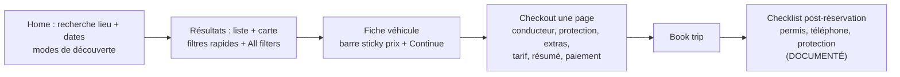
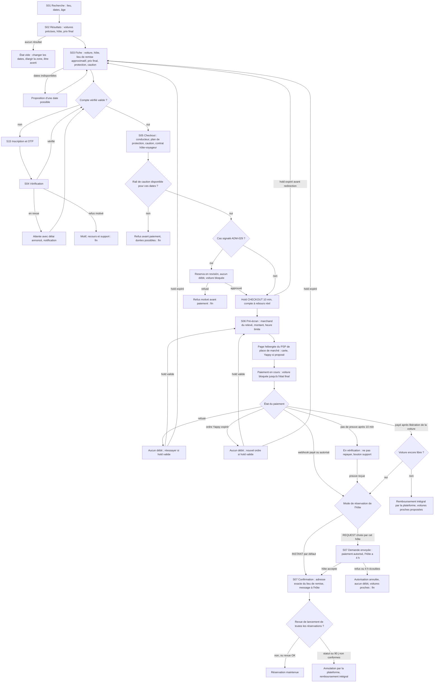
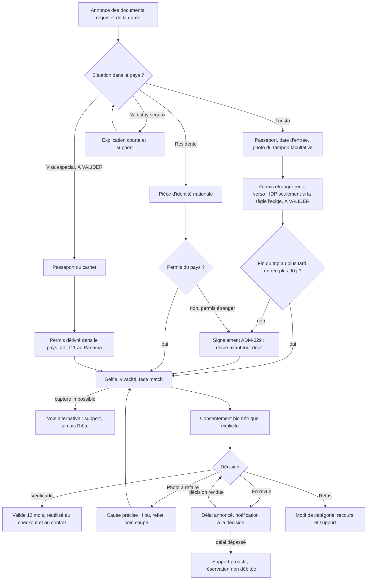
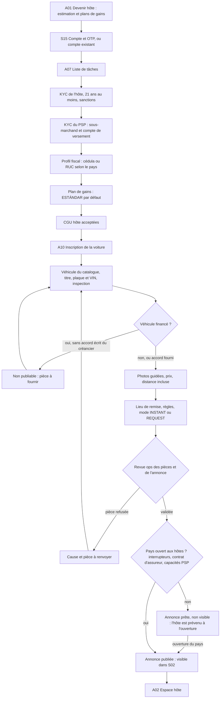
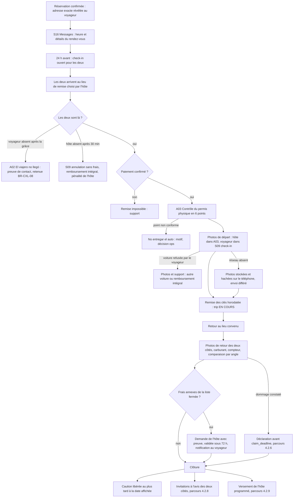
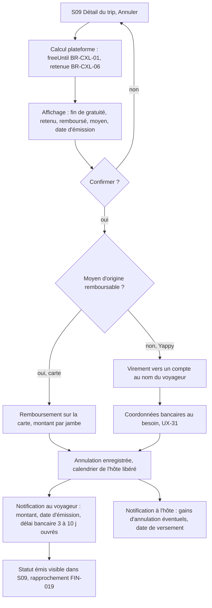
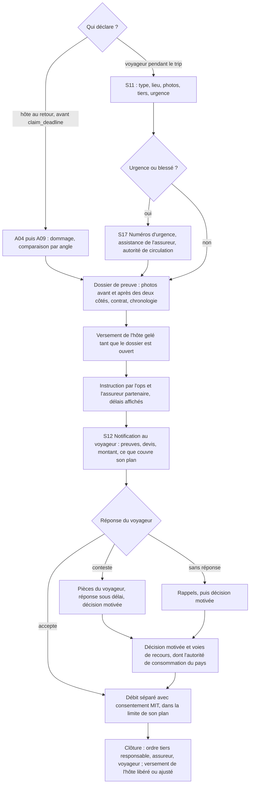
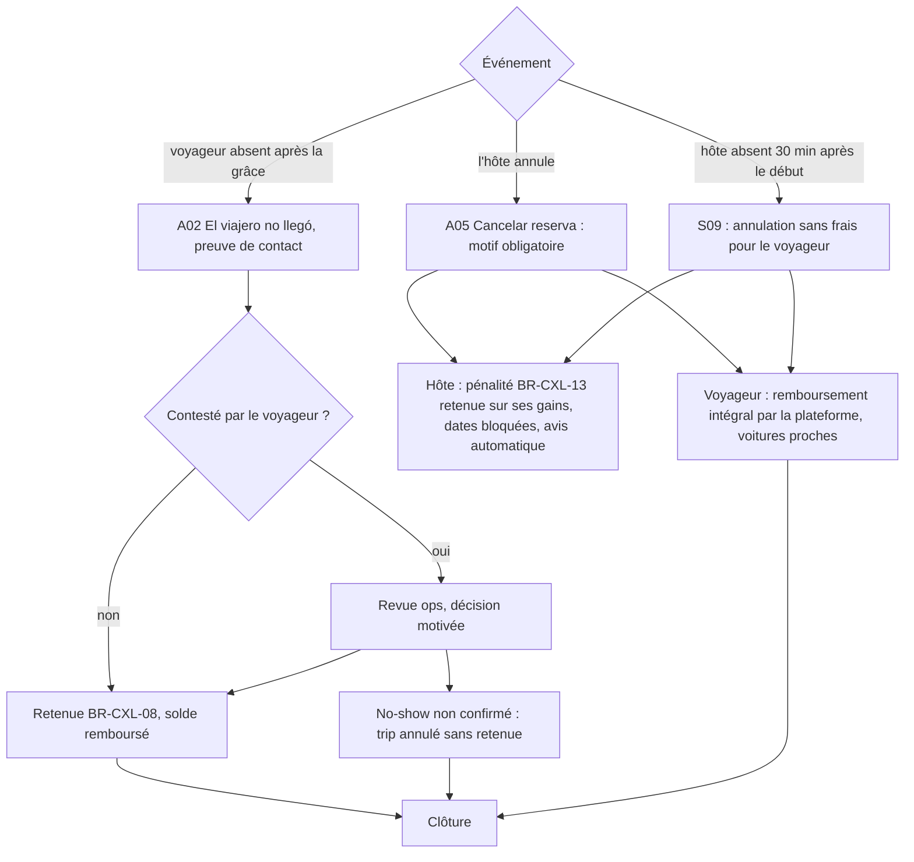
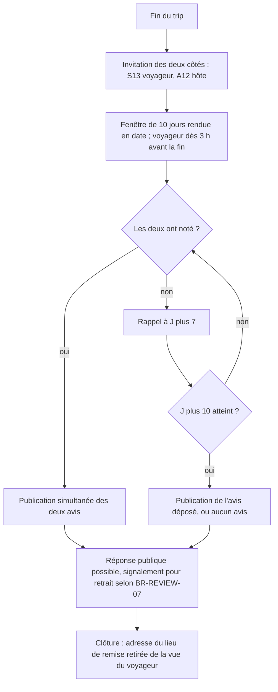
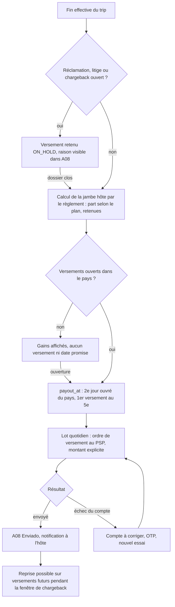

# 10b — Analyse UX/UI de Turo et principes UX de notre place de marché entre particuliers (Panama et Paraguay)

> **Mise à jour pivot P2P (US-059, paquet S7, 2026-11-02)** : Kmino est une **place de marché de particulier à particulier** (DEC-FONDATEUR-12, 13) : des particuliers louent **leur** voiture à d'autres particuliers ; **aucune agence, aucun comptoir, aucun loueur professionnel**. Les parcours suivent ceux de Turo (DEC-FONDATEUR-14, 16) : recherche par voiture précise, fiche centrée sur l'hôte, réservation instantanée par défaut, remise des clés entre personnes au lieu choisi par l'hôte, check-in photo des deux côtés, avis réciproques sur 10 jours, versements à l'hôte, espace hôte sur mobile. Source : `docs/team/impact/2026-11-02-pivot-p2p.md` (§b.7, §e, §f, §g ligne S7). Sections révisées : titre, §0, §3.0, §3.4 à §3.12 (alignement), **§3.5, §3.8, §3.14 (nouvelle), §4.1, §4.2, §4.3 (nouvelle), §5.1, §5.2**, §6 (aligné sur 22), §7, §8. Chaque choix « comme Turo » est inscrit dans `docs/team/COMME_TURO.md`.
> **Règle de lecture (pivot P2P)** : dans §1 et §2 (analyse de Turo) et dans les notes d'historique (VERIF_13, VERIF_18, alignement v4), toute mention d'agence, de loueur, de comptoir, de « Bêta pilote », de P0-A ou de P0-B est **historique** ; ce qu'elle décrivait est **sans objet (DEC-FONDATEUR-13)**. Les étiquettes de phase deviennent : **[Bêta]** = bêta P2P, lots 0 à 5 (analyse pivot §e.6, PROPOSÉ jusqu'à la révision de 19 par S6 et de 04 par S2), avec le lot quand il est connu (« L2 ») ; **[Lot C]** = connecteurs réels ; **[P1]** = après la bêta. Les anciennes formes « MANUEL » de la Bêta pilote ne sont plus décrites : la répartition fine par lot relève de S6 et de la révision 6 de 04.
> **Règle bilingue (DEC-FONDATEUR-11)** : tout texte visible cité dans les sections révisées porte une **clé i18n** (`<espace>.<écran>.<élément>`, convention de `packages/i18n/README.md`) et ses versions **es** et **en**, livrées ensemble ; le catalogue est au §4.3. Les variables sont nommées (`{brand}`, `{country}`, `{host_name}`, `{amount}`, `{date}`) : la marque et le pays ne sont jamais écrits en dur.
> **Règle trilingue (DEC-FONDATEUR-17 ; US-060, 2026-11-03)** : la règle précédente vaut pour **trois** langues : chaque clé du catalogue §4.3 a ses versions **es**, **en** et **fr**, livrées ensemble ; là où une section dit « es et en », lire « es, en et fr ». Le français est au tutoiement dans l'interface (PROPOSÉ, comme Turo en France, `docs/team/COMME_TURO.md`) et au vouvoiement dans les textes contractuels.
> **Règle de thème (DEC-MARQUE)** : la direction visuelle retenue est **Lienzo · Tinta** (`docs/design/US-028/tokens-lienzo-tinta.json`), **révisable** ; elle s'applique **uniquement par jetons** (§3.14, §8) : aucune couleur, police ni rayon codé en dur.
> **Alignement v4 (2026-10-30 ; historique, sans objet depuis le pivot P2P : le hold `AGENCY_LINK` sort du produit, UXQ-09)** : écran S06 (libération du hold AGENCY_LINK au lieu d'une « annulation », messages de libération différée, C-v3-17) et proposition BKG-014 du §7 (hold AGENCY_LINK distinct) alignés sur 17 v4 ; marques « (aligné v4 — 16 Rx) ».
> **Statut : EN COURS, version 3 du 2026-11-02 (pivot P2P, US-059)** ; version 2 du 2026-10-30 (version 1 corrigée après l'audit `verification/VERIF_13_UX.md` : 8 MAJEUR et 14 MINEUR traités ; chaque modification est marquée « (corrigé VERIF_13-<ID>) »). Rédigé par la recherche UX à partir des observations déjà consignées ; **aucune nouvelle navigation sur turo.com**.
> **Sources lues** : `03_SITEMAP_AND_NAVIGATION.md`, `05_GUEST_JOURNEYS.md`, `06_HOST_JOURNEYS.md`, `09_PRICING_PAYMENTS_AND_PAYOUTS.md`, `10_INSURANCE_TRUST_AND_SAFETY.md`, `sources/SRC_GUEST_DOCS.md` (survolé : §1.4, §4, §6, §7, §8), `15_PRODUCT_IMPROVEMENTS.md`, `18_MVP_AND_ROADMAP.md` (§0, §1.0–§1.3, §2), `12_PANAMA_MARKET.md` §2, §3.4, §3.7, §9–§10, `08_BUSINESS_RULES.md` (BR-PAY-06, BR-PAY-08, BR-PAY-09 bis, BR-PRICE-13, BR-CXL-01/06/07/08/12 et table de décision), **`04_FEATURE_INVENTORY.csv`** (colonnes `phase_mvp`, `lot_p0a`, `beta_pilote` et `notes` des lignes citées) et **`09b_PAYMENT_PARTNERS_PA_PY.md`** §0 et §2.1 (Yappy : ordre valable 5 min, pas d'API de remboursement trouvée) (corrigé VERIF_13-V13-18).
> **Règle de phase** (corrigé VERIF_13-V13-02, V13-13 ; **historique**, remplacée par la règle de lecture du pivot P2P ci-dessus) : une exigence n'est marquée **[Bêta]** que si la ligne 04 correspondante a `beta_pilote` = OUI ou SIMPLIFIÉ ; si elle est MANUEL ou DIFFÉRÉ, l'exigence est marquée [P0-A] et la forme Bêta (opération manuelle) est décrite à côté.
> **Règle d'identité** : notre plateforme a **sa propre identité visuelle**. Ce document analyse des **principes** (structure, hiérarchie, contenu, comportement) ; il ne décrit ni ne recommande de reproduire la mise en page, la palette, la typographie, l'iconographie, les noms de composants, les libellés commerciaux ou les badges de Turo. Quand un mécanisme est jugé bon, on en retient la **fonction**, pas la forme.

## 0. Conventions

| Étiquette | Sens dans ce document |
|---|---|
| **OBSERVÉ** | Vu à l'écran lors des sessions du 2026-10-30 (y compris « DIRECTEMENT TESTÉ » dans 05/06) ; référence = identifiant de section (ex. G-BOOK-02). |
| **DOCUMENTÉ** | Écrit dans la documentation Turo (centre d'aide, pages officielles), via `SRC_GUEST_DOCS` (noté SRC_G) ou 06/10. |
| **INFÉRÉ** | Déduit d'observations ou de documents, non vérifié directement. |
| **PROPOSÉ** | Recommandation pour notre produit. |

Limites de l'observation : sessions sur le **marché US** uniquement, **navigateur web en viewport étroit (~530 px, layout mobile web)** ; **la version desktop et les applications natives iOS/Android n'ont pas été observées** ; parcours connecté observé en lecture seule (compte guest sans véhicule) ; **aucune réservation, aucun check-in, aucune annulation, aucune déclaration de dommage réalisés** (ces parcours sont DOCUMENTÉS, pas OBSERVÉS). Aucun audit d'accessibilité instrumenté (lecteur d'écran, contraste mesuré) n'a été mené : les constats d'accessibilité de la §1.12 sont donc **INFÉRÉS** à partir de ce qui a été vu.

Abréviations : « nous » = notre plateforme ({brand}, aujourd'hui Kmino) ; « hôte » = particulier qui met **sa propre voiture** en location ; « voyageur » ou « guest » = particulier qui loue ; « trip » = une location ; « lieu de remise » = endroit choisi par l'hôte pour remettre et reprendre la voiture. **Historique** : « agence » désignait un loueur professionnel partenaire (ancien modèle pro-first), aujourd'hui **sans objet (DEC-FONDATEUR-13)** ; P0-A, Bêta pilote et P0-B étaient les phases de l'ancien `18_MVP_AND_ROADMAP.md` (voir la règle de lecture en tête).

---

## 1. Analyse UX/UI de Turo

### 1.1 Architecture de navigation

| # | Constat | Statut | Réf. |
|---|---|---|---|
| N1 | URL hiérarchique `/{pays}/{langue}/…` ; fiche véhicule = catégorie + lieu + marque + modèle + ID numérique. Navigation et SEO sont la même structure (pages catégorie × ville, aéroport, marque, modèle). | OBSERVÉ | 03 §1 ; G-LISTING-01 |
| N2 | Header non connecté minimal : logo, barre de recherche (lieu / début / fin), « Earn on Turo », assistant conversationnel, menu. La promotion de l'offre hôte (bannière de revenus) est placée **au-dessus** de la recherche guest. | OBSERVÉ | 03 §2 |
| N3 | Menu connecté guest : Favorites · Trips · Inbox — Profile · Account · Earn — Help / Legal — Log out. Pas d'outils hôte tant qu'il n'y a pas d'annonce. | OBSERVÉ (+ INFÉRÉ pour le menu hôte) | G-ACCOUNT-01 |
| N4 | Inbox à deux onglets : Messages (humains) et Notifications (flux d'activité). | OBSERVÉ | G-INBOX-01 |
| N5 | Découverte par **modes** (All / Airports / Monthly / Nearby / Delivered / Cities) plutôt que par seule saisie ; mémoire de la dernière recherche **sans compte** (« Continue searching »). | OBSERVÉ | G-SEARCH-01 |
| N6 | Footer dense (corporate, lieux, explorer, hosting, réseaux, stores, sélecteur de langue, liens CCPA). | OBSERVÉ | 03 §4 |
| N7 | Deep-link de retour après inscription (`sign-up?next=…`) : l'utilisateur revient là où il était. | OBSERVÉ | H-ONB |
| N8 | Wizard d'annonce à URL unique avec en-tête de progression « 1 of 9 · Next: … · Start over · View all steps ». | OBSERVÉ | H-ONB-02 |

**Lecture UX (INFÉRÉ)** : l'architecture sert deux publics (guest et hôte particulier) dans un même header, avec une priorité marketing donnée au recrutement d'hôtes. Pour un guest touriste arrivé avec une intention précise (dates + aéroport), la recherche reste accessible en un tap, ce qui est l'essentiel. La séparation Messages / Notifications est saine (le transactionnel ne noie pas la conversation).

### 1.2 Hiérarchie de l'information

**Résultats** (G-SEARCH-03) — ordre de lecture d'une carte : photo → modèle/année → note + nombre d'avis (ou « nouvelle annonce ») → badge hôte → ville + distance → prix (barré + total + « hors taxes »). OBSERVÉ. Le compteur « 200+ cars available » et la carte avec marqueurs de prix (total hors taxes) donnent l'échelle de l'offre. OBSERVÉ.

**Fiche véhicule** (G-LISTING-02, 21 blocs observés) — la fiche fait remonter **avant** les caractéristiques détaillées : les dates du trip, le lieu approximatif, la remise de durée déjà appliquée, la politique d'annulation, l'option de paiement différé, la distance incluse et l'assurance (blocs 5 à 12). Les éléments « réassurance plateforme » (« Included with your trip », bloc 15) et les règles avec amendes (bloc 19) viennent après les avis. Une barre sticky porte en permanence le prix et le CTA (bloc 20). OBSERVÉ.

**Lecture UX (INFÉRÉ)** : la hiérarchie privilégie la **décision transactionnelle** (dates, prix, conditions) sur la description du véhicule, ce qui est adapté à un achat de commodité. Points faibles : (1) la fiche mobile est **très longue** (21 blocs), et les informations qui conditionnent le coût réel (caution, frais jeune conducteur, trip fee, taxes) n'y figurent pas ou seulement en fin de parcours ; (2) les règles assorties d'amendes (tabac 150 $, saleté 150 $) arrivent tard, après l'engagement émotionnel.

### 1.3 Tunnel de conversion (home → recherche → fiche → checkout)

| Étape | Constat | Statut | Réf. |
|---|---|---|---|
| Home → résultats | 3 champs (lieu, début, fin) ; heure optionnelle « Add time ». Âge implicite = 30 dans l'URL de recherche. | OBSERVÉ / INFÉRÉ (sens du paramètre) | G-SEARCH-01, G-SEARCH-02 |
| Résultats | Filtres rapides en chips défilantes + panneau complet avec **compteur sur le CTA** (« View 200+ results », valeur plafonnée) ; la mise à jour en direct du compteur selon les filtres n'est pas démontrée (INFÉRÉ) (corrigé VERIF_13-V13-09). Filtre prix sur le **total hors taxes**. Fin de liste avec conseil de relance. | OBSERVÉ (compteur live : INFÉRÉ) | G-SEARCH-04, G-SEARCH-05, G-SEARCH-03 |
| Fiche | Dates modifiables sur place ; gestion de l'indisponibilité avec ajustement automatique de l'heure de fin + toast. | OBSERVÉ | G-LISTING-02 #5, #7 |
| Checkout | **Une seule page**, sections empilées ; CTA sticky « Book trip » ; en mode BNPL, le CTA devient « Continue » (étape supplémentaire). | OBSERVÉ | G-BOOK-01, G-BOOK-04 |
| Après réservation | Checklist (permis, téléphone, protection) à compléter **au plus tard 2 h avant le départ**, sinon annulation. | DOCUMENTÉ | SRC_G 1.4.5 ; G-BOOK-01 (bandeau) |

**Lecture UX (INFÉRÉ)** : tunnel court (4 écrans jusqu'au paiement) et optimisé pour la conversion. Le prix de l'âge (frais jeune conducteur) et la protection **dépendent d'un champ saisi au checkout** (âge), donc le prix vu en recherche peut augmenter de +60 $ ou +150 $ sur 3 jours au dernier écran (G-BOOK-02). La friction a été déplacée **après** le paiement (vérification), ce qui maximise la conversion mais crée un risque d'annulation tardive.

### 1.4 Friction d'inscription et de vérification

| # | Constat | Statut | Réf. |
|---|---|---|---|
| F1 | **Checkout invité sans compte** : prénom et nom « tels que sur le permis », téléphone, email, âge ; bouton « Log in » secondaire. | OBSERVÉ | G-BOOK-01 |
| F2 | Indicatif téléphonique **pré-rempli** (PA +507 et format « 6123-4567 » observés). La cause (géolocalisation IP) est une **déduction** de 05, pas une observation (corrigé VERIF_13-V13-09). | OBSERVÉ (pré-remplissage) / INFÉRÉ (cause IP) | G-BOOK-01 |
| F3 | Bandeau : il faudra fournir plus d'informations **après** la réservation « afin d'éviter l'annulation de votre voyage, ainsi que des frais ». | OBSERVÉ | G-BOOK-01 |
| F4 | Vérification : photos du permis recto/verso + selfie ; screening à chaque réservation ; revue 24–48 h ; le support **ne communique pas les raisons** d'un refus. | DOCUMENTÉ | SRC_G 1.4.1–1.4.4 |
| F5 | Échéance : tout terminé **2 h avant le départ**, sinon annulation. Le SMS en roaming n'est pas garanti ; les numéros virtuels sont refusés. | DOCUMENTÉ | SRC_G 1.4.5, 1.4.6 |
| F6 | Invité : 2 options de paiement ; connecté : 3 (Pay now / Pay later J−7 / Pay over time). | OBSERVÉ | G-BOOK-06 |
| F7 | Inscription : Apple / Google / email ; formulaire email = nom du permis, email, mot de passe, opt-in marketing **non pré-coché**, CGU cochées explicitement ; téléphone et date de naissance absents du formulaire (leur collecte « plus tard », au checkout ou à la vérification, est déduite par 06 : INFÉRÉ, corrigé VERIF_13-V13-09). | OBSERVÉ (formulaire) / INFÉRÉ (« plus tard ») | H-ONB (Inscription) |
| F8 | Nom légal (permis) distinct du **prénom préféré**, modifiable plus tard ; un hôte peut y mettre son nom commercial. | OBSERVÉ | G-BOOK-01, G-ACCOUNT-02 |

**Lecture UX (INFÉRÉ)** : le principe « réserver d'abord, se vérifier ensuite » est très efficace pour la conversion US, où la plupart des guests sont éligibles. Il est **mal adapté** à notre contexte : au Panama l'éligibilité dépend du **statut migratoire** (art. 110/111, 12 §3.4) et un touriste qui apprend après paiement qu'il ne peut pas conduire vit le pire scénario (refus + remboursement + plainte ACODECO possible). La phrase du bandeau F3 mêle menace (annulation, frais) et flou (« plus d'informations ») : elle inquiète sans dire quoi préparer.

### 1.5 Conception des formulaires

| # | Constat | Statut | Réf. | Appréciation |
|---|---|---|---|---|
| FO1 | Libellés explicites « First name on license » + aide « Preferred name can be added later ». | OBSERVÉ | G-BOOK-01 | Bon : explique *pourquoi* ce format. |
| FO2 | Âge en liste 18 → 55+ ; protections masquées tant que l'âge n'est pas choisi (« Select your age to see options »). | OBSERVÉ | G-BOOK-01 | Ambivalent : séquence logique, mais l'âge est demandé tard alors qu'il change le prix. |
| FO3 | Sélecteur d'heures par pas de 30 min (Midnight … 11:30 PM), format 12 h. | OBSERVÉ | G-LISTING-02 #5 | Correct US ; pour nous, format 24 h ou 12 h selon locale. |
| FO4 | Extras : stepper − 0 + borné par le stock ; option explicite « I don't want any extras ». | OBSERVÉ | G-BOOK-03 | Bon : refus explicite, pas d'ajout par défaut. |
| FO5 | Adresse : autocomplete Google ; repli « I don't see my address » → formulaire manuel ; puis confirmation du **pin** sur carte. | OBSERVÉ | H-ONB-02 | Bon : repli manuel + vérification visuelle. |
| FO6 | Bouton « Next » désactivé tant que tous les champs ne sont pas remplis (adresse manuelle). | OBSERVÉ | H-ONB-02 | Risque (INFÉRÉ) : un bouton désactivé n'explique pas ce qui manque. |
| FO7 | VIN : champ 17 caractères + case « older than 1981 » + aide « Where can I find it? » (emplacements). | OBSERVÉ | H-ONB-02 | Bon : aide contextuelle au moment exact du besoin. |
| FO8 | Consentement SMS automatique « By providing a phone number, you consent… » (pas de case). | OBSERVÉ | G-BOOK-01 | À éviter chez nous : consentement implicite, non conforme à notre principe d'opt-in (IMP-06, Ley 81/2019). |
| FO9 | Lien « Ajouter un code promo » sans effet visible en non connecté. | OBSERVÉ | G-BOOK-05 | Défaut probable (INFÉRÉ) : un contrôle qui ne réagit pas. |

### 1.6 Messages d'erreur, états vides et retours système

| # | Message ou état | Statut | Réf. | Appréciation |
|---|---|---|---|---|
| E1 | Indisponibilité : texte rouge « Cette voiture n'est pas disponible du {date} au {date} » + toast « End time was updated based on availability ». | OBSERVÉ | G-LISTING-02 #7 | Bon : le système corrige au lieu de bloquer. Risques (INFÉRÉ) : modification silencieuse d'une donnée saisie, toast éphémère, couleur comme signal principal, mélange FR/EN dans le même échange. |
| E2 | Pays non opéré : « Unfortunately, Turo hasn't launched car sharing in your country yet. » + Next désactivé. | OBSERVÉ | H-ONB-02 | Clair, mais **sans issue** (ni liste d'attente, ni alternative). |
| E3 | Fin de résultats : « No more cars available — Try changing your filters, adjusting your dates, or exploring the map ». | OBSERVÉ | G-SEARCH-03 | Bon : état vide actionnable avec trois leviers. |
| E4 | Trips vide : « No upcoming trips yet … Start searching ». Profil sans avis : « hasn't received a review on Turo yet ». | OBSERVÉ | G-TRIPS-01, G-PROFILE-01 | Bon : état vide avec CTA. |
| E5 | Refus de vérification : raisons non communiquées par le support. | DOCUMENTÉ | SRC_G 1.4.4 | À éviter : décision opaque, source de tickets et de recours. |

### 1.7 Confirmations et engagements

- Récapitulatif complet (véhicule, dates, lieu) en tête de checkout ; consentement unique « J'accepte de payer le montant total affiché, ainsi que les Conditions de service, les Conditions d'annulation et l'avis de confidentialité » ; CTA final « Book trip ». OBSERVÉ (G-BOOK-01 #1, #8, #9).
- Mode BNPL : le CTA change de libellé pour signaler l'étape supplémentaire. OBSERVÉ (G-BOOK-04). Bon signal d'état.
- Paiement différé : date de débit explicite (« automatically charged … on Thu, Jan 7 ») = J−7. OBSERVÉ (G-BOOK-06). Très bon : date précise, pas de « plus tard ».
- La page de confirmation post-réservation n'a pas été observée (aucune réservation). NON OBSERVÉ.

### 1.8 Notifications

| # | Constat | Statut | Réf. |
|---|---|---|---|
| NO1 | Matrice catégorie × canal (Email / SMS) ; « Voyage et compte » en email **obligatoire** ; push non visible sur le web. | OBSERVÉ | G-ACCOUNT-02 §2 |
| NO2 | Langue des notifications réglable : **8 locales listées** (en-US, en-AU, en-CA, en-GB, es-US, fr-CA, fr-FR, pt-BR). 05 écrit « 9 locales » mais n'en énumère que 8 : écart de la source, non résolu (corrigé VERIF_13-V13-09). | OBSERVÉ | G-ACCOUNT-02 §2 |
| NO3 | Notification réelle « conducteur additionnel » : contenu utile (heure de début de couverture, obligation de présence du primary guest) **mais placeholder non résolu `{6}`** et un champ mal substitué (prénom à la place du lieu). | OBSERVÉ | G-INBOX-01 |
| NO4 | SMS de vérification par short code, non garanti en roaming. | DOCUMENTÉ | SRC_G 1.4.6 |

**Lecture UX (INFÉRÉ)** : la granularité des préférences est bonne et la règle « transactionnel obligatoire » est saine. Le défaut NO3 montre l'absence de test automatique des gabarits : dans une notification de **couverture d'assurance**, une variable erronée touche directement la confiance et la compréhension des droits.

### 1.9 Éléments de confiance

| Élément | Statut | Réf. | Fonction UX |
|---|---|---|---|
| Note + nombre de trips, sous-notes (propreté, entretien…), réponses publiques de l'hôte aux avis, avis multilingues | OBSERVÉ / DOCUMENTÉ | G-LISTING-02 #2, #17 ; SRC_G 8.1 | Preuve sociale vérifiable. |
| Badge de programme hôte (critères publics et trimestriels) + filtre de recherche associé | OBSERVÉ / DOCUMENTÉ | G-LISTING-02 #2, #18 ; H-PERF-01 | Signal de qualité **gagné**, critères publiés. |
| Ancienneté de l'hôte (« 9 years of hosting ») | OBSERVÉ | G-LISTING-02 #18 | Continuité. |
| Liste « Included with your trip » (sans comptoir, fenêtre de retrait de 2 h, assistance 24/7) | OBSERVÉ | G-LISTING-02 #15 | Promesse plateforme homogène sur toutes les fiches. |
| Lien « Report listing » sur chaque fiche | OBSERVÉ | G-LISTING-02 #13 | Contrôle donné à l'utilisateur. |
| Mention télématique (collecte de données de conduite) | OBSERVÉ | G-LISTING-02 #19 | Transparence, mais placée en bas de fiche. |
| Coordonnées masquées avant réservation | DOCUMENTÉ | 10 §4 | Sécurité + anti-marché gris. |
| Badges « Verified » email/téléphone sur le profil | OBSERVÉ | G-PROFILE-01 | Confiance bilatérale. |
| Export de données en libre-service, fermeture de compte | OBSERVÉ | G-ACCOUNT-02 §7–8 | Contrôle des données. |
| « Turo is not an insurance company » (remboursement contractuel) | DOCUMENTÉ | H-ACQ | Honnêteté juridique, mais nuance difficile à comprendre pour un non-initié. |

### 1.10 Présentation du prix

| # | Constat | Statut | Réf. |
|---|---|---|---|
| P1 | En recherche et sur la fiche : **prix barré + « Total de X » + « Hors taxes »** ; marqueurs de carte en total hors taxes. La cause du prix barré n'est pas expliquée sur la carte. | OBSERVÉ | G-SEARCH-03, G-LISTING-02 #20 |
| P2 | Filtre prix sur le **total hors taxes** du séjour (et non sur le prix/jour). | OBSERVÉ | G-SEARCH-05 |
| P3 | Checkout : barre sticky « Total de X — **Taxes et frais inclus** ». Le libellé du total change donc entre fiche (hors taxes) et checkout (TTC). | OBSERVÉ | G-BOOK-01 #9 |
| P4 | **Trip fee** ≈ 22–24 % du net, formule non linéaire, visible seulement dans le détail du sous-total ; frais jeune conducteur révélés par le champ âge (+60 $ / +150 $ sur 3 jours). | OBSERVÉ | G-BOOK-02, G-BOOK-06 ; 09 §3 |
| P5 | Remise « non remboursable » (−10 %) **intégrée dans la ligne de base**, sans ligne dédiée ; le libellé commercial « Économisez 15 $US » correspond à l'écart TTC. | OBSERVÉ | G-BOOK-06 |
| P6 | Remise de durée affichée comme ligne (« Réduction pour 3 jours ou plus — 7 $US ») dès la fiche. | OBSERVÉ | G-LISTING-02 #8 ; G-BOOK-02 |
| P7 | **Nudges** : encart « Réservez rapidement pour éviter la hausse des prix… » dans la liste ; badge « Bonne affaire ! Prix inférieur aux options similaires » ; « Offre limitée dans le temps » sur le tarif non remboursable. | OBSERVÉ | G-SEARCH-03, G-LISTING-02 #4, G-BOOK-01 #5 |
| P8 | Livraison incluse dans le prix affiché en recherche (« all-in pricing ») pour l'aéroport. | DOCUMENTÉ | 08 BR-PRICE-13 (SRC_G 2.4.1) ; la formule ne figure pas dans 06 H-AIRPORT (corrigé VERIF_13-V13-09) |

**Lecture UX (INFÉRÉ)** : le total du séjour est affiché tôt (bonne pratique), mais il n'est pas final : **taxes, trip fee détaillé, frais d'âge et protection** s'ajoutent ou se révèlent au checkout. Le prix barré sans cause visible et la remise intégrée à la base rendent la décomposition difficile à vérifier par l'utilisateur. Les nudges d'urgence (« hausse des prix », « offre limitée ») relèvent d'une pression temporelle générique, non personnalisée ; dans notre contexte, ils seraient contraires au positionnement « precio final, sin sorpresas » (IMP-05) et exposés aux règles de protection du consommateur (ACODECO, 12 §3.7).

### 1.11 Clarté des conditions (annulation, protection, caution)

| Sujet | Ce que voit l'utilisateur | Statut | Réf. | Clarté (INFÉRÉ) |
|---|---|---|---|---|
| Annulation sur la fiche | « Annulation gratuite — Remboursement complet dans les 24 heures suivant la réservation. Options plus flexibles lors du paiement. » | OBSERVÉ | G-LISTING-02 #9 | Moyenne : la fiche montre la règle la plus restrictive et renvoie au checkout. |
| Annulation dans la liste | « Annulation gratuite possible (sous conditions) pour tous les voyages. » | OBSERVÉ | G-SEARCH-03 | Faible : « sous conditions » n'est pas expliqué. |
| Annulation au checkout | Deux tarifs avec dates explicites (« jusqu'au 13 janv. (veille du départ) ») | OBSERVÉ | G-BOOK-01 #5 | Bonne : date concrète calculée pour le trip. |
| Règles complètes | ½ ou 1 journée retenue, 50 % de la livraison remboursés, fuseau du véhicule, incohérence 24 h / 25 h dans la doc | DOCUMENTÉ | SRC_G 4.1.1–4.1.3 | Complexe ; non visible en entier au moment du choix. |
| Protection | 3 plans + refus ; « aucun reste à charge… sauf dommages mécaniques et intérieurs » ; RC « on an excess basis » | OBSERVÉ | 10 §1 | Moyenne : franchises chiffrées (bien), jargon assurantiel (mal), exclusions résumées en une incise. |
| Caution | Non affichée sur le trip testé ; montants et libération à 80 h documentés (valeur Turo, non reprise : 72 h chez nous, BR-PAY-06) | DOCUMENTÉ | BR-PAY-06 ; SRC_G 2.5 | Non évaluable à l'écran. |

### 1.12 Desktop vs mobile web

- **Mobile web (OBSERVÉ, ~530 px)** : la barre de recherche se réduit à « Search anywhere » (G-SEARCH-01) ; filtres en chips horizontales défilantes (G-SEARCH-04) ; fiche en colonne unique avec **barre sticky** prix + CTA (G-LISTING-02 #20) ; checkout empilé avec CTA sticky (G-BOOK-01 #9) ; assistant flottant sur les résultats (G-SEARCH-03).
- **Desktop : NON OBSERVÉ.** Toute comparaison serait spéculative ; on note seulement que la carte avec marqueurs de prix est présente en layout étroit (G-SEARCH-03), ce qui implique une bascule liste/carte (INFÉRÉ).
- **Lecture UX (INFÉRÉ)** : le mobile web est traité comme un vrai canal de conversion (checkout complet sans app), ce qui valide notre choix PWA. Risques (INFÉRÉS) : **empilement possible** d'éléments flottants — barre sticky (fiche G-LISTING-02 #20, checkout G-BOOK-01 #9), assistant flottant (résultats, G-SEARCH-03), bannière cookies (accueil, 03 §3) — qui pourraient masquer du contenu ou le focus clavier. Ces éléments ont été **observés séparément, sur des écrans différents** ; aucune superposition n'a été capturée (corrigé VERIF_13-V13-07) ; chips défilantes dont l'existence au-delà du bord n'est pas toujours perceptible.

### 1.13 Accessibilité (INFÉRÉ, aucun audit outillé)

| Constat | Base | Risque / point positif |
|---|---|---|
| Bouton icône avec libellé explicite (« Add car to favorites ») | OBSERVÉ (libellé relevé, G-SEARCH-03) ; exposition comme nom accessible **non vérifiée** (INFÉRÉ) (corrigé VERIF_13-V13-09) | Positif si le libellé est bien le nom accessible. |
| Indisponibilité signalée en **rouge** + toast auto-disparaissant | OBSERVÉ (G-LISTING-02 #7) | Risque WCAG 1.4.1 (couleur seule) et 4.1.3 (message d'état non annoncé) si le toast n'est pas en région live. |
| Boutons désactivés sans explication | OBSERVÉ (H-ONB-02) | Risque 3.3.1 / 3.3.2 (identification des erreurs, instructions). |
| Éléments sticky et flottants superposés | INFÉRÉ : éléments observés séparément (G-LISTING-02 #20, G-SEARCH-03, 03 §3), superposition non observée (corrigé VERIF_13-V13-07) | Risque 2.4.11 (focus non masqué, WCAG 2.2). |
| Carte et carrousels ; curseur de kilométrage | OBSERVÉ (carte, carrousels : G-SEARCH-03) ; curseur « probable » selon 05 G-SEARCH-05 : INFÉRÉ (corrigé VERIF_13-V13-09) | Risque 2.5.7 (alternative au glisser) à vérifier. |
| Mélange de langues dans un même écran | OBSERVÉ (G-SEARCH-03, G-LISTING-02, G-BOOK-01) | Risque 3.1.2 (langue des passages) : un lecteur d'écran prononce le français avec une voix anglaise. |
| Exigence de selfie + photos de permis | DOCUMENTÉ (SRC_G 1.4.1) | Barrière possible pour personnes malvoyantes ou à mobilité réduite des mains ; aucune voie alternative documentée. |

### 1.14 Problèmes de cohérence

| # | Problème | Statut | Réf. |
|---|---|---|---|
| C1 | **Mélange FR/EN** sur `/us/en` non connecté : encarts éditoriaux, badge prix, annulation, checkout en français ; titres, CTA, toasts en anglais. Connecté, tout repasse en anglais (préférence du compte). Cause probable (INFÉRÉ, corrigé VERIF_13-V13-09) : les composants suivent soit la langue du navigateur, soit la locale de l'URL. | OBSERVÉ (mélange) / INFÉRÉ (cause) | G-SEARCH-03, G-LISTING-02 #4/#7/#9, G-BOOK-01, G-BOOK-06 |
| C2 | **Placeholder `{6}` non résolu** et variable mal substituée dans une notification de couverture. | OBSERVÉ | G-INBOX-01 |
| C3 | Libellé du total qui passe de « Hors taxes » (fiche) à « Taxes et frais inclus » (checkout). | OBSERVÉ | G-LISTING-02 #20, G-BOOK-01 #9 |
| C4 | Nombre d'options de paiement différent invité / connecté (2 vs 3) sans explication. | OBSERVÉ | G-BOOK-06 |
| C5 | Documentation contradictoire (24 h vs 25 h de délai d'annulation ; 90 % vs part du plan sur la livraison ; 1 800 vs 3 300 mi). | DOCUMENTÉ | SRC_G 4.1.1 ; H-AIRPORT ; H-MONTHLY |
| C6 | Nom de l'assistant (« Ask Turo ») absent de la documentation d'aide. | OBSERVÉ / DOCUMENTÉ | 03 §2 ; SRC_G 8.7 |
| C7 | Lien « code promo » inactif en invité. | OBSERVÉ | G-BOOK-05 |

---

## 2. Ce qui fonctionne et ce qu'il faut éviter

### 2.1 Ce qui fonctionne (principes à retenir, sous notre propre forme)

| # | Principe | Pourquoi ça marche | Réf. | Statut |
|---|---|---|---|---|
| W1 | Total du séjour affiché dès la recherche, pas seulement un prix/jour | Le guest compare ce qu'il paiera vraiment ; filtre prix cohérent avec ce total. | G-SEARCH-03, G-SEARCH-05 | OBSERVÉ |
| W2 | Checkout invité, une seule page, CTA persistant | Moins d'abandons ; aucune création de mot de passe avant l'intention d'achat. | G-BOOK-01 | OBSERVÉ |
| W3 | Pré-remplissage intelligent (indicatif pays, format local du numéro) | Réduit les erreurs de saisie de téléphone, champ critique pour les OTP. | G-BOOK-01 | OBSERVÉ (pré-remplissage) ; source du pays (IP) INFÉRÉE (corrigé VERIF_13-V13-09) |
| W4 | Le système corrige au lieu de rejeter (heure de fin ajustée à la disponibilité) | Évite une impasse. | G-LISTING-02 #7 | OBSERVÉ |
| W5 | Dates concrètes dans les conditions (« jusqu'au 13 janv. », « débité le 7 janv. ») | Une date se comprend mieux qu'une règle relative (« 24 h avant »). | G-BOOK-01 #5, G-BOOK-06 | OBSERVÉ |
| W6 | Compteur de résultats sur le CTA du panneau de filtres (pour nous : mis à jour en direct) | Évite l'état « 0 résultat » découvert après coup. | G-SEARCH-05 | OBSERVÉ (« View 200+ results », valeur plafonnée) ; mise à jour en direct INFÉRÉE (corrigé VERIF_13-V13-09) |
| W7 | États vides actionnables (3 leviers proposés) | L'utilisateur sait quoi faire ensuite. | G-SEARCH-03, G-TRIPS-01 | OBSERVÉ |
| W8 | Refus explicite (« I don't want any extras », « Refuser la protection ») | Pas d'ajout par défaut, choix libre et visible. | G-BOOK-03, 10 §1 | OBSERVÉ |
| W9 | Nom légal séparé du nom d'usage / commercial | Cohérence KYC sans imposer le nom légal partout ; utile aux hôtes (prénom affiché, nom légal au contrat ; corrigé US-059). | G-ACCOUNT-02 | OBSERVÉ |
| W10 | Opt-in marketing non pré-coché, CGU cochées explicitement | Consentement libre. | H-ONB, G-BOOK-06 | OBSERVÉ |
| W11 | Wizard avec progression, étape suivante nommée, vue de toutes les étapes, recommencer | L'utilisateur sait combien il reste et peut s'orienter. | H-ONB-02 | OBSERVÉ |
| W12 | Aide contextuelle au moment du besoin (où trouver le VIN) | Réduit l'abandon sur un champ technique. | H-ONB-02 | OBSERVÉ |
| W13 | Repli manuel + confirmation sur carte pour l'adresse | Les adresses LATAM sont souvent mal géocodées (INFÉRÉ). | H-ONB-02 | OBSERVÉ |
| W14 | Préférences de notification par catégorie × canal, transactionnel obligatoire | Respecte l'utilisateur sans casser le service. | G-ACCOUNT-02 | OBSERVÉ |
| W15 | Signaux de qualité **gagnés** selon des critères publics | Crédibles parce que vérifiables. | H-PERF-01 | DOCUMENTÉ |
| W16 | Mémoire de recherche sans compte | Reprise rapide, utile aux touristes qui préparent sur plusieurs sessions. | G-SEARCH-01 | OBSERVÉ |

### 2.2 Ce qu'il faut éviter

Les anti-modèles sont numérotés **AM01–AM15** (anciennement A1–A15) pour ne pas être confondus avec les écrans A01–A13 (aujourd'hui l'espace hôte, §4.1 ; corrigé US-059) ; les renvois « anti-AMxx » de la §3 suivent cette numérotation (corrigé VERIF_13-V13-17).

| # | Anti-modèle | Pourquoi l'éviter (pour nous) | Réf. | Statut |
|---|---|---|---|---|
| AM01 | Prix « hors taxes » en recherche puis TTC au checkout ; frais révélés tard (trip fee, âge) | Rupture de confiance au dernier écran ; contraire à IMP-05 et au positionnement face aux prix d'appel des agrégateurs (12 §1.4). | G-SEARCH-03, G-BOOK-02 | OBSERVÉ |
| AM02 | Prix barré sans cause visible, remise noyée dans la ligne de base | Non vérifiable par l'utilisateur ; risque ACODECO sur la « référence » de prix (INFÉRÉ). | G-SEARCH-03, G-BOOK-06 | OBSERVÉ |
| AM03 | Urgence générique (« hausse des prix », « offre limitée ») | Pression non fondée sur une donnée du trip ; dégrade la confiance d'un public déjà méfiant envers la location de voitures (12 §3.7). | G-SEARCH-03, G-BOOK-01 #5 | OBSERVÉ |
| AM04 | Vérification d'éligibilité **après** paiement avec menace d'annulation et de frais | Au Panama, l'éligibilité dépend du statut (art. 110/111) : refus tardif = pire expérience + litige. | G-BOOK-01, SRC_G 1.4.5 | OBSERVÉ / DOCUMENTÉ |
| AM05 | Refus sans motif communiqué | Génère tickets, recours, réputation de « boîte noire ». | SRC_G 1.4.4 | DOCUMENTÉ |
| AM06 | Mélange de langues dans une même vue | Incompréhension, perte de crédibilité, défaut d'accessibilité. | C1 | OBSERVÉ |
| AM07 | Gabarits de notification non testés (`{6}`) | Une variable erronée dans un message de couverture ou de paiement peut être juridiquement trompeuse. | G-INBOX-01 | OBSERVÉ |
| AM08 | Consentement SMS implicite par saisie du numéro | Contraire à l'opt-in explicite Ley 81/2019 que nous retenons (IMP-06). | G-BOOK-01 | OBSERVÉ |
| AM09 | Correction silencieuse d'une donnée saisie (heure de fin) annoncée par un toast éphémère | L'utilisateur peut ne pas voir que son créneau a changé. | G-LISTING-02 #7 | OBSERVÉ |
| AM10 | Contrôles désactivés ou inactifs sans explication (Next grisé, lien promo muet) | Impasse silencieuse. | H-ONB-02, G-BOOK-05 | OBSERVÉ |
| AM11 | Impasse « pays non opéré » sans alternative | Perte d'un lead ; chez nous : proposer la liste d'attente ou une autre ville (corrigé US-059). | H-ONB-02 | OBSERVÉ |
| AM12 | Jargon assurantiel non expliqué (« excess basis », « actual cash value ») | Notre public lit souvent en langue seconde ; les exclusions doivent être lisibles (IMP-14). | 10 §1, H-ACQ | OBSERVÉ / DOCUMENTÉ |
| AM13 | Fiche très longue, règles à amende en bas de page | Les conditions qui coûtent de l'argent doivent être vues avant l'engagement. | G-LISTING-02 #19 | OBSERVÉ |
| AM14 | Superposition de couches flottantes en mobile | Masquage du contenu et du focus. | 03 §3, G-SEARCH-03, G-LISTING-02 #20 (éléments vus séparément) | INFÉRÉ (corrigé VERIF_13-V13-07) |
| AM15 | Dépendance au SMS par short code pour l'OTP | Échecs en roaming pour les touristes. | SRC_G 1.4.6 | DOCUMENTÉ |

---

## 3. Nos principes et exigences UX

Les identifiants `UX-xx` sont des exigences **PROPOSÉES** ; elles renvoient aux lignes de `04_FEATURE_INVENTORY.csv` quand elles existent (la révision 6 de 04, paquet S2, recalera les colonnes de phase). La phase est indiquée entre crochets : **[Bêta]** = bêta P2P (lots 0 à 5, avec le lot quand il est connu), **[Lot C]**, **[P1]** (règle de lecture en tête ; corrigé US-059).

### 3.0 Principes directeurs (PROPOSÉ ; révisés pour le pivot P2P, US-059)

1. **Prix final dès le premier écran.** Le chiffre vu en recherche est celui payé au checkout : loyer de l'hôte, trip fee (BR-PRICE-06), protection minimale obligatoire (`BASICA`, OQ-P2P-12) et taxe du pays ; seules les options choisies ensuite (protection supérieure, Extras) s'y ajoutent, ligne par ligne.
2. **Éligibilité connue avant paiement ; à défaut, aucun coût pour le voyageur.** Le voyageur sait **avant de payer** ce qu'on va vérifier et si son trip respecte la règle des 90 jours (rendue en dates) ; un refus décidé par notre revue après paiement est **remboursé intégralement par {brand}** (UXQ-12, BR-CXL-14). Forme dans la bêta P2P (corrigé US-059) :

| Moment | Ce qui est contrôlé avant paiement | Ce qui est contrôlé après | Si refus |
|---|---|---|---|
| **Bêta P2P** (VER-001 à 005, VER-007, BKG-012, ADM-029) | Identité vérifiée par le parcours hébergé du fournisseur KYC ; âge minimum ; statut et date d'entrée (UX-33) ; contrôles BKG-012. Un cas signalé (fin de trip > entrée + 90 j, résident avec permis étranger, autre règle ADM-029) met la réservation **en revue avant tout débit** (UXQ-08, `flagged_booking_payment_order` = revue avant le débit, fail-closed ; valeur à renommer par S4) : état `web.s05.review.title` « Reserva en revisión: no se te cobró nada », voiture bloquée pendant la revue. | Revue humaine des seuls cas signalés ; si la configuration de lancement impose la revue de **toutes** les réservations (ADM-029), le risque est annoncé avant paiement (`web.s05.review.notice`). | Refus motivé **avant** tout débit ; si un refus intervient malgré tout après paiement, remboursement intégral par {brand}, par jambe (`PLATFORM_REVIEW_DELAY`, BR-CXL-07, BR-CXL-14). |
| **Cible** (après avis OQ-BR-21) | Règle 90 jours / art. 111 appliquée automatiquement avant paiement, avec proposition de la date de fin maximale (IMP-09, EC-50). | Revue limitée aux exceptions. | Refus avant paiement, motif de catégorie et recours. |

3. **Une date, pas une règle.** Chaque délai (annulation, débit, libération de caution, versement à l'hôte, fin de la fenêtre d'avis) est rendu en date et heure locales du véhicule.
4. **Le réseau est une option.** Les moments critiques (remise et retour sur un parking, check-in photo, urgence) fonctionnent avec un réseau faible, et dégradent proprement sans réseau.
5. **Espagnol et anglais livrés ensemble, une langue par écran.** Aucune vue ne mélange les langues ; aucune chaîne n'existe dans une seule langue (DEC-FONDATEUR-11).
6. **La voiture précise et son hôte sont au centre.** On cherche une voiture précise (modèle, année, photos de l'hôte), jamais une catégorie ; l'hôte est visible partout (prénom, monogramme ou photo, ancienneté, réactivité, « identité vérifiée », avis). Le positionnement entre particuliers se comprend au premier coup d'œil (DEC-FONDATEUR-12 ; §3.14). L'hôte est un utilisateur de premier rang : il gère tout depuis son téléphone (§3.8).
7. **Transparence sur l'argent.** Toute somme bloquée ou versée est expliquée : combien, pourquoi, qui la détient, jusqu'à quand, comment elle revient (caution du voyageur, §3.5 ; versement de l'hôte, UX-45).
8. **Identité propre.** Système de design original défini par notre marque, appliqué par jetons (direction Lienzo · Tinta, révisable, §3.14) ; aucune reprise des patterns visuels identifiables de Turo (palette, badges, noms de programmes, libellés commerciaux, vocabulaire de marque).

### 3.1 PWA mobile-first

| ID | Exigence | Phase |
|---|---|---|
| UX-01 | Conception à 360 px de large d'abord (Android d'entrée de gamme), puis 768 px et 1280 px. Aucune fonctionnalité réservée au desktop, ni pour le voyageur ni pour l'hôte : l'**espace hôte est mobile d'abord** (l'hôte gère tout depuis son téléphone, écrans A01–A13), utilisable sur tablette et desktop (corrigé US-059). | [Bêta] |
| UX-02 | Budget de poids : premier chargement < 2 Mo (IMP-35), JS critique < 200 Ko compressé, LCP < 2,5 s et INP < 200 ms mesurés sur profil « 3G rapide » ; images en formats modernes avec tailles adaptées. | [Bêta] (budget), [P1] (PWA complète, IMP-35) |
| UX-03 | Installable (manifest, icône, écran de démarrage) **sans l'exiger** : tout le parcours fonctionne dans le navigateur. Invitation à installer seulement après la réservation (moment où l'app hors ligne a une valeur), ou après la publication de la première voiture pour un hôte. | [Bêta] |
| UX-04 | iOS : ne pas dépendre des notifications push web ni du stockage persistant ; tester le comportement d'éviction du stockage et de la caméra en PWA iOS (TRP-056). Notifications critiques via WhatsApp/SMS/email, jamais via push seul. | [Bêta] (test TRP-056) |
| UX-05 | Une seule couche flottante à la fois en bas d'écran (barre d'action) ; assistant ou aide accessible depuis l'en-tête plutôt que flottant. **Bêta : aucune bannière de consentement** (aucun cookie non essentiel, 18 §2) ; quand une bannière existera (P1), elle ne se superposera jamais à la barre d'action (corrigé VERIF_13-V13-13). | [Bêta] (couche unique) / [P1] (bannière) |

### 3.2 Check-in hors ligne et faible bande passante

| ID | Exigence | Phase |
|---|---|---|
| UX-06 | Mise en cache dès la confirmation : contrat et constancia PDF, **lieu de remise** (adresse exacte révélée à la confirmation, plan), heure du rendez-vous, prénom de l'hôte, téléphone d'urgence, référence de réservation, checklist des documents à présenter à l'hôte (IMP-35, IMP-12 ; corrigé US-059). | [Bêta] |
| UX-07 | Assistant photo guidé par angle avec silhouette de cadrage, compteur « 7 / 18 », contrôle de netteté local, horodatage et position de l'appareil, **empreinte SHA-256 calculée à la prise** (IMP-10, TRP-002). | [Bêta] en ligne, **des deux côtés** : l'hôte (A03, A04) et le voyageur (S09 · check-in, S09 · check-out) photographient la voiture (BR-PICKUP-03, NOUVELLE-08, L3) ; hors ligne (TRP-057) : lot fixé par S6 (corrigé US-059) |
| UX-08 | File d'envoi visible : chaque photo porte un état (*en attente*, *envoi*, *envoyée*, *échec – réessayer*) ; reprise automatique au retour du réseau ; l'utilisateur ne peut pas clôturer l'état des lieux comme « synchronisé » tant que toutes les photos ne sont pas envoyées, mais peut le clôturer comme « enregistré sur l'appareil » (`web.checkin.queue.savedOnDevice`). | [Bêta] |
| UX-09 | Mode « datos bajos » : vignettes compressées en liste, photos HD à la demande, carte statique en repli de la carte interactive. | [P1] |
| UX-10 | Jamais de perte de saisie : brouillon local de chaque formulaire long (checkout, KYC, état des lieux) restauré après coupure ou fermeture d'onglet (y compris l'inscription d'une voiture, A10). | [Bêta] |

### 3.3 Langue et ton : espagnol, anglais et français ensemble, espagnol neutre LATAM (corrigé US-059, DEC-FONDATEUR-11 ; français ajouté US-060, DEC-FONDATEUR-17)

| ID | Exigence | Phase |
|---|---|---|
| UX-11 | Langue par défaut `es` (espagnol neutre d'Amérique latine, validé par un relecteur panaméen **et** un relecteur paraguayen), `en` et `fr` complets et livrés en même temps (DEC-FONDATEUR-11 et 17 ; `fr` ajouté par US-060, catalogue §4.3) ; détection par `Accept-Language` puis choix explicite mémorisé ; sélecteur visible dans l'en-tête. **Une vue = une langue** : aucun composant ne suit une autre source de langue que la préférence courante (anti-C1). Attribut `lang` correct sur la page et sur les passages cités dans une autre langue (avis). | [Bêta] (I18N-003, I18N-004) |
| UX-12 | Tutoiement (« tú ») dans l'interface et les messages, vouvoiement (« usted ») dans le contrat, les décisions de litige et les textes juridiques : **hypothèse à tester** en §5 auprès de voyageurs et d'hôtes résidents au Panama et au Paraguay (corrigé US-059). Jamais de voseo ni de « vosotros ». | [Bêta] (test) |
| UX-13 | Glossaire contrôlé (extrait) : *auto* (neutre ; les mots propres à un pays, comme « carro » au Panama ou « registro de conducir » au Paraguay pour *licencia*, passent par une **surcharge régionale du catalogue** par locale, `es-PA` et `es-PY`, via `createTranslator(profile, overrides)` de `packages/i18n` : jamais par une constante ou une condition de pays dans le code ; corrigé US-059), *alquiler*, *licencia de conducir*, *cédula*, *pasaporte*, *sello de entrada*, *depósito de garantía* (jamais « fianza », réservé à la caution-assurance IMP-02), *retiro* / *devolución*, *anfitrión* / *anfitriona* (en : *host*), *viajero* (en : *guest*), *punto de entrega* (en : *pick-up spot*), *auto de un vecino* (en : *a neighbor's car*), *ITBMS* / *IVA*, *precio final*, *cancelación gratuita hasta…*, *cargo* (débit), *reembolso emitido* (jamais « recibido », BR-PAY-08). Glossaire EN aligné. **Exclu** : *mostrador*, *agencia*, *flota* et tout vocabulaire de loueur (DEC-FONDATEUR-13 ; corrigé US-059). | [Bêta] |
| UX-14 | Les avis, messages et descriptions de l'hôte restent dans leur langue d'origine, avec mention de la langue ; traduction automatique proposée à la demande et étiquetée comme telle. | [P1] |

### 3.4 Prix tout compris en USD et en PYG (les deux construits dès le départ, DEC-FONDATEUR-04)

| ID | Exigence | Phase |
|---|---|---|
| UX-15 | Prix affiché en liste, sur la carte et sur la fiche = **total du trip TTC** (loyer de l'hôte + trip fee BR-PRICE-06 + protection minimale `BASICA` + taxe du pays — ITBMS 7 % au Panama, IVA 10 % au Paraguay, lignes taxables À VALIDER, 08 OQ-BR-14 — + tout frais obligatoire de l'hôte) pour les dates saisies, libellé `common.price.finalForDays` (pluriel : « Precio final · {count} días » / « Final price · {count} days ») ; prix/jour en secondaire. **Le même chiffre et le même libellé** figurent sur la barre d'action de la fiche et du checkout (anti-C3). La protection minimale est incluse dès la bêta (IMP-05, PRC-026, NOUVELLE-14 ; corrigé US-059). | [Bêta] (SRC-042, PRC-021) |
| UX-16 | Format monétaire : « US$ 145.00 » en `es-PA` et `en`, deux décimales au checkout, arrondi à l'unité accepté en liste si toutes les valeurs sont arrondies de la même façon. Paraguay (construit dès le départ, DEC-FONDATEUR-04) : « ₲ 1.250.000 » sans décimale + équivalent indicatif « ≈ US$ 160 (referencial) » (EC-32). | [Bêta] (USD et PYG) |
| UX-17 | Détail déroulant ligne par ligne, toujours accessible (fiche et checkout) : loyer (prix/jour × jours), remises (une ligne par remise, avec sa cause), trip fee, protection choisie, frais de l'hôte (livraison, Extras), taxe, total (corrigé US-059). **Aucune remise intégrée silencieusement dans une autre ligne** (anti-AM02). | [Bêta] |
| UX-18 | Prix barré autorisé **seulement** si la référence est le prix du même véhicule pour les mêmes dates sans la remise, et si la cause est écrite à côté (« −10 % por 7 días o más »). | [P1] (remises de durée, PRC-008) |
| UX-19 | Pas de nudge d'urgence générique. Seuls des signaux **factuels et spécifiques** au trip sont autorisés (ex. `web.s03.signal.bookedAfter` « Este auto ya está reservado justo después de tus fechas: devuélvelo a tiempo. », calculé sur le calendrier de l'hôte ; corrigé US-059) ; jamais de minuteur artificiel. | [Bêta] |
| UX-20 | Le prix est recalculé et réaffiché quand une donnée change (âge, conducteur additionnel, option) avec un message d'état annoncé aux lecteurs d'écran (« El precio final cambió a US$ 162.00 »). Toute variation entre fiche et checkout est un défaut suivi (métrique M-PRIX-01, §5). | [Bêta] |

### 3.5 Explication transparente de la caution (dépôt de garantie) (refondu US-059, pivot P2P)

Référence : BR-PAY-06, BR-PAY-08, BR-PAY-09 bis (08), analyse pivot §c.4, OQ-P2P-04, NOUVELLE-07 (L2), IMP-02. Dans la bêta P2P, la caution est **celle de {brand}, la même pour tous les hôtes d'un pays** : ni l'hôte ni une agence ne la fixent (UXQ-02 sans objet). Elle est prise **sur la carte du voyageur** par le PSP de place de marché (en `FAKE` jusqu'au lot C), et ne couvre que les **frais annexes de la liste fermée** de BR-PAY-06 (carburant, retard, kilométrage, nettoyage / tabac / animaux, péages) : **aucun dommage n'est prélevé sur la caution** ; les dommages suivent leur procédure (BR-PAY-09 bis, BR-DAMAGE-06 : tiers responsable, puis assureur partenaire, puis voyageur dans la limite de son plan, §4.2.6). Rails, dans l'ordre (fail-closed, une capacité PSP inconnue vaut « non ») : (1) pré-autorisation unique si la durée tient dans `provider_max_hold` ; (2) ré-autorisation planifiée si `SUPPORTS_REAUTH` est validée ; (3) débit puis remboursement, plafonné à `deposit_charge_cap[pays]`, actif en production seulement si `funds_holding_enabled[pays]` = `true` et l'avis OQ-PAY-06 favorable ; (4) sinon, réservation refusée **avant paiement** (`DEPOSIT_RAIL_UNAVAILABLE`, nom PROPOSÉ) avec les durées possibles.

| ID | Exigence | Phase |
|---|---|---|
| UX-21 | Bloc `web.s03.deposit.title` « Depósito de garantía » sur la fiche (S03) **et** au checkout (S05), avec **6 réponses fixes**, toutes calculées par la plateforme : **cuánto** (montant BR-PAY-06 de la classe du véhicule, formaté par `formatMoney` en USD ou en PYG) ; **quién lo retiene** (`web.deposit.holder` : {brand}, via le prestataire de paiement, jamais l'hôte ; le nom exact du marchand vient de la configuration du pays) ; **cómo** (`web.deposit.how.preauth` pré-autorisation, ou `web.deposit.how.chargeRefund` cargo y reembolso, selon le rail calculé pour les dates) ; **qué cubre** (`web.deposit.covers` : liste fermée de BR-PAY-06) ; **qué no cubre** (`web.deposit.notCovers` « Los daños no se cobran de este depósito. ») ; **cuándo vuelve** (date au plus tard, UX-22). Le bloc ne dépend d'aucune déclaration de l'hôte : l'ancienne couverture « selon la déclaration de l'agence » (PAY-035) est **sans objet (DEC-FONDATEUR-13)**. | [Bêta] L2 (NOUVELLE-07) |
| UX-22 | Date de libération affichée comme date **au plus tard** (`web.deposit.releaseBy`) : la décision est prise à `min(release_at, auth_expiry − 2 h)` avec `release_at = fin effective + 72 h` (BR-PAY-06) ; la libération peut donc être plus tôt que la date affichée, et le préavis de retenue (≥ 48 h) est calculé sur la date de décision réelle. Si le trip change, la date est recalculée et notifiée. Toute retenue partielle est **demandée par l'hôte avec preuve** (photo ou relevé horodaté de A04, frais annexes validés sous 72 h, 08 BR-REIMB), **notifiée au voyageur au moins 48 h avant** la décision, et contestable depuis la notification (`web.deposit.contest`). | [Bêta] L2–L3 |
| UX-23 | Avertissement avant paiement quand le rail est « débit puis remboursement » (carte de débit, ou durée au-delà de la pré-autorisation) : `web.deposit.debitWarning` « El depósito se cobra y luego se reembolsa. Emitiremos el reembolso el {date}; tu banco puede tardar de 3 a 10 días hábiles en mostrarlo. » (BR-PAY-08 : on parle d'**émission**, jamais de réception). Rail interdit tant que `deposit_charge_cap[pays]` est inconnu (inconnu ⇒ 0) ou que `funds_holding_enabled[pays]` = `false` en production. | [Bêta] L2, sous réserve des capacités PSP |
| UX-24 | **Sans objet (DEC-FONDATEUR-13 ; corrigé US-059)** : le filtre « Sin tarjeta de crédito » supposait des politiques de caution par agence. Dans la bêta P2P, les rails de caution sont les mêmes pour toutes les voitures d'un pays ; si aucun rail ne couvre les dates, le message `web.deposit.unavailable` l'annonce **avant le paiement**, avec les durées possibles. | — |
| UX-25 | Après le retour, écran de suivi `web.s09.deposit.title` « Tu depósito » avec une frise : bloqueado → (frais annexes demandés par l'hôte, s'il y en a, avec preuve et date limite de contestation) → liberado / reembolso emitido (date). **Pas d'étape « en revisión »** : la libération n'est **jamais suspendue** par une réclamation de dommage (BR-PAY-06), qui suit sa propre procédure (S12). Aucune formulation qui laisse croire que {brand} ou l'hôte peut « garder » la caution. | [Bêta] L3 (dans S09) |

### 3.6 UX des paiements locaux (carte, Yappy si le PSP le propose) (révisé US-059, pivot P2P)

Dans la bêta P2P, **le voyageur paie {brand}**, marchand de référence, par la page hébergée du **PSP de place de marché** (en `FAKE` jusqu'au lot C, DEC-FONDATEUR-03) ; le PSP répartit le paiement en **jambes** dont chaque montant est calculé par nos règles (hôte, assureur, plateforme, taxe ; analyse pivot §c.2, NOUVELLE-04). La réservation n'est confirmée **qu'à réception du webhook** du PSP. Le paiement par lien de l'agence (mode b), le hold `AGENCY_LINK` et le paramètre `agency_link_hold_minutes` sont **sans objet (DEC-FONDATEUR-13)** (UXQ-09) : seul reste le hold `CHECKOUT`. Yappy n'est proposé que si la capacité `SUPPORTS_YAPPY_IN_MARKETPLACE` est validée (UXQ-01 ; inconnue ⇒ « non »). Les maquettes n'écrivent pas « cobra {brand} » tant que l'avis juridique sur la détention de fonds n'est pas rendu (OQ-MK-02 ; `docs/design/US-028/PROPOSITIONS.md`, « Encaissement ») : elles montrent le total, la taxe et le nom du marchand qui figurera sur le relevé.

**Cycle des minuteries** — trois durées distinctes, à ne pas confondre à l'écran :

| Minuterie | Durée | Source | Ce que voit le voyageur |
|---|---|---|---|
| Hold de checkout (voiture bloquée avant paiement) | **10 min**, borné à `hold_max_total_minutes` = 20 | BKG-014, 08 BR-BOOK-10 | compte à rebours réel jusqu'à la redirection vers le PSP : `web.s05.hold.until` « Guardamos este auto para ti hasta las {time} » |
| Ordre Yappy (dans la page du PSP, si proposé) | **5 min** (états Ejecutado / Rechazado / Cancelado / Expirado) | 09b §2.1 ; PAY-004 | instructions du PSP, non réinterprétées ; au retour : état final lu sur le webhook |
| Attente de preuve après paiement | jusqu'au webhook | PAY-034 | `web.s06.verifying.title` « Pago en verificación », pas de second paiement possible pendant qu'un ordre est **actif** |
| Réponse de l'hôte en mode `REQUEST` (seulement si l'hôte l'a choisi) | **4 h** (BR-BOOK-01, `{param}`) | OQ-P2P-10 | `web.s07.request.pending` « {host_name} tiene hasta las {time} para responder. No se te cobra nada si no acepta. » |

Règles PROPOSÉES : (1) quand le voyageur quitte notre site pour la page du PSP, la réservation passe en « paiement en cours » et la voiture reste bloquée **jusqu'à l'état final du paiement**, dans la limite de `hold_max_total_minutes` ; (2) **ordre Yappy expiré** : message `web.error.yappyExpired` (§3.12) + bouton `web.s06.yappy.newOrder` « Generar una nueva orden » si le hold est encore valide, sinon retour à la fiche avec dates conservées ; (3) **paiement reçu après libération de la voiture** (webhook tardif) : confirmer si la voiture est encore disponible, sinon **remboursement intégral par {brand}**, par jambe (NOUVELLE-05), et proposition d'autres voitures proches ; (4) **sortie de l'attente** : au-delà de 10 min sans preuve, bouton `web.s06.support` « Hablar con soporte » + numéro de réservation ; (5) **mode `REQUEST`** (comme Turo à l'époque des demandes, PROPOSÉ) : le paiement est **autorisé** puis capturé à l'acceptation de l'hôte ; refus ou expiration ⇒ autorisation annulée, aucun débit, autres voitures proposées ; si le PSP du pays n'a pas `SUPPORTS_PREAUTH`, le mode `REQUEST` n'est pas proposé aux hôtes de ce pays (fail-closed).

| ID | Exigence | Phase |
|---|---|---|
| UX-26 | Avant la redirection : écran court `web.s06.pre.title` qui annonce le **nom du marchand qui apparaîtra sur le relevé** (donnée de configuration du pays, jamais l'hôte), le montant exact, les moyens disponibles (carte, Yappy si proposé) et le fait que l'on quitte notre site pour une page sécurisée du PSP (`web.s06.pre.leaving`). | [Bêta] L2 |
| UX-27 | Retour du PSP : état `web.s06.verifying.title` « Pago en verificación » avec indicateur de progression et `web.s06.verifying.body` « Esto suele tardar menos de un minuto. No pagues de nuevo. » ; **jamais** d'écran « confirmé » avant le webhook ; au-delà de 2 min, `web.s06.verifying.slow` « Seguimos esperando la confirmación de tu banco » + numéro de réservation + promesse de notification ; au-delà de 10 min, sortie vers le support (règle 4) ; bouton `web.s06.payAgain` « Pagar de nuevo » **désactivé seulement tant qu'un ordre est actif**, réactivé dès un état final non payé — anti double paiement, idempotence PAY-019. | [Bêta] L2 |
| UX-28 | Yappy sur mobile (seulement si `SUPPORTS_YAPPY_IN_MARKETPLACE` est validée) : prévoir le retour depuis l'app Yappy (deep link) et le cas « l'utilisateur ne revient pas » (le webhook confirme quand même ; notification envoyée) ; afficher que l'ordre **expire en 5 minutes** et gérer l'état « Expirado » (règle 2). Sur desktop : afficher les instructions du PSP (QR ou numéro) sans les réinterpréter. | [Lot C] (capacité PSP) |
| UX-29 | Échec de paiement : message en trois parties (ce qui s'est passé, ce qui n'a **pas** été débité, que faire, `web.error.paymentDeclined`), conservation de la voiture jusqu'à la fin du hold de **10 min** (BKG-014) avec compte à rebours **réel** et heure limite affichée. | [Bêta] L2 |
| UX-30 | Carte enregistrée pour les débits après le trip (MIT : frais annexes, franchise du voyageur selon son plan, dommages) : case de consentement séparée, non pré-cochée (`web.s05.mitConsent`), qui liste les débits possibles et rappelle que les dommages suivent une procédure distincte avec notification (BR-PAY-09, BR-PAY-09 bis, REQ-PAY-DMG-01) ; affichage des 4 derniers chiffres et de la marque. `SUPPORTS_MIT` est une capacité **bloquante** (analyse pivot §c.5). | [Bêta] L2–L3 (US-703) |
| UX-31 | Remboursements : exécutés par {brand}, par jambe, sur le moyen d'origine (NOUVELLE-05) ; choix d'un autre rail présenté au voyageur seulement quand le natif est impossible (Yappy → virement), sans conversion en crédit par défaut (BR-PAY-08, SM-8) ; collecte des coordonnées bancaires au moment du besoin seulement. **Données financières personnelles** : finalité « remboursement » au registre Ley 81 (LEG-010) ; **{brand} responsable du traitement, données invisibles de l'hôte** (défaut PROPOSÉ d'UXQ-11, À VALIDER par l'avocat) ; coordonnées masquées après usage, jamais par WhatsApp. | [Bêta] L2 |

### 3.7 Vérification d'identité selon le statut (touriste, résident, résidence spéciale) (révisé US-059)

Référence : IMP-09, 12 §3.4 (art. 109, 110, 111 : règles du Panama ; celles du Paraguay sont des **données de pays** à documenter, À VALIDER), 04 VER-001 à VER-005, VER-007, VER-013, VER-015, ADM-029 ; principe n° 2 (§3.0) pour le moment du paiement. Le voyageur et l'hôte passent par le **même** parcours KYC hébergé (l'hôte y ajoute celui du PSP et son profil fiscal, UX-40, OQ-P2P-01). **L'hôte ne collecte jamais de documents** (BR-VERIF-10) et ne voit ni le numéro ni l'image d'une pièce (NOUVELLE-16).

| ID | Exigence | Phase |
|---|---|---|
| UX-32 | Vérification d'identité **avant le paiement**, réutilisable 12 mois (IMP-09) ; annoncée dès la fiche (`web.s03.kyc.notice` « Necesitarás: licencia vigente, pasaporte o cédula y una selfie. Tarda unos 3 minutos. ») ; progression visible en 4 étapes (statut, documents, selfie, décision). | [Bêta] L1 |
| UX-33 | Première question, en langage clair, avec aide : `web.s04.status.question` « ¿Cuál es tu situación en {country}? » → **Turista** (`web.s04.status.tourist` « Entraste a {country} hace menos de 90 días con pasaporte ») / **Residente** (`web.s04.status.resident` « Tienes un documento de identidad de {country} ») / **Visa especial o permiso de estadía** (`web.s04.status.special` ; aucun exemple de catégorie tant qu'OQ-BR-21 est ouverte). Un lien `web.s04.status.unsure` « No estoy seguro » ouvre une explication courte et propose le support. Les libellés de pièces (cédula, cédula E, carnet) sont des **données de pays**. Collecte par le fournisseur KYC ou par deux champs au checkout selon UXQ-03. | [Bêta] L1–L2 (VER-007) |
| UX-34 | Documents demandés selon le statut : **touriste** = passeport + date d'entrée (saisie + photo du tampon) + permis étranger valide ; **résident** = pièce nationale + permis du pays ; **visa spécial** = passeport ou carnet + permis délivré dans le pays (au Panama : ATTT, art. 111). L'IDP est demandé seulement si la règle du pays l'exige (À VALIDER, 12 §3.4). | [Bêta] L1 |
| UX-35 | Contrôle des 90 jours rendu **en dates** : `web.s03.kyc.90days` « Puedes manejar con tu licencia extranjera hasta el {date_limit}. Tu alquiler termina el {date_end}. » Si dépassement, `web.s05.review.title` « Reserva en revisión: no se te cobró nada » et `web.s05.review.body` « Revisaremos tu reserva en un máximo de {count} horas hábiles. » ({count} = délai ADM-029, 2 par défaut) ; débit après la décision (UXQ-08, fail-closed). **Cible** (après avis OQ-BR-21) : refus avant paiement avec proposition de la date maximale (IMP-09, EC-50). | [Bêta] L2 (signalement) ; cible après OQ-BR-21 |
| UX-36 | Capture : guide de cadrage, détection des reflets et du flou avant envoi, recto puis verso, selfie avec détection du vivant ; **voie alternative** pour qui ne peut pas réaliser la capture (contact support ; jamais une vérification par l'hôte) ; consentement biométrique explicite et séparé (Ley 81/2019 au Panama, Ley 7593 au Paraguay). | [Bêta] L1 (fournisseur hébergé) |
| UX-37 | Résultat : *Verificado* / *En revisión* (délai annoncé en heures, notification à la décision) / *Necesitamos otra foto* (cause précise : flou, reflet, coin coupé) / *No podemos aprobarte* avec **motif de catégorie** et voie de recours (anti-AM05) ; clés `web.s04.result.*` (§4.3). **Ce que voit l'hôte** (NOUVELLE-16, minimisation ; comme Turo, voir `docs/team/COMME_TURO.md`) : prénom et initiale du nom, **photo de profil** du voyageur (téléversée par lui, obligatoire avant la première réservation, `web.s14.profilePhoto` ; ce n'est pas une pièce d'identité), **année de naissance**, le **résultat** (vert / rouge) du face-match automatique entre le selfie du check-in et celui du KYC (08 BR-VERIF-07, recommandation LATAM), note, `web.host.guest.verified` « Identidad verificada », statut de conduite (OK / alerte 90 jours), et à la remise une liste de **6 points vérifiables** avec ces seules données sur le **permis physique** présenté par le voyageur (BR-PICKUP-08) : la personne ressemble à la photo du permis et à sa photo de profil (`web.a03.check.face`), le prénom et l'initiale du nom correspondent (`web.a03.check.name`), l'année de naissance correspond (`web.a03.check.birthYear`), le permis n'est pas expiré (`web.a03.check.valid`), il n'est pas provisoire (`web.a03.check.provisional`), ses restrictions sont compatibles avec la voiture, par exemple la boîte (`web.a03.check.restrictions`) ; il ne voit **ni le numéro de pièce ni les images des pièces** et ne les photographie pas (BR-VERIF-10). | [Bêta] L1 (résultat), L3 (contrôle à la remise, A03) |
| UX-38 | OTP par WhatsApp en premier pour les numéros étrangers, **repli SMS après 60 s** ou échec de livraison, email en dernier recours ; code à 6 chiffres collable, **valable 10 min, 5 essais puis blocage 1 h** (VER-013) ; renvoi proposé à 60 s ; WCAG 3.3.8 : pas de test cognitif, copier-coller autorisé (anti-AM15). Écran : S15. | [Bêta] L1 (SMS / email) ; WhatsApp quand NTF-002 est construit |

### 3.8 Espace hôte : parcours de l'hôte particulier sur mobile (refondu US-059 ; remplace « Back-office agence : parcours de l'agent de comptoir », sans objet, DEC-FONDATEUR-13)

Référence : DEC-FONDATEUR-12 à 14 ; 08 BR-LIST-01 à 09, BR-BOOK-01, BR-PICKUP-01 à 09, BR-PROT-06, BR-PAYOUT-01 à 05, BR-CXL-12, 13, BR-REVIEW-01 à 07 ; analyse pivot §e.5 (NOUVELLE-01, 02, 06, 08, 10, 14, 15, 16). L'hôte est un **particulier** qui gère tout **depuis son téléphone**, dans la même PWA que le voyageur (un compte, deux rôles ; auto-réservation interdite, OQ-P2P-09). Maquette de référence : A02 de `docs/design/US-028/presentation.html` (« Hola, María », revenus du mois, demandes, « Mis autos », « Publicar otro auto »). **Écarts maquette → spec (transmis à US-028 et US-030, à aligner avant les stories de l'espace hôte ; la spec fait foi)** : (1) la maquette met « Solicitudes de reserva (2) » en tête d'A02 ; avec la réservation instantanée par défaut (OQ-P2P-10), les **prochaines remises** viennent en tête et le bloc des demandes n'apparaît qu'en mode `REQUEST` ou pour une modification (UX-39) ; (2) ses boutons « Rechazar » / « Aceptar » deviennent `web.a05.decline` / `web.a05.accept` (UX-52) ; (3) l'étape 2 de « Cómo funciona » (« El anfitrión confirma… ») devient `web.s01.how.2.body`, juste dans les deux modes.

| ID | Exigence | Phase |
|---|---|---|
| UX-39 | **Accueil de l'espace hôte (A02)** : salutation `web.a02.greeting` « Hola, {host_name} » ; **prochaines remises et retours** en tête (date, heure, lieu de remise, prénom du voyageur, `web.host.guest.verified`, état du paiement « confirmé par webhook », check-in ouvert 24 h avant, BR-PICKUP-01) ; **gains du mois** (`web.a02.earnings.title`, montant et nombre de jours loués ; compteur animé, valeur finale directe avec `prefers-reduced-motion`) ; bloc **demandes** seulement si l'hôte a choisi le mode `REQUEST` ou si une modification attend sa réponse (BR-MOD-02) ; **Mis autos** avec statut de chaque annonce (`web.a02.cars.listed`, `web.a02.cars.paused`, `web.a02.cars.inReview`, `web.a02.cars.suspended`) ; bouton `web.a02.cars.add` « Publicar otro auto ». Une remise ne peut pas commencer si le paiement n'est pas confirmé. | [Bêta] L3 (NOUVELLE-06, NOUVELLE-15) |
| UX-40 | **Devenir hôte, liste de tâches (A07)** : chaque tâche a un statut et une action : identité vérifiée (KYC, ≥ `host_min_age_years` = 21, OQ-P2P-01) ; **vérification du PSP** (sous-marchand) ; **compte de versement** (B2C, PYO-001) ; **profil fiscal** (cédula ou RUC, `p2p_host_requires_tax_id[pays]`, OQ-P2P-07) ; **plan de gains** (défaut `ESTÁNDAR`, part de l'hôte selon le plan, BR-PROT-06, OQ-P2P-11) ; **première voiture** (A10) ; acceptation des CGU hôte (NOUVELLE-12). Si un interrupteur du pays est coupé (`p2p_private_hosts_enabled[pays]`, `insurer_contract_active[pays]`, capacités PSP bloquantes) ou si `payouts_enabled[pays]` = `false`, l'écran le dit honnêtement sans promettre de date : `web.a07.waitingCountry` « Todo listo de tu lado. Avisaremos cuando {brand} abra a anfitriones en {country}. » (fail-closed, analyse pivot §c.1). | [Bêta] L1 (NOUVELLE-01, 11, 12, 14) |
| UX-41 | **Remise entre personnes (A03)**, au lieu choisi par l'hôte (OQ-P2P-05 ; remise en personne en bêta, `p2p_contactless_handover_enabled` = `false`) : 1) arrivée au rendez-vous (`web.a03.arrived` « Ya llegué ») et message au voyageur ; 2) contrôle visuel du **permis physique** en 6 points vérifiables (UX-37 : photo de profil, prénom et initiale, année de naissance ; l'hôte coche, ne photographie pas ; point non conforme → `web.a03.refuse` « No entregar el auto », motif, décision ops) ; 3) **photos de départ des deux côtés** : l'hôte dans A03, le voyageur dans S09 · check-in, ≥ 15 extérieures et 8 intérieures, carburant, compteur, horodatage serveur, géolocalisation, empreinte (BR-PICKUP-03, UX-07) ; 4) remise des clés horodatée (`web.a03.handover` « Entregar las llaves »), trip EN COURS. Chaque étape dit ce qui bloque et pourquoi. Objectif : **≤ 5 écrans et ≤ 10 min**. | [Bêta] L3 (NOUVELLE-08) |
| UX-42 | **Retour (A04)** symétrique : photos de retour des deux côtés avec **comparaison côte à côte** par angle ; carburant et compteur ; **frais annexes** de la liste fermée demandés avec preuve obligatoire (validés sous 72 h, 08 BR-REIMB) ; **déclaration de dommage** possible jusqu'à `claim_deadline` = `max(scheduled_end, checkout_at) + 24 h` (BR-DAMAGE-01), compte à rebours affiché (`web.a04.claimUntil`) ; clôture. Une réclamation ouverte gèle le versement (`ON_HOLD`, BR-PAYOUT-02), l'hôte le voit. | [Bêta] L3 (NOUVELLE-08, NOUVELLE-18) |
| UX-43 | **Sécurité et données** : OTP pour toute modification du compte de versement, avec notification et délai de prise d'effet (anti prise de contrôle) ; verrouillage de session après inactivité ; **minimisation** (NOUVELLE-16) : l'hôte voit prénom, âge, note et statut de vérification du voyageur, jamais le numéro de permis ni l'image d'une pièce ; l'adresse exacte du lieu de remise n'est révélée au voyageur qu'après confirmation et purgée de sa vue à fin du trip + `review_window_days`. Aucun rôle d'équipe, aucune commission affichée (l'ancien UX-43 agence est **sans objet**). | [Bêta] L0–L1 |
| UX-44 | Utilisation **à une main**, debout sur un parking : cibles ≥ 48 × 48 px (contrôle des maquettes US-028), contraste AA au soleil comme en thème sombre, aucun survol nécessaire, aucune saisie libre quand une liste suffit, gros boutons d'étape. | [Bêta] |
| UX-45 | **Gains et versements (A08)** : pour chaque trip, part de l'hôte selon le plan figé (`hostSharePctFrozen`), retenues éventuelles (franchise de l'hôte, pénalité d'annulation BR-CXL-13) ligne par ligne ; **date de versement** rendue en date (`web.a08.payoutOn` « Te pagamos el {date} » : `payout_at` = 2ᵉ jour ouvré du pays après la fin, 1ᵉʳ versement au 5ᵉ, BR-PAYOUT-02, OQ-P2P-08) ; statuts `web.a08.status.*` (programado, enviado, retenido avec la raison) ; relevé mensuel et relevé fiscal annuel (NOUVELLE-15) ; estimateur de revenus du S01 toujours accompagné de `web.s01.owner.note` « no es una promesa de ingresos ». Si `payouts_enabled[pays]` = `false` : `web.a08.payoutsOff` (aucune date promise). | [Bêta] L3 (NOUVELLE-06) ; relevés L5 (NOUVELLE-15) |

### 3.9 Points de contact WhatsApp

Référence : IMP-06, NTF-001, NTF-002 (gabarits WhatsApp **DIFFÉRÉS** en Bêta, repli SMS/email).

| Moment | Contenu minimal | Canal principal → repli | Phase |
|---|---|---|---|
| Code de vérification | OTP, durée de validité | WhatsApp → SMS → email | [Bêta] (SMS / email d'abord) |
| Réservation confirmée | voiture précise, prénom de l'hôte, **lieu de remise** (adresse exacte), dates/heures locales, total payé, lien constancia | WhatsApp → email + SMS court | [Bêta] email / SMS |
| Nouvelle réservation (hôte) | voiture, dates, prénom du voyageur et statut de vérification, gains prévus ; en mode `REQUEST`, heure limite de réponse (4 h) | WhatsApp → SMS + email | [Bêta] email / SMS |
| Paiement en attente / échoué | état, montant, action | WhatsApp → SMS | [Bêta] SMS |
| Vérification : décision ou photo à refaire | statut, cause, lien | WhatsApp → email | [Bêta] email |
| Rappel J−1 et H−2 (voyageur et hôte) | heure, lieu de remise, documents à présenter, ouverture du check-in photo | WhatsApp → SMS | [Bêta] |
| Retard détecté | heure prévue, frais applicables, message à l'hôte via la messagerie | WhatsApp + SMS (doublé) | [Bêta] SMS (TRP-035) |
| Fin de trip, caution | date de libération, frais annexes demandés par l'hôte avec preuve | WhatsApp → email | [Bêta] |
| Versement à l'hôte | montant, date, statut (programmé, envoyé, retenu et raison) | email → WhatsApp | [Bêta] |
| Invitation à l'avis (les deux) | fin de la fenêtre en date (10 jours), rappel à J+7 | email → WhatsApp | [Bêta] |
| Dommage déclaré | notification formelle avec preuves, délais, lien de réponse | **email + WhatsApp** (preuve écrite) | [Bêta] |
| Support | conversation humaine en horaires annoncés | WhatsApp | [Bêta] (SUP-020) |

Règles : opt-in WhatsApp explicite et séparé (au checkout pour le voyageur, à l'inscription pour l'hôte), dès que NTF-002 est construit ; d'ici là, messages transactionnels par SMS / email (le support humain par WhatsApp Business reste possible, SUP-011) ; langue = préférence du profil de **chaque** destinataire (le voyageur et l'hôte peuvent avoir deux langues différentes) ; aucune pièce d'identité dans WhatsApp ; aucun numéro de l'hôte ni du voyageur transmis par les gabarits (la conversation passe par S16, MSG-007) ; tout message critique (sécurité, non-restitution, dommage) doublé SMS / email ; chaque message journalisé dans le dossier du trip (IMP-06). PROPOSÉ (révisé US-059).

### 3.10 Accessibilité : cible WCAG 2.2 niveau AA

| ID | Exigence | Phase |
|---|---|---|
| UX-46 | Conformité **WCAG 2.2 AA** sur les parcours du voyageur et de l'hôte, vérifiée à chaque release par tests automatiques (axe ou équivalent) + revue manuelle TalkBack (Android) et VoiceOver (iOS). | [Bêta] parcours critiques puis complet (L5) |
| UX-47 | Critères WCAG 2.2 à surveiller spécialement : **2.4.11** focus non masqué par la barre d'action ; **2.5.7** alternative au glisser (carte : liste équivalente ; curseurs : champs numériques) ; **2.5.8** cibles ≥ 24 × 24 px (nous visons **48 × 48 px**, `size.touchTarget` de `tokens-lienzo-tinta.json`, comme UX-44 ; corrigé US-059) ; **3.2.6** aide au même endroit sur tous les écrans ; **3.3.7** pas de ressaisie (données KYC réutilisées au checkout et au contrat) ; **3.3.8** authentification sans test cognitif (OTP collable, gestionnaires de mots de passe acceptés). | [Bêta] |
| UX-48 | Messages d'état (prix recalculé, paiement en vérification, photo envoyée) en région live polie ; erreurs en région assertive ; jamais la couleur seule (icône + texte). | [Bêta] |
| UX-49 | Contrastes ≥ 4,5:1 (texte) et ≥ 3:1 (composants), y compris dans le thème sombre ; le jeton `border` (filet, 1,24:1) ne sert jamais seul de contour à un composant interactif : `border-strong` (≥ 3:1) ou un autre indice (icône, texte) ; l'`accent` ne porte jamais seul un état (UX-48) ; **verre (`glass`)** : contraste mesuré sur le **pire cas** du contenu qui défile dessous, et **repli opaque** (`surface-raised`) avec `prefers-reduced-transparency` ou sans `backdrop-filter` (corrigé US-059) ; texte redimensionnable à 200 % sans perte ; mise en page sans défilement horizontal à 320 px (1.4.10). | [Bêta] |
| UX-50 | Formulaires : libellés visibles, aide sous le champ, erreurs liées au champ (`aria-describedby`), récapitulatif d'erreurs en tête avec liens, bouton principal **jamais désactivé** : il déclenche la validation et dit ce qui manque (anti-AM10). | [Bêta] |
| UX-51 | Documents générés (contrat de location entre l'hôte et le voyageur, constancia, relevés de l'hôte) en PDF balisé ou en HTML accessible équivalent. | [Bêta] |

### 3.11 Lignes directrices de contenu

| ID | Règle |
|---|---|
| UX-52 | Phrases courtes (≤ 20 mots), voix active, verbe d'action dans les boutons (« Pagar US$ 145.00 », « Confirmar devolución »), jamais un bouton « Aceptar » ou « OK » **seul** pour une action engageante : le verbe porte toujours son objet (« Aceptar la solicitud », « Aceptar y pagar {amount} ») (corrigé US-059). |
| UX-53 | Montants, dates et heures toujours explicites, au **fuseau du véhicule** (donnée de pays : `America/Panama`, `America/Asuncion`), format de la locale (`es-PA`, `es-PY`, `en`) : « vie. 14 ene., 10:00 » ; en anglais « Fri, Jan 14, 10:00 AM » (corrigé US-059). |
| UX-54 | Une condition = qui, quoi, combien, jusqu'à quand. Exemple (trip de 4 jours, départ jeu. 14 ene. 10:00, réservé plus de 25 h avant) : « Cancelación gratuita hasta el mié. 13 ene., 10:00. Después, se retiene 1 día de alquiler: {amount}. » (`{amount}` formaté par `formatMoney`) La date vient de `freeUntil` (BR-CXL-01 : `trip.start − 24 h`, ou `min(bookedAt + 60 min, trip.start)` si réservé moins de `lastMinuteThreshold` = 25 h avant, OQ-BR-30) et le montant de BR-CXL-06 (1 jour si trip > 2 jours, ½ jour sinon : retenue non proportionnelle à la durée) ; jamais de montant fixe codé dans le texte (corrigé VERIF_13-V13-06). |
| UX-55 | Pas de jargon non défini ; les termes juridiques (franquicia, responsabilidad civil) ont une infobulle d'une phrase et un exemple chiffré (« Si hay un daño de US$ 800 y tu franquicia es US$ 500, pagas US$ 500. »). Les exclusions du plan de protection de l'assureur partenaire sont reprises **mot pour mot** dans un dépliant (IMP-14 ; l'ancienne « police flotte » est sans objet, DEC-FONDATEUR-13). |
| UX-56 | Pas d'urgence artificielle, pas de culpabilisation (« No, prefiero pagar más »), pas de case pré-cochée. |
| UX-57 | Nommer chaque acteur là où il agit : **l'hôte** est le propriétaire qui loue sa voiture (cocontractant du contrat de location, NOUVELLE-12) ; **{brand}** est la plateforme qui encaisse, rembourse et verse (DEC-FONDATEUR-14, sous réserve de l'avis juridique) ; **l'assureur partenaire** porte la protection. Le voyageur doit savoir qui est son cocontractant (art. 288 ; positionnement d'intermédiaire). L'ancien « nommer l'agence » est sans objet (DEC-FONDATEUR-13 ; corrigé US-059). |
| UX-58 | Toutes les chaînes passent par le système de traduction ; une chaîne absente dans une langue bloque la release (pas de repli silencieux vers l'autre langue, anti-C1). |

### 3.12 Modèles de messages d'erreur

Structure obligatoire : **[ce qui s'est passé] + [ce qui n'a pas changé / ce qui est sauvegardé] + [que faire maintenant]**, sans code technique en premier plan (code de support en petit, copiable). PROPOSÉ. Clé entre parenthèses ; **les deux langues portent les mêmes variables**, nommées en anglais (`{hold_end_time}`, `{amount}`, `{city}`, `{code}`), sinon le contrôle de parité du paquet i18n échoue (corrigé US-059).

| Situation | Exemple (es) | Exemple (en) |
|---|---|---|
| Champ invalide (`common.error.phoneDigits`) | « El número debe tener 8 dígitos, por ejemplo 6123-4567. » | « Enter an 8-digit number, for example 6123-4567. » |
| Dates indisponibles (`web.error.datesUnavailable`) | « Este auto no está disponible el sáb. 16 ene. Te proponemos devolverlo el vie. 15 ene. a las 18:00. ¿Usar esta fecha? » (la modification est **proposée**, jamais appliquée en silence, anti-AM09) | « This car isn't available on Sat, Jan 16. We suggest returning it Fri, Jan 15 at 6:00 PM. Use this date? » |
| Paiement refusé (`web.error.paymentDeclined`) | « Tu banco rechazó el pago. No se hizo ningún cargo. Guardamos tu reserva hasta las {hold_end_time} (10 minutos desde que empezaste a pagar): prueba otra tarjeta. » (Yappy proposé seulement si la capacité est validée, UXQ-01) (hold BKG-014 = 10 min ; corrigé VERIF_13-V13-04) | « Your bank declined the payment. You weren't charged. We're holding your booking until {hold_end_time} (10 minutes from when you started paying): try another card. » |
| Ordre Yappy expiré (`web.error.yappyExpired`) | « Tu orden de Yappy venció a los 5 minutos. No se hizo ningún cargo. Genera una nueva orden antes de las {hold_end_time}. » (09b §2.1 ; corrigé VERIF_13-V13-04) | « Your Yappy order expired after 5 minutes. You weren't charged. Create a new order before {hold_end_time}. » |
| Paiement reçu après libération du véhicule (`web.error.paidAfterRelease`) | « Recibimos tu pago, pero el auto ya no estaba reservado para ti. Te reembolsamos {amount} completo; mira estos autos cerca. » ({brand} rembourse, par jambe ; montant formaté par `formatMoney` ; corrigé US-059) | « We received your payment, but the car was no longer held for you. We'll refund the full {amount}; here are cars nearby. » |
| Demande expirée ou refusée par l'hôte, mode `REQUEST` (`web.error.requestExpired`) | « {host_name} no respondió a tiempo. No se te cobró nada. Mira estos autos disponibles en tus fechas. » | « {host_name} didn't reply in time. You weren't charged. Here are cars available for your dates. » |
| Hôte absent au rendez-vous, 30 min après l'heure (`web.error.hostNoShow`) | « {host_name} no llegó. Puedes cancelar sin costo y te reembolsamos todo, o esperar un poco más. » (BR-PICKUP-04, BR-CXL-13) | « {host_name} didn't show up. You can cancel at no cost for a full refund, or wait a little longer. » |
| Réseau absent (`web.error.offlinePhotos`) | « Sin conexión. Tus fotos están guardadas en este teléfono y se enviarán solas cuando vuelva la señal. » | « You're offline. Your photos are saved on this phone and will upload when you're back online. » |
| Photo KYC refusée (`web.s04.result.glare`) | « La foto de tu licencia salió con reflejo. Inclínala un poco y evita la luz directa. » | « There's glare on your license photo. Tilt it slightly and avoid direct light. » |
| Zone non desservie (`web.error.notServed`) | « Todavía no operamos en {city}. Déjanos tu correo y te avisamos al abrir. » (anti-AM11) | « We're not in {city} yet. Leave your email and we'll let you know. » |
| Erreur serveur (`common.error.server`) | « Algo falló de nuestro lado. No se perdió nada de lo que escribiste. Inténtalo de nuevo; si sigue, escríbenos por WhatsApp con el código {code}. » | « Something went wrong on our side. Nothing you entered was lost. Try again; if it continues, message us on WhatsApp with code {code}. » |

### 3.13 Gabarits de notification : tests (toutes variables résolues)

Réponse directe au défaut observé `{6}` (G-INBOX-01). PROPOSÉ, critère d'acceptation de NTF-001 / NTF-007.

| ID | Exigence |
|---|---|
| UX-59 | Chaque gabarit déclare un **schéma de variables typées** (nom, type, obligatoire, format : date locale, montant, nom propre). Variables **nommées** uniquement, en anglais et identiques dans toutes les langues (`{{date}}`), jamais positionnelles (`{6}`). |
| UX-60 | Test automatique en CI pour **chaque gabarit × chaque langue × chaque canal** avec jeux de données réalistes (dont noms accentués, noms longs, montant à 0, trip de plus de 30 jours) : le rendu échoue si une variable manque, si un motif `{…}`, `{{…}}`, `%s`, `undefined`, `null` ou `NaN` subsiste, ou si une variable de type « lieu » reçoit une valeur d'un autre type. |
| UX-61 | Contrôle de longueur par canal : SMS en espagnol : l'alphabet GSM-7 contient é, è, ù, ì, ò, ñ, Ñ, ü, ¿, ¡ mais **pas á, í, ó, ú** (très fréquents en espagnol) ; un seul de ces caractères fait passer le message en **UCS-2 (70 caractères par segment au lieu de 160)**, ce qui est le cas de la plupart des gabarits → budget de segments par gabarit calculé sur l'encodage réel (corrigé VERIF_13-V13-15) ; titres d'email ≤ 60 caractères ; gabarits WhatsApp conformes au modèle approuvé chez le fournisseur (variables à la même position). |
| UX-62 | Revue humaine bilingue avant toute nouvelle version ; captures de rendu archivées ; version du gabarit enregistrée avec chaque envoi (preuve dans le dossier du trip). |
| UX-63 | Surveillance en production : échantillonnage des messages envoyés, alerte si un motif de placeholder est détecté ; métrique M-NTF-02 = 0 (§5). |

### 3.14 Positionnement entre particuliers et direction visuelle Lienzo · Tinta, en jetons (ajouté US-059)

Référence : DEC-FONDATEUR-12, DEC-MARQUE (DSN-001), `docs/design/US-028/PROPOSITIONS.md` (« Positionnement entre particuliers », « Langage visuel », « Lienzo · Tinta »), `docs/design/US-028/tokens-lienzo-tinta.json`, maquettes S01, S02, S02 · filtres, S03 et A02 de `docs/design/US-028/presentation.html`. Intention : « waouh », mais propre, épuré et mobile d'abord. Toutes les valeurs ci-dessous sont des **jetons** lus depuis la version publiée du thème (`brand_version`, O02) ; la direction est **révisable** par le fondateur (retour à une autre palette ou design neuf) sans toucher au code.

| ID | Exigence (PROPOSÉ) | Phase |
|---|---|---|
| UX-64 | **Positionnement visible au premier coup d'œil** : sur l'accueil (S01), surtitre neutre `web.s01.kicker` « Alquiler entre particulares · {country} », titre-signature `web.s01.title` « Alquila el auto de un vecino. » (signature PROPOSÉE, DEC-MARQUE), sous-titre `web.s01.subtitle` pour habitants et visiteurs, rail `web.s01.rail.title` « Autos de vecinos cerca de ti », « Cómo funciona » en trois étapes (`web.s01.how.*`), bloc propriétaire `web.s01.owner.*` avec estimateur. L'allégation « la primera plataforma… de {country} » n'est **pas affichée** avant validation juridique. Test de 5 secondes en V0 (H8, §5.2). | [Bêta] L2 |
| UX-65 | **La voiture précise et son hôte** sur chaque carte (S02) et chaque fiche (S03) : grande illustration ou photo de l'hôte, modèle et année, prénom et monogramme (ou photo) de l'hôte, note (étoile générique en `currentColor` + chiffre), nombre de trips, quartier et distance, prix par jour et **total**. Sur la fiche : bloc `web.s03.host.titleMasc` « Tu anfitrión » ou `web.s03.host.titleFem` « Tu anfitriona », clé choisie selon le profil de l'hôte, sinon forme neutre `web.s03.host.titleNeutral` (deux clés affichables, pas de texte à variante ; corrigé US-059), membre depuis, taux et délai de réponse, `web.host.guest.verified` « Identidad verificada », promesse de l'hôte entre guillemets, règles de l'hôte, lieu de remise. **Aucun badge de statut d'hôte**, aucun nom de programme (anti-Turo, règle 9). | [Bêta] L2 |
| UX-66 | **Professionnels** : aucune pastille « Empresa » ni mise en avant d'entreprise ; les hôtes sont des particuliers (DEC-FONDATEUR-13, Q-003). `docs/design/US-028/PROPOSITIONS.md` (garde-fou « Professionnels ») prévoyait une pastille « Empresa » pour une petite entreprise hôte : cette mention est **sans objet** et signalée à US-028 ; les maquettes de `presentation.html` n'en contiennent aucune (corrigé US-059). | [Bêta] |
| UX-67 | **Jetons sémantiques uniquement** : composants écrits contre `primary`, `on-primary`, `surface`, `surface-raised`, `surface-sunken`, `text`, `text-muted`, `border`, `border-strong`, `accent`, `on-accent`, `success(-soft)`, `danger(-soft)`, `warning(-soft)`, `focus` ; valeurs Lienzo · Tinta (clair / sombre) dans `tokens-lienzo-tinta.json` (encre bleu nuit `primary` en clair, bleu pâle en sombre) ; **aucune valeur hexadécimale dans un composant** (lint). **Source qui fait foi : `tokens-lienzo-tinta.json` (version 0.1.0), noms et valeurs compris** : `font.family.heading` (Bricolage Grotesque) et `font.family.body` (Manrope), `radius.sm` / `md` / `lg` (8 / 12 / 16 px), `shadow.raised`, `motion.duration.fast` / `base` / `slow` (150 / 180 / 240 ms), `motion.easing.standard` (`cubic-bezier(.2,.6,.2,1)`), `size.touchTarget` (48 px). **Écart transmis à US-030** (corrigé US-059) : le « Langage visuel » de PROPOSITIONS ajoute des valeurs absentes du JSON (`radius.card` 20 px, `shadow.card` et `shadow.float`, `glass`, durées 280 / 300 / 700 ms et courbe `(.2,.7,.2,1)`, `avatar.tone.1-4`, motif `camino`) ; US-030 les ajoute au JSON ou les écarte, et 10b suit le JSON publié. | [Bêta] L0 (US-030) |
| UX-68 | **Blanc d'abord, couleur rare** : fonds blancs ou gris très pâles, une seule couleur d'action (bouton principal, liens, sélection, onglet actif souligné de 2 px) ; thème sombre fourni avec la même hiérarchie ; contrastes AA vérifiés **à la publication du thème** (O02 refuse un thème non conforme, UX-49). | [Bêta] |
| UX-69 | **Motif _camino_** (tracé en pointillés dans la couleur `focus`) : au plus une fois par écran visible (sous l'auto de l'accueil, « Cómo funciona », mini-carte jusqu'au lieu de remise, squelette de chargement) ; jamais en décor de fond. **Mouvement** aux durées des jetons (UX-67), sans rebond ; seules exceptions, plus longues (700 ms dans PROPOSITIONS, valeur à fixer par US-030) : le tracé du _camino_ et le compteur de gains d'A02 ; tout s'arrête avec `prefers-reduced-motion`, exceptions comprises (valeurs finales affichées). | [Bêta] |
| UX-70 | **Visuels maison** : voitures dessinées par nous ou photos de l'hôte ; avatars en monogrammes par défaut ; aucune photo de personne réelle dans les maquettes, aucune image téléchargée, rien de Turo (identité, mise en page, textes, vocabulaire de marque). | [Bêta] |

---

## 4. Écrans clés de la bêta P2P et parcours (refondu US-059)

> **Écrans conçus sans observation de Turo** (ajouté A24-08) : les écrans de trip (check-in, check-out, extension), de réclamation et de litige, de vérification KYC, de calendrier, d'espace hôte et de versements (modules TRP, CLM, VER, CAL, HST, PYO) sont des **conceptions nôtres** nourries par le centre d'aide de Turo (DOCUMENTÉ, via 08), **pas des benchmarks d'interfaces observées** : aucun trip réel, aucune réclamation, aucun KYC ni tableau de bord hôte avec annonce n'a été vu (02 « Limites connues »). On reprend les **solutions** de Turo (DEC-FONDATEUR-16), jamais sa forme (règle 9).

### 4.1 Liste des écrans clés de la bêta P2P (refondue US-059)

États communs à tous les écrans (sauf mention) : **chargement** = squelettes de contenu (pas de spinner plein écran au-delà de 1 s ; squelette ponctué du _camino_, UX-69) ; **hors ligne** = bandeau `common.offline.banner` « Sin conexión » + action de reprise ; contenu critique en cache après confirmation (UX-06) ; **erreur** = modèle §3.12 avec action de reprise. Tous les textes visibles passent par les clés du §4.3 (es et en livrés ensemble) ; toutes les couleurs, polices et rayons par les jetons du §3.14.

**32 écrans** : 17 voyageur (S01–S17), **13 hôte (A01–A13 ; A = _anfitrión_)**, 2 plateforme (O01 ops, O02 Apparence / Marque), plus trois **feuillets** : S02 · filtres, S09 · check-in, S09 · check-out. Les identifiants A01–A13 désignaient des écrans d'agence ; ces écrans sont **sans objet (DEC-FONDATEUR-13)** et leurs numéros sont **réattribués** à l'espace hôte, comme dans les maquettes US-028 (A02 = espace hôte) ; la correspondance est donnée sous le tableau. **Tant que S5 (16) et S6 (19) ne sont pas fusionnés, 16 et 19 ne doivent pas être lus pour le sens des écrans A01–A13** (ils leur donnent encore le sens « agence ») : seule cette table fait foi, et aucune story de l'espace hôte ne part de 16 ou de 19 avant ces fusions (corrigé US-059). Les pages statiques (CGU voyageur et hôte, confidentialité, politique d'annulation, mentions de l'assureur partenaire : LEG-011, PRT-013) suivent un gabarit de contenu unique. **Écran ops** : O01 regroupe les files de travail ; les vues ADM-003 (annonces), ADM-007 (remboursements et gestes), ADM-008 (arbitrage), CLM-006 (instruction) et ADM-022 (retards) sont des **outils internes hors périmètre de cette analyse**.

| # | Écran | But | Composants principaux | Vide | Chargement | Erreur |
|---|---|---|---|---|---|---|
| S01 | Accueil / recherche [Bêta L2] | Faire comprendre le modèle entre particuliers et lancer une recherche | surtitre `web.s01.kicker`, titre `web.s01.title`, sous-titre `web.s01.subtitle` (UX-64) ; **recherche flottante** collante : lieu (`web.search.nearMe` « Cerca de mí », quartier, adresse ou aéroport), dates et heures, âge du conducteur (prix exact) ; rail `web.s01.rail.title` de voitures précises ; avis d'un voyageur ; `web.s01.how.title` en 3 étapes ; bloc `web.s01.owner.title` « Gana dinero con tu auto » avec estimateur (curseur doublé d'un champ numérique, WCAG 2.5.7) et `web.s01.owner.note` ; choix de langue | Première visite : quartiers proposés et `web.search.nearMe` (géolocalisation demandée au geste, jamais au chargement) | squelettes du rail | Lieux non chargés → réessayer ; ville non desservie → `web.error.notServed` |
| S02 | Résultats [Bêta L2] | Choisir **une voiture précise** chez un hôte | titre `web.s02.count` « {count} autos cerca de ti » ; tri segmenté `web.s02.sort.*` (Cercanía, Precio, Valoración) ; mini-carte avec position et tracé jusqu'à la voiture choisie (liste équivalente, WCAG 2.5.7) ; **cartes** (UX-65) : illustration ou photo, modèle et année, prénom et monogramme de l'hôte, note et nombre de trips (ou `web.s02.new` « Nuevo » sans avis), quartier et distance, **prix final du trip** et prix/jour, bouton `web.common.save` « Guardar » ; bouton `web.s02.filters` | `web.s02.empty` « No hay autos disponibles en estas fechas » + 3 actions (changer de dates, élargir la zone, être averti) | squelettes de cartes | Échec → réessayer, filtres conservés |
| S02 · filtres | Feuillet bas des filtres [Bêta L2] | Affiner sans quitter les résultats | histogramme et curseur de prix (`web.s02f.price`) doublé de deux champs, types de voiture (`web.s02f.type`), boîte, places, interrupteur `web.s02f.verified` « Solo anfitriones con identidad verificada », mode de réservation (`web.s02f.instant` « Confirmación inmediata »), `web.s02f.clear` « Borrar » / `web.s02f.show` « Ver {count} autos » | `web.s02f.show` avec {count} = 0, désactivé **avec explication** `web.s02f.none` (anti-AM10) | compteur mis à jour en direct (région live polie) | — |
| S03 | Fiche de la voiture [Bêta L2] | Décider en connaissant la voiture, l'hôte, le coût et les conditions | galerie bord à bord (photos de l'hôte, `web.s03.photos` « {n} / {total} fotos de {host_name} ») avec boutons retour, partager, guardar ; titre modèle et année ; 4 caractéristiques à icônes ; **bloc de l'hôte** (UX-65) ; avis ; **règles de l'hôte** (`web.s03.rules.title`) avec frais **avant** les avis ; **lieu de remise** (`web.s03.meet.title` « Dónde recoges el auto » : zone approximative sur la mini-carte, adresse exacte après confirmation, OQ-P2P-05) ; **prix final + détail** (UX-15, UX-17) ; annulation en dates (BR-CXL-01, UX-54) ; **protection** : plans disponibles et `BASICA` incluse (lien vers les mentions de l'assureur) ; bloc caution (UX-21) ; distance incluse ; documents requis et règle des 90 jours en dates (UX-32, UX-35) ; mode de réservation (`web.s03.instant` « Confirmación inmediata » ou `web.s03.request` « {host_name} confirma en hasta {count} horas ») ; barre d'action unique `web.s03.cta` « Reservar » avec le total | — | squelettes | Dates indisponibles → proposition (`web.error.datesUnavailable`) |
| S04 | Vérification d'identité [Bêta L1] | Établir l'éligibilité avant paiement (principe n° 2) | question de statut (UX-33), documents selon statut (UX-34), consentement biométrique séparé, redirection vers le parcours hébergé du fournisseur, retour avec état `web.s04.result.*`, progression en 4 étapes | — | `web.s04.checking` « Verificando… » avec délai annoncé | photo à refaire avec cause ; revue manuelle annoncée avec délai |
| S05 | Checkout [Bêta L2] | Confirmer conducteur, protection, conditions et montant | récapitulatif (voiture, hôte, dates, lieu de remise approximatif) ; conducteur (pré-rempli KYC, UX-47 3.3.7) ; **choix du plan de protection** (`web.s05.protection.title` : `BASICA` incluse, `ESTANDAR`, `TOTAL`, prix et franchise de chaque plan, BR-PROT-02, BR-PRICE-11, OQ-P2P-12, NOUVELLE-14) ; caution et son rail (UX-21, UX-23) ; case obligatoire `web.s05.manual` « Sé manejar caja manual » pour une boîte manuelle (BKG-025) ; rappel des zones de circulation de l'hôte et de l'interdiction de sortie du territoire (BKG-023, OQ-MK-12) ; **acceptation du contrat de location entre l'hôte et le voyageur** (`web.s05.contract`, NOUVELLE-12) ; consentement MIT séparé (UX-30) ; consentements marketing et WhatsApp non pré-cochés ; total final ; bouton `web.s05.cta` « Pagar {amount} » (ou `web.s05.ctaRequest` « Enviar solicitud » en mode `REQUEST`) | — | recalcul du prix annoncé (UX-20) | hold expiré → relancer ; prix changé → nouvelle acceptation ; contrôle BKG-012 en échec → motif + code ; aucun rail de caution → `web.deposit.unavailable` |
| S06 | Redirection et attente du paiement [Bêta L2] | Payer {brand} sur la page du PSP de place de marché et attendre la preuve | pré-écran (UX-26) avec heure limite du hold ; état `web.s06.verifying.title` (UX-27) ; `web.error.yappyExpired` + `web.s06.yappy.newOrder` si Yappy est proposé ; sortie `web.s06.support` après 10 min | — | progression + texte d'attente | refus (`web.error.paymentDeclined`) ; ordre Yappy expiré ; paiement tardif après libération (`web.error.paidAfterRelease`, remboursement intégral par {brand}) |
| S07 | Confirmation [Bêta L2] | Rassurer et préparer la remise | `web.s07.title` « ¡Reserva confirmada! » ; numéro ; **adresse exacte du lieu de remise** et carte ; prénom de l'hôte et bouton `web.s07.message` « Escribir a {host_name} » (S16) ; heure du rendez-vous ; documents à montrer à l'hôte (permis physique) ; ouverture du check-in photo 24 h avant (`web.s07.checkinOpens`) ; constancia PDF (LEG-026) ; ajouter au calendrier ; **conseils de sécurité** pour une rencontre entre inconnus (`web.s07.safety`) ; invitation à installer la PWA. **Mode `REQUEST`** : état `web.s07.request.pending` jusqu'à la réponse de l'hôte | — | — | constancia indisponible → envoi par email ; demande expirée → `web.error.requestExpired` |
| S08 | Mes voyages [Bêta L2] | Retrouver ses trips | `web.s08.tabs.upcoming` / `web.s08.tabs.past`, statut, voiture, hôte, action principale | `web.s08.empty` « Aún no tienes viajes » + bouton de recherche | squelettes | réessayer ; liste en cache hors ligne (UX-06) |
| S09 | Détail du trip [Bêta L3] | Tout ce qu'il faut le jour J | horaires, **lieu de remise**, hôte, documents, contrat, paiement, caution (UX-25), messages (S16), **urgence (S17)** ; actions : `web.s09.checkin` « Hacer el check-in » (ouvre S09 · check-in 24 h avant), annuler (S10), signaler (S11), `web.s09.lateButton` « Voy tarde » (prolonge une fois la fenêtre de 30 min, BR-PICKUP-04), **« No acepto el auto »** (§4.1 bis) | — | — | numéros d'urgence toujours affichés en clair dans la page et l'email de confirmation ; contenu critique en cache (UX-06) |
| S09 · check-in | Feuillet de check-in photo du voyageur [Bêta L3] | Constituer **sa** preuve de l'état de départ | assistant photo par angle (UX-07, ≥ 15 extérieures et 8 intérieures, carburant, compteur), capture dans l'app uniquement (pas d'import de galerie), file d'envoi (UX-08), confirmation `web.s09c.done` « Tus fotos quedaron guardadas » ; checklist des documents à bord (BR-PICKUP-06) | — | envoi photo par photo | photo floue → refaire ; hors ligne → `web.error.offlinePhotos` |
| S09 · check-out | Feuillet de check-out photo du voyageur [Bêta L3] | Constituer sa preuve de l'état de retour | même assistant, comparaison avec les photos de départ, carburant et compteur ; clôture `web.s09c.returned` « Devolviste el auto » | — | idem | idem |
| S10 | Annulation [Bêta L5 ; avant L5 : demande au support] | Annuler en connaissant le montant remboursé | date de fin de gratuité et montant retenu / remboursé **avant** confirmation, calculés par la plateforme selon la politique unique du pays (BR-CXL-01, 06 ; UXQ-07) ; **{brand} rembourse**, par jambe, sur le moyen d'origine, **date d'émission** promise (BR-PAY-08) ; motif ; confirmation `web.s10.cta` « Cancelar y recibir {amount} » | — | calcul du remboursement | règle non applicable → contact support |
| S11 | Signalement d'incident / dommage [Bêta L3] | Déclarer un problème avec preuves | type (accident, panne, vol, amende, autre ; NOUVELLE-18), date/heure, lieu, photos, description, tiers impliqué, contact urgence ; rappel de ne pas continuer à rouler après un dommage plus que mineur (BR-DAMAGE-01) | — | envoi des photos (file UX-08) | hors ligne → enregistré, envoyé plus tard |
| S12 | Notification de dommage reçue (voyageur) [Bêta L3] | Comprendre et répondre à une réclamation de l'hôte | preuves avant / après des deux côtés, montant, base (devis sur papier à en-tête, BR-DAMAGE-02), **ce que couvre son plan** et franchise, délais, `web.s12.accept` / `web.s12.contest` | — | — | — |
| S13 | Avis du voyageur [Bêta L3] | Noter l'hôte et la voiture | note globale et 5 sous-notes (propreté, communication, praticité, exactitude de l'annonce, entretien ; BR-REVIEW-03), texte obligatoire ≥ 25 caractères dès 3★ (BR-REVIEW-04), **fenêtre de 10 jours** rendue en date (`web.review.until` « Puedes opinar hasta el {date} »), mention `web.review.blind` « {name} no verá tu opinión hasta que ambos opinen o pasen {count} días » (BR-REVIEW-02, OQ-P2P-06, NOUVELLE-10) | — | — | fenêtre close → `web.review.closed` |
| S14 | Compte et préférences [Bêta L1] | Gérer identité, langue, canaux, rôle d'hôte | statut de vérification et validité, langue, matrice canaux, données (export) ; **photo de profil** (`web.s14.profilePhoto`, obligatoire avant la première réservation, montrée à l'hôte à la remise, UX-37) ; entrée `web.s14.becomeHost` « Publica tu auto » vers A07 | — | — | — |
| S15 | Inscription, connexion et OTP [Bêta L1] | Créer un compte vérifié au plus près de l'intention (voyageur ou hôte) | inscription email + mot de passe (ACC-001) avec nom et prénom « como en tu licencia » (`web.s15.legalName`, ACC-006), case CGU et confidentialité obligatoire (LEG-001), opt-in marketing non pré-coché, téléphone avec indicatif pré-rempli selon le pays et modifiable, **OTP** (UX-38), connexion, mot de passe oublié ; retour automatique à l'écran d'origine (deep link, N7) ; SSO [P1] | — | `web.s15.codeSent` « Código enviado a {phone} », compte à rebours de renvoi | code invalide (essais restants) ; numéro déjà vérifié sur un autre compte (ACC-014, bloquant) ; numéro virtuel → revue (VER-013) ; email déjà utilisé → connexion proposée |
| S16 | Messages du trip [Bêta L3] | Échanger avec l'hôte (ou le voyageur) sans quitter la plateforme | fil par réservation, **ouvert à la confirmation** (comme Turo, BR-BOOK-02 ; questions avant réservation : [P1]), prénoms, horodatage, statut d'envoi, photo jointe, **masquage des téléphones, emails et liens WhatsApp** avec explication (MSG-007), bandeau `web.s16.payOnPlatform` « Paga solo en {brand}: nunca por fuera » ; séparation messages / notifications (N4) ; NOUVELLE-09 | `web.s16.empty` « Aún no hay mensajes. Escríbele a {host_name} si tienes una pregunta sobre la entrega. » | squelettes | message non envoyé → réessayer, texte conservé |
| S17 | Aide et urgence [Bêta L2] | Obtenir de l'aide, surtout en cas d'urgence | accessible depuis l'en-tête de chaque écran (UX-05, WCAG 3.2.6) ; en tête, **les numéros** : support {brand} (WhatsApp + téléphone), **assistance routière de l'assureur partenaire** (BR-PROT-05), 911 et autorité de circulation du pays pour un accident (donnée de pays : Tránsito au Panama, Policía Caminera / PMT au Paraguay) ; horaires du support humain es / en ; FAQ courte statique | — | — | numéros affichés en texte même si le chargement échoue (inclus dans la page) |
| A01 | Devenir hôte : présentation et estimation [Bêta L1] | Donner envie et expliquer le modèle à un propriétaire | proposition de valeur (`web.a01.title` « Gana dinero con tu auto »), estimateur (jours par mois × prix moyen de la zone, `web.s01.owner.note`), **ce que fait {brand}** (protection de l'assureur partenaire, paiement sécurisé, vérification des voyageurs), ce que fait l'hôte (remise en personne, photos), **plans de gains** expliqués (part de l'hôte selon le plan, BR-PROT-06), bouton `web.a01.cta` « Empezar » vers S15 puis A07 | — | — | pays fermé aux hôtes → `web.a07.waitingCountry` |
| A02 | Espace hôte : accueil [Bêta L3] | Gérer ses locations depuis son téléphone | UX-39 : `web.a02.greeting`, prochaines remises et retours, gains du mois, demandes (si `REQUEST`), « Mis autos », `web.a02.cars.add` ; actions **no-show** et **refus de remise** (§4.1 bis) | `web.a02.empty` « Aún no tienes reservas. Tu auto ya es visible para los viajeros. » | squelettes | réessayer + horodatage de fraîcheur des données |
| A03 | Remise de la voiture [Bêta L3] | Remettre la voiture avec preuve, au lieu convenu | étapes UX-41 (arrivée, permis en 6 points, photos de départ, clés) ; bouton `web.a03.refuse` (§4.1 bis) | — | envoi photo par photo | étape bloquante expliquée (paiement non confirmé, KYC en revue) |
| A04 | Retour de la voiture [Bêta L3] | Clôturer avec preuve | UX-42 : photos de retour et comparaison, carburant, compteur, frais annexes avec preuve (`web.a04.addFee`), déclaration de dommage avant `claim_deadline` (`web.a04.claimUntil`), clôture | — | — | photo manquante → impossible de demander le frais |
| A05 | Réservations de l'hôte [Bêta L2] | Suivre et traiter | liste filtrable (à venir, en cours, passées, annulées ; HDB-002), détail du trip, en mode `REQUEST` boutons `web.a05.accept` « Aceptar la solicitud » / `web.a05.decline` « Rechazar la solicitud » avec heure limite (verbe d'action complet, UX-52), action **« Cancelar reserva »** (§4.1 bis) | `web.a05.empty` « Sin reservas por ahora » | — | — |
| A06 | Calendrier et disponibilité [Bêta L2] | Ouvrir ou bloquer des jours, régler préavis et durées | calendrier par voiture (CAL-001), blocages par jour (CAL-002), préavis et tampon (CAL-003, US-119), durées min / max, prix par jour modifiable par date | `web.a06.empty` « Tu calendario está abierto » | — | conflit avec une réservation → explication, blocage refusé |
| A07 | Devenir hôte : liste de tâches [Bêta L1] | Savoir ce qui reste avant d'être activé | UX-40 : identité, PSP, compte de versement, profil fiscal, plan de gains, CGU hôte, première voiture ; propriétaire de chaque tâche (hôte ou ops) ; état du pays (`web.a07.waitingCountry`) | — | — | document refusé avec cause |
| A08 | Gains et versements [Bêta L3] | Comprendre ce qui est gagné et quand on est payé | UX-45 : gains par trip, part selon le plan, retenues, `web.a08.payoutOn`, statuts, relevés (mensuel, annuel L5) | `web.a08.empty` « Aún no tienes ganancias » | — | versement retenu → raison et action ; `web.a08.payoutsOff` |
| A09 | Dossier de dommage (hôte) [Bêta L3] | Constituer et suivre un dossier | preuves avant / après des deux côtés, devis, chronologie, statut côté assureur partenaire, décision, effet sur le versement (`ON_HOLD`) ; NOUVELLE-18 | — | — | pièce manquante (≤ 15 jours, BR-DAMAGE-02) → rappel |
| A10 | Inscription d'une voiture (éditeur d'annonce) [Bêta L1–L2] | Publier sa voiture | assistant par étapes avec progression nommée et reprise du brouillon (HST-005, W11) : véhicule (catalogue, HST-011 ; hors catalogue non publiable, OQ-CAT-01) ; **documents** : titre au nom de l'hôte ou autorisation, plaque et VIN rapprochés du titre, inspection, véhicule financé seulement avec consentement écrit du créancier (BR-LIST-01 à 03, OQ-P2P-02, NOUVELLE-02) ; photos guidées (HST-012, BR-LIST-05) ; prix par jour (PRC-001) ; distance incluse et prix du km (HST-033) ; **lieu de remise** (adresse exacte, zone affichée, OQ-P2P-05 ; un **lieu public** proche est proposé par défaut, `web.a10.meetPublic`, le domicile restant un choix explicite) ; règles de l'hôte (tabac, animaux, carburant) ; mode de réservation (`INSTANT` par défaut, `REQUEST` au choix sauf aéroport, OQ-P2P-10) ; **plan de gains** (défaut `ESTÁNDAR`) ; soumission en revue (HST-016) ; statut (brouillon, en revue, publiée, en pause, suspendue : HST-026) avec `web.a10.saved` « Guardado » | `web.a10.empty` « Aún no publicaste ningún auto » + bouton | sauvegarde du brouillon annoncée | champ invalide lié au champ (UX-50) ; annonce refusée avec cause et pièce à corriger |
| A11 | Règles, lieu de remise et plan de l'hôte [Bêta L2] | Déclarer ce que le voyageur verra sur S03, S05 et le contrat | règles avec frais (liste fermée, BR-REIMB), lieux de remise et horaires avec **conseils de sécurité** (`web.a11.safety`), zones exclues si autorisé (OQ-MK-12), plan de gains (modifiable, effet sur les **nouveaux** trips, BR-PROT-06) ; **politique d'annulation et caution : lecture seule** (politique et rails de la plateforme, UXQ-07, §3.5) ; aperçu `web.a11.preview` « Así lo ve el viajero » ; version et date d'effet | — | — | changement → effet sur les nouvelles réservations seulement |
| A12 | Avis sur le voyageur [Bêta L3] | Noter le voyageur | note globale et sous-notes (ponctualité, état de restitution, communication, respect des règles ; BR-REVIEW-03), texte ≥ 25 caractères dès 3★, **fenêtre de 10 jours** (`web.review.until`), double aveugle (`web.review.blind`), avis **public** sur le profil du voyageur et consultable par lui (OQ-P2P-06) | — | — | fenêtre close → `web.review.closed` |
| A13 | Profil public de l'hôte [Bêta L2] | Soigner ce que voient les voyageurs | prénom, photo ou monogramme, ville, membre depuis, langues parlées, présentation courte, **promesse** (`web.a13.promise`), réactivité calculée, avis reçus et réponses publiques (BR-REVIEW-06) ; aperçu tel que le voit le voyageur | `web.a13.empty` « Cuéntales a los viajeros quién eres » | — | texte refusé (coordonnées détectées, MSG-007) → explication |
| O01 | Console ops : files de revue [Bêta] | Revue KYC des voyageurs et des hôtes, revue des annonces et documents de véhicule, réservations signalées (ADM-029), litiges et dommages, retards | files, fiche 360°, décision motivée par gabarit, journal | `backoffice.o01.empty` | — | — |
| O02 | **Apparence / Marque** (back-office plateforme, rôle `ADMIN` avec permission `brand.publish`) [Bêta ; DSN-003, DSN-004] | Permettre au fondateur de changer le design et les textes non juridiques à tout moment, sans déploiement | nom, logo, **jetons** (direction Lienzo · Tinta par défaut, autres palettes US-028 importables), polices, image et textes d'accueil, blocs de contenu **es et en**, gabarits email / WhatsApp ; prévisualisation en direct mobile et desktop, clair et sombre ; brouillon, publication, historique des versions, retour arrière en un clic | `backoffice.o02.noVersion` (thème par défaut : Lienzo · Tinta) | aperçu en squelette | contraste AA insuffisant (publication refusée, jeton fautif signalé) ; texte manquant dans une langue (publication refusée, UX-58) ; conflit de brouillon |

**Correspondance des anciens écrans d'agence** (tous **sans objet, DEC-FONDATEUR-13** ; numéro réattribué) : A01 Connexion agence 2FA → Devenir hôte (la connexion passe par S15, UX-43) ; A02 Hoy en mostrador → Espace hôte ; A03 Check-in comptoir → Remise ; A04 Check-out comptoir → Retour ; A05 Réservations de l'agence → Réservations de l'hôte ; A06 Flotte et calendrier → Calendrier (aucun import CSV, US-116 retirée) ; A07 Onboarding agence (KYB, police flotte, contrat-cadre, mandat) → Liste de tâches de l'hôte ; A08 Relevés et commission → Gains et versements (aucune commission : part selon le plan) ; A09 Dossier de dommage (agence) → Dossier de dommage (hôte) ; A10 Éditeur d'annonce → Inscription d'une voiture ; A11 Politiques de l'agence (caution, comptoirs) → Règles, lieu de remise et plan ; A12 Remboursements à exécuter par l'agence → Avis sur le voyageur ({brand} exécute les remboursements, UXQ-10 sans objet) ; A13 Équipe et rôles → Profil public de l'hôte (aucune équipe, US-505 retirée).

### 4.1 bis Actions : annulation par l'hôte, no-show, refus de la voiture, refus de remise (refondu US-059)

| Action | Où | Phase | Composants | États |
|---|---|---|---|---|
| **Annulation par l'hôte** (BR-CXL-12, BR-CXL-13 ; US-520 adaptée) | A05 → détail du trip → `web.a05.cancel` « Cancelar reserva » | [Bêta] L5 ; avant L5 : via le support | motif obligatoire (liste fermée + texte), rappel des conséquences `web.a05.cancelWarning` « El viajero recibe el reembolso completo. Se te descontará {amount} de tus próximas ganancias y tu calendario quedará bloqueado en esas fechas. » (pénalité et blocage selon BR-CXL-13, montant calculé, jamais écrit en dur), avis automatique d'annulation (BR-REVIEW-06), confirmation explicite ; côté voyageur : notification immédiate, **remboursement intégral par {brand}** et proposition de voitures proches | brouillon → confirmée → remboursement émis ; erreur : trip déjà commencé → action indisponible, renvoi vers l'ops |
| **No-show du voyageur** (TRP-015, BR-CXL-08) | A02 / A05, disponible seulement après l'heure de début + grâce (`noShowGraceMinutes` = 60, BR-PICKUP-04) et 15 min après un message de l'hôte resté sans réponse | [Bêta] L3 | bouton `web.a02.noShow` « El viajero no llegó » (inactif avant la grâce, **avec l'heure d'activation**, anti-AM10), preuve de tentative de contact (message tracé dans S16) ; côté voyageur : notification avec retenue calculée selon BR-CXL-08 et voie de contestation | disponible à {time} → déclaré → décision (ops si contesté) → retenue / remboursement du solde |
| **No-show de l'hôte** (BR-PICKUP-04, BR-CXL-13) | S09, 30 min après l'heure de début sans hôte | [Bêta] L3 | message `web.error.hostNoShow` ; boutons `web.s09.hostNoShow.cancel` « Cancelar sin costo » et `web.s09.hostNoShow.wait` « Esperar un poco más » ; support immédiat | signalé → annulation sans frais, remboursement intégral par {brand}, pénalité de l'hôte (BR-CXL-13) |
| **Refus de la voiture par le voyageur** (TRP-007, BR-PICKUP-06) | S09 `web.s09.refuse` « No acepto el auto » (avant la remise des clés) | [Bêta] L3 | motif (propreté, sécurité, voiture différente de l'annonce), photos obligatoires, contact support immédiat ; issue : autre voiture proche ou **remboursement intégral par {brand}** (BR-CXL-04, table BR-CXL n° 8, `CLEANLINESS_SAFETY_VALID`) | signalé → en traitement (délai annoncé) → relogé / remboursé ; refus non fondé → trip maintenu, motif communiqué |
| **Refus de remise par l'hôte** (permis non conforme, BR-PICKUP-08 → TRP-007) | A03 étape 2 | [Bêta] L3 | point non coché → `web.a03.refuse` « No entregar el auto » avec motif de la liste ; qualification « annulation à cause du voyageur » (BR-CXL-12 → BR-CXL-08) **validée par l'ops**, jamais par l'hôte seul | refus saisi → décision ops → retenue no-show ou remboursement |
### 4.2 Parcours (Mermaid ; refondus US-059)

Syntaxe standard `flowchart TD` ; chaque boucle a une sortie et chaque état final est nommé (corrigé VERIF_13-V13-16). Les parcours suivent ceux de Turo (DEC-FONDATEUR-14, 16), adaptés au Panama et au Paraguay ; les anciens parcours « l'agence encaisse », onboarding d'agence, comptoir et annulation par l'agence sont **sans objet (DEC-FONDATEUR-13)**.

#### 4.2.1 Recherche → réservation (le voyageur paie {brand}, PSP de place de marché en `FAKE` jusqu'au lot C)

#### 4.2.2 Vérification du voyageur par statut (les règles de statut sont des données de pays ; ici, le Panama)

#### 4.2.3 Inscription d'un hôte et de sa voiture (comme Turo ; remplace l'onboarding d'agence)

#### 4.2.4 Remise et retour entre personnes, check-in photo des deux côtés (remplace le comptoir)

#### 4.2.5 Annulation par le voyageur (politique unique de la plateforme, paramétrée par pays)

**Qui fixe la politique** : la plateforme, par pays (UXQ-07, comme Turo : aucune politique par hôte ; BKG-028, LST-010, ADM-031). Fenêtre gratuite : `freeUntil` de BR-CXL-01 ; retenue hors fenêtre : BR-CXL-06 (1 jour si trip > 2 jours, ½ jour sinon) ; refus imputable à notre revue : remboursement intégral (BR-CXL-07, `PLATFORM_REVIEW_DELAY`). **Qui rembourse** : {brand}, par jambe, sur le moyen d'origine (NOUVELLE-05) ; la **date d'émission** est une promesse de la plateforme (UXQ-10 sans objet), jamais la date de réception (BR-PAY-08). Avant le lot 5, S10 ouvre une demande au support et l'ops calcule selon la même politique.

#### 4.2.6 Déclaration et traitement d'un dommage entre particuliers (assureur partenaire ; NOUVELLE-18)

#### 4.2.7 Annulation par l'hôte et no-show (remplace l'annulation par l'agence)

#### 4.2.8 Avis réciproques en double aveugle (comme Turo : 10 jours ; NOUVELLE-10)

#### 4.2.9 Versements à l'hôte (comme Turo, délai LATAM de 08 ; NOUVELLE-06)

### 4.3 Catalogue des textes visibles : clés i18n, espagnol, anglais et français (ajouté US-059, DEC-FONDATEUR-11 ; colonne `fr` ajoutée par US-060, DEC-FONDATEUR-17)

Chaque texte visible cité dans les sections révisées a ici sa clé et ses **trois** versions, `es`, `en` et `fr`, **livrées ensemble** (DEC-FONDATEUR-17, produit trilingue ; US-060). **Règle de 16 et de 10b** : toute clé citée par une fiche de 16, une story de 19 ou une section de 10b existe dans ce catalogue en es, en **et** fr ; là où 16, 19 ou 10b écrivent encore « en es et en », lire « en es, en et fr ». Convention de `packages/i18n` : `<espace>.<écran>.<élément>`, espaces `common`, `web` (voyageur **et** hôte, même PWA) et `backoffice`. Mêmes variables dans les trois langues ; montants par `formatMoney`, dates et heures par `formatDate` / `formatTime` au fuseau du véhicule ; **pluriels** au format de `packages/i18n` : objet `one` / `other` (`other` obligatoire, repli de toute catégorie absente), variable **`{count}` obligatoire** (le traducteur choisit la forme avec `Intl.PluralRules` ; corrigé US-059) ; écrits ici « **one** : … · **other** : … ». Aucune sélection ICU : une variante grammaticale (genre) est une **clé distincte** affichable. Espagnol neutre au tutoiement (UX-12, H1), anglais américain, **français au tutoiement dans l'interface** (registre retenu « comme Turo en France », PROPOSÉ, `docs/team/COMME_TURO.md`) et au vouvoiement dans le contrat, les décisions de litige et les textes juridiques (même partage qu'UX-12) ; textes juridiques français relus par l'avocat avant la mise en service (DEC-FONDATEUR-17). Le français suit l'usage de France (« voiture », « permis de conduire », « hôte », « voyageur »), avec la préposition du pays dans la phrase (« au {country} » vaut pour le Panama et le Paraguay). Les textes de l'aperçu `presentation.html` (clés courtes `home.kicker`, `host.t`…) sont une **maquette** : ce catalogue les reprend sous les clés du produit, qui font foi pour US-030 et les écrans. Statut : PROPOSÉ, à relire par l'UX, par un relecteur hispanophone panaméen et paraguayen et par un relecteur francophone. Clés ajoutées par US-060 : `web.s15.signup`, `web.s05.priceChanged` et `web.a02.cars.title` (PROPOSÉES par 16 v5, US-057), et `web.error.requestDeclined` (refus explicite d'une demande `REQUEST` par l'hôte, distinct de l'expiration `web.error.requestExpired` ; 16 HDB-002).

| Clé | es | en | fr |
|---|---|---|---|
| `common.offline.banner` | Sin conexión. Te mostramos lo último guardado. | You're offline. Showing what was last saved. | Hors connexion. Voici les dernières informations enregistrées. |
| `common.price.finalForDays` | **one** : Precio final · {count} día · **other** : Precio final · {count} días | **one** : Final price · {count} day · **other** : Final price · {count} days | **one** : Prix final · {count} jour · **other** : Prix final · {count} jours |
| `common.error.phoneDigits` | El número debe tener {digits} dígitos, por ejemplo {example}. | Enter a {digits}-digit number, for example {example}. | Le numéro doit comporter {digits} chiffres, par exemple {example}. |
| `common.error.server` | Algo falló de nuestro lado. No se perdió nada de lo que escribiste. Inténtalo de nuevo; si sigue, escríbenos por WhatsApp con el código {code}. | Something went wrong on our side. Nothing you entered was lost. Try again; if it continues, message us on WhatsApp with code {code}. | Un problème est survenu de notre côté. Rien de ce que tu as saisi n'a été perdu. Réessaie ; si le problème continue, écris-nous sur WhatsApp avec le code {code}. |
| `web.common.save` | Guardar | Save | Enregistrer |
| `web.search.nearMe` | Cerca de mí | Near me | Près de moi |
| `web.s01.kicker` | Alquiler entre particulares · {country} | Peer-to-peer car rental · {country} | Location entre particuliers · {country} |
| `web.s01.title` | Alquila el auto de un vecino. | Rent a car from a neighbor. | Loue la voiture d'un voisin. |
| `web.s01.subtitle` | Autos de personas reales cerca de ti, vivas aquí o estés de visita. | Real people's cars near you, whether you live here or you're just visiting. | Des voitures de vraies personnes près de toi, que tu vives ici ou que tu sois de passage. |
| `web.s01.rail.title` | Autos de vecinos cerca de ti | Neighbors' cars near you | Des voitures de voisins près de toi |
| `web.s01.how.title` | Cómo funciona | How it works | Comment ça marche |
| `web.s01.how.1` | Encuentra un auto cerca | Find a car nearby | Trouve une voiture près de toi |
| `web.s01.how.1.body` | Autos de vecinos, con fotos, precio y opiniones reales. | Neighbors' cars, with real photos, prices and reviews. | Des voitures de voisins, avec de vraies photos, des prix et des avis réels. |
| `web.s01.how.2` | Reserva con su dueño | Book with its owner | Réserve auprès de son propriétaire |
| `web.s01.how.2.body` | Reservas y acuerdas con el anfitrión dónde te entrega el auto. | Book and agree with the host on where to meet. | Tu réserves et tu conviens avec l'hôte de l'endroit où il te remet la voiture. |
| `web.s01.how.3` | Recógelo y disfruta | Pick it up and enjoy | Récupère-la et profite |
| `web.s01.how.3.body` | Lo recoges en el punto acordado y lo devuelves ahí mismo. | Pick it up at the agreed spot and bring it back there. | Tu la récupères au point convenu et tu la rends au même endroit. |
| `web.s01.owner.title` | Gana dinero con tu auto | Earn money with your car | Gagne de l'argent avec ta voiture |
| `web.s01.owner.body` | Cuando no lo usas, tu auto puede ayudar a un vecino y darte un ingreso extra. | When you're not using it, your car can help a neighbor and bring you extra income. | Quand tu ne t'en sers pas, ta voiture peut dépanner un voisin et te rapporter un revenu en plus. |
| `web.s01.owner.days` | **one** : {count} día al mes · **other** : {count} días al mes | **one** : {count} day a month · **other** : {count} days a month | **one** : {count} jour par mois · **other** : {count} jours par mois |
| `web.s01.owner.perMonth` | al mes | a month | par mois |
| `web.s01.owner.note` | Estimación de ejemplo ({amount} por día), no es una promesa de ingresos. | Sample estimate ({amount} a day), not a promise of income. | Estimation donnée en exemple ({amount} par jour), pas une promesse de revenus. |
| `web.s01.owner.cta` | Publica tu auto | List your car | Publie ta voiture |
| `web.s02.count` | **one** : {count} auto cerca de ti · **other** : {count} autos cerca de ti | **one** : {count} car near you · **other** : {count} cars near you | **one** : {count} voiture près de toi · **other** : {count} voitures près de toi |
| `web.s02.sort.distance` | Cercanía | Distance | Distance |
| `web.s02.sort.price` | Precio | Price | Prix |
| `web.s02.sort.rating` | Valoración | Rating | Note |
| `web.s02.new` | Nuevo | New | Nouveau |
| `web.s02.empty` | No hay autos disponibles en estas fechas. | No cars are available for these dates. | Aucune voiture n'est disponible à ces dates. |
| `web.s02.filters` | Filtros | Filters | Filtres |
| `web.s02f.price` | Precio por día | Price per day | Prix par jour |
| `web.s02f.type` | Tipo de auto | Car type | Type de voiture |
| `web.s02f.verified` | Solo anfitriones con identidad verificada | Only hosts with verified identity | Seulement les hôtes à l'identité vérifiée |
| `web.s02f.instant` | Confirmación inmediata | Instant confirmation | Confirmation immédiate |
| `web.s02f.clear` | Borrar | Clear | Effacer |
| `web.s02f.show` | **one** : Ver {count} auto · **other** : Ver {count} autos | **one** : Show {count} car · **other** : Show {count} cars | **one** : Voir {count} voiture · **other** : Voir {count} voitures |
| `web.s02f.none` | Ningún auto cumple estos filtros. Quita alguno para ver más. | No cars match these filters. Remove one to see more. | Aucune voiture ne correspond à ces filtres. Retires-en un pour en voir plus. |
| `web.s03.photos` | {n} / {total} fotos de {host_name} | {n} / {total} photos by {host_name} | {n} / {total} photos de {host_name} |
| `web.s03.host.titleMasc` | Tu anfitrión | Your host | Ton hôte |
| `web.s03.host.titleFem` | Tu anfitriona | Your host | Ton hôtesse |
| `web.s03.host.titleNeutral` | Quién te alquila el auto | Your host | Qui te loue la voiture |
| `web.host.guest.verified` | Identidad verificada | Verified identity | Identité vérifiée |
| `web.s03.rules.title` | Reglas de {host_name} | {host_name}'s rules | Règles de {host_name} |
| `web.s03.meet.title` | Dónde recoges el auto | Where you pick up the car | Où tu récupères la voiture |
| `web.s03.instant` | Confirmación inmediata | Instant confirmation | Confirmation immédiate |
| `web.s03.request` | **one** : {host_name} confirma en hasta {count} hora · **other** : {host_name} confirma en hasta {count} horas | **one** : {host_name} confirms within {count} hour · **other** : {host_name} confirms within {count} hours | **one** : {host_name} confirme sous {count} heure maximum · **other** : {host_name} confirme sous {count} heures maximum |
| `web.s03.cta` | Reservar | Book | Réserver |
| `web.s03.signal.bookedAfter` | Este auto ya está reservado justo después de tus fechas: devuélvelo a tiempo. | This car is booked right after your dates: please return it on time. | Cette voiture est déjà réservée juste après tes dates : rends-la à l'heure. |
| `web.s03.kyc.notice` | Necesitarás: licencia vigente, pasaporte o cédula y una selfie. Tarda unos 3 minutos. | You'll need a valid driver's license, a passport or ID card, and a selfie. It takes about 3 minutes. | Il te faudra : un permis de conduire valide, un passeport ou une carte d'identité, et un selfie. Compte environ 3 minutes. |
| `web.s03.kyc.90days` | Puedes manejar con tu licencia extranjera hasta el {date_limit}. Tu alquiler termina el {date_end}. | You can drive with your foreign license until {date_limit}. Your rental ends on {date_end}. | Tu peux conduire avec ton permis étranger jusqu'au {date_limit}. Ta location se termine le {date_end}. |
| `web.s03.deposit.title` | Depósito de garantía | Security deposit | Dépôt de garantie |
| `web.deposit.holder` | Lo retiene {merchant_name} en tu tarjeta; {host_name} nunca lo cobra. | It's held on your card by {merchant_name}; {host_name} never collects it. | Il est bloqué sur ta carte par {merchant_name} ; {host_name} ne l'encaisse jamais. |
| `web.deposit.how.preauth` | Es un bloqueo temporal en tu tarjeta, no un cargo. | It's a temporary hold on your card, not a charge. | C'est un blocage temporaire sur ta carte, pas un débit. |
| `web.deposit.how.chargeRefund` | Se cobra al inicio y se reembolsa al final. | It's charged at the start and refunded at the end. | Il est débité au début et remboursé à la fin. |
| `web.deposit.covers` | Cubre solo estos gastos del viaje: combustible faltante, retraso en la devolución, kilómetros extra, limpieza, tabaco o mascotas, y peajes. | It only covers these trip costs: missing fuel, late return, extra kilometers, cleaning, smoking or pets, and tolls. | Il couvre seulement ces frais du voyage : carburant manquant, retard au retour, kilomètres en plus, nettoyage, tabac ou animaux, et péages. |
| `web.deposit.notCovers` | Los daños no se cobran de este depósito. | Damage is never taken from this deposit. | Les dommages ne sont jamais prélevés sur ce dépôt. |
| `web.deposit.releaseBy` | Se libera a más tardar el {date}. | Released no later than {date}. | Il est libéré au plus tard le {date}. |
| `web.deposit.contest` | Revisar y responder | Review and respond | Vérifier et répondre |
| `web.deposit.debitWarning` | El depósito se cobra y luego se reembolsa. Emitiremos el reembolso el {date}; tu banco puede tardar de 3 a 10 días hábiles en mostrarlo. | The deposit is charged and then refunded. We'll issue the refund on {date}; your bank may take 3 to 10 business days to show it. | Le dépôt est débité puis remboursé. Nous émettrons le remboursement le {date} ; ta banque peut mettre de 3 à 10 jours ouvrés à l'afficher. |
| `web.deposit.unavailable` | **one** : Para estas fechas no podemos tomar el depósito en tu tarjeta. Puedes reservar hasta {count} día. · **other** : Para estas fechas no podemos tomar el depósito en tu tarjeta. Puedes reservar hasta {count} días. | **one** : We can't place the deposit on your card for these dates. You can book up to {count} day. · **other** : We can't place the deposit on your card for these dates. You can book up to {count} days. | **one** : Pour ces dates, nous ne pouvons pas bloquer le dépôt sur ta carte. Tu peux réserver jusqu'à {count} jour. · **other** : Pour ces dates, nous ne pouvons pas bloquer le dépôt sur ta carte. Tu peux réserver jusqu'à {count} jours. |
| `web.s04.status.question` | ¿Cuál es tu situación en {country}? | What's your status in {country}? | Quelle est ta situation au {country} ? |
| `web.s04.status.tourist` | Entraste a {country} hace menos de 90 días con pasaporte | You entered {country} less than 90 days ago with a passport | Tu es entré au {country} il y a moins de 90 jours avec un passeport |
| `web.s04.status.resident` | Tienes un documento de identidad de {country} | You have a {country} ID document | Tu as une pièce d'identité du {country} |
| `web.s04.status.special` | Visa especial o permiso de estadía | Special visa or stay permit | Visa spécial ou permis de séjour |
| `web.s04.status.unsure` | No estoy seguro | I'm not sure | Je ne suis pas sûr |
| `web.s04.checking` | Verificando… | Verifying… | Vérification… |
| `web.s04.result.verified` | Verificado | Verified | Vérifié |
| `web.s04.result.inReview` | **one** : En revisión: te avisamos en un máximo de {count} hora. · **other** : En revisión: te avisamos en un máximo de {count} horas. | **one** : In review: we'll let you know within {count} hour. · **other** : In review: we'll let you know within {count} hours. | **one** : En cours d'examen : nous te répondons sous {count} heure maximum. · **other** : En cours d'examen : nous te répondons sous {count} heures maximum. |
| `web.s04.result.retake` | Necesitamos otra foto | We need another photo | Il nous faut une autre photo |
| `web.s04.result.rejected` | No podemos aprobarte: {reason} | We can't approve you: {reason} | Nous ne pouvons pas te valider : {reason} |
| `web.s04.result.glare` | La foto de tu licencia salió con reflejo. Inclínala un poco y evita la luz directa. | There's glare on your license photo. Tilt it slightly and avoid direct light. | La photo de ton permis a un reflet. Incline-le un peu et évite la lumière directe. |
| `web.s05.protection.title` | Elige tu protección | Choose your protection | Choisis ta protection |
| `web.s05.manual` | Sé manejar caja manual | I can drive a manual car | Je sais conduire une boîte manuelle |
| `web.s05.contract` | Acepto el contrato de alquiler con {host_name} | I accept the rental agreement with {host_name} | J'accepte le contrat de location avec {host_name} |
| `web.s05.mitConsent` | Autorizo cargos posteriores al viaje en esta tarjeta solo por gastos del viaje, mi franquicia o daños, siempre con aviso y prueba. | I authorize post-trip charges to this card only for trip costs, my deductible or damage, always with notice and proof. | J'autorise des débits après le voyage sur cette carte, uniquement pour des frais du voyage, ma franchise ou des dommages, toujours avec un avis et une preuve. |
| `web.s05.cta` | Pagar {amount} | Pay {amount} | Payer {amount} |
| `web.s05.ctaRequest` | Enviar solicitud | Send request | Envoyer la demande |
| `web.s05.hold.until` | Guardamos este auto para ti hasta las {time} | We're holding this car for you until {time} | Nous te gardons cette voiture jusqu'à {time} |
| `web.s05.priceChanged` | El precio cambió | The price changed | Le prix a changé |
| `web.s05.review.title` | Reserva en revisión: no se te cobró nada | Booking under review: you haven't been charged | Réservation en cours d'examen : tu n'as rien payé |
| `web.s05.review.body` | **one** : Revisaremos tu reserva en un máximo de {count} hora hábil. · **other** : Revisaremos tu reserva en un máximo de {count} horas hábiles. | **one** : We'll review your booking within {count} business hour. · **other** : We'll review your booking within {count} business hours. | **one** : Nous examinerons ta réservation sous {count} heure ouvrée maximum. · **other** : Nous examinerons ta réservation sous {count} heures ouvrées maximum. |
| `web.s05.review.notice` | Revisamos cada reserva. Si no podemos aprobarla, te devolvemos todo. | We review every booking. If we can't approve it, you get a full refund. | Nous examinons chaque réservation. Si nous ne pouvons pas l'accepter, nous te remboursons tout. |
| `web.s06.pre.title` | En tu estado de cuenta verás: {merchant_name} | Your statement will show: {merchant_name} | Sur ton relevé, tu verras : {merchant_name} |
| `web.s06.pre.leaving` | Vas a pagar {amount} en una página segura de nuestro procesador de pagos. | You'll pay {amount} on a secure page from our payment processor. | Tu vas payer {amount} sur une page sécurisée de notre prestataire de paiement. |
| `web.s06.verifying.title` | Pago en verificación | Verifying your payment | Paiement en cours de vérification |
| `web.s06.verifying.body` | Esto suele tardar menos de un minuto. No pagues de nuevo. | This usually takes less than a minute. Don't pay again. | Cela prend en général moins d'une minute. Ne paie pas une seconde fois. |
| `web.s06.verifying.slow` | Seguimos esperando la confirmación de tu banco. | We're still waiting for your bank to confirm. | Nous attendons toujours la confirmation de ta banque. |
| `web.s06.support` | Hablar con soporte | Contact support | Contacter l'assistance |
| `web.s06.yappy.newOrder` | Generar una nueva orden | Create a new order | Créer un nouvel ordre |
| `web.s06.payAgain` | Pagar de nuevo | Pay again | Payer à nouveau |
| `web.s07.title` | ¡Reserva confirmada! | Your booking is confirmed! | Réservation confirmée ! |
| `web.s07.message` | Escribir a {host_name} | Message {host_name} | Écrire à {host_name} |
| `web.s07.checkinOpens` | El check-in con fotos se abre el {date}. | Photo check-in opens on {date}. | Le check-in avec photos ouvre le {date}. |
| `web.s07.safety` | Para tu seguridad: encuéntrense en un lugar público e iluminado, avisa a alguien de confianza dónde estarás y escribe solo por {brand}. | For your safety: meet in a public, well-lit place, tell someone you trust where you'll be, and keep all messages on {brand}. | Pour ta sécurité : retrouvez-vous dans un lieu public et éclairé, dis à une personne de confiance où tu seras et échange uniquement sur {brand}. |
| `web.s07.request.pending` | {host_name} tiene hasta las {time} para responder. No se te cobra nada si no acepta. | {host_name} has until {time} to reply. You won't be charged unless they accept. | {host_name} a jusqu'à {time} pour répondre. Tu ne paies rien si la demande n'est pas acceptée. |
| `web.s08.tabs.upcoming` | Próximos | Upcoming | À venir |
| `web.s08.tabs.past` | Anteriores | Past | Passés |
| `web.s08.empty` | Aún no tienes viajes | You don't have any trips yet | Tu n'as encore aucun voyage |
| `web.s09.checkin` | Hacer el check-in | Start check-in | Faire le check-in |
| `web.s09.lateButton` | Voy tarde | I'm running late | Je suis en retard |
| `web.s09.refuse` | No acepto el auto | I don't accept the car | Je n'accepte pas la voiture |
| `web.s09.hostNoShow.cancel` | Cancelar sin costo | Cancel at no cost | Annuler sans frais |
| `web.s09.hostNoShow.wait` | Esperar un poco más | Wait a little longer | Attendre encore un peu |
| `web.s09.deposit.title` | Tu depósito | Your deposit | Ton dépôt |
| `web.s09c.done` | Tus fotos quedaron guardadas | Your photos are saved | Tes photos sont enregistrées |
| `web.s09c.returned` | Devolviste el auto | You've returned the car | Tu as rendu la voiture |
| `web.checkin.queue.savedOnDevice` | Guardado en este teléfono | Saved on this phone | Enregistré sur ce téléphone |
| `web.s10.cta` | Cancelar y recibir {amount} | Cancel and get {amount} back | Annuler et récupérer {amount} |
| `web.s12.accept` | Aceptar y pagar {amount} | Accept and pay {amount} | Accepter et payer {amount} |
| `web.s12.contest` | No estoy de acuerdo | I disagree | Je ne suis pas d'accord |
| `web.review.until` | Puedes opinar hasta el {date} | You can leave a review until {date} | Tu peux donner ton avis jusqu'au {date} |
| `web.review.blind` | **one** : {name} no verá tu opinión hasta que ambos opinen o pase {count} día · **other** : {name} no verá tu opinión hasta que ambos opinen o pasen {count} días | **one** : {name} won't see your review until you've both reviewed or {count} day has passed · **other** : {name} won't see your review until you've both reviewed or {count} days have passed | **one** : {name} ne verra pas ton avis avant que vous ayez tous les deux donné le vôtre ou que {count} jour soit passé · **other** : {name} ne verra pas ton avis avant que vous ayez tous les deux donné le vôtre ou que {count} jours soient passés |
| `web.review.closed` | El plazo para opinar terminó el {date}. | The review period ended on {date}. | Le délai pour donner ton avis s'est terminé le {date}. |
| `web.s14.becomeHost` | Publica tu auto | List your car | Publie ta voiture |
| `web.s14.profilePhoto` | Agrega una foto de perfil: tu anfitrión la verá al entregarte el auto. | Add a profile photo: your host will see it when handing over the car. | Ajoute une photo de profil : ton hôte la verra au moment de te remettre la voiture. |
| `web.s15.legalName` | Nombre y apellido como en tu licencia | First and last name as on your license | Prénom et nom comme sur ton permis |
| `web.s15.signup` | Crear cuenta | Sign up | Créer un compte |
| `web.s15.codeSent` | Código enviado a {phone} | Code sent to {phone} | Code envoyé au {phone} |
| `web.s16.payOnPlatform` | Paga solo en {brand}: nunca por fuera. | Only pay through {brand}, never outside it. | Paie uniquement sur {brand}, jamais en dehors. |
| `web.s16.empty` | Aún no hay mensajes. Escríbele a {host_name} si tienes una pregunta sobre la entrega. | No messages yet. Message {host_name} if you have a question about the handover. | Pas encore de messages. Écris à {host_name} si tu as une question sur la remise. |
| `web.a01.title` | Gana dinero con tu auto | Earn money with your car | Gagne de l'argent avec ta voiture |
| `web.a01.cta` | Empezar | Get started | Commencer |
| `web.a02.greeting` | Hola, {host_name} | Hi, {host_name} | Bonjour {host_name} |
| `web.a02.earnings.title` | Ganancias de {month} | {month} earnings | Gains de {month} |
| `web.a02.cars.title` | Mis autos | My cars | Mes voitures |
| `web.a02.cars.listed` | Publicado | Listed | Publiée |
| `web.a02.cars.paused` | En pausa | Paused | En pause |
| `web.a02.cars.inReview` | En revisión | In review | En cours d'examen |
| `web.a02.cars.suspended` | Suspendido | Suspended | Suspendue |
| `web.a02.cars.add` | Publicar otro auto | List another car | Publier une autre voiture |
| `web.a02.empty` | Aún no tienes reservas. Tu auto ya es visible para los viajeros. | No bookings yet. Your car is already visible to guests. | Pas encore de réservations. Ta voiture est déjà visible par les voyageurs. |
| `web.a02.noShow` | El viajero no llegó | The guest didn't show up | Le voyageur ne s'est pas présenté |
| `web.a03.arrived` | Ya llegué | I'm here | Je suis arrivé |
| `web.a03.refuse` | No entregar el auto | Don't hand over the car | Ne pas remettre la voiture |
| `web.a03.handover` | Entregar las llaves | Hand over the keys | Remettre les clés |
| `web.a03.check.face` | La persona se parece a la foto de la licencia y a su foto de perfil | The person looks like the license photo and their profile photo | La personne ressemble à la photo du permis et à sa photo de profil |
| `web.a03.check.name` | El nombre y la inicial del apellido coinciden con la licencia | The first name and last initial match the license | Le prénom et l'initiale du nom correspondent au permis |
| `web.a03.check.birthYear` | El año de nacimiento coincide | The birth year matches | L'année de naissance correspond |
| `web.a03.check.valid` | La licencia está vigente | The license hasn't expired | Le permis est en cours de validité |
| `web.a03.check.provisional` | No es una licencia provisional | It isn't a provisional license | Ce n'est pas un permis provisoire |
| `web.a03.check.restrictions` | Sus restricciones permiten manejar este auto | Its restrictions allow driving this car | Ses restrictions permettent de conduire cette voiture |
| `web.a04.addFee` | Agregar un gasto con prueba | Add a cost with proof | Ajouter un frais avec justificatif |
| `web.a04.claimUntil` | Puedes reportar daños hasta el {date} | You can report damage until {date} | Tu peux déclarer des dommages jusqu'au {date} |
| `web.a05.accept` | Aceptar la solicitud | Accept request | Accepter la demande |
| `web.a05.decline` | Rechazar la solicitud | Decline request | Refuser la demande |
| `web.a05.cancel` | Cancelar reserva | Cancel booking | Annuler la réservation |
| `web.a05.cancelWarning` | El viajero recibe el reembolso completo. Se te descontará {amount} de tus próximas ganancias y tu calendario quedará bloqueado en esas fechas. | The guest gets a full refund. {amount} will be deducted from your next earnings and your calendar will be blocked for those dates. | Le voyageur est remboursé intégralement. {amount} sera déduit de tes prochains gains et ton calendrier sera bloqué à ces dates. |
| `web.a05.empty` | Sin reservas por ahora | No bookings yet | Aucune réservation pour l'instant |
| `web.a06.empty` | Tu calendario está abierto | Your calendar is open | Ton calendrier est ouvert |
| `web.a07.waitingCountry` | Todo listo de tu lado. Avisaremos cuando {brand} abra a anfitriones en {country}. | You're all set. We'll let you know when {brand} opens to hosts in {country}. | Tout est prêt de ton côté. Nous te préviendrons quand {brand} ouvrira aux hôtes au {country}. |
| `web.a08.payoutOn` | Te pagamos el {date} | We'll pay you on {date} | Nous te payons le {date} |
| `web.a08.status.scheduled` | Programado | Scheduled | Programmé |
| `web.a08.status.sent` | Enviado | Sent | Envoyé |
| `web.a08.status.onHold` | Retenido: {reason} | On hold: {reason} | Retenu : {reason} |
| `web.a08.empty` | Aún no tienes ganancias | No earnings yet | Pas encore de gains |
| `web.a08.payoutsOff` | Tus ganancias quedan registradas. Los pagos a anfitriones en {country} aún no están abiertos; te avisaremos. | Your earnings are recorded. Host payouts in {country} aren't open yet; we'll let you know. | Tes gains sont enregistrés. Les versements aux hôtes ne sont pas encore ouverts au {country} ; nous te préviendrons. |
| `web.a10.saved` | Guardado | Saved | Enregistré |
| `web.a10.empty` | Aún no publicaste ningún auto | You haven't listed a car yet | Tu n'as encore publié aucune voiture |
| `web.a10.meetPublic` | Te sugerimos este lugar público cerca de ti: {place} | We suggest this public place near you: {place} | Nous te suggérons ce lieu public près de chez toi : {place} |
| `web.a11.preview` | Así lo ve el viajero | What guests see | Ce que voit le voyageur |
| `web.a11.safety` | Te recomendamos entregar el auto en un lugar público e iluminado. Si eliges tu casa, el viajero solo verá la dirección después de reservar. | We recommend handing over the car in a public, well-lit place. If you choose your home, guests only see the address after booking. | Nous te conseillons de remettre la voiture dans un lieu public et éclairé. Si tu choisis ton domicile, le voyageur ne verra l'adresse qu'après la réservation. |
| `web.a13.promise` | Tu promesa a los viajeros | Your promise to guests | Ta promesse aux voyageurs |
| `web.a13.empty` | Cuéntales a los viajeros quién eres | Tell guests who you are | Dis aux voyageurs qui tu es |
| `web.error.datesUnavailable` | Este auto no está disponible el {date_unavailable}. Te proponemos devolverlo el {date_suggested}. ¿Usar esta fecha? | This car isn't available on {date_unavailable}. We suggest returning it on {date_suggested}. Use this date? | Cette voiture n'est pas disponible le {date_unavailable}. Nous te proposons de la rendre le {date_suggested}. Utiliser cette date ? |
| `web.error.paymentDeclined` | Tu banco rechazó el pago. No se hizo ningún cargo. Guardamos tu reserva hasta las {hold_end_time}: prueba otra tarjeta. | Your bank declined the payment. You weren't charged. We're holding your booking until {hold_end_time}: try another card. | Ta banque a refusé le paiement. Aucun débit n'a été effectué. Nous gardons ta réservation jusqu'à {hold_end_time} : essaie une autre carte. |
| `web.error.yappyExpired` | Tu orden de Yappy venció a los 5 minutos. No se hizo ningún cargo. Genera una nueva orden antes de las {hold_end_time}. | Your Yappy order expired after 5 minutes. You weren't charged. Create a new order before {hold_end_time}. | Ton ordre Yappy a expiré au bout de 5 minutes. Aucun débit n'a été effectué. Crée un nouvel ordre avant {hold_end_time}. |
| `web.error.paidAfterRelease` | Recibimos tu pago, pero el auto ya no estaba reservado para ti. Te reembolsamos {amount} completo; mira estos autos cerca. | We received your payment, but the car was no longer held for you. We'll refund the full {amount}; here are cars nearby. | Nous avons reçu ton paiement, mais la voiture n'était plus réservée pour toi. Nous te remboursons {amount} en totalité ; voici des voitures à proximité. |
| `web.error.requestExpired` | {host_name} no respondió a tiempo. No se te cobró nada. Mira estos autos disponibles en tus fechas. | {host_name} didn't reply in time. You weren't charged. Here are cars available for your dates. | {host_name} n'a pas répondu à temps. Tu n'as rien payé. Voici des voitures disponibles à tes dates. |
| `web.error.requestDeclined` | {host_name} no puede recibirte en estas fechas. No se te cobró nada. Mira estos autos disponibles en tus fechas. | {host_name} can't host you on these dates. You weren't charged. Here are cars available for your dates. | {host_name} ne peut pas te louer sa voiture à ces dates. Tu n'as rien payé. Voici des voitures disponibles à tes dates. |
| `web.error.hostNoShow` | {host_name} no llegó. Puedes cancelar sin costo y te reembolsamos todo, o esperar un poco más. | {host_name} didn't show up. You can cancel at no cost for a full refund, or wait a little longer. | {host_name} n'est pas venu. Tu peux annuler sans frais et être remboursé intégralement, ou attendre encore un peu. |
| `web.error.offlinePhotos` | Sin conexión. Tus fotos están guardadas en este teléfono y se enviarán solas cuando vuelva la señal. | You're offline. Your photos are saved on this phone and will upload when you're back online. | Hors connexion. Tes photos sont enregistrées sur ce téléphone et partiront toutes seules quand le réseau reviendra. |
| `web.error.notServed` | Todavía no operamos en {city}. Déjanos tu correo y te avisamos al abrir. | We're not in {city} yet. Leave your email and we'll let you know. | Nous ne sommes pas encore à {city}. Laisse-nous ton e-mail et nous te préviendrons à l'ouverture. |
| `backoffice.o01.empty` | Fila vacía | Queue empty | File vide |
| `backoffice.o02.noVersion` | Ninguna versión publicada: tema por defecto | No published version: default theme | Aucune version publiée : thème par défaut |

**Règles du catalogue** : (1) une clé s'ajoute dans `es.ts`, `en.ts` et `fr.ts` dans le même commit (DEC-FONDATEUR-17), et `CATALOG_VERSION` est incrémentée (README de `packages/i18n`) ; (2) `web.home.tagline` (« Rent a car and see the final price from the start. ») est remplacée par `web.s01.title` à la livraison de S01 ; (3) « Yappy » n'apparaît que si la capacité est validée (UXQ-01) : `web.error.paymentDeclined` ne propose plus Yappy par défaut ; (4) aucun texte ne reprend le vocabulaire de marque de Turo (règle 9) : « Confirmación inmediata » / « Instant confirmation » désigne le mode `INSTANT`.

---

## 5. Métriques UX et plan de tests d'utilisabilité de la bêta P2P (révisé US-059)

### 5.1 Métriques à suivre (PROPOSÉ ; seuils indicatifs à recaler après 4 semaines de bêta)

En bêta (volume limité), chaque taux est publié **avec ses effectifs** (« 12/14 ») ; un seuil en pourcentage ne sert d'alerte qu'au-delà de quelques dizaines d'événements (corrigé VERIF_13-V13-08). Chaque métrique est suivie **par pays** (PA, PY) et, quand elle concerne l'hôte, **par rôle**.

| ID | Métrique | Définition | Cible indicative |
|---|---|---|---|
| M-FUN-01 | Conversion recherche → fiche | sessions avec fiche vue / sessions avec recherche | référence à établir |
| M-FUN-02 | Conversion fiche → checkout | | référence à établir |
| M-FUN-03 | Conversion checkout → paiement confirmé | réservations confirmées par webhook / checkouts commencés ; mode `REQUEST` suivi à part (taux d'acceptation, délai de réponse de l'hôte) | référence ; suivi par étape |
| M-FUN-04 | Temps médian recherche → confirmation | hors attente de revue KYC | < 10 min (compte déjà vérifié : < 4 min) |
| M-POS-01 | Compréhension du modèle entre particuliers | part des participants qui disent, après 5 s sur S01, que les voitures appartiennent à des particuliers (V0, H8) | ≥ 4/5 par vague |
| M-PRIX-01 | Écart de prix fiche ↔ checkout | % de checkouts dont le total diffère du total de la fiche à options égales | **0 %** (défaut à corriger) |
| M-KYC-01 | Taux de complétion de la vérification | par statut (touriste / résident / visa spécial) et par rôle (voyageur, hôte) | ≥ 85 % |
| M-KYC-02 | Durée médiane de capture et délai de décision | | capture < 4 min ; revue ≤ 2 h ouvrées (ADM-029) |
| M-KYC-03 | Taux de reprise photo et causes | | suivi des causes ; < 20 % |
| M-KYC-04 | Signalements 90 jours / art. 111 | nombre, part confirmée à la revue | suivi (entrée de l'avis OQ-BR-21) |
| M-PAY-01 | Taux de succès du paiement au premier essai | par moyen (carte, Yappy si proposé) | référence |
| M-PAY-02 | Délai de preuve de paiement (p50, p95), paiements en double évités, ordres Yappy expirés et paiements reçus après libération de la voiture | webhook | p95 < 2 min ; doubles = 0 ; paiements tardifs : chacun remboursé ou confirmé |
| M-HST-01 | Activation des hôtes | hôtes inscrits → toutes les tâches A07 faites → première voiture publiée → premier trip ; délai médian et étape d'abandon | référence ; cause de chaque abandon relevée |
| M-HST-02 | Délai de revue d'une annonce | soumission → publication ou refus motivé (HST-016) | ≤ 2 j ouvrés |
| M-REM-01 | Durée de la remise et du retour entre personnes | de l'arrivée au rendez-vous à la remise des clés ; nombre d'écrans (A03) | **≤ 5 écrans et ≤ 10 min** ; retour < 8 min |
| M-REM-02 | Complétude du check-in photo **des deux côtés** | trips avec toutes les photos requises de l'hôte **et** du voyageur reçues par le serveur | ≥ 98 % |
| M-REM-03 | Remises de clés sur paiement non confirmé | | **0** |
| M-REM-04 | No-shows et annulations par l'hôte | par trip ; part des annulations par l'hôte (BR-CXL-13) | suivi ; baisse mois après mois |
| M-CXL-01 | Compréhension de l'annulation | écart entre montant attendu par le voyageur (sondage) et montant réel ; tickets « remboursement » par trip | tickets < 5 % des annulations |
| M-DEP-01 | Cautions libérées au plus tard à la date annoncée | décision de la plateforme (BR-PAY-06) | ≥ 99 % |
| M-REF-01 | Remboursements émis à la date promise | remboursements émis par {brand} avant la date affichée / remboursements dus ; délai médian entre décision et émission | 100 % ; délai suivi par moyen |
| M-PYO-01 | Versements à l'hôte à la date annoncée | versements envoyés à `payout_at` / versements dus (hors `ON_HOLD`) | ≥ 99 % |
| M-REV-01 | Taux d'avis réciproques | trips avec deux avis publiés dans la fenêtre de 10 jours / trips terminés | référence ; suivi des représailles signalées (EC-42) |
| M-DMG-01 | Dossiers de dommage complets (preuves avant / après des deux côtés) et délai de décision | | 100 % complets ; décision sous 5 j ouvrés |
| M-NTF-01 | Taux de livraison par canal et part des replis | WhatsApp → SMS → email | suivi |
| M-NTF-02 | Messages contenant une variable non résolue ou de mauvais type | détectés en CI et en production | **0** |
| M-I18N-01 | Écrans avec chaîne dans une autre langue que la préférence, ou clé absente d'une langue | | **0** |
| M-SUP-01 | Contacts support par trip, par motif et par rôle | | < 0,5 ; baisse mois après mois |
| M-SAT-01 | UMUX-Lite après réservation et après retour ; CES (« facilidad ») après la remise, pour les deux rôles | | UMUX-Lite ≥ 75 ; CES ≥ 5/7 |
| M-A11Y-01 | Défauts WCAG 2.2 AA bloquants ouverts | | **0** à la release |
| M-PERF-01 | LCP et INP (p75, données terrain) sur mobile | | LCP < 2,5 s ; INP < 200 ms |

Les anciennes métriques de comptoir (M-CTR-01 à 03) deviennent M-REM-01 à 03 ; M-REF-01 ne mesure plus un remboursement exécuté par une agence (sans objet, DEC-FONDATEUR-13) mais l'émission par {brand}. Instrumentation : événements nommés par étape, sans donnée personnelle dans les propriétés ni dans les URL ; consentement analytique conforme à 18 §2 (aucun cookie non essentiel en bêta → mesure côté serveur ou outil sans cookie). PROPOSÉ.

### 5.2 Plan de tests d'utilisabilité de la bêta P2P (PROPOSÉ ; refondu US-059 pour le pivot P2P)

**Principe** : chaque tâche est testée **dans la vague où la fonction existe** : sur prototype (V0) tant qu'elle n'est pas construite, en préproduction contre l'adaptateur `FAKE` (V1, DEC-FONDATEUR-03, UXQ-13), en bêta réelle seulement après la mise en service dans un pays (V2 : avis juridiques, contrat d'assureur et PSP validés, interrupteurs du pays à `true`). Ce qui n'est pas encore construit dans un lot (par exemple l'annulation en libre-service avant L5) est testé comme **service** : le participant déclenche, l'ops exécute, on mesure le délai et l'exactitude de la réponse. **Deux rôles** sont testés à parts égales : le voyageur et l'hôte particulier.

**Objectifs** : (1) vérifier que le **modèle entre particuliers** est compris au premier coup d'œil (S01, H8) ; (2) vérifier que le prix final, la protection choisie, la caution et l'annulation sont compris **avant** paiement ; (3) mesurer la réussite de la vérification d'identité et la compréhension de la règle des 90 jours ; (4) valider le paiement et l'attente de la preuve (aucun double paiement), et le mode `REQUEST` côté voyageur et côté hôte ; (5) valider l'**inscription d'un hôte et de sa voiture** jusqu'à la publication ; (6) valider la **remise entre personnes** (rendez-vous, permis en 6 points, photos des deux côtés) en conditions réelles : parking, soleil, réseau faible ; (7) valider la compréhension des **gains et versements** par l'hôte et des **avis réciproques** par les deux ; (8) valider le ton (tú / usted), le glossaire et la **parité es / en**.

**Participants** (recrutement avec consentement écrit, Ley 81/2019 au Panama, Ley 7593 au Paraguay ; incitation modeste ; **aucun vrai document d'identité ni vrai titre de véhicule** sur prototype ni en préproduction : documents fictifs du bac à sable du fournisseur KYC, dont un passeport avec tampon d'entrée daté de J−80 pour T4 ; à défaut, T4 est testé sur prototype) :

| Profil | Nombre | Langue | Recrutement réaliste |
|---|---|---|---|
| Voyageurs touristes anglophones | V0 : 5 ; V1 : 3–5 ; V2 : voyageurs réels volontaires | en | V0 / V1 : à distance ou dans la capitale (expatriés récents, voyageurs via panels) ; V2 : entretien court après le retour, si le voyageur l'accepte ; pas de recrutement planifié dans le hall d'arrivée des aéroports |
| Voyageurs touristes hispanophones LATAM | V0 : 5 ; V1 : 3–5 | es | à distance (panels CO, CR, MX) |
| Voyageurs résidents, dont sans carte de crédit | V0 : 5 ; V1 : 3–5 | es | dans les capitales du Panama et du Paraguay |
| Étrangers en visa spécial / nomades | V0 : 2–3 | es / en | communautés en ligne ; cas art. 111 testé surtout en compréhension (V0) |
| **Hôtes particuliers** : propriétaires d'une voiture courante (citadine, berline, SUV, pick-up), dont un primo-utilisateur d'application bancaire | V0 : 5 ; V1 : 3–5 ; V2 : **tous les premiers hôtes activés**, en observation répétée | es (au moins 1 en en) | annonces locales et réseaux de voisinage, à distance et en présentiel ; en V2, **observation répétée des mêmes hôtes** (premier trip, troisième trip, journal de bord) plutôt que de nouveaux profils |
| Accessibilité | 1–2 utilisateurs de lecteur d'écran ou basse vision par vague si recrutables (associations locales, à distance) **et** revue par un expert en accessibilité à chaque vague (corrigé VERIF_13-V13-22) | es **et** en (corrigé US-059) | l'expert couvre ce que le petit échantillon ne peut pas couvrir ; audit WCAG 2.2 AA complet en V3 |

**Vagues** :

| Vague | Quand | Support | Méthode |
|---|---|---|---|
| V0 | Avant le lot 2 | Prototype cliquable de la **bêta P2P cible** à partir des maquettes US-028 (S01, S02, S02 · filtres, S03, A02, puis S05, S07, S09, S09 · check-in, S10, S13, S16, S17, A01, A03, A05, A07, A08, A09, A10, A11, A12 ; corrigé US-059), en es **et** en en, thème Lienzo · Tinta clair et sombre, avec **2 ou 3 extraits du contrat de location** au vouvoiement pour le test tú / usted | test de 5 secondes sur S01 (H8) ; tests de compréhension du contenu (prix, protection, caution, annulation, statut, 90 jours, versements, conseils de sécurité) ; test de premier clic ; tri de cartes du glossaire ; tú / usted |
| V1 | Fin des lots 2 et 3, en préproduction (ADM-034) | Produit réel, PSP en **`FAKE`** (UXQ-13), KYC en bac à sable ; services non construits joués par l'ops réelle | tests modérés en présentiel, 60 min, Android d'entrée de gamme avec réseau bridé (« 3G lent ») et un iPhone en PWA ; **remise jouée sur un vrai parking** entre un participant hôte et un participant voyageur, avec une voiture de test ; scénarios de service avec l'ops |
| V2 | Semaines 2 à 4 après la mise en service dans un pays | Production, vrais trips entre particuliers | observation contextuelle de remises et de retours (avec l'accord des deux parties), journal de bord des hôtes (2 semaines), entretiens de 15 min avec voyageurs et hôtes volontaires ; relevé des délais des opérations ops (revue ADM-029, annonces, litiges) |
| V3 | Avant l'ouverture élargie et à chaque lot livré | Production, fonctions construites | retest des tâches échouées ; tâches des lots suivants (hors ligne, annulation en libre-service, dommage, relevés, Yappy si proposé) ; audit WCAG 2.2 AA complet |

**Tâches voyageur** :

| # | Tâche | Fonction | Vague |
|---|---|---|---|
| T1 | Trouver un SUV près de son hôtel pour 4 jours et dire combien on paiera **au total**, et à qui appartient la voiture | SRC-001, SRC-011, SRC-042 ; S01–S03 | V0, V1 |
| T2 | Dire combien est bloqué en caution, par qui, comment et quand cela revient | BR-PAY-06 ; UX-21 | V0, V1 |
| T3 | Dire jusqu'à quand l'annulation est gratuite et combien on perd après | LST-010 ; UX-54 | V0, V1 |
| T4 | Touriste entré il y a 80 jours, trip de 15 jours : dire si l'on peut conduire jusqu'au bout et ce qui va se passer | VER-007 ; UX-33, UX-35 | V0, V1 |
| T5 | Choisir un plan de protection, payer puis revenir sur le site ; variante mode `REQUEST` (« l'hôte n'a pas encore répondu ») ; variante Yappy si proposé (« je ne reviens pas », « l'ordre expire ») | PAY-034, NOUVELLE-04, NOUVELLE-14 ; S05–S07 | V1 (carte en `FAKE`) ; Yappy : V0 pour les messages, V1 ou V2 si `SUPPORTS_YAPPY_IN_MARKETPLACE` est validée (UXQ-01) |
| T6 | Retrouver l'adresse exacte du lieu de remise, l'heure et ce qu'il faut montrer à l'hôte | BKG-016, BKG-027 ; S07, S09 | V1 **en ligne** ; variante **mode avion** : V0 puis V3 (UX-06) |
| T7 | Faire son check-in photo à la remise et son check-out au retour | TRP-002, NOUVELLE-08 ; S09 · check-in | V1 (sur parking), V2 |
| T8 | Annuler et expliquer le remboursement attendu (montant, date d'émission, qui rembourse) | BKG-028 ; S10 | V0 (S10) ; V1 / V2 en scénario de service tant que S10 n'est pas construit (L5) |
| T9 | Laisser un avis et dire quand l'hôte le verra | REV-001, REV-002, REV-004 ; S13 | V0, V1 |
| T10 | Changer la langue et vérifier qu'aucune vue ne mélange les langues | I18N-003 ; UX-11, UX-58 | V1 |
| T11 | Créer un compte et valider le code reçu par SMS | ACC-001, VER-013 ; S15 | V1 |
| T12 | Pendant le trip, après un accrochage : trouver le numéro de l'assistance de l'assureur et savoir quoi faire, sans réseau stable | SUP-004, BR-PROT-05, CLM-002 ; S17, S11 | V0, V1 |
| T13 | À la remise, la voiture est sale ou dangereuse : la refuser et dire ce qui se passe ensuite (autre voiture ou remboursement intégral) | TRP-007, BR-PICKUP-06 ; S09 « No acepto el auto » | V0, V1 en scénario de service |
| T14 | L'hôte n'est pas venu 30 min après l'heure : choisir entre annuler sans frais et attendre, et dire ce qui sera remboursé | BR-PICKUP-04, BR-CXL-13 ; S09, `web.error.hostNoShow` | V0, V1 en scénario de service |
| T15 | Avant la remise, écrire à l'hôte pour préciser le lieu, et dire quels conseils de sécurité s'appliquent | MSG-001, MSG-007 ; S16, S07 (`web.s07.safety`) | V0, V1 |

**Tâches hôte** (préfixe HT ; A06 et A13 sont vus dans HT2 ; les anciennes tâches d'agent de comptoir AG1–AG7 sont **sans objet, DEC-FONDATEUR-13**) :

| # | Tâche | Fonction | Vague |
|---|---|---|---|
| HT1 | Devenir hôte : faire la liste de tâches et dire ce qui reste avant d'être activé | NOUVELLE-01, NOUVELLE-11 ; A01, A07 | V0, V1 |
| HT2 | Inscrire sa voiture (documents, photos, prix, lieu de remise, règles, mode de réservation) et choisir un plan de gains en expliquant ce qu'il change | NOUVELLE-02, NOUVELLE-14 ; A10, A11 | V0, V1 |
| HT3 | Dire combien on gagnera sur un trip de 3 jours, et **quand** on sera versé | BR-PROT-06, BR-PAYOUT-02 ; A08 | V0, V1 |
| HT4 | Remettre la voiture : contrôler le permis en 6 points (l'hôte sait-il quoi décider avec la photo de profil et l'année de naissance ?), faire les photos, remettre les clés ; mesurer le temps réel avec ≥ 23 photos de chaque côté | NOUVELLE-08 ; A03 | V1 (sur parking), V2 ; variante **coupure réseau** : V3 |
| HT5 | Reprendre la voiture et demander un frais de carburant prouvé | BR-REIMB ; A04 | V1, V2 |
| HT6 | Signaler un dommage constaté au retour avant la fin du délai de 24 h | BR-DAMAGE-01, NOUVELLE-18 ; A04, A09 | V0 (A09), V1 en scénario de service, V3 |
| HT7 | Traiter un voyageur dont le paiement n'est pas confirmé, et un voyageur absent (no-show) | PAY-034, TRP-015 ; A02, A03 | V1, V2 |
| HT8 | En mode `REQUEST`, accepter une demande avant l'heure limite ; puis annuler une réservation et dire la conséquence | BR-BOOK-01, BR-CXL-13 ; A05 | V0, V1 |
| HT9 | Noter le voyageur et dire si celui-ci verra l'avis | BR-REVIEW-01, 02 ; A12 | V0, V1 |

**Mesures** : réussite par tâche (succès / succès assisté / échec), temps sur tâche, erreurs, réponse correcte aux questions de compréhension (T1–T4, T8, HT3 : montants et dates exacts), SEQ après chaque tâche, UMUX-Lite en fin de session, citations ; pour les scénarios de service : délai de réponse de l'ops, exactitude de l'information donnée, nombre d'allers-retours.

**Critères de passage avant l'ouverture élargie (qualitatifs, adaptés aux petits échantillons)** : les résultats sont rapportés en **nombre de réussites sur n** (ex. « 4/5 »), jamais en pourcentage seul ; avec n = 5, même 5/5 n'établit pas un taux élevé (borne basse de l'intervalle de Wilson à 95 % ≈ 57 %) : les tests servent à **trouver les problèmes**, pas à certifier un taux. Règles : (a) **tout** échec ou erreur de compréhension sur un montant ou une date (T1–T3, T8, HT3) est un constat de gravité 1 ou 2, corrigé et retesté avant la vague suivante ; (b) **aucun double paiement** en T5 et aucune remise de clés sur paiement non confirmé (HT7) — critères absolus ; (c) chaque hôte observé réussit HT4 et HT5 sans aide **après la courte aide en ligne**, sur au moins deux observations successives, et la remise respecte l'objectif ≤ 5 écrans, ≤ 10 min (M-REM-01) sur la majorité des remises observées en V2 (objectif recalé après V1 si les photos des deux côtés, ≥ 23 chacune, ne tiennent pas en 10 min ; corrigé US-059) ; (d) chaque scénario de service (T8, T13, T14, HT6) aboutit à une réponse exacte dans le délai annoncé ; (e) zéro défaut d'accessibilité bloquant sur S01–S07, S09 · check-in, S15, A02, A03, A07 et A10 selon l'expert ; (f) au moins 4 participants sur 5 par vague comprennent le modèle entre particuliers au test de 5 secondes (M-POS-01).

**Gravité des constats** : 1 bloquant (empêche la tâche ou crée un risque financier ou juridique), 2 majeur (erreur ou retard importants), 3 mineur (gêne), 4 cosmétique. Les constats 1–2 sont corrigés avant la vague suivante ; restitution écrite sous 5 jours ouvrés après chaque vague, avec vidéos anonymisées et liste priorisée.

**Hypothèses à confirmer ou infirmer** (H) : H1 le tutoiement est perçu comme accessible et non irrespectueux par les résidents du Panama et du Paraguay ; H2 la question de statut est comprise sans aide par les nomades et visas spéciaux ; H3 l'affichage d'un prix final (trip fee et protection minimale compris) plus élevé que les prix d'appel des agrégateurs reste préféré une fois l'écart expliqué (IMP-05) ; H4 **les hôtes réalisent la remise sur leur téléphone, à une main, sans tablette** ; H5 l'attente de la preuve de paiement est tolérée sans anxiété si le message est explicite ; H6 un voyageur accepte qu'une revue après paiement puisse annuler sa réservation si le remboursement intégral est annoncé avant paiement ; H7 **les hôtes acceptent la réservation instantanée par défaut** (comme Turo) et peu choisissent le mode `REQUEST` ; H8 **le visiteur comprend en 5 secondes que les voitures appartiennent à des particuliers** (DEC-FONDATEUR-12) ; H9 les avis en double aveugle sur 10 jours réduisent la crainte de représailles des deux côtés (EC-42).

---

## 6. Questions ouvertes UX (reportées dans 22, section « Phase UX » ; alignées sur 22 révisée par US-053)

UXQ-01 à UXQ-06 sont reprises de la version 1 ; UXQ-07 à UXQ-13 sont ajoutées par la correction VERIF_13. Toutes figurent dans `22_OPEN_QUESTIONS.md`, qui **fait foi** ; le tableau ci-dessous en reprend l'état après le pivot P2P (US-053 : UXQ-02, 09 et 10 sans objet ; UXQ-01, 06, 07, 08, 11, 12 et 13 reformulées ; corrigé US-059).

| ID | Question | Défaut (PROPOSÉ) | Bloque |
|---|---|---|---|
| UXQ-01 | La page hébergée du PSP de place de marché retenu propose-t-elle Yappy (`SUPPORTS_YAPPY_IN_MARKETPLACE`), avec quel retour (deep link, page de retour), et existe-t-il un mode test Yappy en préproduction ? | Yappy non proposé tant que la capacité n'est pas validée (inconnue ⇒ « non ») ; bloque la mise en service, pas le build | S06, UX-28, T5 |
| UXQ-02 | ~~Modes de caution de chaque agence pilote~~ **Sans objet (pivot P2P, DEC-FONDATEUR-13)** : aucune agence ne fixe de caution ; la caution est celle de {brand}, avec les rails et le montant d'OQ-P2P-04 (BR-PAY-06, §3.5) | — | — |
| UXQ-03 | Le fournisseur KYC hébergé peut-il ajouter la question de statut et la date d'entrée à son parcours, ou faut-il deux champs au checkout ? | deux champs au checkout lus par l'ops | S04, UX-33 |
| UXQ-04 | Tú ou usted dans l'interface (H1) | tú (interface), usted (contrat), à tester en V0 | UX-12 |
| UXQ-05 | Le comportement de la PWA iOS (caméra, stockage hors ligne) suffit-il pour le check-in photo des deux côtés (TRP-056) ? | à mesurer par le test technique TRP-056 | UX-04, UX-07 |
| UXQ-06 | Le desktop et les applications natives de Turo n'ont pas été observés : faut-il une session complémentaire avant de concevoir l'espace hôte (A02) ? | non (espace hôte mobile d'abord, DEC-FONDATEUR-06), sans lecture en masse de Turo (OQ-MK-10) | §1.12 |
| UXQ-07 | L'hôte peut-il fixer sa propre politique d'annulation dans des bornes, ou la politique reste-t-elle unique et paramétrée par pays (BKG-028, LST-010, ADM-031 ; BR-CXL) ? | « comme Turo » : politique unique fixée par la plateforme, paramétrée par pays ; A11 en lecture seule | S03, S10, A11, UX-54 |
| UXQ-08 | Bêta P2P : pour une réservation signalée (ADM-029, VER-007), le voyageur n'est-il débité qu'après la décision de l'ops (voiture bloquée pendant la revue), ou débité puis remboursé si refus ? | fail-closed, inchangé : revue avant le débit ; type et durée du blocage à définir dans 17 (S4) | principe n° 2, UX-35, BKG-012 |
| UXQ-09 | ~~Blocage pendant le paiement par lien de l'agence (hold `AGENCY_LINK`)~~ **Sans objet (pivot P2P, DEC-FONDATEUR-13)** : le paiement par lien et le hold `AGENCY_LINK` sortent du produit ; seul reste le hold `CHECKOUT`, borné par `hold_max_total_minutes` = 20 (BR-BOOK-10, BKG-014) | — | — |
| UXQ-10 | ~~Délai d'exécution des remboursements par l'agence au contrat-cadre~~ **Sans objet (pivot P2P, DEC-FONDATEUR-13)** : ni agence ni contrat-cadre ; {brand} exécute les remboursements selon 08 (révisée par S3) et promet une date d'émission | — | — |
| UXQ-11 | Qui est responsable du traitement des coordonnées bancaires du voyageur collectées pour un remboursement par virement, et sur quelle base Ley 81 ? | {brand} responsable, données invisibles de l'hôte | UX-31 |
| UXQ-12 | Bêta : un voyageur dont la revue ops aboutit à un refus après paiement est-il remboursé intégralement par {brand} dans un délai garanti, et ce risque est-il annoncé avant paiement ? | « comme Turo » : annulation par la plateforme remboursée intégralement (BR-CXL-14), risque annoncé avant paiement (`web.s05.review.notice`) | principe n° 2, S05, H6 |
| UXQ-13 | Le PSP de place de marché retenu fournit-il un bac à sable (cartes et, le cas échéant, Yappy) pour la vague V1 ? | tests V1 contre l'adaptateur `FAKE` (DEC-FONDATEUR-03) tant que le PSP n'est pas choisi | §5.2 V1, T5 |

---

## 7. Changements à reporter dans 04 (non appliqués ici ; 04 est révisé par la demande de fusion S2, révision 6)

| Ligne 04 | Changement proposé | Origine |
|---|---|---|
| **PAY-035** | ~~Liste « ce que la caution couvre / ne couvre pas » dans la déclaration de l'agence~~ **Sans objet (DEC-FONDATEUR-13 ; corrigé US-059)** : la caution est celle de la plateforme ; la liste fermée de BR-PAY-06 s'affiche sans déclaration de l'hôte (UX-21). | corrigé VERIF_13-V13-03 ; US-059 |
| **BKG-012 / ADM-029** | Préciser qu'une réservation signalée reste **sans débit** jusqu'à la décision de l'ops (voiture bloquée pendant la revue, délai 2 h ouvrées), défaut fail-closed d'UXQ-08. | corrigé VERIF_13-V13-01 ; US-059 |
| **BKG-014** | Ajouter l'état « paiement en cours » : la voiture reste bloquée jusqu'à l'état final du paiement (ordre Yappy de 5 min), dans la limite de `hold_max_total_minutes` ; branche « paiement reçu après libération » → confirmation si disponible, sinon remboursement intégral par la plateforme. Le hold `AGENCY_LINK` est **sans objet** (UXQ-09). | corrigé VERIF_13-V13-04 ; US-059 |
| **PAY-021 / LEG-025** | ~~Délai d'exécution des remboursements par l'agence au contrat-cadre~~ **Sans objet (DEC-FONDATEUR-13)** : la plateforme rembourse par jambe (NOUVELLE-05) et promet une date d'émission (UXQ-10). | corrigé VERIF_13-V13-05, V13-06 ; US-059 |
| **VER-007** (option) | Deux champs simples (statut, date d'entrée) dans le checkout, lus par l'ops, si UXQ-03 conclut que le fournisseur KYC ne peut pas les collecter. | corrigé VERIF_13-V13-02 |
| **LEG-010** | Ajouter la finalité « remboursement par virement » (coordonnées bancaires du voyageur) au registre des traitements, avec la plateforme comme responsable (UXQ-11). | corrigé VERIF_13-V13-19 ; US-059 |
| **BKG-016, TRP-002, TRP-004, VER-015** (pour S2) | Lieu de remise choisi par l'hôte, adresse exacte après confirmation ; check-in et check-out photo **des deux côtés** ; contrôle du permis physique en 6 points **par l'hôte** (NOUVELLE-08). | US-059 (§3.8, §4.2.4) |
| **REV-001, REV-002, REV-004** (pour S2) | Avis réciproques en double aveugle, fenêtre de **10 jours** (`review_window_days` = 10, OQ-P2P-06). | US-059 (§4.2.8) |

## 8. Fondations design et apparence modifiable (DEC-FONDATEUR-06 et 07 ; ajouté par la passe de cohérence finale VERIF_18, 2026-10-30)

| Point | Exigence (PROPOSÉ) | Ligne 04 |
|---|---|---|
| Équipe design | Un agent DESIGN dédié (identité, design system, soin des écrans, mobile-first) ; un **relecteur UX/design indépendant** de l'agent qui code relit chaque story visible avant fusion (grille : design system, mobile-first, WCAG 2.2 AA §3.10, textes es/en §3.11, erreurs §3.12) ; écrans clés validés par le fondateur au point hebdomadaire. | DSN-007 |
| Plateforme cliente | Web responsive **mobile-first** + **PWA installable** dans le MVP (§3.1, UX-01 à UX-05) ; apps natives iOS / Android **hors MVP**, phase ultérieure à décider. | DSN-006 |
| Nom et identité | **Choisis par le fondateur (DEC-MARQUE, 2026-11-02 ; corrigé US-059)** : nom **Kmino** (`{brand_name}` = `Kmino`), direction **Lienzo · Tinta** (`docs/design/US-028/tokens-lienzo-tinta.json`), signature PROPOSÉE « Alquila el auto de un vecino. » / « Rent a car from a neighbor. » ; **tout reste révisable** : le nom est un paramètre `{brand_name}` (clé `{brand}` dans les textes), jamais écrit en dur, et la direction peut être retouchée, remplacée par une autre palette de US-028 ou par un design neuf sans changer le code. Antériorité de marque et domaines (F-20) avant toute publication. | DSN-001 |
| Design tokens | Couleurs, typographies, rayons, ombres, verre, mouvement, avatars, motif _camino_ et logo lus depuis la version publiée du thème (`brand_version`, 17) ; jetons sémantiques du §3.14 (UX-67) ; **thème par défaut = Lienzo · Tinta**, clair et sombre ; aucun composant avec couleur ou police en dur ; contraste AA vérifié à la publication. | DSN-002 |
| Apparence / Marque | Écran O02 : prévisualisation en direct, brouillon puis publication, historique, retour arrière en un clic ; textes juridiques et montants jamais éditables ici. | DSN-003 |
| Contenus éditables | Blocs `content_block` par clé et langue (es, en), versionnés, **publiés seulement si les deux langues existent** (DEC-FONDATEUR-11, UX-58 ; l'ancien « repli sur es si une traduction manque » est retiré, corrigé US-059). | DSN-004 |
| Bibliothèque de composants | Catalogue consultable (états, variantes, accessibilité), régression visuelle bloquante en CI. | DSN-005 |
