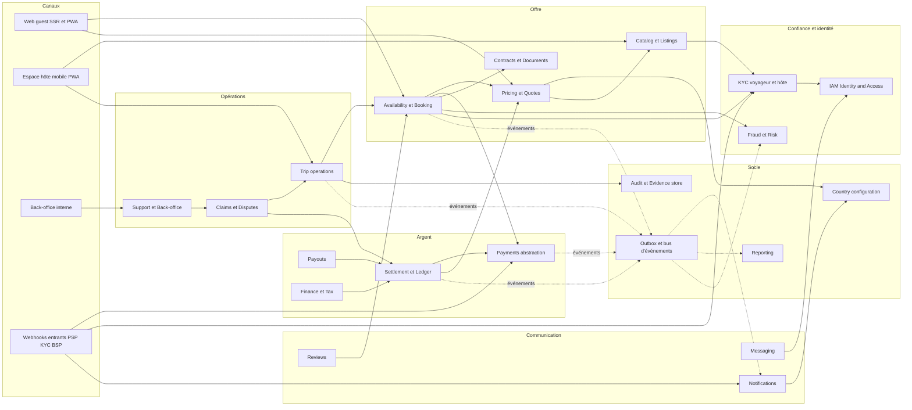
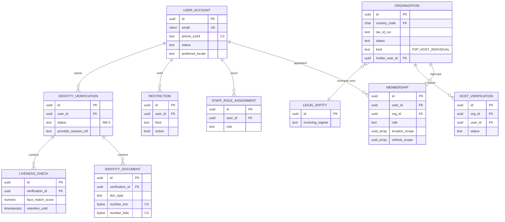
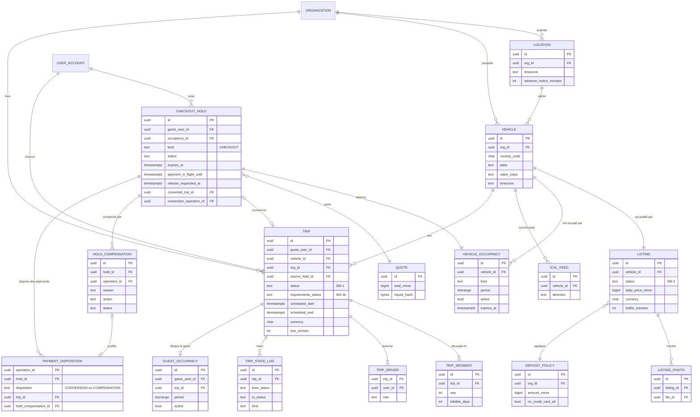
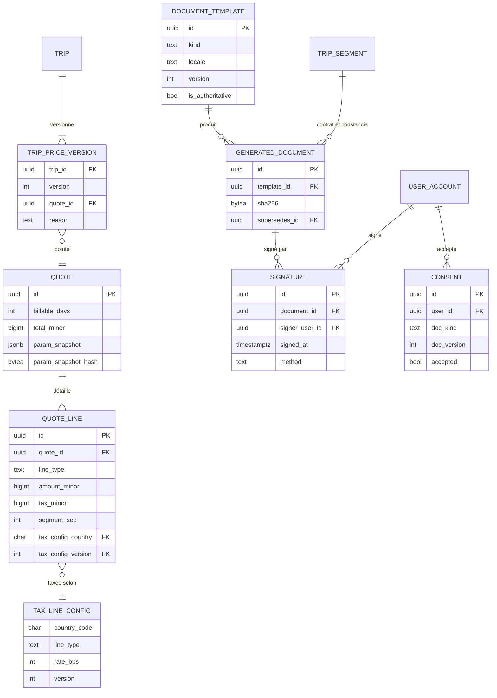
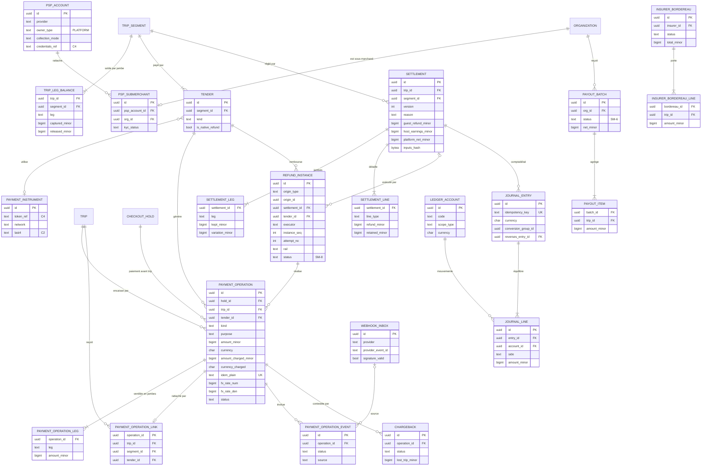
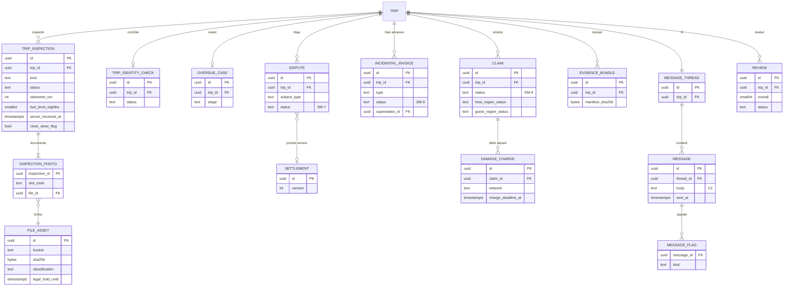
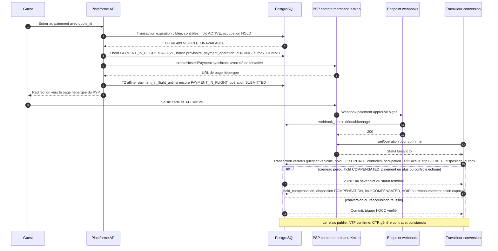

# 17 — Architecture fonctionnelle et modèle de données

> **Statut : PROPOSÉ — version 6 du 2026-11-02** (révision P2P, US-056 ; note suivante). **Version 5 du 2026-10-30** (passe de cohérence finale VERIF_18 + DEC-FONDATEUR-05 à 10 : ADR-028 ajouté et table des ADR remise dans l'ordre, ADR-036 à ADR-040, entités `brand_version` / `brand_asset` / `content_block`, tableau RLS-1 à RLS-20, lot C des connecteurs réels, nouveaux §12 « Stratégie de tests et portes CI » et §13 « Transmissibilité et gouvernance multi-agents », effort en jours-agent ; marques « (v5 — VERIF_18-Fxx) » ; journal en annexe G).** Version 4 du 2026-10-30 (corrections VERIF_17 appliquées : 0 CRITIQUE, 7 MAJEUR A1–A7, 16 MINEUR B1–B16 ; marques « (aligné v4 — VERIF_17-Ax / Bx) » ; nouvelle section §11 « À prouver sur PostgreSQL au lot 0 » ; journal en annexe F ; changements de l'annexe C reportés dans 04, 08, 16, 10b, 18 et 22 lors de la passe d'alignement finale v4). Version 3 : corrections VERIF_16 (5 MAJEUR N1–N5, 14 MINEUR M1–M14 ; marques « (corrigé VERIF_16-Nx / Mx) » ; journal en annexe E). Version 2 : corrections VERIF_14 (1 CRITIQUE, 15 MAJEUR, 17 MINEUR ; marques « (corrigé VERIF_14-Fxx) » ; annexe D).** Rien dans ce document ne décrit l'implémentation interne de Turo, qui n'est pas observable. Les rares faits Turo cités sont marqués **[TURO — statut]** (DOCUMENTÉ / OBSERVÉ / INFÉRÉ) ; tout le reste est **notre** conception.
> **Révision P2P — version 6 du 2026-11-02 (US-056, demande de fusion S4 de `docs/team/impact/2026-11-02-pivot-p2p.md`)** : Kmino est une place de marché **de particulier à particulier**, comme Turo : des particuliers louent leur propre voiture, **il n'existe aucune agence ni aucun loueur professionnel** (DEC-FONDATEUR-13) ; par défaut, on fait comme Turo (DEC-FONDATEUR-14, 16, `docs/team/COMME_TURO.md`). Le voyageur paie **Kmino, marchand de référence** ; un PSP de place de marché répartit chaque paiement en **jambes explicites** (`HOST`, `INSURER`, `TAX_THIRD_PARTY`, `PLATFORM`) calculées par le règlement (08 E7, vecteurs TJ01 à TJ21). Sections réécrites : §0.1, §2.2, §2.3, §2.4, §2.5 (hold `CHECKOUT` seul), §2.8, §2.9, §2.10, §3.2, §3.3, §3.4, §3.5, §4.3, §7.2, §8.1 (ADR-045 « Kmino marchand de référence » remplace ADR-003 ; ADR-046 renverse ADR-020 ; ADR-004 et ADR-025 sans objet ; ADR-041 à ADR-044 reportés), §9, §10 (coupe de la bêta P2P), annexe B (glossaire unique) ; journal en annexe H. **Règle de lecture** : dans ce document, « agence », « loueur », « comptoir », « flotte », « police flotte », « contrat-cadre », « mandat PSP », « P0-A », « P0-B », « Bêta pilote », les identifiants `AGENCY_*`, `agency_*`, `counter_*`, `COUNTER_*` et `fleet_*` ne désignent **jamais** une partie du produit : chaque occurrence restante est marquée « historique » ou « sans objet (pivot P2P) », ou se trouve dans un journal antérieur au 2026-11-02 (annexes A, C à G). Les anciennes étiquettes de phase se lisent ainsi : « P0-A » et « Bêta pilote » = **bêta P2P** (lots 0 à 4 de 19) ; « P0-B » = **bêta P2P, fonction construite et fermée en production par les interrupteurs par pays** (§0.1) ; « P1 », « P2 » = après la bêta.
> **Complément US-060 du 2026-11-03 (demande de fusion S8, reliquats des passations US-057 et US-058 ; version 6 inchangée)** : locale `fr` (§1.4, DEC-FONDATEUR-17) ; hold de demande `REQUEST` (§2.5 : autorisation à l'envoi, capture par jambes à l'acceptation, `VOID` au refus ou à l'expiration de 4 h ; `REQUEST_EXPIRED`, `REQUEST_MODE_NOT_ALLOWED`) ; `CREATE_HOST_ACCOUNT`, `PENDING_ACTIVATION` et `VEHICLE_NOT_COVERED` ; `slot_code` aligné sur TRP-004 ; deux événements obsolètes retirés. Journal : annexe H, S8-01 à S8-06.
> **Lecteur visé** : une future session Claude Code (ou un développeur) sans mémoire de la recherche. Aucun code applicatif ici : spécifications, schémas, contraintes, diagrammes.
> **Sources lues** : `RESUME_HERE.md`, `04_FEATURE_INVENTORY.csv` (révision 3 : `phase_mvp`, `lot_p0a`, `beta_pilote` ; noms de colonnes historiques) et `04_FEATURE_INVENTORY_README.md`, `08_BUSINESS_RULES.md` (dont « Exécution monétaire » E1–E6, SM-1 à SM-8, paramètres, vecteurs T01–T68, corrigé VERIF_16-M6), `09b_PAYMENT_PARTNERS_PA_PY.md`, `11_EDGE_CASES_AND_FAILURES.md`, `12_PANAMA_MARKET.md` §3.5–§3.7, §9–§10, `13_PARAGUAY_MARKET.md` §3, §9–§10, `15_PRODUCT_IMPROVEMENTS.md`, `18_MVP_AND_ROADMAP.md`, `22_OPEN_QUESTIONS.md`.
> **Règles de précédence** (à respecter en cas d'écart) :
> 1. **Formules monétaires, états, délais** : `08_BUSINESS_RULES.md` prime (y compris sur 09b et sur les descriptions de 04 ; écarts relevés en annexe A).
> 2. **Périmètre et phasage** : `04_FEATURE_INVENTORY.csv` et `18_MVP_AND_ROADMAP.md` priment.
> 3. **Ce document** prime pour les noms de modules, d'entités, de colonnes et d'événements. Toute modification ultérieure doit garder 08 et 17 alignés.
> **Mermaid** : diagrammes relus à la main, syntaxe standard (`flowchart`, `erDiagram`, `sequenceDiagram`) ; pas de `;` ni de `#` dans les libellés. Un contrôle `mmdc` en CI est à ajouter dès que le dépôt existe (même consigne que 08).

## Sommaire

0. Cadre : modèle d'argent, interrupteurs par pays, ce qui est décidé
1. Principes et contraintes
2. Carte des modules (bounded contexts)
3. Modèle de données
4. Événements, idempotence, outbox, webhooks PSP
5. Intégrations externes
6. Pile technique recommandée, sécurité, exploitation
7. Multi-pays, multi-devises, langues ; configuration en données
8. Risques techniques et décisions d'architecture (ADR)
9. Traçabilité epics → modules → entités
10. Coupe de la bêta P2P (corrigé VERIF_14-F16 ; révision P2P)
11. À prouver sur PostgreSQL au lot 0 (aligné v4 — VERIF_17 §7)
12. Stratégie de tests et portes CI (v5, DEC-FONDATEUR-09, ADR-038)
13. Transmissibilité et gouvernance multi-agents (v5, DEC-FONDATEUR-05/08/10, ADR-037/040)
- Annexe A : écarts entre sources relevés pendant la rédaction
- Annexe B : glossaire (unique, P2P)
- Annexe C : changements à reporter dans 04/08/16/18/22 (corrigé VERIF_14 ; complétée C-v3-xx, corrigé VERIF_16)
- Annexe D : journal des corrections VERIF_14
- Annexe E : journal des corrections VERIF_16 (version 3)
- Annexe F : journal des corrections VERIF_17 (version 4)
- Annexe G : journal de la passe de cohérence finale VERIF_18 et des décisions DEC-FONDATEUR-05 à 10 (version 5)
- Annexe H : journal de la révision P2P (US-056, version 6)

---

## 0. Cadre

### 0.1 Modèle d'argent et interrupteurs de mise en service (révision P2P, US-056)

| Étape (19) | Qui encaisse | Qui reçoit | Caution | Fonds détenus par Kmino | Conséquence d'architecture |
|---|---|---|---|---|---|
| **Bêta P2P** (lots 0 à 4, build contre les adaptateurs `FAKE`) | **Kmino, marchand de référence**, par un PSP de place de marché ; l'hôte particulier est **sous-marchand** ou bénéficiaire du PSP (ADR-045) | chaque jambe va à son bénéficiaire : `HOST` (hôte), `INSURER` (assureur partenaire ou courtier), `TAX_THIRD_PARTY` (fisc, via Kmino), `PLATFORM` (Kmino) ; montants donnés par le règlement, jamais par le PSP (08 E7) | pré-autorisation sur le compte du PSP de Kmino (08 BR-PAY-06 rails 1 à 4 ; rail du comptoir historique, sans objet) | **aucun** en build et en `FAKE` ; en production, **aucun tant que `funds_holding_enabled[pays]` vaut `false`** (variante A) | commandes PSP par jambe (§2.8), soldes par trip, segment et jambe (§2.9), grand livre E4 tenu en **registre miroir** en variante A (08 E7 règle 11) |
| **Lot C** (après le choix du pays) | idem, connecteur réel du PSP retenu | idem | idem | idem | porte PAY-041 : capacités bloquantes du §2.8 validées sur le PSP réel |
| **Après la bêta** (P1, P2) | idem | idem | idem | variante B seulement si `funds_holding_enabled[pays]` = `true` | automatisations, modifications de trip, double aveugle des avis, télématique |

**« Aucun fonds détenu »** (analyse pivot §g.1 point 4) : c'est vrai **en build et en `FAKE`**, et **en production tant que `funds_holding_enabled[pays]` vaut `false`**. Dans cet état, seule la variante A (`SPLIT_AT_SOURCE`) est permise : le PSP crédite chaque bénéficiaire du montant de sa jambe, et le grand livre de Kmino suit les soldes des tiers en comptes d'ordre. Toute jambe qui passerait par un compte de Kmino (variante B `PLATFORM_MOR`, variante mixte, crédit cash, caution débitée puis remboursée, avance au-delà du solde `PLATFORM`) exige `funds_holding_enabled[pays]` = `true`, donc un avis juridique favorable (OQ-MK-02, OQ-MK-03, OQ-MK-04, OQ-PAY-05 ; DEC-FONDATEUR-02).

**Interrupteurs de mise en service, par pays** (fail-closed : valeur absente ou inconnue = `false` ; `false` en production tant que la condition n'est pas remplie ; tout changement sur décision écrite du fondateur, par les seules commandes `config.cmd_request_go_live_switch` puis `config.cmd_approve_go_live_switch` (deux personnes distinctes, trigger `param_value_go_live_guard` qui refuse toute autre écriture de ces clés, journalisé ; §2.3, RLS-27), jamais par un agent ; 08 « Règle de blocage », DEC-FONDATEUR-15) :

| Interrupteur (§7.2) | Ferme | Condition pour passer à `true` |
|---|---|---|
| `p2p_private_hosts_enabled[pays]` | l'activation de tout hôte particulier du pays (`HOST_PAYOUT_RAIL_UNAVAILABLE`) | avis OQ-BR-35 et OQ-BR-16 favorables ; capacités bloquantes du §2.8 `VALIDATED_*` sur le PSP du pays |
| `insurer_contract_active[pays]` | l'activation d'un hôte et la vente de protection (`INSURER_CONTRACT_INACTIVE`) | contrat signé avec l'assureur partenaire (Q-002, OQ-P2P-03) |
| `funds_holding_enabled[pays]` | variante B, variante mixte, crédit cash, rail (b) de la caution, avance de Kmino au-delà de son solde `PLATFORM` | avis OQ-MK-02 / 03 / 04, OQ-PAY-05, OQ-PAY-06 favorables |
| `payouts_enabled[pays]` | tout versement à un hôte (lots SM-6 `ON_HOLD`) | `SUPPORTS_B2C_PAYOUT` validée ; avis OQ-PAY-09 |

**Principe directeur** : le mode d'exécution est une **valeur de configuration par pays** (`collection_mode[pays]` ∈ {`SPLIT_AT_SOURCE`, `PLATFORM_MOR`}, par jambe si la variante est mixte ; `param_value`), jamais une branche de code. Les montants par jambe sont **identiques** dans les deux variantes ; seul le mouvement des fonds change (08 E7). Aucun repli vers un encaissement par l'hôte n'existe.

**Historique (sans objet, pivot P2P)** : la version 5 décrivait des phases P0-A (une agence encaisse sur son propre compte PSP, caution au comptoir, mandat LEG-027), P0-B (la plateforme encaisse) et P2 (hôtes particuliers). Ces phases et la valeur `organization.collection_mode` « par agence » (`AGENCY_MOR_LINK`, `AGENCY_MOR_API`) sont supprimées (ADR-003 remplacé par ADR-045).

**Décisions du fondateur du 2026-10-30** (ADR-031 à ADR-033, **décidé**) : **DEC-FONDATEUR-02** on construit d'abord, les avis juridiques sont exigés **avant la mise en service** (go-live), et non avant chaque lot ; **DEC-FONDATEUR-03** les connecteurs réels (PSP, facture électronique PAC / SIFEN, vérification d'identité locale) sont différés jusqu'au choix du pays : le build se fait contre les ports `PaymentProvider`, `EInvoicingProvider` et `IdentityProvider` avec des adaptateurs `FAKE` (et bac à sable quand il existe sans contrat) ; **DEC-FONDATEUR-04** Panama **et** Paraguay sont développés **simultanément dès le premier jour** : les deux configurations pays sont de premier rang (USD à 2 décimales et PYG à 0 décimale, `America/Panama` et `America/Asuncion`, ITBMS 7 % et IVA 10 %, formats de pièces et de RUC locaux, fériés, gabarits es-PA / es-PY), et chaque test monétaire tourne dans les deux devises quand c'est pertinent (§10). La règle de repli pays ci-dessous devient un **choix de pays de lancement** fait sur les avis, sans développement supplémentaire. **DEC-FONDATEUR-13 à 16 (2026-11-02)** : place de marché P2P dès la bêta, aucune agence ; faire comme Turo ; ne jamais rester bloqué sur une question propre au P2P.

**Choix du pays de lancement** (12 §10.3 relu par DEC-FONDATEUR-04 ; v5 — VERIF_18-F02) : les deux pays sont construits dès le lot 0 ; le pays **de lancement** reste à choisir sur les avis (si l'avis panaméen sur l'art. 288 est négatif sans montage viable, le lancement se fait au **Paraguay** : PYG, SIFEN, Bancard vPOS, upay), sans développement supplémentaire hors connecteurs réels du lot C. L'architecture doit donc être **multi-pays dès le lot 0** (aucune constante PA codée en dur ; ADM-014 « aucune valeur américaine codée en dur » s'étend à « aucune valeur panaméenne codée en dur »).

### 0.2 Ce qui est déjà décidé ailleurs et repris tel quel

| Décision | Source | Statut |
|---|---|---|
| Montants en unités mineures entières, `roundHalfUp` par ligne, partage `allocHost` (au plus proche, égalité → plateforme), taxe par ligne puis somme | 08 BR-PRICE-14, pseudo-code BR-CXL | décidé (vecteurs T01–T68) |
| Règlement = fonction pure versionnée `(trip, segment, settlement_version)`, contre-passation, jamais de modification | 08 E4 | décidé |
| Registre des encaissements `PaymentOperation`, `collected_total`, `refund_committed`, `available_to_refund` | 08 E1 | décidé |
| Clé d'idempotence `{trip}:{segment}:v{version}:{opération}:{tender}:i{instance_seq}:a{attempt_no}` | 08 E4 | décidé |
| Table d'occupation unique + contrainte d'exclusion PostgreSQL + hold de 10 min | 08 BR-BOOK-10, CAL-011, BKG-014 | **PROPOSÉ** dans 08 (`[NOUS] PROPOSÉ`), retenu ici ; validé seulement par le plan de test de concurrence §2.5 (corrigé VERIF_14-F18) |
| Capacité PSP inconnue ⇒ « non » ; validité de pré-autorisation inconnue ⇒ 0 | 08 E3, BR-PAY-06, 09b §5.1 bis | décidé |
| `platform_funded_host_compensation` = `false` par défaut (fail-closed) | 08, DEC-FONDATEUR-01 / OQ-BR-41 | **décision fondateur en attente** |
| Kmino marchand de référence, jambes explicites, interrupteurs par pays à `false` en production | 08 E7, Règle de blocage ; DEC-FONDATEUR-13, 14 | **PROPOSÉ** (montage, ADR-045) ; interrupteurs **décidés** (ADR-046) |
| Portée PCI visée : SAQ A (page ou champs hébergés du PSP) | PAY-001, ADM-033 | décidé |
| OWASP ASVS niveau 2 sur authentification, contrôle d'accès, téléversements, webhooks | ADM-033 | décidé |
| WhatsApp transactionnel avec repli SMS/email, non bloquant | NTF-001, NTF-002 | décidé |
| PWA seule ou enveloppe native (espace hôte) | TRP-056 | **PWA décidée (ADR-039)** ; repli (enveloppe native ou terminal) décidé à la fin du lot 0 selon TRP-056 (ADR-005, 22 ; A24-02) |

---

## 1. Principes et contraintes

### 1.1 Multi-pays

- Pays supportés par le modèle : `PA` (Panama), `PY` (Paraguay). Tout enregistrement métier rattaché à une offre porte `country_code CHAR(2)` (ISO 3166-1), **hérité du véhicule** (le pays du véhicule détermine devise, fuseau, taxes, documents légaux, PSP, calendrier des fériés).
- Un compte d'hôte (`organization` de type `P2P_HOST_INDIVIDUAL`, une personne physique) est rattaché à **un** pays ; un particulier qui loue dans les deux pays a deux comptes d'hôte, car la devise, le numéro fiscal, le sous-marchand du PSP et le compte de versement diffèrent.
- Un utilisateur guest n'a pas de pays imposé : il réserve dans le pays du véhicule.
- Aucune règle « pays » n'est codée : elle vient de `param_value` (§7) ou d'une table de référence versionnée (taxes, fériés, gabarits légaux).

### 1.2 Monnaie

- **Type monétaire unique** : couple `(amount_minor BIGINT, currency CHAR(3))`. Exposants : `USD` = 2, `PYG` = 0 (table `currency`). Aucun flottant, nulle part (base, API, front, logs).
- **Une devise par trip** = devise du pays du véhicule ; **aucune conversion dans un trip** (BR-PRICE-14 (5)). La devise effectivement débitée par le PSP peut différer (cas dLocal : carte de débit débitée en USD pour un trip PYG) : elle est portée **à part** par `amount_charged_minor` / `currency_charged` sur `payment_operation` (08 E1, E2).
- Montants forfaitaires (pénalités, frais) définis **par devise** dans la configuration, jamais convertis (`HOST_PENALTY[pays]`, T62).
- Ratios (jours de pénalité, pourcentages) = **fractions exactes** (numérateur/dénominateur entiers) ; arrondi uniquement au moment de produire un montant de ligne (`roundHalfUp`, `allocHost` de 08).
- Grand livre : une écriture = une devise ; aucun lettrage entre devises sans écriture de conversion explicite, approuvée et horodatée (08 E5, `host_ledger[hôte][devise]`).
- **Débit dans une autre devise que celle du trip** (cas dLocal : trip PYG débité en USD, 08 E2, T55) (corrigé VERIF_14-F10) : `payment_operation` stocke **les deux** montants (`amount_minor` + `currency` du trip ; `amount_charged_minor` + `currency_charged`), le taux implicite exact (`fx_rate_num` / `fx_rate_den`, entiers, = `amount_charged / amount_trip` de l'opération d'origine), sa **source** (`fx_rate_source` : `PSP_QUOTE`, `PSP_SETTLEMENT_REPORT`) et son **horodatage** (`fx_rate_at`) ; le grand livre passe par des comptes de **position de change** `fx_position[devise]` et une **paire d'écritures** (une par devise, chacune équilibrée) liées par `conversion_group_id` (§3.5) ; l'écart constaté au relevé PSP va au seul compte `fx_difference` (plateforme). Aucune conversion au taux de marché dans un calcul de règlement (08 E2, E5 : ratio de la capture d'origine).
- API : montants sérialisés en **chaîne d'entiers** (`"25666"`) avec `currency` ; le front formate (es-PA : `US$ 1.234,56` selon I18N-004 ; PYG : `₲ 1.050.000`, sans décimales).

### 1.3 Temps et fuseaux

- Stockage : `timestamptz` en UTC ; horodatage **serveur** de référence pour toute borne (08 : `cancelRequestedAt` = réception serveur).
- **Horloge faisant foi = horloge de la base de données** (corrigé VERIF_16-M1). Toute décision de délai (TTL de hold, `payment_in_flight_until`, expiration, échéances de tâches, `cancel_requested_at`, minuteries) est calculée **et** comparée **dans le SQL**, avec la fonction unique `platform.now()` ; les serveurs applicatifs ne calculent jamais un instant d'expiration, ne passent jamais d'« heure courante » en paramètre et ne comparent jamais deux instants pour décider d'une expiration. Règles :
  1. `platform.now()` vaut `clock_timestamp()` en production (instant réel de l'appel, et non `now()` = début de transaction, qui serait périmé après l'attente d'un verrou consultatif) ; une instruction qui a besoin d'un instant cohérent le capture une fois (`WITH t AS (SELECT platform.now() AS ts)`) ;
  2. **horloge virtuelle des tests** : en test seulement, la migration de test remplace `platform.now()` par une version qui lit `current_setting('app.virtual_now', true)` (repli `clock_timestamp()`) ; le harnais de test pose `SET app.virtual_now = '…'` par session ; un test de migration vérifie qu'en préproduction et en production le corps de `platform.now()` ne référence pas `app.virtual_now` (échec du déploiement sinon) ; `now()` et `current_timestamp` sont interdits dans le SQL métier (règle de lint) ;
  2 bis. (aligné v4 — VERIF_17-B2, B3, T6) `platform.now()` est déclarée **`VOLATILE`** (jamais `STABLE` ni `IMMUTABLE` : le planificateur pourrait figer sa valeur dans une instruction) ; **toutes** les colonnes `created_at`, `decided_at`, `opened_at` des modules AVL et PAY ont `DEFAULT platform.now()` (exception explicite à §3.1.2 : sans elle, `created_at + hold_max_total_minutes` mélange heure réelle et heure virtuelle en test) ; le harnais pose l'horloge virtuelle par **`SET LOCAL`** dans chaque transaction de test (jamais au niveau session), sur une **connexion directe sans pooler**, fait `RESET ALL` à la restitution, vérifie en début de test que `platform.now()` est dans la fenêtre attendue, et **signe les webhooks simulés à l'heure virtuelle** ; une passe de C1, C2, C5 et C15 tourne **sans** horloge virtuelle (barrières seulement) sur la fonction de production `clock_timestamp()` (test L0-06, §11) ;
  3. dérive des serveurs applicatifs : surveillée (chrony/NTP, alerte à 30 s) ; elle n'affecte plus les TTL, seulement l'horodatage des journaux et la tolérance de signature des webhooks (§4.4 point 2) ;
  4. dérive du PSP et latence réseau : couvertes par `payment_in_flight_margin_s` (PROPOSÉ **120 s**, au lieu de 60 s, à mesurer en bac à sable par PSP et par moyen : écart entre l'expiration annoncée de l'ordre et le dernier paiement accepté), §2.5.
- Chaque véhicule porte `timezone` IANA (hérité de son lieu) : `America/Panama` (UTC−5, sans heure d'été) ; `America/Asuncion` (**UTC−3 permanent** selon 08 BR-CXL-00, Ley 7354/2024). Les échéances (fenêtre gratuite, no-show, retard, lot de versement à 10:00, jours ouvrés) sont calculées dans ce fuseau puis converties en UTC.
- **Contrôle de démarrage** : l'application refuse de démarrer si la version tzdata embarquée (runtime **et** PostgreSQL) ne donne pas `America/Asuncion` = UTC−3 sur une date de test (OQ-BR-20) — test de non-régression sur les anciennes dates de changement d'heure (EC-33).
- Durées (jours facturés, `H_requise`) calculées en **UTC** (indépendantes de tout changement d'heure, BR-BOOK-03).
- Jours ouvrés : calendrier des fériés **par pays, versionné** (`holiday_calendar`), utilisé par `payout_at`, SLA, relances.

### 1.4 Langues (i18n)

| Locale | Usage | Phase |
|---|---|---|
| `es-PA` | interface, notifications, contrat (**version faisant foi**), pages légales Panama | bêta |
| `en` | interface, notifications, version de courtoisie du contrat | bêta |
| `es-PY` | idem pour le Paraguay | bêta, dès le départ (DEC-FONDATEUR-04 ; v5 — VERIF_18-F02) |
| `fr` | interface, notifications, version de courtoisie du contrat et des pages légales (relue par l'avocat avant la mise en service) | bêta, livrée avec `es` et `en` dans chaque story (DEC-FONDATEUR-17 ; US-060) |
| `pt-BR` | interface et notifications (touristes brésiliens au PY) | P2 |
| guaraní | **support oral uniquement** (pas de chaînes d'interface) | P2 |

Règles : aucune chaîne en dur (I18N-003) ; chaque texte visible existe en `es`, `en` et `fr` (catalogue de 10b §4.3, DEC-FONDATEUR-17) ; chaque gabarit de notification existe dans toutes les locales actives du pays et est testé avec toutes ses variables (bug « `{6}` » relevé chez Turo, **[TURO — OBSERVÉ]** EV-0014) ; la langue d'un message = langue du **destinataire** ; un document juridique stocke la locale de la version signée. **[TURO — OBSERVÉ]** 9 locales dont es-US et pt-BR (référence seulement).

### 1.5 Données personnelles et résidence

| Pays | Texte | Autorité | Points structurants pour l'architecture | Statut |
|---|---|---|---|---|
| Panama | **Ley 81 du 26/03/2019**, règlement **DE 285/2021** | ANTAI | consentement et information préalable ; transferts transfrontaliers sous garanties (notion d'« exportateur ») ; registre des traitements, responsable des données, procédure de violation (LEG-010) ; biométrie collectée dès la bêta (VER-002/003) | CONFIRMÉ (texte) / À VALIDER (hébergement hors Panama, délais de notification : **OQ-MK-09**) |
| Paraguay | **Ley 7593/2025** (promulguée le 27/11/2025) | Agencia Nacional de Protección de Datos Personales (MITIC) | calendrier d'application, base légale GPS et biométrie, transferts internationaux, DPO (13 §6 q. 6) | CONFIRMÉ (promulgation) / À VALIDER |

Conséquences (PROPOSÉ) :
1. **Résidence** : aucune obligation de localisation des données n'a été trouvée dans les sources ; l'hébergement hors du pays est possible **sous réserve** de garanties de transfert (OQ-MK-09 au Panama, Ley 7593 au Paraguay). L'architecture n'impose donc pas une région locale mais doit permettre (a) une région unique documentée dans le registre, (b) l'inventaire des sous-traitants et de leurs pays (fournisseur KYC, BSP WhatsApp, email, SMS, hébergeur), (c) une migration de région sans refonte (aucune dépendance à un service propriétaire non portable pour les données personnelles).
2. **Classification de chaque champ** (§3.1.4) et chiffrement applicatif des champs sensibles (C3).
3. **Minimisation — décision de stockage biométrique** (corrigé VERIF_14-F15) : **défaut = zéro copie d'image chez nous**. Selfie, vidéo de liveness, images du permis et de la pièce restent chez le **fournisseur KYC**, sous sa rétention contractuelle (la plus courte proposée par le fournisseur, inscrite au contrat de sous-traitance) ; la plateforme ne stocke que la référence de session, la décision, le code motif, les scores (classés **C3**, car dérivés de données biométriques), les champs du permis nécessaires (classe, échéance, pays, numéro chiffré + index aveugle pour l'unicité ACC-014). Une **copie ponctuelle** n'est faite que pour un dossier de contestation ou de sinistre identifié (`legal_hold_until` posé, motif journalisé), jamais par défaut. Rétentions par défaut **les plus courtes** (« À DÉCIDER » avec l'avocat : OQ-BR-25, **OQ-MK-09**, Ley 81/2019 et DE 285/2021 au Panama, Ley 7593/2025 au Paraguay) : données de liveness et de face match chez le fournisseur supprimées à la décision + `biometric_appeal_retention_days` (PROPOSÉ 30 j, couvre l'appel SM-3 de 15 j) ; champs du permis conservés comme preuve du contrat (≥ 15 mois après la dernière opération monétaire, REQ-PAY-DMG-11) et non 3 ans ; la borne « ≤ 3 ans » de VER-004 est un **plafond**, pas un défaut. Transferts vers les États-Unis (région de l'hébergeur, ADR-006) et vers le pays du fournisseur KYC : inscrits au registre LEG-010 (table `subprocessor`, §3.2.13) **avant la première collecte réelle**.
4. **Effacement** = pseudonymisation des colonnes C2/C3 et suppression des fichiers, jamais suppression des lignes comptables ou de preuve ; une **rétention légale** (`legal_hold_until`) bloque la purge (fenêtres de chargeback, REQ-PAY-DMG-11 : ≥ 15 mois après la dernière opération monétaire du trip, 08). Dans les registres immuables (classe A), la pseudonymisation se fait par **destruction de clé** (crypto-shredding, §3.1.3), jamais par UPDATE (corrigé VERIF_14-F14). Les demandes des personnes (accès, rectification, suppression, opposition) sont suivies dans `data_subject_request` avec échéance (délais légaux à confirmer, OQ-MK-09).
5. **Journal d'accès** aux dossiers KYC et aux photos (ADM-032).
6. Pas de cookie non essentiel en bêta (18 §2) ; bannière de consentement en P1.

### 1.6 Portée PCI minimale

- Aucune donnée de carte (PAN, CVV, piste) ne transite ni n'est stockée par la plateforme : saisie sur **page ou champs hébergés du PSP** ; la plateforme ne reçoit que des **jetons** (`token_ref`), la marque, le BIN-6 éventuel (si le PSP le renvoie, utile au score de risque), les 4 derniers chiffres et l'échéance (affichage).
- Objectif : **SAQ A** (PAY-001, ADM-033). Toute fonctionnalité qui ferait sortir de SAQ A (champ de carte propre, stockage de PAN) est **interdite** sans nouvel ADR.
- Les **identifiants API du compte marchand de Kmino** (un par PSP et par pays) sont des secrets de classe C4 : coffre ou KMS, déchiffrés dans le seul travailleur de commandes, rotation documentée, chaque usage journalisé (§2.8). Historique (sans objet, pivot P2P) : identifiants des comptes PSP d'agences et mandat LEG-027.

### 1.7 Auditabilité

- **Journal d'audit** en ajout seul (qui, rôle, quoi, avant/après, motif, IP, quand), chaîné par hachage, conservé 5 ans sous réserve d'OQ-BR-25 (ADM-001).
- **Grand livre** immuable, écritures équilibrées, contre-passation (`reverses_entry_id`).
- **Règlements** versionnés avec `inputs_hash` (08 E4) ; recalcul ⇒ même hachage, sinon alerte.
- **Preuves** : chaque fichier reçu reçoit une empreinte SHA-256 **calculée à la réception** et une heure serveur (CLM-034) ; le manifeste du dossier de preuve est lui-même haché.
- **Corrections d'état** (requalification SM-7) : écriture d'audit, jamais une transition métier rétroactive (SM-1 invariant 7).

### 1.8 Principes de conception transverses

| # | Principe | Effet |
|---|---|---|
| D1 | **Monolithe modulaire** : un déployable, une base PostgreSQL, des modules à frontières strictes (schéma SQL par module, ou un schéma unique à préfixe de table en bêta, §10 ; imports contrôlés) | adapté à une petite équipe d'agents Claude Code (v5, DEC-FONDATEUR-05, ADR-040) ; découpage en services seulement si un besoin mesuré l'impose (ADR-001). **Frontière ≠ transaction** (corrigé VERIF_14-F30) : quand 08 E4 exige une seule transaction (transition SM-1 dans AVL, règlement dans STL, instances SM-8 et `payment_command` dans PAY, sous le verrou du `trip`), les modules s'appellent **par interface dans la même transaction applicative** ; seules les écritures SQL directes dans les tables d'un autre module sont interdites |
| D2 | **Fail-closed** | capacité inconnue ⇒ non ; paramètre absent ⇒ erreur bloquante de configuration (jamais 0 silencieux, jamais une valeur par défaut US) ; booléen financier absent ⇒ `false` |
| D3 | **Idempotence partout** | toute commande externe porte une clé stockée **avant** l'envoi ; tout consommateur d'événement est idempotent |
| D4 | **Calcul ≠ exécution** | moteur pur (devis, règlement) séparé de l'exécution (PSP, payouts) ; rejouer l'exécution ne recalcule jamais le dû |
| D5 | **Une source de vérité par fait** | disponibilité = `vehicle_occupancy` ; argent encaissé = `payment_operation` ; dû = `settlement` ; soldes = `journal_line` |
| D6 | **Configuration en données, versionnée, non rétroactive** | le devis fige un instantané des paramètres (`param_snapshot_hash`) |
| D7 | **Manuel d'abord, automatisable ensuite** | la bêta remplace des lignes par des opérations manuelles (décompte historique de la révision 5 de 04 : 58 lignes MANUEL ; recalculé par S2 pour le périmètre P2P) : chaque opération manuelle passe par une **action de console journalisée** (`manual_action`, §3.2.13, corrigé VERIF_14-F29) ; les actions qui changent l'état d'un trip, d'un hold ou de l'argent appellent la même commande de domaine que la future automatisation ; les actions rares sans commande de domaine en bêta sont « d'enregistrement seul » (corrigé VERIF_16-N5) ; coupe détaillée en §10 |

---

## 2. Carte des modules (bounded contexts)

### 2.1 Vue d'ensemble

Chaque module possède ses tables (schéma PostgreSQL dédié, ex. `booking.*`), publie des événements via l'outbox (§4) et n'accède aux données d'un autre module que par son interface (requête de lecture exposée ou événement). Les écritures SQL directes dans les tables d'un autre module sont **interdites** ; les jointures inter-schémas sont tolérées en lecture uniquement dans le module Reporting (vues de lecture). Un appel d'interface peut participer à la transaction de l'appelant (D1, corrigé VERIF_14-F30).

**Rupture du cycle STL ↔ PAY** (corrigé VERIF_14-F30) : STL calcule et **planifie** (crée les instances et commandes via l'interface PAY dans la transaction du règlement) ; PAY **exécute** et publie les changements d'état ; PAY ne rappelle jamais STL, hormis la lecture des agrégats `collected_total` / `refund_committed` (et de leurs équivalents par jambe) qu'il possède lui-même (ces agrégats sont des vues de PAY consommées par STL, d'où la flèche `STL --> PAY` seule).



Lecture : une flèche pleine `A --> B` signifie « A appelle l'interface de B » (dépendance synchrone) ; une flèche pointillée signifie « publie des événements consommés de façon asynchrone ». Les dépendances sont **acycliques** : les modules du socle (CFG, AUD, BUS) ne dépendent de personne ; STL possède aussi `insurer` et `insurer_contract` (US-056), pour que ses FK ne pointent jamais vers FIN, qui dépend de STL.

### 2.2 Fiches des modules

Colonne « Phase » : « bêta » = bêta P2P (lots 0 à 4 de 19) ; « bêta, fermé » = construit en bêta, fermé en production par un interrupteur par pays (§0.1) ; P1, P2 = après la bêta.

| Code | Module | Responsabilités | Entités possédées (§3) | Événements publiés (§4) | Dépend de | Phase |
|---|---|---|---|---|---|---|
| **IAM** | Identity & Access | comptes, authentification (mot de passe, OTP, TOTP staff), sessions, **compte d'hôte** (`organization` de type `P2P_HOST_INDIVIDUAL`, une personne physique) et ses co-hôtes, rôles et permissions, restrictions de compte, blocage d'un voyageur par un hôte | `user_account`, `email_verification`, `auth_factor`, `session`, `organization`, `membership`, `staff_role_assignment`, `role_permission`, `restriction`, `org_guest_block`, `otp_challenge` | `iam.user.registered`, `iam.phone.verified`, `iam.membership.changed`, `iam.restriction.applied/lifted` | CFG, NTF (envoi OTP) | bêta |
| **KYC** | KYC | vérification du conducteur (SM-3) et **de l'hôte** (personne physique, numéro fiscal selon le pays, 08 BR-ACC-06), pièces, liveness, face match via fournisseur, contrôle 90 jours, contrôle du permis à la remise par l'hôte, filtrage sanctions de l'hôte | `identity_verification`, `identity_document`, `liveness_check`, `foreign_entry_declaration`, `trip_identity_check`, `host_verification`, `sanctions_screening` | `kyc.verification.status_changed`, `kyc.trip_identity.failed`, `kyc.host_verification.decided` | IAM, CFG, AUD | bêta |
| **CAT** | Catalog / Listings | lieux de remise de l'hôte, véhicules, annonces (SM-2), photos, documents du véhicule, éligibilité du véhicule au contrat d'assureur, configuration de distance, flux iCal (déclaration) | `location`, `vehicle`, `vehicle_document`, `listing`, `listing_photo`, `deposit_policy`, `ical_feed`, catalogue `vehicle_make` / `vehicle_model` / `vehicle_variant`, `catalog_addition_request` | `catalog.listing.status_changed`, `catalog.vehicle.restricted`, `catalog.deposit_policy.changed` | IAM, KYC, CFG | bêta |
| **AVL** | Availability & Booking | occupation unique, hold `CHECKOUT`, réservation, trip (SM-1, SM-1b), segments, conducteurs, contrôles bloquants (BKG-012), annulations et no-shows (qualification), import iCal en blocages | `vehicle_occupancy`, `guest_occupancy`, `checkout_hold`, `hold_compensation`, `payment_disposition`, `trip`, `trip_segment`, `trip_driver`, `trip_state_log`, `ical_conflict` | `booking.hold.created/payment_in_flight/expired/converted/released/release_deferred/reacquired/compensated`, `booking.hold.compensation_required`, `booking.payment.late_ignored`, `booking.trip.booked`, `trip.status_changed`, `trip.cancellation.qualified`, `booking.ical.conflict_detected` | PRC, PAY, CTR, KYC, RISK, CAT, CFG | bêta |
| **PRC** | Pricing & Quotes | devis versionné (PRC-025), jours facturables, lignes (trip fee, protection), taxes par ligne et groupe « pour compte de tiers », instantané des paramètres (plan de l'hôte, parts de l'assureur), versions de prix du trip (BR-MOD-06) | `quote`, `quote_line`, `trip_price_version`, `tax_line_config`, `promo_code` (P1) | `pricing.quote.accepted`, `pricing.trip_price.versioned` | CAT, CFG | bêta |
| **CTR** | Contracts & Documents | gabarits juridiques versionnés, génération PDF (contrat de location entre l'hôte et le voyageur, constancia, conditions de l'hôte), signature électronique simple horodatée, consentements | `document_template`, `generated_document`, `signature`, `consent` | `contract.document.generated`, `contract.document.signed`, `legal.consent.recorded` | IAM, CFG, AUD | bêta |
| **PAY** | Payments abstraction | adaptateurs PSP de place de marché, compte marchand de Kmino par pays, sous-marchands hôtes, matrice de capacités, instruments tokenisés, consentements MIT, moyens de paiement d'un trip (`tender`), registre des opérations (E1) **avec montants par jambe**, boîte d'envoi des commandes monétaires, webhooks entrants, chargebacks, exécution des remboursements (SM-8), caution | `psp_account`, `psp_capability`, `psp_submerchant`, `payment_instrument`, `mit_consent`, `tender`, `payment_operation`, `payment_operation_link`, `payment_operation_event`, `payment_command`, `refund_instance`, `deposit_hold`, `chargeback`, `webhook_inbox`, `debt_balance`, `payment_plan`, `payment_plan_installment`, `credit_lot` | `payment.operation.status_changed`, `payment.received` (preuve PAY-034), `payment.chargeback.opened/closed`, `refund.instance.status_changed`, `deposit.decision.executed` | CFG, AUD | bêta (caution débitée, crédit cash : bêta, fermé) |
| **STL** | Settlement engine & Ledger | règlement économique pur (BR-CXL, motifs 1–26), **jambes** (08 E7), versions et supersession, exécution E1–E5 (planification des mouvements par jambe), grand livre en partie double, soldes par trip, segment et jambe, `host_ledger` par devise (SM-6b), `insurer_ledger` et bordereaux, avances de Kmino | `settlement`, `settlement_line`, `settlement_leg`, `trip_leg_balance`, `ledger_account`, `journal_entry`, `journal_line`, `host_ledger_state`, `insurer`, `insurer_contract`, `insurer_ledger_state`, `insurer_bordereau`, `insurer_bordereau_line`, `platform_advance`, `finance_approval` | `settlement.computed`, `settlement.superseded`, `ledger.entry.posted`, `host_ledger.state_changed`, `insurer.bordereau.issued` | PRC, PAY, CFG | bêta |
| **PYO** | Payouts | compte de versement vérifié de l'hôte, lots (SM-6) depuis la jambe `HOST`, compensation des débits (`NETTING`), libération et ajustements ordonnés au PSP, gel et reprise | `payout_account`, `payout_batch`, `payout_item` | `payout.batch.status_changed` | STL, PAY, KYC | bêta, fermé (`payouts_enabled[pays]`) |
| **TRP** | Trip operations | ouverture du check-in, check-in / check-out par l'hôte et le voyageur (photos guidées, compteur, carburant, clés, signature), mode hors ligne, retard et non-restitution (escalade), refus du véhicule, liste des remises du jour de l'hôte | `trip_inspection`, `inspection_photo`, `overdue_case`, `key_handover` | `trip.checkin.validated`, `trip.checkout.completed`, `trip.overdue.detected`, `trip.overdue.escalated` | AVL (transitions SM-1), KYC (contrôle permis), PAY (preuve de paiement), AUD | bêta |
| **CLM** | Claims & Disputes | déclarations de dommage et d'incident (SM-4), factures annexes (SM-5), débits de dommage conformes aux réseaux, jambes d'un débit de dommage (08 BR-PAY-09 bis), litiges (SM-7), dossier de preuve, décisions motivées | `claim`, `incident_report`, `incidental_invoice`, `damage_charge`, `dispute`, `decision`, `evidence_bundle` | `claim.status_changed`, `invoice.status_changed`, `dispute.opened/decided`, `evidence.bundle.generated` | TRP, STL, PAY, AUD | bêta (manuel pour une partie) |
| **MSG** | Messaging | fil par trip, masquage des coordonnées, détection du marché gris, relais WhatsApp (P1), questions pré-réservation filtrées (P1) | `message_thread`, `message`, `message_flag` | `message.posted`, `message.flagged` | IAM, AVL | bêta |
| **NTF** | Notifications | table événement → destinataires → canaux → gabarit ; WhatsApp (BSP), SMS, email, in-app, push (P1) ; repli ; idempotence ; préférences | `notification_template`, `notification_rule`, `notification_dispatch`, `notification_preference`, `inapp_notification` | `notification.dispatch.failed`, `notification.fallback.triggered` | CFG | bêta |
| **REV** | Reviews | avis du voyageur et de l'hôte, publication quand les deux ont noté ou à J+10 (`review_window_days`, 08 BR-REVIEW-01), agrégats | `review`, `rating_aggregate` | `review.published` | AVL | bêta |
| **SUP** | Support & back-office | console interne, fiche 360°, files (KYC, annonces, vérification d'hôte, réservations à risque), dossiers de support, notes internes, actions forcées sur trip, gestes commerciaux plafonnés sur la jambe `PLATFORM` | `support_case`, `internal_note`, `review_queue_item`, `commercial_gesture`, `manual_action` | `support.case.status_changed`, `ops.gesture.granted` | tous (lecture), IAM | bêta |
| **FIN** | Finance & Tax | configuration fiscale, documents fiscaux de Kmino (facture du trip fee et de ses services : PAC Panama, SIFEN Paraguay), relevés de gains de l'hôte, lecture du contrat d'assureur et des bordereaux possédés par STL (dépendance FIN → STL seule, §2.1), rapprochements par jambe avec les relevés du PSP, exports comptables | `fiscal_document`, `fiscal_document_line`, `host_earnings_statement`, `host_earnings_line`, `tax_remittance`, `reconciliation_run`, `reconciliation_item`, `legal_entity` | `finance.statement.issued`, `fiscal.document.status_changed`, `finance.reconciliation.delta_exceeded` | STL, CFG | bêta (manuel pour une partie) |
| **RISK** | Fraud / Risk | règles de risque (5–10 codées et déclarées en bêta, configurables en P1), évaluation à la réservation, file de revue, restrictions, journal explicable | `risk_rule`, `risk_assessment` | `risk.review.required`, `risk.review.decided` | IAM, KYC, CFG | bêta |
| **CFG** | Country configuration | pays, devises, fuseaux, locales, définitions et valeurs de paramètres versionnées (dont les interrupteurs par pays), fériés, entités juridiques | `country`, `currency`, `param_definition`, `param_value`, `holiday_calendar` | `config.param.changed` | — | bêta (lot 0) |
| **AUD** | Audit & Evidence store | journal d'audit chaîné, journal d'accès aux données, métadonnées des fichiers (empreintes, rétention, gel légal), clés par sujet (crypto-shredding), demandes des personnes, registre des incidents, sous-traitants | `audit_log`, `data_access_log`, `file_asset`, `subject_key`, `data_subject_request`, `security_incident`, `subprocessor` | `privacy.dsr.status_changed`, `security.incident.opened` | — | bêta (lot 0) |
| **RPT** | Reporting | vues de lecture (tableau de bord de l'hôte, ops retards, KPI de sortie de bêta), exports CSV | vues matérialisées uniquement | — | lecture seule de tous | bêta (minimal) |

### 2.3 Identity & Access : rôles et matrice de permissions

**Rôles** (stockés en base, ADM-001 ; une personne peut cumuler le rôle de voyageur et celui d'hôte, comme chez Turo, mais ne peut jamais réserver son propre véhicule : `self_booking_forbidden`, OQ-P2P-08). **Écart avec 04** (corrigé VERIF_14-F13) : ADM-001 définit 4 rôles internes (admin, ops, support, finance) ; ce document en définit 8 (5 internes, voyageur, hôte, co-hôte). `SUPERADMIN` est une séparation des tâches sur le rôle admin. En bêta, `GUEST`, `P2P_HOST`, `OPS_AGENT` et `ADMIN` sont actifs ; `CO_HOST`, `SUPPORT_AGENT`, `FINANCE` et `SUPERADMIN` sont construits si leur story est dans la bêta (§10) ; écart listé en annexe A (A10).

**Compte d'hôte** : techniquement, une ligne `organization` de type `P2P_HOST_INDIVIDUAL`, **une seule personne physique** titulaire (08 BR-ACC-06 : jamais une personne morale), mono-pays, qui porte la portée RLS `org_id` de ses véhicules, annonces, trips et versements. Ce n'est ni une société ni une agence ; le nom de table est conservé pour ne pas réécrire la portée RLS. Un même particulier présent dans les deux pays a deux comptes d'hôte (devise, numéro fiscal et PSP différents).

| Rôle | Portée | Description | Phase |
|---|---|---|---|
| `GUEST` | soi-même | voyageur, conducteur principal ; réserve et paie | bêta |
| `P2P_HOST` | son compte d'hôte (`org_id`) | **hôte particulier vérifié** (KYC individuel, compte de versement, conditions de l'hôte acceptées) : annonces, prix, calendrier, remise et retour, déclarations, gains ; activable seulement si les interrupteurs du pays le permettent (§0.1) | bêta |
| `CO_HOST` | véhicules assignés (`membership.vehicle_scope`) | personne invitée par l'hôte (BR-COHOST, invitation 30 j) ; jeu de permissions choisi ; ne voit que les trips, annonces et calendriers des véhicules de sa portée ; ne voit jamais les gains de l'hôte | bêta si sa story y est, sinon P1 |
| `SUPPORT_AGENT` | plateforme | vue 360° en lecture, notes, actions de trip limitées | bêta |
| `OPS_AGENT` | plateforme | KYC, annonces, vérification d'hôte, trips, risque, sinistres (ADM-001 « ops ») | bêta |
| `FINANCE` | plateforme | relevés de gains, factures de Kmino, bordereaux de l'assureur, avances, rapprochements par jambe | bêta |
| `ADMIN` | plateforme | tout le fonctionnel, paramètres pays (les interrupteurs de mise en service seulement par décision du fondateur), rôles non-admin | bêta |
| `SUPERADMIN` | plateforme | gestion des rôles admin, rotation des secrets, accès « bris de glace » aux données de production (double validation, journal) ; 2 personnes au plus | bêta |

**Historique (sans objet, pivot P2P)** : les rôles d'organisation de la version 5 (propriétaire, gérant, agent de remise et comptable d'une agence, colonnes `AG_*` de la matrice) sont supprimés ; la permission de libérer un hold de lien, de confirmer un paiement vu dans un back-office PSP et de signer un contrat-cadre ou un mandat n'existent plus.

**[TURO — DOCUMENTÉ]** chez Turo, les co-hôtes ont **deux lots de permissions non séparables** (« Trip management », « Pricing & availability ») et ne peuvent ni déclarer un sinistre ni voir les gains (BR-COHOST-02). **[NOUS]** permissions **unitaires** regroupées en jeux par défaut ; comme chez Turo, le co-hôte ne voit pas les gains.

**Matrice** (`oui` = autorisé ; `lim.` = limité à sa portée ou plafonné ; `—` = interdit). Toute action non autorisée renvoie 403 et est journalisée (ADM-001).

| Permission (code) | GUEST | P2P_HOST | CO_HOST | SUPPORT | OPS | FINANCE | ADMIN | SUPERADMIN |
|---|---|---|---|---|---|---|---|---|
| `catalog.read_public` | oui | oui | oui | oui | oui | oui | oui | oui |
| `booking.create` (réserver pour soi ; jamais son propre véhicule) | oui | oui | oui | — | — | — | — | — |
| `kyc.self_submit` | oui | oui | oui | — | — | — | — | — |
| `trip.read_own` (comme voyageur) | oui | oui | oui | — | — | — | — | — |
| `trip.cancel_own` (voyageur) | oui | — | — | — | — | — | — | — |
| `trip.read_org` (trips de ses véhicules) | — | oui | lim. (véhicules) | lim. (dossier assigné ; hors dossier = bris de glace motivé) | lim. (file assignée) | oui | oui | oui |
| `trip.cancel_as_host` (motif obligatoire) | — | oui | lim. | — | — | — | — | — |
| `trip.declare_no_show` | — | oui | lim. | — | oui | — | oui | — |
| `trip.checkin_checkout` | lim. (sa part) | oui | lim. | — | — | — | — | — |
| `kyc.license_check_at_handover` (VER-015, contrôle du permis à la remise) | — | oui | lim. | — | oui | — | — | — |
| `message.trip_thread` | oui (ses trips) | oui | lim. | lim. (lecture, relais) | oui | — | oui | — |
| `catalog.listing_write` | — | oui | lim. | — | lim. (statut) | — | oui | — |
| `catalog.pricing_availability` | — | oui | lim. | — | — | — | oui | — |
| `calendar.block` | — | oui | lim. | — | lim. | — | oui | — |
| `claim.declare` | lim. (incident) | oui | — | — | oui | — | oui | — |
| `finance.read_org_statements` (relevés de gains de l'hôte) | — | oui | — | lim. | oui | oui | oui | oui |
| `org.manage_members` (inviter ou retirer un co-hôte) | — | oui | — | — | lim. | — | oui | oui |
| `payout.manage_account` (compte de versement ; reconnexion forte, 08 BR-PAYOUT) | — | oui | — | — | — | — | — | — |
| `payment.refund_execute` (déclencher l'exécution d'un remboursement calculé) | — | — | — | — | lim. (déclencher le calcul) | oui (déclencher l'exécution) | oui | — |
| `data.export` (exports CSV, rapports ; vues classées, corrigé VERIF_14-F13) | — | lim. (C0–C1 + C2 de ses trips) | — | — | lim. (C2 de sa file) | lim. (financier) | oui (journalisé) | oui (journalisé) |
| `kyc.read_sensitive` (pièces, selfie : C3, journalisé) | lim. (soi) | lim. (soi) | — | lim. (masqué) | lim. (dossier de sa file ; hors file = bris de glace) | — | oui (journalisé) | **bris de glace seulement** (double validation, séparation des tâches, corrigé VERIF_14-F13) |
| `kyc.decide` | — | — | — | — | oui | — | oui | — |
| `ops.review_listing_host` (revue d'annonce et vérification d'hôte) | — | — | — | — | oui | — | oui | — |
| `ops.platform_cancel` (motif plateforme) | — | — | — | — | oui | — | oui | — |
| `ops.force_terminate_trip` | — | — | — | — | oui | — | oui | — |
| `dispute.decide` (ADM-008) | — | — | — | — | oui | lim. (montants) | oui | — |
| `ops.commercial_gesture` (plafonds ADM-031, sur la jambe `PLATFORM`) | — | — | — | lim. (plafond bas) | lim. (plafond) | lim. | oui | — |
| `finance.issue_invoice_credit_note` | — | — | — | — | — | oui | oui | — |
| `finance.insurer_bordereau` (émettre, geler, libérer un bordereau ; double validation) | — | — | — | — | — | oui | oui | — |
| `finance.platform_advance` (décider une avance au-delà du plafond, passer une créance en perte ; double validation) | — | — | — | — | — | oui | oui | — |
| `finance.reconcile` | — | — | — | — | — | oui | oui | — |
| `config.param_write` (hors interrupteurs de mise en service) | — | — | — | — | — | — | oui | oui |
| `config.go_live_switch` (interrupteurs par pays, §0.1 ; décision écrite du fondateur ; **par les seules commandes** `cmd_request_go_live_switch` / `cmd_approve_go_live_switch`, deux personnes distinctes) | — | — | — | — | — | — | lim. (demande) | lim. (demande ou approbation, jamais les deux) |
| `iam.staff_roles_write` | — | — | — | — | — | — | lim. (non-admin) | oui |
| `audit.read` | — | — | — | — | lim. (ses objets) | lim. | oui | oui |
| `secrets.rotate` / `prod.break_glass` | — | — | — | — | — | — | — | oui (double validation) |

**Minimisation de ce que l'hôte voit du voyageur** (NOUVELLE-16, comme Turo) : avant la réservation, aucune donnée du voyageur ; après, prénom, photo de profil, statut « vérifié », note, nombre de trips et téléphone masqué (relais) ; jamais de pièce, de selfie, de score, de date de naissance ni d'adresse (vue `host_guest_v`, colonnes C0 / C2 minimales). Le voyageur voit de l'hôte son prénom, sa photo, sa note et l'adresse **approximative** du lieu de remise, l'adresse exacte seulement après la réservation (LST-007).

Règles de portée (ABAC) : toute requête de l'hôte est filtrée par `org_id` de la session (son compte d'hôte) **et** par `membership.vehicle_scope` pour les co-hôtes ; un hôte ne voit jamais les données C3 d'un voyageur (il voit le résultat « vérifié » et, à la remise, le permis physique présenté). Le `HOST_BLOCKED_GUEST` (BR-BOOK-11) est vu par le voyageur comme « non disponible ».

**Cloisonnement entre hôtes : sécurité au niveau des lignes obligatoire** (corrigé VERIF_14-F13) : (1) toute table portant `org_id` (ou rattachée à un compte d'hôte par `vehicle_id`, `trip_id`) a une politique PostgreSQL RLS `USING (org_id = app.org_id())` (fonction qui lit `current_setting('app.org_id', true)` et rend `NULL` si le paramètre est absent ou vide, au lieu de lever une erreur : corrigé VERIF_16-M9 ; politiques complètes par type d'acteur ci-dessous) (ou jointure équivalente) **activée et forcée** (`FORCE ROW LEVEL SECURITY`) ; (2) aucun rôle SQL applicatif n'a `BYPASSRLS` ; le rôle des travailleurs internes (outbox, minuteries, rapprochement) porte une politique explicite et journalisée ; (3) chaque transaction d'une requête d'hôte commence par `SET LOCAL app.org_id = …` (et `app.actor_id`, `app.vehicle_scope`) ; une transaction sans `app.org_id` ne voit **aucune** ligne d'un compte d'hôte (fail-closed) ; (4) le filtre applicatif reste la première ligne, la RLS est la seconde ; (5) **tests d'IDOR entre hôtes en CI** : pour chaque route d'hôte, une requête avec la session d'un hôte B sur un identifiant de l'hôte A doit renvoyer 404 ; un test de base vérifie que toute nouvelle table à `org_id` a une politique RLS (échec de migration sinon). Portée des rôles internes : `SUPPORT_AGENT` et `OPS_AGENT` n'accèdent qu'aux dossiers **assignés** (file ou ticket) ; tout accès hors dossier passe par une demande motivée journalisée (bris de glace léger, revue hebdomadaire). `data_access_log` couvre les lectures C3, les **exports en masse** et les consultations C2 par le support (corrigé VERIF_14-F13).

**Politiques RLS par type d'acteur et invariants entre hôtes** (corrigé VERIF_16-N4, M9). La politique « `org_id` de la session » ne suffit pas : le voyageur n'appartient à aucun compte d'hôte, le catalogue est public, et deux invariants portent sur un voyageur **tous hôtes confondus** (2 holds vivants, `GUEST_OVERLAP`). Spécification :

*Rôles SQL* (aucun n'a `BYPASSRLS`) : `app_anon` (requêtes non authentifiées : catalogue seulement, `SELECT` sur les vues publiques, aucun droit sur les tables) ; `app_api` (requêtes authentifiées : voyageur, hôte, co-hôte, staff) ; `app_worker` (travailleurs : outbox, conversion, compensation, libération effective, expiration, balayages, règlement, commandes monétaires, bordereaux, rapprochement) ; **un propriétaire `NOLOGIN` par famille de fonctions `SECURITY DEFINER`** (aligné v4 — VERIF_17-B6), chacun distinct du propriétaire des tables et sans aucun membre : `guard_owner` (fonction de garde `platform.guest_hold_guard`), `catalog_probe_owner` (`catalog.vehicle_is_free`, `catalog.vehicle_org`), `policy_fn_owner` (fonctions de politique `app.staff_case_covers`, `app.has_staff_role`, `app.has_permission`, B16), `cmd_hold_owner` (commandes de hold du voyageur, A1/A2 ci-dessous), **`cmd_money_owner`** (commandes d'argent par jambe, §2.9, US-056) ; `migrator` (propriétaire des tables, utilisé seulement par les migrations, avec une politique explicite journalisée, B9). Toutes les tables d'un module ont `ENABLE` et `FORCE ROW LEVEL SECURITY`.

*Droits d'écriture sur les tables de réservation* (aligné v4 — VERIF_17-A1) : `app_api` n'a **aucun** droit `INSERT`, `UPDATE` ni `DELETE` sur `checkout_hold`, `vehicle_occupancy`, `guest_occupancy`, `hold_compensation`, `payment_disposition` ; il n'en a que la lecture filtrée par politique. Le guest **crée** un hold et **annule** le sien uniquement par les commandes `booking.cmd_place_hold` et `booking.cmd_release_own_hold` (`SECURITY DEFINER`, propriétaire `cmd_hold_owner`), qui ne prennent **aucun** identifiant de personne en paramètre et ne reçoivent du client ni `expires_at`, ni `status`, ni `kind`, ni `payment_in_flight_until`, ni `org_id` (tous calculés dans la fonction à partir des paramètres et de `platform.now()`). Les politiques sont **séparées par commande SQL** (`SELECT`, `INSERT`, `UPDATE` ; aucune politique `DELETE`) avec `WITH CHECK`, et les colonnes modifiables sont bornées par `GRANT UPDATE (colonnes)` ; un trigger `hold_guarded_columns` refuse, pour **tous** les rôles, toute modification de `kind`, `vehicle_id`, `guest_user_id`, `org_id`, `occupancy_id`, `quote_id`, `created_at`, de `expires_at` (seule exception : la prolongation unique d'un hold de revue approuvé, écrite par `app_worker`, §2.5 tableau des holds), et toute augmentation de `payment_in_flight_until` après sa première valeur (la borne ne peut qu'être affinée vers le bas) ; un trigger `no_delete` refuse `DELETE` sur `checkout_hold`, `payment_disposition` et `hold_compensation` (preuve).

*Rôles d'exécution des commandes* (aligné v4 — VERIF_17-A2) :

| Commande (§2.5) | Exécutée sous | Contrôle d'identité et de portée |
|---|---|---|
| pose de hold (étape 2, y compris l'expiration ciblée 2a des holds échus **de tiers** sur le même véhicule) ; annulation de son hold par le guest (étape 6, temps 1) ; intention de paiement T1 et affinage T2 (étape 3) | fonctions `booking.cmd_place_hold`, `booking.cmd_release_own_hold`, `booking.cmd_start_payment`, `booking.cmd_record_order`, propriétaire `cmd_hold_owner`, `EXECUTE` accordé au seul `app_api` | guest = `app.actor_id()` et `app.actor_kind() = 'GUEST'` ; le hold visé (T1, T2, annulation) appartient au guest de la session ; 2a ne renvoie **rien** au client (seulement le résultat de la pose) |
| commandes d'argent par jambe (§2.9, US-056) : `settlement.cmd_post_legs`, `cmd_apply_leg_movement`, `cmd_release_legs` | fonctions propriété de `cmd_money_owner`, `EXECUTE` accordé au seul `app_worker` | `app.actor_kind() = 'WORKER'` et `app.worker_name()` de la liste blanche ; aucune entrée client ; montants lus du `settlement` ou de la preuve, jamais d'un paramètre libre |
| commandes FINANCE (§2.9) à deux personnes : `settlement.cmd_request_finance_action(action, sujet, motif)` puis `settlement.cmd_approve_finance_action(demande)` pour `DECIDE_ADVANCE`, `WRITE_OFF_RECEIVABLE` et `ISSUE_BORDEREAU` | même propriétaire, `EXECUTE` accordé à `app_api` seulement | `app.actor_kind() = 'STAFF'`, permission de l'action (`finance.platform_advance` ou `finance.insurer_bordereau`), portée pays du sujet ; demandeur et approbateur = `app.actor_id()` de deux sessions de **deux personnes distinctes** (`CHECK (approved_by <> requested_by)` dans `finance_approval`, recopiés dans les colonnes à `CHECK` de `platform_advance` et `insurer_bordereau`) ; auto-validation refusée et journalisée ; aucun identifiant de personne en paramètre |
| interrupteurs de mise en service (§0.1, ADR-046) : `config.cmd_request_go_live_switch`, `config.cmd_approve_go_live_switch` | propriétaire `cmd_golive_owner` (`NOLOGIN`), `EXECUTE` accordé à `app_api` seulement | demande par `ADMIN` ou `SUPERADMIN` avec `config.go_live_switch` et `decision_ref` (décision écrite du fondateur) ; approbation par un `SUPERADMIN` **autre** que le demandeur ; trigger `param_value_go_live_guard` : aucune autre écriture possible de ces clés |
| historique (sans objet, pivot P2P) : libération d'un hold `AGENCY_LINK` et confirmation de paiement par une agence | — | — |
| conversion et ré-acquisition (étape 4), compensation (étape 5), libération effective (étape 6, temps 2), expiration (étape 7), `payment_intent_sweeper`, `disposition_sweeper`, rapprochement | `app_worker`, une politique explicite par travailleur | aucune entrée client ; preuve lue dans `webhook_inbox` ou dans la réponse `getOperation` stockée |

La liste des fonctions `SECURITY DEFINER` (nom, propriétaire, `search_path`, `EXECUTE`) est une **liste blanche** vérifiée en CI (RLS-15). Tous les tests C1–C20 et RLS-1 à RLS-28 s'exécutent **sous ces rôles de production** (`app_api` avec le contexte `app.*` posé par la vraie couche d'accès, `app_worker` pour les travailleurs), jamais sous `migrator` ni sous un superutilisateur de conteneur : chaque test commence par une assertion `current_user ∈ {app_api, app_worker, app_anon}` et `NOT rolsuper AND NOT rolbypassrls` (test L0-05, §11).

*Contexte de session* posé par la couche d'accès au début de chaque transaction (`SET LOCAL`) : `app.actor_kind` ∈ {`GUEST`, `HOST`, `STAFF`, `WORKER`} (`HOST` couvre l'hôte titulaire et ses co-hôtes ; la valeur `AGENCY` de la version 5 est sans objet) ; `app.actor_id` ; `app.org_id` (compte d'hôte) ; `app.vehicle_scope` (portée d'un co-hôte) ; `app.worker_name` (travailleurs) ; lus par des fonctions `STABLE` (`app.actor_kind()`, `app.actor_id()`, `app.org_id()`, `app.vehicle_scope()`, `app.worker_name()`) qui utilisent `current_setting(…, true)` et `nullif(…, '')` : paramètre absent ⇒ `NULL` ⇒ **aucune ligne** (fail-closed, sans erreur).

*Portée par pays* (aligné v4 — VERIF_17-B15 ; deux pays de premier rang, DEC-FONDATEUR-04) : `staff_role_assignment.country_scope text[] NN` (`{PA}`, `{PY}` ou `{PA,PY}`) est posé en `app.country_scope` ; toute politique `STAFF` (OPS, SUPPORT, FINANCE, ADMIN) ajoute `AND country_code = ANY (app.country_scope())` sur les tables portant `country_code` (`trip`, `checkout_hold`, `organization`, `support_case`, `payment_operation`, `trip_leg_balance`, `insurer_ledger_state`, `insurer_bordereau`, `platform_advance`, `host_earnings_statement`, `identity_verification` par le pays du dossier) ou par jointure sur le compte d'hôte (mono-pays) ; portée absente ⇒ aucune ligne (fail-closed). Le bris de glace hors pays suit la procédure `BREAK_GLASS`. Les politiques voyageur et hôte n'en ont pas besoin (un voyageur voit ses objets quel que soit le pays ; un compte d'hôte est mono-pays). Test RLS-20.

*Limite de la RLS* (aligné v4 — VERIF_17-B8) : le contexte `app.*` est la seule racine de confiance et **reste forgeable** par quiconque exécute du SQL arbitraire sous `app_api` (`set_config('app.actor_kind','STAFF',true)`). La RLS protège contre un filtre oublié (IDOR), **pas** contre une injection SQL ; les parades sont : requêtes paramétrées seules (aucun SQL dynamique côté application, règle de lint), pose du contexte par une seule fonction de la couche d'accès, et durcissement PROPOSÉ au lot 4 : contexte posé par une fonction `SECURITY DEFINER` qui vérifie un jeton signé (HMAC) avant d'écrire `app.*`, ou connexion et rôle SQL distincts pour le staff (`app_staff`). Test RLS-18 (documente la limite ; il ne prétend pas la fermer).

*Fonctions de politique* (aligné v4 — VERIF_17-B16) : `app.staff_case_covers(type, id)`, `app.has_staff_role(role)`, `app.has_permission(code)` et `app.is_org_holder()` (US-056 ; lit `organization.holder_user_id`) lisent `support_case`, `review_queue_item`, `staff_role_assignment`, `role_permission`, elles-mêmes sous RLS ; elles sont donc `SECURITY DEFINER`, `STABLE`, `search_path` figé, propriétaire `policy_fn_owner` (lecture seule de ces quatre tables par politique explicite), sans paramètre de personne (elles lisent `app.actor_id()`), avec index `support_case (object_type, object_id, assignee_id)` ; un test de plan sur `trip` (RLS-6) vérifie l'absence de récursion et un coût par ligne borné.

```sql
-- Voyageur : ses propres objets, quel que soit l'hôte
CREATE POLICY trip_guest_read ON booking.trip FOR SELECT TO app_api
  USING (app.actor_kind() = 'GUEST' AND guest_user_id = app.actor_id());
-- (aligné v4 — VERIF_17-A1) : la politique FOR ALL de la v3 (hold_guest_rw) est SUPPRIMÉE
REVOKE INSERT, UPDATE, DELETE ON booking.checkout_hold, booking.vehicle_occupancy, booking.guest_occupancy,
       booking.hold_compensation, booking.payment_disposition FROM app_api;
CREATE POLICY hold_guest_read ON booking.checkout_hold FOR SELECT TO app_api
  USING (app.actor_kind() = 'GUEST' AND guest_user_id = app.actor_id());
CREATE POLICY hold_host_read ON booking.checkout_hold FOR SELECT TO app_api
  USING (app.actor_kind() = 'HOST' AND org_id = app.org_id()
         AND (app.vehicle_scope() IS NULL OR vehicle_id = ANY (app.vehicle_scope())));
-- Commandes de hold (cmd_hold_owner, NOLOGIN) : une politique par commande SQL, aucune politique DELETE
GRANT USAGE ON SCHEMA booking, catalog, app, platform TO cmd_hold_owner;
GRANT SELECT, INSERT ON booking.checkout_hold, booking.vehicle_occupancy TO cmd_hold_owner;
GRANT UPDATE (status, expired_at, payment_in_flight_until, payment_attempts, release_requested_at,
              released_at, released_by, release_reason) ON booking.checkout_hold TO cmd_hold_owner;
GRANT UPDATE (active, deactivated_reason) ON booking.vehicle_occupancy TO cmd_hold_owner;
GRANT SELECT (id, hold_id, purpose, status, provider_reference) ON payment.payment_operation TO cmd_hold_owner;
GRANT SELECT (operation_id) ON booking.payment_disposition TO cmd_hold_owner;   -- filtre A3 / A6 de 2a (politiques SELECT USING (true) dédiées)
CREATE POLICY cmd_hold_sel ON booking.checkout_hold FOR SELECT TO cmd_hold_owner USING (true);
CREATE POLICY cmd_hold_ins ON booking.checkout_hold FOR INSERT TO cmd_hold_owner
  WITH CHECK (app.actor_kind() = 'GUEST' AND guest_user_id = app.actor_id()
              AND status = 'ACTIVE' AND payment_in_flight_until IS NULL
              AND org_id = catalog.vehicle_org(vehicle_id));        -- org du véhicule, jamais choisie par le client
CREATE POLICY cmd_hold_upd ON booking.checkout_hold FOR UPDATE TO cmd_hold_owner
  USING      (status IN ('ACTIVE','PAYMENT_IN_FLIGHT'))
  WITH CHECK (status IN ('ACTIVE','PAYMENT_IN_FLIGHT','EXPIRED','RELEASED'));   -- jamais CONVERTED ni COMPENSATED
CREATE POLICY cmd_occ_sel ON booking.vehicle_occupancy FOR SELECT TO cmd_hold_owner USING (true);
CREATE POLICY cmd_occ_ins ON booking.vehicle_occupancy FOR INSERT TO cmd_hold_owner
  WITH CHECK (kind = 'HOLD' AND active AND expires_at IS NOT NULL);
CREATE POLICY cmd_occ_upd ON booking.vehicle_occupancy FOR UPDATE TO cmd_hold_owner
  USING (kind = 'HOLD' AND active) WITH CHECK (kind = 'HOLD' AND NOT active);   -- désactivation de HOLD seulement
-- Hôte : son compte d'hôte, puis la portée de véhicules d'un co-hôte
CREATE POLICY trip_host_read ON booking.trip FOR SELECT TO app_api
  USING (app.actor_kind() = 'HOST' AND org_id = app.org_id()
         AND (app.vehicle_scope() IS NULL OR vehicle_id = ANY (app.vehicle_scope())));
-- Staff OPS / SUPPORT : dossiers assignés seulement ; FINANCE : tables financières, tous hôtes ; ADMIN : tout, journalisé
-- (aligné v4 — VERIF_17-B15) : toujours borné à la portée pays du membre du staff
CREATE POLICY trip_staff_read ON booking.trip FOR SELECT TO app_api
  USING (app.actor_kind() = 'STAFF' AND country_code = ANY (app.country_scope())
         AND (app.has_staff_role('ADMIN') OR app.has_staff_role('FINANCE')
              OR app.staff_case_covers('TRIP', id)));                -- support_case / review_queue_item assigné
CREATE POLICY earnings_read ON finance.host_earnings_statement FOR SELECT TO app_api
  USING ((app.actor_kind() = 'STAFF' AND country_code = ANY (app.country_scope())
          AND (app.has_staff_role('FINANCE') OR app.has_staff_role('ADMIN')))
      OR (app.actor_kind() = 'HOST' AND org_id = app.org_id() AND app.has_permission('finance.read_org_statements')));
-- Catalogue public : lignes publiées seulement, colonnes C0 seulement (vues)
CREATE POLICY listing_public_read ON catalog.listing FOR SELECT TO app_anon, app_api
  USING (status = 'LISTED');
CREATE VIEW catalog.listing_public_v WITH (security_invoker = true) AS
  SELECT l.id, l.daily_price_minor, l.currency, l.buffer_minutes, v.make, v.model, v.year, v.category,
         loc.geo_public, loc.timezone
    FROM catalog.listing l JOIN catalog.vehicle v ON v.id = l.vehicle_id
    JOIN catalog.location loc ON loc.id = v.home_location_id;     -- aucune plaque, aucun VIN, aucune géolocalisation exacte
GRANT SELECT ON catalog.listing_public_v TO app_anon, app_api;
-- (US-056) Tables d'argent par jambe : ENABLE + FORCE partout, aucune écriture de table par app_api ni app_worker,
-- écritures par les commandes settlement.cmd_* (propriétaire cmd_money_owner, NOLOGIN) seulement.
-- Toutes portent org_id (compte d'hôte, NULL pour une ligne sans hôte) et country_code dénormalisés (portée RLS).
ALTER TABLE settlement.trip_leg_balance      ENABLE ROW LEVEL SECURITY, FORCE ROW LEVEL SECURITY;  -- idem pour
-- settlement.settlement_leg, settlement.insurer_ledger_state, settlement.insurer_bordereau,
-- settlement.insurer_bordereau_line, settlement.platform_advance, settlement.finance_approval, settlement.insurer,
-- settlement.insurer_contract, payment.payment_operation_leg, payment.psp_submerchant,
-- finance.host_earnings_statement, finance.host_earnings_line, config.go_live_switch_request
REVOKE ALL ON settlement.trip_leg_balance, settlement.settlement_leg, settlement.insurer_ledger_state,
       settlement.insurer_bordereau, settlement.insurer_bordereau_line, settlement.platform_advance,
       settlement.finance_approval, payment.payment_operation_leg FROM PUBLIC, app_anon, app_api, app_worker;
GRANT SELECT ON settlement.trip_leg_balance, settlement.settlement_leg, settlement.insurer_ledger_state,
       settlement.insurer_bordereau, settlement.insurer_bordereau_line, settlement.finance_approval,
       payment.payment_operation_leg TO app_api, app_worker;                  -- lecture filtrée par politique
-- platform_advance : lecture par colonnes ; les identifiants du personnel FINANCE ne sont pas dans la table
-- (ils sont dans finance_approval, illisible par l'hôte)
GRANT SELECT (id, country_code, currency, trip_id, org_id, cause, amount_minor, receivable_minor, recovered_minor,
              status, created_at) ON settlement.platform_advance TO app_api;
GRANT SELECT ON settlement.platform_advance TO app_worker;
-- Hôte TITULAIRE seulement (jamais un co-hôte, même si on lui donne la permission) : jambe HOST de ses trips
-- app.is_org_holder() : SECURITY DEFINER STABLE, policy_fn_owner (lecture de iam.organization par politique dédiée),
-- compare app.actor_id() à organization.holder_user_id de app.org_id() ; liste blanche RLS-15
CREATE POLICY leg_host_read ON settlement.trip_leg_balance FOR SELECT TO app_api
  USING (app.actor_kind() = 'HOST' AND org_id = app.org_id() AND leg = 'HOST'
         AND app.is_org_holder() AND app.vehicle_scope() IS NULL
         AND app.has_permission('finance.read_org_statements'));
CREATE POLICY stleg_host_read ON settlement.settlement_leg FOR SELECT TO app_api        -- même USING
  USING (app.actor_kind() = 'HOST' AND org_id = app.org_id() AND leg = 'HOST'
         AND app.is_org_holder() AND app.vehicle_scope() IS NULL
         AND app.has_permission('finance.read_org_statements'));
CREATE POLICY opleg_host_read ON payment.payment_operation_leg FOR SELECT TO app_api   -- org_id dénormalisé,
  USING (app.actor_kind() = 'HOST' AND org_id = app.org_id() AND leg = 'HOST'          -- aucune fonction de recherche
         AND app.is_org_holder() AND app.vehicle_scope() IS NULL
         AND app.has_permission('finance.read_org_statements'));
CREATE POLICY advance_host_read ON settlement.platform_advance FOR SELECT TO app_api   -- servie par la vue
  USING (app.actor_kind() = 'HOST' AND org_id = app.org_id() AND cause = 'RELEASED_LEG' -- host_advance_v
         AND app.is_org_holder() AND app.vehicle_scope() IS NULL);                     -- (security_invoker)
-- Staff : FINANCE et ADMIN de la portée pays sur TOUTES les tables d'argent ; OPS et SUPPORT seulement sur dossier
-- assigné et seulement les jambes ; jamais insurer_*, platform_advance ni finance_approval hors FINANCE / ADMIN
CREATE POLICY leg_staff_read ON settlement.trip_leg_balance FOR SELECT TO app_api
  USING (app.actor_kind() = 'STAFF' AND country_code = ANY (app.country_scope())
         AND (app.has_staff_role('FINANCE') OR app.has_staff_role('ADMIN')
              OR app.staff_case_covers('TRIP', trip_id)));
-- même politique (country_code dénormalisé) pour settlement_leg et payment_operation_leg
CREATE POLICY fin_read ON settlement.insurer_bordereau FOR SELECT TO app_api
  USING (app.actor_kind() = 'STAFF' AND country_code = ANY (app.country_scope())
         AND (app.has_staff_role('FINANCE') OR app.has_staff_role('ADMIN')));
-- même politique fin_read pour insurer_bordereau_line, insurer_ledger_state, platform_advance, finance_approval
-- Travailleurs : politique explicite par travailleur
CREATE POLICY leg_worker_read ON settlement.trip_leg_balance FOR SELECT TO app_worker
  USING (app.actor_kind() = 'WORKER'
         AND app.worker_name() IN ('settlement', 'payment_command', 'payout', 'bordereau', 'reconciliation'));
-- Commandes d'argent (cmd_money_owner) : une politique par commande SQL, aucune politique DELETE ;
-- worker_name et pays contrôlés dans la politique, pas seulement dans le corps de la fonction
GRANT USAGE ON SCHEMA settlement, payment, finance, app, platform TO cmd_money_owner;
GRANT SELECT, INSERT ON settlement.trip_leg_balance, settlement.settlement_leg, settlement.platform_advance,
       settlement.insurer_bordereau, settlement.insurer_bordereau_line, settlement.finance_approval,
       payment.payment_operation_leg TO cmd_money_owner;
GRANT UPDATE (captured_minor, refunded_minor, reallocated_in_minor, reallocated_out_minor, released_minor,
              frozen, frozen_reason, release_at, row_version) ON settlement.trip_leg_balance TO cmd_money_owner;
GRANT UPDATE (payable_minor, frozen_minor, receivable_minor, next_bordereau_at, row_version)
       ON settlement.insurer_ledger_state TO cmd_money_owner;
GRANT UPDATE (recovered_minor, status, decided_by, decision_second_by, written_off_by, write_off_second_by,
              written_off_at) ON settlement.platform_advance TO cmd_money_owner;
GRANT UPDATE (approved_by, approved_at, status) ON settlement.finance_approval TO cmd_money_owner;
CREATE POLICY cmd_money_sel ON settlement.trip_leg_balance FOR SELECT TO cmd_money_owner USING (true);
CREATE POLICY cmd_money_ins ON settlement.trip_leg_balance FOR INSERT TO cmd_money_owner
  WITH CHECK (app.actor_kind() = 'WORKER' AND app.worker_name() IN ('settlement', 'payment_command'));
CREATE POLICY cmd_money_upd ON settlement.trip_leg_balance FOR UPDATE TO cmd_money_owner
  USING (app.actor_kind() = 'WORKER' AND app.worker_name() IN ('settlement', 'payment_command', 'payout', 'bordereau'))
  WITH CHECK (app.actor_kind() = 'WORKER');
CREATE POLICY cmd_advance_upd ON settlement.platform_advance FOR UPDATE TO cmd_money_owner
  USING ((app.actor_kind() = 'WORKER' AND app.worker_name() IN ('settlement', 'payout'))
         OR (app.actor_kind() = 'STAFF' AND country_code = ANY (app.country_scope())
             AND app.has_permission('finance.platform_advance')))
  WITH CHECK (status IN ('OPEN', 'RECOVERING', 'RECOVERED', 'WRITTEN_OFF'));
-- triggers (tous rôles) : advance_transition_guard (RECOVERED terminal, WRITTEN_OFF ne revient jamais à OPEN,
-- recovered_minor croissant et ≤ receivable_minor) ; leg_balance_monotonic (captured, refunded, reallocated_*,
-- released ne décroissent jamais : une correction est un mouvement inverse explicite)
-- Décisions FINANCE à deux personnes : demande puis approbation, deux identités issues de app.actor_id(),
-- jamais d'un paramètre ; même utilisateur dans deux sessions = refus
CREATE TABLE settlement.finance_approval (
  id           uuid PRIMARY KEY,
  action       text NOT NULL CHECK (action IN ('DECIDE_ADVANCE', 'WRITE_OFF_RECEIVABLE', 'ISSUE_BORDEREAU')),
  subject_id   uuid NOT NULL,                          -- platform_advance.id ou insurer_bordereau.id
  country_code char(2) NOT NULL,
  reason       text NOT NULL,
  requested_by uuid NOT NULL,                          -- = app.actor_id() de la demande
  requested_at timestamptz NOT NULL DEFAULT platform.now(),
  approved_by  uuid,                                   -- = app.actor_id() de l'approbation
  approved_at  timestamptz,
  status       text NOT NULL CHECK (status IN ('PENDING', 'APPROVED', 'REJECTED', 'EXPIRED')),
  CHECK (approved_by IS NULL OR approved_by <> requested_by),
  CHECK ((status = 'APPROVED') = (approved_by IS NOT NULL)));
CREATE UNIQUE INDEX one_pending_approval ON settlement.finance_approval (action, subject_id) WHERE (status = 'PENDING');
-- Exécution : travailleurs pour les mouvements ; FINANCE (sous app_api) pour demander et approuver
REVOKE ALL ON FUNCTION settlement.cmd_post_legs(uuid), settlement.cmd_apply_leg_movement(uuid),
       settlement.cmd_release_legs(uuid, text), settlement.cmd_request_finance_action(text, uuid, text),
       settlement.cmd_approve_finance_action(uuid), settlement.advance_approvers(uuid) FROM PUBLIC;
GRANT EXECUTE ON FUNCTION settlement.cmd_post_legs(uuid), settlement.cmd_apply_leg_movement(uuid),
       settlement.cmd_release_legs(uuid, text) TO app_worker;
GRANT EXECUTE ON FUNCTION settlement.cmd_request_finance_action(text, uuid, text),
       settlement.cmd_approve_finance_action(uuid), settlement.advance_approvers(uuid) TO app_api;
-- cmd_request_finance_action : STAFF, permission de l'action (finance.platform_advance ou finance.insurer_bordereau),
--   portée pays du sujet ; crée la demande PENDING (requested_by = app.actor_id()), aucun effet d'argent
-- cmd_approve_finance_action : STAFF, même permission et même portée pays, app.actor_id() <> requested_by
--   (sinon refus, journalisé) ; applique l'effet dans la même transaction : platform_advance.decided_by /
--   decision_second_by ou written_off_by / write_off_second_by, insurer_bordereau.issued_by / second_validated_by,
--   écritures de E4, audit_log ; aucun identifiant de personne n'est un paramètre
-- advance_approvers(advance_id) : SECURITY DEFINER, rend les deux approbateurs à FINANCE / ADMIN seulement
-- même schéma pour settlement_leg, insurer_bordereau(_line), payment_operation_leg : INSERT par WORKER de la liste
-- blanche ; insurer_bordereau seulement par cmd_approve_finance_action
-- triggers no_delete sur toutes ces tables ; settlement_leg, insurer_bordereau_line, payment_operation_leg : ajout seul
-- (US-056) Interrupteurs de mise en service (§0.1, ADR-046) : jamais écrits directement, même par ADMIN
-- clés gardées : p2p_private_hosts_enabled, insurer_contract_active, funds_holding_enabled, payouts_enabled
CREATE TABLE config.go_live_switch_request (
  id            uuid PRIMARY KEY,
  key           text NOT NULL CHECK (key IN ('p2p_private_hosts_enabled', 'insurer_contract_active',
                                             'funds_holding_enabled', 'payouts_enabled')),
  country_code  char(2) NOT NULL REFERENCES config.country(code),
  value         boolean NOT NULL,
  decision_ref  text NOT NULL,          -- référence de la décision écrite du fondateur (docs/team/DECISIONS.md)
  requested_by  uuid NOT NULL,          -- = app.actor_id() à la demande
  approved_by   uuid,                   -- = app.actor_id() à l'approbation, autre personne
  requested_at  timestamptz NOT NULL DEFAULT platform.now(),
  approved_at   timestamptz,
  status        text NOT NULL CHECK (status IN ('PENDING', 'APPLIED', 'REJECTED', 'EXPIRED')),
  CHECK (approved_by IS NULL OR approved_by <> requested_by),
  CHECK ((status = 'APPLIED') = (approved_by IS NOT NULL)));
-- trigger param_value_go_live_guard (BEFORE INSERT OR UPDATE OR DELETE ON config.param_value, tous rôles) :
--   pour une clé gardée, refuse (42501) toute écriture dont current_user n'est pas cmd_golive_owner ; DELETE refusé
--   (fermer = nouvelle version à false, par la même commande) ; aucune exception pour migrator hors graines à false
-- commandes (propriétaire cmd_golive_owner, NOLOGIN, distinct de cmd_money_owner, search_path figé) :
--   config.cmd_request_go_live_switch(key, country, value, decision_ref) : STAFF, rôle SUPERADMIN ou ADMIN avec
--     config.go_live_switch, crée la demande PENDING ;
--   config.cmd_approve_go_live_switch(request_id) : STAFF SUPERADMIN, app.actor_id() <> requested_by (refus sinon,
--     même utilisateur dans une autre session compris), écrit la nouvelle version de param_value
--     (valid_from = platform.now(), approved_by), audit_log et événement config.param.changed dans la transaction
REVOKE ALL ON FUNCTION config.cmd_request_go_live_switch(text, char, boolean, text),
       config.cmd_approve_go_live_switch(uuid) FROM PUBLIC;
GRANT EXECUTE ON FUNCTION config.cmd_request_go_live_switch(text, char, boolean, text),
       config.cmd_approve_go_live_switch(uuid) TO app_api;              -- jamais app_worker ni app_anon
-- lecture : config.go_live(key, country) STABLE rend coalesce(valeur en vigueur = true, false) :
-- clé absente, valeur illisible ou pays inconnu ⇒ false (fail-closed)
```

Règles par type d'acteur (une politique par table et par type, générée depuis la matrice §2.3 ; une table sans politique pour un type n'est pas lisible par ce type) :

| Acteur | Lignes visibles | Écritures | Remarques |
|---|---|---|---|
| Public (`app_anon`) | annonces `LISTED` et leurs photos approuvées, lieux (`geo_public`), agrégats d'avis, avis publiés ; **via vues** `security_invoker` à colonnes C0 | aucune | disponibilité : fonction `catalog.vehicle_is_free(vehicle_id, period)` (`SECURITY DEFINER`, rend un booléen, jamais `ref_id` ni `kind`) |
| Guest (`GUEST`) | ses `user_account`, `identity_verification`, holds, trips, `guest_occupancy`, opérations de paiement (via `hold_id` / `trip_id` à lui), remboursements, documents signés, messages de ses fils ; catalogue comme le public | **aucune écriture de table** sur les holds et occupations (aligné v4 — VERIF_17-A1) : création et annulation de ses holds par les commandes `cmd_place_hold` / `cmd_release_own_hold`, paiement par `cmd_start_payment` ; ses demandes d'annulation de trip, son KYC | aucune lecture des occupations, holds ou trips d'autrui, ni des jambes d'un paiement (vue `guest_payment_v` sans jambes) ; les limites entre hôtes passent par la fonction de garde ci-dessous |
| Hôte et co-hôte (`HOST`) | lignes de son compte d'hôte (`org_id`), réduites à `vehicle_scope` pour un co-hôte ; du voyageur d'un de ses trips : vue `host_guest_v` (prénom, photo, statut « vérifié », note, téléphone masqué) ; jamais de C3 ; jambe `HOST` de ses trips seulement, et seulement pour le titulaire | selon la matrice §2.3 ; aucune écriture des tables d'argent | créneaux « en attente de paiement » de ses véhicules visibles, sans données du voyageur ; aucun hold ni trip du même voyageur chez un autre hôte |
| OPS / SUPPORT (`STAFF`) | objets couverts par un `support_case` ou un `review_queue_item` qui leur est assigné (`app.staff_case_covers`) ; hors dossier : création d'un `support_case` de catégorie `BREAK_GLASS` motivé, journalisé (`data_access_log`), revue hebdomadaire | commandes de console (`manual_action`) | C3 seulement par `kyc.read_sensitive` (journalisé) |
| FINANCE (`STAFF`) | tables financières de tous les hôtes de sa portée pays (`host_earnings_*`, `refund_instance`, `payment_operation`, `payment_operation_leg`, `trip_leg_balance`, `insurer_*`, `platform_advance`, `reconciliation_*`) ; aucune table KYC | relevés, bordereaux, avances et pertes par les commandes FINANCE (double validation), rapprochement | — |
| ADMIN (`STAFF`) | tout, chaque lecture C2/C3 journalisée | selon la matrice | `SUPERADMIN` : bris de glace seulement |
| Travailleurs (`app_worker`) | politique explicite par travailleur (ex. conversion : `checkout_hold`, `vehicle_occupancy`, `trip`, `guest_occupancy`, `payment_*` de la partition traitée ; règlement : tables d'argent par jambe, en lecture, écritures par `cmd_money_owner`) ; chaque transaction pose `app.actor_kind = 'WORKER'` et `app.worker_name` | idem | journalisé (`audit_log` acteur `SYSTEM`) |

*Invariants par voyageur entre hôtes* : deux mécanismes, aucun ne demande au voyageur ni à l'hôte de voir les lignes d'un autre compte.
1. **Contraintes** (non soumises à la RLS : une contrainte d'unicité ou d'exclusion voit toutes les lignes) : `one_live_hold_per_guest_vehicle`, `guest_no_overlap` (exclusion sur `guest_occupancy`, table **de portée plateforme** sans `org_id`, lisible par le guest seul et par les travailleurs). Ce sont elles qui tiennent l'invariant ; une violation (`23505`, `23P01`) est traduite en code métier (`VEHICLE_UNAVAILABLE`, `GUEST_OVERLAP`) **sans** jamais renvoyer le `DETAIL` PostgreSQL au client (il contient la clé et la période de la ligne d'un autre locataire, corrigé VERIF_16-M9).
2. **Fonction de garde** pour ce qu'aucune contrainte n'exprime (au plus 2 holds vivants par guest ; retour anticipé `GUEST_OVERLAP` à la pose du hold) :

```sql
CREATE FUNCTION platform.guest_hold_guard(p_period tstzrange)
RETURNS TABLE (live_holds int, trip_overlap boolean)
LANGUAGE sql STABLE SECURITY DEFINER
SET search_path = pg_catalog, pg_temp
AS $$
  SELECT (SELECT count(*) FROM booking.checkout_hold h
           WHERE h.guest_user_id = app.actor_id() AND h.status IN ('ACTIVE','PAYMENT_IN_FLIGHT'))::int,
         EXISTS (SELECT 1 FROM booking.guest_occupancy g
           WHERE g.guest_user_id = app.actor_id() AND g.active AND g.period && p_period)
   WHERE app.actor_kind() = 'GUEST';                 -- aucune ligne pour un autre type d'acteur
$$;
ALTER FUNCTION platform.guest_hold_guard(tstzrange) OWNER TO guard_owner;
REVOKE ALL ON FUNCTION platform.guest_hold_guard(tstzrange) FROM PUBLIC;
GRANT EXECUTE ON FUNCTION platform.guest_hold_guard(tstzrange) TO app_api;
-- guard_owner : SELECT seulement, par politique explicite (et non BYPASSRLS)
-- (aligné v4 — VERIF_17-B6) : droits explicites, sans lesquels la fonction échoue en « permission refusée »
GRANT USAGE ON SCHEMA booking, app, platform TO guard_owner;
GRANT SELECT ON booking.checkout_hold, booking.guest_occupancy TO guard_owner;
GRANT EXECUTE ON FUNCTION app.actor_id(), app.actor_kind() TO guard_owner;
REVOKE CREATE ON SCHEMA public FROM PUBLIC;            -- et aucun CREATE de app_api sur platform, app, booking, catalog
CREATE POLICY guard_read ON booking.checkout_hold   FOR SELECT TO guard_owner USING (true);
CREATE POLICY guard_read ON booking.guest_occupancy FOR SELECT TO guard_owner USING (true);
```

*Sondes publiques* (aligné v4 — VERIF_17-B6, B7) : `catalog.vehicle_is_free` et `catalog.vehicle_org` ont leur **propre** propriétaire `catalog_probe_owner` (lecture seule de `listing`, `vehicle`, `vehicle_occupancy` par politique explicite), de sorte qu'un défaut de l'une n'expose pas les lignes lues par la fonction de garde. `vehicle_is_free(vehicle_id, period)` ne répond que pour un véhicule dont l'annonce est `LISTED` (sinon `NULL`), **arrondit la période à l'heure** (début à l'heure inférieure, fin à l'heure supérieure, comme le calendrier affiché) et est limitée en débit à la couche API (`availability_probe_per_minute`, PROPOSÉ 60 par IP et par session) : la sonde ne révèle donc ni les bornes exactes d'un trip ni la présence d'un hold à la seconde. `vehicle_org(vehicle_id)` ne renvoie une organisation **que** pour un véhicule publié (`NULL` sinon).

La pose d'un hold appelle cette fonction **sous** `pg_advisory_xact_lock` du guest (ordre des verrous §2.5), puis insère : deux onglets ou deux hôtes ne peuvent pas dépasser 2.

**Pourquoi c'est sûr** : (a) la fonction ne prend **aucun identifiant de personne en paramètre** : elle compte les lignes du guest de la session (`app.actor_id()`), donc un guest ne peut rien apprendre d'un autre guest ; (b) elle ne renvoie qu'un entier et un booléen, jamais une ligne, un hôte ou une période ; (c) son propriétaire `guard_owner` ne peut pas se connecter, ne possède aucune table, n'a que `SELECT` sur deux tables par politique explicite ; (d) `search_path` figé, pas de SQL dynamique, aucune écriture ; (e) `EXECUTE` accordé au seul `app_api` ; (f) l'invariant dur est porté par les contraintes, la fonction ne sert qu'au compte « ≤ 2 » (lui-même rattrapé par l'oracle nocturne) ; (g) la fonction est revue à chaque modification (fichier de migration dédié, propriétaire de code distinct) et couverte par les tests ci-dessous. Même schéma pour `catalog.vehicle_is_free` (booléen) et `catalog.vehicle_org` (organisation d'un véhicule publié). Les vues de lecture (RPT) sont toutes créées `WITH (security_invoker = true)`, pour qu'une vue n'élargisse jamais la visibilité de son appelant.

**Tests inter-locataires en CI** (complètent les tests d'IDOR hôte contre hôte ; tableau v5 — VERIF_18-F10, même contenu que la prose v4 ; exécutés **sous les rôles de production**, §11 L0-05) :

| ID | Rôle / session | Action | Résultat attendu |
|---|---|---|---|
| RLS-1 | `app_api`, session guest A | lire un trip, un hold, une opération, un remboursement du guest B par UUID et par `public_ref` | 404 |
| RLS-2 | `app_api`, session hôte A (titulaire), puis co-hôte de A (révision P2P ; l'ancien test « un `AGENCY_LINK` par guest » est sans objet) | lire `trip_leg_balance`, `payment_operation_leg` et `settlement_leg` de ses trips, puis ceux de l'hôte B | titulaire : jambe `HOST` de ses trips seulement ; co-hôte : 0 ligne ; hôte B : 0 ligne |
| RLS-3 | `app_api`, voyageur avec 2 holds vivants chez les hôtes A et B, deux sessions concurrentes | poser un 3ᵉ hold chez l'hôte C | exactement un refus |
| RLS-4 | `app_api`, voyageur avec un trip `BOOKED` chez l'hôte A | poser un hold chevauchant chez l'hôte B | `GUEST_OVERLAP` à la pose ; compensation `GUEST_OVERLAP` si la pose a eu lieu avant |
| RLS-5 | `app_anon` | lire annonces, colonnes et occupations | seules les annonces `LISTED`, aucune colonne hors vue, aucun `ref_id` d'occupation |
| RLS-6 | `app_api`, staff `OPS_AGENT` | lire sans dossier assigné, puis avec dossier, puis en bris de glace | 0 ligne ; lignes du dossier seulement ; bris de glace journalisé |
| RLS-7 | `app_api`, staff `FINANCE` | lire les relevés de gains de deux hôtes, les bordereaux et les avances, puis des données KYC | relevés, bordereaux et avances lus ; 0 ligne KYC |
| RLS-8 | tout rôle applicatif, transaction sans contexte `app.*` | lire toute table protégée | 0 ligne, aucune erreur |
| RLS-9 | `app_api`, co-hôte de portée véhicule V1 | lire les trips du véhicule V2 du même hôte | 0 ligne |
| RLS-10 | `app_api` | provoquer un `23P01` / `23505` | réponse sans `DETAIL` |
| RLS-11 | `app_api`, session d'hôte | appeler `guest_hold_guard` | aucune ligne |
| RLS-12 | migration (test de schéma) | inventaire des vues et tables | toute vue a `security_invoker` ; toute table à `org_id` ou `guest_user_id` a au moins une politique |
| RLS-13 | `app_api`, session guest | `UPDATE` de son propre hold (`expires_at`, `status`, `kind`, `vehicle_id`, `payment_in_flight_until`) et `DELETE` ; même tentative via `cmd_*` avec paramètres hostiles | refus (`42501` ou 0 ligne), aucun changement en base |
| RLS-14 | `app_api` (guest B) puis `cmd_hold_owner` | pose de hold sur V alors qu'un hold échu du guest A existe | le hold de A est expiré par la pose (2a), B obtient son hold, B ne reçoit aucune information sur le hold de A |
| RLS-15 | rôle de lecture du catalogue | `SELECT proname, proowner, prosecdef, proconfig, proacl FROM pg_proc` | conforme à la liste blanche (propriétaire, `search_path` figé, `EXECUTE` limité) |
| RLS-16 | `app_api` | créer un objet homonyme dans `pg_temp` puis appeler la fonction | la fonction ne résout pas l'objet |
| RLS-17 | `app_api` | `vehicle_is_free` / `vehicle_org` sur un véhicule non publié ; période non arrondie | `NULL` ; réponse identique à la période arrondie |
| RLS-18 | `app_api` | `set_config('app.actor_kind','STAFF',true)` | le test **documente** que la RLS ne protège pas contre le SQL arbitraire (B8) ; lint : aucun chemin de SQL dynamique exposé |
| RLS-19 | `migrator` sous `FORCE ROW LEVEL SECURITY` | migration de données | comptes avant / après égaux ; politique `migrator` journalisée (B9) |
| RLS-20 | `app_api`, staff `OPS_AGENT` de portée `{PA}` puis `ADMIN` de portée `{PA,PY}` | lire des lignes PY assignées, puis les deux pays | aucune ligne PY pour le premier ; les deux pays pour le second (B15) |
| RLS-21 | (US-056) `app_api` (voyageur, hôte, staff OPS), puis `app_worker` | `INSERT`, `UPDATE`, `DELETE` directs sur `trip_leg_balance`, `settlement_leg`, `payment_operation_leg`, `insurer_ledger_state`, `insurer_bordereau`, `platform_advance` | refus (`42501`), aucun changement ; seules les commandes `settlement.cmd_*` écrivent |
| RLS-22 | (US-056) `app_anon` et `app_api` voyageur | lire toute table d'argent par jambe et `insurer_*` | 0 ligne (aucune politique) ; le voyageur ne lit ses paiements que par `guest_payment_v`, sans jambes |
| RLS-23 | (US-056) `app_api`, staff `OPS_AGENT` sans dossier, puis avec un dossier de trip assigné ; `SUPPORT_AGENT` | lire `trip_leg_balance`, puis `insurer_bordereau` et `platform_advance` | 0 ligne sans dossier ; jambes du trip du dossier seulement ; 0 ligne sur `insurer_*` et `platform_advance` (FINANCE / ADMIN seulement) |
| RLS-24 | (US-056) `app_api`, staff `FINANCE` A de portée `{PA}`, puis FINANCE B de portée `{PA}`, puis A dans une seconde session | lire les bordereaux, avances, `settlement_leg` et `payment_operation_leg` d'un trip PY ; pour une avance PA : `cmd_request_finance_action('DECIDE_ADVANCE', …)` par A puis `cmd_approve_finance_action` par A (seconde session), puis par B ; même suite pour `WRITE_OFF_RECEIVABLE` et `ISSUE_BORDEREAU` ; `UPDATE` direct de `decided_by` / `decision_second_by` | 0 ligne PY ; approbation par A refusée (auto-validation, même dans une autre session), journalisée, aucun effet d'argent ; approbation par B : effet appliqué, `decided_by` ≠ `decision_second_by` ; `UPDATE` direct refusé (`42501`) |
| RLS-25 | (US-056) `app_worker` sous un `app.worker_name` hors liste blanche | appeler `cmd_apply_leg_movement` ; lire `trip_leg_balance` | refus ; 0 ligne |
| RLS-26 | (US-056) `app_api`, hôte titulaire | lire `host_advance_v` (avances de cause `RELEASED_LEG` de son compte), puis celles d'un autre hôte, puis une avance `CREDIT_BEYOND_PLATFORM` ; lire `decided_by` ou `advance_approvers()` | sa créance seulement, sans identifiant du personnel ; 0 ligne ailleurs ; colonne non accordée (`42501`) et fonction refusée |
| RLS-27 | (US-056) `app_api` staff `ADMIN` seul, `app_api` `SUPERADMIN` seul, `app_worker`, `migrator`, transaction sans contexte | `INSERT` / `UPDATE` / `DELETE` direct de `param_value` pour `p2p_private_hosts_enabled`, `insurer_contract_active`, `funds_holding_enabled`, `payouts_enabled` à `true` ; puis `cmd_request_go_live_switch` et `cmd_approve_go_live_switch` par la même personne ; puis par deux personnes ; lecture `config.go_live` d'une clé absente | toute écriture directe refusée (`42501`, trigger) ; auto-approbation refusée ; succès seulement avec demande et approbation de deux personnes distinctes, journalisé ; `app_worker` sans `EXECUTE` ; clé absente ⇒ `false` |
| RLS-28 | (US-056) `app_api`, co-hôte à qui l'hôte a donné par erreur `finance.read_org_statements` | lire `trip_leg_balance`, `settlement_leg`, `payment_operation_leg`, `host_advance_v` | 0 ligne (`app.is_org_holder()` faux) |

*Migrations sous `FORCE ROW LEVEL SECURITY`* (aligné v4 — VERIF_17-B9) : `migrator` est soumis à la RLS forcée ; chaque table porte une politique `migrator_all … TO migrator USING (true) WITH CHECK (true)`, créée par le cadre de migration ; toute migration de données écrit une ligne `audit_log` (acteur `SYSTEM`, nom de migration, comptes avant / après) et échoue si les comptes attendus ne sont pas atteints (une migration qui voit zéro ligne sans erreur est le défaut visé).

### 2.4 KYC du voyageur et de l'hôte

- **Fournisseur KYC** externe (parcours hébergé) ; la plateforme stocke la décision, les scores (C3), la référence de session et les champs minimaux du permis ; **aucune image** par défaut (§1.5 point 3, corrigé VERIF_14-F15). États SM-3 portés par `identity_verification.status`.
- **Contrôle « 90 jours »** du permis étranger (VER-007, art. 110) : en **mode signalement** tant qu'OQ-BR-21 n'est pas tranchée (alerte ADM-029, pas de refus automatique).
- **Par trip** : `trip_identity_check` (TRP_ID_PENDING → TRP_ID_OK | TRP_ID_FAILED), écran 6 points de l'**hôte** à la remise (VER-015) ; `TRIP_ID_FAILED` alimente la qualification `HOST_CANCELLED_DUE_TO_GUEST` (sous-motif identité) avec **preuve validée automatiquement** (08, règle de qualification 2).
- **KYC de l'hôte** (révision P2P, US-056 ; comme Turo, PROPOSÉ) : l'hôte est une **personne physique** (08 BR-ACC-06 ; une personne morale est refusée) ; même vérification d'identité que le conducteur (pièce, liveness, face match), âge minimal `host_min_age_years` (OQ-P2P-01), numéro fiscal exigé si `p2p_host_requires_tax_id[pays]` = `true` (défaut `true` : cédula ou RUC au Panama, RUC au Paraguay ; au Paraguay, hôte sans RUC non activable tant qu'OQ-PAY-09 est ouverte), titularité du véhicule ou accord du financeur (`vehicle_financed_requires_lender_consent`), compte de versement **au nom de l'hôte** (`payout_account`), filtrage sanctions de la personne (VER-028), acceptation des conditions de l'hôte (CTR). Le dossier est porté par `host_verification` (§3.2.2) ; le PSP fait son propre KYC du sous-marchand (`psp_submerchant.kyc_status`, capacité `SUPPORTS_INDIVIDUAL_SUBMERCHANT`). Un hôte n'est `ACTIVE` que si `host_verification.status = APPROVED`, son sous-marchand est `ACTIVE` chez le PSP **et** les interrupteurs du pays sont ouverts (§0.1) ; sinon refus `HOST_PAYOUT_RAIL_UNAVAILABLE` ou `INSURER_CONTRACT_INACTIVE`.
- **Couverture du véhicule** : la protection est vendue par Kmino pour l'**assureur partenaire** (contrat `insurer_contract` du pays, §3.2.13) ; une annonce ne peut être `LISTED` que si le véhicule est éligible au contrat en vigueur (catégorie, âge, valeur, usage particulier ; BR-LIST) et que `insurer_contract_active[pays]` = `true` ; sinon `BLOCKED_ELIGIBILITY` (motif `INSURER_CONTRACT_INACTIVE`) ; un véhicule hors des critères du contrat est refusé à la soumission par `VEHICLE_NOT_COVERED` (16 A.8, HST-019 ; 19 US-124 ; US-060). Documents du véhicule (carte grise, `revisado`) : expiration < 30 j ⇒ notification ; expirée ⇒ `RESTRICTED`.
- **Historique (sans objet, pivot P2P)** : le KYB d'agence (RUC de société, Aviso de Operación, bénéficiaires effectifs), la police flotte de l'agence (PRT-019, OQ-MK-05), le contrat-cadre et le compte PSP de l'agence de la version 5 sont supprimés.

### 2.5 Availability & Booking : conception du verrouillage

Reprend 08 BR-BOOK-10 (PROPOSÉ) et le précise pour l'implémentation. Section réécrite (corrigé VERIF_14-F1, F2, F3, F4, F20, F21, F22) puis complétée en version 3 (corrigé VERIF_16-N1, N2, N3, M1 à M5, M13, M14).

**Horloge** : tous les instants de cette section (`expires_at`, `payment_in_flight_until`, comparaisons d'expiration) sont calculés par `platform.now()` dans le SQL (§1.3, corrigé VERIF_16-M1) ; dans les extraits SQL ci-dessous, `platform.now()` remplace `now()`.

**Ordre global des verrous** (corrigé VERIF_16-M2) : tout écrivain d'occupation prend, dans cet ordre, (1) `pg_advisory_xact_lock(hashtextextended('guest:' || guest_id, 0))` s'il touche un hold ou un trip d'un guest, (2) `pg_advisory_xact_lock(hashtextextended('veh:' || vehicle_id, 0))` du véhicule (plusieurs véhicules : ordre croissant d'identifiant), (3) le verrou de ligne du hold (`FOR UPDATE`), (4) la ligne `trip`. Sont concernés : pose de hold (2), conversion et ré-acquisition (4), libération (6), extension `OVERDUE`, blocages manuels et iCal, modifications, **et** (aligné v4 — VERIF_17-B4) annulation de trip, no-show, refus au départ, fin anticipée et toute entrée dans un état terminal qui désactive ou raccourcit l'occupation d'un trip (verrou du guest du trip, puis du véhicule, puis ligne `trip` ; aucune ligne de hold) ; C16 couvre ces écrivains. Le verrou par véhicule sérialise les écritures concurrentes dans l'index d'exclusion et supprime les attentes mutuelles qui finissaient en `40P01` (interblocage détecté après `deadlock_timeout`). La tâche d'expiration (7) ne prend **pas** le verrou par véhicule : elle saute les holds verrouillés (`SKIP LOCKED`) et ne fait que désactiver (une désactivation ne peut pas violer l'exclusion). **Reprise** : toute transaction de cette section qui reçoit `40P01` ou `40001` est annulée en entier puis rejouée (au plus 3 fois, attente aléatoire courte), ce qui est sûr car chaque étape est idempotente (clé d'opération, `payment_disposition`, état du hold relu sous verrou) **et parce qu'aucune transaction rejouable ne contient d'effet externe** (aligné v4 — VERIF_17-A5) : tout appel à un PSP (`cancelOrder`, `VOID`, remboursement, `getOperation` hors balayage) et toute notification sont des **commandes ou événements écrits dans la boîte d'envoi / l'outbox** (§4.2, §4.3) dans la transaction, avec clé stockée, et exécutés après le `COMMIT` ; au-delà de 3 rejeux, alerte et reprise par le **travailleur qui détient l'objet** : `disposition_sweeper` pour une preuve de paiement non traitée (étape 4), tâche de libération pour une libération demandée (étape 6), et non « par l'outbox » (test C16, C17).

**Invariant central I-OCC** : *tout trip dans un état non terminal (de `BOOKED` à `OVERDUE` / `UNRETURNED`) possède exactement une ligne `vehicle_occupancy` `kind = 'TRIP'`, `active = true`, `ref_id = trip.id`, donc couverte par la contrainte d'exclusion.* Il est vérifié (1) par un trigger de contrainte **différé** `trip_has_active_occupancy` (`DEFERRABLE INITIALLY DEFERRED`), évalué au `COMMIT` de toute transaction qui crée un trip, change son état ou sa période ; (1 bis) par un second trigger de contrainte différé **côté occupation** (`occupancy_trip_guard`, sur `UPDATE` et `DELETE` de `vehicle_occupancy` où `kind = 'TRIP'`) qui refuse au `COMMIT` la désactivation, la suppression ou le changement de `ref_id` d'une ligne `TRIP` dont le trip n'est pas dans un état terminal ou raccourci dans la même transaction (corrigé VERIF_16-M4) ; (2) par une requête de contrôle nocturne (alerte P1 sur toute violation). Une occupation de trip n'est désactivée que par l'entrée dans un état terminal ou par un raccourcissement de période ; **jamais** par l'expiration d'un hold ni par la conversion (corrigé VERIF_14-F1).

**Sources de vérité**
- `vehicle_occupancy` : une ligne par occupation d'un véhicule. `kind ∈ {TRIP, HOLD, HOST_BLOCK, BUFFER}` ; `source ∈ {CHECKOUT, MANUAL, ICAL, SYSTEM}` ; `period tstzrange` semi-ouvert `[début, fin)` ; `active boolean` (seul prédicat de la contrainte d'exclusion) ; `expires_at` (HOLD uniquement) ; `deactivated_reason`.
- **Tampon matérialisé** : la période d'un TRIP (et du HOLD qui le précède) vaut `[start, end + buffer)` (BR-BOOK-05 : tampon appliqué **après** la fin) ; `BUFFER` n'est utilisé que pour un tampon autonome (ex. maintenance planifiée après un trip terminé tôt) et n'est **jamais** produit ni touché par la conversion d'un hold. La période réservée « commerciale » est stockée à part sur `trip` (`scheduled_start`, `scheduled_end`).
- `checkout_hold` : cycle du hold, `kind = CHECKOUT` ou `REQUEST` (demande à l'hôte, US-060, ci-dessous ; `AGENCY_LINK` sans objet), `status ∈ {ACTIVE, AWAITING_HOST (REQUEST seulement), PAYMENT_IN_FLIGHT, CONVERTED, EXPIRED, RELEASED, COMPENSATED}` (`RELEASED` = « suppression du hold » de BR-BOOK-10 point 4, conservé pour la preuve), `expires_at`, `payment_in_flight_until`, `release_requested_at` (libération différée, N3), `conversion_operation_id` (seule opération qui a converti, N2). **`COMPENSATED` est terminal** (corrigé VERIF_16-N1) : posé dans la **même transaction** que la première `hold_compensation` du hold ; aucune transition n'en sort ; un hold `COMPENSATED` ne peut **jamais** devenir `CONVERTED` ni produire un trip, quel que soit l'état ultérieur du créneau.
- `payment_disposition` (corrigé VERIF_16-N1, N2) : **une ligne au plus par opération de paiement de loyer reçue sur un hold** (`operation_id` clé primaire), `disposition ∈ {CONVERSION, COMPENSATION}`, `hold_id`, `trip_id` (si `CONVERSION`) ou `hold_compensation_id` (si `COMPENSATION`). La clé primaire rend structurellement impossible qu'une opération soit à la fois convertie et compensée (invariant **XOR**) : toute tentative de seconde disposition échoue en `23505` et annule la transaction fautive.
- `guest_occupancy` : BR-BOOK-08 (un guest, un véhicule à la fois), période **sans** tampon, **trips seulement** (corrigé VERIF_14-F3) : aucune ligne n'est créée pour un hold. Le contrôle `GUEST_OVERLAP` à la pose du hold est une requête sur les trips confirmés ; la contrainte d'exclusion `guest_no_overlap` s'applique à la conversion. Ainsi un guest peut comparer deux véhicules sur les mêmes dates (2 holds), et seul le premier payé devient un trip ; le second paiement éventuel suit la compensation (motif `GUEST_OVERLAP`).

**Type de hold** (corrigé VERIF_14-F4 ; révision P2P, US-056 : le hold `AGENCY_LINK` de la version 5 est **sans objet**, il reste `CHECKOUT` et, depuis US-060, la demande `REQUEST` décrite après ce tableau, 08 BR-BOOK-10 point 9, ADR-025 sans objet ; remplace la recommandation « trip `BOOKED` non payé » de la version 1, voir annexe A, A8)

| | `CHECKOUT` |
|---|---|
| Usage | la plateforme crée la page ou les champs hébergés sur le **compte marchand de Kmino** chez le PSP (`createHostedPayment`), avec les montants par jambe de la capture (§2.8) |
| TTL initial | `hold_ttl_minutes` = 10 (BR-BOOK-10) |
| **Revue ops avant le débit** (UXQ-08, défaut PROPOSÉ fail-closed `flagged_booking_payment_order = REVIEW_BEFORE_CHARGE`) | une réservation signalée (ADM-029, VER-007) reçoit un hold `CHECKOUT` avec `review_required = true` ; **aucune intention de paiement** (`cmd_start_payment` refusée) ni aucun débit avant `reviewed_at` ; TTL = `review_hold_minutes` (PROPOSÉ 120) ; à l'approbation, une seule prolongation, écrite par le travailleur de revue sous `app_worker` : `expires_at = reviewed_at + hold_ttl_minutes`, borne `reviewed_at + hold_max_total_minutes` ; revue refusée ou non faite dans le délai ⇒ `RELEASED` (`REVIEW_REJECTED`), aucun règlement, aucun débit ; si UXQ-08 retient `PAY_THEN_REVIEW`, `review_required` reste faux et la revue porte sur le trip |
| Paiement en cours | **avant** l'appel au PSP (corrigé VERIF_16-N3, étape 3) : `status = PAYMENT_IN_FLIGHT` par `UPDATE … WHERE status = 'ACTIVE' AND expires_at > platform.now()` (zéro ligne ⇒ aucun appel PSP, le guest repart d'un nouveau hold), borne provisoire `payment_in_flight_until = min(platform.now() + psp_call_timeout_s + ORDER_TTL_SECONDS[psp][méthode] + payment_in_flight_margin_s, created_at + hold_max_total_minutes)` ; après la réponse, la borne est **affinée** (jamais allongée au-delà de la borne provisoire) avec l'expiration réelle de l'ordre si le PSP la renvoie ; `hold_max_total_minutes` = 20 (BR-BOOK-10 test 8) ; un ordre au TTL inconnu prend la borne de 20 min |
| Garde de durée | `hold_ttl ≥ ORDER_TTL_SECONDS + marge` pour chaque moyen proposé (Yappy : 300 s, 09b §2.1) ; sinon le moyen n'est pas proposé |
| Nombre | au plus `max_active_holds_per_guest` (2) holds vivants (`ACTIVE` ou `PAYMENT_IN_FLIGHT`) par guest, tous hôtes confondus |
| Préconditions | contrôles BKG-012 ; hôte du véhicule `ACTIVE` et interrupteurs du pays ouverts (`HOST_PAYOUT_RAIL_UNAVAILABLE`, `INSURER_CONTRACT_INACTIVE`) ; caution possible pour la durée (sinon `DEPOSIT_RAIL_UNAVAILABLE`, affiché **avant** le paiement, 08 BR-PAY-06, T59) ; le voyageur n'est pas l'hôte du véhicule (`self_booking_forbidden`) |
| Visibilité hôte | créneau « en attente de paiement » dans le calendrier de l'hôte, sans données du voyageur |
| Avant preuve de paiement (PAY-034) | **aucun trip, aucun contrat, aucun événement `booking.trip.booked`, aucune notification NTF-007** ; seulement `booking.hold.created` |
| Expiration ou libération | `EXPIRED` / `RELEASED`, **aucun règlement** (aucun trip n'existe, donc aucun motif BR-CXL ni aucune jambe) ; libération **différée** tant qu'un ordre PSP peut encore être payé (étape 6, corrigé VERIF_16-N3) |
| Paiement tardif | course expiration / paiement (étapes 4 et 5) ; sur un hold `COMPENSATED` : jamais de trip, remboursement de l'opération (N1) |

Pourquoi un hold et non un trip impayé : il n'y a aucune différence économique entre un hold de 2 h et un trip impayé de 2 h, mais le trip impayé contredit SM-1 (`HOLD → BOOKED` sur preuve de paiement) et le critère d'acceptation de PAY-033 (« un trip ne passe BOOKED qu'avec une preuve de paiement »), déclenche à tort les consommateurs de `booking.trip.booked` et exige un motif d'annulation absent de BR-CXL. Le hold de revue (UXQ-08) suit la même logique : aucun trip ni débit avant la décision de l'ops. Historique (sans objet, pivot P2P) : le hold `AGENCY_LINK` de la version 5 (ADR-025).

**Hold de demande `REQUEST`** (US-060, PROPOSÉ ; recommandation LATAM de 08 BR-BOOK-01, OQ-P2P-10 ; 16 HDB-002, 19 US-219 ; Turo garde une réponse sous 8 h, 16 BKG-011) : mode de réservation **au choix de l'hôte** quand `listing.instant_book` = `false` (défaut `p2p_default_booking_mode` = `INSTANT`). Le voyageur **autorise** le paiement à l'envoi ; rien n'est capturé avant l'acceptation de l'hôte.

| | `REQUEST` (diffère de `CHECKOUT` seulement sur ces lignes) |
|---|---|
| Ouverture | une annonce dont un lieu de remise est `AIRPORT` ne peut pas passer en mode `REQUEST` : `REQUEST_MODE_NOT_ALLOWED`, l'annonce reste `INSTANT` (08 BR-BOOK-01) |
| Moyens de paiement | seulement ceux dont `SUPPORTS_PREAUTH` **et** `SUPPORTS_VOID` sont `VALIDATED_*` pour le PSP et la méthode (fail-closed : capacité inconnue = « non », moyen non proposé) ; Yappy n'est donc pas proposé |
| Envoi | même pose (`cmd_place_hold`, `kind = REQUEST`, TTL initial `hold_ttl_minutes`) et mêmes préconditions ; `createHostedPayment(amount, legs)` en capture `MANUAL` : opération `AUTH` du montant total, **jambes figées au devis** ; à la preuve de l'autorisation, le hold passe `AWAITING_HOST` (pas de conversion), `request_respond_by = platform.now() + booking_request_expiry_hours` (4 h), `expires_at = request_respond_by` ; l'occupation `HOLD` reste active (créneau « demande en attente » dans le calendrier de l'hôte) ; `booking.request.received` |
| Acceptation (`cmd_accept_booking_request`, titulaire ou co-hôte dans sa portée) | `UPDATE … SET status = 'PAYMENT_IN_FLIGHT' WHERE status = 'AWAITING_HOST' AND request_respond_by > platform.now()` ; zéro ligne ⇒ `REQUEST_EXPIRED` si l'heure limite est passée, sinon `INVALID_TRANSITION` ; puis `capture(amount, legs)` avec **le montant explicite de chaque jambe** (08 E7 règle 2, contrainte 4) : opération `CAPTURE` rattachée à l'`AUTH` ; la preuve de la **capture** suit l'étape 4 (conversion gardée) : trip `BOOKED`, `booking.trip.booked`, `booking.request.accepted` |
| Refus (`cmd_decline_booking_request`) | `status = RELEASED`, `release_reason = REQUEST_DECLINED`, `void` de l'autorisation, occupation désactivée (`HOLD_RELEASED`) ; aucun débit ; le voyageur voit `web.error.requestDeclined` (10b §4.3) ; `booking.request.declined` |
| Expiration (tâche à `request_respond_by`, horloge de la base) | `status = EXPIRED`, `void`, occupation désactivée (`HOLD_EXPIRED`) ; le voyageur voit `web.error.requestExpired` ; une acceptation tardive renvoie `REQUEST_EXPIRED` ; `booking.request.expired` |
| Capture refusée à l'acceptation (autorisation échue ou refusée) | `void` si l'autorisation vit encore, hold `RELEASED` (`PAYMENT_DECLINED`), aucun trip ; le voyageur est prévenu |
| Nombre | une demande `AWAITING_HOST` compte parmi les `max_active_holds_per_guest` holds vivants |

Deltas à porter dans les extraits SQL ci-dessus par la story qui construit le mode (19 US-219, capture par jambes US-223), à revoir par la sécurité et l'argent : `hold_kind_valid` = `kind IN ('CHECKOUT','REQUEST')` ; `AWAITING_HOST` ajouté à `hold_status_valid`, aux holds « vivants » (`one_live_hold_per_guest_vehicle`, `guest_hold_guard`, politique `cmd_hold_upd`) et exclu de l'expiration ciblée 2a, qui ne traite les demandes que par leur propre tâche ; seule l'opération `CAPTURE` d'un hold `REQUEST` peut recevoir la disposition `CONVERSION` ; l'`AUTH` d'une demande ne reçoit aucune disposition : elle finit `CAPTURE` (acceptée) ou annulée par `VOID` (refus, expiration), et le contrôle A6 de 2a ainsi que l'oracle C12 l'excluent tant que le hold est `AWAITING_HOST` ; une compensation sur une demande (`GUEST_OVERLAP` à l'acceptation, par exemple) prend l'action `VOID`. Cas de test à ajouter avec la story : demande acceptée à H+2 h 30, refusée, expirée à H+4 h, acceptation tardive, acceptation concurrente de l'expiration (une seule issue).

**Contraintes (spécification de schéma)**

```sql
-- extension requise : btree_gist
ALTER TABLE booking.vehicle_occupancy
  ADD CONSTRAINT vehicle_occupancy_no_overlap
  EXCLUDE USING gist (vehicle_id WITH =, period WITH &&) WHERE (active);
ALTER TABLE booking.vehicle_occupancy
  ADD CONSTRAINT period_valid CHECK (
        period IS NOT NULL AND NOT isempty(period)
    AND NOT lower_inf(period) AND NOT upper_inf(period)
    AND lower_inc(period) AND NOT upper_inc(period));      -- corrigé VERIF_14-F20
ALTER TABLE booking.vehicle_occupancy
  ADD CONSTRAINT hold_has_ttl CHECK (kind <> 'HOLD' OR expires_at IS NOT NULL);
ALTER TABLE booking.vehicle_occupancy
  ADD CONSTRAINT trip_has_no_ttl CHECK (kind <> 'TRIP' OR expires_at IS NULL);
ALTER TABLE booking.guest_occupancy          -- trips seulement (corrigé VERIF_14-F3)
  ADD CONSTRAINT guest_no_overlap
  EXCLUDE USING gist (guest_user_id WITH =, period WITH &&) WHERE (active);
CREATE UNIQUE INDEX one_live_hold_per_guest_vehicle
  ON booking.checkout_hold (guest_user_id, vehicle_id)
  WHERE (status IN ('ACTIVE', 'PAYMENT_IN_FLIGHT'));
-- (US-056) index one_live_agency_link_hold_per_guest supprimé : hold AGENCY_LINK sans objet (pivot P2P)
ALTER TABLE booking.checkout_hold ADD CONSTRAINT hold_kind_valid CHECK (kind = 'CHECKOUT');
-- version 3 (corrigé VERIF_16-N1, N2)
ALTER TABLE booking.checkout_hold
  ADD CONSTRAINT hold_status_valid CHECK (status IN
      ('ACTIVE','PAYMENT_IN_FLIGHT','CONVERTED','EXPIRED','RELEASED','COMPENSATED')),
  ADD CONSTRAINT hold_converted_has_trip CHECK (status <> 'CONVERTED'
      OR (converted_trip_id IS NOT NULL AND conversion_operation_id IS NOT NULL)),
  ADD CONSTRAINT hold_conversion_op_unique UNIQUE (conversion_operation_id);
-- trigger : COMPENSATED et CONVERTED sont terminaux (toute mise à jour de status depuis ces états est refusée)
CREATE TABLE booking.payment_disposition (
  operation_id         uuid PRIMARY KEY REFERENCES payment.payment_operation(id),  -- XOR conversion / compensation
  hold_id              uuid NOT NULL REFERENCES booking.checkout_hold(id),
  disposition          text NOT NULL CHECK (disposition IN ('CONVERSION','COMPENSATION')),
  trip_id              uuid REFERENCES booking.trip(id),
  hold_compensation_id uuid REFERENCES booking.hold_compensation(id),
  decided_at           timestamptz NOT NULL DEFAULT platform.now(),
  CHECK ((disposition = 'CONVERSION')   = (trip_id IS NOT NULL)),
  CHECK ((disposition = 'COMPENSATION') = (hold_compensation_id IS NOT NULL)));
CREATE UNIQUE INDEX one_conversion_per_hold
  ON booking.payment_disposition (hold_id) WHERE (disposition = 'CONVERSION');   -- un seul paiement convertit (N2)
-- version 4 (aligné v4 — VERIF_17-B5)
-- (i) seule une opération de PAIEMENT de LOYER peut recevoir une disposition (jamais un remboursement)
CREATE TRIGGER disposition_rent_payment_only BEFORE INSERT ON booking.payment_disposition
  FOR EACH ROW EXECUTE FUNCTION booking.assert_rent_payment_operation();   -- purpose = 'RENT' AND kind IN ('AUTH','CAPTURE','LINK_PAYMENT')
-- (ii) conversion_operation_id et la ligne CONVERSION sont une seule vérité : contrainte croisée différée
CREATE CONSTRAINT TRIGGER hold_conversion_matches_disposition
  AFTER INSERT OR UPDATE ON booking.checkout_hold DEFERRABLE INITIALLY DEFERRED
  FOR EACH ROW EXECUTE FUNCTION booking.assert_conversion_disposition();
  -- status = CONVERTED  <=>  il existe payment_disposition(hold_id, CONVERSION, operation_id = conversion_operation_id)
-- (iii) le trigger « terminal » accepte le no-op COMPENSATED -> COMPENSATED (bloc C sur un hold déjà compensé)
--       et refuse toute autre sortie de CONVERTED / COMPENSATED
-- (iv) hold_compensation : seule l'unicité (operation_id) est gardée ; (hold_id, operation_id) supprimée (redondante)
```

Le prédicat d'un index partiel ne peut pas contenir `now()` (fonction non immuable) : l'expiration est gérée par `checkout_hold.status` et `vehicle_occupancy.active`, mis à jour **ensemble**, et non par le prédicat. La limite de 2 holds vivants par guest est contrôlée sous `pg_advisory_xact_lock` sur l'identifiant du guest (pas de course entre deux onglets), par la fonction de garde entre hôtes `platform.guest_hold_guard` (§2.3, corrigé VERIF_16-N4). **Rotation de holds** (corrigé VERIF_16-M5) : au plus `hold_creations_per_guest_vehicle_hour` (PROPOSÉ 3) poses de hold par (guest, véhicule, heure glissante), compté sur `checkout_hold.created_at` sous le même verrou ; au-delà, `429 HOLD_RATE_LIMITED`.

**Séquence de création d'une réservation**

1. **Devis** (PRC) : `quote` `PRESENTED`, instantané des paramètres, `expires_at`.
2. **Hold** (à l'entrée dans l'étape paiement), dans une transaction, **exécutée par la commande `booking.cmd_place_hold`** sous le propriétaire `cmd_hold_owner` (aligné v4 — VERIF_17-A2 : sous `app_api` avec la RLS guest, 2a ne verrait pas les holds échus de tiers et l'insertion de l'occupation serait refusée ; la commande voit tous les holds du véhicule par sa politique propre et n'en renvoie rien au client) :
   a. **expiration ciblée** des holds échus **de ce véhicule** puis **de ce guest** (pour qu'un guest dont le hold a expiré puisse réessayer aussitôt, corrigé VERIF_14-F3), en une seule instruction qui met à jour le hold et son occupation, en sautant les holds verrouillés (corrigé VERIF_14-F1, F22) :

```sql
-- 0. verrous : guest puis véhicule (ordre global, corrigé VERIF_16-M2)
SELECT pg_advisory_xact_lock(hashtextextended('guest:' || $guest::text, 0));
SELECT pg_advisory_xact_lock(hashtextextended('veh:'   || $vehicle::text, 0));
-- 2a. expiration ciblée : holds échus du véhicule OU du guest, en une instruction (corrigé VERIF_16-M14)
WITH t AS (SELECT platform.now() AS ts),
due AS (
  SELECT h.id, h.occupancy_id
    FROM booking.checkout_hold h, t
   WHERE (h.vehicle_id = $vehicle OR h.guest_user_id = $guest)   -- deux index : (vehicle_id, status), (guest_user_id, status)
     AND h.status IN ('ACTIVE', 'PAYMENT_IN_FLIGHT')
     AND h.expires_at <= t.ts
     AND (h.payment_in_flight_until IS NULL OR h.payment_in_flight_until <= t.ts)
     AND NOT EXISTS (SELECT 1 FROM payment.payment_operation o          -- (aligné v4 — VERIF_17-A3)
                      WHERE o.hold_id = h.id AND o.purpose = 'RENT'
                        AND ( ( o.status IN ('PENDING','SUBMITTED','UNKNOWN')
                                AND (h.last_polled_at IS NULL OR h.last_polled_at < h.payment_in_flight_until)
                                AND t.ts < h.payment_in_flight_until + make_interval(secs => $sweep_grace_s) )
                           OR ( o.status = 'SUCCEEDED'                                  -- (A6) payé, pas encore disposé
                                AND NOT EXISTS (SELECT 1 FROM booking.payment_disposition d
                                                 WHERE d.operation_id = o.id) ) ))
   FOR UPDATE OF h SKIP LOCKED                  -- un hold en conversion est verrouillé : jamais expiré
), expired AS (
  UPDATE booking.checkout_hold SET status = 'EXPIRED', expired_at = (SELECT ts FROM t)
   WHERE id IN (SELECT id FROM due)
  RETURNING occupancy_id
)
UPDATE booking.vehicle_occupancy
   SET active = false, deactivated_reason = 'HOLD_EXPIRED'
 WHERE id IN (SELECT occupancy_id FROM expired)
   AND kind = 'HOLD';                           -- une ligne déjà convertie en TRIP n'est jamais désactivée
```

Le filtre `OR` est borné (un véhicule, un guest : quelques lignes) ; il est couvert par le test C9. Les holds du guest ainsi expirés peuvent porter sur un **autre** véhicule : leur désactivation ne prend pas le verrou de cet autre véhicule, ce qui est sans risque (une désactivation ne peut pas violer l'exclusion) ; un hold de ce guest en cours de conversion est verrouillé et sauté.

   b. vérifier les contrôles bloquants (BKG-012 : codes `ACCOUNT_NOT_APPROVED`, `AGE_CLASS_MISMATCH`, `UNPAID_BALANCE`, `CHARGEBACK_RESTRICTION`, `PAYMENT_PLAN_ACTIVE`, `HOST_BLOCKED_GUEST`, `GUEST_OVERLAP` [requête sur `guest_occupancy`], `VEHICLE_RESTRICTED`), la limite de **2 holds vivants par guest**, l'hôte du véhicule activable et les interrupteurs du pays (`HOST_PAYOUT_RAIL_UNAVAILABLE`, `INSURER_CONTRACT_INACTIVE`), la caution possible pour la durée (`DEPOSIT_RAIL_UNAVAILABLE`) — limites et `GUEST_OVERLAP` lus **tous hôtes confondus** par `platform.guest_hold_guard(période)` (§2.3, corrigé VERIF_16-N4) — et la limite de rotation (M5) ;
   c. insérer `checkout_hold` (`ACTIVE`, `org_id` = compte d'hôte du véhicule) + `vehicle_occupancy(HOLD, [start, end + buffer), active, expires_at = platform.now() + ttl)` ; **pas** de `guest_occupancy` ;
   d. violation d'exclusion (`23P01`) ⇒ `409 VEHICLE_UNAVAILABLE` + suggestions de véhicules similaires ; jamais de `DETAIL` PostgreSQL dans la réponse (M9).
3. **Paiement** (PAY), **synchrone dans la requête du guest** (corrigé VERIF_14-F25 ; la boîte d'envoi ne sert qu'au rejeu), en **trois temps : intention enregistrée, appel, affinage** (corrigé VERIF_16-N3) :
   a. **Transaction T1 (intention), validée avant tout appel externe** : `SELECT … FROM booking.checkout_hold WHERE id = $hold FOR UPDATE` ; `UPDATE booking.checkout_hold SET status = 'PAYMENT_IN_FLIGHT', payment_in_flight_until = <borne provisoire> WHERE id = $hold AND status = 'ACTIVE' AND expires_at > platform.now()` ; **zéro ligne ⇒ aucun appel au PSP**, et la commande relit le hold pour **distinguer trois cas** (aligné v4 — VERIF_17-B1) : `EXPIRED` / `RELEASED` / `COMPENSATED` ⇒ « reserva expirada », le guest repart d'un nouveau hold ; `PAYMENT_IN_FLIGHT` **avec** un ordre vivant (`provider_reference` connu, avant `payment_in_flight_until`) ⇒ renvoyer l'URL de l'ordre existant (double clic, retour arrière), clé d'opération inchangée, aucun nouvel ordre ; `PAYMENT_IN_FLIGHT` **sans** ordre connu (T2 jamais écrite) ⇒ tentative orpheline : nouvel essai de l'appel avec la **même** clé `hold:{hold_id}:…:a{attempt_no}` après `getOperation` si `SUPPORTS_LOOKUP_BY_MERCHANT_REF` est validé, sinon message « pago en verificación » et attente du balayage (jamais un second ordre sans lecture) ; insertion de `payment_operation` (`PENDING`, `hold_id` renseigné, `trip_id` nul, `purpose = RENT`, clé `hold:{hold_id}:{AUTH ou CAPTURE}:a{attempt_no}`, corrigé VERIF_14-F5) et de l'événement `booking.hold.payment_in_flight` dans l'outbox ; `COMMIT`. Borne provisoire = `min(platform.now() + psp_call_timeout_s + ORDER_TTL_SECONDS[psp][méthode] + payment_in_flight_margin_s, created_at + hold_max_total_minutes)` (pour un hold de revue : `reviewed_at + hold_max_total_minutes`) : elle couvre l'appel lui-même puis toute la durée de vie de l'ordre qu'il peut créer. La tâche d'expiration ne peut donc plus expirer le hold pendant l'appel.
   b. **Appel** `createHostedPayment` (compte marchand de Kmino, `LegAmounts` de capture du devis, §2.8), hors transaction, avec un délai client `psp_call_timeout_s` (PROPOSÉ 20 s).
   c. **Transaction T2 (affinage)** : `UPDATE … SET payment_in_flight_until = least(payment_in_flight_until, <expiration réelle de l'ordre> + payment_in_flight_margin_s) WHERE id = $hold AND status = 'PAYMENT_IN_FLIGHT'` ; opération `SUBMITTED` avec `provider_reference`. Si le hold n'est plus `PAYMENT_IN_FLIGHT` (appel plus long que la borne), T2 **se ramifie** (aligné v4 — VERIF_17 T2) : hold `CONVERTED` ou `COMPENSATED` (preuve arrivée avant T2) ⇒ **rien n'est annulé**, l'opération n'est **jamais** rétrogradée en `SUBMITTED` si elle est déjà `SUCCEEDED` (rang §4.4), le guest est redirigé vers le résultat (trip ou message de remboursement) ; hold `EXPIRED` ou `RELEASED` ⇒ le guest n'est **pas** redirigé vers le paiement, une commande `CANCEL_ORDER` est écrite dans la boîte d'envoi si `SUPPORTS_ORDER_CANCEL` est validé, et tout paiement ultérieur suit le chemin « paiement tardif » (étape 4).
   d. **Plantage entre a et c** : l'opération reste `PENDING` et le hold protégé jusqu'à la borne provisoire ; à cette échéance, la tâche `payment_intent_sweeper` interroge `getOperation` (si `SUPPORTS_LOOKUP_BY_MERCHANT_REF` est validé) ; sinon l'opération passe `UNKNOWN`, le hold expire normalement et toute preuve ultérieure suit l'étape 4 (ré-acquisition ou compensation). Le même balayage interroge activement le PSP à l'échéance de `payment_in_flight_until` pour toute opération non terminale (au lieu d'attendre le rapprochement de nuit). **Ordre balayage → libération** (aligné v4 — VERIF_17-A3, cas « Yappy payé à 4:59, IPN perdu ») : (i) le balayage interroge le PSP **dès** `payment_in_flight_until − sweep_lead_s` (PROPOSÉ 30 s) puis à l'échéance, et écrit `checkout_hold.last_polled_at` ; (ii) l'expiration (2a, étape 7) et la libération différée **ne libèrent pas** un hold qui porte une opération de loyer non terminale tant que `last_polled_at < payment_in_flight_until` **et** que `payment_in_flight_until + sweep_grace_s` (PROPOSÉ 60 s) n'est pas dépassé (filtre SQL de 2a) ; (iii) une réponse « payé » du PSP est traitée par l'étape 4 **avant** toute libération (le balayage prend les verrous guest → véhicule et appelle la conversion dans la même transaction que l'écriture de `last_polled_at`) ; (iv) PSP muet ou sans `getOperation` : la grâce expire, le hold est libéré, et une preuve ultérieure suit l'étape 4 (ré-acquisition si le créneau est encore libre, sinon compensation). Le délai supplémentaire de blocage du créneau est borné par `sweep_grace_s`.
   e. `attempt_no` n'augmente qu'après un refus **reçu** (aucun fonds débité), au plus `payment_attempts_per_hold` (3, PAY-017) ; **après un refus reçu** (corrigé VERIF_16-M5), le hold revient `ACTIVE` (`payment_in_flight_until = NULL`) si `expires_at` n'est pas dépassé et qu'il reste une tentative, sinon il est libéré (`RELEASED`, `deactivated_reason = HOLD_RELEASED`, motif `PAYMENT_DECLINED`) : le véhicule n'est plus bloqué sans paiement possible ; *timeout* ou réponse illisible ⇒ `UNKNOWN`, même clé au rejeu, et `getOperation` avant toute nouvelle tentative ; sans `SUPPORTS_LOOKUP_BY_MERCHANT_REF` validé, **aucune** nouvelle tentative : escalade ops, hold conservé jusqu'à `payment_in_flight_until` (F11).
   f. **Ordres à usage unique** (corrigé VERIF_16-N2) : quand `SUPPORTS_SINGLE_USE_ORDER` est validé pour le PSP, l'ordre à montant et usage uniques est **toujours** utilisé ; sinon le cas « plusieurs paiements pour un hold » (étape 4, N2) reste possible et est surveillé dans le rapprochement. (Historique : le lien générique saisi par une agence.)
4. **Conversion atomique et gardée** (à réception de la preuve PAY-034 : webhook signé ou IPN confirmé par `getOperation` ; corrigé VERIF_14-F1), dans **une** transaction, dans cet ordre :
   0. verrous consultatifs du guest puis du véhicule (ordre global, corrigé VERIF_16-M2) ; si l'opération reçue a déjà une ligne `payment_disposition` ⇒ rejeu exact : renvoyer le résultat déjà décidé (trip ou compensation) et s'arrêter ;
   1. `SELECT … FROM booking.checkout_hold WHERE id = $hold FOR UPDATE` (verrou de ligne, **sans** prédicat de statut ; la tâche d'expiration le saute désormais), puis selon le statut (corrigé VERIF_16-N1, N2) :
      - `CONVERTED` et opération reçue = `conversion_operation_id` ⇒ renvoyer le trip existant (rejeu du webhook ou double confirmation : idempotent) ;
      - `CONVERTED` et opération reçue **différente** (lien réutilisable, double clic, tentatives 2 et 3 qui aboutissent toutes, paiement de la tentative 1 cru refusé) ⇒ **aucun second rattachement au trip** : `hold_compensation` motif `DUPLICATE_PAYMENT` (remboursement total de cette opération, action par capacité de l'étape 5) + `payment_disposition(COMPENSATION)` ; l'opération ne compte **jamais** dans `collected_total` du trip ;
      - `COMPENSATED` (corrigé VERIF_16-N1) ⇒ **jamais de trip**, même si le créneau est redevenu libre : si l'opération reçue est celle déjà compensée, journaliser (`booking.payment.late_ignored`) et s'arrêter ; si c'est une **autre** opération réussie, nouvelle `hold_compensation` motif `LATE_PAYMENT_AFTER_COMPENSATION` (remboursement total) ;
      - `ACTIVE`, `PAYMENT_IN_FLIGHT`, `EXPIRED`, `RELEASED` ⇒ suite ;
   2. contrôler la preuve : opération `SUCCEEDED`, montant et devise = devis, **jambes = jambes de capture du devis** (`payment_operation_leg`, sous-marchand = hôte du véhicule), compte PSP = compte marchand de Kmino du pays du véhicule, opération `purpose = RENT` rattachée à ce hold ; **une seule opération de loyer convertit un hold** (index `one_conversion_per_hold`) ;
   2 bis. **contrôles à la conversion** (corrigé VERIF_16-M3), dans la même transaction, par les interfaces des modules concernés : (i) `trip.scheduled_start ≥ platform.now() − conversion_start_tolerance_minutes` (PROPOSÉ 0 : un trip n'est jamais créé après son début prévu ; la tolérance par type de hold de la version 5, pensée pour le lien au comptoir, est sans objet) ; (ii) annonce `LISTED` et véhicule non `RESTRICTED`, véhicule éligible au contrat d'assureur du pays et hôte activable (interrupteurs du pays ouverts) ; (iii) guest toujours éligible : contrôles BKG-012 rejoués (restriction posée entre-temps, KYC révoqué, `HOST_BLOCKED_GUEST`) ; (iv) devis non invalidé (`quote.status = ACCEPTED`, montant inchangé). Un échec ⇒ **pas de trip**, compensation motif `ELIGIBILITY_CHANGED` (ou `START_PASSED`), notification du guest et de l'hôte ;
   3. selon `status` :
      - `ACTIVE` ou `PAYMENT_IN_FLIGHT` (cas nominal, même si `expires_at` est dépassé, la tâche n'ayant pas tourné) : `UPDATE booking.vehicle_occupancy SET kind = 'TRIP', active = true, expires_at = NULL, ref_type = 'TRIP', ref_id = $trip WHERE id = $occupancy AND kind = 'HOLD'` — **une** ligne attendue ; l'écriture `active = true` fait réévaluer la contrainte d'exclusion ;
      - `EXPIRED` ou `RELEASED` (preuve arrivée après l'expiration ou la libération) : **ré-acquisition sous la contrainte** : d'abord (aligné v4 — VERIF_17 T3) l'**expiration ciblée 2a, partie véhicule**, sous le verrou du véhicule déjà tenu (un hold concurrent échu mais pas encore balayé ne doit pas faire échouer la ré-acquisition) ; puis même `UPDATE` (avec `deactivated_reason = NULL`, M4) dans un `SAVEPOINT` ; succès ⇒ conversion normale et événement `booking.hold.reacquired` ; `23P01` (créneau pris entre-temps) ⇒ `ROLLBACK TO SAVEPOINT`, puis **résolution selon l'occupation en conflit** (aligné v4 — VERIF_17-A4), lue sous le verrou du véhicule :
        - occupation `HOLD` d'un hold **vivant H2 du même guest** sur le même véhicule, **sans** opération de loyer `SUCCEEDED` (le guest a ré-essayé après l'expiration de H1) ⇒ H2 passe `RELEASED` (`release_reason = SUPERSEDED_BY_PAID_HOLD`, occupation inactive), une commande `CANCEL_ORDER` est écrite dans la boîte d'envoi pour tout ordre vivant de H2 (si `SUPPORTS_ORDER_CANCEL`), puis **une** nouvelle tentative de ré-acquisition de H1 dans un nouveau `SAVEPOINT` ; succès ⇒ conversion normale de H1 par son opération, aucune compensation, le guest reçoit son trip ; un paiement qui arriverait ensuite sur H2 trouve le trip de H1 (même guest, même véhicule) et est compensé motif `DUPLICATE_PAYMENT` ;
        - occupation d'un hold H2 du même guest **déjà payé** (opération `SUCCEEDED` sur H2), ou occupation `TRIP` d'un trip du **même guest** sur le même véhicule et la même période ⇒ compensation motif `DUPLICATE_PAYMENT` (le guest a payé deux fois le même créneau) ;
        - toute autre occupation (autre guest, blocage, trip d'un tiers) ⇒ **compensation** (étape 5, motif `SLOT_LOST_AFTER_EXPIRY` / `_RELEASE`) ; aucun trip n'est créé ; l'option « priorité au payeur » (M13) reste la seule voie pour supplanter le hold d'un **autre** guest ;
      - zéro ligne mise à jour (occupation absente ou déjà `TRIP` sans conversion enregistrée) ⇒ compensation + alerte P1 ;
   4. insérer `trip` (`BOOKED`), `trip_segment`, `tender`, la ligne `payment_operation_link` de **l'opération de conversion seule** (F5 ; jamais une seconde opération, N2) et `guest_occupancy` (trip, sans tampon) ; `23P01` sur `guest_no_overlap` ⇒ `ROLLBACK TO SAVEPOINT`, compensation motif `GUEST_OVERLAP` ;
   5. `checkout_hold.status = CONVERTED`, `converted_trip_id`, `conversion_operation_id` ; `payment_disposition(operation, CONVERSION, trip)` ; outbox `booking.hold.converted` et `booking.trip.booked` (contrat, constancia et NTF-007 sont des consommateurs) ;
   6. `COMMIT` : le trigger différé I-OCC vérifie l'occupation active du trip. Une violation annule toute la transaction (pas de trip sans créneau). `40P01` / `40001` ⇒ rejeu complet (M2).

   **Toute branche « compensation » de l'étape 4** écrit, dans la même transaction : `hold_compensation` (`OPEN`), `payment_disposition(operation, COMPENSATION)`, `checkout_hold.status = 'COMPENSATED'` (si le hold n'est pas `CONVERTED`), occupation du hold inactive (`deactivated_reason = HOLD_COMPENSATED`), outbox `booking.hold.compensated` et `booking.hold.compensation_required`. Une preuve tardive ne peut donc **jamais** transformer en trip un paiement dont le remboursement a commencé (corrigé VERIF_16-N1).

   **Détection des paiements en plus** (corrigé VERIF_16-N2) : (a) par webhook (chemin ci-dessus) ; (b) par le rapprochement (§4.4 « rapprochement de filet » : `listTransactions` nocturne) : toute opération de loyer réussie sans `payment_disposition` après 20 min est rattachée à son hold par `provider_reference` ou par la référence du lien, puis passe par l'étape 4 (donc convertit si c'est la première, est compensée sinon) ; sans rattachement possible : `hold_compensation` motif `ORPHAN_PAYMENT` ouverte par l'ops. (Historique : la confirmation par une agence du nombre de paiements vus.)

   **Réparation active de la borne de 20 min** (aligné v4 — VERIF_17-A6) : le rapprochement nocturne ne suffit pas à tenir C11 (iii) et C12. Tâche **`disposition_sweeper`** (`app_worker`, période `disposition_sweeper_period_s` PROPOSÉ 60 s) : toute opération de loyer `SUCCEEDED` **sans** `payment_disposition` depuis plus de `disposition_repair_after_minutes` (PROPOSÉ 2) est **rejouée par l'étape 4** à partir de sa preuve persistée (`webhook_inbox` ou réponse `getOperation` stockée), avec les mêmes verrous et la même idempotence (étape 4.0) ; la tâche saute les opérations verrouillées (`SKIP LOCKED`), compte ses essais par opération et lève une **alerte P1** à `disposition_alert_minutes` (PROPOSÉ 10) ; la preuve persistée (et non l'outbox, qui ne porte que des événements sortants) est l'objet rejoué. Le hold d'une opération `SUCCEEDED` non disposée n'est **pas** libéré par l'expiration tant que la tâche n'a pas statué (même filtre que A3 : une opération `SUCCEEDED` sans disposition compte comme « non terminale » pour 2a). Tests C17 et C11 (invariant iii).

   **Option produit « priorité au payeur »** (VERIF_16-M13, **non retenue par défaut** ; UXQ-09 sans objet, pivot P2P) : à la ré-acquisition refusée par un hold concurrent `ACTIVE` non payé et non en vol, libérer ce hold concurrent au profit du payeur (le second guest est notifié). Elle éviterait des remboursements de quelques jours ouvrés (Yappy) ; elle n'est pas activée tant que la décision n'est pas prise (paramètre `reacquire_preempts_unpaid_hold`, défaut `false`).

   Esquisse de la transaction de conversion (spécification, **non exécutée** : à valider en CI sur PostgreSQL réel avant le lot 2) :

```sql
BEGIN;  -- READ COMMITTED
SELECT pg_advisory_xact_lock(hashtextextended('guest:' || :guest::text, 0));
SELECT pg_advisory_xact_lock(hashtextextended('veh:'   || :vehicle::text, 0));
SELECT disposition, trip_id, hold_compensation_id
  FROM booking.payment_disposition WHERE operation_id = :op;          -- ligne trouvée -> rejeu, renvoyer, COMMIT
SELECT status, occupancy_id, conversion_operation_id
  FROM booking.checkout_hold WHERE id = :hold FOR UPDATE;             -- pas de prédicat de statut
--  CONVERTED, :op = conversion_operation_id -> renvoyer le trip
--  CONVERTED, autre :op                     -> compensation DUPLICATE_PAYMENT (bloc C)
--  COMPENSATED                              -> déjà compensée : journaliser ; autre :op : compensation LATE_PAYMENT_AFTER_COMPENSATION
--  sinon : contrôles de preuve et contrôles 2 bis (échec -> bloc C, motif ELIGIBILITY_CHANGED / START_PASSED)
SAVEPOINT reacquire;
UPDATE booking.vehicle_occupancy
   SET kind = 'TRIP', active = true, expires_at = NULL, deactivated_reason = NULL,
       ref_type = 'TRIP', ref_id = :trip
 WHERE id = :occupancy AND kind = 'HOLD';
-- 0 ligne        -> bloc C (INVARIANT_VIOLATION) + alerte P1
-- SQLSTATE 23P01 -> ROLLBACK TO SAVEPOINT reacquire ; bloc C (SLOT_LOST_AFTER_EXPIRY / _RELEASE)
INSERT INTO booking.trip (...) VALUES (...);                          -- BOOKED, source_hold_id = :hold
INSERT INTO booking.trip_segment (...), payment.tender (...);
INSERT INTO payment.payment_operation_link (operation_id, trip_id, segment_id, tender_id, link_reason)
     VALUES (:op, :trip, :segment, :tender, 'HOLD_CONVERSION');
SAVEPOINT guest_overlap;
INSERT INTO booking.guest_occupancy (guest_user_id, period, active, trip_id) VALUES (:guest, :period, true, :trip);
-- SQLSTATE 23P01 -> ROLLBACK TO SAVEPOINT reacquire ; bloc C (GUEST_OVERLAP)
INSERT INTO booking.payment_disposition (operation_id, hold_id, disposition, trip_id)
     VALUES (:op, :hold, 'CONVERSION', :trip);                        -- PK : XOR avec toute compensation
UPDATE booking.checkout_hold
   SET status = 'CONVERTED', converted_trip_id = :trip, conversion_operation_id = :op
 WHERE id = :hold;
INSERT INTO outbox_event (...) VALUES ('booking.hold.converted', ...), ('booking.trip.booked', ...);
COMMIT;  -- triggers différés I-OCC (côté trip et côté occupation)
-- 40P01 / 40001 à n'importe quelle instruction -> ROLLBACK complet, rejeu (<= 3)

-- bloc C (compensation), même transaction :
--   INSERT INTO booking.hold_compensation (id, hold_id, operation_id, reason, action, status) VALUES (:hc, :hold, :op, :reason, :action, 'OPEN');
--   INSERT INTO booking.payment_disposition (operation_id, hold_id, disposition, hold_compensation_id) VALUES (:op, :hold, 'COMPENSATION', :hc);
--   UPDATE booking.checkout_hold SET status = 'COMPENSATED' WHERE id = :hold
--          AND status NOT IN ('CONVERTED','COMPENSATED');          -- (aligné v4 — VERIF_17-B5) 0 ligne si déjà compensé : no-op
--   UPDATE booking.vehicle_occupancy SET active = false, deactivated_reason = 'HOLD_COMPENSATED' WHERE id = :occupancy AND kind = 'HOLD';
--   INSERT INTO outbox_event (...) VALUES ('booking.hold.compensated', ...), ('booking.hold.compensation_required', ...);
--   COMMIT;
```
5. **Compensation d'un paiement sans créneau** (`hold_compensation`, corrigé VERIF_14-F2) : le paiement a abouti mais le créneau n'a pas pu être (ré)acquis, ou il s'agit d'un paiement en plus sur un hold déjà converti ou compensé, ou d'un échec des contrôles à la conversion (motifs étendus, corrigé VERIF_16-N1, N2, M3). Le hold passe `COMPENSATED` (terminal) dans la même transaction. Le remboursement créé porte le plafond « ≤ montant de l'opération compensée − déjà engagé » (§4.3 point 6), contrôlé **à la création** de `refund_instance` (corrigé VERIF_16-M7), et ses jambes sont celles de l'opération compensée, débitées en entier (aucune jambe n'est conservée). Aucun trip, aucun règlement, aucune pénalité, aucune part de l'hôte, aucune compensation hôte. Le guest est notifié aussitôt (excuse, véhicules similaires, date d'émission du remboursement) ; l'ops reçoit une alerte. Action par capacité **validée** du PSP et du moyen (fail-closed) :

| Situation du paiement | Capacité (`psp_capability`) | Action | Exécutant |
|---|---|---|---|
| autorisation seule (`capture = MANUAL`) | `SUPPORTS_VOID` validé | commande `VOID`, clé `hold:{hold_id}:VOID:a1` | Kmino, par le PSP |
| autorisation seule | pas de `VOID` | laisser expirer, aucune capture ; message « montant bloqué jusqu'au {date} » (08 E3, repli 4) | — |
| débit capturé (capture `AUTO`) | `SUPPORTS_REFUND` validé | `refund_instance` origine `HOLD_COMPENSATION`, montant total, jambes de l'opération, rail `NATIVE_PARTIAL` (ou total) | Kmino, par le PSP |
| Yappy (aucun `VOID` ; remboursement API inconnu, OQ-PAY-22, ou absent via PagueloFacil) | `SUPPORTS_REFUND[YAPPY]` non validé | `refund_instance` rail `BANK_TRANSFER` : virement ordonné par Kmino et exécuté par le PSP vers un compte vérifié au nom du guest, avec son choix du rail (SM-8 `PENDING_CUSTOMER_CHOICE`) ; jamais de crédit par défaut ; passage par un compte de Kmino ⇒ `funds_holding_enabled[pays]` requis | Kmino, par le PSP |
| historique (sans objet, pivot P2P) : débit capturé sur le compte d'une agence, remboursé par l'agence (`agency_refund_task`, `AGENCY_TRANSFER`) | — | — | — |
| état inconnu (`UNKNOWN`) | `SUPPORTS_LOOKUP_BY_MERCHANT_REF` | `getOperation` ; sans lookup : file ops ; aucun remboursement avant un statut faisant foi | ops |

   Option P1 (hors bêta) : transfert du paiement vers un véhicule similaire du même hôte, au même prix ou moins, avec accord explicite du guest (nouveau hold, puis conversion avec la même opération). Le cas « même guest, même véhicule » n'est plus traité par cette option mais par la règle A4 de l'étape 4.3 (bêta, aligné v4).
6. **Libération** d'un hold (guest qui abandonne, revue refusée, refus définitif), sous les verrous guest → véhicule → hold. La libération **vérifie d'abord les ordres PSP vivants** du hold (opérations `PENDING`, `SUBMITTED` ou `UNKNOWN` dont l'ordre peut encore être payé, c'est-à-dire avant `payment_in_flight_until`) (corrigé VERIF_16-N3) :
   - **aucun ordre vivant** ⇒ libération immédiate : même instruction que 2a, `status = RELEASED`, occupation inactive (`HOLD_RELEASED`) ;
   - **ordre vivant et `SUPPORTS_ORDER_CANCEL` validé** ⇒ `cancelOrder`, puis libération **seulement après confirmation** de l'annulation par le PSP (réponse d'annulation ou `getOperation` = annulé / expiré) ; si le PSP répond « déjà payé », la preuve suit l'étape 4 (conversion). **Exécution en deux temps** (aligné v4 — VERIF_17-A5 ; aucun appel externe sous verrou, aucun effet externe dans une transaction rejouable) : **temps 1** (commande `cmd_release_own_hold` ou travailleur de revue, transaction courte sous les verrous guest → véhicule → hold) : poser `release_requested_at`, `released_by`, `release_reason`, et écrire dans la boîte d'envoi (§4.3) la commande `CANCEL_ORDER` avec la clé stockée `hold:{hold_id}:CANCEL:{operation_id}:a1` ; `COMMIT` ; **appel** `cancelOrder` hors transaction par le consommateur PAY (réponse « déjà annulé » ou « expiré » = **succès** ; « déjà payé » ⇒ la preuve est routée vers l'étape 4 ; erreur ou *timeout* ⇒ `getOperation`, jamais un second envoi sans lecture) ; **temps 2** (`app_worker`, nouvelle transaction sous les mêmes verrous) : relire le hold ; s'il est encore `ACTIVE` / `PAYMENT_IN_FLIGHT` et que l'annulation est confirmée, libérer (`RELEASED`) ; s'il a été converti ou compensé entre-temps, ne rien faire. Un rejeu `40P01` du temps 1 ou du temps 2 ne répète **aucun** appel (la commande stockée est idempotente par sa clé) ; C16 compte les appels `cancelOrder` d'un `FAKE` instrumenté ;
   - **ordre vivant sans annulation validée** (cas Yappy : ordre de 5 min) ⇒ **libération différée** : le hold reste `PAYMENT_IN_FLIGHT`, `release_requested_at` et `released_by` sont posés, événement `booking.hold.release_deferred` ; le créneau reste retenu jusqu'à `payment_in_flight_until` (expiration de l'ordre + marge), puis la tâche d'expiration le libère. Le guest voit « liberando tu reserva… » et peut reprendre son paiement tant que l'ordre vit ;
   - un paiement arrivant **après** la libération effective suit l'étape 4 (`RELEASED` : ré-acquisition si le créneau est libre, sinon compensation, puis `COMPENSATED`).
   (Historique, sans objet : le lien réutilisable et sans expiration d'une agence.)
7. **Tâche d'expiration** toutes les 60 s : même instruction que 2a sans filtre de véhicule ni de guest, par lots (`LIMIT`), avec `SKIP LOCKED` (filet de sécurité de 2a ; jamais d'interblocage avec une conversion) ; elle traite aussi les libérations différées échues (`release_requested_at` non nul et `payment_in_flight_until` dépassé ⇒ `RELEASED`), **avec le même filtre A3 / A6 que 2a** (aligné v4 — VERIF_17-A3, A6) : pas de libération tant que le balayage n'a pas lu le PSP après la borne (`last_polled_at ≥ payment_in_flight_until`) ou que `sweep_grace_s` n'est pas écoulé, ni tant qu'une opération `SUCCEEDED` du hold n'a pas de disposition. Elle compare `expires_at` et `payment_in_flight_until` à `platform.now()` (M1) ; l'intervalle de 60 s est sans effet sur la sûreté (la pose et la conversion font leur propre expiration ciblée et leur propre ré-acquisition).

**Modifications et extensions** (P1 en libre-service, manuel par l'ops en bêta) : hold sur la **seule période ajoutée** ; à l'approbation, dans la même transaction, **désactiver d'abord le hold** puis étendre la période du TRIP (la contrainte est vérifiée à chaque instruction). Raccourcissement : la période est réduite, le créneau libéré.

**Retard et prolongation tacite** (corrigé VERIF_14-F21) : à l'entrée en `OVERDUE`, puis toutes les `overdue_occupancy_step_minutes` (PROPOSÉ 60) tant que le véhicule n'est pas rendu, la période du TRIP est étendue à `[start, now() + pas + buffer)`. Si l'extension viole l'exclusion (trip suivant sur le même véhicule), la période est étendue jusqu'au début de l'occupation suivante seulement, le trip suivant est marqué **à risque** (`trip.at_risk_reason = PREVIOUS_OVERDUE`), une alerte ADM-022 et une notification à l'hôte partent (autre véhicule proposé ou annulation selon BR-CXL). Le retard n'est donc jamais hors contrainte sans alerte.

**Blocages iCal** (CAL-009) : import toutes les 15 min en `HOST_BLOCK source = ICAL` ; un événement importé qui chevauche un trip confirmé **échoue** à l'insertion ⇒ ligne `ical_conflict` + alerte à l'hôte ; le trip confirmé prime. Blocage manuel chevauchant un trip : refusé (BR-BOOK-07, l'hôte doit annuler explicitement).

**Plan de test de concurrence** (BR-BOOK-10, EC-51 ; corrigé VERIF_14-F1, F2). Tests de CI sur un **PostgreSQL réel** (jamais de simulation de la base), avec horloge virtuelle injectée **dans la base** (`SET app.virtual_now`, lu par la version de test de `platform.now()`, §1.3 ; corrigé VERIF_16-M1) et **barrières** (verrous consultatifs ou points d'arrêt de test) pour forcer chaque entrelacement. Le test « 100 requêtes » seul ne détecte pas la double réservation silencieuse de la version 1 (UPDATE de `kind` sans réactivation) : ce sont C2 à C4 et C11 qui la détectent.

| # | Scénario | Résultat attendu |
|---|---|---|
| C1 | 100 poses de hold concurrentes sur le même créneau, **avec** le verrou par véhicule (et une variante sans, pour mesure) | exactement 1 hold, 99 `409 VEHICLE_UNAVAILABLE` ; p95 de création < 300 ms sous cette contention (F22) ; 0 `40P01` avec le verrou (nombre de `40P01` sans verrou consigné, VERIF_16-M2) |
| C2 | **expiration pendant la conversion** : T1 verrouille le hold (étape 4.1) et s'arrête à une barrière ; la tâche d'expiration tourne avec `expires_at` dépassé ; T1 reprend et valide | la tâche saute le hold ; trip `BOOKED` avec occupation `TRIP` active ; I-OCC vrai |
| C3 | expiration **avant** la preuve, sans concurrent (3-D Secure ou lien lent) | ré-acquisition réussie, trip `BOOKED`, événement `booking.hold.reacquired`, occupation active |
| C4 | expiration avant la preuve, **avec** concurrent : B pose un hold et convertit sur le même créneau ; la preuve de A arrive | aucun trip pour A ; `hold_compensation` créé selon la capacité (VOID, remboursement API, virement) ; une seule occupation active sur le créneau |
| C5 | B tente un hold pendant que le hold de A est `PAYMENT_IN_FLIGHT` (après `expires_at`, avant `payment_in_flight_until`) | B reçoit `409` ; le hold de A n'est pas expiré |
| C6 | webhook en double et réponse `getOperation` du balayage simultanés (révision P2P : la confirmation d'agence est sans objet) | un seul trip ; les rejeux renvoient le trip existant |
| C7 | un guest paie deux holds chevauchants sur deux véhicules | un trip ; le second paiement compensé (motif `GUEST_OVERLAP`) |
| C8 | libération d'un hold de revue refusé par l'ops (UXQ-08), concurrente d'une preuve de paiement tardive (révision P2P ; l'ancien cas `AGENCY_LINK` est sans objet) | soit conversion, soit compensation, jamais les deux, jamais un trip sans occupation ; aucun paiement possible avant `reviewed_at` |
| C9 | le guest réessaie juste après l'expiration de son hold, avant la tâche | nouveau hold accepté (2a sur le guest) |
| C10 | `OVERDUE` étendu pendant qu'un nouveau hold est posé sur la période suivante | aucun chevauchement actif ; trip suivant marqué à risque si l'extension est bornée |
| C11 | **fuzz d'entrelacements** (1 000 exécutions à chaque CI, ≥ 10 000 en tâche de nuit, corrigé VERIF_16-N5) : pose, paiement (dont paiements multiples sur un hold et preuves tardives), expiration, libération (dont différée), conversion, compensation, annulation sur 3 véhicules × 4 guests × 2 hôtes, horloge virtuelle | (i) jamais deux occupations actives chevauchantes par véhicule ; (ii) I-OCC pour chaque trip non terminal ; (iii) toute opération de loyer `SUCCEEDED` a **exactement une** `payment_disposition` (`CONVERSION` **xor** `COMPENSATION`) au plus 20 min virtuelles après l'instant où sa réussite est connue de la plateforme (premier `payment_operation_event` `SUCCEEDED`) ; (iv) aucun trip sans preuve de paiement ; (v) aucun hold `COMPENSATED` avec un trip ; (vi) au plus une opération `CONVERSION` par hold ; (vii) aucun guest avec plus de 2 holds vivants, tous hôtes confondus (corrigé VERIF_16-N1, N2, N4, M6) ; (aligné v4 — VERIF_17 §7.9) (viii) aucun hold `PAYMENT_IN_FLIGHT` dont une opération `SUCCEEDED` est sans disposition depuis plus de 20 min ; (ix) aucun trip sans occupation après rejeu `40P01` ; le fuzz tourne sous `app_api` / `app_worker` (A2) avec `disposition_sweeper` et `payment_intent_sweeper` actifs et le `FAKE` en mode hostile (A7) |
| C12 | oracle de production (requête nocturne + alerte) | 0 trip non terminal sans occupation active ; 0 paiement `SUCCEEDED` sans `payment_disposition` depuis plus de 20 min ; 0 hold `COMPENSATED` avec trip ; 0 hold avec deux dispositions `CONVERSION` ; 0 occupation `TRIP` inactive d'un trip non terminal |
| C13 | **preuve tardive après compensation** (corrigé VERIF_16-N1) : hold HA expiré ; HB de B prend le créneau ; preuve E1 de A ⇒ compensation ; HB expire sans paiement (créneau libre) ; preuve E2 de la **même** opération (autre `dedup_key`, ou réponse `getOperation`), puis preuve d'une **autre** opération réussie de A | HA `COMPENSATED` ; **aucun trip** pour A malgré le créneau libre ; E2 journalisée et ignorée (une seule `hold_compensation` pour l'opération) ; l'autre opération reçoit sa propre compensation `LATE_PAYMENT_AFTER_COMPENSATION` ; invariant XOR vrai |
| C14 | **paiements multiples sur un hold** (corrigé VERIF_16-N2) : (a) ordre réutilisable payé deux fois ; (b) tentatives 1 et 2 réussies toutes les deux (tentative 1 crue refusée) ; (c) double clic ; (d) le second paiement n'arrive que par le rapprochement (aucun webhook) | un seul trip ; la première opération convertit, chaque autre opération réussie reçoit une compensation `DUPLICATE_PAYMENT` (webhook ou rapprochement) ; `collected_total` du trip = montant d'**une** opération ; aucune opération sans disposition après 20 min |
| C15 | **ordre des opérations du paiement** (corrigé VERIF_16-N3) : (a) appel PSP lent qui franchit `expires_at` : la tâche d'expiration tourne pendant l'appel ; (b) plantage du processus entre T1 et T2 ; (c) hold déjà `EXPIRED` au moment de T1 ; (d) libération par le guest pendant qu'un ordre Yappy (TTL 5 min, sans annulation) est vivant, B tente un hold, A paie à la minute 4 ; (e) même cas avec `SUPPORTS_ORDER_CANCEL` validé | (a) hold non expiré pendant l'appel (borne provisoire) ; (b) hold protégé jusqu'à la borne, `payment_intent_sweeper` lève l'état ; (c) aucun appel PSP ; (d) B reçoit `409`, A convertit ; (e) libération seulement après confirmation d'annulation ; paiement concurrent ⇒ conversion |
| C16 | **interblocage et rejeu** (corrigé VERIF_16-M2) : ré-acquisition et pose concurrentes sur le même créneau sans le verrou par véhicule (injection), puis avec ; (aligné v4 — VERIF_17-A5, B4) injection de `40P01` pendant le temps 1 et le temps 2 d'une libération avec ordre annulable ; annulation de trip, no-show et fin anticipée concurrents d'une pose sur le créneau libéré | sans verrou : l'éventuel `40P01` est rejoué, issue correcte (un trip ou une compensation, jamais deux occupations) ; avec verrou : 0 `40P01` ; **exactement un** appel `cancelOrder` reçu par le `FAKE` instrumenté quel que soit le nombre de rejeux ; aucune notification en double |
| C4 bis | (aligné v4 — VERIF_17 T3) variante **périmée** de C4 : HB de B a expiré à 10:21:00 mais la tâche ne passe qu'à 10:21:50 ; la preuve de A arrive à 10:21:20 | la ré-acquisition expire d'abord HB (2a partie véhicule) puis réussit : trip pour A, aucune compensation |
| C15 bis | (aligné v4 — VERIF_17-A3, B1, T2) (f) ordre Yappy payé à 4:59, IPN **perdu**, libération différée demandée par A, B tente une pose à 7:45, le balayage répond « payé » à 7:50 ; (g) double clic sur « payer » pendant `PAYMENT_IN_FLIGHT` ; (h) preuve reçue **avant** T2, puis T2 | (f) le hold de A n'est pas libéré avant la lecture du PSP (ou `sweep_grace_s`) : B reçoit `409`, A convertit ; (g) la seconde requête reçoit l'URL de l'ordre existant, un seul ordre côté `FAKE` ; (h) T2 n'annule rien, l'opération reste `SUCCEEDED`, le guest voit son trip |
| C17 | (aligné v4 — VERIF_17-A6) opération `SUCCEEDED` dont la transaction de conversion échoue 3 fois (`40P01` injecté), puis panne simulée du travailleur de webhooks | `disposition_sweeper` rejoue l'étape 4 depuis la preuve persistée ; disposition écrite en moins de 20 min virtuelles ; hold non libéré entre-temps ; alerte à 10 min si la cause persiste |
| C18 | (aligné v4 — VERIF_17-A4, T7) H1 expiré ; A pose H2 sur le même véhicule et la même période ; la preuve de H1 arrive ; variantes : H2 déjà payé ; H2 `PAYMENT_IN_FLIGHT` avec ordre vivant | H2 non payé : H2 `RELEASED` (`SUPERSEDED_BY_PAID_HOLD`), H1 converti, aucune compensation, `CANCEL_ORDER` émis pour l'ordre de H2 ; H2 payé : opération de H1 compensée `DUPLICATE_PAYMENT` ; paiement ultérieur sur H2 : `DUPLICATE_PAYMENT` ; jamais deux trips |
| C19 | (aligné v4 — VERIF_17-A7) configuration de production avec un `psp_account` `FAKE` ; webhook `FAKE` posté sur l'URL de production ; activation d'un `FAKE` en `LIVE` | refus de démarrage ; `404` sans écriture dans `webhook_inbox` ; `CHECK` / trigger refusent l'écriture |
| C20 | (révision P2P, US-056 ; l'ancien cas `AGENCY_LINK` au comptoir est sans objet) réservation de dernière minute : hold `CHECKOUT` posé à 13:58 pour un début à 14:00, paiement confirmé à 14:01 ; puis hold de revue (UXQ-08) approuvé après le début prévu | trip refusé, compensation `START_PASSED` (tolérance 0), remboursement intégral, jambes rendues ; hold de revue : aucune intention de paiement avant `reviewed_at`, puis `START_PASSED` |

**[TURO — INFÉRÉ]** Turo ne publie pas son mécanisme ; aucun hold de panier observé (EV-0007).

### 2.6 Pricing & Quotes

- **Devis versionné** (PRC-025) : même calcul pour l'affichage, le contrat, le remboursement et les jambes. Entrées : véhicule, période, lieu, conducteur (âge), options, `tax_line_config` en vigueur, paramètres pays (instantané). Sortie : lignes typées (énumération `LINES` de 08), taxe **par ligne**, total. `inputs_hash` = hachage canonique des entrées.
- **Jours facturables** : `billable_days = max(1, ceil((end − start − grace_minutes) / 24 h))`, `grace_minutes` = 29 ; le retard est détecté à `overdue_detection_minutes` = 30, paramètre distinct (OQ-BR-04 ; l'option « frontière à +2 h » `billing_boundary_minutes` = 120 est PROPOSÉE, non appliquée ; VERIF_19-m6) : **une seule fonction**, paramétrée, utilisée partout.
- **Segments** : trip > 30 jours = segments de 30 jours, chacun périmètre de lignes, taxes, contrat, facture et règlement (08 E1). Bêta : durée maximale 30 j (ADM-031) ⇒ un seul segment, mais le modèle porte `segment_seq` dès le départ.
- **Versions de prix du trip** (`trip_price_version`) : toute modification crée une nouvelle version ; le règlement porte toujours la version en vigueur à l'événement (08).
- **Part de l'hôte** (révision P2P) : donnée par le **plan de l'hôte** (08 BR-PROT-06, défaut `ESTÁNDAR` 75 %), figée sur le trip à la réservation (`host_share_pct_bps`) ; la plateforme prend le complément (jambe `PLATFORM`). Historique (sans objet) : la commission d'agence de 12 % (OQ-MK-07, FIN-018, `commission_rate_bps`).
- **Trip fee** (PRC-012, 08 BR-PRICE-06) : ligne `TRIP_FEE` payée par le voyageur à Kmino, dans la jambe `PLATFORM` ; barème `trip_fee_schedule[pays]` ; licéité à confirmer avant la mise en service (OQ-MK-01, art. 288).
- **Protection** (08 BR-PRICE-11) : ligne `PROTECTION` ; la prime due à l'assureur forme la jambe `INSURER` (`insurerPremiumShareFrozen`), le reste est la marge de Kmino.

### 2.7 Contracts & documents (signature électronique)

- Gabarits versionnés par `(kind, country, locale)` ; chaque version porte son hachage et la référence de validation juridique (OQ-BR-24).
- **Contrat de location par segment** (BKG-018) entre **l'hôte** (particulier propriétaire du véhicule) et le conducteur, sur le gabarit de Kmino ; Kmino y figure comme intermédiaire et marchand de référence, pas comme loueur (LEG-014 ; à valider par l'avocat, ADR-045) ; espagnol faisant foi, anglais de courtoisie.
- **Constancia de arrendamiento** (LEG-026) bilingue, régénérée à chaque modification (nouvelle version, `supersedes_id`).
- **Signature électronique simple** (Ley 51/2008 PA ; Ley 6822/2021 PY) : acceptation par clic après authentification de session **et** OTP récent (≤ 10 min) ; enregistrement : document (hachage SHA-256 du PDF exact présenté), signataire, heure serveur, IP, user-agent, référence OTP, contexte. Le PDF signé est re-haché avec un bloc de signature visible ; les deux empreintes sont conservées. Fournisseur tiers (ex. signature avancée) : non requis en P0 (ADR-017).
- **Conditions de l'hôte** (gabarit `TOS_HOST`) acceptées par l'hôte à son activation (`consent`), avec le plan choisi. Historique (sans objet, pivot P2P) : contrat-cadre (LEG-025) et mandat PSP (LEG-027) d'une agence.
- **Consentements** (LEG-002) : table immuable `(utilisateur, type de document, version, langue, accepted_at, ip, user_agent, contexte)` ; consentement biométrique **séparé** (VER-004) ; consentement MIT et conditions de dommages « dans la même fenêtre que la confirmation » (REQ-PAY-DMG-01).

### 2.8 Payments abstraction

**Montage** (ADR-045, PROPOSÉ, comme Turo ; DEC-FONDATEUR-14) : **Kmino est le marchand de référence** ; un seul compte marchand de Kmino par pays et par PSP (`psp_account.owner_type = PLATFORM`) ; chaque hôte est un **sous-marchand** ou bénéficiaire de ce compte (`psp_submerchant`, KYC du PSP) ; l'assureur partenaire (ou son courtier) est un bénéficiaire tiers. Chaque commande porte **le montant explicite de chaque jambe**, calculé par le règlement (08 E7) ; le PSP ne calcule jamais un prorata. En build et jusqu'au lot C, seul l'adaptateur `FAKE` existe, jamais actif en production (C19).

**Interface `PaymentProvider`** (spécification ; un adaptateur par PSP ; aucun code métier ne connaît un PSP). Type commun `LegAmounts = { HOST, INSURER, TAX_THIRD_PARTY, PLATFORM }` en unités mineures `bigint`, dans la devise du trip, avec les bénéficiaires (`host_submerchant_ref`, `insurer_beneficiary_ref`) ; **toute méthode qui déplace des fonds reçoit un `LegAmounts`**, l'adaptateur vérifie `Σ jambes = amount` et chaque jambe ≥ 0 (sauf `reallocate`, de somme nulle) avant l'appel, et rejette sinon (`LEG_AMOUNT_NEGATIVE` ou `LEG_SUM_MISMATCH`, sans appel au PSP) :

| Opération | Sémantique | Idempotence | Notes |
|---|---|---|---|
| `createHostedPayment(amount, legs)` | crée un paiement sur page / champs hébergés (carte, Yappy, Clave, QR) sur le **compte marchand de Kmino** du pays ; mode `capture = AUTO` ou `MANUAL` ; en capture `AUTO`, `legs` = `captureLegs` (08 E7 règle 2) | clé obligatoire, **une par tentative** : `hold:{hold_id}:{AUTH ou CAPTURE}:a{attempt_no}` avant le trip, `idem_plain` de 08 E4 ensuite (corrigé VERIF_14-F5) | renvoie URL ou jeton client ; SAQ A ; appel **synchrone** dans la requête du guest (F25) |
| `cancelOrder` | annule un ordre non payé | idem | si `SUPPORTS_ORDER_CANCEL` (corrigé VERIF_14-F11) |
| `capture(amount, legs)` | capture totale ou partielle d'une autorisation ; une capture partielle porte directement les jambes réglées (08 E7 règle 2, TJ03) | idem | partielle seulement si `SUPPORTS_PARTIAL_CAPTURE` validé |
| `void` | annulation d'autorisation | idem | si `SUPPORTS_VOID` |
| `refund(amount, legs)` | remboursement total ou partiel ; `legs` = débit de chaque jambe (variation négative de 08 E7 règle 3, ventilée par instance selon la règle 10) | idem | partiel seulement si `SUPPORTS_PARTIAL_REFUND[psp][méthode]` validé ; refus si une jambe débitée est déjà libérée (08 E7 règle 3 bis : la variation est alors portée sur `PLATFORM` par STL **avant** l'appel) |
| `reallocate(legs)` | réaffectation entre jambes d'un même trip, de somme nulle (variation positive de 08 E7 règle 3 : hôte inéligible, TJ05b ; réémission en crédit sur une jambe non plateforme, TJ20b) | idem | seulement si `SUPPORTS_PAYOUT_ADJUSTMENT` validé et la jambe source non libérée |
| `rollback` | annulation totale d'un débit (Bancard vPOS) | idem | rail `ROLLBACK_AND_RECHARGE` (E3) si `ROLLBACK_WINDOW_HOURS` connu |
| `chargeMIT(reason, amount, legs)` | débit initié par le marchand sur jeton (`DELAYED_CHARGES`, `NO_SHOW`, `DAMAGE_SEPARATE`, `REAUTHORIZATION`) avec `network_tx_reference` / `transaction_link_id` ; jambes d'un débit de dommage selon 08 BR-PAY-09 bis ; encaissement partiel d'une dette selon la règle 4 | idem | consentement `mit_consent` obligatoire ; capacité `SUPPORTS_MIT` |
| `reauthorize` | nouvelle autorisation avant expiration | idem | si `SUPPORTS_REAUTH` validé (dLocal `REAUTHORIZATION` À VALIDER, OQ-PAY-17) |
| `registerSubmerchant(host)` / `getSubmerchant(ref)` | rattache un hôte comme sous-marchand (KYC du PSP), lit son état | clé `submerchant:{org_id}:a{n}` | capacités `SUPPORTS_SUBMERCHANT`, `SUPPORTS_INDIVIDUAL_SUBMERCHANT` |
| `releaseLeg(trip_ref, leg, amount)` / `holdLeg(trip_ref, leg)` | libère vers le bénéficiaire ou gèle la jambe d'un trip tenue chez le PSP (`payout_at`, `ON_HOLD`, bordereau) | clé `release:{trip_id}:{segment_id}:{leg}:i{n}` | `SUPPORTS_DELAYED_PAYOUT_RELEASE` |
| `payout(host, amount)` | versement d'un lot à l'hôte (compte vérifié à son nom) depuis ses jambes `HOST` libérées | clé `payout_batch_id` + rang | `SUPPORTS_B2C_PAYOUT[devise]` ; `payouts_enabled[pays]` |
| `adjustPayout(host, amount, reason)` | retenue ou réduction d'un versement non libéré (pénalité, franchise, remboursement imputé : 08 E7 règle 7) ; reprise sur versements futurs après versement | clé `adjust:{host_ledger_entry_id}` | `SUPPORTS_PAYOUT_ADJUSTMENT`, `SUPPORTS_NEGATIVE_BALANCE_RECOVERY` |
| `transferFromPlatform(host_or_insurer, amount, reason)` | transfert du solde `PLATFORM` de Kmino vers une jambe d'un tiers (compensation de l'hôte financée par la plateforme, DEC-FONDATEUR-01 ; crédit au-delà de `PLATFORM`, §2.9) | clé `ptransfer:{platform_advance_id}` | `SUPPORTS_PLATFORM_LEG_TRANSFER` (nouvelle, PROPOSÉE) ; sinon interdit en variante A |
| `getOperation(key or ref)` | état faisant foi d'une opération, **jambes comprises** si le PSP les expose | lecture | indispensable après *timeout* (état `UNKNOWN`) ; recherche par **notre** clé seulement si `SUPPORTS_LOOKUP_BY_MERCHANT_REF` validé, sinon par `provider_reference` connue ; sans l'une ni l'autre : aucun renvoi, escalade ops (corrigé VERIF_14-F11) |
| `listTransactions(period)` / `listLegBalances(period)` | exports pour le rapprochement, par opération et par jambe | lecture | si `SUPPORTS_LIST_TRANSACTIONS` faux : import CSV |
| `verifyAndParseWebhook(raw, headers)` | vérifie la signature et normalise en événements internes | — | §4.4 |

**Historique (sans objet, pivot P2P)** : `createPaymentLink` (lien de paiement du PSP d'une agence, hold `AGENCY_LINK`), les signatures `capture(amount?)` / `refund(amount?)` / `split` / `payout` à montant unique de la version 5 et la garde des identifiants PSP d'agence (mandat LEG-027, `psp_mandate`, `psp_credential_use_log`, porte PAY-041 « par agence ») sont supprimés.

**Erreurs normalisées** : `DECLINED(code)`, `AUTHENTICATION_REQUIRED` (3-D Secure), `INSUFFICIENT_FUNDS`, `UNSUPPORTED_CAPABILITY`, `DUPLICATE_KEY`, `PROVIDER_UNAVAILABLE`, `LEG_SUM_MISMATCH`, `LEG_AMOUNT_NEGATIVE`, `LEG_ALREADY_RELEASED`, `UNKNOWN_OUTCOME` (*timeout* : l'opération reste `SUBMITTED`/`UNKNOWN` et sera réconciliée par `getOperation`, **jamais** renvoyée avec une nouvelle clé, 08 E4).

**Matrice de capacités** (`psp_capability`, configuration et non code) : une ligne par `(provider, country, method, network?, capability)` avec `value`, `status ∈ {VALIDATED_SANDBOX, VALIDATED_CONTRACT, DOCUMENTED, UNKNOWN}`, source et date. **Règle** : seule une valeur `VALIDATED_*` est utilisée ; sinon booléen = `false`, durée = `0` (une capacité inconnue vaut « non »). Colonne « Bloquante » (analyse pivot §c.5) : **oui** = aucun hôte n'est activable dans ce pays sans elle (fail-closed, `HOST_PAYOUT_RAIL_UNAVAILABLE`) ; **non** = une parade fail-closed existe sans fonds avancés.

| Capacité | Type | Bloquante | Exemple de valeur initiale (09b, 08 E3) | Usage ; si « non » |
|---|---|---|---|---|
| `SUPPORTS_SUBMERCHANT` (nouvelle, US-056) | bool | **oui** | inconnu partout | Kmino marchand de référence, hôte sous-marchand avec KYC du PSP ; non ⇒ aucun hôte |
| `SUPPORTS_INDIVIDUAL_SUBMERCHANT` (nouvelle) | bool, par pays | **oui** | inconnu (OQ-PAY-09) | sous-marchand particulier, avec ou sans RUC selon le pays ; non ⇒ aucun hôte particulier dans ce pays |
| `SUPPORTS_MULTI_LEG_SPLIT` (nouvelle) | bool | **oui en variante A** | inconnu | au moins 3 bénéficiaires par capture, dont une personne morale tierce (assureur) ; non ⇒ variante mixte (jambe `INSURER` en variante B), donc `funds_holding_enabled[pays]` requis |
| `SUPPORTS_PER_LEG_AMOUNTS` (nouvelle ; remplace « contre-passation au prorata ») | bool | **oui** | inconnu | capture, remboursement, réaffectation et reprise portent un montant explicite par jambe, à l'unité mineure près ; soldes par trip et jambe, pas par opération d'origine (08 E7 règle 10) ; non ⇒ aucun hôte |
| `SUPPORTS_B2C_PAYOUT` (nouvelle, par devise) | bool | **oui** | inconnu (USD, PYG) | versement vers un compte bancaire ou un portefeuille de particulier ; non ⇒ aucun hôte |
| `SUPPORTS_DELAYED_PAYOUT_RELEASE` (nouvelle) | bool | **oui** | inconnu | la jambe `HOST` reste chez le PSP jusqu'à `payout_at` et peut être gelée (`ON_HOLD`) ; non ⇒ aucun hôte |
| `SUPPORTS_PAYOUT_ADJUSTMENT` (nouvelle) | bool | **oui** | inconnu | retenue, réduction d'un versement non libéré, **réaffectation entre jambes** d'un trip (TJ05b, TJ20b) ; non ⇒ aucun hôte (08 E7 règle 3 bis : lots `ON_HOLD`, activations refusées) |
| `SUPPORTS_NEGATIVE_BALANCE_RECOVERY` (nouvelle) | bool | **oui** | inconnu | reprise sur les versements futurs de l'hôte (clawback E5, chargeback, créance de la règle 3 bis) ; non ⇒ aucun hôte |
| `SUPPORTS_PLATFORM_LEG_TRANSFER` (nouvelle, US-056 ; la « capacité de transfert plateforme → hôte » demandée par 08 E7 règle 7) | bool | non | inconnu ⇒ `false` | transfert du solde `PLATFORM` vers une jambe tierce ; non ⇒ compensation de l'hôte financée par la plateforme impossible en variante A (DEC-FONDATEUR-01, défaut `false`), crédits plafonnés à `PLATFORM` (§2.9) |
| `SUPPORTS_YAPPY_IN_MARKETPLACE` (nouvelle) | bool, PA | non | inconnu | Yappy proposé par le produit de place de marché ; non ⇒ Yappy non proposé (carte seulement) |
| `SUPPORTS_PREAUTH` | bool | non | Tilopay cartes : DOCUMENTED (`capture=0`) ; Yappy : `false` (ordre push expirant en 5 min) | caution, Pay now ; non ⇒ rails 2 à 4 de la caution (08 BR-PAY-06) |
| `MAX_HOLD_HOURS` (= `provider_max_hold_h[p][c][n]`) | int | non | Tilopay PA 168 (CONFIRMÉ-VENDOR) ; dLocal via Braintree 168 ; EBANX ~120 ; BAC, PagueloFacil, Bancard vPOS, dLocal direct : inconnue ⇒ 0 | formule caution `H_requise ≤ V` ; durée non couverte ⇒ `DEPOSIT_RAIL_UNAVAILABLE` avant le paiement |
| `SUPPORTS_PARTIAL_CAPTURE` | bool | **oui** | inconnu partout ⇒ `false` jusqu'au bac à sable | E1 (a), caution, frais annexes |
| `SUPPORTS_VOID` | bool | non | inconnu ⇒ `false` | repli E3 (2) |
| `SUPPORTS_REFUND` / `SUPPORTS_PARTIAL_REFUND` | bool | **oui** | Tilopay cartes : partiel À VALIDER (OQ-PAY-03) ; Yappy via Tilopay : inconnu (OQ-PAY-22) ; Yappy via PagueloFacil : **non** ; dLocal : oui (partiel à tester) ; Bancard vPOS : rollback seulement | rails E3 ; annulations partielles |
| `ROLLBACK_WINDOW_HOURS` | int | non | Bancard vPOS : inconnu ⇒ rail interdit | `ROLLBACK_AND_RECHARGE` |
| `SUPPORTS_MIT` | bool | **oui** | à valider (OQ-BR-12, OQ-PAY-13 : Clave, débit Bancard) | débits post-trip et dommages (08 BR-PAY-09 bis) ; non ⇒ aucun hôte |
| `SUPPORTS_REAUTH` | bool | non | dLocal : À VALIDER (OQ-PAY-17) | caution longue ; non ⇒ rail 3 ou 4 |
| `SUPPORTS_3DS` | bool | non | cartes : oui (PAY-018) | CIT |
| `CHARGEBACK_WINDOW_DAYS` (par réseau) | int | non | Bancard vPOS 365, autres canaux Bancard 180 (CONFIRMÉ) ; autres PSP : défaut 180 (À VALIDER, OQ-BR-43) | E5 reprise, rétention |
| `IDEMPOTENCY_KEY_MAX_LEN` | int | non | inconnu ⇒ on envoie `hex(sha256(idem_plain))` (64 car.) | E4 |
| `WEBHOOK_SIGNATURE_SCHEME` | enum | **oui** | à relever par PSP en bac à sable | §4.4 |
| `SUPPORTS_LOOKUP_BY_MERCHANT_REF` (corrigé VERIF_14-F11) | bool | **oui** | inconnu partout ⇒ `false` | lever un état `UNKNOWN` ; faux ⇒ aucun renvoi après *timeout*, escalade |
| `SUPPORTS_IDEMPOTENCY_HEADER` | bool | non | Tilopay, Yappy : non documenté ⇒ `false` | faux ⇒ tout rejeu passe d'abord par `getOperation` (lookup), jamais par un renvoi « même clé » |
| `ECHOES_MERCHANT_REF_IN_WEBHOOK` | bool | non | inconnu ⇒ `false` | rattachement §4.4 point 6 ; faux ⇒ rattachement par `provider_reference` stockée à la création |
| `ORDER_TTL_SECONDS` (par moyen) | int | non | Yappy 300 (09b §2.1) ; carte : inconnu ⇒ borne `hold_max_total_minutes` | `payment_in_flight_until`, garde `hold_ttl ≥ ORDER_TTL + marge` (§2.5) |
| `SUPPORTS_ORDER_CANCEL` | bool | non | inconnu ⇒ `false` | libération d'un hold (§2.5 étape 6) ; faux ⇒ libération **différée** jusqu'à l'expiration de l'ordre (corrigé VERIF_16-N3) |
| `SUPPORTS_SINGLE_USE_ORDER` (ex-`SUPPORTS_SINGLE_USE_LINK`, corrigé VERIF_16-N2) | bool | non | inconnu ⇒ `false` | vrai ⇒ ordre à usage et montant uniques, toujours préféré ; faux ⇒ paiements multiples possibles sur un hold, détectés et compensés (§2.5 étape 4, test C14) |
| `ORDER_EXPIRY_RETURNED` | bool | non | inconnu ⇒ `false` | vrai ⇒ l'expiration réelle de l'ordre affine `payment_in_flight_until` (§2.5 étape 3 c) ; faux ⇒ borne provisoire conservée |
| `SUPPORTS_LIST_TRANSACTIONS` | bool | non | inconnu ⇒ `false` | rapprochement nocturne par opération et par jambe ; faux ⇒ import CSV |
| `CHARGEBACK_NOTIFICATION_CHANNEL` | enum (`WEBHOOK`, `API_POLL`, `EMAIL_PORTAL`, `UNKNOWN`) | **oui** | Tilopay : inconnu | arme la garde SM-8 `BLOCKED_CHARGEBACK` ; `EMAIL_PORTAL` ⇒ saisie ops (`manual_action`) sous 1 j ouvré et relevé hebdomadaire du portail ; `UNKNOWN` ⇒ aucun hôte |
| `REFUND_WINDOW_DAYS` / `MIN_AMOUNT_MINOR` / `MAX_AMOUNT_MINOR` | int | non | inconnu ⇒ aucune fenêtre ni borne supposée : le rail natif n'est tenté que si `SUPPORTS_REFUND` est validé, et un refus « hors fenêtre » ou « montant hors bornes » reçu ⇒ repli E3 (`BANK_TRANSFER` avec consentement du guest) | choix du rail |
| `WEBHOOK_RETRY_POLICY` / `WEBHOOK_ORDERING_GUARANTEE` | enum | non | inconnu ⇒ « aucun réessai, aucun ordre » | dimensionne le rapprochement de filet et les rangs §4.4 |
| `SUPPORTS_RESTRICTED_API_KEYS` (F12) | bool | non | inconnu ⇒ `false` | faux ⇒ clés de Kmino limitées par le contrôle indépendant du travailleur de commandes (ci-dessous) |

**Règle d'activation** (révision P2P ; remplace la règle historique, sans objet, « compte d'agence en mode b » de la version 5) : un hôte n'est **activable** dans un pays que si (1) toutes les capacités **bloquantes** ci-dessus sont `VALIDATED_*` pour le PSP du pays et la variante choisie (`collection_mode[pays]`), (2) `insurer_contract_active[pays]` = `true`, (3) `p2p_private_hosts_enabled[pays]` = `true` ; sinon refus `HOST_PAYOUT_RAIL_UNAVAILABLE` ou `INSURER_CONTRACT_INACTIVE`. Le retrait d'une capacité bloquante d'un PSP actif ⇒ lots `ON_HOLD`, nouvelles activations refusées, revue ops et FIN (08 E7 règle 3 bis). La variante choisie est vérifiée au démarrage : `SPLIT_AT_SOURCE` avec `SUPPORTS_MULTI_LEG_SPLIT` faux, ou `PLATFORM_MOR` avec `funds_holding_enabled[pays]` = `false` ⇒ refus de démarrage pour ce pays.

**Yappy via PSP** (corrigé VERIF_14-F8) : Yappy n'est **jamais** intégré en direct (09b §5.2) : moyen `YAPPY` porté par le produit de place de marché du PSP si `SUPPORTS_YAPPY_IN_MARKETPLACE` est validée ; pas de pré-autorisation (aucun `VOID`), ordre expirant en 5 min ; remboursement API inconnu (OQ-PAY-22) ou absent (PagueloFacil). Sans remboursement API : rail `BANK_TRANSFER` (ACH Xpress ≤ 5 000 USD, au-delà ACH Directo) ordonné par Kmino et exécuté par le PSP vers un compte vérifié au nom du guest, avec son consentement (SM-8 `PENDING_CUSTOMER_CHOICE`) ; s'il passe par un compte de Kmino, `funds_holding_enabled[pays]` est requis (08 E3). **Jamais** utilisé pour la caution ni les frais post-trip (09b §0 point 2).

**Compte marchand de Kmino et identifiants** (révision P2P ; remplace la garde historique, sans objet, des identifiants d'agence de la version 5) : un `psp_account` par `(provider, pays, environnement)`, `owner_type = PLATFORM`, identifiants dans le coffre (C4), déchiffrés **seulement** dans le travailleur de commandes (rôle KMS dédié), jamais dans l'API ni la console. Exigences :
1. **Contrôle indépendant dans le travailleur de commandes** : opération dans la liste permise du type de commande ; montant et `LegAmounts` = ceux de l'instance issue du `settlement` (ou de la compensation, ou du lot de versement) ; Σ remboursements d'un trip ≤ encaissé, **jambe par jambe** (§4.3) ; clés restreintes du PSP utilisées quand elles existent (`SUPPORTS_RESTRICTED_API_KEYS`).
2. **Toute utilisation** des identifiants, y compris les lectures (`getOperation`, `listTransactions`), est journalisée (`audit_log`, acteur `SYSTEM`, travailleur, opération, référence, résultat).
3. **Mise en service** d'un compte réel (lot C) : procédure « opération de test » (paiement, remboursement et versement du plus petit montant accepté, sur des instruments de l'équipe) consignée dans `gate_decision_ref` (porte PAY-041) avant le premier trip réel.
4. **Webhook** : URL `public_webhook_id` et secret configurés par l'équipe sur le compte de Kmino ; alerte « aucun webhook reçu depuis `webhook_silence_alert_hours` » (PROPOSÉ 24 h) sur tout compte ayant des trips actifs.
5. **Sous-marchands** : `registerSubmerchant` à l'activation de l'hôte ; un sous-marchand `SUSPENDED` chez le PSP ⇒ hôte `SUSPENDED` chez nous, lots `ON_HOLD`, annonces `RESTRICTED`.

**Historique (sans objet, pivot P2P)** : les remboursements exécutés par une agence (exécutant `AGENCY_MANUAL`, rails `AGENCY_BACKOFFICE` et `AGENCY_TRANSFER`, file `agency_refund_task`, confirmation de paiement par l'agence `agency_payment_confirmation`) et la caution prise au comptoir (`counter_deposit_record`) de la version 5 sont supprimés : Kmino exécute tous les remboursements par le PSP (08 BR-PAY-08, SM-8).

**Deux instruments par réservation** (09b §5.1) : (a) le **loyer** (carte ou rail local) ; (b) l'**instrument de garantie** (carte tokenisée + consentement MIT) pour la caution, les frais annexes et les dommages (08 BR-PAY-06, BR-PAY-09 bis). La caution couvre **seulement** les frais annexes de la liste fermée ; aucun dommage n'est capturé sur la caution.

**Périmètre des encaissements** (corrigé VERIF_14-F6) : chaque `payment_operation` porte un `purpose` obligatoire et ses **jambes** (`payment_operation_leg`) ; `collected_total` (08 E1) ne somme que les opérations de loyer (§4.3). Caution, frais annexes et dommages ont leurs **propres agrégats**, leurs propres plafonds de remboursement et leurs propres jambes (carburant à 100 % pour l'hôte, 08 BR-PAY-06 ; dommage selon BR-PAY-09 bis) :

| Agrégat | Opérations comptées (`purpose`) | Plafond de remboursement |
|---|---|---|
| `collected_total(segment)` (E1) et `collected_leg(segment, L)` | `RENT`, `RENT_SHORTFALL` (capture complémentaire, MIT ou recouvrement de dette sur loyer), `NO_SHOW_RETENTION` | `refund_committed(segment)` des instances d'origine `SETTLEMENT` ; par jambe, `refund_committed_leg(segment, L)` (§4.3) |
| `deposit_collected(trip)` | `DEPOSIT` (`DEPOSIT_CAPTURE`) | instances d'origine `DEPOSIT` |
| `incidental_collected(invoice)` | `INCIDENTAL` | révision de facture (SM-5) : instances d'origine `INCIDENTAL_REVISION` |
| `damage_collected(damage_charge)` | `DAMAGE` | instances d'origine `DAMAGE_OVERCHARGE` (écart entre débit et montant décidé) |
| `debt_collected(debt_balance)` | `OTHER_DEBT` | aucun remboursement automatique |

### 2.9 Settlement engine & Ledger (E1–E7)

- **Moteur pur** : `computeCancellationSettlement` et `computeTerminationSettlement` de 08, sans effet de bord ; entrées = version de prix, événement qualifié, paramètres figés (dont `hostSharePctFrozen`, `insurerPremiumShareFrozen`, `insurerRoadsideShareFrozen`, groupes fiscaux `third_party`) ; sorties stockées dans `settlement` + `settlement_line` + **`settlement_leg`** (jambes retenues et variation signée de chaque jambe, 08 E7) avec `inputs_hash`.
- **Transaction unique** (08 E4) : transition SM-1 + création du règlement sous `SELECT … FOR UPDATE` de la ligne `trip` et contrôle `trip.row_version` ; second événement incompatible ⇒ `409 SETTLEMENT_EXISTS` (EC-54) ; requalification ⇒ version n+1 + supersession des instances SM-8 sans mouvement de fonds.
- **Exécution** (E1, E7) : calcule `collected_total` (périmètre loyer seulement, `purpose`, corrigé VERIF_14-F6), `refund_committed`, `available_to_refund`, `owed`, **et les mêmes agrégats par jambe** ; puis planifie les mouvements (capture partielle, `VOID`, débit MIT, réaffectation, remboursements répartis par moyen selon E2, dette guest) sous forme de **commandes** `payment_command` (§4.3), chacune avec ses `LegAmounts`.

**Jambes** (08 E7 ; analyse pivot §c.2) :

| Jambe | Contenu | Bénéficiaire | Compte de E4 | Grand livre de suivi |
|---|---|---|---|---|
| `HOST` | `hostFromGuest` (part du plan, 08 BR-PROT-06, défaut `ESTÁNDAR` 75 %), 0 si l'hôte est inéligible | hôte (sous-marchand) | `host_payable[hôte][devise]`, `host_pending_collection` | `host_ledger[hôte][devise]` (SM-6b) |
| `INSURER` | prime due selon le contrat d'assureur (`insurerPremiumShareFrozen`, `insurerRoadsideShareFrozen`) | assureur partenaire ou courtier | `insurer_payable[assureur][devise]` | **`insurer_ledger`** (`insurer_ledger_state`, bordereaux), **séparé** |
| `TAX_THIRD_PARTY` | taxe des groupes `tax_line_config.third_party = true` ; défaut : aucun groupe, jambe vide (OQ-BR-14, OQ-P2P-07) | fisc, via Kmino | `tax_third_party_payable[pays][groupe]` | `tax_remittance` |
| `PLATFORM` | **complément** : trip fee, part plateforme, marge de protection, frais, taxe due par Kmino | Kmino | `platform_revenue_*`, `tax_payable` | grand livre de la plateforme |

**Soldes par trip, segment et jambe** (`trip_leg_balance`, une ligne par `(trip_id, segment_id, leg)`, devise du trip) : `captured_minor` (Σ encaissements portés sur la jambe), `refunded_minor` (Σ débits par remboursement), `reallocated_in_minor` / `reallocated_out_minor` (réaffectations, 08 E7 règle 3), `released_minor` (libéré au bénéficiaire), `frozen` (gel de chargeback ou de litige) et `release_at` ; solde = `captured + reallocated_in − refunded − reallocated_out − released`, **toujours ≥ 0** (`CHECK`). Les soldes sont tenus par jambe, **pas** par moyen de paiement ni par opération d'origine (08 E7 règle 10). Ils ne sont modifiés **que** par les commandes `settlement.cmd_*` (`cmd_money_owner`, §2.3), dans la transaction qui crée l'opération ou qui reçoit sa preuve ; jamais par `app_api` ni par une écriture directe d'un travailleur. Un oracle nocturne rapproche chaque solde de la somme des `payment_operation_leg` du trip et du relevé du PSP par jambe (`listLegBalances`).

**Deux ordres distincts** (revue architecture US-055 n° 5 ; 08 E2 et E7 règle 10) — ils ne doivent jamais être confondus dans le code (deux fonctions séparées, testées séparément) :

| Ordre | Question tranchée | Séquence | Source |
|---|---|---|---|
| **Absorption** de la retenue entre moyens | **combien** chaque moyen rembourse | crédit promo → crédit cash → moyens externes non natifs → moyens externes natifs (la capture la plus récente d'abord dans une catégorie) ; montant de chaque moyen ≤ `refundable[m]` | 08 E2 (imputation incrémentale, T33, T66) |
| **Cascade** des jambes entre opérations | **quelles jambes** porte chaque opération | opérations : natif → non natif → crédit cash → crédit promo, puis `instance_seq` croissant ; jambes : `HOST` → `INSURER` → `TAX_THIRD_PARTY` → `PLATFORM` ; chaque opération prend sur la première jambe non épuisée | 08 E7 règle 10 (TJ15, TJ16, TJ20) |

L'absorption fixe d'abord les montants par moyen, puis la cascade les ventile en jambes ; une réaffectation (règle 3) est passée **avant** la cascade.

**Crédits cash et promo face à la jambe `PLATFORM`** (revue architecture US-055 n° 2 b ; PROPOSÉ, fail-closed, comme Turo pour le principe « le crédit est financé par la plateforme ») : un crédit est une dette de Kmino envers le voyageur, payée sur les fonds de Kmino. Règle de financement :
1. **À la capture**, Σ des crédits imputés ≤ jambe `PLATFORM` de l'état capturé ; le reste est payé par un moyen externe (TJ21). Les crédits, placés en fin de cascade, ne tombent donc que sur `PLATFORM` : aucun fonds de crédit ne devient la part d'un hôte ou d'un assureur sans mouvement réel.
2. **Au-delà du plafond** (comme chez Turo, où le crédit vaut sur tout le trip), seulement si `credit_beyond_platform_leg_enabled[pays]` = `true` (défaut `false`) **et** `SUPPORTS_PLATFORM_LEG_TRANSFER` validée : Kmino **avance** l'excédent par `transferFromPlatform` depuis son solde `PLATFORM` du pays vers les jambes concernées, dans la limite du plafond d'avance ci-dessous ; l'avance est inscrite en `platform_advance` (cause `CREDIT_BEYOND_PLATFORM`, aucune créance sur un tiers : c'est une charge `promo_expense` ou une réduction de `credit_cash_liability`).
3. **Au remboursement**, la part d'une réémission en crédit (`CREDIT_REISSUE`) qui tombe sur une jambe non plateforme est exécutée comme une **réaffectation** de cette jambe vers `PLATFORM` (`reallocate`, TJ20b) ; jambe déjà libérée ⇒ 08 E7 règle 3 bis (avance et créance).
4. En production, les crédits n'existent que si `funds_holding_enabled[pays]` = `true` (08 E7 règle 11).

**Libération des jambes** (08 E7 règle 6 ; PROPOSÉ) :

| Jambe | Libérée à | Gel |
|---|---|---|
| `HOST` | `payout_at` (2ᵉ jour ouvré du pays après `trip.end_effective`, 1ᵉʳ versement au 5ᵉ) ou `cxl_earnings_release_at` (08 BR-PAYOUT-02, E5) | `ON_HOLD` sur `dispute_opened`, `chargeback_opened`, réclamation (SM-6) |
| `INSURER` | `insurer_settlement_at` : bordereau émis après la fin du trip, périodicité fixée par le contrat (`insurer_contract.bordereau_period`, défaut PROPOSÉ mensuel) | part du trip exclue du bordereau pendant un chargeback ouvert (08 E7 règle 7) |
| `TAX_THIRD_PARTY` | échéance fiscale du groupe (`tax_remittance`) | jamais gelée |
| `PLATFORM` | **`platform_release_at` = même instant que `HOST`** (US-056, PROPOSÉ, fail-closed ; **choix de Kmino, non documenté pour Turo**, `docs/team/COMME_TURO.md`) : avant, la jambe reste affectée au trip et couvre en priorité ses remboursements, réaffectations et avances ; après, elle rejoint le **solde `PLATFORM` du pays** chez le PSP | même gel que `HOST` |

**Avance de Kmino et son financement** (revue argent US-055 n° 3 ; 08 E7 règles 3 bis, 7, 10) : une avance naît (a) d'une variation sur une jambe déjà libérée (règle 3 bis, TJ18), (b) d'un crédit au-delà de `PLATFORM` (ci-dessus), (c) de la part non reprise d'un chargeback perdu (règle 7, charge de Kmino). Elle est **toujours** financée par la **jambe `PLATFORM` du trip** tant qu'elle n'est pas libérée, puis par le **solde `PLATFORM` du pays** chez le PSP (fonds propres de Kmino, jamais ceux d'un autre hôte ni de l'assureur). Règles :
1. **Plafond par opération** : l'avance ≤ solde `PLATFORM` disponible du pays au moment de l'ordre, diminué de la réserve `platform_reserve_minor[pays][devise]` (PROPOSÉ ; valeur de test en préproduction, à fixer par FIN avant la mise en service ; absente ⇒ `BLOCK`). Solde insuffisant ⇒ l'ordre reste `PLANNED` (SM-8), le **remboursement du voyageur n'est jamais réduit**, alerte FIN P1 et dotation du solde par Kmino ; aucune avance n'est prise sur une autre jambe.
2. **Plafond par hôte** : les créances ouvertes d'un hôte nées d'avances (règle 3 bis) ≤ `host_advance_cap_minor[pays][devise]` (PROPOSÉ ; valeur de test) ; au-delà, comme chez Turo pour un solde d'hôte négatif : ses annonces passent `RESTRICTED`, ses lots `NETTING` puis `ON_HOLD`, et toute nouvelle avance pour cet hôte exige une décision FIN à deux personnes (`cmd_request_finance_action` / `cmd_approve_finance_action`) ; en attendant, l'ordre reste `PLANNED` et le remboursement du voyageur n'est pas réduit.
3. **Recouvrement** : compensation sur les versements futurs de la même devise (`SUPPORTS_NEGATIVE_BALANCE_RECOVERY`), puis prélèvement, échéancier, recouvrement (SM-6b).
4. **Passage en perte** (`host_ledger_state` `WRITTEN_OFF`) : seulement après épuisement de SM-6b ou à `host_receivable_writeoff_days` (PROPOSÉ 180 j sans recouvrement), par décision FIN à deux personnes (`WRITE_OFF_RECEIVABLE` par `cmd_request_finance_action` puis `cmd_approve_finance_action`) ; écriture `bad_debt_expense` (débit) / `host_ledger[hôte][devise]` (crédit), dans la devise de la créance ; la créance reste dans `platform_advance` avec `status = WRITTEN_OFF` (preuve, recouvrement ultérieur possible : écriture inverse vers `bad_debt_recovery`). Une créance sur l'assureur (imputation sur bordereau) n'est jamais passée en perte automatiquement : décision FIN sur le contrat.

**`insurer_ledger`** : position par `(assureur, pays, devise)` dans `insurer_ledger_state` (`payable_minor` = Σ jambes `INSURER` non encore portées par un bordereau, `frozen_minor` = part gelée par un chargeback ouvert, `receivable_minor` = créances sur l'assureur à imputer) ; bordereaux `insurer_bordereau` (période, total, état `DRAFT` → `ISSUED` → `PAID`, ou `DISPUTED`) et lignes `insurer_bordereau_line` (une par trip et segment, montant = jambe `INSURER` libérable). Un bordereau est émis par FIN à deux personnes (`ISSUE_BORDEREAU` par `cmd_request_finance_action` puis `cmd_approve_finance_action`), qui libère les jambes `INSURER` qu'il porte (`releaseLeg`) et les rend non débitables (règle 3 bis). Rapprochement avec le relevé de l'assureur à chaque bordereau.

**Invariants par jambe** (revue architecture US-055 n° 5 (i) ; 08 E7 ; contrôlés par §4.3 avant chaque commande et par l'oracle nocturne C12) : pour chaque segment et chaque jambe `L`, `refund_committed_leg(segment, L) + reallocated_out(L) + released(L) ≤ collected_leg(segment, L) + reallocated_in(L)` ; Σ jambes d'une opération = montant de l'opération ; chaque jambe d'une capture, d'un encaissement et d'un état réglé ≥ 0 (`LEG_AMOUNT_NEGATIVE` sinon) ; Σ variations d'un règlement = − remboursement du guest ; aucune commande ne débite une jambe libérée ou gelée ; Σ des soldes `INSURER` non libérés = `insurer_ledger_state.payable_minor + frozen_minor`.

- **Grand livre en partie double** (E4) : plan de comptes de 08 E4, avec `insurer_payable`, `tax_third_party_payable`, `bad_debt_expense`, `bad_debt_recovery` et les créances d'avance (§3.5). En **variante A**, les comptes des tiers (`guest_funds_held`, `host_payable`, `host_pending_collection`, `insurer_payable`, `tax_third_party_payable`) sont des **comptes d'ordre** qui suivent les soldes tenus par le PSP (08 E7 règle 11) ; en variante B, des comptes propres de Kmino.
- **Part hôte et versement** (E1, E5) : `hostPayable = floor(hostFromGuest × retainedCollected / owed) + hostCompensation` (garde `owed = 0`) ; la jambe `HOST` portée par un encaissement partiel ne dépasse jamais cette valeur (08 E7 règle 4 révisée) ; `PENDING_COLLECTION` sinon ; versement à `cxl_earnings_release_at` ; reprise après chargeback `clawback = max(0, hostPaidFromGuest − hostPayableFromGuest_after)`, isolée par devise.
- **Tests** : les vecteurs T01–T68 et **TJ01–TJ21** (jambes, `tools/check_legs.py`) deviennent des **tests dorés** de CI (T66–T68 : `tools/check_verif12_fixes.py`) (port de `tools/independent_settlement_check.py`, `tools/verif11_settlement.py`, `tools/check_t49plus.py`, `tools/check_legs.py` ; `tools/verify_cxl_tests.py` n'asserte rien et ne doit pas servir) ; test de propriété de la règle 4 (aucun incrément négatif, cumul exact, `HOST` ≤ `hostPayable`) ; test du plafond de crédit (TJ21) ; test de l'avance plafonnée (solde `PLATFORM` insuffisant ⇒ ordre `PLANNED`, remboursement inchangé).

### 2.10 Payouts (versements à l'hôte)

Lots SM-6 par **`(compte d'hôte, devise, type)`** (l'hôte est une personne physique ; ses co-hôtes ne reçoivent rien de la plateforme, comme chez Turo) ; montant d'un lot = Σ jambes `HOST` libérées de ses trips (§2.9), moins les ajustements du `host_ledger` (`NETTING` contre les débits, SM-6b) ; exécution **par le PSP** (`payout`, capacité `SUPPORTS_B2C_PAYOUT[devise]`) vers le compte vérifié **au nom de l'hôte** (`payout_account`) ; aucun versement si `payouts_enabled[pays]` = `false` (lots `ON_HOLD`, motif `PAYOUTS_DISABLED`) ; `payout_at` = 2ᵉ jour ouvré du pays du véhicule après `trip.end_effective`, lot quotidien à 10:00 locale, 1ᵉʳ versement au 5ᵉ jour ouvré ; gel `ON_HOLD` sur `dispute_opened` / `chargeback_opened` / réclamation ; changement de compte bancaire ⇒ nouvelle vérification + blocage 48 h (PYO-001). Clé d'idempotence par versement (`payout_batch_id` + rang). Les rails bancaires (ACH Directo / ACH Xpress ≤ 5 000 USD au Panama, SIPAP au Paraguay) sont ceux du PSP ; Kmino n'ordonne aucun virement depuis son propre compte en variante A.

### 2.11 Trip operations

- **Ouverture du check-in** à T−24 h ou dès la réservation si elle est faite après (SM-1) ; check-in **bloqué** tant que la preuve de paiement (PAY-034) n'est pas reçue.
- **Inspection** (TRP-002/004/033) : capture dans l'app uniquement, gabarit d'angles (≥ 12 extérieures, 6 intérieures, carburant, compteur), photos ≈ 1 600 px ≤ 500 ko, empreinte et heure serveur à la réception ; `CHECKIN` validé ⇒ `trip.status = IN_PROGRESS` (invariant 1 de SM-1 : check-in validé **et** approbation conducteur valide).
- **Hors ligne** (TRP-057) : file locale chiffrée, horodatage appareil + serveur, écart > 2 h signalé, file d'envoi visible ; un check-in incomplet ne fait pas passer le trip en cours.
- **Retard** (TRP-035) : sans check-out 30 min après la fin ⇒ `OVERDUE` (grâce 29 min) ; escalade TRP-038 à +2 h, +6 h, +24 h (manuelle en bêta, mais horodatée par la console).
- **Minuteries durables** (table `scheduled_job` du moteur de files) : `T−24h` ouverture, `T−2h` évaluation SM-1b, `noShowAt`, `T+72h` no-show automatique, `end + 30 min` retard, `release_at` / `deposit_decision_at`, `payout_at`, `platform_release_at`, `insurer_settlement_at`, relances. Chaque minuterie est **idempotente** et revérifie l'état avant d'agir (une minuterie en retard n'agit pas sur un trip déjà annulé).

### 2.12 Claims & Disputes

- SM-4 à deux régions (hôte / guest) modélisées par **deux colonnes d'état** `host_region_status`, `guest_region_status` + l'état principal ; `CLOSED` exige les deux régions terminales.
- SM-5 (facture annexe) : objet lié au trip, ne rouvre jamais SM-1 ; révision = nouvelle instance `supersedes_id`.
- SM-7 (litige) : ouverture dans `cxl_contest_window_h` (72 h) après notification du règlement ; gel des lots de versement ; décision `DECIDED_REQUALIFIED` ⇒ STL crée la version n+1.
- Débits de dommage (BR-PAY-09 bis ; jambes selon la décision) : module « consentement dommages » **séparé** du module « fenêtre de rétention » de la caution (09b §5.1 ter) ; minuteries par réseau (`damage_notice_days` 10, `visa_objection_days` 20, `damage_charge_deadline_days` MC 30 / Visa 90 / Amex 90).
- La décision est exécutée par Kmino par le PSP (débit MIT, remboursement, ajustement du versement de l'hôte). Historique (sans objet, pivot P2P) : exécution par une agence et pénalité sur la facture de commission.

### 2.13 Messaging, Notifications, Reviews

- **Messagerie** : fil par trip, ouvert après réservation (BR-BOOK-02 **[TURO — DOCUMENTÉ]** pas de contact avant réservation ; **[NOUS]** questions pré-réservation filtrées en P1) ; masquage automatique des téléphones, emails, liens WhatsApp ; mots-clés de marché gris (« efectivo », « por fuera », « Yappy directo ») ⇒ `message_flag` + file ops (MSG-007). Les messages servent de preuve (`hostMessageTraced` de 08 pour l'éligibilité no-show) : **jamais supprimés**, seulement masqués (`hidden_at`).
- **Notifications** : moteur unique (NTF-001) ; canaux : email transactionnel (preuve), WhatsApp (gabarits Meta, NTF-002), SMS (repli), in-app, push (P1) ; repli automatique après échec de livraison ou 60 s pour l'OTP ; idempotence `(event_id, destinataire, canal)` ; 3 réessais ; journal d'envoi. **[TURO — DOCUMENTÉ]** WhatsApp utilisé pour le code de connexion (BR-NOTIF NOTIF-01).
- **Avis** (comme Turo) : avis du voyageur sur le véhicule et l'hôte (note globale + 5 sous-notes) et avis de l'hôte sur le voyageur ; publication quand les deux ont noté ou à J+10 (`review_window_days`, 08 BR-REVIEW-01) ; agrégats par véhicule et par hôte.

### 2.14 Support / back-office, Finance & Tax, Reporting, Fraud/Risk, Country configuration

- **Back-office** : console interne avec RBAC, 2FA TOTP obligatoire, journal d'audit (ADM-001) ; files : KYC (SLA 4 h ouvrées), annonces (24 h), vérification d'hôte, réservations à risque (ADM-029), retards (ADM-022), écarts de rapprochement par jambe ; gestes commerciaux **plafonnés par rôle** (ADM-031) et financés par la jambe `PLATFORM` (remboursement partiel ou crédit, ce dernier fermé sans `funds_holding_enabled[pays]`) (ADM-007).
- **Configuration — marque et contenus** (v5, ADR-036, DEC-FONDATEUR-07) : le module CFG porte aussi `brand_version`, `brand_asset` et `content_block` (§3.2.13) ; le front lit la version publiée (cache invalidé à la publication) et applique les tokens en variables CSS ; écran back-office « Apparence / Marque » (DSN-003) avec prévisualisation d'une version `DRAFT`, publication, historique et retour arrière ; aucun montant, texte juridique ni règle n'est éditable par ce biais.
- **Finance & Tax** : moteur fiscal par ligne (`tax_line_config` versionnée ; ITBMS 7 % PA, IVA 10 % PY, application exacte À VALIDER OQ-BR-14, OQ-MK-06) ; documents fiscaux : facture du trip fee et des services de Kmino (PAC si l'entité est panaméenne, sinon facture de l'entité étrangère, FIN-002) ; facture ou relevé du loyer de l'hôte particulier selon l'avis OQ-BR-14 / OQ-P2P-07 ; SIFEN (PY) : port fiscal + adaptateur `FAKE` au lot 2 (FIN-003), connecteur réel au lot C (FIN-020) si le Paraguay est retenu comme pays de lancement (DEC-FONDATEUR-03/04 ; v5 — VERIF_18-F02) ; relevé de gains mensuel de l'hôte (PYO-013) ; rapprochement quotidien **par jambe** avec le relevé du PSP (FIN-005 ; écart > seuil ⇒ alerte) ; bordereaux de l'assureur (§2.9).
- **Reporting** : vues de lecture ; KPI de sortie de bêta S1–S4 (18 §1.1) ; aucun accès direct en écriture.
- **Fraud/Risk** : bêta = 5 à 10 règles codées en dur mais **déclarées** dans `risk_rule` (code, version, description) pour que chaque décision soit explicable (BR-TRUST-01 **[NOUS]** « journal explicable ») ; revue humaine avant capture (PAY-006 : capture dès la revue passée, au plus tard 24 h). **[TURO — DOCUMENTÉ]** Turo Risk Score (ML) fixe les frais et filtre au paiement ; variables non publiées.
- **Country configuration** : voir §7.

---

## 3. Modèle de données

### 3.1 Conventions communes

#### 3.1.1 Identifiants et nommage
- Clé primaire `id uuid` (UUID v7, ordonnable dans le temps), générée côté application. Les API exposent un préfixe typé (`trp_`, `veh_`, `usr_`, `org_`, `stl_`…) purement cosmétique ; les vecteurs de 08 utilisent cette notation (`trp_8f3a`).
- Référence humaine courte pour les objets vus par les clients et le support : `public_ref` (8 caractères Crockford base32, unique), ex. numéro de réservation. **Sécurité** (corrigé VERIF_14-F27) : 40 bits sont énumérables et un UUID v7 révèle son heure de création : aucun accès à une ressource par `public_ref` ou par UUID sans **contrôle d'appartenance** (session, organisation, RLS) ; recherche par `public_ref` limitée en débit et réservée au support et au titulaire authentifié ; jamais de `public_ref` seul dans un lien non authentifié.
- Un schéma PostgreSQL par module (en bêta : un schéma unique, tables préfixées par le code du module, ex. `booking_vehicle_occupancy` ; la notation `module.table` de ce document s'y lit `module_table`, corrigé VERIF_14-F16) (`iam`, `kyc`, `catalog`, `booking`, `pricing`, `contract`, `payment`, `settlement`, `payout`, `tripops`, `claims`, `messaging`, `notify`, `review`, `support`, `finance`, `risk`, `config`, `audit`) ; tables au singulier en `snake_case`.
- Énumérations : colonne `text` + contrainte `CHECK (col IN (...))` (et non type `ENUM` PostgreSQL, pénible à faire évoluer) ; la liste fait foi dans ce document et dans 08 pour les états.

#### 3.1.2 Colonnes d'audit
| Type de table | Colonnes obligatoires |
|---|---|
| mutable (état métier) | `created_at timestamptz NOT NULL DEFAULT now()`, `created_by uuid NULL` (acteur ou `NULL` = système), `updated_at timestamptz NOT NULL`, `updated_by uuid NULL`, `row_version int NOT NULL DEFAULT 0` (verrou optimiste, incrémenté à chaque mise à jour) |
| immuable (registre) | `created_at`, `created_by`, `request_id` (corrélation) ; **aucun UPDATE ni DELETE** (droits SQL retirés au rôle applicatif ; triggers de refus) |
| configuration versionnée | `valid_from timestamptz NOT NULL`, `valid_to timestamptz NULL`, `created_by`, `approved_by`, `change_reason text NOT NULL` |

Toute transition d'état d'une machine SM-x écrit aussi une ligne dans le journal d'état du module (`trip_state_log`, etc.) et une ligne `audit_log` si l'acteur est humain.

#### 3.1.3 Politique de suppression (soft delete)

| Classe | Exemples | Règle |
|---|---|---|
| **A — registres immuables** | `payment_operation`, `payment_operation_event`, `settlement`, `settlement_line`, `journal_entry`, `journal_line`, `audit_log`, `data_access_log`, `consent`, `signature`, `generated_document`, `webhook_inbox`, `outbox_event` | jamais supprimés ni modifiés ; correction par contre-passation ou nouvelle version |
| **B — objets métier à cycle de vie** | `trip`, `listing`, `claim`, `dispute`, `incidental_invoice`, `payout_batch`, `identity_verification`, `organization` | jamais supprimés ; état terminal (`DELETED`, `CLOSED`, `OFFBOARDED`…) ; données personnelles pseudonymisées à l'échéance de rétention |
| **C — référence et configuration** | `param_value`, `tax_line_config`, `document_template`, `holiday_calendar`, `psp_capability`, `risk_rule` | versionnées (`valid_from`/`valid_to`), jamais supprimées |
| **D — contenu éditable** | `listing_photo`, `message` (masquage), `notification_preference`, brouillons | `deleted_at timestamptz NULL` (ou `hidden_at` pour un message) ; purge physique des fichiers après `soft_delete_purge_days` (PROPOSÉ 30 j) sauf gel légal |
| **E — effacement de données personnelles** | demande d'effacement (`data_subject_request`), fermeture de compte (BR-ACC-09), fin de rétention (LEG-009) | **pseudonymisation** des colonnes C2/C3 des tables B (remplacées par un marqueur), suppression des fichiers C3, conservation des lignes A et B ; dans les tables A, **crypto-shredding** (ci-dessous) ; bloquée par `legal_hold_until` (chargeback, litige, rétention fiscale, REQ-PAY-DMG-11 ≥ 15 mois après la dernière opération monétaire) |

**Crypto-shredding des registres immuables** (corrigé VERIF_14-F14). La classe A interdit tout UPDATE (trigger de refus, chaîne de hachage), alors que certaines de ses colonnes sont C2 (`consent.ip/user_agent`, `signature.ip/user_agent`, `webhook_inbox.raw_body_enc`, `audit_log.ip`, `data_access_log`, PDF de `generated_document` contenant une identité) : leur pseudonymisation passe donc par la **destruction de clé**, jamais par une modification.
1. **Clé de données par sujet** (`audit.subject_key` : `subject_id` = utilisateur ou organisation, `wrapped_dek` chiffrée par KMS, `created_at`, `destroyed_at`) ; toute colonne C2/C3 d'une table A est chiffrée avec la clé du sujet concerné (enveloppe) ; les fichiers de preuve et les PDF nominatifs sont chiffrés côté application avec la même clé avant dépôt.
2. **Effacement** = destruction de la clé (`destroyed_at`, copie KMS supprimée après le délai de récupération du fournisseur) : les octets restent, illisibles ; aucune ligne n'est modifiée ; la chaîne de hachage reste valide.
3. **Chaîne de hachage** de `audit_log` calculée sur le **texte chiffré** et sur les références, jamais sur le clair ; `audit_log.before/after` ne contiennent que des **références** et des valeurs C0/C1 (jamais de C2/C3 en clair).
4. **Données comptables** (`journal_line`, `settlement`, `payment_operation`) : aucune donnée personnelle directe (identifiants techniques seulement), donc rien à détruire ; le lien vers la personne passe par `user_account`, pseudonymisé (classe B/E).
5. **Gel légal** : la destruction de clé est refusée tant qu'un `legal_hold_until` du sujet est dans le futur ; une demande de suppression reçue pendant un gel est enregistrée, notifiée au demandeur avec le motif, et exécutée à la levée.
6. **Verrouillage objet** (stockage) : mode **conformité**, limité au bucket `PRIVATE_EVIDENCE`, rétention = durée légale de la preuve (`evidence_retention_months`) ; **jamais** sur `KYC` ni `DOCUMENTS` (corrigé VERIF_14-F31). Les fichiers sous verrou étant chiffrés par sujet, l'effacement reste possible par destruction de clé à l'échéance du gel.
7. **Corps bruts des webhooks** (corrigé VERIF_16-M10) : à l'écriture de `webhook_inbox`, le sujet (guest) est encore inconnu ; le corps brut est donc chiffré avec la clé **plateforme** du compte marchand de Kmino (sujet `PLATFORM`), et sa rétention est courte (`webhook_raw_body_retention_days`, PROPOSÉ 90 j, sauf gel légal d'une opération rattachée) ; les champs utiles à la preuve sont recopiés, normalisés, dans `payment_operation_event` (sans C2/C3).
8. **Sauvegardes et restauration** (corrigé VERIF_16-M10) : une sauvegarde ou une restauration à un instant donné contient les `wrapped_dek` détruites depuis. Un **registre d'effacement** (liste horodatée des `subject_id` détruits, sans autre donnée) est tenu **hors de la base** (objet en ajout seul dans le bucket `PRIVATE_EVIDENCE`, verrou en mode conformité) et **ré-appliqué automatiquement** après toute restauration, avant la réouverture du trafic (étape obligatoire du plan de reprise ADM-035, testée à chaque test de restauration) ; le délai effectif d'effacement annoncé au demandeur = délai de destruction KMS + durée de rétention des sauvegardes.
9. **Dépendance à KMS** (corrigé VERIF_16-M10) : les DEK déchiffrées sont gardées en cache mémoire du processus (`subject_dek_cache_ttl_s`, PROPOSÉ 300 s, jamais sur disque) ; si KMS est indisponible et la clé absente du cache, la ligne d'audit est **écrite quand même** avec ses colonnes C2 à `NULL` et `c2_withheld = true` (l'audit n'est jamais bloqué, la donnée personnelle n'est jamais écrite en clair) ; alerte P1 si l'indisponibilité dépasse 5 min.
10. **Bêta** (corrigé VERIF_16-N5) : schéma, clés par sujet et chiffrement des colonnes C2/C3 des tables A **dès le premier jour** (ils ne se rattrapent pas après coup sans réécrire les registres) ; l'outil de destruction de clé et le registre d'effacement automatisé arrivent au premier cas réel ou avant l'ouverture élargie ; en attendant, procédure manuelle tracée (`manual_action` `HANDLE_DSR`, LEG-009).

#### 3.1.4 Classification des données (PII)

| Classe | Définition | Exemples | Règles techniques |
|---|---|---|---|
| **C0 Public** | publié volontairement | annonce, photos d'annonce, nom commercial, note moyenne | CDN autorisé ; EXIF/GPS retirés des photos d'annonce |
| **C1 Interne** | données d'affaires non personnelles | prix, plaques, paramètres | chiffrement disque ; accès par rôle |
| **C2 Personnel** | identifie une personne | nom, email, téléphone, date de naissance, IP, messages, adresse, 4 derniers chiffres de carte | chiffrement disque ; masquage dans les logs ; accès par rôle et portée ; export sur demande |
| **C3 Sensible** | biométrie, numéros et images de pièces, permis, géolocalisation précise, compte bancaire, preuves de sinistre avec personnes | selfie, liveness, face match **et leurs scores** (dérivés de données biométriques, corrigé VERIF_14-F15), n° de cédula/passeport/permis, IBAN/compte, positions GPS | **chiffrement applicatif** (enveloppe KMS, clé de données par domaine) + **index aveugle** HMAC pour les recherches d'unicité (ACC-014 : permis déjà utilisé) ; chaque lecture journalisée (`data_access_log`, ADM-032) ; jamais dans les logs, événements ou entrepôts analytiques ; rétention courte (OQ-BR-25) |
| **C4 Secret** | secrets d'authentification et d'accès | hachages de mots de passe, secrets TOTP, identifiants API du compte marchand de Kmino, secrets de webhook, jetons de carte | coffre / KMS (jamais en clair en base) ou hachage (argon2id) ; rotation ; accès machine uniquement |

Dans les tableaux ci-dessous, la classe est notée entre crochets après l'attribut (`[C2]`) ; un attribut non marqué est C0/C1.

#### 3.1.5 Montants
- Deux colonnes par montant : `<nom>_minor bigint NOT NULL` et `<nom>_currency char(3) NOT NULL`, **ou** une colonne `currency char(3)` unique par ligne quand tous ses montants partagent la devise du trip (cas général : `trip`, `quote`, `settlement`, `refund_instance` côté trip).
- `CHECK (currency IN (SELECT …))` est impossible en SQL : la devise est une **clé étrangère** vers `config.currency(code)`.
- Montants de registre et d'écriture : `CHECK (amount_minor > 0)` ; le signe est porté par le type d'opération ou le sens débit/crédit (08 E4 : « tout montant d'écriture est strictement positif »). Seules les **lignes de devis** promo (`PROMO_PLATFORM`, `PROMO_HOST`) sont négatives (`CHECK` par type de ligne).
- Montants en PYG envoyés au PSP sans séparateur décimal (EC-32).

### 3.2 Entités par module

Notation : `nom type` ; `PK`, `FK→table`, `UQ` (unique), `NN` (non nul) ; `[Cx]` classe de données. Les colonnes d'audit (§3.1.2) sont implicites.

#### 3.2.1 IAM

| Entité | Attributs clés | Relations / contraintes | Classe de suppression |
|---|---|---|---|
| `user_account` | `id uuid PK` · `email citext UQ NN [C2]` · `email_verified_at timestamptz` (ACC-001, corrigé VERIF_14-F29) · `phone_e164 text [C2]` · `phone_verified_at timestamptz` · `phone_line_type text` (VER-013 : VoIP refusé) · `password_hash text [C4]` (argon2id) · `legal_first_name text NN [C2]` · `legal_last_name text NN [C2]` · `display_name text [C2]` · `date_of_birth date [C2]` · `preferred_locale text NN` (`es-PA`, `en`…) · `residence_country char(2)` · `status text NN` (`ACTIVE`, `RESTRICTED`, `CLOSED`, `BANNED`) · `pseudonymized_at timestamptz` | UQ partiel `phone_e164 WHERE phone_verified_at IS NOT NULL` (ACC-014) | B/E |
| `email_verification` (corrigé VERIF_14-F29) | `id` · `user_id FK` · `email [C2]` · `token_hash [C4]` · `sent_at` · `expires_at` (PROPOSÉ 24 h) · `consumed_at` · `ip [C2]` | jeton à usage unique ; preuve transactionnelle de l'adresse (envoi des contrats et reçus) | purge 30 j après consommation |
| `auth_factor` | `id` · `user_id FK` · `kind` (`TOTP`, `PHONE_OTP`) · `secret_ref [C4]` · `enabled_at` | TOTP obligatoire pour tout rôle staff | B |
| `session` | `id` · `user_id FK` · `created_at` · `expires_at` · `ip [C2]` · `user_agent [C2]` · `revoked_at` · `mfa_level` | expiration courte pour staff (PROPOSÉ 8 h) | purge 90 j |
| `otp_challenge` | `id` · `user_id FK NULL` · `phone_e164 [C2]` · `channel` (`WHATSAPP`, `SMS`, `EMAIL`) · `code_hash [C4]` · `expires_at` (10 min) · `attempts int` (≤ 5) · `locked_until` (1 h) · `purpose` (`PHONE_VERIFY`, `SIGNATURE`, `LOGIN`) | — | purge 30 j |
| `organization` (compte d'hôte, révision P2P) | `id` · `kind` (`P2P_HOST_INDIVIDUAL` seulement ; `CHECK (kind = 'P2P_HOST_INDIVIDUAL')`) · `holder_user_id FK→user_account NN UQ par pays` (la personne physique titulaire, 08 BR-ACC-06) · `country_code char(2) FK NN` · `display_name` (prénom et initiale affichés, C2) · `tax_id text NULL [C2]` (RUC au Paraguay si `p2p_host_requires_tax_id[pays]`, DV) · `status` (`ONBOARDING`, `PENDING_ACTIVATION` (dossier approuvé, pays fermé : `p2p_private_hosts_enabled[pays]` = `false` ; statut, pas un refus ; 16 A.8, 19 US-123, US-060), `ACTIVE`, `SUSPENDED`, `OFFBOARDED`) · `plan_code` (plan de l'hôte, 08 BR-PROT-06 ; défaut `host_default_plan` = `ESTÁNDAR`) · `legal_entity_id FK` (entité Kmino contractante du pays) | UQ `(country_code, holder_user_id)` ; `status = ACTIVE` exige `host_verification` `APPROVED`, `psp_submerchant` `ACTIVE` et les interrupteurs du pays (trigger + contrôle applicatif, §2.4) ; **historique, sans objet** : `kind = AGENCY`, `legal_name`, `trade_name`, `aviso_operacion_no`, `collection_mode` « par agence », `commission_rate_bps` et `group_id` de la version 5 | B |
| `membership` | `id` · `user_id FK` · `org_id FK` · `role` (`P2P_HOST` pour le titulaire, `CO_HOST`) · `vehicle_scope uuid[]` (co-hôtes, corrigé VERIF_14-F13 ; vide = aucun véhicule) · `permission_overrides text[]` · `status` (`INVITED`, `ACTIVE`, `REMOVED`) · `invite_expires_at` (30 j) | UQ `(user_id, org_id, role)` ; exactement un `P2P_HOST` actif par compte d'hôte, égal à `organization.holder_user_id` ; un co-hôte ne voit jamais les gains (§2.3) | B |
| `staff_role_assignment` | `id` · `user_id FK` · `role` (`SUPPORT_AGENT`, `OPS_AGENT`, `FINANCE`, `ADMIN`, `SUPERADMIN`) · `granted_by FK` · `expires_at` | `SUPERADMIN` : attribution par un autre `SUPERADMIN` uniquement | B |
| `role_permission` | `role text` · `permission_code text` · `scope_rule text` (`ORG` = compte d'hôte, `VEHICLE`, `SELF`, `PLATFORM`) · `valid_from` | PK `(role, permission_code, valid_from)` ; matrice §2.3 | C |
| `restriction` | `id` · `user_id FK` · `kind` (`UNPAID_BALANCE`, `CHARGEBACK`, `PAYMENT_PLAN_ACTIVE`, `TS_HOLD`, `KYC_REVOKED`, `POLICY_VIOLATION`) · `active bool` · `reason text [C2]` · `source_ref` · `lifted_at` | lue par BKG-012 | B |
| `org_guest_block` | `org_id FK` (compte d'hôte) · `guest_user_id FK` · `reason [C2]` | PK `(org_id, guest_user_id)` ; effet « non disponible » (BR-BOOK-11) | D |

#### 3.2.2 KYC (voyageur et hôte)

| Entité | Attributs clés | Relations / contraintes | Suppr. |
|---|---|---|---|
| `identity_verification` | `id` · `user_id FK` · `status` (SM-3 : `NOT_STARTED`, `PHONE_VERIFIED`, `DOCS_SUBMITTED`, `AUTO_CHECKS`, `MANUAL_REVIEW`, `MORE_INFO_REQUIRED`, `APPROVED`, `RECHECK`, `EXPIRED`, `REVOKED`, `REJECTED`, `APPEAL`, `REJECTED_FINAL`, `BANNED`) · `provider` · `provider_session_ref` · `risk_tier` · `decision_reason_code` · `reviewed_by FK` · `approved_at` · `expires_at` (fin de validité du permis) · `appeal_deadline_at` (15 j) · `more_info_deadline_at` (15 j) | une vérification « courante » par utilisateur (UQ partiel `WHERE is_current`) | B/E |
| `identity_document` | `id` · `verification_id FK` · `doc_type` (`DRIVER_LICENSE`, `CEDULA`, `CEDULA_E`, `PASSPORT`, `IDP`) · `issuing_country char(2)` · `number_enc bytea [C3]` · `number_bidx bytea [C3]` (index aveugle) · `expiry_date date [C2]` · `license_class text` · `is_permanent bool` (VER-006 : provisoires refusés) · `provider_document_ref` (référence chez le fournisseur KYC) · `front_file_id FK→file_asset NULL [C3]` · `back_file_id NULL [C3]` (**nuls par défaut** : copie seulement pour un dossier de contestation, avec `legal_hold_until`, corrigé VERIF_14-F15) · `copy_reason text` (`DISPUTE`, `CLAIM`, `LEGAL_REQUEST`) · `retention_until` (≥ 15 mois après la dernière opération monétaire du dernier trip, REQ-PAY-DMG-11 ; OQ-BR-25) · `status` | UQ partiel `(doc_type, number_bidx) WHERE status = 'ACCEPTED'` (ACC-014) ; `CHECK (front_file_id IS NULL OR copy_reason IS NOT NULL)` | E |
| `liveness_check` | `id` · `verification_id FK` · `liveness_score numeric(5,4) [C3]` · `face_match_score numeric(5,4) [C3]` · `result` · `provider_session_ref` · `selfie_file_id NULL [C3]` (aucune copie par défaut) · `retention_until` (décision + `biometric_appeal_retention_days`, PROPOSÉ 30 j ; plafond VER-004 ≤ 3 ans ; OQ-BR-25, OQ-MK-09) | scores **C3** (dérivés de données biométriques, corrigé VERIF_14-F15) ; purge demandée au fournisseur à `retention_until` (preuve de purge consignée) ; **rétention des scores chez nous** = décision + `biometric_score_retention_days` (PROPOSÉ = `biometric_appeal_retention_days`, 30 j), puis colonnes de score pseudonymisées, seuls `result` et le code motif restent (corrigé VERIF_16-M12) ; le contrat de sous-traitance exige une **attestation de suppression** par session et un test d'effacement de bout en bout déclenché par une `data_subject_request` de test avant la première collecte réelle (la plateforme ne peut pas vérifier elle-même la rétention du fournisseur) | E |
| `foreign_entry_declaration` | `id` · `user_id FK` · `residency_status` (`TOURIST`, `RESIDENT`, `SPECIAL_VISA`) · `entry_date date [C2]` · `stamp_file_id [C3]` · `rule_result` (`OK`, `FLAG_90D`) · `trip_id FK NULL` | VER-007 en mode signalement (OQ-BR-21) | E |
| `trip_identity_check` | `id` · `trip_id FK UQ` · `status` (`TRIP_ID_PENDING`, `TRIP_ID_OK`, `TRIP_ID_FAILED`) · `checklist jsonb` (6 points VER-015) · `checked_by_user_id FK` (hôte ou co-hôte) · `failure_subreason` (`INVALID_LICENSE`, `IDENTITY_NOT_VERIFIED`, `OTHER_DRIVER_SENT`) · `evidence_file_ids uuid[]` [**C3** s'ils contiennent une image de pièce ou de visage] | alimente la qualification BR-CXL n° 3 ; `evidence_file_ids` non vide seulement si `status = TRIP_ID_FAILED`, fichiers dans le bucket `PRIVATE_EVIDENCE` chiffrés par clé de sujet, `legal_hold_until` posé avec motif (contestation SM-7, chargeback), sinon purge à `trip_id_evidence_retention_days` (PROPOSÉ 90 j après la décision) ; seule exception assumée au « zéro copie » (corrigé VERIF_16-M10) | B |
| `host_verification` (révision P2P, remplace `kyb_case`) | `id` · `org_id FK` (compte d'hôte) · `user_id FK` (titulaire) · `status` (`OPEN`, `DOCS_PENDING`, `IN_REVIEW`, `APPROVED`, `REJECTED`, `REVOKED`) · `identity_verification_id FK` (KYC individuel, SM-3) · `age_ok bool` (`host_min_age_years`) · `tax_id_checked_at` · `vehicle_title_checked bool` · `lender_consent_file_id FK NULL` (`vehicle_financed_requires_lender_consent`) · `sanctions_screening_id FK` · `host_terms_consent_id FK` · `decided_by` · `decided_at` | un dossier actif par compte d'hôte ; `APPROVED` exige KYC `APPROVED`, filtrage `CLEAR` et conditions acceptées | B |
| `beneficial_owner` | **historique, sans objet (pivot P2P)** : bénéficiaires effectifs d'une société ; un hôte est une personne physique | — | — |
| `sanctions_screening` | `id` · `subject_type` (`PERSON`) · `subject_id` · `lists_version jsonb` (ONU, OFAC, listes panaméennes et paraguayennes) · `result` (`CLEAR`, `POTENTIAL_MATCH`, `CONFIRMED_MATCH`) · `screened_at` · `reviewer` | à l'activation de l'hôte et à chaque changement de titulaire du compte de versement (VER-028) | A |
| `insurance_policy` | **historique, sans objet (pivot P2P)** : police flotte d'une agence (PRT-019, OQ-MK-05) ; la couverture vient du contrat de Kmino avec l'assureur partenaire (`insurer_contract`, §3.2.13) | — | — |
| `insurance_policy_vehicle` | **historique, sans objet (pivot P2P)** ; remplacé par l'éligibilité du véhicule au contrat d'assureur (`vehicle.insurer_eligibility`, §2.4) | — | — |

#### 3.2.3 Catalog / Listings

| Entité | Attributs clés | Relations / contraintes | Suppr. |
|---|---|---|---|
| `location` | `id` · `org_id FK` (compte d'hôte) · `kind` (`HOME` lieu de remise de l'hôte, `POI` point public convenu, `AIRPORT` ; `COUNTER` historique, sans objet) · `name` · `address_line` · `city` · `geo point` (exacte, servie après réservation) · `geo_public point` (approximative, publiée avant réservation : LST-007 « approximatif puis exact », corrigé VERIF_14-F29) · `timezone text NN` (IANA) · `handover_hours jsonb` (plages de remise de l'hôte) · `advance_notice_minutes int` · `holiday_calendar_id FK` · `is_airport bool` | `timezone` validé contre la liste IANA ; un véhicule hérite du fuseau de son lieu | B |
| `vehicle` | `id` · `org_id FK NN` · `country_code FK NN` · `home_location_id FK NN` · `timezone NN` (copie figée, mise à jour si le lieu change) · `vin text` · `plate text NN` · `plate_category` (`PARTICULAR` ; `COMERCIAL` historique) · `insurer_eligibility` (`ELIGIBLE`, `INELIGIBLE`, `PENDING`, au regard du contrat d'assureur du pays) · `variant_id FK→vehicle_variant NULL` (aligné v4 — catalogue véhicules, ADR-034) · `make_text`, `model_text` (repli **seulement** si `variant_id` est nul ; ex-`make` / `model`) · `year int NN` · `trim_override` (ex-`trim`) · `category` (défaut : `vehicle_model.category_default`) · `value_class` (`STANDARD`, `PREMIUM`, `LUXE`) · `transmission` (`MANUAL`, `AUTOMATIC`) · `seats int` · `fuel_type` (`GASOLINE`, `DIESEL`, `HYBRID`, `EV`) · `odometer_km int` · `eligibility_status` (`ELIGIBLE`, `INELIGIBLE`, `PENDING`) · `lien_declared bool` (véhicule financé, `vehicle_financed_requires_lender_consent`) · `gps_installed bool` | UQ `(country_code, plate)` ; HST-019 (âge, km) en configuration ; titulaire du véhicule = titulaire du compte d'hôte, ou accord écrit (§2.4) | B |
| `vehicle_document` | `id` · `vehicle_id FK` · `kind` (`REGISTRATION`, `REVISADO`, `POLICY_CERTIFICATE`) · `file_id` · `valid_to date` · `status` | expiration ⇒ `RESTRICTED` | B |
| `listing` | `id` · `vehicle_id FK UQ` · `status` (SM-2 : `DRAFT`, `BLOCKED_ELIGIBILITY`, `PENDING_REVIEW`, `LISTED`, `REJECTED`, `SNOOZED`, `UNLISTED`, `RESTRICTED`, `REMOVED_BY_PLATFORM`, `DELETED`) · `daily_price_minor bigint NN` · `currency` · `min_trip_minutes` · `max_trip_days` (≤ 30 en bêta) · `buffer_minutes int` (défaut 120) · `mileage_mode` (`UNLIMITED`, `INCLUDED`) · `included_km_per_day int` · `extra_km_price_minor bigint` · `deposit_policy_id FK` · `instant_book bool` (défaut vrai = `p2p_default_booking_mode` `INSTANT` ; faux = mode `REQUEST`, refusé par `REQUEST_MODE_NOT_ALLOWED` si un lieu de remise de l'annonce est `AIRPORT`, US-060) · `snoozed_until` · `restricted_reason` · `published_at` | `CHECK (mileage_mode = 'UNLIMITED' OR included_km_per_day > 0)` ; prix PYG multiple de 1 000 (`{param}`) ; invariant SM-2 : pas d'`UNLISTED`/`DELETED` avec trips `BOOKED`/`CHECKIN_OPEN` | B |
| `listing_photo` | `id` · `listing_id FK` · `file_id FK` · `position int` · `status` (`PENDING`, `APPROVED`, `REJECTED`) · `alt_text` | ≥ 6 approuvées pour LST-002 (≥ 1 obligatoire à la soumission, HST-012) | D |
| `deposit_policy` | `id` · `country_code` · `value_class` · `amount_minor bigint NN` · `currency` · `accepted_methods text[]` (`CARD_PREAUTH`, `CARD_CHARGE_THEN_REFUND` seulement si `funds_holding_enabled[pays]`) · `covered_items text[] NN` (liste **fermée** des frais annexes couverts : `FUEL`, `CLEANING`, `TOLLS`, `FINES`, `LATE_RETURN`, `KEYS`) · `excluded_items text[]` · `covers_damage bool NN` (toujours `false` : aucun dommage n'est capturé sur la caution, 08 BR-PAY-06) · `valid_from` | caution fixée par Kmino par pays et classe (`deposit_amount[catégorie]`), jamais par l'hôte ; affichée sur la fiche, au checkout et dans le contrat ; `CHECK (NOT covers_damage)` ; **historique** : caution d'agence au comptoir (espèces, Yappy rendu, virement rendu, PAY-035) | C |
| `ical_feed` | `id` · `vehicle_id FK` · `direction` (`IN`, `OUT`) · `url_secret_ref [C4]` · `poll_interval_min` (15) · `last_sync_at` · `last_status` · `etag` | — | D |
| `fleet_import_job` | **historique, sans objet (pivot P2P)** : import CSV d'une flotte (FLT-011) ; un hôte particulier ajoute ses véhicules par l'assistant | — | — |
| `vehicle_make` (aligné v4 — catalogue, ADR-034) | `id` · `slug UQ` · `name NN` · `country_origin` · `aliases text[]` · `status` (`ACTIVE`, `PENDING_REVIEW`, `RETIRED`) · `source NN` (`WIKIDATA`, `NHTSA_VPIC`, `OPS_CURATED`, `HOST_REQUEST` ; `AGENCY_REQUEST` historique) · `source_ref` · `license_note NN` | aucune ligne sans `source` ni `license_note` ; import refusé si la licence de la source est inconnue | D (retrait par `RETIRED`) |
| `vehicle_model` | `id` · `make_id FK NN` · `slug` · `name NN` · `aliases text[]` · `body_type` (`SUV`, `PICKUP`, `SEDAN`, `HATCHBACK`, `VAN`, `MINIVAN`, `COUPE`, `CONVERTIBLE`, `WAGON`) · `category_default` · `seats_default` · `doors_default` · `status` · `source NN` · `source_ref` · `license_note NN` | UQ `(make_id, slug)` | D |
| `vehicle_variant` | `id` · `model_id FK NN` · `year_from int NN` · `year_to int` · `trim_name` · `transmission` (`MT`, `AT`, `CVT`, `DCT`) · `fuel_type` (`GASOLINE`, `DIESEL`, `HYBRID`, `PHEV`, `EV`, `LPG`) · `drive` (`FWD`, `RWD`, `AWD`, `4X4`) · `engine_cc` · `engine_cylinders` · `power_hp` · `consumption_l_100km NULL` · `consumption_source` (`EPA_US_REFERENCE` = valeur US indicative, `OPS_CURATED`) · `seats` · `doors` · `cargo_l NULL` · `value_class` · `market` (`PA`, `PY`, `BOTH`) · `source NN` · `source_ref` · `license_note NN` · `verified_by` · `verified_at` · `status` | `CHECK (year_to IS NULL OR year_to >= year_from)` ; les valeurs EPA sont toujours étiquetées « référence US » et modifiables par l'ops ; aucune photo de catalogue au MVP | D |
| `catalog_addition_request` | `id` · `org_id FK NULL` · `requested_by FK` · `origin` (`WIZARD_OTHER`, `OPS` ; `FLEET_IMPORT` historique) · `make_text NN` · `model_text NN` · `year` · `trim_text` · `vin_masked` · `status` (`OPEN`, `APPROVED`, `MERGED`, `REJECTED`) · `resolved_variant_id FK NULL` · `reviewed_by` · `reviewed_at` · `sla_due_at` | file ops (`review_queue_item` de type `CATALOG_ADDITION`) ; à l'approbation, le `vehicle` en attente reçoit `variant_id` | D |

#### 3.2.4 Availability & Booking

| Entité | Attributs clés | Relations / contraintes | Suppr. |
|---|---|---|---|
| `vehicle_occupancy` | `id` · `vehicle_id FK NN` · `kind` (`TRIP`, `HOLD`, `HOST_BLOCK`, `BUFFER`) · `source` (`CHECKOUT`, `MANUAL`, `ICAL`, `SYSTEM`) · `period tstzrange NN` · `active bool NN` · `expires_at` · `deactivated_reason` (`HOLD_EXPIRED`, `HOLD_RELEASED`, `HOLD_COMPENSATED`, `TRIP_TERMINAL`, `SHORTENED`, `BLOCK_REMOVED` ; remis à `NULL` à la ré-acquisition) · `ref_type` · `ref_id` · `ical_uid text` | exclusion GiST et `CHECK` §2.5 ; UQ `(vehicle_id, ical_uid) WHERE source = 'ICAL'` ; invariant I-OCC (triggers différés côté trip **et** côté occupation, corrigé VERIF_16-M4) ; toute écriture sous le verrou consultatif du véhicule (M2) ; une ligne `TRIP` n'est jamais désactivée par une expiration (corrigé VERIF_14-F1) | B (désactivation, jamais suppression) |
| `guest_occupancy` | `id` · `guest_user_id FK` · `period tstzrange` · `active` · `trip_id FK NN` | exclusion GiST §2.5 (BR-BOOK-08) ; **trips seulement**, créée à la conversion (corrigé VERIF_14-F3) | B |
| `checkout_hold` | `id` · `guest_user_id FK` · `vehicle_id FK` · `org_id FK` (compte d'hôte du véhicule) · `country_code NN` (du véhicule, aligné v4 — VERIF_17-B15) · `reviewed_at` (hold de revue, UXQ-08) · `last_polled_at` (dernière lecture PSP par le balayage, aligné v4 — VERIF_17-A3) · `quote_id FK` · `occupancy_id FK UQ` · `kind` (`CHECKOUT`, `REQUEST` (US-060, mode demande, §2.5) ; `AGENCY_LINK` **sans objet**, pivot P2P) · `status` (`ACTIVE`, `AWAITING_HOST` (demande autorisée, en attente de l'hôte, US-060), `PAYMENT_IN_FLIGHT`, `CONVERTED`, `EXPIRED`, `RELEASED`, `COMPENSATED` ; `CONVERTED` et `COMPENSATED` terminaux, corrigé VERIF_16-N1) · `expires_at NN` · `payment_in_flight_until` · `payment_attempts int` (≤ 3, refus **reçus** seulement) · `expired_at` · `release_requested_at` (libération différée, N3) · `released_at` · `released_by` · `release_reason` (`GUEST_ABANDON`, `PAYMENT_DECLINED`, `SUPERSEDED_BY_PAID_HOLD` aligné v4 — VERIF_17-A4, `REVIEW_REJECTED`, `HOST_UNAVAILABLE`, `REQUEST_DECLINED` US-060) · `request_respond_by timestamptz NULL` (heure limite de réponse de l'hôte, `REQUEST` seulement, US-060) · `converted_trip_id FK NULL` · `conversion_operation_id FK→payment_operation NULL UQ` (N2) · `compensated_at` · `review_required bool` (UXQ-08) | UQ partiel §2.5 (un vivant par guest et véhicule) ; `CHECK (kind IN ('CHECKOUT','REQUEST'))`, `CHECK (kind = 'REQUEST' OR request_respond_by IS NULL)` et `CHECK (status <> 'AWAITING_HOST' OR (kind = 'REQUEST' AND request_respond_by IS NOT NULL))` (US-060, PROPOSÉ) ; ≤ 2 vivants par guest (fonction de garde entre hôtes sous verrou consultatif, N4) ; `CHECK (status <> 'CONVERTED' OR (converted_trip_id IS NOT NULL AND conversion_operation_id IS NOT NULL))` ; trigger : aucune sortie de `CONVERTED` ni de `COMPENSATED` (corrigé VERIF_14-F1, F3, F4 ; VERIF_16-N1, N2), no-op `COMPENSATED → COMPENSATED` toléré ; triggers `hold_guarded_columns`, `no_delete`, `hold_conversion_matches_disposition` ; aucune écriture de table par `app_api`, commandes `cmd_*` seulement (aligné v4 — VERIF_17-A1, B5) | purge 90 j **sauf** hold lié à une opération de paiement ou à une compensation (conservé comme preuve, classe B) |
| `hold_compensation` (corrigé VERIF_14-F2) | `id` · `hold_id FK NN` · `reason` (`SLOT_LOST_AFTER_EXPIRY`, `SLOT_LOST_AFTER_RELEASE`, `GUEST_OVERLAP`, `INVARIANT_VIOLATION`, `DUPLICATE_PAYMENT`, `LATE_PAYMENT_AFTER_COMPENSATION`, `ELIGIBILITY_CHANGED`, `START_PASSED`, `ORPHAN_PAYMENT` ; corrigé VERIF_16-N1, N2, M3) · `operation_id FK→payment_operation NN` · `action` (`VOID`, `LET_EXPIRE`, `REFUND_API`, `BANK_TRANSFER_REFUND`, `OPS_LOOKUP` ; `AGENCY_REFUND` historique, sans objet) · `refund_instance_id FK NULL` · `status` (`OPEN`, `EXECUTING`, `DONE`, `ESCALATED`) · `opened_at` · `closed_at` | UQ `(operation_id)` (une opération n'est compensée qu'une fois ; l'unicité `(hold_id, operation_id)` de la v3, redondante, est supprimée, aligné v4 — VERIF_17-B5) ; un paiement tardif de H1 qui supplante le hold vivant H2 du même guest n'ouvre **aucune** compensation (A4, §2.5 étape 4.3) ; créée dans la même transaction que `checkout_hold.status = COMPENSATED` (sauf `DUPLICATE_PAYMENT` sur un hold `CONVERTED`) et que sa `payment_disposition` ; tout paiement de loyer `SUCCEEDED` non converti en a une sous 20 min (test C11/C12) | B |
| `payment_disposition` (corrigé VERIF_16-N1, N2) | `operation_id PK FK→payment_operation` · `hold_id FK NN` · `disposition` (`CONVERSION`, `COMPENSATION`) · `trip_id FK NULL` · `hold_compensation_id FK NULL` · `decided_at` | PK = invariant XOR (une opération est convertie **ou** compensée, jamais les deux) ; UQ partiel `(hold_id) WHERE disposition = 'CONVERSION'` (un seul paiement convertit un hold) ; `CHECK` de cohérence disposition / référence (§2.5) ; immuable | A |
| `trip` | `id` · `public_ref UQ` · `guest_user_id FK NN` · `org_id FK NN` · `vehicle_id FK NN` · `listing_id FK` · `country_code NN` · `currency NN` · `timezone NN` (figé) · `scheduled_start timestamptz NN` · `scheduled_end timestamptz NN` · `booked_at NN` · `status NN` (SM-1) · `requirements_status NN` (SM-1b : `NONE`, `PENDING`, `SATISFIED`, `FAILED`) · `payment_status NN` (`CONFIRMED`, `REFUNDED_PARTIAL`, `REFUNDED` ; **pas** d'état « en attente » : un trip n'existe qu'avec une preuve de paiement, corrigé VERIF_14-F4) · `source_hold_id FK UQ` · `at_risk_reason` (`PREVIOUS_OVERDUE`, F21) · `rate_type` (`REFUNDABLE`, `NON_REFUNDABLE`) · `current_price_version int NN` · `collection_mode NN` (figé, celui du pays à la réservation) · `host_plan_code` · `host_share_pct_bps`, `delivery_share_pct_bps`, `extras_share_pct_bps` (figés, du plan de l'hôte, 08 BR-PROT-06) · `insurer_contract_id FK`, `insurer_premium_share_frozen`, `insurer_roadside_share_frozen` (figés) · `pickup_location_id FK` · `return_location_id FK` · `checkin_validated_at` · `checkout_at` · `end_effective_at` · `terminated_at` · `termination_reason` (motifs 22–26) · `cancellation_reason` (motifs 1–21) · `cancel_initiator` (`GUEST`, `HOST`, `CO_HOST`, `PLATFORM`, `SYSTEM`) · `cancel_requested_at` (heure serveur) · `no_show_at` (calculé : `start + noShowGraceMinutes`, figé) · `row_version` | `CHECK (scheduled_start < scheduled_end)` ; `CHECK (status <> 'TERMINATED_EARLY' OR termination_reason IS NOT NULL)` (invariant 4 de SM-1) ; verrou `FOR UPDATE` pour toute transition ; I-OCC (§2.5) ; RLS par `org_id` (compte d'hôte) ; `CHECK (guest_user_id <> holder de org_id)` par trigger (`self_booking_forbidden`) | B |
| `trip_segment` | `id` · `trip_id FK` · `seq int` · `period tstzrange` · `billable_days int` · `price_version int` · `contract_document_id FK` · `due_at` (échéance de paiement) · `payment_status` | UQ `(trip_id, seq)` ; un segment = 30 j max | B |
| `trip_driver` | `trip_id FK` · `user_id FK` · `role` (`PRIMARY`, `ADDITIONAL`) · `approved_at` | PK `(trip_id, user_id)` ; exactement un `PRIMARY` (titulaire = conducteur principal, BR-BOOK-08) | B |
| `trip_state_log` | `id` · `trip_id FK` · `from_status` · `to_status` · `kind` (`TRANSITION`, `AUDIT_CORRECTION`) · `reason_code` · `actor_user_id` · `actor_role` · `at` · `settlement_id FK NULL` | A (immuable) ; SM-1 invariant 7 | A |
| `ical_conflict` | `id` · `vehicle_id FK` · `ical_uid` · `period` · `conflicting_trip_id` · `detected_at` · `resolved_at` · `resolution` | alerte à l'hôte | D |

#### 3.2.5 Pricing & Quotes

| Entité | Attributs clés | Relations / contraintes | Suppr. |
|---|---|---|---|
| `quote` | `id` · `vehicle_id FK` · `guest_user_id FK NULL` · `period tstzrange` · `country_code` · `currency` · `billable_days int` · `rate_type` · `status` (`PRESENTED`, `ACCEPTED`, `SUPERSEDED`, `EXPIRED`) · `total_minor bigint NN` · `param_snapshot jsonb NN` · `param_snapshot_hash bytea NN` · `tax_config_version int NN` · `inputs_hash bytea NN` · `expires_at` | immuable une fois `ACCEPTED` | A dès acceptation |
| `quote_line` | `id` · `quote_id FK` · `segment_seq int` · `line_type` (`TRIP_PRICE`, `PROMO_PLATFORM`, `PROMO_HOST`, `TRIP_FEE`, `PROTECTION`, `EXTRAS`, `ENHANCED_ROADSIDE`, `ADDITIONAL_DRIVER_FEE`, `YOUNG_DRIVER_FEE` (P1, PRC-014 : jamais émis en P0, montant 0 / ligne absente ; v5 — VERIF_18-F23), `DELIVERY_FEE`) · `amount_minor bigint NN` · `per_day bool` · `tax_group text` · `tax_rate_bps int` · `tax_minor bigint NN` · `tax_config_country`, `tax_config_version` (FK composite → `tax_line_config(country_code, line_type, version)`, corrigé VERIF_14-F29) · `label_key` | `CHECK (amount_minor >= 0 OR line_type IN ('PROMO_PLATFORM','PROMO_HOST'))` ; `CHECK (line_type NOT IN ('PROMO_PLATFORM','PROMO_HOST') OR amount_minor <= 0)` ; total = Σ lignes + Σ taxes (vérifié) | A |
| `trip_price_version` | `trip_id FK` · `version int` · `quote_id FK` · `reason` (`BOOKING`, `MODIFICATION`, `EXTENSION`, `SHORTENING`) · `effective_at` | PK `(trip_id, version)` | A |
| `tax_line_config` | `country_code` · `line_type` · `taxable bool` · `rate_group` · `rate_bps int` · `third_party bool NN DEFAULT false` (taxe collectée pour le compte d'un tiers ⇒ jambe `TAX_THIRD_PARTY`, 08 BR-PRICE-12, E7 ; `true` seulement sur avis OQ-BR-14 / OQ-P2P-07) · `version int` · `valid_from` | PK `(country_code, line_type, version)` (corrigé VERIF_04-R11 : table versionnée) ; un même `rate_group` a la même valeur de `third_party` sur toutes ses lignes | C |
| `promo_code` (P1) | `id` · `code UQ` · `owner` (`PLATFORM`, `HOST`) · `currency` · `amount_or_pct` · `single_use bool` · `expires_at` | ligne négative, jamais un moyen de paiement (08 E2) | C |

#### 3.2.6 Contracts & documents

| Entité | Attributs clés | Relations / contraintes | Suppr. |
|---|---|---|---|
| `document_template` | `id` · `kind` (`RENTAL_CONTRACT`, `CONSTANCIA`, `TOS_GUEST`, `TOS_HOST`, `PRIVACY`, `BIOMETRIC_CONSENT`, `DAMAGE_TERMS`, `CANCELLATION_POLICY`) · `country_code` · `locale` · `version int` · `body_ref` · `content_hash` · `legal_review_ref` (OQ-BR-24) · `is_authoritative bool` (espagnol) · `valid_from` | UQ `(kind, country_code, locale, version)` | C |
| `generated_document` | `id` · `template_id FK` · `subject_type` (`TRIP_SEGMENT`, `ORG`, `USER`) · `subject_id` · `locale` · `file_id FK` · `sha256 bytea NN` · `version int` · `supersedes_id FK NULL` · `generated_at` | immuable | A |
| `signature` | `id` · `document_id FK` · `signer_user_id FK` · `signer_role` · `method` (`CLICKWRAP_OTP` ; `OFFLINE_UPLOAD` historique) · `signed_at` (serveur) · `ip [C2]` · `user_agent [C2]` · `otp_challenge_id FK` · `signed_file_sha256` | immuable | A |
| `consent` | `id` · `user_id FK` · `doc_kind` · `doc_version` · `locale` · `accepted bool` (faux = retrait) · `accepted_at` · `ip [C2]` · `user_agent [C2]` · `context` (`SIGNUP`, `CHECKOUT`, `CONTRACT`, `KYC`) | immuable ; consentement courant = dernière ligne | A |
| `master_agreement` | **historique, sans objet (pivot P2P)** : contrat-cadre d'une agence (LEG-025) ; l'hôte accepte les conditions de l'hôte (`consent`, gabarit `TOS_HOST`) | — | — |
| `psp_mandate` | **historique, sans objet (pivot P2P)** : mandat LEG-027 donné par une agence sur son compte PSP ; Kmino n'opère que son propre compte marchand (§2.8) | — | — |

#### 3.2.7 Payments

| Entité | Attributs clés | Relations / contraintes | Suppr. |
|---|---|---|---|
| `psp_account` | `id` · `provider` (`TILOPAY`, `DLOCAL`, `BAC`, `PAGUELOFACIL`, `BANCARD_VPOS`, `UPAY`, `EBANX`, `FAKE`) · `owner_type` (`PLATFORM` seulement ; `CHECK (owner_type = 'PLATFORM')`) · `country_code` · `environment` (`SANDBOX`, `LIVE`) · `collection_mode` (`SPLIT_AT_SOURCE`, `PLATFORM_MOR` ; copie de `collection_mode[pays]` à l'activation) · `credentials_ref [C4]` · `webhook_secret_ref [C4]` · `public_webhook_id UQ` · `status` (`PENDING_VALIDATION`, `ACTIVE`, `SUSPENDED`) · `gate_decision_ref` (PAY-041, opération de test) · `last_webhook_at` | un compte `ACTIVE` par `(provider, country_code, environment)` ; **garde `FAKE`** (aligné v4 — VERIF_17-A7) : `CHECK (provider <> 'FAKE' OR environment = 'SANDBOX')` et trigger refusant `status = 'ACTIVE'` pour un `FAKE` quand `platform.deployment_env() = 'production'` (§6.5) ; `PLATFORM_MOR` refusé si `funds_holding_enabled[pays]` = `false` ; **historique** : `owner_type = AGENCY`, `mode = LINK_ONLY`, `mandate_id`, provider `AGENCY_LINK_GENERIC` | B |
| `psp_capability` | `provider` · `country_code` · `method` (`CARD`, `YAPPY`, `CLAVE`, `QR`, `PIX`, `BANK_TRANSFER`) · `network` (`VISA`, `MASTERCARD`, `AMEX`, `*`) · `capability` (§2.8, liste étendue F11) · `value jsonb` · `status` · `source` · `validated_at` · `valid_from` | PK `(provider, country_code, method, network, capability, valid_from)` ; lecture fail-closed | C |
| `psp_submerchant` (révision P2P) | `id` · `psp_account_id FK` · `org_id FK` (compte d'hôte) · `provider_submerchant_ref` · `kyc_status` (`PENDING`, `ACTIVE`, `SUSPENDED`, `REJECTED`) · `payout_currency` · `activated_at` · `suspended_reason` | UQ `(psp_account_id, org_id)` ; RLS : hôte en lecture de sa ligne (statut seulement), FINANCE / ADMIN, travailleurs ; écriture par commande `payment.cmd_register_submerchant` (`app_worker`) | B |
| `psp_credential_use_log` | **historique, sans objet (pivot P2P)** : journal d'usage des identifiants d'une agence ; l'usage des identifiants de Kmino est journalisé dans `audit_log` (§2.8) | — | — |
| `payment_instrument` | `id` · `user_id FK` · `psp_account_id FK` · `token_ref [C4]` · `network` · `funding` (`CREDIT`, `DEBIT`, `PREPAID`) · `bin6 [C2]` · `last4 [C2]` · `exp_month`, `exp_year [C2]` · `issuer_country` · `status` | jamais de PAN | B/E |
| `mit_consent` | `id` · `user_id FK` · `instrument_id FK` · `trip_id FK` · `scopes text[]` (`DELAYED_CHARGES`, `NO_SHOW`, `DAMAGE_SEPARATE`, `REAUTHORIZATION`) · `document_id FK` · `accepted_at` · `network_tx_reference` · `transaction_link_id` (Mastercard) | immuable | A |
| `tender` | `id` · `trip_id FK` · `segment_id FK` · `seq int` · `kind` (`CARD`, `YAPPY`, `CLAVE`, `QR`, `PIX`, `BANK_TRANSFER`, `CREDIT_PROMO`, `CREDIT_CASH`, `BNPL`) · `psp_account_id FK NULL` · `instrument_id FK NULL` · `credit_lot_id FK NULL` · `is_native_refund bool` (figé à la création depuis `psp_capability`) · `category_rank int` (ordre E2) | UQ `(trip_id, segment_id, seq)` ; créé **à la conversion** du hold (le paiement du hold n'a pas encore de tender, F5) ; `CREDIT_*` exige `credit_lot_id` | B |
| `payment_operation` | `id` · `hold_id FK→checkout_hold NULL` · `trip_id FK NULL` · `segment_id FK NULL` · `tender_id FK NULL` (les trois nuls avant la conversion ; rattachement par `payment_operation_link`, corrigé VERIF_14-F5) · `provider` · `method` · `network` · `kind` (`AUTH`, `CAPTURE`, `VOID`, `REFUND`, `MIT_CHARGE`, `DEBT_COLLECTION`, `CREDIT_REDEMPTION`, `CREDIT_REISSUE`, `CHARGEBACK`, `CHARGEBACK_REVERSAL`, `DEPOSIT_AUTH`, `DEPOSIT_CAPTURE`, `DEPOSIT_VOID`, `LEG_REALLOCATION`, `LEG_RELEASE` ; `LINK_PAYMENT` historique, sans objet) · `purpose NN` (`RENT`, `RENT_SHORTFALL`, `NO_SHOW_RETENTION`, `DEPOSIT`, `INCIDENTAL`, `DAMAGE`, `OTHER_DEBT`, corrigé VERIF_14-F6) · `origin_type`, `origin_id` (objet financé ou remboursé : segment, `deposit_hold`, `incidental_invoice`, `damage_charge`, `debt_balance`, `hold_compensation`) · `amount_minor bigint NN` (devise du trip) · `currency NN` · `amount_charged_minor bigint` · `currency_charged` · `fx_rate_num bigint`, `fx_rate_den bigint` (exacts, = `amount_charged / amount` de l'opération d'origine) · `fx_rate_source` (`PSP_QUOTE`, `PSP_SETTLEMENT_REPORT`) · `fx_rate_at` (corrigé VERIF_14-F10) · `attempt_no int NN` · `status` (projection : `PENDING`, `SUBMITTED`, `SUCCEEDED`, `FAILED`, `UNKNOWN`) · `idem_plain text UQ NN` · `idem_sent text NN` · `provider_reference` · `network_tx_reference` · `transaction_link_id` · `refund_instance_id FK NULL` · `settlement_id FK NULL` · `proof_type` (`WEBHOOK_SIGNED`, `POLL`) · jambes dans `payment_operation_leg` (US-056) | `CHECK (amount_minor > 0)` ; `CHECK (trip_id IS NOT NULL OR hold_id IS NOT NULL)` ; `CHECK ((currency_charged IS NULL OR currency_charged = currency) OR (fx_rate_num IS NOT NULL AND fx_rate_source IS NOT NULL AND fx_rate_at IS NOT NULL))` ; **cohérence kind / purpose** : `CHECK ((kind IN ('DEPOSIT_AUTH','DEPOSIT_CAPTURE','DEPOSIT_VOID')) = (purpose = 'DEPOSIT'))`, `CHECK (kind NOT IN ('AUTH','CAPTURE') OR purpose IN ('RENT','RENT_SHORTFALL'))`, `CHECK (kind <> 'LINK_PAYMENT')` (pivot P2P), `CHECK (kind <> 'MIT_CHARGE' OR purpose IN ('RENT_SHORTFALL','NO_SHOW_RETENTION','INCIDENTAL','DAMAGE','OTHER_DEBT'))` ; un `REFUND`, `CHARGEBACK` ou `CHARGEBACK_REVERSAL` hérite du `purpose` de l'opération visée ; montants immuables ; seul `status` évolue, par la machine d'état, chaque changement étant écrit dans `payment_operation_event` ; trigger différé : une opération qui déplace des fonds a exactement ses lignes `payment_operation_leg` | A |
| `payment_operation_leg` (US-056) | `operation_id FK` · `org_id FK NULL` · `country_code NN` (dénormalisés depuis l'opération, portée RLS, aucune fonction de recherche) · `leg` (`HOST`, `INSURER`, `TAX_THIRD_PARTY`, `PLATFORM`) · `amount_minor bigint NN` · `beneficiary_ref` (sous-marchand hôte, bénéficiaire assureur, compte de Kmino) | PK `(operation_id, leg)` ; immuable ; contrainte différée : Σ `amount_minor` = `payment_operation.amount_minor` et chaque ligne ≥ 0, sauf `kind = LEG_REALLOCATION` (Σ = 0, une ligne négative au plus par jambe source) ; insérée dans la transaction qui crée l'opération, par `cmd_money_owner` ; RLS : hôte **titulaire** = sa ligne `HOST` seulement, FINANCE / ADMIN de la portée pays, travailleurs ; jamais lue par `app_anon` ni par le voyageur | A |
| `payment_operation_link` (corrigé VERIF_14-F5) | `operation_id FK PK` · `trip_id FK NN` · `segment_id FK NN` · `tender_id FK NN` · `linked_at` · `link_reason` (`HOLD_CONVERSION`, `MANUAL_OPS`) | inséré dans la transaction de conversion (§2.5 étape 4) ; la vue `payment_operation_v` expose `coalesce(op.trip_id, link.trip_id)` et sert de base à E1 | A |
| `payment_operation_event` | `id` · `operation_id FK` · `status` · `source` (`API_RESPONSE`, `WEBHOOK`, `POLL`, `MANUAL_OPS`) · `raw_ref FK→webhook_inbox NULL` · `at` | immuable | A |
| `agency_payment_confirmation` | **historique, sans objet (pivot P2P)** : confirmation par une agence d'un paiement vu dans son back-office PSP ; la seule preuve est le webhook signé ou `getOperation` (PAY-034) | — | — |
| `payment_command` | `id` · `operation_kind` · `idem_plain FK→payment_operation` (les `LegAmounts` envoyés sont ceux de `payment_operation_leg`, jamais recalculés à l'envoi) · `status` (`PENDING`, `IN_FLIGHT`, `DONE`, `UNKNOWN`, `ABANDONED`) · `next_attempt_at` · `attempts int` · `last_error` · `partition_key` (= `trip_id` ou `hold_id`, F32) | boîte d'envoi monétaire §4.3 | purge 1 an après `DONE` |
| `refund_instance` (SM-8) | `id` · `origin_type NN` (`SETTLEMENT`, `DEPOSIT`, `DAMAGE_OVERCHARGE`, `INCIDENTAL_REVISION`, `HOLD_COMPENSATION`, corrigé VERIF_14-F9) · `origin_id NN` · `settlement_id FK NULL` · `trip_id FK NULL` · `segment_id FK NULL` · `hold_id FK NULL` · `tender_id FK NULL` · `refunded_operation_id FK→payment_operation NN` · `instance_seq int NN` · `attempt_no int NN` · `executor` (`PLATFORM_API` ; `AGENCY_MANUAL` historique, sans objet) · `rail` (`NATIVE_PARTIAL`, `ROLLBACK_AND_RECHARGE`, `BANK_TRANSFER`, `CREDIT_CASH` [fermé si `funds_holding_enabled[pays]` = `false`] ; `AGENCY_BACKOFFICE` et `AGENCY_TRANSFER` historiques, sans objet) · `legs` (par l'opération réalisée, `payment_operation_leg`) · `amount_trip_minor bigint NN` · `currency_trip` · `amount_charged_minor bigint` · `currency_charged` · `status` (SM-8 : `PLANNED`, `BLOCKED_CHARGEBACK`, `PENDING_CUSTOMER_CHOICE`, `PENDING_BANK_DETAILS`, `SUBMITTED`, `SENT`, `CONFIRMED`, `FAILED`, `CREDITED`, `CANCELLED`, `SUPERSEDED`) · `bank_account_enc [C3]` (rail `BANK_TRANSFER`, purgé à `SENT`) · `proof_file_id FK NULL` · `issued_at` · `arn` · `reminder_count` · `collection_mode_at_creation` (figé) | UQ `(origin_type, origin_id, refunded_operation_id, instance_seq)` ; `CHECK ((origin_type = 'SETTLEMENT') = (settlement_id IS NOT NULL))` ; `CHECK (origin_type <> 'HOLD_COMPENSATION' OR hold_id IS NOT NULL)` ; `CHECK (executor = 'PLATFORM_API')` (pivot P2P) ; `CREDIT_CASH` refusé par trigger si `funds_holding_enabled[pays]` = `false` à la création ; `instance_seq` et `attempt_no` attribués sous verrou du trip (ou du hold) **avant** envoi (E4) ; plafond par origine (§2.8, périmètre des encaissements) | B |
| `agency_refund_task` | **historique, sans objet (pivot P2P)** : remboursement exécuté par une agence ; Kmino exécute tous les remboursements par le PSP (SM-8) | — | — |
| `deposit_hold` | `id` · `trip_id FK UQ` · `mechanism` (`PREAUTH_SINGLE`, `REAUTH`, `CHARGE_THEN_REFUND` [fermé si `funds_holding_enabled[pays]` = `false`], `REFUSED` ; `COUNTER_AGENCY` historique, sans objet) · `amount_minor` · `currency` · `h_required_hours int` · `v_hours_snapshot int` · `auth_at` · `auth_expiry_at` · `release_at` · `decision_at` · `status` (`PLANNED`, `AUTHORIZED`, `PARTIALLY_CAPTURED`, `VOIDED`, `REFUNDED`, `EXPIRED`) | `decision_at = min(release_at, auth_expiry − deposit_safety_h)` (BR-PAY-06) ; aucune capture de dommage ; agrégat `deposit_collected` distinct de `collected_total` (F6) | B |
| `counter_deposit_record` | **historique, sans objet (pivot P2P)** : caution prise au comptoir d'une agence (PAY-035) ; la caution passe par `deposit_hold` (08 BR-PAY-06) | — | — |
| `chargeback` | `id` · `operation_id FK` · `provider_case_ref` · `network` · `reason_code` · `amount_charged_minor` · `currency_charged` · `lost_trip_minor` (ratio de la capture d'origine, E5) · `opened_at` · `respond_by` · `status` (`OPEN`, `EVIDENCE_SUBMITTED`, `WON`, `LOST`) · `evidence_bundle_id FK` · `notification_source` (`WEBHOOK`, `API_POLL`, `PORTAL_MANUAL`) · `loss_legs` (ventilation de la perte par jambe, 08 E7 règle 7) | ouvre gel SM-6 / SM-8 et gel de la part `INSURER` non portée par un bordereau ; perdu ⇒ `HOST` = − reprise E5, `INSURER` et `TAX_THIRD_PARTY` = 0, `PLATFORM` = reste (TJ14) | B |
| `webhook_inbox` | `id` · `provider` · `psp_account_id FK NULL` · `provider_event_id text` · `dedup_key bytea NN` · `received_at` · `signature_valid bool NN` · `headers jsonb` · `raw_body_enc bytea [C2]` (chiffré par la clé de l'organisation du compte PSP, le sujet étant inconnu à la réception, rétention `webhook_raw_body_retention_days`, corrigé VERIF_16-M10 ; balayé à la réception pour tout PAN accidentel, masqué et alerté, F26) · `processing_status` (`RECEIVED`, `PROCESSED`, `DUPLICATE`, `QUARANTINED`, `FAILED`, `REJECTED_SIGNATURE`) · `processed_at` · `error` | `UNIQUE NULLS NOT DISTINCT (provider, psp_account_id, dedup_key)` (PostgreSQL 15+, corrigé VERIF_14-F23) | A (corps brut purgé à `webhook_raw_body_retention_days`, PROPOSÉ 90 j, sauf gel légal ; ligne conservée 18 mois) |
| `debt_balance` | `id` · `user_id FK` · `currency` · `origin_type` · `origin_id` · `amount_minor` · `status` (`OPEN`, `PARTIALLY_PAID`, `PAID`, `IN_PLAN`, `IN_COLLECTIONS`, `WRITTEN_OFF`) · `payment_plan_id FK NULL` | une dette ouverte ⇒ restriction `UNPAID_BALANCE` ; `CHECK (status <> 'IN_PLAN' OR payment_plan_id IS NOT NULL)` | B |
| `payment_plan` (BR-PAY-10, EC-28 ; corrigé VERIF_14-F29) | `id` · `user_id FK` · `currency` · `total_minor` · `installments_count` · `status` (`PROPOSED`, `ACCEPTED`, `ACTIVE`, `COMPLETED`, `DEFAULTED`, `CANCELLED`) · `accepted_at` · `document_id FK` (accord signé) · `created_by` | restriction `PAYMENT_PLAN_ACTIVE` tant que `ACTIVE` | B |
| `payment_plan_installment` | `plan_id FK` · `seq` · `due_at` · `amount_minor` · `status` (`DUE`, `PAID`, `LATE`, `WAIVED`) · `operation_id FK NULL` | PK `(plan_id, seq)` ; Σ échéances = `total_minor` | B |
| `credit_lot` (E2, BR-PAY-07 ; corrigé VERIF_14-F29 ; en production seulement si `funds_holding_enabled[pays]` = `true`) | `id` · `user_id FK` · `kind` (`CREDIT_PROMO`, `CREDIT_CASH`) · `currency` · `issued_minor` · `remaining_minor` · `expires_at` (nul pour le crédit cash) · `origin_type` (`MARKETING`, `GIFT_CARD`, `REFUND_REISSUE`, `PROMO_REISSUE`) · `origin_id` · `reissued_from_lot_id FK NULL` · `status` (`ACTIVE`, `EXHAUSTED`, `EXPIRED`, `CANCELLED`) | portefeuille du guest = Σ lots actifs par devise et par type ; contrepartie comptable `credit_*_liability[guest]` ; réémission à l'échéance `max(origine, aujourd'hui + promo_reissue_min_days)` ; imputation au checkout plafonnée à la jambe `PLATFORM` (§2.9, TJ21) | B |

#### 3.2.8 Settlement & Ledger

| Entité | Attributs clés | Relations / contraintes | Suppr. |
|---|---|---|---|
| `settlement` | `id` · `trip_id FK NN` · `segment_id FK NN` · `version int NN` (règlements de trip seulement ; caution, écart de dommage et compensation de hold ne créent pas de `settlement`, leurs remboursements portent `origin_type`, F9) · `kind` (`CANCELLATION`, `TERMINATION`, `COMPLETION`) · `reason` (motifs 1–26) · `origin` (`HOST_DECLARATION`, `SYSTEM_AUTO_72H`, `PICKUP_CHECK`, `GUEST`, `PLATFORM`, `LATE_GUEST_CANCELLATION`, `REQUALIFIED_NO_EVIDENCE`, `TERMINATION`) · `qualification` (`VOLUNTARY`, `FAULT_PRE_START`, `NO_SHOW`, `FULL`) · `currency` · `guest_refund_minor` · `tax_refund_minor` · `retained_tax_minor` · `host_from_guest_minor` · `host_compensation_minor` · `host_earnings_minor` · `platform_net_minor` (peut être négatif : **seul** montant signé du module) · `host_penalty_minor` · `target_state` · `rebooking_credit jsonb` · `inputs_hash bytea NN` · `param_snapshot_hash bytea NN` · `supersedes_id FK NULL` · `exec_status` (projection : `COMPUTED`, `POSTED`, `EXECUTING`, `EXECUTED`) | UQ `(trip_id, segment_id, version)` ; invariant `guest_refund + Σ retained + retained_tax = segment.total` vérifié à l'insertion | A |
| `settlement_line` | `settlement_id FK` · `line_type` · `refund_minor` · `retained_minor` · `tax_group` · `tax_refund_minor` | PK `(settlement_id, line_type)` | A |
| `ledger_account` | `id` · `code` (ex. `psp_clearing`, `guest_funds_held`, `tax_payable`, `refund_payable`, `guest_receivable`, `host_payable`, `host_pending_collection`, `host_ledger`, `platform_revenue_fee`, `platform_revenue_commission`, `platform_penalty_revenue`, `platform_compensation_expense`, `promo_expense`, `credit_cash_liability`, `credit_promo_liability`, `fx_position` (une par devise, corrigé VERIF_14-F10), `fx_difference`, `chargeback_loss_expense`, `psp_fee_expense` ; révision P2P : `insurer_payable` (par assureur), `insurer_receivable`, `tax_third_party_payable` (par pays et groupe), `platform_advance_clearing`, `bad_debt_expense`, `bad_debt_recovery` ; **historique, sans objet** : les comptes « P0-A » de commission d'agence et de GMV mémo) · `kind` (`ASSET`, `LIABILITY`, `REVENUE`, `EXPENSE`, `MEMO` ; `MEMO` = compte d'ordre d'un tiers en variante A) · `scope_type` (`PSP_ACCOUNT`, `TRIP`, `USER`, `ORG` (compte d'hôte), `INSURER`, `COUNTRY_TAXGROUP`, `PLATFORM`) · `scope_id` · `currency NN` | `UNIQUE NULLS NOT DISTINCT (code, scope_type, scope_id, currency)` (`scope_id` nul pour la portée `PLATFORM`, corrigé VERIF_14-F23) ; **un compte = une devise** | C |
| `journal_entry` | `id` · `entry_type` · `source_type` (`SETTLEMENT`, `PAYMENT_OPERATION`, `PAYOUT`, `STATEMENT`, `ADJUSTMENT`, `FX_CONVERSION`) · `source_id` · `idempotency_key UQ NN` · `currency NN` · `conversion_group_id uuid NULL` (paire d'écritures d'un débit en autre devise, corrigé VERIF_14-F10) · `fx_rate_num`, `fx_rate_den`, `fx_rate_source`, `fx_rate_at` (obligatoires si `conversion_group_id`) · `effective_at` · `posted_at` · `reverses_entry_id FK NULL` · `memo` | trigger différé : Σ débits = Σ crédits, une seule devise, ≥ 2 lignes ; un `conversion_group_id` regroupe exactement deux écritures de devises différentes, chacune équilibrée par un compte `fx_position` de sa devise | A |
| `journal_line` | `id` · `entry_id FK` · `account_id FK` · `side` (`DEBIT`, `CREDIT`) · `amount_minor bigint NN` | `CHECK (amount_minor > 0)` ; devise du compte = devise de l'écriture | A |
| `account_balance` | `account_id PK` · `balance_minor` · `last_entry_id` | projection recalculable | — |
| `host_ledger_state` (SM-6b) | `org_id FK` (compte d'hôte) · `currency` · `state` (`BALANCED`, `NEGATIVE`, `DIRECT_DEBIT`, `PAYMENT_PLAN`, `COLLECTIONS`, `WRITTEN_OFF`) · `balance_minor` (projection du compte `host_ledger`) · `open_advances_minor` (Σ `platform_advance` ouvertes de l'hôte, plafond `host_advance_cap_minor`) · `since` · `next_action_at` (30 j) | PK `(org_id, currency)` ; écrit seulement par les commandes `settlement.cmd_*` | B |
| `settlement_leg` (US-056) | `settlement_id FK` · `org_id FK` · `country_code NN` (dénormalisés, portée RLS) · `leg` (`HOST`, `INSURER`, `TAX_THIRD_PARTY`, `PLATFORM`) · `kept_minor bigint NN` (jambe retenue de la version, ≥ 0) · `variation_minor bigint NN` (variation signée depuis l'état capturé ou la version n, 08 E7 règle 3) | PK `(settlement_id, leg)` ; `CHECK (kept_minor >= 0)` (`LEG_AMOUNT_NEGATIVE`) ; trigger différé : Σ `kept_minor` = retenu TTC de la version, Σ `variation_minor` = − remboursement du guest ; immuable | A |
| `trip_leg_balance` (US-056) | `trip_id FK` · `segment_id FK` · `leg` · `org_id FK` (compte d'hôte, portée RLS) · `country_code NN` · `currency NN` · `captured_minor` · `refunded_minor` · `reallocated_in_minor` · `reallocated_out_minor` · `released_minor` · `frozen bool` · `frozen_reason` (`CHARGEBACK`, `DISPUTE`, `CLAIM`) · `release_at` (`payout_at`, `insurer_settlement_at`, échéance fiscale, `platform_release_at`) · `row_version` | PK `(trip_id, segment_id, leg)` ; `CHECK (captured_minor + reallocated_in_minor - refunded_minor - reallocated_out_minor - released_minor >= 0)` ; tous les montants ≥ 0 ; écrit **seulement** par `settlement.cmd_apply_leg_movement` / `cmd_release_legs` (`cmd_money_owner`) sous le verrou du trip ; aucun `DELETE` (trigger) ; oracle nocturne contre Σ `payment_operation_leg` et le relevé du PSP | B |
| `insurer_ledger_state` (US-056) | `insurer_id FK` · `country_code` · `currency` · `payable_minor` · `frozen_minor` · `receivable_minor` · `next_bordereau_at` · `row_version` | PK `(insurer_id, country_code, currency)` ; projection des comptes `insurer_payable` / créance assureur ; écrit par commandes seulement ; lecture FINANCE / ADMIN | B |
| `insurer_bordereau` (US-056) | `id` · `insurer_id FK` · `insurer_contract_id FK` · `country_code` · `currency` · `period tstzrange` · `total_minor` · `status` (`DRAFT`, `ISSUED`, `PAID`, `DISPUTED`) · `issued_by FK` · `second_validated_by FK` (tous deux écrits par `cmd_approve_finance_action` depuis `finance_approval`, jamais d'un paramètre) · `approval_id FK→finance_approval` · `issued_at` · `paid_at` · `psp_release_ref` | `CHECK (issued_by <> second_validated_by)` ; `ISSUED` ⇒ jambes `INSURER` de ses lignes libérées (`releaseLeg`) ; immuable après `ISSUED` (correction = bordereau suivant) | B |
| `insurer_bordereau_line` (US-056) | `bordereau_id FK` · `country_code NN` (dénormalisé, portée RLS) · `trip_id FK` · `segment_id FK` · `amount_minor` (jambe `INSURER` libérée) | PK `(bordereau_id, trip_id, segment_id)` ; une ligne de trip n'appartient qu'à un bordereau (UQ `(trip_id, segment_id)`) ; exclut les trips gelés (chargeback ouvert) ; Σ lignes = `total_minor` | A |
| `platform_advance` (US-056) | `id` · `country_code` · `currency` · `trip_id FK NULL` · `org_id FK NULL` (hôte débiteur, cause `RELEASED_LEG`) · `insurer_id FK NULL` · `cause` (`RELEASED_LEG` règle 3 bis, `CREDIT_BEYOND_PLATFORM`, `CHARGEBACK_LOSS`, `HOST_COMPENSATION`) · `amount_minor bigint NN` (> 0) · `funded_from` (`TRIP_PLATFORM_LEG`, `COUNTRY_PLATFORM_BALANCE`) · `receivable_minor` (créance sur l'hôte ou l'assureur ; 0 pour `CREDIT_BEYOND_PLATFORM` et `CHARGEBACK_LOSS`) · `recovered_minor` · `status` (`OPEN`, `RECOVERING`, `RECOVERED`, `WRITTEN_OFF`) · `decided_by FK NULL` · `decision_second_by FK NULL` (avance au-delà d'un plafond : deux personnes) · `decision_approval_id FK→finance_approval NULL` · `written_off_at` · `written_off_by FK NULL` · `write_off_second_by FK NULL` · `write_off_approval_id FK NULL` | `CHECK (cause <> 'RELEASED_LEG' OR (receivable_minor = amount_minor AND (org_id IS NOT NULL OR insurer_id IS NOT NULL)))` ; `CHECK ((decided_by IS NULL) = (decision_second_by IS NULL) AND (decided_by IS NULL OR decided_by <> decision_second_by))` ; `CHECK ((written_off_by IS NULL) = (write_off_second_by IS NULL) AND (written_off_by IS NULL OR written_off_by <> write_off_second_by))` ; `CHECK (status <> 'WRITTEN_OFF' OR written_off_by IS NOT NULL)` ; création seulement si `amount_minor ≤` solde `PLATFORM` disponible − `platform_reserve_minor[pays][devise]` et, pour `RELEASED_LEG`, si les avances ouvertes de l'hôte + `amount_minor` ≤ `host_advance_cap_minor[pays][devise]` (contrôles dans la commande ; sinon ordre `PLANNED` en attendant la dotation ou la décision FIN, remboursement jamais réduit) ; décision au-delà d'un plafond et `WRITTEN_OFF` seulement par `cmd_approve_finance_action` ; colonnes du personnel non accordées à `app_api` (hôte servi par `host_advance_v`) ; triggers `advance_transition_guard`, `no_delete` | B |

#### 3.2.9 Payouts (versements à l'hôte)

| Entité | Attributs clés | Relations / contraintes | Suppr. |
|---|---|---|---|
| `finance_approval` (US-056) | `id` · `action` (`DECIDE_ADVANCE`, `WRITE_OFF_RECEIVABLE`, `ISSUE_BORDEREAU`) · `subject_id` · `country_code` · `reason` · `requested_by` · `requested_at` · `approved_by` · `approved_at` · `status` (`PENDING`, `APPROVED`, `REJECTED`, `EXPIRED`) | `CHECK (approved_by IS NULL OR approved_by <> requested_by)` ; une demande `PENDING` par `(action, subject_id)` ; écrite par les commandes FINANCE seulement (§2.3) ; lecture FINANCE / ADMIN | A |
| `payout_account` | `id` · `org_id FK` (compte d'hôte) · `country_code` · `currency` · `bank_code` · `account_number_enc [C3]` · `account_bidx [C3]` · `holder_name [C2]` · `holder_tax_id [C2]` · `verified_at` · `status` · `change_hold_until` (48 h) | titulaire = **l'hôte, personne physique**, nom et pièce concordants avec `host_verification` (PYO-001) ; changement ⇒ reconnexion forte, nouvelle vérification, blocage 48 h | B |
| `payout_batch` (SM-6) | `id` · `org_id FK` (compte d'hôte) · `currency` · `kind` (`FINAL`, `CXL_EARNINGS`, `INVOICE_SHARE`, `PARTIAL_WEEKLY` P1) · `status` (`SCHEDULED`, `ON_HOLD`, `NETTING`, `READY`, `ZERO_NET`, `INITIATED`, `IN_TRANSIT`, `PAID`, `FAILED`) · `scheduled_for` · `gross_minor` (Σ jambes `HOST` libérées) · `netted_minor` · `net_minor` · `rail` (`PSP_PAYOUT` ; rail bancaire du PSP : `ACH_DIRECTO`, `ACH_XPRESS`, `SIPAP`) · `provider_ref` · `idempotency_key UQ` · `hold_reasons text[]` (dont `PAYOUTS_DISABLED`) | plafond du rail par trigger `payout_rail_cap` contre `ach_xpress_max_minor[pays]` (§7.2, absent ⇒ rail refusé ; aucune constante dans le schéma) ; aucune transition vers `INITIATED` si `payouts_enabled[pays]` = `false` | B |
| `payout_item` | `batch_id FK` · `trip_id FK` · `segment_id FK` · `settlement_id FK NULL` · `leg` (`HOST`) · `amount_minor` | Σ items = `gross_minor` ; un item = une libération de jambe `HOST` (`trip_leg_balance.released_minor`) | A |
| `tax_remittance` (module FIN, FIN-004 ; jambe `TAX_THIRD_PARTY` et taxe propre de Kmino ; corrigé VERIF_14-F29) | `id` · `country_code` · `tax_group` (ITBMS, IVA) · `period_month date` · `currency` · `collected_minor` · `credited_minor` · `due_minor` · `declaration_ref` · `paid_at` · `status` (`DRAFT`, `DECLARED`, `PAID`, `AMENDED`) | solde le compte `tax_payable[pays][groupe]` ; UQ `(country_code, tax_group, period_month)` | A |

#### 3.2.10 Trip operations

| Entité | Attributs clés | Relations / contraintes | Suppr. |
|---|---|---|---|
| `trip_inspection` | `id` · `trip_id FK` · `kind` (`CHECKIN`, `CHECKOUT`) · `performed_by FK` · `performer_role` (`HOST`, `CO_HOST`, `GUEST` ; `COUNTER_AGENT` historique) · `status` (`DRAFT`, `SUBMITTED`, `VALIDATED`) · `odometer_km int` · `fuel_level_eighths smallint` · `ev_soc_pct smallint` · `keys_count smallint` · `device_started_at` · `device_completed_at` · `server_received_at` · `clock_skew_flag bool` (> 2 h) · `offline_captured bool` · `geo point [C3]` · `signature_id FK` | UQ `(trip_id, kind) WHERE status = 'VALIDATED'` ; CHECKIN validé exige `trip_identity_check = TRIP_ID_OK` et `trip.payment_status = CONFIRMED` (PAY-034) | B |
| `inspection_photo` | `inspection_id FK` · `slot_code` (gabarit de 16 TRP-004 et 08 BR-PICKUP-03, aligné par US-060 : **au moins 15 extérieures** `EXT_01` à `EXT_15` et **au moins 8 intérieures** `INT_01` à `INT_08`, plus `FUEL` et `ODOMETER`, **de chaque côté** (hôte et voyageur), au départ et au retour ; `KEY` et `DAMAGE_n` optionnels, hors du minimum ; liste fermée versionnée ; gabarit incomplet ⇒ `PHOTO_TEMPLATE_INCOMPLETE` ; le gabarit de 20 photos de la version 4 est abandonné) · `taken_by_role` (`HOST`, `GUEST` ; égal au `performer_role` de l'inspection, `CO_HOST` compté côté hôte) · `file_id FK` | PK `(inspection_id, slot_code, file_id)` | B |
| `overdue_case` | `id` · `trip_id FK UQ` · `detected_at` · `stage` (`T30M`, `T2H`, `T6H`, `T24H`, `RESOLVED`) · `actions jsonb` · `gps_requested_at` · `police_report_ref` | TRP-035/038 | B |
| `key_handover` | `id` · `trip_id FK` · `direction` (`OUT`, `IN`) · `method` (`IN_PERSON`, `LOCKBOX` P1, `CONTACTLESS` si `p2p_contactless_handover_enabled`) · `at` · `by_user` | — | B |

#### 3.2.11 Claims & Disputes

| Entité | Attributs clés | Relations / contraintes | Suppr. |
|---|---|---|---|
| `claim` (SM-4) | `id` · `trip_id FK` · `reported_by FK` · `kind` (`DAMAGE`, `THEFT`, `ACCIDENT`) · `status` (`REPORTED`, `THEFT_INVESTIGATION`, `REJECTED_LATE`, `EVIDENCE_COLLECTION`, `PATH_CHOICE`, `DIRECT_ESTIMATE_SENT`, `DIRECT_PAID`, `ESCALATED`, `ELIGIBILITY_REVIEW`, `INELIGIBLE`, `APPRAISAL`, `INSURER_DECLINED`, `PLATFORM_GUARANTEE_REVIEW`, `TOTAL_LOSS`, `SETTLEMENT`, `CLOSED`) · `host_region_status` (`HOST_PENDING`, `HOST_PAID`, `HOST_NOTHING_DUE`, `SUPPLEMENT`, `DONE`) · `guest_region_status` (`RECOVERY_PENDING`, `THIRD_PARTY_RECOVERY`, `GUEST_INVOICED`, `PAYMENT_PLAN`, `GUEST_PAID`, `GUEST_NOTHING_DUE`, `COLLECTIONS`, `DONE`) · `reported_at` · `claim_deadline_at` · `path` (`DIRECT`, `PLATFORM`) · `estimate_minor` · `decided_minor` · `currency` · `insurer_ref` · `evidence_bundle_id FK` | `CHECK (status <> 'CLOSED' OR (host_region_status = 'DONE' AND guest_region_status = 'DONE') OR path = 'DIRECT')` | B |
| `incident_report` | `id` · `trip_id FK` · `reported_by FK` · `kind` · `description [C2]` · `third_party jsonb [C2]` · `police_ref` · `files uuid[]` | CLM-002 | B |
| `incidental_invoice` (SM-5) | `id` · `trip_id FK` · `type` (`FUEL`, `LATE_RETURN`, `MILEAGE`, `CLEANING`, `SMOKE`, `PET`, `TOLL`, `FINE`) · `amount_minor` · `currency` · `proof_file_ids uuid[]` · `notified_at` · `guest_deadline_at` · `host_deadline_at` · `status` (`DRAFT`, `SUBMITTED`, `EXPIRED_WINDOW`, `AUTO_REJECTED`, `AWAITING_GUEST`, `DISPUTED`, `HOST_RESPONSE`, `PLATFORM_DECISION`, `CHARGED`, `PAID`, `UNPAID`, `PAYMENT_PLAN`, `COLLECTIONS`, `REJECTED`, `CANCELLED_BY_HOST`, `SUPERSEDED`) · `supersedes_id FK NULL` | n'altère jamais SM-1 | B |
| `damage_charge` | `id` · `claim_id FK` · `network` · `notice_sent_at` · `notice_deadline_at` (`damage_notice_days`) · `agreement_signature_id FK NULL` · `visa_objection_until` · `charge_deadline_at` · `amount_minor` · `operation_id FK NULL` · `overcharge_refund_instance_id FK NULL` | Mastercard / Amex sans accord ⇒ débit interdit (REQ-PAY-DMG-05) | B |
| `dispute` (SM-7) | `id` · `trip_id FK` · `subject_type` (`SETTLEMENT`, `CLAIM`, `INVOICE`, `CHARGEBACK`) · `subject_id` · `opened_by FK` · `opened_at` · `contest_deadline_at` · `evidence_deadline_at` (72 h) · `status` (`OPENED`, `EVIDENCE`, `DECIDED_UPHELD`, `DECIDED_REQUALIFIED`, `ADJUSTED`) · `new_reason` · `resulting_settlement_id FK NULL` · `decision_id FK` | ouverture refusée après `contest_deadline_at` | B |
| `decision` | `id` · `case_type` · `case_id` · `author FK` · `text_ref` · `sent_to text[]` · `sent_at` · `sla_due_at` (5 j ouvrés) | décision motivée écrite (ADM-008, LEG-024) | A |
| `evidence_bundle` | `id` · `trip_id FK` · `manifest jsonb` (fichiers, empreintes, versions des CGU, journal d'événements) · `manifest_sha256` · `export_file_id FK` · `generated_at` · `purpose` (`ACODECO`, `CHARGEBACK`, `INSURER`, `DISPUTE`) | CLM-034 | A |

#### 3.2.12 Messaging, Notifications, Reviews

| Entité | Attributs clés | Relations / contraintes | Suppr. |
|---|---|---|---|
| `message_thread` | `id` · `trip_id FK UQ` · `created_at` | un fil par trip | B |
| `message` | `id` · `thread_id FK` · `author_user_id FK` · `author_role` · `body [C2]` · `body_masked [C2]` (servi aux destinataires) · `channel_origin` (`IN_APP`, `WHATSAPP_RELAY`) · `sent_at` (serveur) · `hidden_at` | jamais supprimé (preuve `hostMessageTraced`) | D (masquage) / E |
| `message_flag` | `message_id FK` · `kind` (`CONTACT_MASKED`, `GRAY_MARKET_KEYWORD`, `ABUSE`) · `matched` · `reviewed_by` · `outcome` | file ops MSG-007 | B |
| `notification_template` | `id` · `event_code` · `channel` (`EMAIL`, `WHATSAPP`, `SMS`, `IN_APP`, `PUSH`) · `locale` · `version` · `provider_template_name` · `variables_schema jsonb` · `approval_status` (`DRAFT`, `PENDING_META`, `APPROVED`, `REJECTED`) · `fallback_channel` | test de rendu avec toutes les variables en CI | C |
| `notification_rule` | `event_code` · `recipient_role` · `channels text[]` (ordre de préférence) · `category` (`TRANSACTIONAL`, `MARKETING`) · `mandatory bool` | — | C |
| `notification_dispatch` | `id` · `event_id` · `recipient_user_id FK` · `channel` · `template_id FK` · `status` (`QUEUED`, `SENT`, `DELIVERED`, `FAILED`, `FALLBACK_TRIGGERED`, `SUPPRESSED`) · `provider_message_id` · `attempts` (≤ 3) · `rendered_hash` | UQ `(event_id, recipient_user_id, channel)` | purge 13 mois |
| `notification_preference` | `user_id FK` · `category` · `channel` · `opted_in bool` · `updated_at` | marketing opt-in seulement ; transactionnel email non désactivable | D |
| `inapp_notification` | `id` · `user_id FK` · `event_code` · `payload jsonb` · `read_at` | — | purge 13 mois |
| `review` | `id` · `trip_id FK` · `author_user_id FK` · `subject_type` (`VEHICLE`, `HOST`, `GUEST`) · `subject_id` · `overall smallint` (1–5) · `cleanliness`, `communication`, `convenience`, `accuracy`, `maintenance smallint` · `text [C2]` · `status` (`PENDING`, `PUBLISHED`, `HIDDEN`, `REMOVED`) · `published_at` | UQ `(trip_id, author_user_id, subject_type)` ; trip `COMPLETED` requis ; publication quand les deux parties ont noté ou à J+`review_window_days` (10, 08 BR-REVIEW-01) | D |
| `rating_aggregate` | `subject_type` · `subject_id` · `count` · `avg_overall_x100 int` | projection | — |

#### 3.2.13 Support, Risk, Finance & Tax, Configuration, Audit

| Entité | Attributs clés | Relations / contraintes | Suppr. |
|---|---|---|---|
| `support_case` | `id` · `requester_user_id FK` · `country_code NN` (portée pays du staff, aligné v4 — VERIF_17-B15) · `trip_id FK NULL` · `channel` (`WHATSAPP`, `EMAIL`, `PHONE`, `IN_APP`) · `category` · `priority` · `status` · `assignee FK` · `sla_due_at` | — | B |
| `internal_note` | `id` · `subject_type` · `subject_id` · `author FK` · `body [C2]` | jamais visible des clients | B |
| `review_queue_item` | `id` · `queue` (`KYC`, `LISTING`, `HOST_VERIFICATION`, `RISK_BOOKING`, `OVERDUE`, `GRAY_MARKET`, `CATALOG_ADDITION`, `LEG_RECONCILIATION`) · `subject_id` · `status` · `sla_due_at` · `assignee` · `decision` | SLA par file (ADM-031) | B |
| `manual_action` (D7 ; corrigé VERIF_14-F29) | `id` · `action_code` (catalogue fermé : `CANCEL_TRIP_GUEST`, `CANCEL_TRIP_HOST`, `CANCEL_TRIP_PLATFORM`, `DECLARE_NO_SHOW`, `RECORD_CHARGEBACK`, `KYC_DECISION`, `HOST_VERIFICATION_DECISION`, `CREATE_HOST_ACCOUNT` (US-060), `RECORD_CLAIM`, …, liste complète au §10) · `subject_type` · `subject_id` · `actor_user_id FK` · `actor_role` · `input jsonb` (références, aucune C3) · `evidence_file_ids uuid[]` · `reason` · `emitted_event_ids uuid[]` · `audit_log_id FK` · `at` | chaque opération manuelle de la bêta passe par une action de console ; `mode` (`DOMAIN_COMMAND`, `RECORD_ONLY`, corrigé VERIF_16-N5) : les actions qui changent l'état d'un trip, d'un hold, d'une annonce, d'un KYC ou de l'argent appellent la **même commande de domaine** que la future automatisation et produisent les mêmes événements ; les actions rares sans table cible en bêta (`RECORD_CLAIM`, `ISSUE_DECISION`, `RECORD_CHARGEBACK`, `OPEN_INCIDENT`, `RECORD_REVIEW`, `HANDLE_DSR`) sont **d'enregistrement seul** (pièces + motif + audit, aucun effet de domaine) ; idempotente par `(action_code, subject_id, request_id)` | A |
| `commercial_gesture` | `id` · `trip_id FK` · `kind` (`PLATFORM_CREDIT`, `PLATFORM_REFUND`) · `amount_minor` · `currency` · `granted_by FK` · `role_cap_minor` · `reason` | `CHECK (amount_minor <= role_cap_minor)` ; financé par la jambe `PLATFORM` (jamais par `HOST` ni `INSURER`) ; **historique** : avoir sur commission, demande de remboursement à une agence | A |
| `risk_rule` | `code` · `version` · `description` · `severity` · `active` · `valid_from` | bêta : règles codées, déclarées ici | C |
| `risk_assessment` | `id` · `subject_type` (`HOLD`, `TRIP`, `USER`) · `subject_id` · `rules_fired jsonb` · `score int` · `decision` (`AUTO_OK`, `REVIEW`, `REJECT`) · `reviewed_by` · `decided_at` · `explanation` | journal explicable | A |
| `legal_entity` | `id` · `name` · `country_of_incorporation` · `tax_id` · `invoicing_regime` (`PAC_PA`, `SIFEN_PY`, `FOREIGN`) | quelle entité de Kmino est marchand de référence et facture le trip fee dans chaque pays : OQ-MK-06 | C |
| `fiscal_document` | `id` · `issuer_type` (`PLATFORM`) · `legal_entity_id FK` · `kind` (`INVOICE`, `CREDIT_NOTE`) · `country_code` · `regime` · `customer_type` (`GUEST`, `HOST`) · `customer_id` · `currency` · `subtotal_minor` · `tax_minor` · `total_minor` · `status` (`DRAFT`, `SUBMITTED`, `AUTHORIZED`, `REJECTED`, `CANCELLED`) · `authority_ref` (CUFE PA / CDC PY) · `xml_file_id` · `pdf_file_id` · `related_document_id` | numérotation fournie par le PAC / SIFEN ; Kmino facture **ses** lignes (trip fee, services) au voyageur et, le cas échéant, ses frais à l'hôte ; le loyer de l'hôte particulier n'est pas facturé par Kmino tant que l'avis OQ-BR-14 / OQ-P2P-07 ne le demande pas | A |
| `agency_fiscal_reference` | **historique, sans objet (pivot P2P)** : référence de la facture émise par une agence à son locataire | — | — |
| `fiscal_document_line` | `document_id FK` · `seq` · `description` · `quantity` · `unit_minor` · `tax_rate_bps` · `tax_minor` · `amount_minor` | taxe par ligne | A |
| `host_earnings_statement` (révision P2P, remplace `commission_statement`) | `id` · `org_id FK` (compte d'hôte) · `country_code NN` (aligné v4 — VERIF_17-B15) · `period_month date` · `currency` · `trips_count` · `host_leg_minor` (Σ jambes `HOST`) · `adjustments_minor` (pénalités, franchises, reprises) · `paid_out_minor` · `status` (`DRAFT`, `ISSUED`) · `reconciliation_run_id FK` | UQ `(org_id, period_month, currency)` ; relevé de gains de l'hôte (PYO-013), jamais une facture de commission | B |
| `host_earnings_line` | `statement_id FK` · `trip_id FK` · `leg_minor` · `kind` (`EARNING`, `CXL_EARNING`, `ADJUSTMENT`, `CLAWBACK`) · `amount_minor` | — | A |
| `insurer` (US-056 ; **possédé par STL**, schéma `settlement`, listé ici pour la lecture par FIN) | `id` · `name` · `country_code` · `kind` (`INSURER`, `BROKER`) · `license_ref` · `beneficiary_ref` (bénéficiaire chez le PSP) · `status` | un assureur partenaire (ou courtier agréé) par pays (OQ-P2P-03) | C |
| `insurer_contract` (US-056 ; **possédé par STL**) | `id` · `insurer_id FK` · `country_code` · `version` · `premium_share[niveau]` (fractions, `insurer_premium_share`) · `roadside_share` (`insurer_roadside_share`) · `bordereau_period` (défaut mensuel) · `vehicle_eligibility jsonb` (catégories, âge, valeur) · `chargeback_clause` (par défaut : prime jamais réduite, 08 E7 règle 7) · `signed_at` · `valid_from` · `valid_to` · `document_file_id` | une version active par pays ; `insurer_contract_active[pays]` reste un interrupteur séparé (décision du fondateur) ; valeurs figées dans le trip à la réservation | C |
| `reconciliation_run` | `id` · `scope` (`PLATFORM_DAILY` FIN-005, `PSP_LEGS_DAILY` rapprochement par jambe, `INSURER_BORDEREAU`) · `psp_account_id FK` · `period` · `source` (`CSV_IMPORT`, `API`) · `matched int` · `unmatched_platform int` · `unmatched_psp int` · `leg_mismatches int` · `delta_pct_bps int` · `threshold_bps int` · `status` | écart > seuil ⇒ alerte FIN, gel des versions de règlement concernées | A |
| `reconciliation_item` | `run_id FK` · `side` · `ref` · `amount_minor` · `status` (`MATCHED`, `MISSING_PLATFORM`, `MISSING_PSP`, `AMOUNT_MISMATCH`) · `resolution` | — | A |
| `country` | `code PK` · `currency FK` · `default_timezone` · `locales text[]` · `authoritative_locale` · `status` (`ACTIVE`, `PLANNED`) | — | C |
| `currency` | `code PK` · `exponent smallint` (USD 2, PYG 0) · `display_rules jsonb` | — | C |
| `param_definition` | `key PK` · `type` (`INT`, `BOOL`, `DURATION`, `MONEY`, `BPS`, `ENUM`, `JSON`) · `unit` · `allowed_scopes text[]` (`COUNTRY`, `ORG` (compte d'hôte), `PSP`, `NETWORK`, `CATEGORY`) · `currency_bound bool` · `fail_mode` (`BLOCK`, `FALSE`, `ZERO`) · `source_ref` (BR, OQ) | §7 | C |
| `param_value` | `id` · `key FK` · `country_code` · `scope_type` · `scope_id` · `network` · `currency` · `value jsonb` · `valid_from` · `valid_to` · `approved_by` · `change_reason` | UQ `(key, country_code, scope_type, scope_id, network, valid_from)` ; `valid_from ≥ now()` à la création (non rétroactif) | C |
| `holiday_calendar` | `country_code` · `date` · `name` · `version` | PK `(country_code, date, version)` | C |
| `file_asset` | `id` · `bucket` (`PUBLIC_LISTING`, `PRIVATE_EVIDENCE`, `KYC`, `DOCUMENTS`, `BRAND` (v5, ADR-036 : actifs de marque publics)) · `storage_key` · `mime` · `bytes` · `sha256 bytea NN` (à la réception) · `uploader_user_id` · `source` (`IN_APP_CAMERA`, `STAFF_UPLOAD`, `GENERATED`, `PROVIDER`) · `device_captured_at` · `server_received_at` · `classification` (C0–C4) · `retention_class` · `legal_hold_until` · `deleted_at` | métadonnées ; le contenu est dans le stockage objet | D/E |
| `audit_log` | `id bigserial` · `at` · `actor_user_id` · `actor_role` · `action_code` · `subject_type` · `subject_id` · `before jsonb` · `after jsonb` (**références et valeurs C0/C1 seulement**, corrigé VERIF_14-F14) · `reason` · `ip_enc [C2]` (clé du sujet acteur) · `request_id` · `prev_hash` · `hash` (calculé sur le texte chiffré) | chaîne de hachage ; ajout seul | A |
| `data_access_log` | `id` · `at` · `actor_user_id` · `subject_type` · `subject_id` · `field_or_file` · `purpose` · `access_kind` (`READ_C3`, `READ_C2_SUPPORT`, `BULK_EXPORT`, `BREAK_GLASS`) · `case_ref` (dossier assigné) | lectures C3, exports en masse, consultations C2 par le support (F13) | A |
| `subject_key` (corrigé VERIF_14-F14) | `subject_type` (`USER`, `ORG` = compte d'hôte, `PLATFORM`) · `subject_id` · `wrapped_dek bytea [C4]` · `kms_key_id` · `created_at` · `destroyed_at` · `destroy_request_id FK NULL` | PK `(subject_type, subject_id)` ; destruction refusée si `legal_hold_until` futur ; accès machine seulement | spécial (destruction de clé) |
| `data_subject_request` (LEG-010 ; corrigé VERIF_14-F14, F29) | `id` · `user_id FK NULL` · `requester_contact [C2]` · `kind` (`ACCESS`, `RECTIFICATION`, `DELETION`, `OPPOSITION`, `PORTABILITY`) · `country_code` · `received_at` · `identity_verified_at` · `due_at` (délai légal, À DÉCIDER : OQ-MK-09, Ley 81, Ley 7593) · `status` (`RECEIVED`, `VERIFYING`, `IN_PROGRESS`, `BLOCKED_LEGAL_HOLD`, `DONE`, `REJECTED`) · `legal_hold_until` · `response_file_id` · `handled_by` | échéance surveillée ; une suppression exécute la classe E et le crypto-shredding | B |
| `security_incident` (LEG-010, ADM-035 ; corrigé VERIF_14-F29) | `id` · `detected_at` · `reported_by` · `severity` · `kind` (`DATA_BREACH`, `CREDENTIAL_LEAK`, `PSP_CREDENTIAL_COMPROMISE`, `AVAILABILITY`, `OTHER`) · `personal_data_involved bool` · `subjects_count_estimate` · `countries text[]` · `authority_notification_due_at` (OQ-MK-09) · `authority_notified_at` · `subjects_notified_at` · `status` (`OPEN`, `CONTAINED`, `NOTIFIED`, `CLOSED`) · `postmortem_file_id` | registre exigé par la procédure de violation (Ley 81, LEG-010) | A |
| `subprocessor` (LEG-010 ; corrigé VERIF_14-F15, F29) | `id` · `name` · `service` (`KYC`, `HOSTING`, `EMAIL`, `SMS`, `WHATSAPP_BSP`, `OBSERVABILITY`, `PSP`) · `processing_countries text[]` · `data_classes text[]` (C1–C3) · `contract_ref` · `transfer_safeguard` · `retention_terms` · `valid_from` · `valid_to` | inscrit **avant** la première collecte réelle ; aucun envoi C3 vers un sous-traitant absent ou expiré (contrôle de configuration) | C |
| `outbox_event` | voir §4.2 ; `partition_key` (agrégat monétaire, F32) | relais `SKIP LOCKED` | A (purge 90 j après publication) |
| `inbox_receipt` | `consumer` · `event_id` · `processed_at` | PK `(consumer, event_id)` | purge 90 j |
| `dead_letter` | `id` · `consumer` · `event_id` · `attempts` · `last_error` · `parked_at` · `replayed_at` · `replayed_by` | rejeu par console (ADMIN, journalisé) | A |
| `scheduled_job` | table du moteur de files (pg-boss) : `name` · `run_at` · `payload` (références) · `singleton_key` · `state` | minuteries durables §2.11 ; chaque tâche revérifie l'état avant d'agir | purge selon pg-boss |
| `brand_version` (v5, ADR-036 ; DSN-002, DSN-003 ; module CFG) | `id` · `version_no int NN` · `status` (`DRAFT`, `PUBLISHED`, `ARCHIVED`) · `brand_name text NN` · `tokens jsonb NN` (couleurs, typographies, rayons, espacements, ombres) · `tokens_schema_version int NN` · `logo_asset_id FK→brand_asset NULL` · `favicon_asset_id FK→brand_asset NULL` · `pwa_icon_asset_id FK NULL` · `email_skin jsonb` · `whatsapp_skin jsonb` (habillage seulement, jamais le texte transactionnel des gabarits) · `contrast_check jsonb` (résultat AA calculé à la publication) · `copied_from_id FK→brand_version NULL` · `created_by FK` · `published_by FK NULL` · `published_at NULL` ; classe **C0** (aucune donnée personnelle hors identifiants techniques d'auteur) | UQ `version_no` ; index unique partiel : une seule ligne `PUBLISHED` ; publication refusée si `contrast_check` échoue ; une version `PUBLISHED` ou `ARCHIVED` est immuable (trigger) ; **retour arrière = nouvelle version copiée** (`copied_from_id`) puis publiée, jamais d'écrasement ; publication et retour arrière journalisés (`audit_log`) ; permission `brand.publish` (rôle `ADMIN`, attribuée au fondateur) | C |
| `brand_asset` (v5, ADR-036 ; module CFG) | `id` · `kind` (`LOGO`, `FAVICON`, `PWA_ICON`, `HERO_IMAGE`, `FONT`) · `file_asset_id FK` (bucket `BRAND`) · `alt_text_es` · `alt_text_en` · `license_note` (licence de la police ou de l'image vérifiée) · `uploaded_by FK` ; classe **C0** | jamais supprimé tant qu'une version `PUBLISHED` ou `ARCHIVED` ou un `content_block` le référence | C |
| `content_block` (v5, ADR-036 ; DSN-004 ; module CFG) | `id` · `block_key text NN` (ex. `home.hero.title`) · `locale` (`es`, `en`, `fr` ; US-060) · `country_code NULL` (NULL = commun PA / PY) · `version_no int NN` · `status` (`DRAFT`, `PUBLISHED`, `ARCHIVED`) · `body_md text NN` (Markdown restreint : aucun script, liens internes seulement) · `asset_id FK→brand_asset NULL` · `copied_from_id NULL` · `created_by FK` · `published_by FK NULL` · `published_at NULL` ; classe **C0** | index unique partiel `(block_key, locale, country_code)` `WHERE status = 'PUBLISHED'` ; clés `legal.*` refusées (les textes juridiques sont des `document_template` versionnés, LEG) ; locale manquante ⇒ repli `es`, signalé au back-office ; retour arrière par copie | C |

### 3.3 Diagrammes entité-association

Les diagrammes ne montrent que les attributs structurants ; les tableaux de §3.2 font foi. Types simplifiés pour la lisibilité Mermaid (`char` = `char(n)`).

#### 3.3.1 Identité, comptes d'hôte, KYC



#### 3.3.2 Catalogue, disponibilité, réservation



#### 3.3.3 Devis, contrats, consentements



#### 3.3.4 Paiements, règlement, grand livre, versements



#### 3.3.5 Opérations de trip, sinistres, litiges, messagerie



Note de lecture Mermaid : `uuid_array` et `text_array` désignent `uuid[]` et `text[]` (les crochets ne sont pas admis dans un type d'attribut `erDiagram`).

### 3.4 Champs d'état et machines SM-1 à SM-8

| Machine (08) | Entité.colonne | Valeurs (référence 08) | Transition exécutée par | Garde technique |
|---|---|---|---|---|
| **SM-1** Réservation / Trip | `trip.status` | `QUOTE` et `HOLD` (portés par `quote` et `checkout_hold`, pas par `trip` ; `HOLD` se lit `checkout_hold.status ∈ {ACTIVE, PAYMENT_IN_FLIGHT}` (type `CHECKOUT` seul) ; `HOLD → BOOKED` = conversion gardée §2.5 sur preuve PAY-034 ; `HOLD → QUOTE` = `EXPIRED` / `RELEASED`, corrigé VERIF_14-F1, F4 ; `COMPENSATED` = paiement reçu sans trip possible, terminal, hors SM-1, corrigé VERIF_16-N1), `BOOKED`, `CHECKIN_OPEN`, `START_WINDOW_EXPIRED`, `IN_PROGRESS`, `OVERDUE`, `RETURNED`, `UNRETURNED`, `TERMINATED_EARLY`, `VEHICLE_LOST`, `POST_TRIP`, `COMPLETED`, `IN_DISPUTE`, `CANCELLED_BY_GUEST`, `CANCELLED_BY_HOST`, `CANCELLED_BY_PLATFORM`, `REFUSED_AT_PICKUP`, `NO_SHOW_GUEST`, `NO_SHOW_HOST` | AVL (commandes), minuteries TRP | `FOR UPDATE` + `row_version` ; état cible d'annulation = fonction du **motif qualifié** (invariant 3) ; règlement dans la même transaction (invariant 4) ; aucune `CANCELLED_*` depuis `IN_PROGRESS` (invariant 2) |
| **SM-1b** Exigences pré-départ | `trip.requirements_status` | `NONE`, `PENDING`, `SATISFIED`, `FAILED` | AVL ; évaluation à T−2 h | `FAILED` ⇒ `CANCELLED_BY_PLATFORM` motif `PLATFORM_INCOMPLETE_STEPS` / `PLATFORM_REVIEW_DELAY` / `PSP_FAILURE` selon la cause |
| **SM-2** Annonce | `listing.status` | voir §3.2.3 | CAT, ops | pas d'`UNLISTED`/`DELETED` avec trips futurs ; `LISTED` exige l'éligibilité au contrat d'assureur et `insurer_contract_active[pays]` (§2.4) |
| **SM-3** Vérification conducteur | `identity_verification.status` + `trip_identity_check.status` (par trip) | voir §3.2.2 | KYC (webhook fournisseur, ops) | `REVOKED` avec trips `BOOKED`/`CHECKIN_OPEN` ⇒ annulation `GUEST_FRAUD_PROVEN` ou `RISK_SUSPENSION_UNPROVEN` |
| **SM-4** Réclamation | `claim.status`, `claim.host_region_status`, `claim.guest_region_status` | voir §3.2.11 | CLM, ops, assureur | `CLOSED` exige les deux régions terminales ; sortie `release_damage_deposit` ; la caution n'est jamais suspendue par une Claim |
| **SM-5** Facture annexe | `incidental_invoice.status` | voir §3.2.11 | CLM, minuteries | révision = nouvelle instance `supersedes_id` |
| **SM-6** Versement | `payout_batch.status` | `SCHEDULED`, `ON_HOLD`, `NETTING`, `READY`, `ZERO_NET`, `INITIATED`, `IN_TRANSIT`, `PAID`, `FAILED` | PYO | un lot `INITIATED`/`IN_TRANSIT` n'est plus gelable : blocage tardif ⇒ reprise `host_ledger` ; aucun `INITIATED` si `payouts_enabled[pays]` = `false` |
| **SM-6b** Solde hôte négatif | `host_ledger_state.state` | `BALANCED`, `NEGATIVE`, `DIRECT_DEBIT`, `PAYMENT_PLAN`, `COLLECTIONS`, `WRITTEN_OFF` | STL | par `(compte d'hôte, devise)` ; aucune compensation entre devises ; `WRITTEN_OFF` par décision FIN seulement (§2.9) |
| **SM-7** Litige | `dispute.status` | `OPENED`, `EVIDENCE`, `DECIDED_UPHELD`, `DECIDED_REQUALIFIED`, `ADJUSTED` | CLM, ops | `DECIDED_REQUALIFIED` ⇒ STL version n+1 ; SM-1 corrigé par écriture d'audit |
| **SM-8** Remboursement | `refund_instance.status` | voir §3.2.7 | PAY (exécution par le PSP, Kmino), STL (supersession) | compte dans `refund_committed` (et `refund_committed_leg` par jambe) sauf `CANCELLED`, `SUPERSEDED` (et seulement pour l'origine `SETTLEMENT` dans `refund_committed(segment)`, F6, F9) ; `BLOCKED_CHARGEBACK` seulement depuis un état sans mouvement de fonds ; historique (sans objet) : exécutant agence (corrigé VERIF_14-F8) |

Règle commune : chaque machine est implémentée comme **table de transitions déclarative** (état source, événement, garde, état cible, effets) testée exhaustivement ; toute transition absente de 08 est refusée (`409 INVALID_TRANSITION`) et journalisée.

### 3.5 Écritures comptables de référence (révision P2P, US-056)

Plan de comptes de 08 E4 et E7 ; montants positifs, un compte = une devise. Colonne « variante A » : les comptes des tiers sont des **comptes d'ordre** (registre miroir des soldes tenus par le PSP, hors bilan de Kmino, 08 E7 règle 11) ; colonne « variante B » : comptes propres de Kmino (fonds de tiers, seulement si `funds_holding_enabled[pays]` = `true`). Les montants par jambe sont identiques dans les deux variantes.

| Événement | Écritures (variante A : comptes d'ordre pour les tiers) | Variante B (Kmino encaisse et reverse) |
|---|---|---|
| Capture du loyer (jambes de capture, TJ01) | `psp_clearing → guest_funds_held` (HT) et `psp_clearing → tax_payable` / `tax_third_party_payable` (08 E4, exemple T03) ; ventilation par jambe portée par `payment_operation_leg` et `trip_leg_balance` | mêmes écritures, `psp_clearing` = compte de Kmino |
| Règlement (version n) | `guest_funds_held → host_payable` (`HOST`), `→ insurer_payable` (`INSURER`), `→ platform_revenue_fee` / `platform_revenue_commission` (`PLATFORM`), `→ refund_payable` (remboursé) ; contre-passation à la version n+1 | idem |
| Réaffectation entre jambes (TJ05b, TJ20b) | `host_payable → platform_revenue_commission` (ou vers `credit_*_liability` pour une réémission en crédit) | idem |
| Libération de `HOST` et versement | `host_payable → psp_clearing` à la libération (le PSP verse) | `host_payable → psp_clearing` au versement ordonné par Kmino |
| Bordereau de l'assureur | `insurer_payable → psp_clearing` à l'émission (le PSP crédite l'assureur) | `insurer_payable → psp_clearing` au reversement par Kmino |
| Taxe pour compte de tiers | `tax_third_party_payable → psp_clearing` à la déclaration (`tax_remittance`) | idem |
| Avance de Kmino sur une jambe libérée (règle 3 bis, TJ18) | remboursement : `refund_payable → psp_clearing` porté par `PLATFORM` ; créance : `host_ledger[hôte][devise] → platform_advance_clearing` | idem |
| Avance pour un crédit au-delà de `PLATFORM` (§2.9) | `promo_expense` (crédit promo) ou `credit_cash_liability` (crédit cash) `→ psp_clearing` (`transferFromPlatform`) | idem |
| Pénalité, franchise de l'hôte (08 E7 règle 7) | `host_ledger[hôte][devise] → platform_penalty_revenue` (ou bénéficiaire) ; recouvrée par `adjustPayout` | idem |
| Geste commercial | `promo_expense` ou `platform_compensation_expense`, plafonné sur la jambe `PLATFORM` | idem |
| Chargeback perdu (08 E7 règle 7, TJ14) | `HOST` : reprise `host_ledger → chargeback_loss_expense` ; `INSURER`, `TAX_THIRD_PARTY` : aucune écriture ; `PLATFORM` : `chargeback_loss_expense → psp_clearing` et `guest_receivable → chargeback_loss_expense` (E5) | idem |
| Créance d'hôte passée en perte (§2.9) | `bad_debt_expense → host_ledger[hôte][devise]` ; recouvrement ultérieur : `psp_clearing → bad_debt_recovery` | idem |
| Paiement reçu sans créneau (`hold_compensation`, F2) | `psp_clearing → refund_payable[guest]` à la réception, `refund_payable → psp_clearing` au remboursement ; aucun produit, aucune jambe de trip | idem |
| Capture d'un trip PYG débitée en USD (dLocal, T55 ; corrigé VERIF_14-F10) | **paire liée par `conversion_group_id`** : écriture USD `psp_clearing[USD]` débit / `fx_position[USD]` crédit (`amount_charged`) ; écriture PYG `fx_position[PYG]` débit / `guest_funds_held[trip]` et `tax_payable` crédit (`amount_trip`) ; taux, source et horodatage portés par les deux écritures ; jambes toujours en PYG (08 E7 règle 9) | idem |
| Remboursement ou chargeback du même trip | même paire au **ratio de la capture d'origine** (08 E2, E5) ; aucun taux de marché | idem |
| Relevé PSP | écart entre le montant réglé par le PSP et `fx_position` attendu ⇒ `fx_difference` ↔ `psp_clearing` ; écart par jambe entre `trip_leg_balance` et le relevé ⇒ `reconciliation_item` et alerte FIN | idem |

**Historique (sans objet, pivot P2P)** : le plan « P0-A » de la version 5 (comptes mémo de GMV d'une agence, commission facturée mensuellement à l'agence, avoirs sur commission, pénalité d'agence, chargeback sur le compte de l'agence) est supprimé.

Test automatique (FIN-001) : balance nulle après chaque transaction ; **Σ des jambes de chaque opération = son montant** ; pour chaque trip, solde de `trip_leg_balance` par jambe = solde du compte de E4 correspondant (`host_payable`, `insurer_payable`, `tax_third_party_payable`, part `PLATFORM`). **Tests multi-devises** (corrigé VERIF_14-F10) : (1) chaque `conversion_group_id` contient exactement deux écritures équilibrées de devises différentes ; (2) pour chaque capture convertie, `fx_position[USD]` et `fx_position[PYG]` du groupe sont dans le rapport `fx_rate_num / fx_rate_den` exact ; (3) au relevé PSP, Σ des écarts passés en `fx_difference` = écart constaté entre le règlement PSP et Σ `fx_position[USD]` des opérations réglées ; (4) le vecteur T55 de 08 rejoué de bout en bout (capture, remboursement, chargeback) solde `guest_funds_held[trip]` en PYG et ne touche jamais `host_ledger[hôte][USD]` ; (5) **résidu d'arrondi** (corrigé VERIF_16-M8) : un remboursement ou un chargeback **partiel** converti au ratio de la capture d'origine est arrondi (`roundHalfUp`, ex. T55 : 13 912,83 → 13 913) ; l'écart entre `fx_position[USD]` et `fx_position[PYG] × ratio` laissé par ces arrondis est soldé, à la clôture de chaque `conversion_group_id` de l'opération d'origine (dernier mouvement du trip), par une écriture explicite vers `fx_difference` dans chaque devise ; le test vérifie que, trip clos, `fx_position` du groupe vaut 0 dans les deux devises. **Non modélisé** (accepté, ADR-028) : la conversion réelle de fonds USD en PYG pour verser un hôte paraguayen ; aucun versement transfrontalier n'est fait (08 E7 règle 9).

---

## 4. Événements, idempotence, outbox, webhooks PSP

### 4.1 Enveloppe d'événement

Tout événement de domaine a la même enveloppe (JSON) :

| Champ | Contenu |
|---|---|
| `event_id` | UUID v7 (unique, sert de clé d'idempotence côté consommateur) |
| `type` | `module.entité.verbe` en minuscules, ex. `booking.trip.booked` |
| `schema_version` | entier ; tout changement incompatible crée une nouvelle version publiée en parallèle |
| `occurred_at` | heure serveur UTC du fait |
| `aggregate_type`, `aggregate_id`, `aggregate_version` | permet l'ordre **par agrégat** (ex. `trip.row_version`) |
| `country_code` | pays de l'agrégat |
| `actor` | `{user_id, role}` ou `SYSTEM` |
| `correlation_id`, `causation_id` | traçabilité de bout en bout (requête HTTP, webhook, minuterie) |
| `payload` | identifiants et valeurs non sensibles ; **aucune donnée C3 ni C4** ; C2 seulement si nécessaire au consommateur (préférer une référence) |

### 4.2 Outbox transactionnelle et réception idempotente

- **Écriture** : l'événement est inséré dans `outbox_event(id, type, aggregate_*, payload, created_at, published_at NULL, attempts, last_error)` **dans la même transaction** que le changement d'état. Aucun appel externe dans une transaction métier.
- **Relais** : un travailleur lit `outbox_event WHERE published_at IS NULL ORDER BY id FOR UPDATE SKIP LOCKED LIMIT n`, publie vers la file interne (§6), marque `published_at`. Livraison **au moins une fois**. **Ordre** (corrigé VERIF_14-F32) : avec plusieurs travailleurs, `ORDER BY id … SKIP LOCKED` ne préserve **pas** l'ordre par agrégat ; les consommateurs s'appuient sur `aggregate_version` (ci-dessous), et les événements monétaires sont **partitionnés** par `partition_key` (= `trip_id` ou `hold_id`) : un seul travailleur à la fois par partition (verrou consultatif sur la clé), ce qui sérialise les commandes d'un même trip.
- **Consommation** : chaque consommateur écrit `inbox_receipt(consumer, event_id)` (PK) dans la transaction de son traitement ; doublon ⇒ ignoré. Ordre : un consommateur qui dépend de l'ordre vérifie `aggregate_version` et met en attente un événement « du futur » (au plus N minutes, puis alerte).
- **Échecs** : 5 tentatives avec attente exponentielle, puis file des lettres mortes (`dead_letter`) ; outil de console « rejouer » (ADMIN, journalisé).
- **Purge** : `outbox_event` publié conservé 90 jours (diagnostic), `inbox_receipt` 90 jours (fenêtre de rejeu maximale tolérée : 30 jours).

### 4.3 Boîte d'envoi monétaire (commandes vers les PSP)

Spécifique aux opérations d'argent (08 E4 : « l'outbox ne lit que des clés déjà stockées »).

1. Sous verrou du trip, STL/PAY crée l'**instance** (`refund_instance`, opération planifiée) avec `instance_seq`, `attempt_no`, `idem_plain`, puis la ligne `payment_operation` (`PENDING`) et `payment_command` (`PENDING`).
2. Le travailleur de commandes envoie l'appel PSP avec `idem_sent` (`idem_plain` ou `hex(sha256(idem_plain))` si la longueur dépasse `IDEMPOTENCY_KEY_MAX_LEN`).
3. Réponse : succès ⇒ `SUBMITTED`/`SUCCEEDED` ; rejet **confirmé** ⇒ `FAILED` (une nouvelle tentative = `attempt_no + 1`, nouvelle clé) ; *timeout*, 5xx ou réponse illisible ⇒ `UNKNOWN` : **même clé** au rejeu, et interrogation `getOperation` avant tout nouvel envoi (EC-29, T51, T52).
4. Les commandes `UNKNOWN` depuis plus de `unknown_escalation_minutes` (PROPOSÉ 30) passent en file ops.
5. **Invariants contrôlés avant chaque envoi** (réécrits d'après 08 E1, E2 corrigés VERIF_12-F1, F2, F3 ; corrigé VERIF_14-F6, F7), calculés sous le verrou du trip (ou du hold), dans la devise du trip, **par périmètre d'encaissement** (`purpose`, §2.8) :
   1. **Périmètre loyer** : `collected_total(segment)` = Σ `CAPTURE` + Σ `MIT_CHARGE` / `DEBT_COLLECTION` réussis de `purpose ∈ {RENT, RENT_SHORTFALL, NO_SHOW_RETENTION}` + Σ `CREDIT_REDEMPTION` − Σ `CHARGEBACK` perdus + Σ `CHARGEBACK_REVERSAL` (même périmètre). Les opérations `DEPOSIT`, `INCIDENTAL`, `DAMAGE` et `OTHER_DEBT` n'y entrent **jamais** et ont leurs propres agrégats et plafonds.
   2. `refund_committed(segment) ≤ collected_total(segment)` **tant qu'aucun chargeback n'a été perdu sur le segment** ; après le premier chargeback perdu, l'excédent `refund_committed − collected_total` doit être **exactement** le `guest_receivable` inscrit pour le double remboursement (E5, T53) : le contrôle compare l'excédent à ce solde (écart ⇒ blocage et alerte), et n'autorise aucun nouveau remboursement à ce titre.
   3. **Imputation incrémentale par moyen** (E2) : pour toute nouvelle instance de remboursement sur le moyen `m`, `montant ≤ refundable[m] = max(0, payé[m] − refund_committed[m] − chargeback_perdu_net[m])`, où `refund_committed[m]` couvre toutes les versions du règlement hors `CANCELLED` et `SUPERSEDED` ; jamais `≤ payé[m]` brut (un moyen déjà remboursé ne reçoit plus rien, T66).
   4. `refund_external ≤ collected_external`.
   5. **Après un chargeback perdu sur le moyen `m`** (E1, VERIF_12-F2) : **aucune** commande `CAPTURE`, `MIT_CHARGE` ou `DEBT_COLLECTION` de `need` sur ce moyen n'est créée automatiquement ; seul un débit décidé par le Support (BR-PAY-10), tracé par `manual_action`, peut l'être.
   6. **Autres périmètres** : un remboursement d'origine `DEPOSIT` ≤ `deposit_collected(trip)` − déjà engagé ; d'origine `DAMAGE_OVERCHARGE` ≤ débit de dommage − montant décidé − déjà engagé ; d'origine `HOLD_COMPENSATION` ≤ montant de l'opération compensée − déjà engagé.
   7. Capacité validée pour l'opération (sinon repli E3 calculé **avant** de créer la commande) ; compte marchand de Kmino `ACTIVE` et non `FAKE` en production ; interrupteurs du pays ouverts pour l'opération (versement : `payouts_enabled` ; crédit cash, rail (b) de la caution, variante B : `funds_holding_enabled`).
   8. **Par jambe** (révision P2P, US-056 ; 08 E7 ; revue architecture US-055 n° 5 (i)) : pour chaque jambe `L` du segment, `refund_committed_leg(segment, L) + reallocated_out(L) + released(L) ≤ collected_leg(segment, L) + reallocated_in(L)` (même condition « avant le premier chargeback perdu » que le point 2, puis excédent = part `PLATFORM` du `guest_receivable`) ; Σ `LegAmounts` de la commande = montant de la commande ; chaque jambe ≥ 0 sauf `LEG_REALLOCATION` (Σ = 0) ; aucune commande ne débite une jambe libérée, gelée ou portée par un bordereau (sinon STL porte la variation sur `PLATFORM` avant de créer la commande, règle 3 bis) ; une avance n'est créée que dans la limite du solde `PLATFORM` disponible moins `platform_reserve_minor[pays][devise]` (sinon instance `PLANNED` et alerte FIN, §2.9) et, pour une avance sur jambe libérée, dans la limite de `host_advance_cap_minor[pays][devise]` pour l'hôte (sinon `PLANNED` jusqu'à la décision FIN à deux personnes) ; à la capture, Σ des crédits imputés ≤ jambe `PLATFORM` (TJ21, sauf `credit_beyond_platform_leg_enabled`) ; violation ⇒ commande refusée (`LEG_AMOUNT_NEGATIVE`, `LEG_SUM_MISMATCH`, `LEG_ALREADY_RELEASED`), alerte et revue FIN.
   Tests dorés obligatoires de ce contrôle : T53 (excédent = `guest_receivable` 187,44), T66 (complément de 50,00 imputé hors carte déjà remboursée), T67 a et b (remboursement bloqué puis chargeback perdu), T68 (relances d'encaissement : `attempt_no`), plus un vecteur « caution capturée puis remboursée » qui ne modifie pas `available_to_refund` du loyer (F6) ; et, par jambe, TJ02b, TJ05b, TJ14, TJ16, TJ18, TJ20 (ventilation, réaffectation, jambe libérée, complément d'une version n+1).

### 4.4 Webhooks entrants (PSP, KYC, BSP)

**Points d'entrée** : `POST /webhooks/{provider}/{public_webhook_id}` — un identifiant par **compte PSP** (un compte marchand de Kmino par PSP et par pays, donc un secret par compte).

**Traitement synchrone (cible < 2 s, réponse 2xx)** :
1. Lire le **corps brut** (octets) ; refuser au-delà de 256 ko.
2. **Vérifier la signature** selon `WEBHOOK_SIGNATURE_SCHEME` du PSP (HMAC du corps brut avec le secret du compte, comparaison à temps constant ; horodatage signé et tolérance de ±5 min quand le PSP le fournit ; la comparaison utilise l'heure de la base, `platform.now()`, et non l'horloge du serveur applicatif ; un webhook à signature valide rejeté **seulement** pour son horodatage passe en `QUARANTINED` et déclenche `getOperation`, au lieu d'être perdu ; corrigé VERIF_16-M1). Schéma exact par PSP **à relever en bac à sable** (Tilopay, dLocal, Bancard, upay : non documenté dans ce dossier). PSP sans signature (IPN simple) : l'événement n'est **jamais** cru sur parole — il déclenche une **vérification par rappel** `getOperation` avec les identifiants du compte (règle PAY-034 : « réputé reçu sur webhook ou IPN signé » ; la confirmation par une agence dans son back-office de la version 5 est historique, sans objet) ; liste d'IP autorisées en défense secondaire seulement.
3. **Persister** dans `webhook_inbox` (corps chiffré, en-têtes, résultat de signature) avec `dedup_key` = `provider_event_id` s'il existe, sinon `sha256(provider ‖ compte ‖ corps)` ; contrainte `UNIQUE NULLS NOT DISTINCT` (un `psp_account_id` nul ne contourne pas le dédoublonnage, corrigé VERIF_14-F23) ; conflit d'unicité ⇒ doublon ⇒ réponse 200 sans traitement. Le corps est balayé à la réception par un détecteur de PAN (suite de 13 à 19 chiffres valide au contrôle de Luhn) : toute occurrence est masquée avant stockage et alertée (corrigé VERIF_14-F26).
4. Signature invalide ⇒ `REJECTED_SIGNATURE`, réponse 401, alerte si répété (ADM-032 « webhooks PSP en échec »).

**Traitement asynchrone** :
5. Normaliser (`verifyAndParseWebhook`) en événement interne (`payment.authorized`, `payment.captured`, `payment.failed`, `refund.succeeded`, `refund.failed`, `chargeback.opened`, `chargeback.closed`, `payout.paid`…).
6. **Rattacher** à l'opération par `idem` renvoyé (si `ECHOES_MERCHANT_REF_IN_WEBHOOK`) ou par `provider_reference` stockée à la création ; opération inconnue (webhook arrivé avant la fin de notre transaction) ⇒ `QUARANTINED`, nouvelle tentative pendant 15 min, puis alerte. Un paiement rattaché à un **hold** déclenche la conversion gardée (§2.5 étape 4).
7. **Ordre** : ne jamais supposer l'ordre de livraison. Chaque état a un **rang propre à son entité** (corrigé VERIF_14-F24) : `payment_operation` : `PENDING` (0) < `SUBMITTED` (1) < `UNKNOWN` (1, même rang : à lever par lecture) < `SUCCEEDED` = `FAILED` (2, terminaux, conflit ⇒ lecture) ; `refund_instance` (SM-8) : `PLANNED` < `SUBMITTED` < `SENT` < `CONFIRMED`, `FAILED` après `SUBMITTED`/`SENT` ; `chargeback` : `OPEN` < `EVIDENCE_SUBMITTED` < `WON` = `LOST` ; un événement de rang inférieur à l'état courant est journalisé et ignoré ; un événement contradictoire (ex. `FAILED` après `CONFIRMED`) ⇒ `getOperation` puis file ops. Pour les transitions monétaires sensibles (capture, remboursement, chargeback), **« lire puis appliquer »** : interroger l'état faisant foi chez le PSP avant d'appliquer, quand l'API le permet.
8. Appliquer la transition, écrire `payment_operation_event`, publier l'événement de domaine par l'outbox.

**Rapprochement de filet** : chaque nuit, `listTransactions` sur chaque compte PSP actif (si `SUPPORTS_LIST_TRANSACTIONS`) ⇒ comparaison avec `payment_operation` ; autorisations orphelines ⇒ `VOID` (EC-29) si `SUPPORTS_VOID` ; paiements sans `payment_disposition` ⇒ rattachement au hold puis étape 4 du §2.5 (première opération : conversion ; opération en plus : compensation `DUPLICATE_PAYMENT` ; hold `COMPENSATED` : `LATE_PAYMENT_AFTER_COMPENSATION`) ; non rattachables ⇒ `hold_compensation` `ORPHAN_PAYMENT` par l'ops + alerte (corrigé VERIF_16-N2) ; écarts ⇒ `reconciliation_item`. **Par jambe** : `listLegBalances` nocturne comparé à `trip_leg_balance` ; écart ⇒ `reconciliation_item` (`leg_mismatches`), file `LEG_RECONCILIATION`, gel des nouvelles commandes du trip concerné.

Séquence en mode (a) API, hold `CHECKOUT` (corrigé VERIF_14-F1, F5, F25 : création de l'ordre **synchrone**, clé par tentative, conversion gardée) :



Historique (sans objet, pivot P2P) : la variante « mode (b) » de la version 5 (lien de paiement du PSP d'une agence, hold `AGENCY_LINK`, confirmation par l'agence, tâche de remboursement de l'agence).

### 4.5 Catalogue des événements de domaine

| Événement | Producteur | Consommateurs | Charge utile essentielle |
|---|---|---|---|
| `iam.user.registered` | IAM | NTF, RISK | `user_id`, `locale` |
| `iam.phone.verified` | IAM | KYC (SM-3 `PHONE_VERIFIED`), RISK | `user_id`, `channel`, `line_type` |
| `iam.restriction.applied` / `.lifted` | IAM | AVL (contrôles bloquants), NTF | `user_id`, `kind` |
| `kyc.verification.status_changed` | KYC | AVL (SM-1b, annulations EC-39), NTF, RISK | `user_id`, `from`, `to`, `reason_code` |
| `kyc.trip_identity.failed` | KYC | AVL (qualification n° 3) | `trip_id`, `subreason` |
| `kyc.host_verification.decided` (US-060, remplace `kyb.case.decided`) | KYC | IAM (`organization.status` : `ACTIVE` ou `PENDING_ACTIVATION`), CAT, NTF | `org_id`, `verification_id`, `decision` |
| `catalog.listing.status_changed` | CAT | RPT, NTF, AVL (refus de nouvelles réservations si `RESTRICTED`) | `listing_id`, `from`, `to`, `reason` |
| `catalog.vehicle.restricted` | CAT | AVL (motifs `SAFETY_RECALL`, `VEHICLE_RESTRICTED`) | `vehicle_id`, `cause` |
| `booking.hold.created` / `.payment_in_flight` / `.expired` / `.released` / `.reacquired` / `.converted` | AVL | RPT, RISK, PAY (annulation d'ordre si `SUPPORTS_ORDER_CANCEL`), NTF (hôte : créneau en attente de paiement) | `hold_id`, `kind`, `vehicle_id`, `period`, `guest_user_id`, `expires_at` |
| `booking.request.received` / `.accepted` / `.declined` / `.expired` (US-060, mode `REQUEST`, §2.5) | AVL | NTF (`EVT_BOOKING_REQUEST_RECEIVED` à l'hôte avec l'heure limite, `EVT_BOOKING_REQUEST_EXPIRED` au voyageur et à l'hôte, refus au voyageur), PAY (`capture` par jambes ou `void`), RPT | `hold_id`, `listing_id`, `request_respond_by`, `decision` |
| `booking.hold.compensation_required` (corrigé VERIF_14-F2) | AVL | PAY (VOID ou remboursement), NTF (guest, hôte), SUP (alerte) | `hold_id`, `operation_id`, `reason`, `action` |
| `booking.hold.compensated` / `.release_deferred` (corrigé VERIF_16-N1, N3) | AVL | RPT, NTF (guest : « liberando tu reserva », hôte), SUP | `hold_id`, `status`, `payment_in_flight_until`, `reason` |
| `booking.payment.late_ignored` (corrigé VERIF_16-N1) | AVL | SUP (journal), RPT | `hold_id`, `operation_id`, `proof_type` |
| `settlement.legs.posted` / `.released` / `.reallocated` (US-056) | STL | PAY (commandes), PYO (lots), FIN (rapprochement), RPT | `trip_id`, `segment_id`, `leg`, `amount`, `release_at` |
| `settlement.advance.opened` / `.recovered` / `.written_off` (US-056) | STL | FIN (alerte, revue), NTF (hôte : dette), RISK | `advance_id`, `cause`, `org_id`, `amount` |
| `insurer.bordereau.issued` (US-056) | STL | FIN, PAY (`releaseLeg`) | `bordereau_id`, `insurer_id`, `total`, `period` |
| `privacy.dsr.status_changed` / `security.incident.opened` (F14, F29) | AUD | SUP, NTF (responsable des données) | `request_id` / `incident_id`, `due_at` |
| `risk.review.required` / `.decided` | RISK | SUP (file), PAY (capture après revue, PAY-006) | `subject`, `rules_fired`, `decision` |
| `payment.received` | PAY | AVL (conversion gardée du hold, §2.5), TRP (déblocage check-in) | `hold_id` ou `trip_id`, `operation_id`, `amount`, `proof_type` (`WEBHOOK_SIGNED`, `POLL`), jambes |
| `payment.operation.status_changed` | PAY | STL (encaissé E1), FIN | `operation_id`, `kind`, `status`, montants |
| `booking.trip.booked` (émis **seulement** à la conversion, donc après preuve de paiement, F4) | AVL | CTR (contrat, constancia), NTF (NTF-007), MSG (fil), FIN (mémo GMV), RPT | `trip_id`, `org_id`, `vehicle_id`, `scheduled_*`, `currency`, `collection_mode` |
| `trip.status_changed` | AVL | NTF, RPT, TRP (minuteries), PYO | `trip_id`, `from`, `to`, `reason`, `settlement_id?` |
| `trip.cancellation.qualified` | AVL | STL | `trip_id`, `segment_id`, `reason`, `origin`, `requested_at` |
| `settlement.computed` | STL | PAY (exécution par jambe), FIN (relevés, rapprochement), NTF (notification au guest : départ de `cxl_contest_window_h`), CLM | `settlement_id`, `version`, `reason`, montants agrégés |
| `settlement.superseded` | STL | PAY (supersession SM-8), FIN | `old_settlement_id`, `new_settlement_id` |
| `refund.instance.status_changed` | PAY | NTF (date d'émission, jamais de réception), STL, SUP | `refund_instance_id`, `status`, `rail`, `issued_at` |
| `payment.chargeback.opened` / `.closed` | PAY | PYO (`ON_HOLD`), PAY (SM-8 `BLOCKED_CHARGEBACK`), CLM (dossier), IAM (restriction) | `chargeback_id`, `operation_id`, `result` |
| `deposit.decision.executed` | PAY | NTF, CLM | `trip_id`, `captured_minor`, `voided_minor` |
| `contract.document.generated` / `.signed` | CTR | NTF (envoi), AUD | `document_id`, `kind`, `sha256` |
| `legal.consent.recorded` | CTR | IAM, KYC (consentement biométrique préalable) | `user_id`, `doc_kind`, `version` |
| `trip.checkin.validated` | TRP | AVL (`IN_PROGRESS`), NTF, CLM (photos de départ) | `trip_id`, `inspection_id`, `odometer`, `fuel` |
| `trip.checkout.completed` | TRP | AVL (`RETURNED`), STL (`payout_at`, libération des jambes), NTF (invitation à l'avis), PAY (caution) | `trip_id`, `checkout_at`, `odometer`, `fuel` |
| `trip.overdue.detected` / `.escalated` | TRP | NTF (WhatsApp guest et hôte), SUP (ADM-022) | `trip_id`, `stage` |
| `claim.status_changed` | CLM | NTF, PYO (gel), FIN | `claim_id`, `status`, régions |
| `invoice.status_changed` | CLM | NTF (délai `invoice_guest_response_h`, 72 h `{param}`, BR-REIMB-02 ; corrigé VERIF_14-F17), PAY (débit MIT) | `invoice_id`, `status`, `deadline` |
| `dispute.opened` / `.decided` | CLM | PYO (gel / levée), STL (version n+1), AVL (écriture d'audit SM-1) | `dispute_id`, `subject`, `decision`, `new_reason` |
| `evidence.bundle.generated` | CLM | PAY (representment), SUP | `bundle_id`, `manifest_sha256` |
| `message.posted` / `.flagged` | MSG | NTF, SUP (file marché gris), STL (preuve `hostMessageTraced`, lecture) | `message_id`, `thread_id`, `flags` |
| `notification.dispatch.failed` / `.fallback.triggered` | NTF | SUP (alertes), RPT | `dispatch_id`, `channel`, `fallback_channel` |
| `review.published` | REV | RPT (agrégats), CAT | `review_id`, `subject` |
| `finance.statement.issued` | FIN | NTF (hôte), RPT | `statement_id`, `org_id`, `host_leg_minor` |
| `fiscal.document.status_changed` | FIN | NTF, SUP | `document_id`, `status`, `authority_ref` |
| `finance.reconciliation.delta_exceeded` | FIN | SUP, RPT (critère d'arrêt) | `run_id`, `delta_pct_bps` |
| `payout.batch.status_changed` | PYO | NTF, FIN | `batch_id`, `status`, `net_minor` |
| `host_ledger.state_changed` | STL | PYO, NTF, SUP | `org_id`, `currency`, `state` |
| `booking.ical.conflict_detected` | AVL | NTF (hôte), SUP | `vehicle_id`, `trip_id`, `ical_uid` |
| `config.param.changed` | CFG | tous (invalidation de cache), AUD | `key`, `scope`, `valid_from` |
| `support.commercial_gesture.issued` (aligné v4 — 16 R7) | SUP | NTF, FIN | `gesture_id`, `user_id`, `amount_minor`, `currency` |
| `booking.ical.feed_failing` | AVL | NTF (hôte), SUP | `ical_feed_id`, `vehicle_id`, `last_status` |
| `catalog.addition_request.resolved` (ADR-034) | CAT | NTF (demandeur), CAT (rattachement `variant_id`) | `request_id`, `status`, `resolved_variant_id` |
| `catalog.vehicle_document.expiring` | CAT | NTF (hôte), SUP | `vehicle_id`, `kind`, `valid_to` |
| `trip.offline.clock_skew_detected` | TRP | SUP, RISK | `trip_id`, `skew_h` |
| `iam.organization.created` / `iam.organization.status_changed` (compte d'hôte) | IAM | NTF, AVL (suspension), SUP | `org_id`, `from`, `to` |
| `iam.membership.invited` | IAM | NTF | `org_id`, `user_email_hash`, `role` |
| `support.review_queue.sla_breached` | SUP | NTF (ops), RPT | `item_id`, `kind`, `sla_due_at` |
| `legal.document_template.published` | CTR | NTF (personnes concernées) | `template_id`, `version`, `effective_at` |
| `booking.hold.release_requested` / `booking.hold.superseded` (aligné v4 — VERIF_17-A4, A5) | AVL | PAY (commande `CANCEL_ORDER`), NTF | `hold_id`, `reason`, `operation_id` |
| `payment.disposition.repair_alert` (aligné v4 — VERIF_17-A6) | AVL | SUP (alerte P1) | `operation_id`, `hold_id`, `age_minutes` |

**Codes d'erreur** (aligné v4 — 16 R8) : le catalogue de référence des codes renvoyés aux clients est celui de 16 A.8 (noms **sans préfixe**, ex. `VEHICLE_UNAVAILABLE`, `GUEST_OVERLAP`, `HOLD_RATE_LIMITED`, `SETTLEMENT_EXISTS`, `INVALID_TRANSITION` et les codes de BR-BOOK-11) ; 17 y ajoute les codes PROPOSÉS par 08 et repris ici : `LEG_AMOUNT_NEGATIVE`, `LEG_SUM_MISMATCH`, `LEG_ALREADY_RELEASED`, `DEPOSIT_RAIL_UNAVAILABLE` (affiché avant le paiement), `HOST_PAYOUT_RAIL_UNAVAILABLE`, `INSURER_CONTRACT_INACTIVE` (à reporter dans 16 C.2 par S5) ; `AGENCY_LINK_LIMIT` est sans objet. Un code ne transporte jamais le `DETAIL` PostgreSQL (§2.3).

---

## 5. Intégrations externes

Chaque intégration est derrière un **port** interne (interface du module propriétaire) et un **adaptateur** ; un adaptateur factice (`FAKE`) existe pour chaque port dès le lot 0 (18 §4 : abstraction PSP avec adaptateur factice). Les options de fournisseurs non lues dans ce dossier sont marquées « option du marché, non évaluée ».

| Domaine | Options | Port (module) | Données échangées | Modes de défaillance | Parade | Phase / questions |
|---|---|---|---|---|---|---|
| **PSP Panama** (place de marché) | candidats à évaluer sur les capacités bloquantes du §2.8 : **Tilopay** (cartes, Yappy, `capture=0`, tokenisation, split INFÉRÉ ; produit de place de marché et sous-marchands particuliers non validés) ; **dLocal** (Platforms, cartes cross-border) ; **BAC**, **PagueloFacil** (Yappy non remboursable) | `PaymentProvider` (PAY) | montants **par jambe**, jetons, références, identité du sous-marchand ; jamais de PAN | PSP indisponible (EC-29) ; webhook perdu ou doublonné ; capacité absente (remboursement Yappy, sous-marchand particulier) ; sous-marchand suspendu | adaptateur unique ; idempotence ; rapprochement nocturne par jambe ; prolongation des holds pendant l'incident (≤ 20 min) ; motif `PSP_FAILURE` si annulation ; aucun repli vers un encaissement par l'hôte | lot C ; porte **PAY-041** (OQ-PAY-03, OQ-PAY-22, OQ-PAY-07) |
| **PSP Paraguay** | **Bancard vPOS** (cartes, catastro, caution ; rollback ; validité de pré-autorisation inconnue) ; **upay** (ueno, ex-Pagopar : QR, Pix, QR argentin ; API non publique ; risque de contrepartie) ; **dLocal** (secours indépendant) | `PaymentProvider` | idem ; PYG sans décimales | idem + risque ueno (enquête BCP, perspective Fitch négative) | déclencheurs de repli hors ueno (09b §3.1) ; trésorerie dans une seconde banque | port + `FAKE` dès le lot 0 ; connecteur réel au lot C (PAY-042) si le Paraguay est retenu (v5 — VERIF_18-F02) ; OQ-PAY-10, OQ-PAY-11, OQ-PAY-12, OQ-PAY-23 |
| **Yappy** | **uniquement via le PSP** (Tilopay, PagueloFacil) | `PaymentProvider` (moyen `YAPPY`) | ordre push expirant en 5 min, IPN | faux justificatif (capture d'écran) ; pas de remboursement API | preuve = webhook signé ou `getOperation` (PAY-034) ; sans remboursement API : `BANK_TRANSFER` ordonné par Kmino et exécuté par le PSP (corrigé VERIF_14-F8) ; `SUPPORTS_YAPPY_IN_MARKETPLACE` ; `ORDER_TTL_SECONDS` = 300 | bêta (`FAKE`), lot C ; OQ-PAY-07, OQ-PAY-22 |
| **Payouts** (versements à l'hôte, par le PSP de place de marché) | dLocal Payouts / Platforms ; Localpayment (ACH J+0, solde préfinancé ⇒ détention de fonds, donc `funds_holding_enabled`) ; ACH Directo / Xpress via banque locale ; SIPAP (PY) ; Stripe Global Payouts (conditionné MTL) | `PayoutRail` (PYO) | coordonnées bancaires C3, montants | rejet bancaire ; plafond Xpress 5 000 USD ; qualification casa de remesas | rails multiples, contrôle de plafond, `FAILED → ON_HOLD` ; `payouts_enabled[pays]` | bêta, fermé ; OQ-MK-02, OQ-PAY-04, OQ-PAY-05, OQ-PAY-21, OQ-PAY-09 |
| **KYC (conducteur)** | options du marché, non évaluées : Veriff, Onfido, Sumsub, Jumio, Incode, MetaMap ; critères : documents PA/PY (cédula, cédula E), passeports, liveness actif, face match, hébergement et sous-traitance compatibles Ley 81 / Ley 7593, parcours hébergé, webhooks signés | `IdentityProvider` (KYC) | pièces et selfie (C3) **transmis au fournisseur** et conservés chez lui seulement (zéro copie par défaut, F15), décision et scores en retour ; critère de choix ajouté : purge à la demande avec preuve, rétention configurable courte | file de revue lente (motif `PLATFORM_REVIEW_DELAY`) ; faux positifs ; transfert hors Panama non conforme | parcours hébergé, revue manuelle (ADM-002, SLA 4 h), contrat de sous-traitance (LEG-010) ; conservation minimale ; même parcours pour l'hôte | bêta ; OQ-MK-09, OQ-BR-21, OQ-BR-25 |
| **Sanctions (hôte)** | manuel en bêta (VER-028) ; options du marché : OpenSanctions, ComplyAdvantage, Dow Jones | `ScreeningProvider` (KYC) | nom et pièce de l'hôte (C2/C3) | liste non à jour | version des listes stockée (`lists_version`) ; nouveau filtrage à chaque changement de titulaire du compte de versement | bêta |
| **WhatsApp Business** | Meta Cloud API directe ou BSP (options du marché : Twilio, Infobip, 360dialog, Gupshup) | `MessagingChannel` (NTF, MSG) | téléphone, contenu des gabarits (C2) | gabarit non approuvé ; numéro bloqué ; échec de livraison ; fenêtre de 24 h pour les messages libres | repli automatique SMS (OTP après 60 s) et email (NTF-002) ; l'ouverture ne dépend pas de Meta | bêta (non bloquant) |
| **SMS** | options du marché : Twilio, Infobip, Vonage, agrégateurs locaux | `MessagingChannel` | téléphone, OTP (C4 en transit) | livraison lente, coût, pompage de SMS (« SMS pumping ») | plafonds par numéro et par IP, détection du type de ligne (VER-013) | bêta |
| **Email transactionnel** | options : Amazon SES, Postmark, SendGrid | `MessagingChannel` | email, PDF (contrat, constancia) | spam, rebond | domaine authentifié (SPF, DKIM, DMARC), suivi des rebonds | bêta |
| **Cartes / géocodage** | Google Maps Platform (SRC-002 : autocomplétion Places, DIFFÉRÉ en bêta) ; alternatives Mapbox, HERE | `GeoProvider` (CAT, AVL) ; `MapTiles` (CAT : fonds de carte seuls, bêta, corrigé VERIF_16-M11) | lieux de remise des hôtes (exacts C2, approximatifs C0), requêtes de recherche | quota, coût | positions approximatives publiées, exactes après réservation ; recherche par zone sans géocodage en bêta | bêta (simplifié) |
| **Facture électronique Panama** | **PAC** habilité par la DGI (liste officielle non relue) ; obligation depuis le 01/01/2026 au-delà de seuils (Résolution DGI 201-6299) | `EInvoicingProvider` (FIN) | données de facture, RUC client | rejet, indisponibilité, numérotation | file de soumission idempotente (`fiscal_document.status`), reprise ; facture de l'entité étrangère si l'entité n'est pas panaméenne (FIN-002) | bêta (`FAKE`), lot C ; OQ-MK-06, OQ-BR-14, OQ-PAY-15 |
| **SIFEN Paraguay** | service DNIT (direct, certificat) ou prestataire | `EInvoicingProvider` | idem, PYG | idem | idem ; obligation dès le premier jour pour une nouvelle société (RG DNIT 01/24) | port + `FAKE` au lot 2 (FIN-003) ; connecteur réel au lot C (FIN-020) si le Paraguay est retenu (v5 — VERIF_18-F02) |
| **Stockage objet / CDN** | S3 (ou compatible) + CDN pour les photos d'annonce | `FileStore` (AUD) | fichiers C0 à C3 | fuite par URL publique ; perte | buckets séparés public / privé ; URL signées courtes ; versionnage ; verrouillage objet en **mode conformité** limité au bucket `PRIVATE_EVIDENCE`, rétention = durée légale, jamais sur `KYC` (le mode gouvernance n'empêche pas un administrateur privilégié de supprimer ; corrigé VERIF_14-F31) ; fichiers nominatifs chiffrés par clé de sujet (F14) ; réplication inter-région (après la bêta ; bêta : sauvegarde quotidienne dans un autre compte) | bêta |
| **Antivirus et contrôle des téléversements** | ClamAV ou service du nuage | `UploadScanner` (AUD) | fichiers | fichier malveillant | quarantaine avant usage ; vérification MIME réelle | bêta |
| **Signature électronique** | interne (clic + OTP + empreinte), ADR-017 ; prestataire tiers en option (non évalué) | `SignatureService` (CTR) | PDF, identité du signataire | contestation de la valeur probante | journal de signature complet, double empreinte, conservation | bêta ; OQ-BR-24 |
| **iCal** | RFC 5545, URL par véhicule | `CalendarFeed` (AVL) | périodes, UID | flux indisponible, import tardif créant un conflit | interrogation toutes les 15 min, conflit ⇒ alerte, le trip confirmé prime | bêta (MANUEL) |
| **Télématique / GPS** (plus tard) | GPS déjà installés par certains hôtes (TRP-055, P1) ; boîtiers et coupure moteur exclus (OQ-BR-17) | `TelematicsProvider` (TRP) | positions (C3), kilométrage, carburant | télématique hors ligne (EC-15) | consentement GPS (Ley 81 / Ley 7593), position demandée seulement en procédure de non-restitution en bêta | P1 / P2 |
| **Observabilité** | OpenTelemetry vers un service de traces et métriques ; Sentry (erreurs) | transverse | logs **expurgés** (C2 masqué, C3/C4 interdits) | fuite de données dans les logs | filtre d'expurgation obligatoire, tests ; **aucune donnée C3** (ni C2 non masquée) envoyée à un outil tiers d'observabilité ; fournisseur inscrit dans `subprocessor` avec son pays (ADR-006) | lot 0 |

---

## 6. Pile technique recommandée (PROPOSÉ)

### 6.1 Choix et justification

Contexte (v5, DEC-FONDATEUR-05) : **aucun développeur humain** ; le build est fait par une équipe d'agents Claude Code (orchestrateur, agents d'implémentation, vérificateurs indépendants ; §13, ADR-040), le fondateur étant product owner, recette, comptes et juridique ; exigences fortes sur l'argent, la concurrence et la preuve ; faible volume initial (quelques dizaines d'hôtes particuliers en bêta, PROPOSÉ).

| Couche | Recommandation | Justification | Alternatives |
|---|---|---|---|
| Langage | **TypeScript** de bout en bout (Node.js LTS) | un seul langage pour front, back, scripts et tests ; écosystème large ; très bonne productivité assistée par IA ; types partagés (contrats d'API, énumérations d'états) | Kotlin + Spring (plus robuste en finance, deux langages) ; Python + Django (admin rapide, typage plus faible) ; Elixir (concurrence, vivier réduit) |
| Back-end | **NestJS** en **monolithe modulaire** (un module Nest par bounded context, frontières contrôlées par une règle d'imports en CI) | structure, injection de dépendances, modules explicites ; un seul déployable | Fastify + modules maison (plus léger) ; tRPC (couplage front-back) |
| Front | **Next.js** (React) : application guest (rendu serveur pour SEO des fiches et de la recherche), **espace hôte mobile PWA** (annonces, calendrier, remise et retour), back-office interne (application séparée, domaine distinct, SSO staff + 2FA) ; monorepo pnpm + Turborepo | une pile, composants partagés, i18n mature | Remix ; SvelteKit ; back-office généré (Retool, AdminJS) pour la bêta |
| Base de données | **PostgreSQL 16+** géré, extensions `btree_gist` (contrainte d'exclusion), `pgcrypto`, `citext`, PostGIS plus tard | `tstzrange` + `EXCLUDE` = garantie anti-double réservation au niveau base (BR-BOOK-10) ; transactions sérialisables ponctuelles ; `FOR UPDATE SKIP LOCKED` pour l'outbox | MySQL (pas de contrainte d'exclusion : rejeté) ; bases NoSQL (rejeté pour le grand livre) |
| Accès aux données | requêteur SQL typé (**Kysely** ou **Drizzle**) + **migrations SQL versionnées** | les contraintes d'exclusion, triggers d'immuabilité, index partiels s'écrivent en SQL ; ORM lourds mal adaptés aux types range | Prisma (types range et exclusion en SQL brut seulement) |
| Arithmétique monétaire | type `Money` sur **`bigint`** (jamais `number` pour les calculs), ratios en fractions `bigint` exactes, `roundHalfUp` et `allocHost` uniques et testés par T01–T68 | élimine les erreurs de flottant ; PYG à 0 décimale | bibliothèque décimale (moins stricte que des entiers) |
| Files et minuteries | **pg-boss** (file sur PostgreSQL) : envoi transactionnel, tâches planifiées, réessais | pas de second système à exploiter en P0 ; cohérence avec l'outbox | BullMQ + Redis (plus rapide, une brique de plus) ; AWS SQS + EventBridge Scheduler |
| Stockage objet | S3 (SSE-KMS, versionnage, verrouillage objet pour les preuves) + CDN pour les photos publiques | standard, URL signées, cycle de vie | stockage compatible S3 (Cloudflare R2, GCS) |
| Secrets | KMS + gestionnaire de secrets (identifiants du compte marchand de Kmino, déchiffrés dans le travailleur de commandes) | exigence PAY-001 / ADM-032 | HashiCorp Vault (plus lourd) |
| Génération PDF | rendu HTML → PDF côté serveur (Chromium sans interface) avec gabarits versionnés | contrats bilingues fidèles, empreinte du PDF exact | bibliothèque PDF programmatique |
| Hébergement | **AWS, région us-east-1** (Virginie du Nord) en région unique pour P0, conteneurs (ECS Fargate), PostgreSQL géré (RDS) avec restauration à un instant donné, IaC (Terraform ou OpenTofu) | proximité réseau avec le Panama (INFÉRÉ, latence à mesurer pendant le lot 0) ; KMS, journaux, sauvegardes inter-région disponibles ; aucune obligation de localisation trouvée (§1.5) | sa-east-1 São Paulo (meilleure pour le Paraguay, moins bonne pour le Panama, INFÉRÉ) ; GCP / Azure équivalents ; PaaS (Render, Fly.io) plus simples mais KMS, journaux d'accès et contrôle de région moins fins. **Bêta** (F16) : un seul service conteneurisé (ou PaaS géré offrant KMS et choix de région) + RDS, IaC minimale ; pas de cluster. **Arbre de décision de région** (avant la première collecte réelle) : (1) région unique documentée au registre ; (2) liste des sous-traitants et pays (`subprocessor`) ; (3) clés KMS contrôlées par la plateforme ; (4) aucune donnée C3 dans un outil tiers hébergé ailleurs ; (5) avis OQ-MK-09 / Ley 7593 favorable au transfert, sinon région alternative |
| Authentification | bibliothèque d'authentification éprouvée intégrée (sessions serveur, argon2id, TOTP) avec OTP WhatsApp/SMS maison ; ou service géré | l'OTP par WhatsApp avec repli et la résidence des données sont spécifiques ; à trancher en ADR-021 | Cognito, Auth0, Clerk (OTP WhatsApp et résidence à vérifier) |
| CI/CD | GitHub Actions : lint (dont règles d'imports entre modules et interdiction de `now()` / `current_timestamp` dans le SQL métier), tests unitaires, **tests dorés T01–T68**, tests de concurrence C1 à C20 (§2.5, aligné v4 ; exécutés sous les rôles de production, §11 : expiration pendant la conversion, ré-acquisition, compensation, preuve tardive, paiements multiples, ordre des opérations de paiement, interblocage ; fuzz C11 à 1 000 exécutions par CI et ≥ 10 000 de nuit ; C12 est l'oracle de production ; corrigé VERIF_14-F1, VERIF_16-M6), tests d'IDOR entre hôtes, tests inter-locataires RLS-1 à RLS-28 sous les rôles de production et preuves L0-01 à L0-10 (§11) et de couverture RLS (F13, VERIF_16-N4 ; v5 — VERIF_18-F07 ; stratégie complète et portes au §12), tests de gabarits de notification, `mmdc` sur les diagrammes, analyse des dépendances et des secrets, migrations en préproduction | qualité vérifiable par une petite équipe | GitLab CI |

### 6.2 PWA ou application native (TRP-056)

- **Risque identifié** (TRP-056) : sur iOS, l'entrée fichier d'une PWA peut proposer la photothèque (fraude à la photo ancienne) ; le stockage hors ligne peut être purgé ; la synchronisation en arrière-plan est limitée ; géolocalisation et poids des photos à tester sur les appareils réels des hôtes.
- **Exigence d'architecture indépendante de la décision** : l'espace de remise et de retour de l'hôte est un module front isolé qui n'accède à l'appareil que par trois interfaces (`CameraCapture` : capture **en direct** dans la page, jamais d'import de galerie ; `OfflineQueue` : file locale chiffrée avec reprise ; `DeviceGeo`). Changer de technique (PWA, enveloppe Capacitor, terminal Android fourni) ne touche que ces interfaces.
- **Côté serveur** : l'horodatage serveur et l'empreinte à la réception font foi ; l'heure de l'appareil est conservée et l'écart > 2 h est signalé (TRP-057) ; rien n'est accepté sans rattachement à une inspection ouverte.
- **Décision** : **PWA décidée (ADR-039)**. Repli (enveloppe native ou terminal) décidé à la **fin du lot 0** selon le résultat de TRP-056 (ADR-005, 22 ; aligné A24-02) ; options de repli évaluées : PWA seule ; enveloppe native (publication App Store / Play Store, revue Apple : délai et coût à ajouter) ; terminal Android (sans objet pour des particuliers). Le parcours guest reste web responsive (aucune installation exigée).

### 6.3 Observabilité

- Traces distribuées (OpenTelemetry) avec `correlation_id` propagé (requête → outbox → consommateurs → appels PSP).
- Métriques métier surveillées avec alertes : âge maximal de l'outbox non publiée (> 2 min), commandes monétaires `UNKNOWN` (> 30 min), webhooks en échec de signature ou en quarantaine, holds actifs anormaux, échecs de notification par canal et taux de repli, files de revue hors SLA, trips `OVERDUE`, écart de rapprochement, erreurs 5xx, latences p95.
- Journaux structurés JSON, **expurgés** (C2 masqué, C3/C4 interdits par filtre et par test), conservation 30 jours en ligne, 13 mois archivés (sous réserve d'OQ-BR-25).
- Tableau de bord des KPI de sortie de bêta (S1–S4, 18 §1.1).

### 6.4 Sauvegardes, RPO / RTO (ADM-032, ADM-035)

| Élément | Objectif (À DÉCIDER, ADM-035) | Mise en œuvre proposée |
|---|---|---|
| Base de données | RPO ≤ 24 h exigé ; **cible ≤ 1 h** (la restauration à un instant donné du service géré la permet, souvent à quelques minutes) ; RTO ≤ 8 h | sauvegardes automatiques + journaux de transactions ; copie chiffrée dans un **autre compte** et une **autre région** |
| Fichiers (photos, preuves, PDF) | RPO ≤ 24 h | versionnage + réplication inter-région ; verrouillage objet sur les preuves |
| Secrets et clés | — | clés KMS multi-région ou procédure de recréation documentée ; identifiants du compte marchand de Kmino re-saisissables |
| Tests | restauration testée **avant l'ouverture**, puis **mensuelle** (ADM-032) ; test complet chronométré contre le RTO (ADM-035) | rapport avec RPO et RTO mesurés |
| Incident | procédure d'incident de sécurité et de violation de données reliée au registre LEG-010 (notification selon OQ-MK-09) | registre `security_incident` (§3.2.13) ; astreinte définie ci-dessous |
| Disponibilité et astreinte (précisions VERIF_14 §1.6) | ≥ 99,5 % mensuel = ≈ 3,6 h d'indisponibilité par mois | RDS **Multi-AZ** dès l'ouverture (coût accepté) ; sauvegardes copiées dans un compte séparé ; **astreinte** : le fondateur seul humain et les agents ne couvrent pas une astreinte humaine 7 j/7 (v5, DEC-FONDATEUR-05) : heures couvertes = plage du support (SUP-020, ex. 8 h–20 h) ; hors plage, mode dégradé documenté (pas de nouvelles réservations si l'outbox ou les webhooks sont en panne > 30 min ; alerte par SMS au fondateur et ouverture automatique d'un incident pour l'agent d'exploitation, réponse au mieux) ; test de restauration inter-région au moins une fois avant l'ouverture élargie |

### 6.5 Environnements (ADM-034)

| Environnement | Données | Intégrations | Règles |
|---|---|---|---|
| Local | synthétiques (graines) | adaptateurs `FAKE` | conteneurs locaux |
| Préproduction (staging) | synthétiques ou pseudonymisées, **jamais de KYC réel** | bacs à sable PSP (Tilopay, dLocal), KYC, numéro WhatsApp de test, gabarits en mode test | tout déploiement de production passe par la préproduction ; migrations jouées d'abord ici |
| Production | réelles | comptes réels | déploiement par pipeline, approbation, migrations « expand / contract » réversibles ; retour arrière exécuté au moins une fois avant l'ouverture |

Les identifiants de production ne sont jamais présents hors production ; les jeux de données de préproduction sont générés, pas copiés.

**Adaptateurs `FAKE` interdits en production** (aligné v4 — VERIF_17-A7 ; un `FAKE` actif en production fabriquerait des paiements `SUCCEEDED`, donc des trips sans argent) :
1. **Configuration** : `CHECK (provider <> 'FAKE' OR environment = 'SANDBOX')` sur `psp_account` (et équivalent sur les comptes KYC et facture électronique) ; trigger refusant l'activation d'un `FAKE` quand `platform.deployment_env()` (constante écrite par la migration d'environnement) vaut `production` ;
2. **Construction** : les adaptateurs `FAKE` sont dans un paquet séparé, **exclu de l'image de production** par une liste blanche à la compilation (la route de webhook `FAKE` n'existe pas dans le binaire de production) ;
3. **Démarrage** : en production, l'application **refuse de démarrer** si un `psp_account`, un compte KYC ou un compte de facture électronique `FAKE` existe, si une variable `*_ADAPTER=FAKE` est posée, ou si `platform.now()` référence `app.virtual_now` (§1.3) ;
4. **Test** : C19 (refus de démarrage, webhook `FAKE` sur l'URL de production ⇒ `404` sans écriture, écriture d'un `FAKE` `LIVE` refusée) ;
5. **Mode « hostile » du `FAKE`** (tests seulement) : en plus des capacités simulées (ADR-032), le `FAKE` sait, par scénario déclaré : répondre après le délai client (*timeout* après succès), renvoyer un webhook **en double** ou **hors d'ordre** (`SUCCEEDED` avant `CREATED`), **perdre** un IPN (Yappy), rejouer un événement ancien, ignorer l'idempotence (second débit sur même clé), répondre « déjà annulé » / « déjà payé » à `cancelOrder`, et faire payer deux fois un lien réutilisable ; C11 tire ces comportements au hasard ;
6. **Limite** : un `FAKE` qui réussit C1–C20 prouve la logique interne, **pas** le comportement des vrais PSP ; la porte **PAY-041** (validation des capacités en bac à sable du PSP réel) reste un critère de mise en service (ADR-031, 18 §4).

### 6.6 Exigences de sécurité

| Domaine | Exigence |
|---|---|
| Référentiel | **OWASP ASVS niveau 2** sur authentification, contrôle d'accès, téléversements, webhooks (ADM-033) ; revue de sécurité et test d'intrusion ciblé avant ouverture ; aucune vulnérabilité critique ou élevée ouverte |
| Authentification | mots de passe argon2id, politique de longueur, vérification contre les mots de passe compromis ; OTP 6 chiffres, 10 min, 5 essais puis blocage 1 h (VER-013) ; **2FA TOTP obligatoire pour tout le staff** (ADM-001) ; sessions serveur, cookies `HttpOnly`, `Secure`, `SameSite=Lax` ; reconnexion forte pour les actions sensibles (signature, changement de compte de versement de l'hôte) |
| Autorisation | RBAC (§2.3) + portée par compte d'hôte et par véhicule (ABAC) appliquée dans une couche unique ; **sécurité au niveau des lignes PostgreSQL obligatoire** sur toute table portant des données d'organisation **ou de guest** (rôles `app_anon`, `app_api`, `app_worker`, `guard_owner` sans `BYPASSRLS`, contexte `SET LOCAL app.*` par transaction, politiques par type d'acteur, fonctions de garde `SECURITY DEFINER` minimales pour les invariants entre hôtes, commandes d'argent `cmd_money_owner`, vues `security_invoker`, tests d'IDOR et inter-locataires en CI ; §2.3, corrigé VERIF_14-F13, VERIF_16-N4) ; accès interne lié au dossier assigné ; tout refus journalisé |
| Journal d'audit | ajout seul, chaîne de hachage, droits SQL limités à l'insertion, export périodique vers un stockage verrouillé |
| Secrets | coffre / KMS ; identifiants PSP du compte marchand de Kmino, par pays ; rotation documentée ; aucun secret dans le dépôt, les logs ou les événements ; analyse de secrets en CI |
| Chiffrement | TLS 1.2+ partout ; chiffrement disque ; chiffrement **applicatif** des colonnes C3 (enveloppe KMS) + index aveugles HMAC ; clés distinctes par domaine (KYC, bancaire) |
| Limitation de débit | par IP, par compte et par numéro : connexion, OTP, création de hold (2 actifs par guest tous hôtes confondus ; 3 poses par guest, véhicule et heure, corrigé VERIF_16-M5), checkout (3 tentatives par hold, anti « card testing », PAY-017), messages, recherche publique ; webhooks : limite large mais corps limité |
| Téléversements | type MIME réel vérifié, taille maximale, analyse antivirus, ré-encodage des images publiques, suppression des métadonnées GPS des photos d'annonce ; preuves conservées à l'identique (empreinte) |
| Web | CSP stricte, protection CSRF, en-têtes de sécurité, aucun script tiers sur les pages de paiement hors PSP |
| Données de carte | portée **SAQ A** : aucune donnée de carte ; jetons seulement. (révision P2P ; corrigé VERIF_14-F26) : le commerçant est **Kmino** (marchand de référence) ; Kmino signe l'attestation de conformité auprès de son PSP ; la page qui redirige ou intègre le paiement n'embarque **aucun script tiers** hors PSP et fait l'objet d'un inventaire et d'un contrôle d'intégrité des scripts (critères d'éligibilité SAQ A du PCI DSS 4.x, à confirmer avec un QSA) ; balayage des corps de webhooks pour tout PAN accidentel (§4.4) |
| Accès production | bris de glace (`SUPERADMIN`, double validation, durée limitée, journal) ; aucune requête manuelle en écriture sur la base hors procédure |
| Fournisseurs | contrats de sous-traitance (Ley 81, Ley 7593), inventaire des sous-traitants et pays dans le registre (LEG-010) |

### 6.7 Objectifs de performance et de service (PROPOSÉ, à confirmer après mesure au lot 0)

| Mesure | Cible |
|---|---|
| Recherche (liste + carte, une ville) p95 | < 800 ms côté serveur |
| Fiche véhicule p95 | < 500 ms côté serveur ; LCP mobile < 2,5 s en 4G |
| Création de hold p95 | < 300 ms ; 100 requêtes concurrentes ⇒ 1 succès exact |
| Accusé de réception d'un webhook | < 2 s (persistance + 200) |
| Délai webhook → trip `BOOKED` p95 | < 10 s |
| Notification transactionnelle envoyée | < 60 s après l'événement ; repli SMS de l'OTP après 60 s |
| Envoi d'une photo d'inspection (≤ 500 ko) | < 5 s en 4G ; file hors ligne sans perte |
| Disponibilité mensuelle (bêta) | ≥ 99,5 % hors maintenance annoncée |
| Âge de l'outbox | p99 < 30 s |
| Calcul d'un règlement | < 200 ms, déterministe (même `inputs_hash`) |

---

## 7. Multi-pays, multi-devises, langues ; configuration en données

### 7.1 Règles

1. **Pays du véhicule = pays du trip** : devise, fuseau, taxes, documents légaux, calendrier des fériés, PSP et barèmes viennent du pays du véhicule.
2. **Aucune conversion** dans un trip, un règlement, un relevé ou un versement ; affichage d'un équivalent USD **indicatif** au Paraguay (BR-PRICE-13), jamais utilisé dans un calcul.
3. **Montants forfaitaires par devise** dans la configuration (pénalités, frais minimaux, plafonds) ; pays sans barème ⇒ erreur de configuration bloquante (08 : « jamais 0 silencieux, jamais une conversion »).
4. **Grand livre, `host_ledger` et soldes par jambe par devise** ; un hôte présent dans deux pays a deux comptes d'hôte et deux soldes.
5. **Langue** : celle du destinataire ; document juridique : version espagnole du pays faisant foi, autres langues informatives.
6. **Paramètres** : résolus par ordre de spécificité `NETWORK > PSP > ORG > CATEGORY > COUNTRY` à la date de l'événement ; **figés** dans le devis (instantané) et dans le trip (plan et parts de l'hôte, parts de l'assureur) ; les **interrupteurs de mise en service** sont toujours de portée `COUNTRY` (jamais `ORG` ni constante) ; une modification n'est jamais rétroactive (`valid_from ≥ now()`), est journalisée et approuvée (ADMIN).
7. **Fail-closed** : `param_definition.fail_mode` indique le comportement en l'absence de valeur : `BLOCK` (refus de l'opération), `FALSE` (booléen financier), `ZERO` (durée de validité PSP).
8. **Fériés** : calendrier versionné par pays, utilisé pour `payout_at`, SLA en jours ouvrés, relances.

### 7.2 Registre des paramètres (extrait structurant ; valeurs = défauts PROPOSÉS, « À DÉCIDER » au jalon J-ADM-031)

| Clé | Portée | Défaut PA | Défaut PY | Source | Statut / OQ |
|---|---|---|---|---|---|
| `last_minute_threshold` | pays | 25 h | 25 h | BR-CXL-01 | OQ-BR-30 |
| `free_cancel_lead` | pays | 24 h avant le départ | idem | BR-CXL-01 | ADM-031 |
| `no_show_grace_minutes` | pays | 60 | 60 | BR-CXL-08 | OQ-BR-33 |
| `grace_minutes` (jours facturés **seulement** ; aligné v4 — 16 R10) | pays | 29 | 29 | BR-BOOK-03 | OQ-BR-04 (ouverte) |
| `billing_boundary_minutes` | pays | non appliqué (120 proposé) | idem | BR-BOOK-03 | OQ-BR-04 |
| `hold_ttl_minutes` (hold `CHECKOUT`) | pays | 10 | 10 | BR-BOOK-10 | PROPOSÉ (08) |
| `hold_max_total_minutes` (borne de `payment_in_flight_until` ; hold `CHECKOUT` seul, révision P2P : plus de `[kind]`) | pays | 20 | 20 | BR-BOOK-10 test 8 | PROPOSÉ (corrigé VERIF_14-F2) |
| `sweep_lead_s` / `sweep_grace_s` (balayage avant libération, A3) | PSP | 30 / 60 | 30 / 60 | §2.5 étape 3 d | PROPOSÉ (aligné v4 — VERIF_17-A3) ; à mesurer |
| `disposition_sweeper_period_s` / `disposition_repair_after_minutes` / `disposition_alert_minutes` | plateforme | 60 / 2 / 10 | idem | §2.5 étape 4 (A6) | PROPOSÉ (aligné v4 — VERIF_17-A6) |
| `review_hold_minutes` (hold `CHECKOUT` de revue ops avant le débit d'une réservation signalée, UXQ-08) | pays | 120 | 120 | §2.5 | PROPOSÉ ; **UXQ-08 ouverte**, défaut fail-closed « revue avant le débit » |
| `availability_probe_per_minute` | plateforme | 60 | 60 | §2.3 (B7) | PROPOSÉ (aligné v4) |
| `catalog_addition_sla_business_h` | pays | 24 | 24 | ADR-034 | PROPOSÉ (aligné v4) |
| `payment_in_flight_margin_s` | PSP, moyen | 120 | 120 | §1.3, §2.5 | PROPOSÉ ; à mesurer en bac à sable (dérive PSP + latence), corrigé VERIF_16-M1 |
| `psp_call_timeout_s` | PSP | 20 | 20 | §2.5 étape 3 | PROPOSÉ (corrigé VERIF_16-N3) |
| `conversion_start_tolerance_minutes` (plus de `[kind]`, révision P2P) | pays | 0 | 0 | §2.5 étape 4 | PROPOSÉ (corrigé VERIF_16-M3) |
| `hold_creations_per_guest_vehicle_hour` | pays | 3 | 3 | §2.5 | PROPOSÉ (corrigé VERIF_16-M5) |
| `reacquire_preempts_unpaid_hold` | pays | `false` | `false` | §2.5 (M13) | PROPOSÉ, non retenu (UXQ-09 sans objet, pivot P2P) |
| `webhook_raw_body_retention_days` / `trip_id_evidence_retention_days` / `biometric_score_retention_days` | pays | 90 / 90 / 30 | à fixer | §3.1.3, §3.2.2 | PROPOSÉ ; OQ-BR-25, OQ-MK-09 (corrigé VERIF_16-M10, M12) |
| `subject_dek_cache_ttl_s` | plateforme | 300 | 300 | §3.1.3 | PROPOSÉ (corrigé VERIF_16-M10) |
| `max_active_holds_per_guest` | pays | 2 | 2 | BR-BOOK-10 | PROPOSÉ (08) |
| `max_agency_link_holds_per_guest` | — | — | — | — | **historique, sans objet (pivot P2P)** : supprimé avec le hold `AGENCY_LINK` |
| `payment_attempts_per_hold` | pays | 3 | 3 | PAY-017 | décidé |
| `agency_link_hold_minutes` | — | — | — | — | **historique, sans objet (pivot P2P)** : supprimé (UXQ-09 sans objet, ADR-025 sans objet) |
| `agency_link_enabled` | — | — | — | — | **historique, sans objet (pivot P2P)** : supprimé |
| `agency_payment_dual_confirm_minor` | — | — | — | — | **historique, sans objet (pivot P2P)** : supprimé |
| `agency_refund_deadline_business_days` | — | — | — | — | **historique, sans objet (pivot P2P)** : Kmino exécute les remboursements par le PSP ; délais de SM-8 et OQ-BR-44 |
| `refund_bank_details_ttl_days` (nom historique, sans objet : `agency_refund_bank_details_ttl_days`) | pays | 30 | 30 | rail `BANK_TRANSFER` | PROPOSÉ |
| `overdue_occupancy_step_minutes` | pays | 60 | 60 | F21 | PROPOSÉ |
| `webhook_silence_alert_hours` | PSP | 24 | 24 | F12 | PROPOSÉ |
| `invoice_guest_response_h` | pays | 72 | 72 | BR-REIMB-02 (`[NOUS]` 72 h `{param}`), CLM-021 | PROPOSÉ (corrigé VERIF_14-F17) |
| `incidental_charge_deadline_days` / `damage_overcharge_refund_days` | pays | à fixer | à fixer | BR-PAY-09 bis, SM-8 | J-ADM-031 (F33) |
| `deposit_amount[catégorie]` / `deposit_max` / `fuel_refill_max` / `late_fee_cap` | pays, devise | à fixer | à fixer | BR-PAY-06 (VERIF_12-F9), OQ-BR-47 | J-ADM-031 (F33) |
| `max_reattempts[réseau]` | réseau | à fixer | à fixer | 08 E4 (VERIF_12-F4) | OQ-PAY-18 (F33) |
| `unknown_escalation_minutes` | pays | 30 | 30 | §4.3 | PROPOSÉ (F33) |
| `soft_delete_purge_days` | pays | 30 | 30 | §3.1.3 | PROPOSÉ (F33) |
| `biometric_appeal_retention_days` | pays | 30 | à fixer | §1.5, SM-3 | OQ-BR-25, OQ-MK-09 (F15) |
| `capture_max_delay_after_booking_h` | pays | 24 | 24 | PAY-006 | décidé |
| `buffer_minutes` | annonce / pays | 120 | 120 | BR-BOOK-05 | ADM-031 |
| `advance_notice_minutes` | lieu / pays | 180 ; 1 440 classe LUXE | idem | BR-BOOK-04 | ADM-031 |
| `min_driver_age[classe]` | pays | 21 / 25 | 21 / 25 | BKG-012 | ADM-031 |
| `max_trip_days` | pays | 30 | 30 | ADM-031 | décidé (bêta) |
| `segment_days` | pays | 30 | 30 | BR-PAY-04 | décidé |
| `host_penalty` (unités mineures) | pays, devise | 2 500 / 5 000 / 15 000 / 5 000 (USD) | 200 000 / 400 000 / 1 200 000 / 400 000 (PYG, PROPOSÉ) | BR-CXL-13 | OQ-BR-24 |
| `platform_funded_host_compensation` | pays | `false` | `false` | 08 | **DEC-FONDATEUR-01 / OQ-BR-41** |
| `p0a_ineligible_no_show_outcome` | — | — | — | 08 BR-CXL-08 | **historique, sans objet (pivot P2P)** : supprimé ; la retenue de l'hôte inéligible va à la jambe `PLATFORM` (TJ05), comme chez Turo ; avis OQ-BR-45 avant la mise en service |
| `goodfaith_comp_requires_support_validation` | pays | `true` | `true` | 08 | décidé |
| `refund_protection_on_nr` | pays | `false` | `false` | 08 | OQ-BR-42 |
| `cxl_contest_window_h` | pays | 72 | 72 | E5 | décidé |
| `chargeback_window_days` | PSP, réseau | 180 (défaut) | Bancard vPOS 365, autres canaux 180 | E5 | OQ-BR-43 |
| `provider_max_hold_h` | PSP, pays, réseau | Tilopay 168 ; dLocal via Braintree 168 ; EBANX ~120 ; autres 0 | dLocal via Braintree 168 ; Bancard 0 | 09b §5.1 bis | OQ-PAY-02 |
| `release_delay_h` / `deposit_safety_h` / `marge_h` / `auth_lead_h` | pays | 72 / 2 / 0 / 24 | idem | BR-PAY-06 | OQ-PAY-02 (marge à relever) |
| `deposit_charge_cap` | pays, devise | inconnu ⇒ 0 (rail interdit) | idem | BR-PAY-06 | OQ-PAY-06, OQ-PAY-19 |
| `damage_notice_days` / `visa_objection_days` | pays | 10 / 20 | 10 / 20 | BR-PAY-09 bis | OQ-PAY-18 |
| `damage_charge_deadline_days` | réseau | MC 30, Visa 90, Amex 90 | idem | REQ-PAY-DMG-07 | OQ-PAY-18 |
| `evidence_retention_months` | pays | ≥ 15 après la dernière opération monétaire | idem | REQ-PAY-DMG-11 (08) | OQ-BR-25 |
| `biometric_retention` | pays | **plafond** ≤ 3 ans après la dernière interaction ; défaut appliqué = le plus court (décision + `biometric_appeal_retention_days` chez le fournisseur ; aucune copie chez nous) | à fixer | VER-004 | OQ-BR-25, OQ-MK-09 (corrigé VERIF_14-F15) |
| `audit_log_retention_years` | pays | 5 | 5 | ADM-001 | OQ-BR-25 |
| `refund_reminders_days` | pays | J+1, J+3, J+7 | idem | E3 | OQ-BR-44 |
| `promo_reissue_min_days` | pays | 30 | 30 | E2 | décidé |
| `payout_business_day_offset` / `first_payout_business_day` / `payout_batch_local_time` | pays | 2 / 5 / 10:00 | idem | BR-PAYOUT-02 | PROPOSÉ (bêta, fermé par `payouts_enabled`) |
| `ach_xpress_max_minor` | pays | 500 000 (5 000 USD) | — | BR-PAYOUT-01 | rail du PSP |
| `tax_rate` (via `tax_line_config`) | pays, ligne | ITBMS 7 % | IVA 10 % | BR-PRICE-12 | OQ-BR-14, OQ-MK-06 |
| `commission_rate_bps` | — | — | — | FIN-018 | **sans objet (pivot P2P, analyse §g.1 point 1)** : aucune commission d'agence ; la part de l'hôte vient du plan (`host_share_pct`), la plateforme prend le complément (jambe `PLATFORM`) ; OQ-MK-07 sans objet |
| `trip_fee_schedule` | pays | 15 / 12 / 8 %, min. 5 USD | min. 35 000 PYG | BR-PRICE-06 | PROPOSÉ ; OQ-MK-01 (avis avant la mise en service) ; jambe `PLATFORM` |
| `pyg_price_step` | pays | — | 1 000 | BR-PRICE-14 | décidé |
| `otp_ttl_min` / `otp_max_attempts` / `otp_lock_min` / `otp_sms_fallback_s` | pays | 10 / 5 / 60 / 60 | idem | VER-013 | décidé |
| `ical_poll_minutes` | pays | 15 | 15 | CAL-009 | décidé |
| `overdue_detection_minutes` / escalades (passage `OVERDUE` ; aligné v4 — 16 R10 : contrôle de cohérence au chargement `overdue_detection_minutes = grace_minutes + 1` tant qu'OQ-BR-04 est ouverte, « > 29 min » ⇔ « ≥ 30 min ») | pays | 30 ; +2 h, +6 h, +24 h | idem | TRP-035, TRP-038 | décidé |
| `claim_declaration_window_h` | pays | 24 après la fin | idem | CLM-001 | ADM-031 |
| `kyc_review_sla_business_h` / `listing_review_sla_h` / `dispute_decision_sla_business_days` | pays | 4 / 24 / 5 | idem | ADM-002, ADM-003, ADM-008 | décidé |
| `more_info_timeout_days` / `appeal_window_days` | pays | 15 / 15 | idem | SM-3 | décidé |
| `cohost_invite_validity_days` | pays | 30 | 30 | BR-COHOST | décidé |
| `payout_account_change_hold_h` | pays | 48 | 48 | PYO-001 | décidé |
| `reconciliation_delta_threshold_bps` | pays | à fixer | à fixer | FIN-005, rapprochement par jambe | J-ADM-031 |
| `commercial_gesture_cap[role]` | pays, devise | à fixer | — | ADM-031 | J-ADM-031 |
| `photo_max_kb` / `photo_max_px` / `clock_skew_flag_h` | pays | 500 / 1 600 / 2 | idem | TRP-002, TRP-057 | décidé |
| `flagged_booking_payment_order` (v5 — VERIF_18-F12 ; valeur renommée par US-056) | pays | `REVIEW_BEFORE_CHARGE` (défaut fail-closed : une réservation signalée est revue par l'ops **avant** tout débit ; hold `CHECKOUT` de revue, §2.5) | idem | ADM-029, UXQ-08 | **UXQ-08 ouverte** ; alternative `PAY_THEN_REVIEW` (paiement puis revue, remboursement intégral si refus) ; absent ⇒ `REVIEW_BEFORE_CHARGE` ; l'ancienne valeur `REVIEW_BEFORE_LINK` se lit `REVIEW_BEFORE_CHARGE` |
| `host_share_pct` (figé par réservation dans `host_share_pct_frozen` ; v5 — VERIF_18-F16 ; révision P2P) | pays, plan de l'hôte | **donné par le plan** (08 BR-PROT-06) : `ESTÁNDAR` 75 % par défaut (`host_default_plan`), autres plans selon 08 ; `PRO` sans objet | idem | 08 BR-PROT-06, BR-PROT-08 | PROPOSÉ (OQ-P2P-11) ; absent ⇒ calcul de règlement refusé (fail-closed) |
| `delivery_share_pct` (v5 — VERIF_18-F16) | pays | = `host_share_pct_frozen` du trip | idem | 08 BR-PROT-08, BR-CXL-16 | PROPOSÉ ; absent ⇒ `host_share_pct_frozen` |
| `extras_share_pct` (v5 — VERIF_18-F16) | pays | = `host_share_pct_frozen` du trip | idem | 08 BR-PROT-08 | PROPOSÉ ; absent ⇒ `host_share_pct_frozen` |
| **Interrupteurs de mise en service (révision P2P, US-056 ; §0.1)** | | | | | |
| `p2p_private_hosts_enabled` | pays | `false` (production) ; `true` en préproduction et en test | idem | 08 Règle de blocage ; OQ-BR-35, OQ-BR-16 | **fail-closed** : absent ⇒ `false` ; changement par les commandes à deux personnes du §2.3 seulement (RLS-27) |
| `insurer_contract_active` | pays | `false` (production) | idem | 08 Règle de blocage ; Q-002, OQ-P2P-03 | idem ; refus `INSURER_CONTRACT_INACTIVE` |
| `funds_holding_enabled` | pays | `false` (production) | idem | 08 E7, BR-PAY-06, E3 ; OQ-MK-02 / 03 / 04, OQ-PAY-05, OQ-PAY-06 | idem ; ferme variante B, mixte, crédit cash, rail (b) de la caution, avance au-delà du solde `PLATFORM` |
| `payouts_enabled` | pays | `false` (production) | idem | 08 BR-PAYOUT ; OQ-PAY-09 | idem ; lots `ON_HOLD` (`PAYOUTS_DISABLED`) |
| `collection_mode` | pays (par jambe si mixte) | `SPLIT_AT_SOURCE` | `SPLIT_AT_SOURCE` | 08 E7 (variantes A, B, mixte) ; ADR-045 | PROPOSÉ ; `PLATFORM_MOR` refusé si `funds_holding_enabled` = `false` |
| **Hôte particulier et argent par jambe (révision P2P, US-056)** | | | | | |
| `host_default_plan` | pays | `ESTÁNDAR` | `ESTÁNDAR` | 08 BR-PROT-06 ; OQ-P2P-11 | PROPOSÉ |
| `insurer_premium_share[niveau]` / `insurer_roadside_share` (figés dans le trip) | pays | à fixer par le contrat (valeurs de test 7/10 et 1/2) | idem | 08 BR-PRICE-11, E7 | contrat d'assureur ; absent ⇒ vente de protection refusée |
| `insurer_settlement_at` (périodicité du bordereau) | pays, contrat | mensuel | mensuel | 08 E7 règle 6 | PROPOSÉ ; contrat d'assureur |
| `platform_release_at` | pays | = `payout_at` du trip | idem | 08 E7 règle 6 ; §2.9 | PROPOSÉ (US-056), fail-closed |
| `platform_reserve_minor` | pays, devise | à fixer (valeur de test en préproduction) | à fixer | §2.9 (avance de Kmino) | PROPOSÉ ; absent ⇒ `BLOCK` (aucune avance automatique) |
| `host_advance_cap_minor` | pays, devise | à fixer (valeur de test) | à fixer | §2.9 ; 08 E7 règle 3 bis, SM-6b | PROPOSÉ ; absent ⇒ `BLOCK` |
| `host_receivable_writeoff_days` | pays | 180 | 180 | §2.9 ; SM-6b | PROPOSÉ ; passage en perte par décision FIN seulement |
| `credit_beyond_platform_leg_enabled` | pays | `false` | `false` | 08 E7 règle 10 ; §2.9 | PROPOSÉ, fail-closed ; exige `SUPPORTS_PLATFORM_LEG_TRANSFER` et `funds_holding_enabled` |
| `host_min_age_years` | pays | 21 | 21 | §2.4 ; OQ-P2P-01 | PROPOSÉ (comme Turo, adapté) |
| `p2p_host_requires_tax_id` | pays | `true` (cédula ou RUC) | `true` (RUC) | §2.4 ; OQ-PAY-09, OQ-P2P-07 | PROPOSÉ |
| `vehicle_financed_requires_lender_consent` | pays | `true` | `true` | §2.4 | PROPOSÉ |
| `self_booking_forbidden` | plateforme | `true` | `true` | §2.3 ; OQ-P2P-08 | PROPOSÉ |
| `p2p_default_booking_mode` | pays | `INSTANT` | `INSTANT` | 22 « Pivot P2P » | PROPOSÉ |
| `booking_request_expiry_hours` | pays | 4 | 4 | 08 BR-BOOK-01 ; §2.5 (hold `REQUEST`) ; OQ-P2P-10 | PROPOSÉ (US-060) |
| `p2p_contactless_handover_enabled` | pays | `false` | `false` | 22 « Pivot P2P » | PROPOSÉ |
| `review_window_days` | pays | 10 | 10 | 08 BR-REVIEW-01 ; OQ-P2P-06 | décidé (comme Turo) |
| `guest_protection_min_level` | pays | `BASICA` | `BASICA` | 22 « Pivot P2P » | PROPOSÉ |

La liste complète des clés est la table `param_definition` ; ce tableau est la **source initiale** de ses lignes. Les valeurs Turo restent en notes des règles de 08 et ne sont jamais chargées comme défaut.

---

## 8. Risques techniques et décisions d'architecture (ADR)

### 8.1 Liste des ADR

| ID | Décision | Statut | Liens (OQ, lignes 04, règles) | Conséquence si la décision change |
|---|---|---|---|---|
| ADR-001 | Monolithe modulaire TypeScript (NestJS + Next.js), une base PostgreSQL, schéma par module | **décidé** (orchestrateur, lot 0, 2026-10-31 ; `docs/adr/ADR-001-monolithe-modulaire.md`) | 18 §5 ; US-001 | découpage en services possible module par module grâce aux frontières |
| ADR-002 | Anti-double réservation par table d'occupation unique + contrainte d'exclusion GiST + hold TTL + **conversion gardée** (verrou, réactivation sous contrainte, compensation) et invariant I-OCC | **PROPOSÉ** (aligné sur BR-BOOK-10 `[NOUS] PROPOSÉ`) ; validé par le plan de test C1–C20 (aligné v4) ; état terminal `COMPENSATED`, `payment_disposition` (XOR), intention de paiement avant l'appel PSP, libération différée, verrou par véhicule, horloge de la base (corrigé VERIF_14-F1, F18 ; VERIF_16-N1 à N3, M1, M2) | BR-BOOK-10, CAL-011, BKG-014, EC-51 | — |
| ADR-003 | **Remplacé par ADR-045 (révision P2P, US-056)**. Énoncé historique : mode d'encaissement « par agence » (`organization.collection_mode`) : P0-A agence marchand de référence, P0-B plateforme ou split | **remplacé** (historique, sans objet : DEC-FONDATEUR-13) | OQ-MK-02 (lecture b, historique) ; ADR-045 | — |
| ADR-004 | **Sans objet (pivot P2P)**. Énoncé historique : PSP primaire Panama = Tilopay sur le compte d'une agence, secours lien de paiement ; le choix du PSP de place de marché du pays relève de la porte PAY-041 et du lot C (ADR-032, ADR-045) | **sans objet** | OQ-PAY-03, OQ-PAY-22, OQ-PAY-07 (relues pour un PSP de place de marché) | — |
| ADR-005 | Espace hôte mobile (remise et retour, photos guidées) : PWA seule, enveloppe native ou terminal | **décidé pour le MVP par ADR-039** (PWA ; v5, DEC-FONDATEUR-06) ; enveloppe native seulement si TRP-056 échoue | TRP-056, TRP-057 | interfaces `CameraCapture`, `OfflineQueue`, `DeviceGeo` isolent l'impact |
| ADR-006 | Hébergement AWS us-east-1, région unique en P0, sauvegardes inter-région | PROPOSÉ, **en attente** de l'avis données | **OQ-MK-09**, OQ-BR-25, Ley 7593 | migration de région possible (aucun service non portable pour les données personnelles) |
| ADR-007 | Fournisseur KYC à parcours hébergé, conservation minimale chez nous | **en attente** (choix fournisseur, contrat de sous-traitance) | OQ-MK-09, OQ-BR-21, OQ-BR-25 ; VER-001 à VER-005 | port `IdentityProvider` |
| ADR-008 | Grand livre en partie double interne : **registre miroir** des soldes par jambe tenus par le PSP en variante A, comptes propres en variante B (08 E7 règle 11) | **décidé** (révisé par US-056) | 08 E4, E7, FIN-001 | — |
| ADR-009 | Argent en unités mineures `bigint`, fractions exactes, `roundHalfUp` / `allocHost` uniques | **décidé** | BR-PRICE-14, T01–T68 | — |
| ADR-010 | Règlement = fonction pure versionnée, contre-passation, supersession SM-8 | **décidé** | 08 E1, E4, SM-8 | — |
| ADR-011 | File et minuteries sur PostgreSQL (pg-boss) + outbox transactionnelle | PROPOSÉ | — | remplaçable par SQS / BullMQ derrière l'interface de file |
| ADR-012 | WhatsApp transactionnel avec repli SMS / email, non bloquant pour l'ouverture | **décidé** | NTF-001, NTF-002, VER-013 | — |
| ADR-013 | Entité de Kmino qui est marchand de référence et facture le **trip fee** et ses services (PAC Panama ou facture étrangère ; SIFEN Paraguay) | **en attente** | **OQ-MK-06**, OQ-BR-14, OQ-PAY-15, OQ-P2P-07 ; FIN-002 | `legal_entity` et `fiscal_document.regime` en configuration |
| ADR-014 | Compensation de l'hôte financée par la plateforme : paramètre `platform_funded_host_compensation`, défaut `false` ; en variante A, exige `SUPPORTS_PLATFORM_LEG_TRANSFER` (transfert du solde `PLATFORM` vers la jambe `HOST`, §2.8) | défaut **décidé**, politique **en attente** ; à trancher avant le lot 2 : les vecteurs T17, T18, T20, T61 conditionnent des règlements de la bêta (corrigé VERIF_14-F33) | **DEC-FONDATEUR-01 / OQ-BR-41** | changement de paramètre, vecteurs T17, T18, T20, T61 |
| ADR-015 | Jours facturés : `grace_minutes` = 29 (en vigueur ; retard détecté à `overdue_detection_minutes` = 30) ; option frontière à +2 h (`billing_boundary_minutes`) | **en attente** | **OQ-BR-04**, OQ-BR-46 | une fonction unique paramétrée |
| ADR-016 | Caution par formule `H_requise ≤ V` en heures, repli ré-autorisation / débit puis remboursement (fermé si `funds_holding_enabled[pays]` = `false`) / refus `DEPOSIT_RAIL_UNAVAILABLE` affiché avant le paiement ; rail du comptoir historique, sans objet (pivot P2P) | décidé (règle) ; valeurs **en attente** | OQ-PAY-02, OQ-PAY-17, OQ-PAY-06, OQ-PAY-19 ; PAY-036 ; 08 BR-PAY-06, T59 | valeurs dans `psp_capability` et `param_value` |
| ADR-017 | Signature électronique simple interne (clic + OTP + empreintes), sans prestataire | PROPOSÉ | **OQ-BR-24** ; BKG-019 ; Ley 51/2008, Ley 6822/2021 | port `SignatureService` |
| ADR-018 | Durées de rétention et pseudonymisation (classe E) | **en attente** (modes prudents en attendant) | **OQ-BR-25** ; LEG-009, VER-004 | valeurs en paramètres |
| ADR-019 | Contrôle de version tzdata au démarrage (`America/Asuncion` UTC−3) | PROPOSÉ | **OQ-BR-20**, EC-33 | — |
| ADR-020 | **Renversé par DEC-FONDATEUR-13 et 02 (révision P2P, US-056 ; voir ADR-046)**. Énoncé historique : « aucune fonction d'onboarding d'hôte particulier avant avis », rôle `P2P_HOST` désactivé | **renversé** : le parcours de l'hôte particulier est construit ; la mise en service est fermée par pays par les interrupteurs (ADR-046) | OQ-BR-35, OQ-BR-16, OQ-BR-28 ; 08 Règle de blocage | — |
| ADR-021 | Authentification interne vs service géré | **en attente** (lot 0) | VER-013, ACC-001 | port d'authentification |
| ADR-022 | Remboursement de rails non natifs : jamais de conversion en crédit sans accord, `PENDING_CUSTOMER_CHOICE` sans échéance automatique | décidé (règle) ; délai légal **en attente** | **OQ-BR-44**, OQ-PAY-06 | paramètres de relance |
| ADR-023 | Contrôle des 90 jours du permis étranger en mode signalement | décidé (mode dégradé) | **OQ-BR-21** ; VER-007 | passage au refus automatique par paramètre |
| ADR-024 | Aucun pays codé en dur : aucun élément propre au Panama ni au Paraguay dans le code dès le lot 0 (relu par ADR-033 ; choix du pays de lancement ouvert ; v5 — VERIF_18-F02) | **décidé** | OQ-MK-01, OQ-MK-04 ; 12 §10.3 | coût d'un lancement au Paraguay limité aux connecteurs réels du lot C (Bancard, upay, SIFEN) |
| ADR-025 | **Sans objet (pivot P2P, US-056)**. Énoncé historique : mode lien de paiement (b) d'une agence = hold `AGENCY_LINK` (TTL `agency_link_hold_minutes`, PROPOSÉ 120 ; 1 par guest), et non trip `BOOKED` impayé. Seul reste le hold `CHECKOUT` (§2.5) ; le principe « aucun trip sans preuve de paiement » demeure ; la revue ops avant le débit (UXQ-08) est un hold `CHECKOUT` avec `review_required` | **sans objet** | PAY-033 (historique), SM-1, UXQ-08 ; UXQ-09 sans objet | — |
| ADR-026 | Crypto-shredding par clé de sujet pour les colonnes C2/C3 des registres immuables et les fichiers nominatifs (corrigé VERIF_14-F14) | PROPOSÉ (lot 0, schéma) | LEG-009, LEG-010, OQ-BR-25, OQ-MK-09 | sans lui, l'effacement contredit l'immuabilité |
| ADR-027 | RLS PostgreSQL obligatoire pour les données des comptes d'hôte, des voyageurs **et de l'argent par jambe**, politiques par type d'acteur (`GUEST`, `HOST`, `STAFF`, `WORKER`), fonctions de garde `SECURITY DEFINER` minimales pour les invariants entre hôtes (corrigé VERIF_14-F13, VERIF_16-N4 ; révisé par US-056) | PROPOSÉ (lot 0) | ADM-001, ADM-033, BKG-014 ; RLS-21 à RLS-28 | sans fonctions de garde : limites par voyageur contournables d'un hôte à l'autre |
| ADR-028 | **Change** (v5 — VERIF_18-F03 : la ligne existait mais était collée à la fin de la ligne ADR-035, donc invisible dans le tableau ; reformulée et complétée) : un débit dans une autre devise que celle du trip stocke **les deux montants** (`amount_minor` / `currency` du trip ; `amount_charged_minor` / `currency_charged`), le **taux implicite exact** en fraction d'entiers (`fx_rate_num` / `fx_rate_den`), sa source (`fx_rate_source`) et son horodatage (`fx_rate_at`) ; le grand livre passe par des comptes `fx_position[devise]` et une **paire d'écritures** équilibrées par devise liées par `conversion_group_id` ; remboursements et chargebacks partiels convertis au ratio de la capture d'origine, jamais au taux de marché ; résidu d'arrondi soldé à la clôture du groupe ; écart de relevé PSP au seul compte `fx_difference` | PROPOSÉ (avant tout PSP cross-border ; corrigé VERIF_14-F10) | 08 E2, E5, T55 ; 09b §3.4 ; §1.2, §3.2.7, §3.2.8, §3.5 ; FIN-001, FIN-005 ; C08-10 | réécriture des écritures multi-devises et du rapprochement ; règles 08 E2 / E5 inchangées |
| ADR-029 | Biométrie : zéro copie d'image, rétention chez le fournisseur KYC, défaut le plus court (corrigé VERIF_14-F15) | PROPOSÉ ; durées **en attente** | VER-002 à VER-004, OQ-BR-25, OQ-MK-09, Ley 81, Ley 7593 | copie ponctuelle seulement sur dossier |
| ADR-030 | Horloge faisant foi = base de données (`platform.now()` = `clock_timestamp()`), horloge virtuelle des tests dans la base (corrigé VERIF_16-M1) | PROPOSÉ (lot 0) | BR-BOOK-10, EC-51 | sans elle : TTL dépendants de la dérive des serveurs et tests C2–C16 non reproductibles |
| ADR-031 | **DEC-FONDATEUR-02** : construire d'abord ; avis juridiques (OQ-MK-01/02/03, OQ-PAY-04/05/21, art. 288, Ley 81 / Ley 7593) exigés **avant la mise en service**, et non plus avant chaque lot ; la porte PAY-041 (capacités du PSP réel) est ajoutée aux critères de go-live (aligné v4 — VERIF_17 §6) | **décidé** (fondateur, 2026-10-30) | 18 §4 (portes G1a/G1b) ; 12 §10.3 | les portes juridiques de 18 §4 deviennent des critères de go-live ; le risque d'un build non réutilisable est accepté et borné par ADR-024 et ADR-033 |
| ADR-032 | **DEC-FONDATEUR-03** : connecteurs réels différés jusqu'au choix du pays ; build contre les ports `PaymentProvider`, `EInvoicingProvider`, `IdentityProvider` (vérification d'identité locale) avec adaptateurs `FAKE` / bac à sable ; les adaptateurs `FAKE` simulent les capacités de la matrice `psp_capability` (y compris les cas fail-closed, ordres Yappy à 5 min, liens réutilisables, webhooks dupliqués ou tardifs) pour exercer C1–C20 ; **livraison en deux temps** (v5 — VERIF_18-F01) : port + `FAKE` dans le lot de la ligne, connecteur réel au **lot C** (après le choix du pays de lancement, avant la mise en service : porte PAY-041, PSP PAY-042, facture électronique FIN-020, KYC VER-029), même suite de contrats sur `FAKE` et sur le réel (§12) ; **mode hostile** et **interdiction en production** (configuration, image, démarrage, test C19 ; §6.5, aligné v4 — VERIF_17-A7) | **décidé** (fondateur, 2026-10-30) | ADR-004, ADR-007, ADR-013 ; PAY-041, PAY-042, FIN-020, VER-029 (lot C) | ADR-004 (Tilopay) et ADR-013 restent en attente jusqu'au choix du pays ; aucune ligne de code métier ne dépend d'un PSP |
| ADR-033 | **DEC-FONDATEUR-04** : Panama et Paraguay développés simultanément dès le premier jour, configurations de premier rang (USD / PYG, `America/Panama` / `America/Asuncion`, ITBMS 7 % / IVA 10 %, formats de pièces et de RUC, fériés, locales es-PA / es-PY) ; tests monétaires en variantes USD et PYG, valeurs attendues PYG produites par un **oracle indépendant** du code testé (aligné v4 — VERIF_17-B14, §10 principe 2 bis) ; RLS bornée par pays pour le staff (B15) | **décidé** (fondateur, 2026-10-30) | ADR-024, ADR-019 ; BR-PRICE-14, EC-32, EC-33 ; 13 §3 | remplace l'ancienne règle de repli pays par un choix de pays de lancement ; coût supplémentaire de graines et de tests compté dans la Bêta |
| ADR-034 | **Catalogue de référence des véhicules** (aligné v4, demande du fondateur du 2026-10-30) : catalogue **maison** `vehicle_make` / `vehicle_model` / `vehicle_variant` d'environ 150 modèles locaux (PA et PY), amorcé par Wikidata (CC0) et le squelette NHTSA vPIC (licence À VALIDER), valeurs EPA étiquetées « référence US » ; ajouts par file `catalog_addition_request` validée par l'ops (« Autre » de l'assistant de l'hôte) ; `vehicle.variant_id` ; `source` et `license_note` obligatoires ; décodage VIN NHTSA en *best effort*, jamais bloquant (HST-007, P1) ; enrichissement payant (JATO, VCdb, décodeurs VIN, Teoalida) différé (P2) ; **aucune aspiration** de Turo, d'annonces ou de sites constructeurs, aucune photo de tiers | PROPOSÉ (lot 1, CAT) | `sources/SRC_VEHICLE_DATA.md` ; HST-011, FLT-011, LST-004, SRC-011, HST-007 ; OQ-CAT-01 (22) | sans catalogue : saisie libre, filtres et import CSV non fiables ; changement de fournisseur = ajout de lignes `source`, sans changement de schéma |
| ADR-035 | **Écritures de réservation par commandes seulement** (aligné v4 — VERIF_17-A1, A2) : aucun droit d'écriture de table de `app_api` sur holds, occupations, dispositions et compensations ; commandes `SECURITY DEFINER` à propriétaire `NOLOGIN` par famille (`cmd_hold_owner`), travailleurs sous `app_worker` ; politiques par commande SQL avec `WITH CHECK` ; tests C1–C20 et RLS-1 à RLS-28 sous les rôles de production | PROPOSÉ (lot 0) | ADR-027 ; BKG-014, ADM-033 | sans elle : un guest peut retenir un véhicule indéfiniment (A1) et les tests prouvent autre chose que la production (A2) |
| ADR-036 | **Thème et contenus pilotés par les données** (DEC-FONDATEUR-07) : design tokens en `brand_version.tokens` (JSON) appliqués en variables CSS, versions `DRAFT` / `PUBLISHED` / `ARCHIVED`, une seule publiée, retour arrière = nouvelle version copiée puis publiée, contrôle de contraste AA bloquant à la publication ; actifs `brand_asset` (bucket `BRAND`) ; blocs `content_block` par clé et locale (es, en) versionnés ; permission `brand.publish` (rôle `ADMIN`, fondateur) ; textes juridiques, montants et règles **exclus** ; aucun nom de marque en dur (nom provisoire `{brand_name}`) | **décidé** (fondateur, 2026-10-30) | DSN-001 à DSN-005 ; §3.2.13, §2.14 | si abandonné : thème en fichiers de configuration versionnés, mêmes tokens |
| ADR-037 | **Portabilité et transmissibilité** (DEC-FONDATEUR-08) : environnements en Infrastructure as Code, services en conteneurs, tout service cloud derrière un port avec un adaptateur de remplacement documenté, comptes externes au nom de l'entité du fondateur (agents en accès délégué révocable), registre des comptes, variables et secrets **sans valeurs**, export complet chiffré et **restauration testée sur un autre compte** avant l'ouverture, documentation tenue à jour (§13) | **décidé** (fondateur, 2026-10-30) | PLT-001, PLT-002, PLT-003 ; ADR-006, ADR-011 ; ADM-034, ADM-035 | ADR-006 (AWS) reste remplaçable sans réécriture du domaine |
| ADR-038 | **Stratégie de tests exhaustive et portes CI bloquantes** (DEC-FONDATEUR-09) : pyramide du §12, oracles monétaires, C1–C20, L0-01 à L0-10, RLS-1 à RLS-28 sous les rôles de production, même suite de contrats sur `FAKE` et sur les connecteurs réels ; un **agent QA indépendant** de l'agent qui code ; logique monétaire revue sur un autre modèle ; régression complète nocturne | **décidé** (fondateur, 2026-10-30) | PLT-004 ; §12 ; ADM-033 | — |
| ADR-039 | **Client web mobile-first + PWA installable** (DEC-FONDATEUR-06) : une application Next.js responsive conçue d'abord pour le mobile (voyageur et espace hôte, dont la remise et le retour), installable en PWA (manifeste et icônes générés depuis la version de marque publiée) ; **aucune app native iOS / Android dans le MVP** (phase ultérieure à décider) ; agent DESIGN dédié et relecteur UX/design indépendant | **décidé** (fondateur, 2026-10-30) | DSN-005 à DSN-007 ; TRP-056, TRP-057 ; ADR-005 | les interfaces d'appareil (`CameraCapture`, `OfflineQueue`, `DeviceGeo`) permettent une enveloppe native plus tard |
| ADR-040 | **Développement 100 % multi-agents Claude Code** (DEC-FONDATEUR-05, DEC-FONDATEUR-10) : orchestrateur, agents d'implémentation, vérificateurs indépendants (revue de code, QA, sécurité, logique monétaire sur un autre modèle, conformité d'architecture, design) ; communication **par artefacts versionnés du dépôt** ; aucune fusion sans revue indépendante ; double revue argent / sécurité / réservation ; red-team à chaque lot ; pré-mortem par lot, post-mortem par incident ; un point fondateur hebdomadaire ; chaque décision ouverte a une valeur par défaut (§13) | **décidé** (fondateur, 2026-10-30) | PLT-005 ; DSN-007 ; 22 (décisions en attente) ; 18 §5 | effort exprimé en jours-agent ; durée calendaire mesurée après le lot 0 |
| ADR-041 | **Chaîne d'outils** : Node.js 26.13 officiel et pnpm 10.34.9 (`.nvmrc`, `engines`, `packageManager`) (report de `docs/adr/ADR-041-chaine-outils-node-pnpm.md`, US-056) | **décidé** (orchestrateur, 2026-10-31) | US-001 ; §6.1 ; TECH-005 | nouvelle version figée par un nouvel ADR |
| ADR-042 | **Chemins des artefacts d'équipe, gabarits et identité des agents** (`docs/team/`, pieds `Agent-Role` / `Agent-Model` ; les ADR du dépôt prolongent la numérotation de ce tableau) (report de `docs/adr/ADR-042-chemins-equipe-et-gabarits.md`) | **décidé** (orchestrateur, 2026-10-31) | US-029 ; §13 ; TECH-006 | — |
| ADR-043 | **Banc PostgreSQL** : PostgreSQL 16 natif en local (repli P-07), Testcontainers `postgres:16` en CI, qui **fait foi** pour l'intégration et les preuves L0 (report de `docs/adr/ADR-043-banc-postgresql-natif-p07.md`) | **décidé** (fondateur, 2026-10-31) | US-005, US-006, US-007, US-002 ; §11, §12 ; TECH-002 | le banc local n'est jamais une preuve |
| ADR-044 | **Migrations SQL et harnais de tests** : SQL brut dans `packages/db/migrations/`, exécuteur maison (une transaction par fichier, sommes SHA-256, ordre linéaire, verrou d'instance, refus du superutilisateur), amorçage séparé des rôles, garde-fou L0-05 (report de `docs/adr/ADR-044-migrations-sql-et-harnais.md`) | PROPOSÉ (US-005) | US-005 à US-011, US-022 à US-025 ; §1.3, §2.3, §11 ; TECH-009 | — |
| ADR-045 | **Kmino marchand de référence, hôtes sous-marchands et jambes explicites** (révision P2P, US-056 ; remplace ADR-003 ; comme Turo, DEC-FONDATEUR-14) : le voyageur paie Kmino ; un compte marchand de Kmino par pays et par PSP de place de marché ; chaque hôte particulier est sous-marchand ou bénéficiaire ; chaque commande PSP porte le montant de chaque jambe (`HOST`, `INSURER`, `TAX_THIRD_PARTY`, `PLATFORM` en complément), calculé par le règlement pur, jamais par le PSP ; variantes par pays `SPLIT_AT_SOURCE` (préférée, aucun fonds de tiers) et `PLATFORM_MOR` (exige `funds_holding_enabled[pays]`), mixte permise ; capacités bloquantes (§2.8) ; aucun repli vers un encaissement par l'hôte | PROPOSÉ ; **revue de l'avocat requise** avant la mise en service (responsabilité de marchand de référence, chargebacks, PCI, facture ; OQ-MK-02, OQ-MK-03, OQ-MK-04, OQ-PAY-05) | 08 E7, TJ01–TJ21 ; analyse pivot §c ; §0.1, §2.8, §2.9, §3.5 ; NOUVELLE-04 (story à créer dans 19 par S6) | si l'avis interdit la variante A dans un pays : variante B si l'avis la permet, sinon le pays n'est pas mis en service (aucune réécriture) |
| ADR-046 | **Construire le parcours de l'hôte particulier, fermer la mise en service par interrupteurs par pays** (révision P2P, US-056 ; renverse ADR-020) : `p2p_private_hosts_enabled`, `insurer_contract_active`, `funds_holding_enabled`, `payouts_enabled`, tous **par pays**, `false` en production, fail-closed (absent ⇒ `false`), changés seulement sur décision écrite du fondateur, par les commandes `cmd_request_go_live_switch` / `cmd_approve_go_live_switch` (deux personnes distinctes, trigger qui refuse toute autre écriture, journal ; RLS-27) ; aucun agent ne les passe à `true` (DEC-FONDATEUR-15) | principe **décidé** (DEC-FONDATEUR-02, 13, 15) ; mécanisme (quatre interrupteurs, commandes à deux personnes, trigger, RLS-27) **PROPOSÉ** | §0.1, §7.2 ; 08 Règle de blocage ; OQ-BR-35, OQ-BR-16, OQ-MK-02, OQ-PAY-09 | un avis favorable dans un pays et défavorable dans l'autre reste une configuration (ADR-024) |

### 8.2 Risques techniques

| # | Risque | Probabilité / impact | Parade |
|---|---|---|---|
| R1 | Double remboursement ou remboursement non encaissé (rejeu, requalification, webhook doublonné) | moyenne / élevé | E1 + E4 : `refund_committed`, supersession, clés stockées avant envoi, invariants vérifiés avant chaque commande, tests T49–T68 |
| R2 | Double réservation (multi-canal, iCal tardif, course, **expiration d'un hold pendant la conversion**) | moyenne / élevé | contrainte d'exclusion (ADR-002), conversion gardée et invariant I-OCC (§2.5), tests C1–C20 en CI (aligné v4), oracle nocturne, conflit iCal alerté |
| R16 | Paiement encaissé sans créneau (hold expiré puis pris ; Yappy ou capture immédiate sans VOID) | moyenne / moyen | `payment_in_flight_until` posé avant l'appel PSP, libération différée, ré-acquisition, `hold_compensation` par capacité, état terminal `COMPENSATED`, `payment_disposition`, remboursement par le PSP (corrigé VERIF_14-F2, VERIF_16-N1 à N3) |
| R17 | Ventilation par jambe divergente entre Kmino et le PSP (prorata du PSP, débit lié à l'opération d'origine, arrondi) | moyenne / élevé | capacité bloquante `SUPPORTS_PER_LEG_AMOUNTS`, `LegAmounts` contrôlés avant l'appel, `trip_leg_balance`, rapprochement quotidien par jambe, vecteurs TJ01–TJ21 (US-056) |
| R18 | Fuite entre hôtes (IDOR), lecture des jambes d'autrui ou contournement des limites par voyageur | moyenne / élevé | RLS par type d'acteur, fonctions de garde, contraintes, tests d'IDOR et RLS-1 à RLS-28 en CI, sous les rôles de production (F13, VERIF_16-N4 ; aligné v4 — VERIF_17-A1, A2, B15 ; US-056) |
| R19 | Coupe Bêta sous-estimée (éléments « non négociables » hors barème de 04) | élevée / moyen | double estimation affichée (§10), sous-ensembles retenus (moteur, fuzz, crypto-shredding, `manual_action`), recalage obligatoire après le lot 1 (corrigé VERIF_16-N5) |
| R20 | Adaptateur `FAKE` actif en production (paiements fabriqués, trips sans argent) | faible / élevé | contrainte et trigger sur `psp_account`, image de production sans `FAKE`, refus de démarrage, test C19 (§6.5, aligné v4 — VERIF_17-A7) |
| R21 | Écriture directe d'un guest sur ses holds (blocage indéfini d'un véhicule) ou tests exécutés sous un rôle propriétaire | moyenne / élevé | ADR-035, RLS-13, RLS-14, L0-05 (aligné v4 — VERIF_17-A1, A2) |
| R3 | Capacité PSP supposée mais absente (remboursement Yappy, capture partielle, validité de pré-autorisation) | élevée / élevé | matrice `psp_capability` fail-closed, validation en bac à sable avant usage, porte PAY-041 |
| R4 | Erreur d'arrondi ou de devise (PYG) | moyenne / moyen | `bigint`, fractions exactes, tests dorés (T27, T40, T41, T48, T55), aucun `number` dans le domaine monétaire |
| R5 | Erreur de fuseau (Asunción, heure d'été passée) | faible / moyen | ADR-019, calcul dans le fuseau du véhicule, tests EC-33 |
| R6 | Fuite de données sensibles (KYC, biométrie, logs) | moyenne / élevé | classes C3/C4, chiffrement applicatif, journaux expurgés, journal d'accès, revue ADM-033 |
| R7 | Identifiants du compte marchand de Kmino compromis | faible / élevé | coffre, déchiffrement dans le seul travailleur de commandes, contrôle indépendant des montants par jambe, clés restreintes, journalisation de chaque appel, rotation |
| R8 | PWA iOS inadaptée à la capture de preuves | moyenne / moyen | TRP-056 au lot 0, interfaces d'appareil isolées |
| R9 | Approbation Meta tardive | élevée / faible | repli SMS / email (ADR-012) |
| R10 | Charge ops sous-estimée (opérations MANUEL de la bêta) | élevée / moyen | chaque opération manuelle est une action de console journalisée produisant les mêmes événements (D7) ; tableau des files et SLA |
| R11 | Complexité du moteur de règlement face à une petite équipe | moyenne / élevé | moteur pur isolé, portage des scripts de vérification existants en tests dorés, aucune logique de règlement hors STL |
| R12 | Webhook falsifié (faux paiement Yappy) | moyenne / élevé | signature obligatoire ou vérification par rappel ; captures d'écran jamais acceptées (PAY-034) |
| R13 | Avis juridique négatif après le build (marchand de référence, détention de fonds, hôtes particuliers) | moyenne / élevé | ADR-024, ADR-045, ADR-046 : interrupteurs par pays ; variante A sans fonds de tiers ; aucune réécriture |
| R14 | Dépendance à un fournisseur KYC hors Panama non conforme | moyenne / moyen | ADR-007, contrat de sous-traitance, port interchangeable |
| R22 | Avances de Kmino non recouvrées (jambe déjà libérée, crédits, chargebacks) | moyenne / moyen | plafonds `platform_reserve_minor` et `host_advance_cap_minor`, ordre `PLANNED` si le solde `PLATFORM` manque (remboursement jamais réduit), recouvrement SM-6b, passage en perte par FIN seulement (§2.9, US-056) |
| R23 | Interrupteur de mise en service passé à `true` par erreur ou par un agent | faible / élevé | commandes dédiées `SECURITY DEFINER` (`cmd_golive_owner`), deux personnes distinctes, trigger `param_value_go_live_guard`, journal, valeur absente ⇒ `false`, test RLS-27 (ADR-046) |
| R15 | Dérive entre 08 et le code | moyenne / élevé | tests dorés T01–T68 et tables de transitions générées depuis la même spécification ; toute modification de règle passe par 08 puis par les tests |

---

## 9. Traçabilité epics → modules → entités

Révision P2P (US-056) : les lignes de 04 ci-dessous sont celles de la révision 5 de 04 ; les intitulés d'epics sont déjà réécrits pour le P2P et diffèrent donc du README de 04 (E6 « agence encaisse », E7 « onboarding agence », historiques) ; S2 (04 révision 6) et S6 (19) les renomment pour l'hôte particulier. Colonne « Phase » : voir §2.2.

| Epic (04 README §4) | Phase | Modules | Entités principales | Lignes 04 structurantes |
|---|---|---|---|---|
| **E1** Comptes, identité, KYC (voyageur et hôte) | bêta | IAM, KYC, NTF | `user_account`, `email_verification`, `otp_challenge`, `organization` (compte d'hôte), `membership`, `identity_verification`, `identity_document`, `liveness_check`, `foreign_entry_declaration`, `host_verification`, `sanctions_screening`, `consent` (biométrie) | ACC-001, ACC-006, ACC-008, ACC-014, ACC-029, VER-001, VER-002, VER-003, VER-004, VER-005, VER-006, VER-007, VER-013, VER-015, VER-027, VER-028 (liste exacte du README 04 §4, corrigé VERIF_14-F28) |
| **E2** Recherche et fiche véhicule | bêta | CAT, PRC, REV | `listing`, `listing_photo`, `vehicle`, `location`, `deposit_policy`, `quote` (total TTC), `rating_aggregate` | SRC-001, SRC-002, SRC-008, SRC-011, SRC-012, SRC-042, LST-002, LST-003, LST-006, LST-007, LST-008, LST-010, LST-012, LST-013, LST-020 |
| **E3** Disponibilité, calendrier et co-hôtes | bêta | AVL, CAT, IAM | `vehicle_occupancy`, `checkout_hold`, `hold_compensation`, `guest_occupancy`, `ical_feed`, `ical_conflict`, `membership` (`CO_HOST`, `vehicle_scope`) | CAL-001, CAL-002, CAL-003, CAL-004, CAL-009, CAL-011, FLT-001, FLT-003, BKG-014 |
| **E4** Réservation, contrat et checkout | bêta | AVL, CTR, PRC, RISK | `trip`, `trip_segment`, `trip_driver`, `trip_state_log`, `generated_document`, `signature`, `consent`, `risk_assessment` | BKG-001, BKG-002, BKG-006, BKG-008, BKG-012, BKG-016, BKG-018, BKG-019, BKG-022, BKG-023, BKG-025, BKG-027, LEG-026 |
| **E5** Devis, taxes, trip fee, relevés et facturation de Kmino | bêta | PRC, FIN, STL | `quote`, `quote_line`, `trip_price_version`, `tax_line_config`, `host_earnings_statement`, `host_earnings_line`, `fiscal_document`, `journal_entry`, `journal_line`, `reconciliation_run` | PRC-001, PRC-020, PRC-021, PRC-025, FIN-001, FIN-002, PYO-013, FIN-005 ; FIN-018 et FIN-019 (commission d'agence) historiques |
| **E6** Paiements : Kmino marchand de référence, jambes explicites | bêta | PAY, STL | `psp_account`, `psp_capability`, `psp_submerchant`, `tender`, `payment_operation`, `payment_operation_leg`, `payment_operation_link`, `payment_operation_event`, `payment_command`, `webhook_inbox`, `refund_instance`, `trip_leg_balance`, `settlement_leg` | PAY-001, PAY-002, PAY-004, PAY-006, PAY-017, PAY-018, PAY-019, PAY-034, PAY-041 (→ E18, lot C) ; PAY-021, PAY-033, PAY-035 (agence) historiques ; NOUVELLE-04, 05, 06 (19) |
| **E7** Onboarding de l'hôte particulier et annonces | bêta | IAM, KYC, CAT, CTR | `organization`, `host_verification`, `psp_submerchant`, `payout_account`, `vehicle`, `vehicle_document`, `listing`, `consent` (conditions de l'hôte) | HST-005, HST-011, HST-012, HST-016, HST-019, HST-026, HST-033, HST-039, HST-049, HDB-001, HDB-002 ; FLT-011, LEG-025, PRT-019 (agence) historiques |
| **E8** Trip : remise, retour et preuves (entre l'hôte et le voyageur) | bêta | TRP, KYC, AVL, AUD, CLM | `trip_inspection`, `inspection_photo`, `file_asset`, `trip_identity_check`, `key_handover`, `overdue_case`, `evidence_bundle` | TRP-002, TRP-004, TRP-007, TRP-015, TRP-033, TRP-035, TRP-038, TRP-045, TRP-052, CLM-034, TRP-056, TRP-057 |
| **E9** Annulations et protection (assureur partenaire) | bêta | AVL, STL, CAT, KYC, FIN | `trip` (motifs, états), `settlement`, `settlement_line`, `settlement_leg`, `refund_instance`, `insurer`, `insurer_contract`, `insurer_ledger_state`, `insurer_bordereau` | BKG-028, BKG-032, BKG-035, PRT-001, PRT-002, PRT-003, PRT-009, PRT-013 |
| **E10** Messagerie, notifications et avis | bêta | MSG, NTF, REV | `message_thread`, `message`, `message_flag`, `notification_template`, `notification_rule`, `notification_dispatch`, `review` | MSG-001, MSG-007, NTF-001, NTF-002, NTF-007, NTF-011, REV-001, REV-002, REV-004, REV-010 |
| **E11** Dommages et litiges de base | bêta | CLM, SUP | `claim`, `incident_report`, `dispute`, `decision`, `evidence_bundle` | CLM-001, CLM-002, CLM-006, ADM-008, LEG-024 |
| **E12** Back-office, support, risque et exploitation | bêta | SUP, RISK, CFG, AUD, IAM | `staff_role_assignment`, `role_permission`, `audit_log`, `data_access_log`, `review_queue_item`, `support_case`, `internal_note`, `commercial_gesture`, `manual_action`, `security_incident`, `risk_rule`, `risk_assessment`, `param_definition`, `param_value`, `holiday_calendar` | ADM-001, ADM-002, ADM-003, ADM-004, ADM-005, ADM-006, ADM-007, ADM-014, ADM-022, ADM-029, ADM-031, ADM-032, ADM-033, ADM-034, ADM-035, SUP-004, SUP-011, SUP-020 |
| **E13** Légal, consentements et langues | bêta | CTR, CFG, AUD | `consent`, `document_template`, `country`, `currency`, `file_asset` (rétention), `subject_key`, `data_subject_request`, `subprocessor` | LEG-001, LEG-002, LEG-009, LEG-011, LEG-014, LEG-015, LEG-020, I18N-003, I18N-004, LEG-010 ; LEG-027 (mandat d'agence) historique |
| **E14** Caution, débits post-trip et crédits | bêta, fermé (rail b de la caution, crédit cash) | PAY, CLM, PRC | `deposit_hold`, `mit_consent`, `payment_instrument`, `damage_charge`, `incidental_invoice`, `chargeback`, `debt_balance`, `payment_plan`, `payment_plan_installment`, `credit_lot`, `quote_line` (`TRIP_FEE`) | PAY-011, PAY-012, PAY-015, PAY-036, PAY-037, PRC-012, CLM-021 ; PAY-038 (split de commission d'agence) sans objet |
| **E15** Versements à l'hôte, taxes et rapprochement par jambe | bêta, fermé (`payouts_enabled`) | PYO, STL, FIN | `payout_account`, `payout_batch`, `payout_item`, `host_ledger_state`, `platform_advance`, `ledger_account` (comptes d'ordre, `fx_position`), `fiscal_document`, `tax_remittance`, `reconciliation_run` (quotidien, par jambe) | PYO-001, PYO-002, PYO-003, PYO-007, FIN-004, FIN-005 |
| **E16** Fondations design, marque et contenus (v5, DEC-FONDATEUR-06/07) | bêta | CFG, NTF (habillage des gabarits), front | `brand_version`, `brand_asset`, `content_block`, `file_asset` (bucket `BRAND`), `audit_log` | DSN-001 à DSN-007 |
| **E17** Transmissibilité, qualité et gouvernance multi-agents (v5, DEC-FONDATEUR-05/08/09/10, transverse) | bêta | transverse (dépôt, CI, IaC) | aucune entité métier : artefacts du dépôt (§13) ; `subprocessor` (registre des comptes externes) | PLT-001 à PLT-005 |
| **E18** Connecteurs réels — lot C (v5 — VERIF_18-F01) | lot C | PAY, FIN, KYC | `psp_account`, `psp_capability`, `psp_submerchant`, `fiscal_document`, `identity_verification` (adaptateurs réels des ports) | PAY-041, PAY-042, FIN-020, VER-029 |

Ordre de construction (révision P2P ; 19 fait foi, S6) : **lot 0** = **d'abord les preuves PostgreSQL du §11** (L0-01 à L0-10 : schéma de réservation, RLS et commandes sous les rôles de production, horloge ; aligné v4), puis CFG (**PA et PY**, interrupteurs par pays, DEC-FONDATEUR-04), ports `PaymentProvider` (avec `LegAmounts`), `IdentityProvider`, `EInvoicingProvider` avec adaptateurs `FAKE` (DEC-FONDATEUR-03), et AUD, IAM (base), NTF (moteur), PAY (interface + adaptateur `FAKE`, idempotence), STL (type `Money`, jambes, tests dorés T01–T68 et TJ01–TJ21), outbox, préproduction, sauvegardes, test PWA ; **lot 1** = KYC (voyageur et hôte), vérification d'hôte, CAT (dont le catalogue véhicules, ADR-034), calendrier, file d'onboarding ; **lot 2** = AVL (hold, trip), PRC, CTR, PAY (paiement par jambes sur le `FAKE`), STL (soldes par jambe, avances), FIN (relevés de gains, bordereaux, ports fiscaux PAC et SIFEN avec `FAKE`) ; **lot 3** = TRP, CLM, MSG, PYO, SUP (files restantes) ; **lot 4** = durcissement, revue de sécurité, recette ; **lot C** (v5 — VERIF_18-F01) = connecteurs réels **après le choix du pays de lancement et avant la mise en service** : porte PAY-041 (capacités bloquantes du §2.8), PSP PAY-042, facture électronique FIN-020 (PAC ou SIFEN), KYC VER-029 ; il démarre dès que le pays est choisi, en parallèle des lots 2 à 4, et aucune ligne des lots 0 à 4 n'en dépend. Fondations design (E16) : DSN-001 (naming et identité, **première story**), DSN-002, DSN-005 à DSN-007 au lot 0, DSN-003 et DSN-004 au lot 1 ; transmissibilité et qualité (E17, PLT-001 à PLT-005) au lot 0 puis en continu. Le **schéma** de la conversion gardée (§2.5), la RLS (dont celle des tables d'argent par jambe), `platform.now()` et le crypto-shredding font partie du **lot 0**, même si leurs écrans arrivent plus tard (corrigé VERIF_14-F1, F13, F14, F16) ; leur effort est compté à part au §10 (corrigé VERIF_16-N5).

---

## 10. Coupe de la bêta P2P (corrigé VERIF_14-F16 ; révision P2P, US-056)

**Révision P2P** (US-056) : la bêta construit le parcours **de particulier à particulier** (lots 0 à 4 de 19) : hôtes particuliers vérifiés, Kmino marchand de référence, jambes explicites, remise et retour entre l'hôte et le voyageur, contre les adaptateurs `FAKE` ; la mise en service reste fermée par les interrupteurs par pays (§0.1, ADR-046). Les décomptes de lignes de 04 ci-dessous (révision 5, « P0-A », « Bêta pilote » d'agences) sont **historiques** : la révision 6 de 04 (S2) et 19 (S6) les recalculent pour le périmètre P2P ; la liste « non négociable » et les tables construites sont, elles, déjà révisées.

**Révision 5 de 04 (historique)** (v5 — VERIF_18-F14) : **166 lignes P0-A**, **96 construites** (OUI 25, SIMPLIFIÉ 71), **58 MANUEL**, **12 DIFFÉRÉ** ; ajouts : I18N-005 (OUI), FIN-003 (MANUEL), DSN-001 à DSN-007, PLT-001 à PLT-005, PAY-042 (SIMPLIFIÉ, lot C), FIN-020 et VER-029 (MANUEL, lot C).

**Cadre** (révision P2P) : hôtes particuliers et voyageurs du **pays de lancement** (choisi sur les avis : DEC-FONDATEUR-02/04 ; le build couvre **les deux pays**) ; remise et retour en personne entre l'hôte et le voyageur (photos guidées, contrôle du permis par l'hôte) ; paiement **sur le compte marchand de Kmino** par page hébergée du PSP (`createHostedPayment`), avec montants par jambe ; Kmino exécute les remboursements par le PSP ; versements à l'hôte par le PSP depuis la jambe `HOST`, fermés en production par `payouts_enabled[pays]` ; grand livre E4 tenu en registre miroir (variante A). **Historique (sans objet)** : la coupe v5 « 1 à 2 agences pilotes, remise au comptoir, paiement uniquement par lien du PSP de l'agence, remboursements exécutés par l'agence, pas de grand livre ».

**Principes de la coupe**
1. **Sous-ensemble strict du modèle cible** : mêmes noms d'entités et de colonnes, mêmes contraintes critiques ; aucune table « bêta » jetable. Ce qui est différé n'est pas créé (migration future additive).
2. **Non négociable même en bêta** : liste fermée ci-dessous, chaque élément rattaché à ses lignes de 04 (corrigé VERIF_16-N5).

**Liste « non négociable » et lignes de 04** (statuts `beta_pilote` relus dans `04_FEATURE_INVENTORY.csv` le 2026-10-30)

| # | Élément (sous-ensemble Bêta retenu en v3) | Lignes 04 porteuses (statut Bêta actuel) | Couvert par les lignes construites de la Bêta (76 en v3, 96 en révision 5 de 04) ? | Changement requis dans 04 |
|---|---|---|---|---|
| NN1 | Exclusion GiST, conversion gardée, `COMPENSATED`, `payment_disposition`, libération différée, verrou par véhicule, I-OCC des deux côtés, tests C1–C20 (aligné v4) (fuzz 1 000 par CI, 10 000 de nuit) ; **paiement par jambes** sur le compte marchand de Kmino (`LegAmounts`, `payment_operation_leg`, révision P2P) | BKG-014 (SIMPLIFIÉ, élevée), CAL-011 (SIMPLIFIÉ, élevée), PAY-034 ; PAY-033 (lien d'agence) historique | oui ; notes Bêta de BKG-014 (consolidée en v3) **et** CAL-011 réécrites dans 04 lors de l'alignement v4 (VERIF_17-B13) | C-v3-03 **appliqué** (aligné v4) ; s'y ajoutent ADR-035, A3–A6, C17–C20 |
| NN2 | Type `Money` sur `bigint`, `roundHalfUp`, `allocHost` | PRC-021 (OUI) | oui | — |
| NN3 | **Moteur de règlement et jambes** (révision P2P) : `computeCancellationSettlement` sur les motifs d'annulation par le guest (gratuite et tardive), par l'hôte et par la plateforme, plus le no-show guest ; moteur **pur** qui calcule le remboursement et **les montants par jambe** (08 E7, TJ01–TJ21), soldes par jambe et avances (§2.9) ; historique : « le montant que l'agence rembourse et la commission conservée » ; l'ops déclenche par `manual_action` (`CANCEL_TRIP_*`, `DECLARE_NO_SHOW`) et ne saisit jamais le montant ; tests dorés = vecteurs de T01–T68 portant sur ces motifs (liste extraite de 08 au lot 0) ; tout autre motif ⇒ calcul de l'ops contrôlé en lecture par le moteur quand il sait le calculer, sinon décision écrite | BKG-028 (MANUEL), BKG-032 (MANUEL), BKG-035 (MANUEL), TRP-015 (MANUEL), PAY-021 (MANUEL : « montant calculé par la plateforme »), FIN-018 (SIMPLIFIÉ) | **non** : aucune ligne construite ne porte le moteur ; 04 est contradictoire (BKG-028 : « l'ops calcule » ; PAY-021 : « calculé par la plateforme ») | C-v3-01 **appliqué** (aligné v4) : BKG-028, BKG-032, BKG-035 MANUEL → SIMPLIFIÉ ; TRP-015 reste MANUEL (constat par l'ops) mais son règlement passe par le moteur |
| NN4 | Dédoublonnage et vérification des webhooks | PAY-019 (SIMPLIFIÉ), PAY-034 (OUI) | oui | — |
| NN5 | Journal d'audit chaîné | ADM-001 (SIMPLIFIÉ) | oui | — |
| NN6 | RLS par type d'acteur **et par pays**, commandes `SECURITY DEFINER` sans écriture de table du guest (ADR-035) ni des tables d'argent (`cmd_money_owner`), fonctions de garde, **minimisation de ce que l'hôte voit du voyageur** (vue `host_guest_v`), tests IDOR et RLS-1 à RLS-28 **sous les rôles de production** | ADM-001 (SIMPLIFIÉ), ADM-033 (SIMPLIFIÉ) | oui : note Bêta d'ADM-033 complétée (aligné v4) | C-v3-04 **appliqué** (aligné v4) |
| NN7 | Zéro copie biométrique | VER-001 (OUI), VER-004 (SIMPLIFIÉ) | oui | — |
| NN8 | Crypto-shredding, **sous-ensemble Bêta** : schéma, clés par sujet et chiffrement des C2/C3 des tables A dès le premier jour ; outil de destruction et registre d'effacement automatisé au premier cas réel (procédure manuelle tracée en attendant, §3.1.3 point 10) | LEG-009 (SIMPLIFIÉ depuis v4), LEG-010 (MANUEL) | oui (LEG-009) | C-v3-02 **appliqué** (aligné v4) |
| NN9 | `manual_action`, **sous-ensemble Bêta** : commande de domaine réelle pour les actions qui changent un état (annulations, no-show, refus au départ, preuve de remboursement, décisions KYC/KYB, publication) ; enregistrement seul pour les actions rares (`RECORD_CLAIM`, `ISSUE_DECISION`, `RECORD_CHARGEBACK`, `OPEN_INCIDENT`, `RECORD_REVIEW`, `HANDLE_DSR`) | ADM-006 (SIMPLIFIÉ) | oui par la ligne, effort sous-estimé | C-v3-05 **appliqué** (aligné v4) |
| NN10 | RDS Multi-AZ, KMS, S3 à deux buckets, sauvegarde dans un autre compte | ADM-032 (SIMPLIFIÉ), ADM-035 (SIMPLIFIÉ) | oui | — |
| NN11 | Horloge de la base (`platform.now()`) et horloge virtuelle des tests | BKG-014 (SIMPLIFIÉ) | oui (note v4) | inclus dans C-v3-03, appliqué |
2 bis. **Deux pays dès le lot 0** (DEC-FONDATEUR-04) : les graines, gabarits, interrupteurs et tests existent pour PA et PY ; **chaque vecteur doré monétaire** (T01–T68 et TJ01–TJ21), les tests C1–C20 (aligné v4) et les tests de taxes sont exécutés en variante **USD** (PA, ITBMS 7 %, `America/Panama`) **et PYG** (PY, IVA 10 %, `America/Asuncion`, multiples de 1 000) quand la variante a un sens (montants et arrondis recalculés, jamais convertis : un vecteur PYG est un vecteur à part entière dont les résultats attendus sont recalculés à 0 décimale) ; un test de non-régression vérifie qu'aucune constante d'un pays n'est codée en dur. **Oracle indépendant** (aligné v4 — VERIF_17-B14) : (i) les valeurs attendues d'une variante PYG ne sont **jamais** produites par le code testé : elles viennent d'un oracle écrit séparément (point de départ : `tools/independent_settlement_check.py` et `tools/verif11_settlement.py`, portés en tests au lot 0) et sont **reportées dans 08** comme vecteurs à part entière (numérotation `T…-PY`) avant d'être assertées ; (ii) « multiples de 1 000 » vise les **prix publics** (`pyg_price_step`), pas les montants calculés (08 contient des résultats PYG non multiples de 1 000, ex. T27) ; (iii) T55 (débit USD d'un trip PYG) est un vecteur de change **sans variante** ; (iv) les vecteurs PYG de pénalité (T48, T62) reposent sur des montants PROPOSÉS (OQ-BR-24) : **non normatifs** tant que non validés ; (v) un test de ratio couvre `bigint` PYG × taux sans flottant côté TypeScript (le pilote rend les `bigint` en chaîne : conversion vers `bigint` natif, jamais `number`). Coût : compté dans l'estimation ci-dessous (VERIF_17-B12).
3. **Simplifications d'infrastructure** : un schéma PostgreSQL unique à préfixe de table (D1) ; **un seul déployable back-end** (API + travailleurs pg-boss dans la même image, deux processus) ; **une application Next.js** (voyageur + espace hôte), le back-office interne étant le même code servi sur un domaine distinct avec authentification staff et TOTP ; RDS Multi-AZ, S3 (deux buckets : public, privé ; verrou objet seulement sur `PRIVATE_EVIDENCE`), KMS avec deux clés maîtresses (secrets, clés de sujet) ; journaux structurés + suivi d'erreurs, **sans** traces distribuées OpenTelemetry ; IaC minimale (ou PaaS géré conforme à l'arbre de décision de région, §6.1) ; pas de réplication inter-région (sauvegarde quotidienne copiée dans un autre compte).

**Modules et tables de la bêta P2P** (révision P2P, US-056)

| Module | Construit (tables) | Remplacé par une opération manuelle (`manual_action`) ou simplifié | Différé (non créé) |
|---|---|---|---|
| CFG | `country`, `currency`, `param_definition`, `param_value` (dont les **interrupteurs par pays**, §0.1), `holiday_calendar` : **Panama et Paraguay en graines dès le lot 0** (USD/PYG, fuseaux, ITBMS 7 % / IVA 10 % dans `tax_line_config`, fériés, valeurs ADM-031 et leur équivalent PY ; DEC-FONDATEUR-04) | paramétrage par migration de graines, sans écran (ADM-014 SIMPLIFIÉ) | écran de paramètres |
| AUD | `audit_log`, `data_access_log`, `file_asset`, `subject_key`, `data_subject_request`, `security_incident`, `subprocessor` | demandes des personnes, registre Ley 81 et incidents tenus par le responsable des données via la console (LEG-009, LEG-010 MANUEL) | export automatique du journal vers stockage verrouillé (manuel mensuel) |
| IAM | `user_account`, `email_verification`, `otp_challenge` (SMS / email), `session`, `auth_factor` (TOTP staff), `organization` (compte d'hôte), `membership` (`P2P_HOST`, `CO_HOST` si sa story est dans la bêta), `staff_role_assignment` (ADMIN, OPS_AGENT, FINANCE), `role_permission`, `restriction`, `org_guest_block` | bris de glace par procédure hors application | `SUPPORT_AGENT`, `SUPERADMIN` selon 19 |
| KYC | `identity_verification` (parcours hébergé du fournisseur, VER-001 OUI), `identity_document` (champs minimaux, sans image), `liveness_check` (scores et référence), `trip_identity_check` (VER-015, par l'hôte), `host_verification`, `sanctions_screening` (personne) | revue KYC, permis acceptés, 90 jours, doublons dans le portail du fournisseur (VER-002, VER-003, VER-005 à VER-007, ACC-014 MANUEL) ; décision de vérification d'hôte en `manual_action` | `foreign_entry_declaration` |
| CAT | `location` (lieux de remise de l'hôte), `vehicle`, `listing` (sous-ensemble d'états SM-2), `listing_photo`, `deposit_policy` (par pays et classe) ; **catalogue véhicules** `vehicle_make`, `vehicle_model`, `vehicle_variant`, `catalog_addition_request` (ADR-034) ; carte à marqueurs de prix (SRC-008) par le port `MapTiles` (fonds de carte seulement, positions approximatives des lieux, sans géocodage ; corrigé VERIF_16-M11) | revue des annonces et de l'éligibilité au contrat d'assureur par l'ops (ADM-003) ; iCal remplacé par l'engagement de l'hôte (CAL-009 MANUEL) | `ical_feed`, `vehicle_document` (fichiers rattachés à `vehicle` via `file_asset`) |
| AVL | `vehicle_occupancy`, `checkout_hold` (`CHECKOUT` seul, revue ops avant le débit), `hold_compensation`, `payment_disposition` (corrigé VERIF_16-N1), `guest_occupancy`, `trip`, `trip_segment` (1 segment), `trip_driver` (`PRIMARY`), `trip_state_log` | refus et no-show (TRP-007, TRP-015) déclenchés par l'hôte ou l'ops : la console appelle les **commandes AVL réelles** (même transaction, règlement calculé par le moteur, NN3) | `ical_conflict`, modifications et extensions en libre-service |
| PRC | `quote`, `quote_line` (dont `TRIP_FEE` et `PROTECTION`), `tax_line_config` (avec `third_party`), `trip_price_version` | — | `promo_code` |
| CTR | `document_template`, `generated_document` (contrat BKG-018 entre l'hôte et le voyageur, constancia LEG-026, conditions de l'hôte), `signature` (acceptation horodatée + OTP, BKG-019 SIMPLIFIÉ), `consent` (dont biométrique séparé, VER-004 SIMPLIFIÉ) | — | — |
| PAY | `psp_account` (compte marchand de Kmino, `FAKE` jusqu'au lot C), `psp_capability` (graines, capacités bloquantes à `UNKNOWN` sur le `FAKE` configurable), `psp_submerchant`, `payment_instrument`, `mit_consent`, `tender`, `payment_operation`, **`payment_operation_leg`**, `payment_operation_link`, `payment_operation_event`, `payment_command` et boîte d'envoi monétaire, `webhook_inbox`, `refund_instance` (`executor = PLATFORM_API`), `deposit_hold`, `chargeback`, `debt_balance` | chargeback saisi par l'ops si le PSP n'a pas de webhook (`manual_action` `RECORD_CHARGEBACK`) | `payment_plan` (P1), `credit_lot` (fermé en production sans `funds_holding_enabled`) |
| STL | `settlement`, `settlement_line`, **`settlement_leg`**, **`trip_leg_balance`**, `ledger_account`, `journal_entry`, `journal_line`, `account_balance`, `host_ledger_state`, **`insurer_ledger_state`**, **`insurer_bordereau`**, **`insurer_bordereau_line`**, **`platform_advance`** (moteur pur et jambes, NN3) | passage en perte et avance au-delà du plafond par décision FIN (`manual_action` + commande) | — |
| PYO | `payout_account`, `payout_batch`, `payout_item` (lots depuis la jambe `HOST`) | — | versements hebdomadaires partiels (P1) |
| TRP | `trip_inspection`, `inspection_photo` (TRP-004 OUI), `key_handover`, `overdue_case` (détection TRP-035 SIMPLIFIÉ) | escalade de non-restitution par l'ops (TRP-038, ADM-022 MANUEL) | file hors ligne chiffrée |
| CLM | `evidence_bundle` (CLM-034 SIMPLIFIÉ), `decision` | déclarations de dommage et d'incident par l'hôte ou le voyageur, instruction et décision par gabarit (CLM-001, CLM-002, CLM-006, ADM-008, LEG-024) : `support_case` + `manual_action` | `claim`, `incident_report`, `incidental_invoice`, `dispute`, `damage_charge` selon 19 |
| MSG | `message_thread`, `message`, `message_flag` si leur story est dans la bêta | sinon messages relayés par le support | relais WhatsApp |
| NTF | `notification_template`, `notification_rule`, `notification_dispatch` (email + SMS ; NTF-001 SIMPLIFIÉ, NTF-007 OUI) | — | WhatsApp (NTF-002 DIFFÉRÉ), `inapp_notification`, `notification_preference` (transactionnel seulement), NTF-011 |
| REV | `review`, `rating_aggregate` (avis des deux parties, publication à J+10) | — | — |
| SUP | `support_case`, `internal_note`, `review_queue_item` (ADM-029 SIMPLIFIÉ), `manual_action`, `commercial_gesture` (jambe `PLATFORM`) | — | — |
| FIN | `host_earnings_statement`, `host_earnings_line`, `insurer`, `insurer_contract`, `legal_entity` (une ligne par pays), `reconciliation_run`, `reconciliation_item` (rapprochement par jambe sur l'export du `FAKE`, puis du PSP réel au lot C) | facture électronique du trip fee émise hors plateforme jusqu'au connecteur (FIN-002 MANUEL) | `fiscal_document` (PAC / SIFEN réel au lot C), `tax_remittance` |
| RISK | `risk_rule` (5 à 10 règles codées, déclarées), `risk_assessment` | revue des réservations signalées par l'ops avant le débit (ADM-029, UXQ-08) | règles configurables |
| RPT | 3 vues : remises du jour de chaque hôte, retards, KPI de sortie de bêta ; export CSV (`data.export`) | — | tableaux de bord étendus |
| CFG — marque et contenus (v5, ADR-036) | `brand_version`, `brand_asset`, `content_block` (DSN-002 à DSN-004 SIMPLIFIÉ) | thème clair unique, blocs de l'accueil et de la FAQ courte | mode sombre, variantes par pays, planification de publication |

**Historique (sans objet, pivot P2P)** : la v5 construisait pour la Bêta pilote d'agences `checkout_hold` de type `AGENCY_LINK`, `agency_payment_confirmation`, `agency_refund_task`, `counter_deposit_record`, `commission_statement`, `agency_fiscal_reference`, `kyb_case`, `insurance_policy`, `fleet_import_job`, et différait PYO, le grand livre et la boîte d'envoi monétaire.

**Décompte** (historique, v5 : il porte sur la coupe d'agences de la version 5 ; à recompter par script sur le tableau révisé ci-dessus, demande S6) (corrigé VERIF_16-N5, M11 ; compté par script sur la colonne « Construit » de l'époque, et non estimé). **Version 5** (v5 — VERIF_18, DEC-FONDATEUR-07) : + 3 tables construites (`brand_version`, `brand_asset`, `content_block`) = **92 tables nommées + 4 d'infrastructure = 96 tables construites**, sur **141 entités** (138 + 3) ; obtenu par addition au décompte v4 (aucun script ne recompte les tables) ; ports inchangés (7 actifs sur 13). **Version 4** (aligné v4) : 85 + 4 tables du catalogue véhicules (ADR-034) = **89 tables nommées + 4 d'infrastructure = 93 tables construites**, sur **138 entités** (134 + 4). Rappel v3 : **85 tables nommées** dans la colonne « Construit » (84 en v2, qui annonçait à tort « ≈ 60 », + `payment_disposition` ajoutée en v3) **+ 4 tables d'infrastructure** exigées par §4.2 et non listées par module (`outbox_event`, `inbox_receipt`, `dead_letter`, `scheduled_job` de pg-boss ; rattachées à AUD et CFG) = **89 tables construites** (88 au périmètre v2, conforme au décompte 84–88 de l'auditeur) sur **134 entités** du modèle cible (§3.2). Ports : **7 actifs** (`EInvoicingProvider` figure au tableau ci-dessous avec un adaptateur `FAKE` seulement et **n'est pas compté** parmi eux, aligné v4 — VERIF_17 §5) (`PaymentProvider` réduit, `IdentityProvider`, `MessagingChannel`, `FileStore`, `UploadScanner`, `SignatureService`, `MapTiles`) sur **13** (les 12 ports nommés au §5 + `MapTiles`) ; le « 15 » de la v2 n'était pas recomptable. Rattachement **ligne de 04 → tables** : seules 20 des 76 lignes sont nommées dans ce tableau ; la table de correspondance complète est générée par script au lot 0 (C-v3-06) ; les deux lignes les plus lourdes, BKG-014 et CAL-011, portent `vehicle_occupancy`, `checkout_hold`, `hold_compensation`, `payment_disposition`, `guest_occupancy`.

**Estimation de la bêta** (historique, périmètre d'agences de la v5 ; à refaire par S2 et S6 pour le périmètre P2P) (corrigé VERIF_16-N5). Deux ordres de grandeur coexistent ; **aucun n'est mesuré** :

| Source | Estimation | Méthode | Ce qu'elle couvre |
|---|---|---|---|
| 18 §5 (barème de 04, historique v3) | **≈ 8 à 14 semaines-équipe** (barème brut 5,9 à 14,0 ; 7,5 à 17,5 unités en révision 5) | somme par ligne des lignes construites de l'époque (76) selon leur complexité (33 faibles, 37 moyennes, 6 élevées) et la note Bêta de chaque ligne | les lignes **telles que leur note Bêta les décrit** : hold de 10 min et expiration simple, pas de moteur de règlement (annulations MANUEL), pas de RLS, pas de crypto-shredding |
| VERIF_16 (auditeur) | **≈ 14 à 24 semaines-équipe** pour 2 développeurs assistés par IA (historique) | barème de 18 + surcoût des éléments « non négociables » absents du barème : conversion gardée, compensation et banc C1 à C12 de l'époque (aujourd'hui C1–C20) (+1,5 à 2), RLS + IDOR + séparation des rôles (+0,5 à 1), crypto-shredding + chaîne de hachage + DSR (+1 à 1,5), moteur de règlement + vecteurs dorés (+2 à 4), cadre `manual_action` (+1 à 2) = +6 à +10 | la Bêta **telle que 17 la spécifie** |
| VERIF_17 (auditeur, v3) | **≈ 16 à 28 semaines-équipe** | fourchette VERIF_16 + deux pays de premier rang et vecteurs en deux devises, simulateurs `FAKE` à capacités simulées (B12, +2 à +4) + durcissement A1–A7 (≈ +1) | la Bêta telle que 17 v3 la spécifie, **deux pays et `FAKE` compris** |
| 17 v4 (historique) | **≈ 16 à 28 semaines-équipe** retenu (inchangé) | barème recalculé après l'alignement v4 : 82 lignes construites (80 + 2 lignes du catalogue véhicules), **6,2 à 14,8** ; les corrections v4 (commandes `SECURITY DEFINER`, balayage avant libération, `disposition_sweeper`, règle A4, garde `FAKE`, preuves du lot 0 §11) sont **le** durcissement A1–A7 déjà compté par VERIF_17 ; le catalogue véhicules ajoute ≈ 0,3 à 0,5 semaine-équipe de développement (dans le barème) et une curation ops de la graine (hors développement) | la Bêta telle que 17 v4 la spécifie |
| 17 v5 (historique, périmètre d'agences, DEC-FONDATEUR-05) | **≈ 170 à 300 jours-agent** (≈ 17 à 30 unités de 10 jours-agent) ; **aucune durée calendaire promise** | barème de 04 révision 5 : 96 lignes construites, 7,5 à 17,5 unités ; + éléments non négociables comptés comme en v4 ; + fondations design et transmissibilité (E16, E17) | la Bêta telle que 17 v5 la spécifie, deux pays et `FAKE` compris, connecteurs réels du lot C exclus |

**D'où vient l'écart** : le barème de 04 compte des lignes ; or (a) le moteur de règlement n'est porté par aucune ligne construite, (b) les notes Bêta de BKG-014 et CAL-011 décrivent une version bien plus simple que la conversion gardée du §2.5, (c) RLS, crypto-shredding, `platform.now()` et le cadre `manual_action` ne sont rattachés à aucune ligne ou le sont par une note qui ne les mentionne pas. Les sous-ensembles retenus en v3 (NN3, NN8, NN9, fuzz à 1 000 en CI) **réduisent** le surcoût de l'auditeur, sans qu'on puisse dire de combien sans mesure ; les ajouts de v3 (N1 à N4 : `COMPENSATED`, `payment_disposition`, libération différée, fonctions de garde, tests C13 à C16 et premiers tests RLS ; aujourd'hui C1–C20, RLS-1 à RLS-20 et L0-01 à L0-10) l'**augmentent** légèrement. Le net est inconnu à ± quelques semaines.

**Énoncé v5 (historique, à remplacer par S2 / 18 §5 pour le périmètre P2P)** (DEC-FONDATEUR-05 ; **18 §5 fait foi**) : « Bêta pilote, Panama **et** Paraguay construits, connecteurs réels du lot C exclus : effort **≈ 170 à 300 jours-agent** ; P0-A complet (166 lignes, éléments non négociables compris, lot C exclu) : **≈ 320 à 640 jours-agent** ; 1 unité d'effort = 10 jours-agent (un jour-agent = une journée de travail d'un agent d'implémentation, revues et tests compris) ; ordres de grandeur **non mesurés**. Le build est fait par une équipe d'agents Claude Code (§13) : **aucune durée calendaire n'est promise** ; elle sera **mesurée après le lot 0** (jours-agent effectivement livrés par semaine), puis recalée après le lot 1. Goulots attendus : revues et décisions du fondateur (point hebdomadaire), limites d'usage des agents, mises en place externes (comptes, PSP, KYC, facture électronique, avis juridiques). » Les fourchettes en semaines-équipe de 2 développeurs ci-dessous ne sont conservées que comme **contexte historique**.

**Énoncé v4 (historique, remplacé en v5)** (aligné v4 ; repris à l'époque dans 18 §5 et 16 A.3) : « Bêta pilote, Panama **et** Paraguay construits, connecteurs réels exclus : **≈ 16 à 28 semaines-équipe**, soit **≈ 4 à 7 mois** pour 2 développeurs assistés par IA (1 semaine-équipe = 2 développeurs × 1 semaine), ordre de grandeur **non mesuré**, **recalé après les lots 0 et 1** sur la vélocité mesurée et sur le résultat des preuves PostgreSQL du lot 0 (§11). Le barème de 04 (≈ 6 à 15 semaines-équipe) ne couvre pas les éléments non négociables et ne doit **jamais** être communiqué seul. Ne sont **pas** compris : le lot des connecteurs réels après le choix du pays (PSP, facture électronique, KYC local : non chiffré, à estimer avec la documentation du PSP retenu), les avis juridiques et la porte PAY-041 (critères de mise en service), la recette avec les agences pilotes. » Cohérence : 16 à 28 semaines calendaires à 2 développeurs = 3,7 à 6,5 mois, arrondis à « 4 à 7 mois » pour absorber les arrêts de recalage ; si les preuves du lot 0 échouent (ex. conversion gardée non tenable sous RLS), l'estimation est refaite avant le lot 2.

**Énoncé v3 (historique, remplacé)** (C-v3-07) : « Bêta pilote : **≈ 14 à 24 semaines-équipe** pour 2 développeurs assistés par IA, ordre de grandeur non mesuré, **recalé après le lot 1** sur la vélocité mesurée. La fourchette de 8 à 14 semaines du barème de 04 ne couvre pas les éléments de sûreté non négociables (conversion gardée et compensation, moteur de règlement des annulations, RLS, crypto-shredding, actions de console) et ne doit pas être communiquée seule. » Raison : c'est la seule fourchette compatible avec le périmètre écrit ; annoncer 8 à 14 reviendrait soit à dépasser, soit à retirer en silence des éléments de sûreté. Si le fondateur veut viser le bas de la fourchette, il doit **réduire explicitement** la liste NN (ex. aucun moteur : remboursement saisi par l'ops et contrôlé par double validation), décision à écrire dans 18, pas à déduire de 17.

**Ports et adaptateurs de la bêta P2P**

| Port | Bêta P2P | Adaptateurs |
|---|---|---|
| `PaymentProvider` | **build contre `FAKE`** (et bac à sable sans contrat) jusqu'au choix du pays (DEC-FONDATEUR-03) ; interface complète du §2.8 (`LegAmounts`, sous-marchands, libération, versement, ajustement) ; le `FAKE` simule chaque capacité bloquante à `VALIDATED` ou `UNKNOWN` pour exercer les refus fail-closed ; connecteur réel du PSP de place de marché au **lot C** (PAY-042, après la porte PAY-041) avant la mise en service | `FAKE` (puis l'adaptateur du PSP retenu) |
| `IdentityProvider` | parcours hébergé + webhook de décision signé ; build contre `FAKE` couvrant les pièces PA (cédula, cédula E) et PY (cédula paraguaya), connecteur réel après le choix du pays (DEC-FONDATEUR-03) | fournisseur retenu (ADR-007) + `FAKE` |
| `EInvoicingProvider` (DEC-FONDATEUR-03) | port et adaptateur `FAKE` (PAC Panama et SIFEN Paraguay simulés) pour la facture du trip fee ; émission réelle hors plateforme en bêta (FIN-002 MANUEL) jusqu'au connecteur | `FAKE` |
| `MessagingChannel` | email transactionnel + SMS (OTP et notifications) | un fournisseur par canal + `FAKE` |
| `FileStore` / `UploadScanner` | S3 privé et public ; analyse antivirus gérée | — |
| `MapTiles` (corrigé VERIF_16-M11) | fonds de carte pour SRC-008 (marqueurs de prix aux positions approximatives des lieux de remise) ; aucun géocodage, aucune autocomplétion | fournisseur de tuiles à choisir (inscrit dans `subprocessor` : il reçoit l'IP du visiteur) + `FAKE` |
| `SignatureService` | interne (clic + OTP + empreintes, ADR-017) | — |
| Différés | `GeoProvider` (SRC-002 DIFFÉRÉ), connecteurs réels PSP / PAC / SIFEN / KYC (DEC-FONDATEUR-03 ; lot C : PAY-042, FIN-020, VER-029), `PayoutRail` (les versements passent par `PaymentProvider.payout`), `CalendarFeed`, `TelematicsProvider`, `ScreeningProvider` | — |

**Catalogue minimal des actions de console** (`manual_action.action_code` ; commande de domaine réelle pour les actions qui changent un état, enregistrement seul pour `RECORD_CLAIM`, `ISSUE_DECISION`, `RECORD_CHARGEBACK`, `OPEN_INCIDENT`, `RECORD_REVIEW`, `HANDLE_DSR`, corrigé VERIF_16-N5) : `HOST_VERIFICATION_DECISION`, `CREATE_HOST_ACCOUNT` (création par l'ops d'un compte d'hôte `organization` `ONBOARDING` pour une personne physique déjà inscrite, commande de domaine ; le compte ne devient `ACTIVE` que par la règle d'activation du §2.8, sinon `PENDING_ACTIVATION` ; 19 US-107, 16 A.8 ; US-060, PROPOSÉ), `PUBLISH_LISTING`, `KYC_DECISION`, `CANCEL_TRIP_GUEST`, `CANCEL_TRIP_HOST`, `CANCEL_TRIP_PLATFORM`, `DECLARE_NO_SHOW`, `REFUSE_AT_PICKUP`, `ESCALATE_OVERDUE`, `REVIEW_FLAGGED_BOOKING` (UXQ-08), `ISSUE_BORDEREAU`, `DECIDE_ADVANCE`, `WRITE_OFF_RECEIVABLE`, `RECORD_CHARGEBACK`, `RECORD_CLAIM`, `ISSUE_DECISION`, `RECORD_REVIEW`, `HANDLE_DSR`, `OPEN_INCIDENT`. Historique (sans objet) : `CREATE_AGENCY`, `IMPORT_FLEET_CSV`, `RECORD_POLICY`, `KYB_DECISION`, `RECORD_AGENCY_REFUND_PROOF`, `RECORD_AGENCY_INVOICE_REF`.

**Critères de sortie de la bêta P2P** (révision P2P ; 18 §1.1 pour les KPI, à réviser par S2) : tests C1–C20 et RLS-1 à RLS-28 verts **sous les rôles de production**, preuves L0-01 à L0-10 du §11 acquises (aligné v4), tests dorés T01–T68 et TJ01–TJ21 verts en USD et en PYG, oracle de production C12 et rapprochement par jambe à 0 écart pendant toute la bêta (corrigé VERIF_16-M6) ; 0 trip remis sans preuve de paiement ; aucune fuite entre hôtes aux tests d'IDOR ; registre des sous-traitants et rétentions validés par l'avocat (OQ-BR-25, OQ-MK-09) ; décision sur ADR-014 (OQ-BR-41) prise. **Critères de mise en service, par pays** (aligné v4, ADR-031, ADR-046) : avis juridiques reçus (OQ-BR-35, OQ-BR-16, OQ-MK-02 / 03 / 04, OQ-PAY-05, OQ-PAY-09), contrat d'assureur signé, porte PAY-041 franchie sur le PSP réel du pays choisi (capacités bloquantes du §2.8 `VALIDATED_*`), connecteurs réels en place, **aucun adaptateur `FAKE` dans l'image ni dans la configuration de production** (test C19), puis interrupteurs passés à `true` **par le fondateur seulement**.

---

## 11. À prouver sur PostgreSQL au lot 0 (aligné v4 — VERIF_17 §7)

Aucun DDL, aucune politique RLS ni aucune transaction de ce document n'a été exécuté (aucun PostgreSQL sur le poste de rédaction ni d'audit). Les dix points que VERIF_17 §7 déclare « confirmables seulement par exécution » deviennent les **tests d'acceptation du lot 0**, à faire **avant** toute autre tâche du lot 0 (18 §6) : PostgreSQL ≥ 16 réel en conteneur (même version majeure que la production), extension `btree_gist`, **connexion directe sans pooler** pour le banc, horloge virtuelle par `SET LOCAL` (§1.3 point 2 bis), schéma installé par `migrator`, puis **tous les tests exécutés sous les rôles indiqués** (jamais `migrator`, jamais superutilisateur : assertion L0-05 en tête de chaque test). Un échec d'un test L0 bloque le lot 2 (AVL) et déclenche une révision de §2.3 / §2.5 et de l'estimation (§10).

| ID | Point VERIF_17 §7 | Scénario | Résultat attendu | Rôle(s) utilisé(s) |
|---|---|---|---|---|
| L0-01 | 1. Réévaluation de l'exclusion à la ré-acquisition | occupation `HOLD` désactivée ; une occupation concurrente active est posée ; `UPDATE … SET kind = 'TRIP', active = true` dans un `SAVEPOINT` ; puis bloc C dans la même transaction ; variante sans concurrent | avec concurrent : `23P01` levé à l'`UPDATE`, `ROLLBACK TO SAVEPOINT` laisse la transaction utilisable, bloc C validé (`COMPENSATED`, `payment_disposition`) ; sans concurrent : ligne active, trip créé ; aucune ligne `TRIP` active hors contrainte | `app_worker` (conversion) ; `cmd_hold_owner` via `app_api` (pose du concurrent) |
| L0-02 | 2. Écritures concurrentes dans l'index GiST, avec et sans verrou par véhicule ; annulations de trip (B4) | 100 poses concurrentes (C1) et ré-acquisition + pose concurrentes (C16), d'abord sans verrou consultatif (injection), puis avec ; annulation de trip concurrente d'une pose sur le créneau libéré | sans verrou : nombre de `40P01` consigné, rejeu correct ; avec verrou : **0** `40P01`, exactement 1 hold, p95 de pose < 300 ms ; l'annulation prend guest → véhicule → trip sans interblocage | `app_api` (pose par `cmd_place_hold`), `app_worker` (conversion, annulation) |
| L0-03 | 3. Triggers de contrainte différés I-OCC et trigger terminal | désactivation de l'occupation d'un trip `BOOKED` ; suppression ; changement de `ref_id` ; création de trip sans occupation ; bloc C sur un hold déjà `COMPENSATED` ; sortie de `CONVERTED` | refus au `COMMIT` (message identifiable) pour les quatre premiers ; no-op toléré pour le bloc C (0 ligne mise à jour, aucune erreur) ; refus de toute sortie de `CONVERTED` / `COMPENSATED` ; coût mesuré | `app_worker` |
| L0-04 | 4. Instruction 2a : plan de l'`OR`, `SKIP LOCKED` dans une CTE, filtre A3 / A6 | 10 000 holds, 1 000 véhicules ; `EXPLAIN (ANALYZE, BUFFERS)` de 2a ; hold verrouillé par une conversion à une barrière ; hold `PAYMENT_IN_FLIGHT` avec opération non terminale non encore balayée ; opération `SUCCEEDED` sans disposition | deux index utilisés (pas de parcours séquentiel) ; hold verrouillé sauté ; les deux derniers holds **non** expirés ; p95 de 2a compatible avec C1 | `cmd_hold_owner` via `app_api` ; `app_worker` (tâche d'expiration) |
| L0-05 | 5. RLS, `FORCE`, rôles sans `BYPASSRLS`, fonction de garde, vues, fonctions de politique, commandes d'argent, migrations, contexte absent | suite RLS-1 à RLS-28 ; inventaire `pg_roles` (`rolsuper`, `rolbypassrls`) et `pg_proc` (RLS-15) ; transaction sans `app.*` ; plan de `trip_staff_read` (B16) ; migration de données sous `FORCE` (RLS-19) | toutes les attentes RLS-1 à RLS-28 tenues ; aucun rôle applicatif `rolsuper` / `rolbypassrls` ; contexte absent ⇒ 0 ligne sans erreur ; aucune récursion de politique ; comptes de migration égaux | `app_anon`, `app_api` (guest, hôte, co-hôte, staff PA, staff PY), `app_worker`, `migrator` (RLS-19 seulement) |
| L0-06 | 6. `platform.now()` | volatilité (`provolatile = 'v'`) ; deux appels dans une instruction longue ; horloge virtuelle par `SET LOCAL` puis `RESET ALL` au retour au pool ; contrôle du corps de la fonction en préproduction ; passe C1 / C2 / C5 / C15 **sans** horloge virtuelle | fonction `VOLATILE` ; valeurs croissantes ; aucune fuite d'horloge d'un test à l'autre ; corps de production sans `app.virtual_now` ; la passe en horloge réelle donne les mêmes issues | `app_api`, `app_worker` ; contrôle de corps sous un rôle de lecture du catalogue |
| L0-07 | 7. Conditions A1 à A7 | RLS-13 (écriture de colonnes et `DELETE` du guest) ; RLS-14 (pose sous rôles réels) ; C15 bis (f) (balayage contre libération) ; C18 (H1 → H2) ; C16 (rejeu sans second `cancelOrder`) ; C17 (`disposition_sweeper`) ; C19 (`FAKE` en production) | chaque test donne le résultat de son tableau (§2.3, §2.5, §6.5) | `app_api` (guest, hôte), `app_worker`, image et configuration de production pour C19 |
| L0-08 | 8. `UNIQUE NULLS NOT DISTINCT` et index partiels | doublon de `webhook_inbox` à clé partiellement nulle ; deux holds vivants même guest / véhicule ; deux dispositions `CONVERSION` sur un hold ; deux `payment_operation_leg` de même jambe pour une opération | `23505` dans chaque cas, traduit en code métier sans `DETAIL` | `app_worker` (webhooks), `app_api` via `cmd_place_hold` |
| L0-09 | 9. Fuzz C11 | 3 véhicules × 4 guests × 2 hôtes × 2 pays, horloge virtuelle, `FAKE` hostile, travailleurs et balayages actifs ; 1 000 exécutions (puis 10 000 de nuit) | invariants (i) à (ix) de C11 tenus sur toutes les exécutions ; graine de chaque échec conservée et rejouable | `app_api` et `app_worker` uniquement |
| L0-10 | 10. Mesures de PSP | sur le bac à sable du PSP du pays choisi **dès qu'il est connu** (sinon le `FAKE` reproduit les hypothèses, marquées non mesurées) : marge réelle (`payment_in_flight_margin_s`), TTL des ordres, ordre des événements, identifiant d'événement, idempotence, expiration et unicité d'un ordre, réponses de `cancelOrder`, **capacités bloquantes du §2.8** (montants par jambe, sous-marchand particulier, libération différée, ajustement, versement B2C) | valeurs mesurées reportées dans `psp_capability` et §7.2 ; écart > hypothèse ⇒ révision de §2.5 ; **porte PAY-041** : critère de mise en service, pas du lot 0 | adaptateur réel en bac à sable (hors base) ; `app_worker` |

**Rattachement aux lignes de 04** (v5 — VERIF_18-F15) : L0-01, L0-02, L0-03, L0-04, L0-08 et L0-09 → BKG-014 (et CAL-011) ; L0-05 et L0-06 → ADM-033 ; L0-07 → ADM-033 et BKG-014 (C19 : PAY-041) ; L0-10 → PAY-041 et PAY-042 (lot C), questions OQ-ARCH-01 (capacités du PSP du pays choisi) et OQ-PAY-03 / OQ-PAY-22. Ces identifiants figurent dans les critères d'acceptation de BKG-014 et ADM-033 (04, 16).

---
## 12. Stratégie de tests et portes CI (v5, DEC-FONDATEUR-09, ADR-038)

Principe : chaque story est livrée avec ses tests ; un **agent QA indépendant** de l'agent qui code écrit ou relit les tests d'acceptation à partir des critères Given / When / Then de 16 ; la logique monétaire est revue par un vérificateur fonctionnant sur **un autre modèle** ; aucune fusion avec une porte rouge. Les tests **réduisent le risque sans prouver l'absence de bug** : monitoring, alertes et triage post-lancement restent obligatoires (ADM-032, §6.3).

| Niveau | Contenu | Outil / données | Référence |
|---|---|---|---|
| Unitaires | fonctions pures (règlement, devis, taxes, arrondis, machines à états), tables de transitions générées depuis 08 | Vitest ; horloge virtuelle | 08 SM-1 à SM-8, E1–E6 |
| Oracles monétaires et vecteurs dorés | T01–T68, TJ01–TJ21 et TA01–TA11 rejoués en USD (PA) et en PYG (PY) ; property-based et fuzz contre les oracles indépendants de `tools/` (`verif11_settlement.py`, `independent_settlement_check.py`, `verif12_t49plus.py`, `check_t66_68.py`, `check_legs.py`) | fast-check ; scripts Python portés en tests | 08, 16 A.8.1 |
| Intégration | PostgreSQL réel en conteneur (même version majeure que la production), migrations, contraintes, triggers, outbox, pg-boss | Testcontainers | §2.5, §4 |
| Concurrence et preuves du lot 0 | C1–C20 (fuzz C11 à 1 000 exécutions par CI, ≥ 10 000 de nuit), L0-01 à L0-10 | banc dédié, rôles de production | §2.5, §11 |
| Isolation | RLS-1 à RLS-28 et IDOR entre hôtes **sous les rôles de production** | `app_anon`, `app_api`, `app_worker` | §2.3 |
| Contrats d'API et de ports | contrat OpenAPI ; **même suite de contrats** pour chaque port (`PaymentProvider`, `IdentityProvider`, `EInvoicingProvider`, `MessagingChannel`…) exécutée sur l'adaptateur `FAKE` et sur le connecteur réel du lot C | tests de contrat | ADR-032 |
| Résilience | `FAKE` hostiles : webhooks dupliqués, tardifs, désordonnés, réponses inconnues, expiration d'ordre, panne du PSP, de KMS, de la file | `FAKE` en mode hostile | ADR-032, C19 |
| E2E et parcours complets | Playwright sur viewport mobile et PWA installée, puis desktop ; parcours complets voyageur, hôte (onboarding, annonce, remise, retour, gains), ops, finance en **Panama / USD** et **Paraguay / PYG** | données synthétiques | 10b, DSN-006 |
| Sécurité | IDOR, en-têtes, authentification et 2FA staff, analyse des dépendances et des secrets, SAST, revue de menaces par lot | outils CI + agent sécurité | ADM-033 |
| Accessibilité | WCAG 2.2 AA sur les écrans clés (dont 2.4.11 et 2.5.7, 10b §3.10 ; VERIF_19-m1), contraste vérifié aussi à la publication d'un thème | axe-core | DSN-002, ADR-036 |
| Régression visuelle | captures des composants du catalogue et des écrans clés, thème publié et thème brouillon | captures comparées | DSN-005 |
| Gabarits de notification | chaque gabarit, chaque locale active, chaque variable | rendu en test | NTF-001, §1.4 |
| Données personnelles | export, effacement (crypto-shredding), registre d'effacement après restauration | scénarios dédiés | §3.1.3, LEG-009, LEG-010 |
| Charge | parcours de recherche et de pose de hold au double du pic prévu | outil de charge | §6.7 |
| Migrations et retour arrière | migration montante et descendante (ou compensation) en préproduction ; restauration testée | pipeline | ADM-034, PLT-001 |

**Portes CI**

| Porte | Moment | Bloque la fusion ? |
|---|---|---|
| lint (frontières de modules, `now()` interdit dans le SQL métier, aucun SQL dynamique), types, unitaires, oracles monétaires (échantillon), intégration, RLS-1 à RLS-28, C1–C20 (fuzz réduit), contrats des ports sur `FAKE`, E2E des parcours touchés, accessibilité et régression visuelle des écrans touchés, secrets, dépendances | chaque demande de fusion | **oui** |
| revue de code indépendante, revue QA, revue design (story visible, DSN-007), double revue argent / sécurité / réservation | chaque demande de fusion | **oui** (rapport de revue versionné, §13) |
| régression complète (tous E2E PA et PY, fuzz C11 ≥ 10 000, vecteurs dorés complets, charge courte, résilience) | chaque nuit | non, mais un échec ouvre un incident prioritaire et gèle les fusions du module concerné |
| L0-01 à L0-10 | lot 0, puis à chaque migration du schéma de réservation | **oui** pour le lot 0 |
| contrats des ports sur le connecteur réel (bac à sable), C19 sur l'image de production | lot C, avant la mise en service | **oui** pour la mise en service |

## 13. Transmissibilité et gouvernance multi-agents (v5, DEC-FONDATEUR-05/08/10, ADR-037/040)

**Équipe** : aucun développeur humain ; le fondateur est le seul humain (product owner, recette, ouverture des comptes, juridique). Rôles d'agents : **orchestrateur** (tech lead : découpe, attribution, fusion) ; **agents d'implémentation** ; **agent DESIGN** (identité, design system, écrans) ; vérificateurs **indépendants** de l'auteur : revue de code, QA, sécurité, logique monétaire (autre modèle), conformité d'architecture (ce document), relecteur UX/design ; **red-team** à chaque lot.

**Artefacts versionnés** (seul canal entre agents ; aucune information de projet hors dépôt) :

| Artefact | Contenu | Tenu par |
|---|---|---|
| Tableau des tâches | stories de 19, statut, agent, dépendances, lot | orchestrateur |
| Notes de passation | état, décisions prises, pièges, prochaines étapes, à chaque fin de session | chaque agent |
| Rapports de revue | constats, gravité, décision, lien vers la fusion | vérificateurs |
| Registre des risques | risques ouverts, parades (cf. §8.2), propriétaire | orchestrateur |
| Registre des décisions | décisions ouvertes (22) avec **valeur par défaut** appliquée tant que le fondateur n'a pas tranché, point de décision daté ; ADR | orchestrateur |
| Rapport de santé | tests, couverture, portes, incidents, consommation d'usage, par session | orchestrateur |
| Pré-mortem / post-mortem | pré-mortem par lot ; post-mortem par incident | orchestrateur + red-team |

**Point fondateur hebdomadaire** : une démo et au plus 5 décisions groupées ; escalade hors point seulement pour une action purement humaine (compte, signature, avis juridique) ou un incident grave.

**Definition of Done d'une story** : critères d'acceptation de 16 couverts par des tests identifiés ; portes CI vertes ; revues indépendantes versionnées ; **documentation à jour** (README, ADR, OpenAPI, schéma, runbook concerné, registre des variables) ; aucune valeur pays codée en dur.

**Transmissibilité** (PLT-001 à PLT-003, ADR-037) : Infrastructure as Code et conteneurs ; ports pour tout service cloud ; comptes externes au nom de l'entité du fondateur ; registre des comptes, variables et secrets sans valeurs ; runbooks (incident PSP, restauration, rotation de secrets, retour arrière, publication de thème) ; export complet des données ; **checklist de passation** (accès, secrets à transmettre hors dépôt, commandes de déploiement, état des décisions ouvertes, dette connue) testée par un exercice de reprise sur une copie avant l'ouverture.

---

## Annexe A — Écarts entre sources relevés pendant la rédaction (à arbitrer, sans modification des fichiers sources)

> **Historique (révision P2P, US-056)** : les lignes A8, A9, A12, A16 et A17 décrivent la coupe d'agences de la version 5 (hold `AGENCY_LINK`, remboursements par l'agence, ACH Xpress « P0-A ») : **sans objet (pivot P2P)** ; elles sont gardées pour la traçabilité. A10 se lit avec les 8 rôles du §2.3 révisé.

| # | Écart | Sources | Règle appliquée ici |
|---|---|---|---|
| A1 | PRC-021 décrit l'arrondi comme « allocation au plus grand reste » ; 08 précise que `allocHost` **n'est pas** un plus grand reste (arrondi au plus proche de la part hôte, égalité → plateforme) | 04 PRC-021 ; 08 BR-PRICE-14 (corrigé VERIF_09-m06) | 08 prime ; corriger la description de PRC-021 lors de la prochaine révision de 04 |
| A2 | PAY-012 (P0-B) indique une libération du dépôt à 80 h « sauf dommage, facture ou frais d'assistance » (valeur Turo) ; 08 [NOUS] fixe `release_at = fin + 72 h` et une caution **jamais suspendue** par une Claim | 04 PAY-012 ; 08 BR-PAY-06 (corrigé VERIF_11-M4) | 08 prime |
| A3 | 09b REQ-PAY-DMG-11 : conservation ≥ 12 mois ; 08 : ≥ 15 mois **après la dernière opération monétaire** | 09b §5.1 ter ; 08 BR-PAY-09 bis (corrigé VERIF_11-m7) | 08 prime |
| A4 | 09b exprime la règle de pré-autorisation en jours (`durée + 4 ≤ V`) ; 08 impose la forme **en heures** (vecteur T59) | 09b §0, §5.1 bis ; 08 BR-PAY-06 (corrigé VERIF_11-m5) | 08 prime (forme en heures) |
| A5 | 09b REQ-PAY-DMG-02 : la caution couvre « le loyer estimé et les frais prévisibles » ; 08 : **uniquement** les frais annexes de la liste fermée acceptée au checkout | 09b §5.1 ter ; 08 REQ-PAY-DMG-02 (corrigé VERIF_11-M4) | 08 prime |
| A6 | BR-BOOK-10 liste un `kind = BUFFER` et dit aussi que le tampon est matérialisé dans la période du trip | 08 BR-BOOK-10 | tampon matérialisé dans la période ; `BUFFER` réservé aux tampons autonomes (§2.5) et **jamais** produit ni touché par la conversion d'un hold (précisé, corrigé VERIF_14 §1.7) |
| A7 | CLM-021 (P0-B) : « sans réponse sous 48 h, la plateforme peut débiter la carte » ; 08 BR-REIMB-02 `[NOUS]` recommande **72 h** `{param}` et la note de CLM-021 dit « [NOUS] 72 h » ; REQ-PAY-DMG-10 : ce délai ne s'applique pas aux dommages | 04 CLM-021 ; 08 BR-REIMB-02, BR-PAY-09 bis ; 04 README §9 | **08 prime** : paramètre `invoice_guest_response_h` = 72 h, limité aux frais annexes (sous réserve de validation par l'acquéreur) ; dommages selon PAY-037 / BR-PAY-09 bis ; renommer CLM-021 « sous 72 h » (corrigé VERIF_14-F17) |
| A8 | PAY-033 mode (b) : confirmation de l'agence sous 2 h, « sinon annulation automatique » ; le hold de checkout est de 10 min | 04 PAY-033 ; 08 BR-BOOK-10, SM-1 | **remplacé** (corrigé VERIF_14-F4) : la v1 retenait un trip `BOOKED` impayé (`AWAITING_CONFIRMATION`), contraire au critère d'acceptation de PAY-033 (« un trip ne passe BOOKED qu'avec une preuve de paiement »), à SM-1 (`HOLD → BOOKED` sur paiement) et sans motif BR-CXL pour l'annulation à 2 h. **Règle appliquée** : hold de type `AGENCY_LINK` (§2.5, ADR-025), TTL `agency_link_hold_minutes` PROPOSÉ 120 min, au plus 1 par guest, KYC approuvé, aucun trip ni contrat avant preuve ; expiration sans règlement ; paiement tardif = ré-acquisition ou compensation. **TTL = décision produit** (UXQ-09 ; UXQ-08 pour la revue avant émission du lien) ; « annulation automatique » de PAY-033 se lit « libération du hold » |
| A9 | 17 v1 §2.8 : rail Yappy `BANK_TRANSFER` (ACH Xpress) en P0-A ; README 04 §4 et PAY-004 : ACH Xpress **exclu** du P0-A ; PAY-021 : remboursement Yappy **par l'agence** par virement, preuve, 5 j ouvrés | 17 v1 ; 04 README §4, PAY-004, PAY-021 | 04 prime (périmètre) : rail `AGENCY_TRANSFER`, exécutant `AGENCY_MANUAL` en P0-A ; `BANK_TRANSFER` (ACH Xpress) en P0-B seulement (corrigé VERIF_14-F8) |
| A10 | ADM-001 définit 4 rôles internes (admin, ops, support, finance) et la Bêta pilote 2 (admin, ops) ; 17 définit 12 rôles | 04 ADM-001 ; 17 §2.3 | extension documentée (§2.3) ; rôles actifs en Bêta pilote listés en §10 ; à reporter dans ADM-001 (corrigé VERIF_14-F13) |
| A11 | ADR-002 « décidé » contre BR-BOOK-10 `[NOUS] PROPOSÉ` | 17 v1 §8 ; 08 BR-BOOK-10 | 08 prime : ADR-002 PROPOSÉ, validé par le plan de test C1–C12 (corrigé VERIF_14-F18), étendu à C1–C16 en v3 (corrigé VERIF_16-M6) |
| A12 | PAY-006 en Bêta pilote : « DIFFÉRÉ : paiement immédiat par lien ; pas d'autorisation puis capture » ; 17 v1 supposait autorisation puis `VOID` pour la compensation | 04 PAY-006 ; 17 v1 §2.5 étape 5 | 04 prime : la compensation en Bêta pilote est un **remboursement** par l'agence (pas de `VOID` possible sur un débit capturé) ; tableau par capacité §2.5 étape 5 (corrigé VERIF_14-F2) |
| A13 | BR-BOOK-10 point 4 : « si l'autorisation échoue : suppression du hold » ; 17 : statut `RELEASED` | 08 BR-BOOK-10 ; 17 §2.5 | cosmétique : le hold n'est jamais supprimé physiquement (preuve) ; `RELEASED` / `EXPIRED` = « suppression » au sens de 08 |
| A14 | 17 v1 ajoutait `DEPOSIT_AUTH/CAPTURE/VOID` à `payment_operation.kind`, absents de la liste E1 de 08, et `collected_total` les aurait sommés | 17 §3.2.7 ; 08 E1 | colonne `purpose` et `collected_total` limité au loyer (§2.8, §4.3) ; à inscrire dans 08 E1 (annexe C) (corrigé VERIF_14-F6) |
| A15 | 17 v1 §4.3 : invariants `refund_committed ≤ collected_total` sans condition et `refund[moyen] ≤ payé[moyen]` ; 08 E1/E2 corrigés VERIF_12-F1, F2, F3 : condition « jusqu'au premier chargeback perdu », imputation incrémentale `refundable[m]`, aucun débit de `need` sur le moyen contesté | 17 v1 §4.3 ; 08 E1, E2 | 08 prime : §4.3 réécrit (corrigé VERIF_14-F7) |
| A16 | BKG-028 (Bêta MANUEL) : « l'ops annule et calcule le remboursement selon la politique affichée » ; PAY-021 (Bêta MANUEL) et 18 : « montant calculé par la plateforme » ; 17 v2 §10 : moteur `settlement` construit | 04 BKG-028, PAY-021 ; 18 §5 ; 17 §10 | 17 v3 retient le **moteur, sous-ensemble Bêta** (NN3) : l'ops déclenche, le moteur calcule ; changement de statut proposé C-v3-01 (corrigé VERIF_16-N5) |
| A17 | Notes Bêta de BKG-014 et CAL-011 : « hold de 10 min et contrainte d'exclusion ; expiration par tâche planifiée simple » ; 17 : hold `AGENCY_LINK` 120 min, conversion gardée, compensation, `COMPENSATED`, libération différée | 04 BKG-014, CAL-011 ; 17 §2.5 | 17 prime pour la conception (règle de précédence 3) ; notes et chiffrage de 04 à aligner (C-v3-03, corrigé VERIF_16-N5) |
| A18 | 17 v2 §10 : « ≈ 60 tables construites » et « 6 ports actifs sur 15 » | 17 v2 §10 | recomptés par script : 84 tables nommées + 4 d'infrastructure (v2), 85 + 4 = 89 en v3 ; 7 ports actifs sur 13 (corrigé VERIF_16-N5, M11) |

## Annexe B — Glossaire (unique, P2P ; révision US-056)

Ce glossaire est le seul de ce document et décrit le produit **de particulier à particulier** ; il remplace celui de la version 5.

| Terme | Sens dans ce document |
|---|---|
| Kmino | nom de marque (donnée de thème `{brand_name}`, DEC-MARQUE) de la place de marché ; « rueda » est le nom de code du dépôt |
| Hôte | **particulier** (personne physique vérifiée) qui loue sa propre voiture ; rôle `P2P_HOST` ; jamais une société ni une agence |
| Compte d'hôte | ligne `organization` de type `P2P_HOST_INDIVIDUAL` : une personne titulaire, mono-pays, portée RLS (`org_id`) de ses véhicules, annonces, trips et versements (§2.3) |
| Co-hôte | personne invitée par l'hôte pour gérer certains véhicules (`CO_HOST`, `vehicle_scope`) ; ne voit pas les gains |
| Voyageur (guest) | conducteur principal qui réserve et paie ; rôle `GUEST` |
| MoR (marchand de référence) | partie qui encaisse auprès du voyageur et apparaît sur son relevé : **Kmino** (ADR-045) |
| Sous-marchand | hôte rattaché au compte marchand de Kmino chez le PSP de place de marché, avec le KYC du PSP (`psp_submerchant`) |
| Jambe | part d'un paiement destinée à un bénéficiaire, calculée par le règlement : `HOST`, `INSURER`, `TAX_THIRD_PARTY`, `PLATFORM` (complément) (08 E7) |
| Variante A / B / mixte | A `SPLIT_AT_SOURCE` : le PSP crédite chaque bénéficiaire, aucun fonds de tiers chez Kmino ; B `PLATFORM_MOR` : Kmino encaisse et reverse (exige `funds_holding_enabled[pays]`) ; mixte : par jambe (§0.1) |
| Interrupteur de mise en service | paramètre booléen **par pays**, `false` en production, fail-closed : `p2p_private_hosts_enabled`, `insurer_contract_active`, `funds_holding_enabled`, `payouts_enabled` (§0.1, ADR-046) |
| Assureur partenaire | assureur (ou courtier agréé) avec lequel Kmino a un contrat ; la protection est vendue par Kmino pour lui ; bénéficiaire de la jambe `INSURER` |
| `insurer_ledger` | suivi de la prime due à l'assureur (`insurer_ledger_state`, bordereaux), séparé du grand livre de la plateforme (§2.9) |
| Bordereau | relevé périodique des primes dues à l'assureur ; son émission libère les jambes `INSURER` qu'il porte |
| Avance de Kmino | montant payé par Kmino sur ses propres fonds (jambe `PLATFORM`) à la place d'une jambe déjà libérée, d'un crédit ou d'une perte de chargeback ; plafonnée, éventuellement recouvrée sur l'hôte (`platform_advance`, §2.9) |
| Plan de l'hôte | plan de protection choisi par l'hôte, qui fixe sa part (`host_share_pct`, défaut `ESTÁNDAR` 75 %, 08 BR-PROT-06) |
| Trip fee | frais de service payés par le voyageur à Kmino (08 BR-PRICE-06), dans la jambe `PLATFORM` |
| Hold | occupation temporaire d'un créneau pendant le paiement : type `CHECKOUT` seul (TTL 10 min, prolongé jusqu'à 20 min tant que le paiement est en cours ; hold de revue ops avant le débit, UXQ-08) ; converti en trip seulement sur preuve de paiement (§2.5) |
| Compensation de hold | traitement d'un paiement abouti dont le créneau n'a pas pu être (ré)acquis : `VOID` ou remboursement par le PSP selon les capacités (§2.5) |
| Remise et retour | échange du véhicule en personne entre l'hôte (ou un co-hôte) et le voyageur, avec photos guidées et contrôle du permis par l'hôte (TRP) |
| I-OCC | invariant : tout trip non terminal a une occupation `TRIP` active couverte par la contrainte d'exclusion |
| Crypto-shredding | effacement par destruction de la clé de chiffrement propre à une personne, sans modifier les registres immuables (§3.1.3) |
| Règlement (`settlement`) | calcul de ce qui est **dû** après un événement (annulation, no-show, fin anticipée), versionné, avec ses jambes (`settlement_leg`) |
| Exécution | mouvements de fonds réels qui découlent du règlement (E1–E7), par commandes portant des montants par jambe |
| Tender | moyen de paiement utilisé sur un segment de trip (carte, Yappy, crédit…) |
| Rail | canal d'exécution d'un remboursement (`NATIVE_PARTIAL`, `ROLLBACK_AND_RECHARGE`, `BANK_TRANSFER`, `CREDIT_CASH` ; les deux derniers soumis à `funds_holding_enabled[pays]` quand des fonds passent par Kmino) |
| MIT / CIT | débit initié par le marchand sur une carte enregistrée / par le porteur |
| Outbox | table d'événements écrite dans la même transaction que le changement d'état, relayée ensuite |
| Fail-closed | en cas de doute ou d'absence de valeur, le système refuse ou retient l'option la plus prudente ; une capacité PSP inconnue vaut « non » |
| C0–C4 | classes de données (§3.1.4) |
| PAC / SIFEN | facturation électronique Panama (Proveedor de Autorización Calificado) / Paraguay (DNIT) |
| Termes historiques | « agence », « loueur », « comptoir », « flotte », « police flotte », « contrat-cadre », « mandat PSP », « P0-A », « P0-B », « Bêta pilote », `AGENCY_*`, `agency_*`, `counter_*`, `fleet_*` : **sans objet** depuis le pivot P2P (DEC-FONDATEUR-13) ; ils ne survivent que dans les journaux et les mentions marquées historiques |

## Annexe C — Changements à reporter dans 04/08/16/18/22 (corrigé VERIF_14 ; C-v3-xx corrigé VERIF_16)

> **Historique (révision P2P, US-056)** : cette annexe et les journaux D à G datent d'avant le pivot P2P ; toute mention d'agence, de comptoir, de mandat, de contrat-cadre, de flotte, de P0-A, de P0-B ou de Bêta pilote y est **historique et sans objet** (DEC-FONDATEUR-13). Les écarts à reporter depuis la révision P2P sont dans `docs/team/handoffs/US-056.md`.

Ces changements ne sont **pas** appliqués (08 et 04 hors périmètre de cette correction). Ils sont nécessaires pour que 08, 04 et 17 restent alignés ; à faire lors de la passe de cohérence finale.

**Dans `08_BUSINESS_RULES.md`**

| # | Emplacement | Changement | Origine |
|---|---|---|---|
| C08-1 | BR-BOOK-10 point 4 | remplacer « UPDATE de `kind`, la contrainte reste satisfaite » par la **conversion gardée** : verrou du hold, `UPDATE … SET kind = 'TRIP', active = true` (réévaluation de la contrainte), ré-acquisition si le hold a expiré, compensation sinon ; invariant I-OCC ; « suppression du hold » se lit `RELEASED`/`EXPIRED` | F1, A13 |
| C08-2 | BR-BOOK-10 points 2, 3, 5 | ajouter l'état « paiement en cours » (`payment_in_flight_until`, borne 20 min) exclu de l'expiration ; types de hold `CHECKOUT` et `AGENCY_LINK` (TTL `{param}` PROPOSÉ 120 min, 1 par guest, KYC approuvé) ; garde `hold_ttl ≥ ORDER_TTL + marge` ; holds exclus de `guest_occupancy` | F2, F3, F4 |
| C08-3 | BR-BOOK-10 point 8 | compléter le test d'acceptation par les scénarios C2 à C12 (expiration pendant la conversion, ré-acquisition, compensation, fuzz) et « 0 paiement encaissé sans trip ni compensation après 20 min » | F1, F2 |
| C08-4 | BR-BOOK-08 | préciser que le contrôle « un guest, un véhicule à la fois » porte sur les **trips** ; deux holds chevauchants d'un même guest sont permis, le second paiement est compensé | F3 |
| C08-5 | SM-1 | `HOLD → BOOKED` : « preuve de paiement (PAY-034) : autorisation, débit ou confirmation de l'agence » au lieu de « autorisation OK » ; ajouter la note « paiement tardif après `HOLD → QUOTE` : ré-acquisition ou compensation, hors SM-1 » | F1, F4 |
| C08-6 | E1 (registre) | ajouter `DEPOSIT_AUTH`, `DEPOSIT_CAPTURE`, `DEPOSIT_VOID`, `DEBT_COLLECTION`, `LINK_PAYMENT` à la liste des `kind` ; ajouter `purpose` ; restreindre `collected_total` aux `purpose ∈ {RENT, RENT_SHORTFALL, NO_SHOW_RETENTION}` ; agrégats distincts pour caution, frais annexes, dommages | F6, A14 |
| C08-7 | E1 / E4 | `PaymentOperation` : `hold_id` et `trip_id` / `segment_id` / `tender_id` nullables avant la conversion, rattachement par lien immuable | F5 |
| C08-8 | E4 (clé d'idempotence) | variantes de format : **pré-trip** `hold:{hold_id}:{AUTH, CAPTURE, LINK ou VOID}:a{attempt_no}` (une clé par tentative, `attempt_no` + 1 sur refus reçu seulement) ; **hors règlement** `{trip_id}:{segment_id}:v0-{origin_type}-{origin_id}:REFUND:{tender_id}:i{instance_seq}:a{attempt_no}` ; compensation de hold `hold:{hold_id}:v0-HOLD_COMPENSATION:REFUND:{operation_id}:i{n}:a{m}` | F5, F9 |
| C08-9 | SM-8 | origines `SETTLEMENT`, `DEPOSIT`, `DAMAGE_OVERCHARGE`, `INCIDENTAL_REVISION`, `HOLD_COMPENSATION` (`settlement_id` nul hors règlement) ; exécutant `AGENCY_MANUAL` (P0-A) avec correspondance `SUBMITTED` = tâche transmise, `SENT` = preuve téléversée, `CONFIRMED` = confirmation ou rapprochement ; rails `AGENCY_BACKOFFICE`, `AGENCY_TRANSFER` ; `CREDIT_CASH` interdit en P0-A | F8, F9 |
| C08-10 | E2 (devise de débit), E4 (plan de comptes), E5 | comptes `fx_position[devise]`, paire d'écritures liées par `conversion_group_id`, stockage du taux exact, de sa source et de son horodatage ; test de cohérence `fx_difference` au relevé PSP | F10 |
| C08-11 | E3 (`BANK_TRANSFER`) | préciser « P0-B » pour ACH Xpress ; en P0-A, virement **par l'agence** (PAY-021) | F8, A9 |
| C08-12 | BR-CXL | aucun motif nouveau requis avec le hold `AGENCY_LINK` (aucun trip n'existe avant la preuve) ; si le produit retient malgré tout un trip impayé (ADR-025 alternative), ajouter `PAYMENT_NOT_CONFIRMED` (encaissé 0, aucune pénalité, aucune commission, aucune compensation) | F4 |
| C08-13 | BR-PAY-06 | préciser que la règle « frais annexes seulement » vise la caution plateforme ; caution d'agence au comptoir : OQ-PAY-06 | F19 |
| C08-14 | paramètres | ajouter `hold_max_total_minutes`, `agency_link_hold_minutes`, `max_agency_link_holds_per_guest`, `invoice_guest_response_h` (= BR-REIMB-02 72 h) | F2, F4, F17, F33 |

**Dans `04_FEATURE_INVENTORY.csv`** (puis `python -I tools/check_inventory.py`)

| # | Ligne | Changement | Origine |
|---|---|---|---|
| C04-1 | PAY-033 | mode (b) : « sinon annulation automatique » → « sinon libération du hold `AGENCY_LINK` (TTL `{param}` PROPOSÉ 120 min, décision UXQ-09) ; aucun trip avant la preuve » | F4, A8 |
| C04-2 | BKG-014 | ajouter l'état « paiement en cours », le hold `AGENCY_LINK`, la conversion gardée et la compensation par capacité (y compris Yappy et capture immédiate) ; reprendre la proposition VERIF_13-V13-04 de 10b §7 | F1, F2 |
| C04-3 | PAY-019 | clé d'idempotence **par tentative** (`hold:{hold_id}:…:a{n}`), pas `hold_id` seul | F5 |
| C04-4 | PAY-021 | exécution par l'agence modélisée (tâche, échéance 5 j ouvrés, preuve, confirmation par permission dédiée, pénalité LEG-025) | F8 |
| C04-5 | PAY-034 | confirmation de l'agence réservée à `AGENCY_OWNER` / `AGENCY_MANAGER`, double confirmation au-delà d'un seuil, jamais l'agent de comptoir seul | F13 |
| C04-6 | CLM-021 | nom « sous 72 h » (`{param}`), aligné sur sa note et sur BR-REIMB-02 | F17, A7 |
| C04-7 | ADM-001 | documenter l'extension à 12 rôles (2 en Bêta pilote) | F13, A10 |
| C04-8 | FLT-003 / FLT-001 | portée des co-hôtes par véhicule (`vehicle_scope`) ; RLS obligatoire | F13 |
| C04-9 | VER-004, VER-002, VER-003 | défaut zéro copie d'image, rétention chez le fournisseur ; « ≤ 3 ans » = plafond, défaut le plus court ; scores en C3 | F15 |
| C04-10 | LEG-009, LEG-010 | crypto-shredding des registres immuables ; registres `data_subject_request`, `security_incident`, `subprocessor` (avant la première collecte) | F14, F15 |
| C04-11 | ADM-035 | registre des incidents ; Multi-AZ et astreinte (heures couvertes) | §6.4 |
| C04-12 | PRC-021, PAY-012 | A1 et A2 (inchangés depuis la v1) | A1, A2 |
| C04-13 | PAY-006 | noter que la compensation d'un paiement immédiat par lien (Bêta) est un remboursement, pas un `VOID` | F2, A12 |

**Changements issus de VERIF_16 (version 3)** (corrigé VERIF_16 ; **appliqués lors de l'alignement v4 du 2026-10-30** dans 04, 08, 16, 10b, 18 et 22 : statut ligne par ligne en annexe F)

| # | Fichier, emplacement | Changement | Origine |
|---|---|---|---|
| C-v3-01 | 04 BKG-028, BKG-032, BKG-035 (`beta_pilote`, `notes`) | MANUEL → **SIMPLIFIÉ** : « annulation déclenchée par l'ops (console, `manual_action`) ; montant de remboursement et pénalité calculés par le moteur de règlement (sous-ensemble Bêta : annulations guest, agence, plateforme, no-show guest) ; exécution par l'agence (PAY-021) ». TRP-015 reste MANUEL, son règlement passant par le moteur. Supprime la contradiction BKG-028 / PAY-021 (A16) | N5 |
| C-v3-02 | 04 LEG-009 | MANUEL → **SIMPLIFIÉ** : « chiffrement par clé de sujet des colonnes C2/C3 des registres immuables dès le lot 0 ; destruction de clé et registre d'effacement par procédure manuelle tracée jusqu'au premier cas réel » | N5, M10 |
| C-v3-03 | 04 BKG-014, CAL-011 (notes Bêta, chiffrage) | remplacer « hold de 10 min… expiration par tâche planifiée simple » par : hold `AGENCY_LINK` (TTL `{param}`), conversion gardée, ré-acquisition, compensation par capacité, état terminal `COMPENSATED`, `payment_disposition`, intention de paiement avant l'appel PSP, libération différée, verrou par véhicule, horloge de la base, tests C1–C16 ; re-chiffrer ces deux lignes (complexité élevée confirmée, effort à relever) | N1–N3, M1, M2, A17 |
| C-v3-04 | 04 ADM-033 (ou ADM-001) | note Bêta : « RLS par type d'acteur (guest, public, agence, staff, finance), fonctions de garde inter-agences, tests IDOR et RLS-1 à RLS-12 en CI » ; re-chiffrer | N4 |
| C-v3-05 | 04 ADM-006 | note Bêta : « actions de console `manual_action` : commande de domaine réelle pour les changements d'état, enregistrement seul pour les actions rares » | N5 |
| C-v3-06 | 04 (README §1 bis) et `tools/` | après C-v3-01/02 : comptes Bêta **18 OUI / 62 SIMPLIFIÉ / 55 MANUEL / 12 DIFFÉRÉ** (80 construites) ; relancer `python -I tools/check_inventory.py` ; ajouter au lot 0 un script de correspondance ligne de 04 → tables de 17 (aujourd'hui 20 lignes sur 76 nommées) | N5, M11 |
| C-v3-07 | 18 §0, §1.0, §4, §5 (énoncé d'effort Bêta) | remplacer « ≈ 8 à 14 semaines-équipe » par l'énoncé recommandé de 17 §10 (« ≈ 14 à 24 semaines-équipe, ordre de grandeur non mesuré, recalé après le lot 1 ; 8 à 14 = barème des lignes de 04 hors éléments non négociables ») ; garder la règle « date d'ouverture = max(build, prérequis) + recette » ; revoir en conséquence l'analyse du chemin critique de 18 §4 (avec 14 à 24 semaines, la chaîne technique redevient probablement critique) ; 76 → 80 lignes construites si C-v3-01/02 sont acceptés | N5 |
| C-v3-08 | 16 (PRD : périmètre Bêta, critères d'acceptation) | même énoncé d'effort que C-v3-07 ; liste « non négociable » NN1–NN11 avec ses lignes 04 ; critères : « un paiement reçu sur un hold compensé ne crée jamais de trip et est remboursé », « un seul paiement convertit un hold, tout paiement en plus est remboursé », « limites par guest toutes agences confondues » | N1, N2, N4, N5 |
| C-v3-09 | 08 BR-BOOK-10 (points 2 à 8), SM-1 (note) | état terminal `COMPENSATED` ; preuve tardive sur hold compensé : jamais de trip, remboursement ; invariant « une opération de loyer = une conversion **xor** une compensation » ; une seule opération convertit un hold, motif `DUPLICATE_PAYMENT` ; `PAYMENT_IN_FLIGHT` posé **avant** l'appel PSP (mise à jour conditionnelle) ; libération différée tant qu'un ordre non annulable vit ; contrôles à la conversion (début non dépassé, annonce et véhicule actifs, guest éligible) ; horloge faisant foi = base ; test d'acceptation étendu à C13–C16 (complète C08-1 à C08-3) | N1–N3, M1, M3, M6 |
| C-v3-10 | 08 paramètres | ajouter `payment_in_flight_margin_s` (120 s PROPOSÉ, au lieu de 60), `psp_call_timeout_s`, `conversion_start_tolerance_minutes`, `hold_creations_per_guest_vehicle_hour`, `reacquire_preempts_unpaid_hold`, `webhook_raw_body_retention_days`, `trip_id_evidence_retention_days`, `biometric_score_retention_days` (complète C08-14) | M1, M3, M5, M10, M12, M13 |
| C-v3-11 | 08 BR-BOOK-08, BR-BOOK-10 | préciser « toutes agences confondues » pour les 2 holds vivants, le `AGENCY_LINK` unique et `GUEST_OVERLAP` | N4 |
| C-v3-12 | 08 E1, SM-8, E4 | motifs de compensation de hold étendus (`DUPLICATE_PAYMENT`, `LATE_PAYMENT_AFTER_COMPENSATION`, `ELIGIBILITY_CHANGED`, `START_PASSED`, `ORPHAN_PAYMENT`) ; une opération de loyer en plus n'entre jamais dans `collected_total` ; plafonds du §4.3 contrôlés **à la création** des instances `AGENCY_MANUAL` et des tâches d'agence (P0-A mode b) ; le format de clé `hold:{hold_id}:v0-HOLD_COMPENSATION:REFUND:{operation_id}:…` (C08-8) couvre déjà ces cas | N2, M7 |
| C-v3-13 | 08 E2, E5 (complète C08-10) | solde du résidu d'arrondi des remboursements et chargebacks partiels convertis vers `fx_difference` à la clôture du groupe de conversion | M8 |
| C-v3-14 | 22 (UXQ-09 et nouvelles questions) | rattacher à UXQ-09 l'option « priorité au payeur » (`reacquire_preempts_unpaid_hold`) et la libération différée (« liberando tu reserva ») ; nouvelles questions jointes à OQ-PAY-03 : `SUPPORTS_SINGLE_USE_LINK`, `ORDER_EXPIRY_RETURNED`, `SUPPORTS_ORDER_CANCEL` de Tilopay et Yappy, mesure de la marge `payment_in_flight_margin_s` ; question au fournisseur KYC : attestation de suppression et test d'effacement (M12) ; condition d'entrée d'agence pilote : un OWNER ou MANAGER joignable pendant les heures d'ouverture (M7) | M7, M12, M13, N2, N3 |
| C-v3-15 | 04 SRC-008 | note Bêta : carte par fonds de tuiles seulement (port `MapTiles`), coordonnées des comptoirs saisies par l'ops, sans géocodage ; ou repasser la ligne en DIFFÉRÉ si aucun fournisseur de tuiles n'est retenu | M11 |
| C-v3-16 | 04 PAY-033, PAY-034 | préférer un lien de paiement à usage unique quand le PSP l'offre (`SUPPORTS_SINGLE_USE_LINK`) ; la confirmation de l'agence enregistre chaque paiement vu pour le lien ; limite de preuve du lien générique (paiement non confirmé invisible jusqu'au rapprochement mensuel) | N2, M7 |
| C-v3-18 | 04 (ADM-014, ADM-031, PRC-020, VER-001, FIN-002, PAY-041), 18 §4–§5, 16, 22 | refléter DEC-FONDATEUR-02/03/04 (ADR-031 à 033) : portes juridiques = critères de mise en service ; connecteurs réels après le choix du pays, `FAKE` d'abord ; graines et tests PA **et** PY dès le lot 0 (notes Bêta d'ADM-014, ADM-031 « Panama par défaut » → « Panama et Paraguay », PRC-020 « ITBMS 7 % » → « ITBMS 7 % et IVA 10 % ») ; pays pilote choisi sur les avis ; coût de la double configuration à ajouter à l'estimation Bêta | décision fondateur |
| C-v3-17 | 10b (textes d'interface) | messages « liberando tu reserva… » (libération différée) et « si se te cobró y no recibes confirmación en {agency_link_hold_minutes}, escríbenos » | N3, M7 |

**Changements issus de VERIF_17 (version 4)** (aligné v4 ; appliqués dans la même passe d'alignement)

| # | Fichier, emplacement | Changement | Origine |
|---|---|---|---|
| C-v4-01 | 08 BR-BOOK-10 (points 1, 2, 3, 4 bis, 5, 6, 8, 10), paramètres | aucune écriture directe du guest sur ses holds (commandes seulement) ; borne `hold_max_total_minutes` par type ; trois cas d'un T1 à zéro ligne ; T2 ramifiée ; balayage avant libération (`sweep_lead_s`, `sweep_grace_s`) ; libération en deux temps, annulation d'ordre par la boîte d'envoi ; `disposition_sweeper` ; paiement tardif de H1 contre le hold vivant H2 du même guest ; tolérance de début par type ; tests C17 à C20 | A1–A6, B1, B10, B11, T2, T3 |
| C-v4-02 | 08 E1 / SM-8 / paramètres | une disposition ne vise qu'une opération de **paiement** de loyer ; `DUPLICATE_PAYMENT` étendu au même guest et au même créneau ; paramètres `sweep_*`, `disposition_*`, `review_hold_minutes`, `conversion_start_tolerance_minutes[kind]` | A4, A6, B5, B10, B11 |
| C-v4-03 | 04 BKG-014, CAL-011, ADM-033, PAY-019, PAY-041 | notes v4 (conception de §2.5 v4, RLS par pays et rôles de production, `disposition_sweeper`, garde `FAKE`) | A1–A7, B15 |
| C-v4-04 | 16 (BKG-014, PAY-033, PAY-034, PAY-041, ADM-033, PAY-035, A.3, A.6, critères) | mêmes changements ; énoncé d'effort v4 ; critère « aucun `FAKE` en production » | A1–A7, §10 |
| C-v4-05 | 18 §0, §4, §5, §6 | décisions DEC-FONDATEUR-02/03/04, Bêta à 82 lignes construites, énoncé d'effort v4, lot 0 commençant par les preuves PostgreSQL (§11), avis juridiques = porte de mise en service, connecteurs réels = lot après le choix du pays | B12, §10, §11 |
| C-v4-06 | 22 | questions jointes : mesure de `sweep_grace_s` et des réponses `cancelOrder` (OQ-PAY-03) ; `review_hold_minutes` (UXQ-08) ; licences des sources du catalogue véhicules (OQ-CAT-01) | A3, A5, 16 R5, ADR-034 |
| C-v4-07 | 04 (HST-050, ADM-036, HST-051 ; HST-011, FLT-011, HST-007), 16 (fiches HST-050, ADM-036), 22 (OQ-CAT-01) | catalogue de référence des véhicules (ADR-034) | demande du fondateur |
| C-v4-08 | 10b S06 et §7 (BKG-014), UXQ-09 | mode (b) sans confirmation : libération du hold (et non « annulation ») ; hold `AGENCY_LINK` distinct de TTL `agency_link_hold_minutes` (et non prolongation du hold de 10 min) ; message « liberando tu reserva… » | 16 R1, R2 ; C-v3-17 |
**Dans `22_OPEN_QUESTIONS.md`** (pour mémoire) : rattacher à UXQ-09 la valeur `agency_link_hold_minutes` ; proposer la remontée d'OQ-BR-41 en P0 (ADR-014) ; ajouter une question sur les capacités `SUPPORTS_LOOKUP_BY_MERCHANT_REF`, `SUPPORTS_ORDER_CANCEL`, `CHARGEBACK_NOTIFICATION_CHANNEL` de Tilopay (à joindre à OQ-PAY-03).

## Annexe D — Journal des corrections VERIF_14 (2026-10-30)

Source : `verification/VERIF_14_ARCHITECTURE.md`. Statuts : **Corrigé** ; **Corrigé (adapté)** ; **Reporté** (changement dans 04/08, annexe C).

| ID | Gravité | Correction | Emplacement | Statut |
|---|---|---|---|---|
| F1 | CRITIQUE | conversion gardée (verrou, réactivation sous contrainte, ré-acquisition, compensation), expiration `SKIP LOCKED` qui ne désactive jamais une ligne `TRIP`, invariant I-OCC (trigger différé + oracle), plan de test C1–C12 | §2.5, §3.2.4, §4.4, §6.1, ADR-002 | Corrigé |
| F2 | MAJEUR | `PAYMENT_IN_FLIGHT` / `payment_in_flight_until`, garde de TTL par moyen, compensation par capacité (VOID, remboursement API, tâche agence, Yappy), annulation d'ordre | §2.5, §3.2.4 (`hold_compensation`), §4.5 | Corrigé |
| F3 | MAJEUR | `guest_occupancy` = trips seulement ; expiration en une instruction (hold + occupation) ; expiration ciblée sur le guest | §2.5, §3.2.4 | Corrigé |
| F4 | MAJEUR | hold `AGENCY_LINK` (TTL PROPOSÉ 120, décision produit UXQ-08/09), plus de trip impayé | §2.5, §3.2.4, §7.2, ADR-025, A8 | Corrigé |
| F5 | MAJEUR | `payment_operation.hold_id`, FK nullables, `payment_operation_link`, clé par tentative | §2.5, §2.8, §3.2.7, §3.3.4 | Corrigé ; format à reporter (C08-7, C08-8) |
| F6 | MAJEUR | `purpose` + `CHECK` kind/purpose ; `collected_total` limité au loyer ; agrégats propres | §2.8, §3.2.7, §4.3 | Corrigé ; reporté C08-6 |
| F7 | MAJEUR | invariants §4.3 réécrits sur 08 E1/E2 post-VERIF_12 + tests dorés T53/T66/T67/T68 | §4.3 | Corrigé |
| F8 | MAJEUR | `executor`, rails P0-A, `agency_refund_task`, preuve, échéance, pénalité, `CREDIT_CASH` désactivé, ACH Xpress retiré du P0-A, coordonnées non stockées | §2.8, §3.2.7, §3.4, §5 | Corrigé ; reporté C08-9, C08-11 |
| F9 | MAJEUR | `refund_instance.origin_type/origin_id`, `settlement_id` nullable, convention de clé `v0-{origine}` | §3.2.7, §3.2.8 | Corrigé ; reporté C08-8, C08-9 |
| F10 | MAJEUR | deux montants + taux exact, source, horodatage ; `fx_position` ; `conversion_group_id` ; tests | §1.2, §3.2.7, §3.2.8, §3.5, ADR-028 | Corrigé ; reporté C08-10 |
| F11 | MAJEUR | 11 capacités ajoutées avec comportement fail-closed ; règle « capacité inconnue ⇒ mode (b) » | §2.8 | Corrigé |
| F12 | MAJEUR | `psp_account.mandate_id`, contrôle dans le travailleur, clés restreintes ou mode (b), `psp_credential_use_log`, révocation et destruction, opération de test, webhook configuré par l'agence, `psp_consent_ref` précondition | §2.8, §3.2.6, §3.2.7 | Corrigé |
| F13 | MAJEUR | permissions `payment.confirm_agency`, `refund.confirm_agency_execution`, `hold.release_agency_link`, `data.export` ; `vehicle_scope` ; RLS obligatoire + tests d'IDOR ; accès interne lié au dossier ; `kyc.read_sensitive` du SUPERADMIN en bris de glace ; écart des 12 rôles documenté | §2.3, §3.2.1, §3.2.7, §6.6, ADR-027, A10 | Corrigé |
| F14 | MAJEUR | crypto-shredding (`subject_key`), chaîne de hachage sur texte chiffré, `before/after` en références, verrou objet limité, `data_subject_request` | §1.5, §3.1.3, §3.2.13, ADR-026 | Corrigé |
| F15 | MAJEUR | zéro copie d'image, scores C3, rétentions les plus courtes, permis ≥ 15 mois, sous-traitants avant collecte | §1.5, §2.4, §3.2.2, §7.2, ADR-029 | Corrigé ; durées « À DÉCIDER » (OQ-BR-25, OQ-MK-09) |
| F16 | MAJEUR | section 10 « Coupe Bêta pilote » | §10, §1.8, §3.1.1, §6.1 | Corrigé |
| F17 | MINEUR | `invoice_guest_response_h` = 72 h ; A7 corrigé | §4.5, §7.2, A7 | Corrigé ; reporté C04-6 |
| F18 | MINEUR | ADR-002 PROPOSÉ | §0.2, ADR-002, A11 | Corrigé |
| F19 | MINEUR | caution d'agence hors règle « frais annexes seulement » (OQ-PAY-06) | §2.8, §3.2.7 | Corrigé ; reporté C08-13 |
| F20 | MINEUR | `CHECK` de période (`isempty`, bornes infinies) | §2.5 | Corrigé |
| F21 | MINEUR | extension de l'occupation en `OVERDUE`, trip suivant « à risque » | §2.5, §3.2.4 | Corrigé |
| F22 | MINEUR | expiration ciblée `SKIP LOCKED`, p95 sous contention (C1) | §2.5 | Corrigé |
| F23 | MINEUR | `UNIQUE NULLS NOT DISTINCT` sur `webhook_inbox` et `ledger_account` | §3.2.7, §3.2.8, §4.4 | Corrigé |
| F24 | MINEUR | rangs d'états par entité | §4.4 | Corrigé |
| F25 | MINEUR | création de l'ordre PSP synchrone ; diagramme de séquence refait | §2.5, §2.8, §4.4 | Corrigé |
| F26 | MINEUR | PCI en P0-A (attestation de l'agence, scripts, balayage des PAN) | §6.6, §4.4, §3.2.7 | Corrigé |
| F27 | MINEUR | `public_ref` et UUID v7 : contrôle d'appartenance, débit limité | §3.1.1 | Corrigé |
| F28 | MINEUR | identifiants P0 exacts dans §9 | §9 | Corrigé |
| F29 | MINEUR | entités ajoutées : `credit_lot`, `payment_plan`, `payment_plan_installment`, `data_subject_request`, `security_incident`, `psp_credential_use_log`, `subprocessor`, `email_verification` (+ `email_verified_at`), `manual_action`, `location.geo_public`, `agency_fiscal_reference`, `tax_remittance`, `outbox_event`, `inbox_receipt`, `dead_letter`, `scheduled_job` ; FK `quote_line → tax_line_config` ; ER corrigés (`WEBHOOK_INBOX` optionnel vers `PAYMENT_OPERATION_EVENT`, `TRIP → ORGANIZATION`, `PAYMENT_OPERATION → TRIP`, `PSP_ACCOUNT.mandate_id`) | §3.2, §3.3 | Corrigé |
| F30 | MINEUR | frontière de module ≠ transaction ; cycle STL ↔ PAY rompu | §1.8, §2.1 | Corrigé |
| F31 | MINEUR | verrou objet en mode conformité sur `PRIVATE_EVIDENCE` seulement | §3.1.3, §5 | Corrigé |
| F32 | MINEUR | ordre de l'outbox : partition par agrégat monétaire | §4.2, §3.2.7 | Corrigé |
| F33 | MINEUR | paramètres manquants ajoutés, doublon `hold_ttl_link_mode` / `agency_link_confirmation_minutes` supprimé, ADR-014 remontée | §7.2, ADR-014 | Corrigé |
| §1.6 | — | Multi-AZ, astreinte, arbre de décision de région, observabilité sans C3 | §5, §6.1, §6.4 | Corrigé (adapté) |
| §1.7 | — | 7 écarts ajoutés à l'annexe A (A9 à A15) | Annexe A | Corrigé |

Contrôles faits après correction : relecture des blocs Mermaid (syntaxe standard `erDiagram`, `flowchart`, `sequenceDiagram` avec `alt`/`else`/`end` ; pas de `;` ni de `#` dans les libellés ; fences équilibrées) ; `mmdc` toujours non exécuté (à ajouter en CI). À revérifier indépendamment : §2.5 (conversion gardée et plan de test), §4.3 (invariants), §10 (coupe Bêta).

## Annexe E — Journal des corrections VERIF_16 (version 3, 2026-10-30)

Source : `verification/VERIF_16_ARCH_V2.md` (0 CRITIQUE, 5 MAJEUR, 14 MINEUR). Statuts : **Corrigé** ; **Corrigé (option)** : traité comme option produit non activée ; **Reporté** : changement dans un autre fichier (annexe C, C-v3-xx).

| ID | Gravité | Correction | Emplacement | Statut |
|---|---|---|---|---|
| N1 | MAJEUR | état terminal `COMPENSATED` posé dans la transaction de la compensation ; preuve tardive sur hold compensé : jamais de trip, journalisée ou compensée à son tour (`LATE_PAYMENT_AFTER_COMPENSATION`) ; table `payment_disposition` (PK = invariant XOR conversion / compensation) ; test C13 ; invariants C11/C12 réécrits | §2.5 (sources, contraintes, étape 4, bloc C, C11–C13), §3.2.4, §3.3.2, §3.4, §4.5 | Corrigé ; reporté C-v3-09 |
| N2 | MAJEUR | seule l'opération de conversion est rattachée au trip (`conversion_operation_id`, `one_conversion_per_hold`) ; toute autre opération réussie ⇒ `DUPLICATE_PAYMENT` ; détection par webhook, confirmation d'agence (nombre de paiements) et rapprochement ; capacité `SUPPORTS_SINGLE_USE_LINK` préférée ; test C14 | §2.5 (étapes 3 f, 4), §2.8, §3.2.4, §4.4 | Corrigé ; reporté C-v3-12, C-v3-16 |
| N3 | MAJEUR | `PAYMENT_IN_FLIGHT` posé **avant** l'appel PSP (T1 conditionnelle, borne provisoire, outbox), affinage T2, balayage `payment_intent_sweeper` ; libération qui vérifie les ordres vivants : annulation confirmée ou libération différée jusqu'à l'expiration de l'ordre, paiement ultérieur par le chemin tardif ; test C15 ; diagramme de séquence corrigé | §2.5 (tableau des holds, étapes 3, 6, 7), §2.8, §4.4 | Corrigé ; reporté C-v3-09, C-v3-17 |
| N4 | MAJEUR | rôles SQL (`app_anon`, `app_api`, `app_worker`, `guard_owner`, `migrator`), contexte `app.*` fail-closed, politiques écrites par type d'acteur (public, guest, agence, OPS/SUPPORT, FINANCE, ADMIN, travailleurs), invariants inter-agences par contraintes + fonction de garde `SECURITY DEFINER` minimale (justification de sûreté), vues `security_invoker`, tests RLS-1 à RLS-12 | §2.3, §2.5 (étape 2), §6.6, ADR-027 | Corrigé ; reporté C-v3-04, C-v3-11 |
| N5 | MAJEUR | liste « non négociable » NN1–NN11 rattachée aux lignes de 04 avec les changements de statut nécessaires (BKG-028, BKG-032, BKG-035, LEG-009 → SIMPLIFIÉ) ; sous-ensembles Bêta (moteur, crypto-shredding, `manual_action`, fuzz) ; tables recomptées par script (84 + 4 en v2, 85 + 4 = 89 en v3) ; double estimation (8–14 au barème de 04, ≈ 14–24 de l'auditeur), écart expliqué, énoncé recommandé ≈ 14–24 semaines-équipe recalé après le lot 1 ; R19 | §1.8 (D7), §3.1.3, §3.2.13, §9, §10, §8.2, A16–A18 | Corrigé ; reporté C-v3-01 à C-v3-08 |
| M1 | MINEUR | horloge faisant foi = base (`platform.now()` = `clock_timestamp()`), applications sans décision de délai, horloge virtuelle des tests par paramètre de session dans la base (et contrôle qu'elle est absente en production), marge 120 s à mesurer, tolérance de signature sur l'heure de la base ; ADR-030 | §1.3, §2.5, §4.4, §7.2, ADR-030 | Corrigé |
| M2 | MINEUR | ordre global des verrous guest → véhicule → hold → trip ; verrou consultatif par véhicule ; rejeu sur `40P01`/`40001` ; test C16 ; C1 mesure les `40P01` | §2.5 | Corrigé |
| M3 | MINEUR | contrôles à la conversion : début non dépassé (`conversion_start_tolerance_minutes`), annonce et véhicule actifs, police valide, guest éligible, devis valide ; compensation `ELIGIBILITY_CHANGED` / `START_PASSED` | §2.5 étape 4, §7.2 | Corrigé |
| M4 | MINEUR | trigger différé I-OCC côté occupation ; `deactivated_reason = NULL` à la ré-acquisition | §2.5, §3.2.4 | Corrigé |
| M5 | MINEUR | retour à `ACTIVE` ou libération après refus reçu ; limite de rotation par (guest, véhicule, heure) | §2.5, §6.6, §7.2 | Corrigé |
| M6 | MINEUR | références T01–T68 et C1–C16 partout (CI, ADR-002, ADR-009, R2, R15, critères de passage) ; origine des 20 min de C11 précisée ; C13–C16 ajoutés | en-tête, §0.2, §2.5, §2.9, §6.1, §8, §10 | Corrigé |
| M7 | MINEUR | plafonds du §4.3 contrôlés à la création des instances et tâches d'agence ; montant jamais saisi librement ; limites de preuve du mode (b) documentées ; joignabilité OWNER/MANAGER comme condition d'exploitation | §2.5 étape 5, §2.8 | Corrigé ; reporté C-v3-12, C-v3-14 |
| M8 | MINEUR | résidu d'arrondi des conversions partielles soldé vers `fx_difference` ; test (5) ; conversion réelle USD → PYG non modélisée, renvoyée aux critères du P1 | §3.5 | Corrigé ; reporté C-v3-13 |
| M9 | MINEUR | `current_setting(…, true)` + `nullif` ; vues `security_invoker` ; jamais de `DETAIL` de `23P01`/`23505` au client ; tests guest contre guest et staff hors dossier | §2.3, §2.5 | Corrigé |
| M10 | MINEUR | corps bruts des webhooks chiffrés par la clé de l'organisation, rétention courte ; registre d'effacement hors base ré-appliqué après restauration ; cache de clés et mode dégradé KMS ; `evidence_file_ids` classés C3 et bornés | §3.1.3, §3.2.2, §3.2.7, §7.2 | Corrigé |
| M11 | MINEUR | décompte des tables corrigé ; port `MapTiles` pour SRC-008 ; tables d'infrastructure rattachées ; correspondance lignes → tables renvoyée à un script | §5, §10 | Corrigé ; reporté C-v3-06, C-v3-15 |
| M12 | MINEUR | attestation de suppression et test d'effacement exigés du fournisseur KYC ; rétention des scores chez nous fixée | §3.2.2, §7.2 | Corrigé ; reporté C-v3-14 |
| M13 | MINEUR | « priorité au payeur » spécifiée comme option (`reacquire_preempts_unpaid_hold`, défaut `false`), décision produit avec UXQ-09 | §2.5, §7.2 | Corrigé (option) ; reporté C-v3-14 |
| DEC-02/03/04 | décision | décisions du fondateur du 2026-10-30 reflétées : ADR-031 à ADR-033, §0.1, lot 0 (§9), coupe Bêta (cadre, CFG à deux pays, ports `FAKE`, principe 2 bis : tests en USD et PYG) | §0.1, §8.1, §9, §10 | Corrigé ; reporté C-v3-18 |
| M14 | MINEUR | expiration ciblée 2a écrite en une instruction (véhicule **ou** guest), avec verrous et `platform.now()` | §2.5 étape 2a | Corrigé |

Contrôles faits après correction : décompte des tables de la coupe Bêta et des entités du §3.2 par script `python -I` (85 noms, tous présents au §3.2 ; 134 entités) ; statuts `beta_pilote` des lignes citées dans la liste NN relus dans `04_FEATURE_INVENTORY.csv` ; relecture des blocs Mermaid modifiés (séquence §4.4, ER §3.3.2 : pas de `;` ni de `#` dans les libellés) et des tableaux Markdown par script. **Non exécuté** : le DDL, les politiques RLS et la transaction de conversion (aucun PostgreSQL sur le poste) ; `mmdc`. À revérifier indépendamment : §2.3 (politiques et fonction de garde), §2.5 (étapes 3, 4, 6 et tests C13–C16), §10 (liste NN et estimation).

## Annexe F — Journal des corrections VERIF_17 (version 4, 2026-10-30)

Source : `verification/VERIF_17_ARCH_V3.md` (0 CRITIQUE, 7 MAJEUR, 16 MINEUR). Statuts : **Corrigé** ; **Documenté** (limite écrite, non fermée) ; **Reporté** (à prouver au lot 0, §11) ; **Ajouté** (hors audit).

| ID | Gravité | Correction | Emplacement | Statut |
|---|---|---|---|---|
| A1 | MAJEUR | politique `FOR ALL` du guest supprimée ; lecture seule pour `app_api` ; création, annulation et intention de paiement par commandes `SECURITY DEFINER` (`cmd_hold_owner`) ; politiques par commande SQL avec `WITH CHECK`, `GRANT UPDATE (colonnes)`, triggers `hold_guarded_columns` et `no_delete` ; RLS-13 ; ADR-035 | §2.3, §3.2.4, ADR-035 | Corrigé |
| A2 | MAJEUR | rôle de chaque commande (pose sous `cmd_hold_owner`, conversion et travailleurs sous `app_worker`) ; liste blanche des fonctions (RLS-15) ; tests C1–C20 et RLS-1 à RLS-20 sous les rôles de production, assertion de rôle (L0-05) ; RLS-14 | §2.3, §2.5 étape 2, §11 | Corrigé ; à prouver (L0-05, L0-07) |
| A3 | MAJEUR | balayage avant libération (`sweep_lead_s`, `last_polled_at`, `sweep_grace_s`) ; filtre dans 2a et dans la tâche d'expiration ; réponse « payé » convertie avant libération ; C15 bis (f) | §2.5 étapes 2a, 3 d, 7 ; §7.2 | Corrigé ; valeurs à mesurer (L0-10) |
| A4 | MAJEUR | paiement tardif de H1 contre le hold vivant H2 du même guest : H2 libéré (`SUPERSEDED_BY_PAID_HOLD`), H1 converti sans compensation ; H2 déjà payé : `DUPLICATE_PAYMENT` ; C18 | §2.5 étape 4.3, §3.2.4 | Corrigé |
| A5 | MAJEUR | libération en deux temps, `CANCEL_ORDER` en commande stockée de la boîte d'envoi, « déjà annulé » = succès ; aucun effet externe dans une transaction rejouable ; C16 compte les appels | §2.5 (verrous, étape 6) | Corrigé |
| A6 | MAJEUR | `disposition_sweeper` (60 s, rejeu après 2 min, alerte à 10 min) depuis la preuve persistée ; hold non libéré entre-temps ; C17 ; invariants (viii), (ix) de C11 | §2.5 étape 4, §4.5, §7.2 | Corrigé |
| A7 | MAJEUR | `CHECK (provider <> 'FAKE' OR environment = 'SANDBOX')`, trigger, image de production sans `FAKE`, refus de démarrage, C19 ; mode hostile du `FAKE` ; PAY-041 reste un critère de mise en service ; R20 | §3.2.7, §6.5, ADR-031, ADR-032, §8.2, §10 | Corrigé |
| B1 | MINEUR | trois cas d'un T1 à zéro ligne (URL existante, tentative orpheline, expiré) ; C15 bis (g) | §2.5 étape 3 a | Corrigé |
| B2 | MINEUR | `platform.now()` `VOLATILE` ; `created_at DEFAULT platform.now()` dans AVL et PAY | §1.3 point 2 bis | Corrigé |
| B3 | MINEUR | passe en horloge réelle (L0-06) | §1.3, §11 | Corrigé |
| B4 | MINEUR | annulation, no-show, fin anticipée et états terminaux ajoutés à l'ordre des verrous et à C16 | §2.5 | Corrigé |
| B5 | MINEUR | disposition limitée aux paiements de loyer ; contrainte croisée `conversion_operation_id` / disposition ; no-op `COMPENSATED` ; unicité redondante supprimée | §2.5 (contraintes, bloc C), §3.2.4 | Corrigé |
| B6 | MINEUR | GRANT explicites ; un propriétaire `NOLOGIN` par famille de fonctions | §2.3 | Corrigé |
| B7 | MINEUR | `vehicle_is_free` limitée aux annonces `LISTED`, période arrondie à l'heure, débit limité ; `vehicle_org` pour véhicule publié seulement ; RLS-17 | §2.3, §7.2 | Corrigé |
| B8 | MINEUR | limite écrite (contexte forgeable sous SQL arbitraire) ; durcissement PROPOSÉ au lot 4 ; RLS-18 | §2.3 | Documenté |
| B9 | MINEUR | politique `migrator_all` journalisée, comptes avant / après ; RLS-19 | §2.3 | Corrigé |
| B10 | MINEUR | `conversion_start_tolerance_minutes[kind]` (`AGENCY_LINK` = TTL) ; C20 | §2.5 étape 4, §7.2 | Corrigé |
| B11 | MINEUR | `hold_max_total_minutes[kind]` | §2.5, §7.2 ; 08 | Corrigé |
| B12 | MINEUR | estimation : fourchette VERIF_17 16–28 retenue, énoncé v4 « ≈ 4 à 7 mois » | §10 ; 18 §5.0 | Corrigé |
| B13 | MINEUR | NN1 et C-v3-03 mis à jour ; 08 a rattrapé la v3 et la v4 (C-v3-09 à 13, C-v4-01, 02) | §10 ; 08 | Corrigé |
| B14 | MINEUR | oracle indépendant des vecteurs PYG, multiples de 1 000 = prix publics, T55 sans variante, T48 / T62 non normatifs, test `bigint` | §10 principe 2 bis ; ADR-033 | Corrigé |
| B15 | MINEUR | `app.country_scope` sur les politiques STAFF ; `country_code` ajouté à `checkout_hold`, `support_case`, `commission_statement` ; RLS-20 | §2.3, §3.2 | Corrigé |
| B16 | MINEUR | fonctions de politique `SECURITY DEFINER` (`policy_fn_owner`), index, test de plan | §2.3 | Corrigé |
| T2 | entrelacement | T2 ramifiée : rien n'est annulé si le hold est déjà converti ou compensé | §2.5 étape 3 c | Corrigé |
| T3 | entrelacement | expiration ciblée du véhicule avant la ré-acquisition ; C4 bis | §2.5 étape 4.3 | Corrigé |
| T6 | entrelacement | horloge virtuelle par `SET LOCAL`, connexion directe, `RESET ALL`, signature à l'heure virtuelle | §1.3 | Corrigé |
| §7 | — | les dix points « à exécuter » deviennent les tests L0-01 à L0-10 | §11 | Reporté (lot 0) |
| 16 R4–R10 | — | `deposit_policy` (couverture), hold de revue conditionnel (UXQ-08 ouverte), `KEY` optionnel, événements et codes d'erreur, `p0a_ineligible_no_show_outcome`, `grace_minutes` / `overdue_detection_minutes` | §2.5, §3.2.3, §3.2.10, §4.5, §7.2 | Corrigé |
| Catalogue véhicules | — | demande du fondateur : `vehicle_make`, `vehicle_model`, `vehicle_variant`, `catalog_addition_request`, `vehicle.variant_id`, rapprochement de l'import ; ADR-034 ; décompte 89 + 4 = 93 tables construites, 138 entités | §3.2.3, §8.1, §10 | Ajouté |

Contrôles faits après correction : relecture des tableaux et blocs SQL modifiés ; décompte des tables (§10) et des entités ; scripts `python -I tools/*.py` (sorties dans `verification/VERIFICATION_LOG.md`). **Non exécuté** : tout le SQL (aucun PostgreSQL sur le poste) ; c'est l'objet du §11. À revérifier indépendamment : §2.3 (commandes, politiques par commande, portée pays), §2.5 (A3 à A6), §11.

## Annexe G — Journal de la passe de cohérence finale VERIF_18 et des décisions DEC-FONDATEUR-05 à 10 (version 5, 2026-10-30)

| Constat / décision | Correction | Où |
|---|---|---|
| VERIF_18-F03 | ADR-028 (change) : la ligne existante, collée à la fin de la ligne ADR-035, est remise sur sa propre ligne, complétée et rangée | §8.1 |
| VERIF_18-F21 | table des ADR remise dans l'ordre numérique (ADR-029, ADR-035) | §8.1 |
| VERIF_18-F01 | lot C des connecteurs réels (PAY-041, PAY-042, FIN-020, VER-029) ; ADR-032 en deux temps | §8.1, §9, §10 |
| VERIF_18-F02 | `es-PY` dès le départ ; SIFEN en port + `FAKE` au lot 2 ; ADR-024 et choix du pays de lancement reformulés | §0, §1.4, §2.14, §5, §8.1 |
| VERIF_18-F07, F10 | C1–C20, RLS-1 à RLS-20, L0-01 à L0-10 dans la CI ; RLS en tableau | §2.3, §6.1, §10 |
| VERIF_18-F12, F16 | `flagged_booking_payment_order` (défaut `REVIEW_BEFORE_LINK`), `host_share_pct`, `delivery_share_pct`, `extras_share_pct` | §7.2 |
| VERIF_18-F14, F15, F23 | comptes (58 MANUEL, 166 P0-A, 96 construites) ; L0 rattachés à 04 ; `YOUNG_DRIVER_FEE` absent en P0 | §1.8, §10, §11, §3.2.5 |
| DEC-FONDATEUR-05, 10 | aucun développeur humain ; effort en jours-agent, calendrier mesuré après le lot 0 ; gouvernance par artefacts ; ADR-040 | §6.1, §10, §13 |
| DEC-FONDATEUR-06 | ADR-039 (web mobile-first + PWA, natif hors MVP) ; ADR-005 décidé pour le MVP | §8.1 |
| DEC-FONDATEUR-07 | ADR-036 ; entités `brand_version`, `brand_asset`, `content_block` ; bucket `BRAND` ; 96 tables, 141 entités | §2.14, §3.2.13, §10 |
| DEC-FONDATEUR-08 | ADR-037 ; §13 transmissibilité | §8.1, §13 |
| DEC-FONDATEUR-09 | ADR-038 ; §12 stratégie de tests et portes CI | §8.1, §12 |

Non exécuté : tout le SQL (aucun PostgreSQL) ; décompte des tables par addition, non recompté par script.

## Annexe H — Journal de la révision P2P (US-056, version 6, 2026-11-02)

Source : `docs/team/impact/2026-11-02-pivot-p2p.md` (§b.3, §c, §g ligne S4, §g.1) ; 08 révisé (US-055, E7, TJ01–TJ18 ; TJ19 à TJ21 ajoutés par cette story) ; passations US-053 et US-055 (écarts pour S4) ; revues US-055 `architecture-2026-11-02b.md` (constats 2 et 5) et `argent-2026-11-02b.md` (constats 3 et 5) ; 22 « Pivot P2P ». Choix « comme Turo » inscrits dans `docs/team/COMME_TURO.md`.

| Item | Changement | Emplacement | Statut |
|---|---|---|---|
| S4-01 | Note de tête et règle de lecture : agence, loueur, comptoir, flotte, contrat-cadre, mandat PSP, P0-A, P0-B, Bêta pilote, `AGENCY_*`, `agency_*`, `counter_*`, `fleet_*` historiques ou sans objet ; correspondance des anciennes étiquettes de phase | en-tête | Appliqué |
| S4-02 | §0.1 réécrit : Kmino marchand de référence, jambes, « aucun fonds détenu » vrai en build, en `FAKE` et en production tant que `funds_holding_enabled[pays]` = `false` ; 4 interrupteurs par pays ; `collection_mode[pays]` | §0.1, §0.2 | Appliqué (PROPOSÉ) |
| S4-03 | §2.2 et §2.3 : compte d'hôte (`organization` `P2P_HOST_INDIVIDUAL`, une personne physique), rôles `GUEST`, `P2P_HOST`, `CO_HOST` et internes ; matrice sans colonnes `AG_*` ; acteur `HOST` ; minimisation de ce que l'hôte voit du voyageur ; RLS des tables d'argent (ENABLE + FORCE, commandes `cmd_money_owner`, aucun `BYPASSRLS`) ; RLS-2 réaffecté, RLS-21 à RLS-28 ajoutés | §2.2, §2.3 | Appliqué (revue RLS sur un autre modèle requise) |
| S4-04 | §2.4 : KYC de l'hôte personne physique, `host_verification`, sous-marchand du PSP, éligibilité du véhicule au contrat d'assureur ; KYB et police flotte sans objet | §2.4, §3.2.2 | Appliqué (PROPOSÉ) |
| S4-05 | §2.5 : hold `CHECKOUT` seul ; revue ops avant le débit (UXQ-08) typée comme hold `CHECKOUT` `review_required` ; index `one_live_agency_link_hold_per_guest`, `AGENCY_LINK_LIMIT`, tolérance par type, confirmation d'agence et tâche de remboursement d'agence retirés ; C6, C8 et C20 reformulés | §2.5 | Appliqué |
| S4-06 | §2.8 : interface `PaymentProvider` à montants par jambe (`LegAmounts` sur `createHostedPayment`, `capture`, `refund`, `chargeMIT`, `reallocate`, `releaseLeg`, `payout`, `adjustPayout`, `transferFromPlatform`) ; `createPaymentLink` sans objet ; capacités du §c.5 avec colonne « bloquante » et `SUPPORTS_PLATFORM_LEG_TRANSFER` ; règle d'activation de l'hôte ; compte marchand de Kmino ; `psp_mandate`, `psp_credential_use_log`, `owner_type = AGENCY` sans objet | §2.8, §3.2.7 | Appliqué (PROPOSÉ) |
| S4-07 | §2.9 : jambes, `trip_leg_balance` (par trip, segment et jambe), `settlement_leg`, `insurer_ledger` et bordereaux ; deux ordres distincts (absorption E2, cascade règle 10) ; crédits plafonnés à `PLATFORM` (TJ21) ; date de libération de `PLATFORM` = celle de `HOST` ; avance de Kmino : financement, plafonds `platform_reserve_minor` et `host_advance_cap_minor`, passage en perte `bad_debt_expense` (TJ18) ; invariants par jambe | §2.9, §3.2.8, §4.3 | Appliqué (PROPOSÉ ; revue argent sur un autre modèle requise) |
| S4-08 | §2.10 et §3.2.9 : lots par compte d'hôte, devise et type, depuis la jambe `HOST`, exécutés par le PSP ; `payouts_enabled[pays]` | §2.10, §3.2.9 | Appliqué |
| S4-09 | §3.2 : `tax_line_config.third_party` ; `payment_operation_leg` ; `psp_submerchant` ; `platform_advance` ; `insurer`, `insurer_contract` ; `host_earnings_statement` remplace `commission_statement` ; `trip.commission_rate_bps` remplacé par le plan figé ; entités d'agence marquées sans objet | §3.2 | Appliqué |
| S4-10 | §3.3, §3.4, §3.5 : diagrammes et machines sans entité d'agence ; écritures de référence par variante (A : comptes d'ordre ; B : comptes propres) ; plan « P0-A » historique | §3.3 à §3.5 | Appliqué |
| S4-11 | §7.2 : interrupteurs par pays, `collection_mode`, paramètres du §c et de 22 « Pivot P2P », `commission_rate_bps` sans objet, `host_share_pct` donné par le plan ; paramètres d'agence et `p0a_ineligible_no_show_outcome` sans objet ; `hold_max_total_minutes` et `conversion_start_tolerance_minutes` sans `[kind]` ; `flagged_booking_payment_order` = `REVIEW_BEFORE_CHARGE` | §7.2 | Appliqué (PROPOSÉ) |
| S4-12 | §8.1 : ADR-003 remplacé par ADR-045 ; ADR-020 renversé (ADR-046) ; ADR-004 et ADR-025 sans objet ; ADR-005, 008, 013, 014, 016, 027, 039 relus ; ADR-041 à ADR-044 reportés ; ADR-001 décidé ; risques R7, R13, R16 à R18 relus, R22 et R23 ajoutés | §8 | Appliqué |
| S4-13 | §9 et §10 : traçabilité et coupe de la bêta P2P (NN1, NN3, NN6, tables, ports, actions, critères de sortie et de mise en service par pays) ; décomptes et estimation v5 marqués historiques (S2, S6) | §9, §10 | Appliqué |
| S4-14 | 08 E7 règle 4 corrigée (plus d'incrément `PLATFORM` négatif au solde, TJ19) ; règle 10 (deux ordres, crédits plafonnés, TJ20, TJ21) ; règle 6 (renvoi ici) ; `tools/check_legs.py` (58 vecteurs, balayage de propriété) | 08 E7 ; `tools/check_legs.py` | Appliqué (revue argent requise) |
| S4-15 | Annexe B : glossaire unique P2P ; annexes A, C à G marquées historiques | annexes | Appliqué |
| S4-16 | Revues US-056 (sécurité, architecture, code, argent) : décisions FINANCE à deux personnes structurelles (`finance_approval`, colonnes à `CHECK` sur `platform_advance` et `insurer_bordereau`, commandes `cmd_request_finance_action` / `cmd_approve_finance_action`) ; interrupteurs écrits seulement par `cmd_request_go_live_switch` / `cmd_approve_go_live_switch` (`cmd_golive_owner`, deux personnes, trigger `param_value_go_live_guard`) ; RLS-24 étendu, RLS-27 et RLS-28 ajoutés ; `payment.operation_org` remplacé par `org_id` dénormalisé ; titularité (`app.is_org_holder()`) ; portée pays et `worker_name` dans les politiques ; colonnes du personnel non visibles de l'hôte ; `insurer` et `insurer_contract` possédés par STL ; ADR-046 « principe décidé, mécanisme PROPOSÉ » ; résidus nettoyés ; plafond Xpress en paramètre | §2.1 à §2.3, §2.9, §3.2, §4.3, §4.5, §7.2, §8, §9, §10 | Appliqué |
| S8-01 | Locale `fr` : interface, notifications, version de courtoisie du contrat et des pages légales ; `content_block.locale` | §1.4, §3.2.13 | Appliqué (US-060) |
| S8-02 | Hold de demande `REQUEST` : statut `AWAITING_HOST`, `request_respond_by`, `booking_request_expiry_hours` = 4, commandes d'acceptation et de refus, événements `booking.request.*`, deltas SQL à porter par 19 US-219 / US-223 | §2.5, §3.2.3, §3.2.4, §4.5, §7.2 | Appliqué (US-060) ; revues sécurité et argent requises |
| S8-03 | `manual_action` : `CREATE_HOST_ACCOUNT` (19 US-107) ; `organization.status` `PENDING_ACTIVATION` (19 US-123) ; refus `VEHICLE_NOT_COVERED` (19 US-124) | §2.4, §3.2.1, §3.2.13, §10 | Appliqué (US-060) |
| S8-04 | `inspection_photo.slot_code` aligné sur TRP-004 (≥ 15 extérieures, ≥ 8 intérieures, carburant, compteur, de chaque côté) ; `taken_by_role` | §3.2.10 | Appliqué (US-060) |
| S8-05 | Événements obsolètes retirés : `kyb.case.decided` (remplacé par `kyc.host_verification.decided`) et `insurance.policy.status_changed` (police d'agence, sans objet ; le contrat de l'assureur partenaire est un interrupteur par pays, `config.param.changed`) | §4.5 | Appliqué (US-060) |
| S8-06 | Restent ouverts (passation US-057, « S4 bis ») : noms sans équivalent `vehicle_earnings_plan`, `plan_history`, `host_guest_block`, `insurer_contract.exclusions`, `rc_amount_minor`, `go_live_switch_request`, `handover_location`, types de `vehicle_document` et de `fiscal_document`, `no_show.side` | §3.2 | Reporté (US-060 : hors du périmètre S8) |
