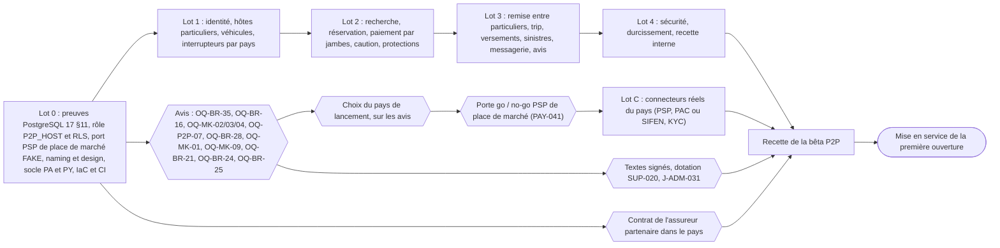

# 18 — MVP et feuille de route (version 5, bêta P2P)

> **Statut : PROPOSÉ, version 5 du 2026-11-02 (pivot P2P, story US-054, paquet S2 de `docs/team/impact/2026-11-02-pivot-p2p.md` §g)**. Kmino est une **place de marché de particulier à particulier** : des particuliers louent leur propre voiture au Panama et au Paraguay, **dès la bêta** ; **il n'y a aucune agence ni aucun loueur professionnel dans le produit** (DEC-FONDATEUR-13). Par défaut, on fait **comme Turo** (DEC-FONDATEUR-14, DEC-FONDATEUR-16 ; choix journalisés dans `docs/team/COMME_TURO.md`). Les §0 à §7 sont réécrits ; le MVP est la **bêta P2P** ; le lot LB et la phase P0-B sont supprimés ; la séquence est celle de l'analyse pivot §e.6 ; l'effort est recalculé (§5, méthode explicite). Comptes de `04_FEATURE_INVENTORY.csv` **révision 6** (178 lignes P0-A, 142 construites dans la tranche des lots 0 à 4).
> **Règle de lecture (version 5)** : les §9 à §12 et les mentions « (corrigé VERIF_10-…) », « (aligné v4) » ou « historique » sont **historiques** : ils décrivent la version 4, faite pour un modèle « pro-first » où des agences encaissaient, abandonné par DEC-FONDATEUR-13. Les noms techniques `P0-A`, `lot_p0a` et `beta_pilote` de 04 sont gardés parce que les contrôles de `tools/` les lisent : `P0-A` se lit **MVP (bêta P2P)** et `beta_pilote` se lit **tranche des lots 0 à 4 de la bêta P2P**. Aucune « agence pilote » n'existe.
> Sources : `04_FEATURE_INVENTORY.csv` (révision 6) et son README (§12), `docs/team/impact/2026-11-02-pivot-p2p.md` (§a, §b.7, §c, §e, §h), `22_OPEN_QUESTIONS.md` (section « Pivot P2P », décisions DEC-FONDATEUR-13 à 16), `19_DEVELOPMENT_BACKLOG.md` (estimations des stories), `08_BUSINESS_RULES.md` (lu, non modifié).
> **Règle de cohérence** : 04 est la source de vérité du périmètre. Chaque identifiant cité ici (`PAY-011`, etc.) est une ligne de 04 ; les comptes, epics, lots, valeurs de la tranche et estimations au barème viennent de 04 et de son README et sont vérifiés par `python -I -X utf8 tools/check_inventory.py`. Les stories `NOUVELLE-01` à `NOUVELLE-18` sont les identifiants provisoires de l'analyse pivot §e.5 ; la demande de fusion S6 (19) leur donnera un identifiant définitif.

## 0. Résumé

- **Décisions du fondateur** (22 « Décisions prises ») : **DEC-FONDATEUR-02** on construit d'abord ; les avis juridiques sont exigés **avant la mise en service**, jamais avant un lot. **DEC-FONDATEUR-03** les connecteurs réels (PSP, facture électronique, KYC local) attendent le choix du pays de lancement ; le build se fait contre des adaptateurs `FAKE`, jamais actifs en production (17 §6.5). **DEC-FONDATEUR-04** Panama **et** Paraguay construits en même temps (USD / PYG). **DEC-FONDATEUR-13** place de marché entre particuliers dès la bêta, aucune agence, modèle économique de Turo décrit dans 08 (trip fee, plans de protection, part de l'hôte selon le plan), assurance par un contrat entre Kmino et un assureur partenaire. **DEC-FONDATEUR-14** par défaut, comme Turo : le voyageur paie Kmino, l'hôte est versé après le trajet, la protection est vendue par Kmino pour l'assureur partenaire ; montage par un PSP de place de marché, en `FAKE` seulement. **DEC-FONDATEUR-16** devant une question propre au P2P, on applique la solution de Turo, marquée PROPOSÉ.
- **MVP = bêta P2P** : bêta fermée dans le pays de lancement, avec des **hôtes particuliers dès le départ** et des voyageurs réels en volume limité. Le voyageur paie **Kmino, marchand de référence** ; chaque paiement est réparti en **jambes** calculées par le règlement (part de l'hôte, prime de l'assureur, part de la plateforme, taxe pour compte de tiers) ; caution par carte ; protections du voyageur et plans de gains de l'hôte ; trip fee ; versements aux hôtes après le trajet ; remise et retour **entre particuliers**, photos des deux côtés ; messagerie ; avis réciproques ; sinistres, vol et amendes. **178 lignes** de 04 (révision 6), 18 epics (E1 à E18).
- **Première ouverture** : tranche des lots 0 à 4 de la bêta P2P, définie ligne par ligne dans 04 (colonne `beta_pilote`) : **142 lignes construites** (31 OUI, 111 SIMPLIFIÉ), **28 MANUEL**, **8 DIFFÉRÉ**. Effort retenu : **≈ 190 à 370 jours-agent** ; bêta P2P complète (lots 0 à 5) : **≈ 340 à 670 jours-agent** ; lot C non compris (§5, méthode). Aucune durée calendaire n'est promise : elle sera mesurée après le lot 0 (US-027).
- **Interrupteurs de mise en service, par pays**, tous à `false` en production tant que l'avis ou le contrat manque : `p2p_private_hosts_enabled[pays]` (OQ-BR-35), `insurer_contract_active[pays]` (contrat de l'assureur, OQ-P2P-03), `funds_holding_enabled[pays]` (détention de fonds, OQ-MK-02, OQ-MK-03, OQ-MK-04), `payouts_enabled[pays]` (fiscalité des hôtes, OQ-P2P-07). Noms PROPOSÉS (22 « Pivot P2P », forme définitive par S4).
- **Lot C — connecteurs réels** (après le choix du pays) : **porte go / no-go du PSP de place de marché** par pays (PAY-041, capacités bloquantes de l'analyse pivot §c.5), puis connecteur PSP (PAY-042), facture électronique PAC ou SIFEN (FIN-020), fournisseur KYC (VER-029) ; barème 1,1 à 2,6 unités (11 à 26 jours-agent), à recalculer quand le PSP est connu. **Il n'existe aucun plan B avec des agences** : un pays sans PSP validé n'ouvre pas.
- **Fondations design** (E16), **transmissibilité, qualité et gouvernance** (E17) : inchangées (DEC-FONDATEUR-05 à 10 ; §11).
- **Supprimés** : la phase P0-B et le lot LB (leurs stories sont remontées dans la bêta, retirées ou fondues dans les portes de lot ; analyse pivot §e.6) ; la porte G0 (viabilité d'une commission d'agence, OQ-MK-07, **sans objet** dans 22) ; la « Bêta pilote avec 1 à 2 agences ».
- **Puis** P1 (version concurrentielle complète, dont co-hôtes, livraison, remise sans contact), P2 (ouverture commerciale du second pays, déjà construit ; différenciation), P3 (options). Le P2P n'est plus en P2 : il est le MVP.
- **Chemin critique** (§4) : le build n'attend aucun avis ; la **mise en service** = max(fin du build, avis juridiques, contrat de l'assureur, choix du pays + lot C + porte go / no-go PSP, autres prérequis) + recette de la bêta.

## 1. Définition du MVP

### 1.0 Première ouverture — tranche des lots 0 à 4 de la bêta P2P

**Pourquoi** : la bêta P2P complète (178 lignes) est trop large pour une première ouverture. La tranche est définie **ligne par ligne** dans la colonne `beta_pilote` de 04 (nom de colonne historique), contrôlée par script ; la raison de chaque valeur autre que OUI est écrite dans `notes`.

**Pour qui** : des **hôtes particuliers** du pays de lancement (la capitale du Panama ou Asunción, choisie sur les avis ; le build couvre les deux pays), inscrits et vérifiés un par un (KYC individuel et KYC du PSP, véhicule contrôlé : titre, prenda, plaque et châssis) ; leur nombre et celui des véhicules sont fixés avant la mise en service, avec la dotation de l'ops (SUP-020) ; des voyageurs réels (touristes et résidents) en volume limité ; remise et retour **en personne, entre l'hôte et le voyageur**, au lieu déclaré par l'hôte (remise sans contact et livraison en P1, OQ-P2P-05).

**Valeurs** (178 lignes P0-A, révision 6 de 04) : **OUI** 31, **SIMPLIFIÉ** 111, **MANUEL** 28, **DIFFÉRÉ** 8. Contrôle : aucune ligne construite ne dépend d'une ligne DIFFÉRÉ. Passage de la révision 5 à la révision 6 : README de 04 §12.

**Ce qui est construit** (142 lignes) :

| Domaine | Lignes de 04 (principales) | Stories (19 et analyse pivot §e) |
|---|---|---|
| Socle, preuves PostgreSQL, design, transmissibilité | lot 0 (22 lignes) | L0 inchangé, 11 stories ajustées ; NOUVELLE-16 (rôle `P2P_HOST`, RLS, minimisation) avec US-011 ; NOUVELLE-03 (port PSP de place de marché) en fin de lot 0 ou au lot 1 |
| Inscription et KYC du voyageur et de l'hôte, interrupteurs par pays | ACC-001, ACC-006, ACC-014, VER-001, VER-004, VER-013, VER-015, HST-049, FIN-008, PYO-001, ADM-027, LEG-021 | US-101 à US-106, US-109 à US-114 ; US-107, US-108 adaptées ; NOUVELLE-01, 11, 12, 13 |
| Véhicules et annonces de l'hôte | HST-005, HST-011, HST-012, HST-016, HST-019, HST-026, HST-033, HST-039, HST-050, ADM-036, PRC-001, CAL-001 à CAL-004, CAL-011, HDB-001, HDB-002 | US-115 adaptée (lieux de remise) ; US-118 à US-122 ; NOUVELLE-02 |
| Recherche, fiche, réservation | SRC-001, SRC-008, SRC-011, SRC-042, LST-002 à LST-013, LST-020, BKG-001 à BKG-027, BKG-014, BKG-016 | US-202 à US-204, US-207 à US-209, US-213 à US-215, US-218, US-221 ; US-201, US-211, US-212, US-219 adaptées ; US-514 remontée |
| Paiement par jambes et caution | PAY-001, PAY-002, PAY-006, PAY-011, PAY-012, PAY-019, PAY-021, PAY-034, PAY-036, PRC-012, PRC-020, PRC-021, PRC-025, FIN-018 | US-701, US-702, US-704 remontées ; US-217 adaptée ; NOUVELLE-04, 05, 07 |
| Protections et assureur partenaire | PRT-001, PRT-002, PRT-003, PRT-007, PRT-008, PRT-011, PRT-013, PRT-015, BKG-003, PRC-018, HST-048 | US-205 adaptée ; NOUVELLE-14, 17 |
| Remise, trip, retour et preuves | TRP-002, TRP-004, TRP-033, TRP-035, TRP-045, TRP-056, CLM-034 | US-303, US-305 à US-313 ; NOUVELLE-08 |
| Versements aux hôtes | PYO-002, PYO-003, PYO-007, PAY-015, PAY-037 | US-703, US-707, US-708, US-709 remontées ; NOUVELLE-06 |
| Messagerie, avis, sinistres | MSG-001, MSG-007, REV-001, REV-002, REV-004, REV-010, TRP-038, CLM-001, CLM-002, CLM-006, CLM-021, ADM-022, NTF-001, NTF-007 | US-525, US-706 remontées ; US-309 adaptée ; NOUVELLE-09, 10, 18 |
| Console, exploitation, sécurité, légal | ADM-001, ADM-004, ADM-005, ADM-006, ADM-007, ADM-014, ADM-029, ADM-031 à ADM-035, SUP-004, LEG-001, LEG-002, LEG-009, LEG-011, LEG-014, LEG-026, I18N-003 à I18N-005, DSN-001 à DSN-007, PLT-001 à PLT-005 | lots 0 à 4 ; US-407 (red team) ajoute les fraudes P2P, la jambe de l'assureur et les interrupteurs |

**Ce qu'elle exclut** (DIFFÉRÉ, 8) : autocomplétion des lieux (SRC-002), tri (SRC-012), ajustement des dates indisponibles (LST-008), écrans propres à Yappy, aux refus et au 3-D Secure (PAY-004, PAY-017, PAY-018 : assurés par la page hébergée du PSP de place de marché ; Yappy seulement si ce PSP le propose), gabarits WhatsApp (NTF-002, repli SMS / e-mail), notifications de trip (NTF-011). Hors MVP de toute façon : le §2.

**Opérations manuelles qui remplacent les lignes MANUEL** (28 ; détail dans `notes` de chaque ligne) :

| Domaine | Opération manuelle (qui) | Lignes remplacées |
|---|---|---|
| KYC | revue KYC dans le portail du fournisseur ou sur pièces (VER-029 au lot C), liste des permis acceptés, contrôle des 90 jours et des sanctions à la revue (ops) | VER-002, VER-003, VER-005, VER-006, VER-007, VER-028, VER-029, ADM-002 |
| Annonces et hôtes | revue des annonces et de l'inscription des hôtes par l'ops, depuis la console | ADM-003, ADM-004 |
| Légal et données | registre Ley 81 et purge tenus par le responsable des données ; litiges et droit applicable dans les CGU statiques | LEG-010, LEG-015 |
| Finance | grand livre en partie double, factures PAC ou SIFEN sur le portail, collecte des taxes par le comptable, rapprochement sur l'export du PSP, relevé mensuel de l'hôte ; porte PSP au lot C | FIN-001, FIN-002, FIN-003, FIN-004, FIN-005, FIN-020, PYO-013, PAY-041 |
| Trip et litiges | refus du véhicule, no-show et arbitrage des litiges par l'ops ; preuves et décisions par gabarit ; pas de hors ligne | TRP-007, TRP-015, TRP-057, ADM-008, LEG-024 |
| Support | support humain es/en sur une plage réduite, planning de présence | SUP-011, SUP-020 |
| Gestes commerciaux | crédits et gestes accordés par l'ops depuis la console, plafonnés (ADM-031) | ADM-007 |

La liste exacte des 28 lignes MANUEL est celle de 04 (`beta_pilote` = MANUEL) ; le tableau les regroupe par domaine.

**Conséquence** : ce que l'ops faisait à la place d'une agence (import de flotte, police, contrat-cadre, comptoir) disparaît ; ce que l'hôte fait lui-même (annonce, photos, prix, remise) est construit. La charge de l'ops porte désormais sur la vérification des hôtes et des véhicules, les sinistres entre particuliers et les versements (SUP-020).

**Taille** : §5.

**Prérequis** : identiques à ceux de la bêta P2P complète (§3), **à la mise en service** et non avant un lot.

### 1.1 Bêta P2P complète (bêta fermée, P0-A)

**Pour qui** : hôtes particuliers et voyageurs du pays de lancement, admis progressivement après la première ouverture ; aucun professionnel de la location.

**Ce que fait la plateforme** (18 epics, 178 lignes ; détail dans le README de 04, §4) :

| Epic | Lignes | Contenu |
|---|---|---|
| E1 Comptes, identité et KYC des voyageurs et des hôtes particuliers | 15 | inscription, nom légal, un compte par personne et interdiction de l'auto-réservation (OQ-P2P-09), permis, selfie + liveness, face match, cédula / passeport, 90 jours du permis étranger en mode signalement, OTP, vérification de l'hôte (21 ans, KYC du PSP, sanctions), profil fiscal |
| E2 Recherche et fiche véhicule | 15 | recherche lieu / dates, liste + carte, total TTC, fiche (photos, distance incluse, bloc de l'hôte, protections, caution) |
| E3 Disponibilité et calendrier de l'hôte | 6 | table d'occupation unique, hold anti-double réservation, blocages, préavis, tampon |
| E4 Réservation, contrat hôte–voyageur et checkout | 13 | checkout une page, contrôles bloquants, lieux de remise de l'hôte, contrat de location entre l'hôte et le voyageur (Kmino intermédiaire), signature, constancia, confirmation |
| E5 Devis, taxes, trip fee et facturation | 10 | devis versionné, ITBMS ou IVA, trip fee (08 BR-PRICE-06), grand livre par jambe, facture du trip fee et reçu des frais de l'hôte, ports PAC et SIFEN contre `FAKE`, relevé mensuel de l'hôte |
| E6 Paiement par jambes et caution par carte | 14 | port PSP de place de marché (Kmino marchand de référence, hôtes sous-marchands), autorisation et capture par jambe, remboursements par jambe, preuve par webhook, caution par carte (rails de 08 BR-PAY-06 sans comptoir), carte enregistrée et débits post-trip conformes aux réseaux, Yappy si le PSP le propose |
| E7 Onboarding de l'hôte particulier et annonces | 12 | annonce publiée par l'hôte (wizard), éligibilité du véhicule d'un particulier, documents, catalogue de référence, espace hôte |
| E8 Trip : remise et retour entre particuliers, preuves | 11 | remise et retour sur le téléphone de l'hôte et du voyageur, photos horodatées des deux côtés, retard, non-restitution graduée, dossier de preuve, risque PWA iOS, hors ligne |
| E9 Annulations, protections du voyageur et plans de gains de l'hôte | 14 | annulation par le voyageur, par l'hôte (BR-CXL-13) et par la plateforme ; 3 niveaux de protection du voyageur (Básica obligatoire), RC tiers, plans de gains de l'hôte (défaut `ESTÁNDAR` 75 %), prix des protections (BR-PRICE-11) |
| E10 Messagerie, notifications et avis réciproques | 10 | messagerie hôte–voyageur avec détection du marché gris, notifications avec repli SMS / e-mail, avis réciproques en double aveugle (10 jours) |
| E11 Dommages, sinistres et litiges entre particuliers | 6 | déclarations, instruction, déclaration à l'assureur, factures annexes validées sous 72 h, preuves et décisions motivées |
| E12 Back-office, support, risque et exploitation | 19 | console à rôles avec journal d'audit, file d'onboarding des hôtes, interrupteurs par pays, réservations à risque, paramètres PA et PY, support, dotation, sécurité, préproduction, sauvegardes, RPO / RTO |
| E13 Légal, consentements, langues et pays | 11 | CGU du voyageur et de l'hôte, consentements versionnés, rétention, registre Ley 81, positionnement d'intermédiaire, avertissements réglementaires, es / en, USD et PYG |
| E14 Versements aux hôtes et grand livre de l'hôte | 4 | compte de versement de l'hôte, versements B2C après le trajet (J+2 ouvrés, premier à J+5), `host_ledger`, reprise du solde négatif |
| E15 Taxes collectées et rapprochement par jambe | 2 | taxes collectées par Kmino, rapprochement quotidien par jambe (bordereau de l'assureur compris) |
| E16 Fondations design, marque et contenus | 7 | inchangé |
| E17 Transmissibilité, qualité et gouvernance multi-agents | 5 | inchangé |
| E18 Connecteurs réels (lot C) | 4 | porte go / no-go du PSP de place de marché (PAY-041), connecteur PSP (PAY-042), facture électronique (FIN-020), fournisseur KYC (VER-029) |

**Voyageurs sans carte de crédit** : le loyer peut être payé par Yappy si le PSP de place de marché le propose (PAY-004, capacité `SUPPORTS_YAPPY_IN_MARKETPLACE`, inconnue ⇒ non), mais la caution reste une autorisation sur carte (PAY-011) tant qu'aucun autre rail n'est validé ; le rail « débit puis remboursement » exige `funds_holding_enabled[pays]` (analyse pivot §c.4, risque R11).

**Parcours couverts de bout en bout** : (1) l'hôte s'inscrit, passe le KYC (le nôtre et celui du PSP), déclare son profil fiscal et son compte de versement, publie son véhicule, qui est contrôlé par l'ops, et choisit son plan de gains ; (2) le voyageur cherche, se vérifie, choisit sa protection, réserve et paie Kmino ; la caution est autorisée sur sa carte ; (3) l'hôte et le voyageur se retrouvent au lieu convenu (messagerie), l'hôte contrôle le permis (6 points), les deux prennent les photos, les clés sont remises ; (4) retour, photos, clôture ; retard ou non-restitution suivis par l'ops ; (5) dommage éventuel : dossier de preuve, déclaration à l'assureur, décision motivée, débit du voyageur et franchise de l'hôte selon les plans ; (6) versement de la jambe de l'hôte après le trajet (si `payouts_enabled[pays]`), avis réciproques, rapprochement par jambe.

**Critères de sortie de la bêta fermée** (PROPOSÉS, à confirmer au point hebdomadaire ; DEC-FONDATEUR-14) :

| # | Critère | Seuil proposé |
|---|---|---|
| S1 | Hôtes actifs (vérifiés, au moins un trip par mois) | seuil à fixer avec la dotation de l'ops avant la mise en service (aucune valeur dans les specs) |
| S2 | Trips terminés sans double réservation ni remise de clés sur paiement non confirmé | ≥ 100 cumulés, 0 incident de ces deux types |
| S3 | Sinistres déclarés à l'assureur et instruits dans les délais de CLM-006 | 100 % |
| S4 | Écart de rapprochement par jambe (FIN-005) | 0 écart non expliqué sur deux cycles de versement |

**Critères d'arrêt ou de révision** (PROPOSÉS) : un avis défavorable reçu après l'ouverture sur OQ-BR-35, OQ-BR-16 ou la détention de fonds (arrêt des nouvelles réservations dans le pays concerné, ouverture du second pays, déjà construit) ; résiliation du contrat de l'assureur (`insurer_contract_active[pays]` repasse à `false`) ; perte des capacités bloquantes du PSP. Le point mort (trips × part plateforme face aux coûts tiers et d'exploitation, 15 K.3) reste à calculer.

### 1.2 Ancienne phase P0-B (supprimée)

Sans objet depuis la version 5. Ses 13 lignes sont intégrées au MVP (PAY-011, PAY-012, PAY-015, PAY-036, PAY-037, PRC-012, CLM-021, PYO-001, PYO-002, PYO-007, FIN-004, FIN-005), sauf PAY-038 (split de commission sur le compte d'un tiers), **hors produit**. Ce que la plateforme encaisse est construit dès la bêta contre le `FAKE` ; ce qu'elle détient pour le compte de tiers reste coupé en production tant que `funds_holding_enabled[pays]` = `false`.

### 1.3 Ouverture élargie

L'**ouverture élargie** est la bêta P2P complète (178 lignes, sans P1) ouverte à tout hôte particulier éligible du pays de lancement, après que les critères S1 à S4 de §1.1 sont atteints. Aucune date n'est annoncée avant le recalage de §5.3.

## 2. Hors périmètre explicite du MVP

| Hors MVP | Où | Lignes de 04 |
|---|---|---|
| **Agences, loueurs professionnels, comptes de société, KYB, police flotte, contrat-cadre, mandats, encaissement par un tiers, caution prise au comptoir, interface de comptoir, outils et API de flotte** | **hors produit (DEC-FONDATEUR-13)** ; les réintroduire serait une décision nouvelle du fondateur | les 24 lignes HORS PRODUIT de 04 (README §12) |
| Détention de fonds de tiers par Kmino en production | interrupteur `funds_holding_enabled[pays]` (avis OQ-MK-02, OQ-MK-03, OQ-MK-04) ; construit contre le `FAKE` | — |
| Co-hôtes | P1, comme Turo | FLT-001, FLT-002 |
| Remise sans contact (équipements), livraison, remise à l'aéroport hors point convenu, one-way | P1 (OQ-P2P-05, OQ-MK-08) | HST-034, BKG-041, BKG-017 |
| Ouverture commerciale du second pays (le build couvre déjà Panama et Paraguay, DEC-FONDATEUR-04) | P2 | connecteurs réels du second pays (lot C rejoué) |
| Applications natives iOS / Android | après le MVP (DEC-FONDATEUR-06 ; web mobile-first + PWA, DSN-006) | — |
| VTC et option avec chauffeur | rejeté (15 §M) / P3 | BKG-043 |
| Variantes régionales hors capitale (Panama intérieur, villes frontalières du Paraguay) | hors bêta ; OQ-MK-12 (22) avant l'ouverture hors capitale | — |
| Géofencing logiciel, télématique, coupure moteur | P1 / P2 ; coupure exclue (OQ-BR-17) | TRP-042, TRP-043, TRP-054 |
| Support humain 24/7, triage IA | P1 | SUP-004 (reliquat), 15 IMP-07 |
| Modification, extension et échange de trip en libre-service | P1 (manuel par l'ops en bêta, ADM-006) | TRP-020 à TRP-025, TRP-027 |
| Réponses publiques aux avis, profil public complet | P1 | REV-006, ACC-017 |
| Connexion Google / Apple, connexion par code | P1 | ACC-002, ACC-003, ACC-004 |
| Prix par date, remises de durée, non remboursable, jeune conducteur, tarification dynamique | P1 / P2 | PRC-002, PRC-008, PRC-010, PRC-011, PRC-014, PRC-003 |
| Paiement de soldes in-app, chargebacks automatisés, recouvrement | P1 | PAY-025, PAY-028, ADM-021 |
| ACH Xpress comme rail d'encaissement, BNPL, Apple / Google Pay | P1 / P3 / P2 | PAY-009, PAY-003 |
| Moteur de règles configurable, score de fraude, screening continu, exigences dynamiques | P1 | ADM-011, SUP-012, VER-009, VER-019 |
| Calendrier multi-véhicules, actions en masse pour un hôte qui a plusieurs véhicules | P1 | FLT-004, FLT-005 |
| Parrainage, fidélité, cartes cadeaux, crédits | P1 à P3 | module MKT |
| Droits des personnes en libre-service, bannière de cookies | P1 (manuel en bêta ; aucun cookie non essentiel en bêta) | LEG-005, LEG-007, LEG-008, ADM-026 |
| Inspection IA, refacturation Panapass / ATTT | P2 / P1 | CLM-035, CLM-036 |

Exclusions supplémentaires de la première ouverture (lignes DIFFÉRÉ ou MANUEL) : §1.0.

## 3. Préconditions de lancement

Questions de `22_OPEN_QUESTIONS.md` (section « Pivot P2P » et questions existantes reformulées par US-053) et prérequis opérationnels. **Aucune ne bloque le build** (DEC-FONDATEUR-02) : la colonne « Bloque » dit ce qui ne peut pas **ouvrir** sans la réponse. **Aucune question n'est posée au fondateur** (DEC-FONDATEUR-14, 16) : chaque point ouvert porte un défaut « comme Turo » codé et marqué PROPOSÉ ; seuls restent les avis, les contrats et les dépenses. Chaque responsable demande un délai écrit au prestataire pendant le lot 0.

| # | Domaine | Précondition | Questions / lignes | Qui | Bloque |
|---|---|---|---|---|---|
| C1 | Juridique PA et PY | Un particulier peut louer son véhicule (plaque « particular ») par une plateforme sans requalification ; statut fiscal et commercial de l'hôte au Paraguay | **OQ-BR-35** | Avocat ; Comptable | mise en service dans le pays (`p2p_private_hosts_enabled[pays]`) |
| C2 | Assurance | Protection du voyageur et plans de l'hôte = produit de l'assureur partenaire distribué par un courtier agréé ; qualification d'assurance ; **contrat signé dans le pays** | **OQ-BR-16**, **OQ-P2P-03**, OQ-P2P-12 | Avocat ; Assureur (contrat et dépense du fondateur) | tout hôte (`insurer_contract_active[pays]`) |
| C3 | Fonds de tiers | Kmino (ou son entité US) qui encaisse et reverse est-il casa de remesas, money transmitter ou PSP au sens du BCP ? Même en variante A (jambes directes), Kmino ordonne les libérations | **OQ-MK-02**, **OQ-MK-03**, **OQ-MK-04**, OQ-PAY-05, OQ-PAY-21 | Avocats PA, US, PY | variante B et caution « débit puis remboursement » (`funds_holding_enabled[pays]`) ; mise en service si la variante A est aussi requalifiée (risque R4) |
| C4 | Fiscal | Kmino agent de retenue (IRP / IVA au PY, retenues au PA) ? RUC exigé de l'hôte ? Taxe sur le trip fee et sur la marge ; entité qui facture | **OQ-P2P-07**, OQ-PAY-09, OQ-BR-14, OQ-MK-06 | Comptable PA et PY ; Avocat | versements aux hôtes (`payouts_enabled[pays]`) ; factures en production |
| C5 | Véhicules | Véhicule financé (prenda) ; vérification de la plaque et du châssis | **OQ-BR-28**, OQ-P2P-02 | Avocat ; Assureur | publication des véhicules financés (défaut : consentement écrit du créancier) |
| C6 | PSP | **Porte go / no-go du PSP de place de marché, par pays** : sous-marchand particulier, montants par jambe, versement B2C (USD, PYG), libération différée, ajustement, reprise, MIT, remboursement partiel (analyse pivot §c.5) ; candidats de 09b non validés | **PAY-041** ; OQ-PAY-02, 04, 05, 06, 08, 17, 19, 20, 21, 23 ; OQ-PAY-03 (reformulée) ; OQ-PAY-07, OQ-PAY-22 (Yappy) | PSP ; fondateur (contrat) | connecteur réel (PAY-042) au lot C ; **mise en service** ; aucun plan B avec des agences (risque R1) |
| C7 | Contrats et consommation | CGU du voyageur et de l'hôte, contrat de location hôte–voyageur ; validité des clauses (pénalités, décision « définitive », frais annexes) ; retenue d'un no-show quand l'hôte est inéligible | **OQ-BR-24**, OQ-BR-45 (avis consommation) | Avocat PA et PY | mise en service |
| C8 | KYC | Permis étrangers et date d'entrée (art. 110 / 111) | **OQ-BR-21** | Avocat PA | refus automatique (sinon mode signalement) |
| C9 | Données | Durées de conservation (KYC, biométrie, photos, adresse de l'hôte) | **OQ-BR-25** | Avocat | paramétrage de LEG-009 (valeurs prudentes en attendant) |
| C10 | Données (Ley 81) | Enregistrement des traitements, transferts de biométrie hors Panama, notification d'une violation | **OQ-MK-09** ; LEG-010, ADM-035 | Avocat PA | KYC réel en production (VER-029, lot C) ; mise en service |
| C11 | Intermédiation | Positionnement de Kmino : intermédiaire et marchand de référence, jamais loueur (art. 288 au Panama) | **OQ-MK-01** | Avocat PA | textes (LEG-014) ; mise en service au Panama |
| C12 | Paraguay pays de lancement | Statut PSP au BCP ; PSP de place de marché au Paraguay | **OQ-MK-04**, OQ-PAY-08, OQ-PAY-10, OQ-PAY-11, OQ-PAY-23 | Avocat PY ; PSP | choix du Paraguay comme pays de lancement ; son lot C |
| C13 | Paramètres | Valeurs de lancement de ADM-031 (âges, préavis, pénalités de l'hôte, plan par défaut, protection minimale, fenêtre d'avis, plafonds) | jalon **J-ADM-031** | Ops ; valeurs par défaut « comme Turo » (DEC-FONDATEUR-14) | mise en service ; valeurs de test pendant le build |
| C14 | Exploitation | Dotation du support et de l'ops : 7 h–22 h, 7 j/7 ≈ 2,6 ETP de présence, ou plage réduite ; responsable ops nommé | SUP-020 | Fondateur (dépense) | ouverture de la bêta |
| C15 | Sécurité | Revue de sécurité avec livrables, aucune vulnérabilité critique ou élevée ouverte | ADM-033 | Agent sécurité indépendant + prestataire | ouverture de la bêta |
| C16 | Technique | Décision PWA seule ou enveloppe native, après test sur des téléphones représentatifs des hôtes et des voyageurs | TRP-056 | Agents (orchestrateur, DESIGN) | rien pour le build (PWA décidée, 17 ADR-039) ; repli décidé à la fin du lot 0 |
| C17 | Marque | Nom et identité ; antériorité de marque et domaine | DSN-001 ; DEC-MARQUE | Fondateur (conseil en marques) | publication du nom (le build continue avec `{brand_name}`) |
| C18 | Comptes | Comptes externes (cloud, domaine, dépôt, PSP, KYC, e-facture, WhatsApp, courriel) au nom de l'entité du fondateur | PLT-002 | Fondateur | lot 0 (cloud, dépôt, domaine) ; lot C (PSP, KYC, e-facture) |

Sans objet depuis la version 5 (pivot P2P) : l'ancienne C1 (commission acceptée par des agences, OQ-MK-07, porte G0), C4 (polices flotte, OQ-MK-05), C10 (caution restituée par une agence, forme initiale d'OQ-PAY-06) et la signature d'agences pilotes.

Prérequis non juridiques à lancer dès le début du lot 0 : contrat, accord de sous-traitance (Ley 81) et bac à sable du fournisseur KYC ; demandes de renseignements écrites aux PSP de place de marché candidats des deux pays (capacités bloquantes) ; démarchage d'assureurs et de courtiers (F-09, F-18) ; compte WhatsApp Business et BSP (**non bloquant**, repli SMS / e-mail) ; choix d'hébergement ; nom de domaine et entité qui signe les contrats ; devis du test d'intrusion.

## 4. Chemin critique

**Lecture** :
- **Build sans porte juridique** (DEC-FONDATEUR-02) : lots 0 à 4 enchaînés, contre les adaptateurs `FAKE`. Le risque d'un build non réutilisable est accepté et borné : aucun élément propre à un pays codé en dur (ADR-024), deux pays de premier rang (ADR-033), ports avec adaptateurs `FAKE` (ADR-032). Un avis négatif dans un pays oriente le choix du pays de lancement au lieu d'arrêter le build.
- **Plus de porte G0** : elle mesurait l'intérêt des agences pour une commission (OQ-MK-07, sans objet). Le lot 0, déjà engagé, continue tel quel (analyse pivot §d) ; ses 11 stories ajustées et NOUVELLE-16 y entrent.
- **Lot 0 d'abord : preuves PostgreSQL** (17 §11, L0-01 à L0-10) sous les rôles de production ; un échec bloque le lot 2 et déclenche une ré-estimation.
- **Pendant les lots 0 à 3** : demandes écrites aux PSP candidats (capacités bloquantes), démarchage des assureurs et des courtiers, demandes de devis et de délais aux avocats et aux comptables (sans commander l'avis, DEC-FONDATEUR-02).
- **Avant le lot C** : **porte go / no-go du PSP**, par pays (risque R1) ; GO si un PSP valide en bac à sable toutes les capacités bloquantes, NO-GO sinon : le pays n'ouvre pas. Le lot C peut tourner en parallèle des lots 3 et 4 si le choix du pays intervient tôt.
- **Mise en service** = max(fin du lot 4, avis reçus, contrat de l'assureur, choix du pays + porte go / no-go + lot C, textes signés, dotation SUP-020, J-ADM-031) + recette (2 à 4 semaines calendaires, proposé). Les principaux risques externes sont l'absence de PSP (R1) et d'assureur (R3) ; les goulots internes, la disponibilité du fondateur pour les revues et les limites d'usage des agents.
- **Chaîne technique** : la plus longue chaîne de dépendances P0 de 04 compte 14 niveaux (révision 6) ; l'abstraction PSP (PAY-001, adaptateur `FAKE`) et l'idempotence (PAY-019) restent au lot 0.
- **Gel** (risque R9 de l'analyse) : les stories des lots 1 à 3 citées en analyse pivot §e.2 et §e.4 ne démarrent pas avant la fusion des révisions S3 à S6.

## 5. Estimations de build (effort en jours-agent)

### 5.0 Énoncé unique (à utiliser tel quel)

> **Énoncé à communiquer.** « Bêta P2P, première ouverture (lots 0 à 4, Panama **et** Paraguay construits, connecteurs réels exclus) : **≈ 190 à 370 jours-agent** (≈ 19 à 37 unités de 10 jours-agent). Bêta P2P complète (lots 0 à 5, 178 lignes, éléments non négociables de 17 §10 compris, lot C exclu) : **≈ 340 à 670 jours-agent** (≈ 34 à 67 unités). Ordres de grandeur **non mesurés**. **Aucune durée calendaire n'est promise** : elle sera **mesurée après le lot 0** puis recalée après le lot 1. Non compris : le lot C (barème 1,1 à 2,6 unités, à recalculer quand le PSP est connu), les avis juridiques, le contrat de l'assureur, la porte go / no-go du PSP et la recette. »
>
> **Unité et équipe (DEC-FONDATEUR-05).** **1 jour-agent** = une journée de travail d'un agent d'implémentation, tests écrits et revue indépendante compris ; **1 unité = 10 jours-agent**. Le grain fin est celui de 19 (points ; 1 point ≈ ½ jour-agent, hypothèse non mesurée de 19 §1.2).

**Méthode (aucune valeur inventée)**. Deux calculs indépendants à partir des estimations existantes, le premier étant retenu :

1. **Barème de 04 + surcoût des non négociables (retenu)** — même méthode qu'en version 4 : la version 4 retenait, pour la tranche, le barème de 04 révision 5 (7,5 à 17,5 unités) relevé des surcoûts de sûreté de 17 §10 et des audits VERIF_16 / VERIF_17, soit ≈ 17 à 30 unités ; pour le P0-A complet, 24,4 à 49,9 relevé à ≈ 32 à 64. La version 5 garde ces surcoûts tels quels (les non négociables NN1 à NN11 ne changent pas) et ajoute **l'écart de barème** entre les révisions 5 et 6 de 04, calculé par `tools/check_inventory.py` :

| Périmètre | Barème révision 5 | Barème révision 6 | Écart | Retenu version 4 | **Retenu version 5** |
|---|---|---|---|---|---|
| Tranche des lots 0 à 4 | 7,5–17,5 (96 lignes construites) | 9,9–24,1 (142 lignes construites) | +2,4 à +6,6 | ≈ 17–30 | **≈ 19–37 unités (190–370 jours-agent)** |
| MVP complet (P0-A, lots 0 à 5) | 24,4–49,9 (166 lignes) | 26,1–53,1 (178 lignes) | +1,7 à +3,2 | ≈ 32–64 | **≈ 34–67 unités (340–670 jours-agent)** |

L'écart de la tranche est plus fort que celui du MVP complet parce que la révision 6 **construit** dans la tranche ce que l'ops faisait à la place des agences (MANUEL → SIMPLIFIÉ, README de 04 §12) et parce que les lignes de l'ancien P0-B (barème 2,0–3,7) entrent dans le MVP, tandis que 15 lignes d'agence en sortent. Les surcoûts propres à l'ancien P0-B qui n'étaient pas des lignes (certification PSP, recette financière, conformité : « ≈ 5–10 » en version 4) relèvent désormais du lot C et de la mise en service, hors énoncé.

2. **Points des stories de 19 (contrôle ; recalculé le 2026-11-03 sur 19 version 3, US-057)** — même méthode que la version 5 (US-054) : 1 point ≈ ½ jour-agent (hypothèse de 19 §1.2), points lus par `tools/check_backlog.py` sur 19 v3 (US-058), qui a chiffré les 18 nouvelles stories, US-542 et les stories adaptées :

| Lot (19 v3) | Stories | Points |
|---|---|---|
| L0 | 59 | 286 |
| L1 | 28 | 120 |
| L2 | 27 | 140 |
| L3 | 21 | 110 |
| L4 | 9 | 37 |
| **Tranche L0–L4** | **144** | **693 pts ≈ 347 jours-agent** |
| L5 | 34 | 176 |
| **Bêta P2P complète L0–L5** | **178** | **869 pts ≈ 435 jours-agent** |
| LC (hors énoncé) | 8 | 52 |
| HORS (19 stories hors produit, vidées) | 19 | 0 |

**Écart corrigé** : la version 5 annonçait, faute de chiffrage, ≈ 622 à 638 pts pour la tranche et ≈ 788 à 804 pts pour la bêta complète (stories retirées, remontées, nouvelles estimées par les stories remplacées, 8 nouvelles bornées par les quartiles 3–5 pts). Le chiffrage de S6 donne **693 et 869 pts**, soit + 55 à + 71 pts et + 65 à + 81 pts : le lot 0 passe de 222 à 286 pts (US-061 port PSP de place de marché, US-062 rôle `P2P_HOST` et RLS de l'hôte, ajustements des 12 stories de l'analyse §d), et les nouvelles stories des lots 1 à 3 sont plus lourdes que les quartiles supposés (US-315 remise et retour à 13 pts, US-542 ajoutée). Le contrôle **reste dans les fourchettes de la méthode 1**, qui ne changent pas : 347 jours-agent dans 190–370 pour la tranche (dans son quart haut : risque de dépassement à surveiller au recalage du lot 1, §5.3) et 435 dans 340–670 pour la bêta complète. Ce n'est pas une preuve : le facteur ½ jour par point et le barème sont des hypothèses (A24-20).

**Pourquoi aucune date.** La conversion jours-agent → jours calendaires dépend de facteurs inconnus avant le lot 0 : nombre d'agents en parallèle, limites d'usage, temps de revue du fondateur, mise en place externe (comptes, PSP, assureur, KYC, e-facture, avis). Ils sont mesurés au lot 0 (§5.3, US-027).

**Hypothèses.** Exploitation (support, ops, vérification des hôtes et des véhicules, curation du catalogue), rédaction juridique, démarchage des assureurs et recrutement des premiers hôtes non comptés ; tests exhaustifs et documentation compris dans chaque story (DoD, DEC-FONDATEUR-08 / 09).

**Délais externes exclus** : avis juridiques et comptables (§3), contrat de l'assureur, choix du pays, porte go / no-go et contrat du PSP, contrat et bac à sable du fournisseur KYC, BSP WhatsApp (non bloquant), recrutement du support (SUP-020), test d'intrusion externe, entité qui facture et connecteur PAC ou SIFEN.

**Date de mise en service** = **max(fin du build mesurée, avis reçus, contrat de l'assureur, choix du pays + porte go / no-go + lot C, autres prérequis) + recette** (2 à 4 semaines calendaires, proposé).

**Retiré en version 5.** L'énoncé de la version 4 (« Bêta pilote ≈ 170 à 300 jours-agent, P0-A ≈ 320 à 640 », pour un modèle agence) ; la ligne « P2 : P2P vérifié ≈ 12–25 unités » (le P2P est le MVP) ; la ligne « E14 + E15 P0-B ≈ 5–10 ». L'historique des fourchettes en semaines-équipe (versions 1 à 4) reste dans l'historique Git.

### 5.1 Détail par epic (barème de 04, révision 6)

Barème : somme des lignes de l'epic selon `complexite_tech` (faible 0,5–1,5 jour-agent, moyenne 1,5–2,5, élevée 3–8 ; une ligne SIMPLIFIÉ compte un cran plus bas dans la tranche, une ligne MANUEL ou DIFFÉRÉ compte 0 ; README de 04 §1 bis). Par lot (sortie de calcul sur 04 révision 6, même barème que `tools/check_inventory.py`) :

| Lot | Lignes P0-A | Barème MVP (unités) | Lignes construites dans la tranche | Barème de la tranche (unités) |
|---|---|---|---|---|
| 0 | 22 | 3,2–6,7 | 22 | 1,9–4,0 |
| 1 | 47 | 5,8–11,2 | 37 | 1,8–4,9 |
| 2 | 72 | 8,6–18,2 | 59 | 3,1–8,4 |
| 3 | 32 | 4,8–9,2 | 22 | 1,4–3,5 |
| 4 | 1 | 0,1–0,2 | 1 | 0,1 |
| C | 4 | 1,1–2,6 | 1 | 0,1–0,2 |
| Forfaits (socle ; durcissement et recette interne) | — | 1,5–3 ; 1–2 | — | 1–2 ; 0,5–1 |
| **Total** | **178** | **26,1–53,1** | **142** | **9,9–24,1** |
| **Retenu avec les non négociables (§5.0)** | | **≈ 34–67** | | **≈ 19–37** |
| P1 (version concurrentielle) | 327 | 32,9–71,2 (lignes seules) | — | — |

Le détail par epic de la version 4 (E1 à E15 du modèle agence) est retiré : les epics ont été recomposés (README de 04 §4) ; le barème par epic se recalcule avec le même script.

### 5.2 Contrôle du P1

P1 : 327 lignes, 32,9–71,2 unités au barème (lignes seules), **à ré-estimer par epic avant toute date**. Le P1 contient des lignes lourdes (moteur de risque ADM-011, modifications de trip TRP-020 à TRP-025, chargebacks PAY-028, télématique TRP-043).

### 5.3 Recalage

Fin du lot 0 : première mesure calendaire (US-027). Fin du lot 1 : vélocité mesurée (jours-agent par ligne livrée et par complexité, taux de rejet en revue), nouvelle fourchette publiée ici et dans le README de 04 ; recalage suivant à la fin du lot 2. Coûts tiers et d'exploitation (assureur, PSP, KYC, support) : à chiffrer par devis ; dotation du support dans SUP-020.

## 6. Feuille de route phasée

```mermaid
flowchart LR
    L0["Lot 0 : preuves PostgreSQL, rôle P2P_HOST, port PSP FAKE, design, socle PA et PY"] --> L1["Lot 1 : identité, hôtes, véhicules"]
    L1 --> L2["Lot 2 : recherche, réservation, paiement par jambes, protections"]
    L2 --> L3["Lot 3 : remise, trip, versements, sinistres, confiance"]
    L3 --> L4["Lot 4 : sécurité, durcissement, recette interne"]
    L0 --> AV{{"Avis, contrat de l'assureur, choix du pays"}}
    AV --> GNG{{"Porte go / no-go PSP de place de marché"}}
    GNG --> LC["Lot C : connecteurs réels du pays choisi"]
    L4 --> BP(["Bêta P2P, première ouverture : ≈ 190-370 jours-agent, mise en service après avis, contrat et lot C"])
    LC --> BP
    BP --> L5["Lot 5 : reste de la bêta fermée, ≈ 340-670 jours-agent cumulés"]
    L5 --> OE(["Ouverture élargie : critères S1-S4"])
    OE --> P1["P1 pays de lancement complet, ≈ 33-71 unités au barème"]
    P1 --> G4{{"OQ-MK-04, OQ-PAY-08 à 12"}} --> P2b["P2 ouverture du second pays : connecteurs réels et recette, le build existe déjà"]
    P2b --> P3["P3 options"]
```

Séquence des lots (analyse pivot §e.6, PROPOSÉ). L'affectation des lignes est la colonne `lot_p0a` de 04 (lot minimal par ligne, relevé au lot maximal de ses dépendances ; 0 inversion de lot) ; les stories sont celles de 19, révisées par S6. Plusieurs agents peuvent travailler en parallèle dans un lot ; la durée sera mesurée après le lot 0.

| Lot | Lignes (04) | Contenu (stories) | Effort (barème, unités) | Porte / prérequis | Tranche (lignes construites ; barème) |
|---|---|---|---|---|---|
| 0 Socle, preuves et cœur sûr | 22 | 49 stories, dont 11 ajustées ; NOUVELLE-16 (rôle `P2P_HOST`, RLS, minimisation) avec US-011 ; NOUVELLE-03 (port PSP de place de marché, `FAKE` normal et hostile) en fin de lot si US-019 est fusionnée ; **d'abord les preuves PostgreSQL de 17 §11** | 4,7–9,7 (lignes 3,2–6,7 + socle) ; 19 chiffre le lot 0 à 222 points ≈ 111 jours-agent, au-dessus de cette fourchette | C18 (comptes cloud, dépôt, domaine) | 22 ; 2,9–6,0 |
| 1 Identité, hôtes, véhicules | 47 | US-101 à US-106, US-109 à US-114, US-118 à US-122, US-036, US-044, US-045 ; US-107, US-108, US-115 adaptées ; NOUVELLE-01, 02, 11, 12, 13 ; retirées : US-116, US-117 | 5,8–11,2 | aucune porte juridique ; KYC contre le `FAKE` | 37 ; 1,8–4,9 |
| 2 Recherche, réservation, paiement par jambes, protections | 72 | US-202 à US-204, US-207 à US-209, US-213 à US-215, US-218, US-221, US-222 ; US-201, 205, 211, 212, 217, 219 adaptées ; US-514, US-701, US-702, US-704 remontées ; NOUVELLE-04, 05, 07, 14, 17 ; retirées : US-206, US-210, US-216, US-220 | 8,6–18,2 | preuves du lot 0 réussies | 59 ; 3,1–8,4 |
| 3 Remise, trip, versements, sinistres, confiance | 32 | US-303, US-305 à US-313 ; US-309 adaptée ; US-525, US-703, US-706, US-707, US-708, US-709 remontées ; NOUVELLE-06, 08, 09, 10, 18 ; retirées : US-301, US-302, US-304 | 4,8–9,2 | C16 (décision PWA) | 22 ; 1,4–3,5 |
| 4 Sécurité, durcissement, recette interne | 1 | inchangé ; la red team (US-407) ajoute les fraudes P2P, la jambe de l'assureur et les interrupteurs | 0,1–0,2 (+ forfait 1–2) | C15 | 1 ; 0,1 |
| 5 Reste de la bêta fermée | (lignes MANUEL, DIFFÉRÉ et SIMPLIFIÉ des lots 0 à 4) | lot 5 actuel moins les 8 stories retirées ; US-520, US-530, US-531 adaptées ; US-710, US-711 remontées ; NOUVELLE-15 | inclus dans le MVP complet | après la première ouverture | — |
| **C** Connecteurs réels | 4 | US-601 (connecteur du PSP de place de marché, variante A puis B) et US-603 (porte go / no-go) adaptées ; US-602, US-604 à US-608 inchangées | 1,1–2,6 (à recalculer quand le PSP est connu) | choix du pays ; contrats PSP, KYC, e-facture au nom du fondateur (C18) | 1 (PAY-042) ; 0,1–0,2 |
| ~~LB~~ | — | **supprimé** : stories remontées (US-701 à US-704, US-706 à US-711), retirées (US-705) ou fondues dans les portes de lot (US-712 → US-222, US-313) | — | — | — |
| Recette (hors build) | — | recette de bout en bout avec des hôtes et des voyageurs réels, chargement des paramètres définitifs (ADM-031) | 2 à 4 semaines calendaires (proposé) | après max(fin du lot 4, lot C, contrat de l'assureur, dernier prérequis) ; C2, C6, C7, C14 | idem |

**Bilan des stories** (analyse pivot §e.6) : 19 retirées, 12 remontées (plus 19 lignes de 04 couvertes par les nouvelles stories), 15 adaptées, 18 nouvelles, 11 du lot 0 ajustées.

### Contenu des phases suivantes (04, `phase_mvp`)

- **P1 (327 lignes)** — automatiser ce qui est manuel en bêta et compléter l'offre : modifications et extensions de trip (TRP-020 à TRP-025), swap (TRP-027), co-hôtes (FLT-001, FLT-002), filtres et pertinence (SRC-013 à SRC-016, SRC-030), connexion Google / Apple / OTP (ACC-002 à ACC-004), restrictions de compte et soldes (ACC-025, PAY-025), chargebacks (PAY-028), support humain 24/7 (reliquat SUP-004, ADM-010), moteur de risque et score (ADM-011, SUP-012, SUP-019), outils pour un hôte qui a plusieurs véhicules (FLT-004, FLT-005), livraison et aéroport (HST-034, BKG-041 après OQ-MK-08), télématique et alertes frontière (TRP-042, TRP-043), droits des personnes en libre-service (LEG-007, LEG-008), Panapass / ATTT (CLM-036), caution modulée et remboursement multi-rails (PAY-039, PAY-040).
- **P2 (100 lignes)** — **ouverture commerciale du second pays** (le produit est déjà construit pour les deux pays, DEC-FONDATEUR-04 ; restent son lot C et sa recette ; portes OQ-MK-04, OQ-PAY-08 à 12) et différenciation (CLM-035, TRP-054, BKG-042, SRC-046, MKT-018, programmes MKT).
- **P3 (47 lignes)** — options conditionnelles (BNPL PAY-009, option avec chauffeur BKG-043, compte entreprise du voyageur ACC-030, éléments non applicables aux deux pays).
- **HORS (24 lignes)** — lignes **HORS PRODUIT (DEC-FONDATEUR-13)**, sans story (`phase_mvp` = `HORS` depuis US-058 ; rangées en P3 auparavant).

Correspondance avec 15 : « P2 = P2P vérifié » et « P0-B » de 15 sont périmés depuis DEC-FONDATEUR-13 ; 04 et ce document font foi.

## 7. Risques principaux du plan

Risques propres au P2P : analyse pivot §h (R1 à R15, probabilité et impact INFÉRÉS), repris ici sous forme courte ; risques du build par agents : inchangés.

| Risque | Effet | Parade |
|---|---|---|
| **R1 — aucun PSP** de place de marché ne fournit au Panama ou au Paraguay les capacités bloquantes | pays non ouvrable | porte go / no-go par pays avant le lot C (PAY-041, US-603 adaptée) ; demandes écrites aux candidats dès le lot 0 ; **aucun repli avec des agences** (DEC-FONDATEUR-13) ; le second pays est construit (DEC-FONDATEUR-04) |
| R2 — OQ-BR-35 défavorable au Panama (plaque « particular ») | pas d'hôtes au Panama | `p2p_private_hosts_enabled[pays]` ; le Paraguay est construit |
| R3 — pas d'assureur partenaire, ou produit trop cher | aucun hôte activable | `insurer_contract_active[pays]` = `false` ⇒ aucun hôte ; démarchage d'assureurs et de courtiers pendant les lots 1 à 3 (contrat et dépense du fondateur) |
| R4 — qualification de Kmino (casa de remesas, PSP au sens du BCP), même en variante A | mise en service bloquée | question posée à l'avocat (OQ-PAY-05, OQ-MK-02, OQ-MK-04) ; `funds_holding_enabled[pays]` ; journal des ordres |
| R5 — fraude : véhicule volé ou nanti, faux hôte, auto-réservation, blanchiment | pertes, sanctions | double KYC, plaque et châssis rapprochés du titre (OQ-P2P-02), `self_booking_forbidden`, revue ops des réservations en bêta (ADM-029), red team US-407 |
| R6 — sécurité physique de la remise entre inconnus | atteinte aux personnes | lieux déclarés et revus, adresse après confirmation, ligne d'urgence (SUP-004), messagerie tracée |
| R7 — dommages non recouvrés (carte de débit, MIT refusé) | perte pour l'hôte ou Kmino | `SUPPORTS_MIT` bloquante ; protection Básica obligatoire (OQ-P2P-12) ; ordre de recouvrement BR-DAMAGE-06 ; dossier de preuve (CLM-034) |
| R8 — vol ou non-restitution ; amendes imputées au propriétaire | perte du véhicule | escalade BR-RETURN-04 (TRP-038, NOUVELLE-18) ; refacturation des amendes (BR-TT-03, OQ-BR-19) ; coupure moteur seulement sur avis (OQ-BR-17) |
| R9 — dérive : le code avance sur l'ancien modèle avant la révision des specs | reprise de code | lot 0 inchangé ; gel des stories des lots 1 à 3 citées en analyse §e.2 et §e.4 jusqu'à la fusion de S3 à S6 |
| R10 — incohérences entre specs | défauts de construction | ordre S1 → S8 ; contrôles croisés de `tools/` (04 / 16 / 19) relancés après S2, S5 et S6 |
| R11 — exclusion des voyageurs sans carte | marché réduit | `SUPPORTS_YAPPY_IN_MARKETPLACE` ; rail « débit puis remboursement » si `funds_holding_enabled[pays]` |
| R12 — fiscalité : agent de retenue, hôtes sans RUC non payables | versements bloqués | `payouts_enabled[pays]` = `false` sans avis fiscal (OQ-P2P-07) ; relevé annuel ; jambe `TAX_THIRD_PARTY` |
| R13 — offre insuffisante : peu d'hôtes particuliers au lancement | bêta sans volume | inscription de l'hôte simple sur mobile ; plans de gains et protections dès l'onboarding ; pas de parade « agences » |
| R14 — reprise de Turo (contrainte 9) | risque juridique et d'image | reprise **fonctionnelle** seulement, règles reformulées ; identité propre (Kmino) ; aucun texte, visuel ni donnée de Turo |
| R15 — écart d'arrondi entre nos jambes et un PSP qui recalcule | écarts de rapprochement | `SUPPORTS_PER_LEG_AMOUNTS` bloquante ; rapprochement par jambe (FIN-005) ; vecteurs PYG à une unité mineure (S3) |
| Conception de 17 §2.3 / §2.5 non tenable sous les rôles de production | reprise de la réservation, estimation fausse | preuves PostgreSQL au début du lot 0 (17 §11) ; ré-estimation avant le lot 2 |
| Adaptateur `FAKE` actif en production | trips sans argent | contrainte, image sans `FAKE`, refus de démarrage, test C19 (17 §6.5) |
| Interrupteur de mise en service passé à `true` sans avis ni contrat | exploitation illégale | interdit aux agents (DEC-FONDATEUR-15) ; bascule journalisée (ADM-027) |
| **PWA iOS** inadaptée (galerie, purge hors ligne) | preuve photo contestable | PWA décidée (17 ADR-039) ; test TRP-056 au lot 0 ; repli (enveloppe native) décidé à la fin du lot 0 |
| **Charge ops** supérieure à la dotation (vérification des hôtes et des véhicules, sinistres, versements) | délais non tenus | SUP-020 : dotation chiffrée, plage réduite possible, responsable ops nommé |
| Approbation Meta tardive | pas de WhatsApp à l'ouverture | repli SMS / e-mail (NTF-002), non bloquant |
| Violation de données (biométrie, adresse de l'hôte) | sanction Ley 81, perte de confiance | minimisation (NOUVELLE-16), LEG-010, ADM-033, ADM-035, OQ-MK-09 |
| Effort sous-estimé (18 nouvelles stories non chiffrées) | mise en service plus tardive | borne haute retenue ; chiffrage par S6 ; mesure après le lot 0, recalage après le lot 1 |
| **Revue du fondateur** goulot (seul humain) | décisions et recettes en attente | point hebdomadaire regroupé ; défaut « comme Turo » appliqué sans attendre (DEC-FONDATEUR-14, 16) ; seules les actions humaines escaladées |
| **Limites d'usage** des agents | build interrompu | stories courtes, passations versionnées, reprise à froid, mesure après le lot 0 |
| **Erreur d'agent présentée avec assurance** | défaut monétaire, de sécurité ou de réservation | vérificateurs indépendants, revues argent / RLS / concurrence sur un autre modèle, oracles de `tools/`, portes CI, red team à chaque lot |
| **Mise en place externe** (comptes, PSP, assureur, KYC, e-facture, domaine, marque) | lot C ou mise en service décalés | registre des comptes (PLT-002) dès le lot 0, demandes lancées au lot 0, build contre `FAKE` |
| **Changement de design tardif** | reprise d'écrans | design piloté par les données (DSN-002, DSN-003, 17 ADR-036) |
| **Dépendance à un fournisseur ou à l'équipe d'agents** | passation impossible | IaC, conteneurs, ports, comptes au nom du fondateur, checklist de passation (PLT-001 à PLT-003) |

Les risques de la version 4 propres aux agences (agence défaillante après encaissement, polices flotte, commission refusée, mandat, contournement par l'agence, décision non exécutée par l'agence) sont **sans objet** (DEC-FONDATEUR-13).

## 8. Tenue à jour

- Toute modification de périmètre se fait dans `04_FEATURE_INVENTORY.csv` (`phase_mvp`, `dependances`, `lot_p0a`, `beta_pilote`), puis `python -I -X utf8 tools/check_inventory.py` doit répondre « OK ». Ce document se met ensuite à jour sur les comptes, les lots et les estimations au barème. Les contrôles croisés de `tools/` (16 et 19) doivent aussi passer : après la version 5, ils attendent les révisions S5 (16) et S6 (19).
- Les réponses aux questions de §3 sont reportées dans 22 ; un avis favorable ou défavorable change un **interrupteur par pays**, pas une phase.
- `08_BUSINESS_RULES.md` est la référence des règles détaillées (révision P2P par S3). Toute décision prise au point hebdomadaire du fondateur est reportée dans 22 (« Décisions prises ») puis dans 04 / 16 / 17 / 18, avec relance des scripts de `tools/`.

> **Historique (version 5)** : les §9 à §12 ci-dessous décrivent les versions 2 à 4 de ce document, faites pour le modèle « pro-first » abandonné (DEC-FONDATEUR-13). Ils sont conservés pour la traçabilité ; les agences, les comptoirs, le P0-A « l'agence encaisse », le P0-B et les portes G0 / G2 qu'ils citent sont **hors produit** ou **sans objet**. Le bilan de la version 5 est au §13.

## 9. Application de VERIF_10

| ID | Gravité | Traitement | Où |
|---|---|---|---|
| V10-01 | CRITIQUE | **Corrigé** : énoncé unique avec hypothèses, délais externes exclus et listés, formule de date, recalage ; Bêta pilote définie ligne par ligne (colonne `beta_pilote`, 76 lignes construites, ≈ 8–14) ; « bêta publique » retirée et remplacée par l'ouverture élargie définie | §0, §1.0, §1.3, §5.0 ; 04 ; 15 K.3 |
| V10-02 | MAJEUR | **Corrigé** : P1 recalculé au barème par ligne (≈ 35–76 au lieu de 25–45), non utilisable pour une date | §5.1, §5.2 ; 15 K.3 |
| V10-03 | MAJEUR | **Corrigé** : G1a avant le lot 1, G1b avant le lot 2 ; lots 0 neutre et 1 générique ; texte et diagramme concordants ; part réutilisable chiffrée (INFÉRÉ) | §4, §6 |
| V10-04 | MAJEUR | **Corrigé** : OQ-MK-02 lecture b dans G1 et dans les préconditions du P0-A ; §0 reformulé | §0, §3 C3, §4, §6 ; README 04 §3 ; 15 K.0 ; 22 |
| V10-05 | MAJEUR | **Corrigé** : mandat LEG-027, porte PSP PAY-041, OQ-PAY-22/07 en P0, portée PCI et secrets (PAY-001, ADM-032, ADM-033) | §3 C6, C7 ; 04 ; 22 |
| V10-06 | MAJEUR | **Corrigé** : FIN-019 (rapprochement), indicateur ADM-005, clause d'audit LEG-025 | §1.1 ; 04 |
| V10-07 | MAJEUR | **Corrigé** : exécution des décisions et pénalité (LEG-025), cas « annulation plateforme + Yappy » (BKG-035), levier noté dans CLM-006 | §1.1 ; 04 |
| V10-08 | MAJEUR | **Corrigé** : 41 lignes traitées, script étendu (mentions non déclarées, ordre des lots), 0 inversion de lot, ADM-004 et ADM-029 au lot 1 | §6 ; 04 ; README 04 §6 bis, §7 |
| V10-09 | MAJEUR | **Corrigé** : LEG-010 promue en P0-A ; OQ-MK-09 ajoutée en P0 ; OQ-BR-21 et OQ-BR-25 en P0 | §3 C8, C9, C13 ; 04 ; 22 ; 15 |
| V10-10 | MAJEUR | **Corrigé** : SUP-020 (≈ 2,6 ETP de présence pour 7 h–22 h, 7 j/7), prérequis C15 | §3 ; 04 |
| V10-11 | MAJEUR | **Corrigé** : ADM-033 (sécurité), ADM-034 (préproduction), ADM-035 (RPO/RTO, incident) ; recette pilote séparée du durcissement | §5, §6 ; 04 |
| V10-12 | MAJEUR | **Corrigé** : TRP-056 (test au lot 0 ; PWA décidée par ADR-039, repli décidé à la fin du lot 0 : constat 24-02), TRP-057 (hors ligne scindé) | §3 C17, §6 ; 04 |
| V10-13 | MINEUR | **Corrigé en partie** : 4 lignes P0 « DIRECTEMENT TESTÉ » requalifiées, F11 appliqué (colonne de risque, barèmes) ; les 51 descriptions P0 courtes restent à compléter avant leur lot (compte affiché par le script) | README 04 §1 bis, §2, §9 |
| V10-14 | MINEUR | **Corrigé** : « preuve obligatoire » et « preuve opposable » reformulées, K.0 complété, IMP-33/34 en P2 | 15 |
| V10-15 | MINEUR | **Corrigé** : nœuds ajoutés (OQ-MK-02, C8, C12, C13, KYC, Meta, PAY-041, ADM-031, TRP-056, SUP-020) ; G0 élargi à 6 semaines, puis **déplacé au premier point après le lot 0** (constat 24-01, aligné sur 22) | §4 |
| V10-16 | MINEUR | **Corrigé** : 4 seuils de sortie et critères d'arrêt proposés ; point mort toujours à calculer | §1.1 |
| V10-17 | MINEUR | **Corrigé** : VER-028 reformulée, plafond des crédits ADM-007 obligatoire (défaut 0) | 04 |
| V10-18 | MINEUR | **Non appliqué** : 08 hors périmètre de cette correction ; avertissement maintenu ici et dans le README de 04 | §8 |
| V10-19 | MINEUR | **Corrigé** : jalon J-ADM-031 avant le lot 2 | §3 C14, §4, §6 |
| §2.3 (NTF-002) | réserve | **Corrigé** : repli SMS/email déclaré, VER-013 ne dépend plus de NTF-002 | 04 |

## 10. Alignement v4 (2026-10-30)

| Point | Changement | Emplacement |
|---|---|---|
| DEC-FONDATEUR-02 | avis juridiques = porte de **mise en service** ; plus de portes G1a / G1b entre les lots | en-tête, §0, §1.0, §3 (lecture v4), §4, §6, §7 |
| DEC-FONDATEUR-03 | build contre adaptateurs `FAKE` ; **lot des connecteurs réels** après le choix du pays ; porte PAY-041 sur le PSP réel | §0, §4, §5.0, §6 |
| DEC-FONDATEUR-04 | Panama et Paraguay construits dès le lot 0 ; le repli vers le Paraguay remplacé par le choix du pays de lancement (historique v4) | §0, §1.0, §3, §4, §6, §7 |
| Coupe Bêta | 82 lignes construites (C-v3-01, C-v3-02 appliqués ; HST-050, ADM-036 du catalogue véhicules, 17 ADR-034) ; 55 MANUEL | §0, §1.0, §5.1, §6 |
| Estimation | énoncé unique ≈ 16 à 28 semaines-équipe, ≈ 4 à 7 mois, avec toutes les fourchettes et leurs hypothèses | §5.0 |
| Lot 0 | commence par les preuves PostgreSQL de 17 §11 | §4, §6 |

Restent ouverts : DEC-FONDATEUR-01 (OQ-BR-41), OQ-BR-04, OQ-BR-45, UXQ-08, UXQ-09 (et autres UXQ), choix du pays de lancement. Non recalculés en v4 : colonnes « Fin (S) » des lots (retirées en v5), détail par epic de §5.1 (v2), chemin critique chiffré.

## 11. Organisation du build : équipe multi-agents, qualité et transmissibilité (DEC-FONDATEUR-05 à 10)

| Sujet | Règle | Où c'est spécifié |
|---|---|---|
| Équipe (DEC-FONDATEUR-05) | aucun développeur humain ; orchestrateur (tech lead) + agents d'implémentation + agent DESIGN + vérificateurs indépendants (revue de code, QA, sécurité, logique monétaire sur un autre modèle, conformité d'architecture, revue UX) ; aucune fusion sans revue indépendante ; le fondateur = product owner, recette, comptes, juridique | 04 PLT-005 ; 17 §13, ADR-040 |
| Design (DEC-FONDATEUR-06 / 07) | epic E16 au lot 0 / 1 ; DSN-001 « Naming et identité » en première story ; design modifiable à tout moment par le fondateur sans déploiement (tokens pilotés par les données, back-office « Apparence / Marque », blocs de contenu es/en) ; web mobile-first + PWA, apps natives après le MVP ; écrans clés validés par le fondateur | 04 DSN-001 à DSN-007 ; 16 E16 ; 17 ADR-036, ADR-039 ; 10b §8 |
| Transmissibilité (DEC-FONDATEUR-08) | IaC, conteneurs, ports pour tout service cloud, comptes au nom du fondateur, registre des secrets sans valeurs, runbooks, export et restauration testés, checklist de passation exercée avant l'ouverture ; « documentation à jour » dans la Definition of Done de chaque story | 04 PLT-001 à PLT-003 ; 17 §13, ADR-037 |
| Tests (DEC-FONDATEUR-09) | pyramide complète par story et parcours complets PA / USD et PY / PYG ; concurrence C1–C20, L0-01 à L0-10, RLS-1 à RLS-20 sous les rôles de production ; oracles monétaires des scripts de `tools/` (dont `check_t66_68.py`) ; accessibilité, régression visuelle, charge, résilience contre des `FAKE` hostiles ; portes CI bloquantes ; régression complète nocturne ; agent QA indépendant de l'agent qui code ; les tests réduisent le risque sans prouver l'absence de bug, d'où le monitoring post-lancement | 04 PLT-004 ; 17 §12, ADR-038 |
| Autonomie (DEC-FONDATEUR-10) | communication entre agents **par artefacts versionnés du dépôt** (tableau des tâches, notes de passation, rapports de revue, registre des risques, registre des décisions) ; chaque décision ouverte de 22 a une **valeur par défaut** appliquée si elle n'est pas tranchée à son point de décision ; escalade au fondateur seulement pour les actions purement humaines (comptes, signatures, juridique, recette) et les décisions produit de 22 | 22 (« Décisions fondateur / produit en attente », colonnes « valeur par défaut » et « décider avant ») |
| Rythme fondateur | **un point hebdomadaire** regroupé : démo des stories terminées, au plus 5 décisions, validation des écrans clés ; rapport de santé de chaque session (avancement, portes rouges, consommation, blocages) | 04 PLT-005 ; 17 §13 |
| Rigueur « mission critique » | double revue argent / sécurité / réservation ; modélisation des menaces (ADM-033) ; **pré-mortem au début de chaque lot** ; **red-team à chaque lot** ; **post-mortem par incident** ; aucun `FAKE` en production (C19) | 04 PLT-005, ADM-033 ; 17 §12, §13 |

**Ordre de travail recommandé au lot 0** : (1) preuves PostgreSQL de 17 §11 ; (2) DSN-001 (naming, en parallèle, décision du fondateur au premier point hebdomadaire ; défaut : nom de code `{brand_name}`) ; (3) dépôt, IaC, CI et registre des comptes (PLT-001 à PLT-004) ; (4) design tokens et bibliothèque (DSN-002, DSN-005) ; (5) socle bi-pays, ports et adaptateurs `FAKE`. **Mesure** à la fin du lot 0 : jours-agent consommés, durée calendaire, attente des revues, interruptions (§5.3).

## 12. Passe de cohérence finale VERIF_18 (version 4 de 18, 2026-10-30)

| Point | Changement | Emplacement |
|---|---|---|
| VERIF_18-F01 | lot `C` des connecteurs réels dans 04 (PAY-041, PAY-042, FIN-020, VER-029) ; PAY-041 hors du lot 2, généralisée au PSP du pays retenu | §0, §1.1 (E18), §3 C6, §6 |
| VERIF_18-F02 | Paraguay construit dès le lot 0 (I18N-005 lot 0, FIN-003 lot 2 en port) ; le Paraguay n'est plus présenté comme repli ni comme P2, et la capitale du Panama n'est plus le seul lieu cité ; lot 2 renommé « générique, PA et PY » | §0, §1.0, §1.1, §1.3, §2, §3 C12, §5.1, §6 |
| VERIF_18-F04 | caution P0-B en forme en heures (marge 0 h, T59) | §1.2 |
| VERIF_18-F09 | énoncé retenu pour le P0-A complet (≈ 320 à 640 jours-agent) ; ligne « P2 Paraguay pro-first » supprimée | §5.0, §5.1 |
| VERIF_18-F14 | comptes v5 (166 / 96 / 58 / 108) | §0, §1.0, §1.1, §5.1, §6 |
| VERIF_18-F19 | colonne « Fin (S) » retirée (non recalculée, collision avec les écrans S01–S17 et les critères S1–S4) | §6 |
| VERIF_18-F20 | cellules « Bloque » de C2, C3, C5, C7, C13, C14 réécrites « mise en service » | §3 |
| DEC-FONDATEUR-05 | effort en jours-agent, aucune promesse calendaire, durée mesurée après le lot 0, goulots nommés ; ancien énoncé conservé comme historique | §5.0, §5.3, §7 |
| DEC-FONDATEUR-06 à 10 | epics E16 et E17, C18 (marque), C19 (comptes), organisation du build, risques propres au build par agents | §0, §1.1, §3, §7, §11 |

## 13. Version 5 — pivot P2P (US-054, 2026-11-02)

| Point | Changement | Emplacement |
|---|---|---|
| DEC-FONDATEUR-13, 14, 16 | MVP = bêta P2P, hôtes particuliers dès le départ ; aucune agence ; comme Turo par défaut | en-tête, §0, §1 |
| Phases | P0-B et lot LB supprimés ; P2P retiré du P2 ; 24 lignes de 04 hors produit | §0, §1.2, §2, §6 ; 04 révision 6 |
| Séquence | lots 0 à 5, C selon l'analyse pivot §e.6 ; porte G0 sans objet ; porte go / no-go du PSP avant le lot C | §4, §6 |
| Préconditions | réécrites pour le P2P (C1 à C18) ; interrupteurs de mise en service par pays | §3 |
| Effort | recalculé par l'écart de barème entre les révisions 5 et 6 de 04 (retenu) et contrôlé par les points de 19 | §5 |
| Risques | R1 à R15 de l'analyse pivot ; risques d'agence sans objet | §7 |

Restent ouverts : choix du pays de lancement, DEC-FONDATEUR-01 (OQ-BR-41), OQ-BR-04, et les avis, contrats et dépenses de §3 (aucune question produit n'est posée au fondateur). Fait depuis (2026-11-03, US-057) : S6 (19 v3, US-058) a chiffré les nouvelles et les adaptées, S5 (16 v5, US-057) a écrit les fiches des lignes remontées et régénéré D.1 ; le contrôle par les points de §5.0 est recalculé (693 et 869 pts, dans les fourchettes retenues, inchangées).
