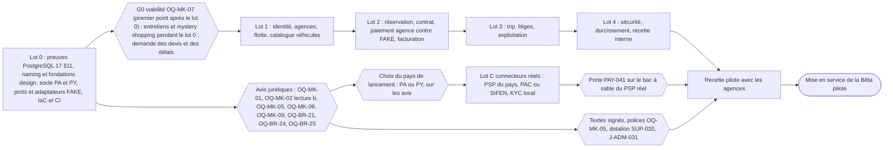

# 18 — MVP et feuille de route (version 4)

> **Statut : PROPOSÉ, version 4 du 2026-10-30 (passe de cohérence finale VERIF_18 + décisions DEC-FONDATEUR-05 à 10)** : comptes de 04 révision 5 (166 lignes P0-A, 96 construites en Bêta, lot `C` des connecteurs réels) ; effort exprimé en **jours-agent** pour une équipe multi-agents Claude Code, **sans promesse calendaire** (§5.0) ; fondations design, transmissibilité, stratégie de tests et gouvernance multi-agents (§11) ; bilan en §12. **Version 3 (alignement v4)** : décisions du fondateur DEC-FONDATEUR-02, -03, -04 reflétées (construire d'abord ; connecteurs réels après le choix du pays ; Panama **et** Paraguay dès le premier jour) ; coupe Bêta à **82 lignes construites** ; énoncé d'effort unique de §5.0 réécrit d'après `17_DATA_MODEL_AND_ARCHITECTURE.md` v4 §10 et les audits VERIF_16 / VERIF_17 ; le lot 0 commence par les preuves PostgreSQL (17 §11) ; les avis juridiques deviennent une **porte de mise en service**, plus une porte de build ; marques « (aligné v4) » ; bilan en §10. DEC-FONDATEUR-01, OQ-BR-04, OQ-BR-45 et les questions UXQ restent **ouvertes**. Version 2 : corrections de `verification/VERIF_10_MVP_ROADMAP.md`. Document de cadrage pour l'équipe qui construira le produit : **une équipe multi-agents Claude Code** (orchestrateur, agents d'implémentation, agent DESIGN, vérificateurs indépendants dont un agent QA), le fondateur étant le seul humain (product owner, recette, comptes, juridique ; DEC-FONDATEUR-05).
> Sources : `04_FEATURE_INVENTORY.csv` (révision 5 ; révision 3 : colonnes `phase_mvp`, `lot_p0a`, `beta_pilote`, `risque_legal_financier`) et son README, `15_PRODUCT_IMPROVEMENTS.md`, `12_PANAMA_MARKET.md` §9–§10, `09b_PAYMENT_PARTNERS_PA_PY.md`, `22_OPEN_QUESTIONS.md`, `08_BUSINESS_RULES.md` (lu, non modifié), audits `verification/VERIF_06`, `VERIF_07`, `VERIF_08`, `VERIF_10`.
> **Règle de cohérence** : 04 est la source de vérité du périmètre. Chaque identifiant cité ici (`PAY-033`, etc.) est une ligne de 04 ; les comptes, epics, lots, valeurs de Bêta pilote et estimations au barème viennent de 04 et de son README et sont vérifiés par `python -I tools/check_inventory.py`. En cas d'écart avec 15, 04 et ce document font foi.
> **Corrections VERIF_10** : 1 CRITIQUE, 11 MAJEUR, 7 MINEUR traités ; chaque passage modifié porte « (corrigé VERIF_10-<ID>) » ; bilan en §9.

## 0. Résumé

- **Décisions du fondateur du 2026-10-30** (22 « Décisions prises » ; 17 ADR-031 à ADR-033) (aligné v4) : **DEC-FONDATEUR-02** on construit d'abord ; les avis juridiques (OQ-MK-01 art. 288, OQ-MK-02 lecture b, OQ-MK-05, OQ-MK-06, OQ-MK-09, OQ-BR-21, OQ-BR-24, OQ-BR-25…) sont exigés **avant la mise en service**, plus avant un lot. **DEC-FONDATEUR-03** les connecteurs réels (PSP, facture électronique PAC / SIFEN, vérification d'identité locale) attendent le **choix du pays de lancement** : le build se fait contre les ports avec des adaptateurs `FAKE` (jamais actifs en production, 17 §6.5). **DEC-FONDATEUR-04** Panama **et** Paraguay sont construits **en même temps** (USD / PYG, deux fuseaux, ITBMS 7 % / IVA 10 %, pièces et RUC locaux, fériés, es-PA / es-PY) ; le pays de lancement est choisi sur les avis. **Restent ouverts** : DEC-FONDATEUR-01 (OQ-BR-41), OQ-BR-04, OQ-BR-45, UXQ-08, UXQ-09 et les autres UXQ.
- **MVP = P0-A** : bêta fermée dans le pays de lancement avec quelques agences professionnelles. **L'agence encaisse** (son propre compte PSP), **prend la caution** et facture le loyer ; **la plateforme facture sa commission** et ne détient aucun fonds, sous réserve des avis (porte de mise en service). **166 lignes** de 04 (révision 5 : 149 en v4 + I18N-005 et FIN-003 promues + 15 lignes créées : fondations design DSN, transmissibilité et qualité PLT, connecteurs réels du lot C), 16 epics (E1 à E13, E16 à E18).
- **Bêta pilote** : première ouverture, tranche mince du P0-A définie ligne par ligne dans 04 (`beta_pilote`) : 1 à 2 agences, **96 lignes construites** (25 OUI, 71 SIMPLIFIÉ), **58 MANUEL**, **12 DIFFÉRÉ** (révision 5 ; 82 en v4). Effort : **≈ 170 à 300 jours-agent**, sans durée calendaire promise : elle sera **mesurée après le lot 0** (§5.0, énoncé unique ; l'ancien « ≈ 16 à 28 semaines-équipe ≈ 4 à 7 mois pour 2 développeurs » n'est plus qu'un repère historique).
- **P0-B** : la plateforme encaisse, détient la caution, débite les frais post-trip et reverse aux agences. 13 lignes, 2 epics. **Seulement après** les avis casa de remesas / MTL / PSP et la validation des capacités PSP.
- **Lot C — connecteurs réels** (DEC-FONDATEUR-03 ; valeur `lot_p0a` = `C` dans 04 depuis la révision 5, VERIF_18-F01) : après le choix du pays, porte PAY-041 sur le bac à sable du PSP retenu, puis connecteur PSP (PAY-042), facture électronique PAC ou SIFEN (FIN-020), fournisseur KYC (VER-029) ; barème 1,1 à 2,6 unités (11 à 26 jours-agent), à recalculer quand le PSP est connu.
- **Fondations design** (DEC-FONDATEUR-06 / 07, epic E16) : agent DESIGN et relecteur UX indépendant ; « Naming et identité » (DSN-001) en **première story** ; design tokens pilotés par les données, back-office « Apparence / Marque » avec prévisualisation, brouillon / publication, historique et retour arrière, blocs de contenu es/en, bibliothèque de composants ; web mobile-first + PWA installable, apps natives après le MVP.
- **Transmissibilité, qualité, gouvernance** (DEC-FONDATEUR-08 / 09 / 10, epic transverse E17) : IaC, conteneurs, portabilité, comptes au nom du fondateur, documentation et checklist de passation ; tests exhaustifs et portes CI bloquantes (17 §12) ; agents autonomes communiquant par artefacts versionnés, valeur par défaut pour chaque décision (22), point fondateur hebdomadaire, red-team et pré-mortem par lot (§11).
- **Puis** P1 (version concurrentielle complète), P2 (P2P vérifié, différenciation ; les deux pays sont **construits dès le P0** : il ne reste en P2 que l'ouverture commerciale du second pays), P3 (options).
- **Chemin critique** (aligné v4 ; échéance de G0 alignée sur 22, constat 24-01) : G0 (viabilité OQ-MK-07) se tient **au premier point hebdomadaire après le lot 0** (22 fait foi pour les échéances de décision) ; les entretiens F-16 se font pendant le lot 0 ; le lot 0 est un coût assumé (≈ 222 points, ≈ 111 jours-agent perdus si G0 est négatif) ; le build n'attend plus les avis ; le **lot 0 commence par les preuves PostgreSQL** (17 §11) ; la **mise en service** = max(fin du build, avis juridiques, choix du pays + lot des connecteurs réels + porte PAY-041, autres prérequis) + recette pilote.

## 1. Définition du MVP

### 1.0 Bêta pilote — tranche mince du P0-A (corrigé VERIF_10-V10-01)

**Pourquoi** (historique v2) : la mention « 8 à 14 semaines de codage » ne valait pas pour le P0-A complet (alors 147 lignes, 21–42 semaines-équipe au barème) ; elle n'est plausible que pour une tranche mince, qui n'existait pas dans 04. Elle est désormais définie **ligne par ligne** dans la colonne `beta_pilote` de 04 (choix d'une colonne plutôt que d'une étiquette en note, pour que le script la contrôle ; raison de chaque valeur dans `notes`).

**Pour qui** : 1 à 2 agences pilotes du **pays de lancement** (la capitale du Panama ou Asunción, choisie sur les avis ; le build couvre les deux pays) (plaques commerciales, police flotte avec attestation « plateforme », compte PSP existant), flotte de quelques dizaines de véhicules importée par l'ops, remise et retour au comptoir uniquement, guests réels (touristes et résidents) en volume limité.

**Valeurs** (166 lignes P0-A, révision 5 de 04) : **OUI** 25 (construites telles que décrites), **SIMPLIFIÉ** 71 (version réduite décrite en note), **MANUEL** 58 (non construites, remplacées par une opération manuelle), **DIFFÉRÉ** 12 (non construites ni remplacées). Révision 5 : + DSN-001 à DSN-007 et PLT-001 à PLT-005 (OUI ou SIMPLIFIÉ ; cœur « Apparence / Marque » en SIMPLIFIÉ), I18N-005 (OUI), PAY-042 (SIMPLIFIÉ : un seul PSP du pays de lancement) ; FIN-003, FIN-020, VER-029 en MANUEL. Historique v4 : Changements v4 : BKG-028, BKG-032, BKG-035 et LEG-009 passent de MANUEL à SIMPLIFIÉ (l'ops déclenche, le moteur de règlement calcule ; chiffrement par sujet dès le lot 0 : 17 C-v3-01, C-v3-02) ; HST-050 (catalogue de référence des véhicules) et ADM-036 (file d'ajout au catalogue) sont ajoutées en SIMPLIFIÉ (17 ADR-034). Contrôle : aucune ligne construite ne dépend d'une ligne DIFFÉRÉ.

**Ce qui est construit** (96 lignes : la liste ci-dessous, plus le moteur de règlement des annulations BKG-028, BKG-032, BKG-035, le chiffrement par sujet LEG-009, le catalogue véhicules HST-050, ADM-036, et depuis la révision 5 les fondations design DSN-001 à DSN-007, l'epic transverse PLT-001 à PLT-005, la devise PYG I18N-005 et le connecteur PSP réel du pays de lancement PAY-042) : inscription et KYC par le parcours hébergé du fournisseur (ACC-001, VER-001, VER-004, VER-013 par SMS/email) ; recherche par comptoir, liste, fiche, total TTC (SRC-001, SRC-008, SRC-011, SRC-042, LST-002 à LST-013) ; occupation unique et hold anti-double réservation simplifiés (CAL-011, BKG-014, CAL-001, CAL-002, CAL-004) ; checkout, contrat PDF, acceptation horodatée et constancia (BKG-001, BKG-002, BKG-006, BKG-008, BKG-012, BKG-018, BKG-019, LEG-026) ; devis et ITBMS (PRC-020, PRC-021, PRC-025) ; paiement **par lien du PSP de l'agence** avec webhook ou confirmation de l'agence (PAY-001 adaptateur unique, PAY-019, PAY-033 mode b, PAY-034, PAY-035) ; machine à états réduite (TRP-045) ; check-in et check-out au comptoir **en ligne**, photos dans l'app (TRP-002, TRP-004, TRP-033, TRP-052, VER-015), dossier de preuve exporté (CLM-034) ; détection des retards (TRP-035) ; notifications email et SMS (NTF-001, NTF-007) ; console à deux rôles avec 2FA et journal d'audit, fiche 360°, gestion des trips, file de revue (ADM-001, ADM-005, ADM-006, ADM-029) ; calcul de la commission (FIN-018) ; préproduction, sauvegardes, RPO/RTO, revue de sécurité ciblée (ADM-032 à ADM-035) ; test de faisabilité PWA iOS (TRP-056) ; textes statiques es/en (LEG-001, LEG-002, LEG-011, LEG-014, I18N-003, I18N-004).

**Ce qu'elle exclut** (DIFFÉRÉ) : autocomplétion des lieux (SRC-002), tri (SRC-012), ajustement des dates indisponibles (LST-008), bloc « Hosted by » (LST-020), lieux multiples (BKG-016), écrans propres aux cartes, à Yappy, à l'autorisation/capture, aux refus et au 3-D Secure (PAY-002, PAY-004, PAY-006, PAY-017, PAY-018 : assurés par la page hébergée du PSP de l'agence ; **Yappy seulement si cette page le propose**), gabarits WhatsApp (NTF-002, repli SMS/email), notifications de trip (NTF-011). Hors P0-A de toute façon : tout le §2.

**Opérations manuelles qui remplacent les lignes MANUEL** (58 en révision 5, 55 en v4 ; BKG-028, BKG-032, BKG-035 et LEG-009 restent cités ci-dessous pour leur part manuelle — déclenchement par l'ops, destruction de clé tracée — mais sont construites ; détail dans `notes` de chaque ligne) :

| Domaine | Opération manuelle (qui) | Lignes remplacées |
|---|---|---|
| KYC et KYB | revue KYC dans le portail du fournisseur ou sur pièces (VER-029 MANUEL), liste des permis acceptés, contrôle des 90 jours et des doublons à la revue de chaque réservation ; KYB, sanctions, police et documents des véhicules vérifiés sur pièces (ops) | VER-002, VER-003, VER-005, VER-006, VER-007, VER-027, VER-028, VER-029, ACC-014, ADM-002, ADM-004, PRT-019, PRT-009, PRT-003, HST-039 |
| Agences et annonces | comptes et nom commercial créés par l'ops ; annonces, photos, prix et distance par import CSV ; revue, éligibilité et statut par l'ops ; iCal remplacé par l'engagement écrit de l'agence de bloquer ses dates vendues ailleurs | ACC-008, FLT-001, FLT-003, HDB-001, HST-005, HST-012, HST-016, HST-019, HST-026, HST-033, PRC-001, CAL-003, CAL-009, ADM-003 |
| Contrats et légal | contrat-cadre signé hors ligne (PDF), clauses de mandat et de litige dans ce contrat et dans les CGU statiques ; registre Ley 81 et purge tenus par le responsable des données | LEG-025, LEG-020, LEG-027, LEG-015, LEG-009, LEG-010 |
| Paiement et facturation | validation écrite du PSP de chaque agence (fondateur) ; remboursements exécutés par l'agence dans son back-office, montant calculé par la plateforme ; facture de commission (PAC ou SIFEN sur le portail), relevé et avoirs par le comptable ; rapprochement mensuel sur l'export du PSP | PAY-041, PAY-021, FIN-001, FIN-002, FIN-003, FIN-020, PYO-013, FIN-019, ADM-007 |
| Trip et litiges | annulations (guest, agence, plateforme), refus du véhicule, no-show, retards et non-restitution traités par l'ops ; messages relayés par le support ; déclarations de dommage et d'incident par email ou téléphone ; instruction et décision par gabarit ; pas de hors ligne (wifi du comptoir) | BKG-028, BKG-032, BKG-035, TRP-007, TRP-015, TRP-038, TRP-057, ADM-022, MSG-001, MSG-007, CLM-001, CLM-002, CLM-006, ADM-008, LEG-024, REV-001 |
| Support | support humain es/en sur une plage réduite, planning de présence (SUP-020) | SUP-011, SUP-020 |

**Conséquence** : la Bêta pilote déplace de la charge du build vers l'ops ; elle n'est tenable qu'avec 1 à 2 agences et la dotation de SUP-020 (plage réduite possible, par ex. 8 h–20 h ≈ 2,1 ETP de présence).

**Taille** (révision 5) : barème de 04 (README §1 bis) = **7,5 à 17,5 unités** (75 à 175 jours-agent) pour les 96 lignes construites ; ce barème **ne couvre pas** les éléments non négociables de 17 §10 (conversion gardée et compensation, moteur de règlement, RLS et commandes sous rôles de production, crypto-shredding, actions de console, deux pays, simulateurs `FAKE`, preuves du lot 0) : **on retient ≈ 170 à 300 jours-agent** (§5.0). La v2 retenait 8 à 14 « incluses dans les 21–42 du P0-A » : cette inclusion n'est plus vraie telle quelle (le P0-A complet au barème a le même angle mort ; voir §5.0). Sortie : P0-A complet en construisant les lignes SIMPLIFIÉ, MANUEL et DIFFÉRÉ restantes dans l'ordre des lots (§6).

**Prérequis** (aligné v4) : identiques au P0-A (§3), désormais **à la mise en service** et non avant un lot : avis art. 288 / OQ-MK-02 lecture b, attestation de police (OQ-MK-05), textes (OQ-BR-24), choix du pays, lot des connecteurs réels et porte PAY-041 sur le PSP de l'agence pilote. La durée calendaire du build n'étant pas encore mesurée (§5.0), les validations externes sont demandées dès le début du lot 0 (G0 se tient après le lot 0) ; le chemin critique dépend de leur délai réel et de la vitesse mesurée après le lot 0 (§4).

### 1.1 P0-A — bêta fermée « l'agence encaisse »

**Pour qui** : 5 à 10 agences de location professionnelles du pays de lancement (au Panama : plaques commerciales, Aviso de Operación, police flotte ; au Paraguay : équivalents à confirmer, OQ-MK-04), sélectionnées et signées une par une ; guests touristes et résidents. Remise et retour **au comptoir de l'agence** uniquement.

**Ce que fait la plateforme** (16 epics, 166 lignes ; détail dans le README de 04, §4) :

| Epic | Lignes | Contenu |
|---|---|---|
| E1 Comptes, identité, KYC et KYB | 16 | inscription, nom légal, compte société (RUC), permis, selfie + liveness, face match, cédula/passeport, 90 jours du permis étranger **en mode signalement**, OTP (WhatsApp ou SMS), KYB et filtrage sanctions des agences |
| E2 Recherche et fiche véhicule | 15 | recherche lieu/dates, liste + carte, total TTC, fiche (photos, distance incluse, police flotte, caution exigée et options sans carte de crédit) |
| E3 Disponibilité, calendrier et flotte | 9 | table d'occupation unique, hold anti-double réservation, blocages, préavis, tampon, iCal entrant/sortant, équipes et rôles |
| E4 Réservation, contrat et checkout | 13 | checkout une page, contrôles bloquants, contrat de location par trip (l'agence est le loueur), signature électronique, constancia bilingue, confirmation |
| E5 Devis, taxes, commission et facturation | 10 | devis versionné, ITBMS ou IVA calculé et affiché, grand livre minimal, **facturation mensuelle de la commission** et relevé, port fiscal PAC (Panama) et SIFEN (Paraguay, FIN-003) contre `FAKE`, connecteur réel au lot C, **rapprochement léger des revenus** (FIN-019, corrigé VERIF_10-V10-06) |
| E6 Paiements « agence encaisse » | 11 | abstraction PSP (portée PCI SAQ A, secrets en coffre), **ordre créé sur le compte de l'agence** sous **mandat écrit** (LEG-027), **Yappy** (et Clave si confirmée), 3-D Secure, refus, idempotence, remboursements sur le compte de l'agence, **preuve de paiement par webhook**, **politique de caution de l'agence** (la porte PSP PAY-041 passe en E18, lot C) |
| E7 Onboarding agence, polices flotte et annonces | 15 | contrat-cadre (avec exécution des décisions, audit des relevés et mandat), **contrôle de la police flotte**, annonces, éligibilité, import CSV de flotte, tableau de bord, catalogue de référence des véhicules et file d'ajout (HST-050, ADM-036) |
| E8 Trip : remise, retour et preuves | 12 | check-in/out mobile avec photos horodatées, **hors ligne** (TRP-057), **évaluation du risque PWA iOS** (TRP-056, corrigé VERIF_10-V10-12), interface comptoir, refus du véhicule, no-show, retard détecté, non-restitution (manuelle), dossier de preuve |
| E9 Annulations et protection | 6 | annulation guest et agence, annulation plateforme (qui paie, cas Yappy), RC et franchises de la police flotte affichées |
| E10 Messagerie, notifications et avis | 8 | messagerie par trip avec détection du marché gris, notifications WhatsApp avec **repli SMS/email déclaré** (corrigé VERIF_10-§2.3), avis du guest |
| E11 Dommages et litiges de base | 5 | déclaration, instruction par l'ops, décision motivée exécutée par l'agence selon le contrat-cadre, preuves |
| E12 Back-office, support, risque et exploitation | 18 | console à rôles avec journal d'audit, files KYC/annonces/KYB/réservations à risque, paramètres par pays (PA et PY), véhicules en retard, ligne d'urgence et support en horaires étendus, **dotation du support** (SUP-020), **revue de sécurité** (ADM-033), **préproduction** (ADM-034), sauvegardes, monitoring et **RPO/RTO** (ADM-032, ADM-035) (corrigé VERIF_10-V10-10, V10-11) |
| E13 Légal, consentements, langues et pays | 12 | CGU, consentements versionnés, rétention, **registre Ley 81 et procédure de violation** (LEG-010, corrigé VERIF_10-V10-09), positionnement d'intermédiaire, droit applicable, mandats (LEG-020, LEG-027), es/en (`es-PA`, `es-PY`), USD et PYG (I18N-005) |
| E16 Fondations design, marque et contenus | 7 | naming et identité (DSN-001, première story), design tokens pilotés par les données, back-office « Apparence / Marque », blocs de contenu es/en, bibliothèque de composants, web mobile-first + PWA, revue UX indépendante (DEC-FONDATEUR-06 / 07) |
| E17 Transmissibilité, qualité et gouvernance multi-agents (transverse) | 5 | IaC, conteneurs et portabilité, comptes et secrets au nom du fondateur, documentation et checklist de passation, stratégie de tests et portes CI, gouvernance par artefacts (DEC-FONDATEUR-05 / 08 / 09 / 10) |
| E18 Connecteurs réels (lot C) | 4 | porte PSP du pays retenu (PAY-041), connecteur PSP (PAY-042), facture électronique réelle (FIN-020), fournisseur KYC réel (VER-029) |

**Résidents sans carte de crédit** : ils réservent en payant le loyer par Yappy sur le compte PSP de l'agence (PAY-004), la réservation n'étant confirmée qu'à réception du webhook (PAY-034), et en versant la caution selon les moyens que l'agence accepte au comptoir (carte de débit, espèces, Yappy restitué ; PAY-035, filtre « sin tarjeta de crédito »). La capacité de remboursement d'un paiement Yappy (OQ-PAY-22, OQ-PAY-07) est désormais une question **P0** (corrigé VERIF_10-V10-05) ; à défaut, l'agence rembourse par virement avec preuve (PAY-021).

**Parcours couverts de bout en bout** : (1) l'agence est pré-inscrite et passe le KYB et le contrôle de police (lot 1), puis signe le contrat-cadre et le mandat, connecte son compte PSP et importe sa flotte (lot 2) ; l'ops valide KYB, police et annonces ; (2) le guest cherche, se vérifie, réserve et paie sur le compte de l'agence ; (3) l'agent comptoir contrôle le permis, prend la caution, fait les photos et remet les clés ; (4) retour, photos, clôture ; retard ou non-restitution suivis par l'ops ; (5) dommage éventuel : dossier de preuve, décision motivée, exécutée par l'agence sous 5 j ouvrés, à défaut pénalité sur la facture de commission (LEG-025, corrigé VERIF_10-V10-07) ; (6) fin de mois : rapprochement avec le relevé PSP de l'agence (FIN-019), relevé et facture de commission, paiement par l'agence.

**Critères de sortie de la bêta fermée** (PROPOSÉS, seuils à valider avec les agences avant le lot 2 ; corrigé VERIF_10-V10-16) :

| # | Critère | Seuil proposé |
|---|---|---|
| S1 | Agences actives (contrat signé, police vérifiée, au moins un trip par mois) | ≥ 3 |
| S2 | Trips terminés sans double réservation ni remise de clés sur paiement non confirmé | ≥ 100 cumulés, 0 incident de ces deux types |
| S3 | Délai médian d'ouverture ou de connexion du compte PSP d'une agence | ≤ 15 jours ouvrés |
| S4 | Commission effective (facturée et payée, sur loyer HT), sur au moins deux cycles | ≥ 10 % (hypothèse de 12 %, OQ-MK-07) |

**Critères d'arrêt ou de révision** (PROPOSÉS) : moins de 2 agences actives 3 mois après l'ouverture ; commission effective < 8 % ; écart de rapprochement (FIN-019) > 10 % des trips sur deux mois consécutifs (contournement) ; un avis défavorable reçu après l'ouverture sur OQ-MK-01 ou OQ-MK-02 (arrêt des nouvelles réservations ; ouverture du second pays, déjà construit). Le point mort (véhicules actifs × commission face aux coûts tiers et d'exploitation, 15 K.3) reste à calculer avec la commission obtenue en entretiens.

### 1.2 P0-B — la plateforme encaisse

Deux epics, 13 lignes : **E14** (PAY-011, PAY-012, PAY-015, PAY-036, PAY-037, PAY-038, PRC-012, CLM-021) et **E15** (PYO-001, PYO-002, PYO-007, FIN-004, FIN-005).

Changements par rapport au P0-A : loyer (et éventuels frais de service guest) encaissés par la plateforme ou par un PSP licencié pour son compte ; caution plateforme avec la **fenêtre de rétention** de VERIF_08 (pré-autorisation unique si `H_requise` = pose + durée + 72 h + marge 0 h, calculée en heures, tient dans la validité du PSP ; repère : trips ≤ 3 j à 7 j de validité, 3 j + 25 min échoue, T59 ; au-delà ré-autorisation ou débit puis remboursement, PAY-036, 08 BR-PAY-06) ; débits post-trip **conformes aux règles des réseaux** (consentement écrit, transaction séparée, notification sous 10 j, préavis d'objection ≥ 20 j pour Visa, 30 j maximum pour Mastercard ; PAY-037), qui remplacent le délai de 48 h de BR-REIMB-03 ; versements J+2 aux agences ; ITBMS collecté ; rapprochement quotidien ; ou, variante plus légère, **split de commission à la source** par le PSP (PAY-038).

**Déclencheur** : P0-B n'est démarré que si les avis le permettent (§3) **et** si la bêta montre un besoin (ex. agences sans compte PSP compatible, demande de caution plateforme, frais de service guest). Ce n'est pas une étape obligatoire : si les avis sont négatifs, le produit reste en mode « l'agence encaisse » (12 §10.3, dernière règle).

### 1.3 Ouverture élargie (ex-« bêta publique ») (corrigé VERIF_10-V10-01)

La formule « bêta publique 4–5 mois » n'était définie nulle part et **est retirée** : P0-A + P0-B + P1 représentaient ≈ 61 à 128 unités d'effort au barème (§5), incompatibles avec 4–5 mois. Définition retenue : l'**ouverture élargie** est le **P0-A complet** (166 lignes, sans P1) ouvert à toute agence qualifiée du pays de lancement (objectif ≥ 10 agences), après que les critères S1–S4 de §1.1 sont atteints. Sa date = date d'ouverture de la bêta fermée + durée nécessaire pour atteindre S1–S4 (au moins deux cycles de facturation, soit ≥ 2 mois) ; aucune date n'est annoncée avant le recalage de §5.3.

## 2. Hors périmètre explicite du MVP

| Hors P0 | Où | Lignes de 04 |
|---|---|---|
| Encaissement, détention de fonds, caution et versements par la plateforme | P0-B | E14, E15 |
| Frais de service facturés au guest | P0-B (OQ-MK-01, art. 288) | PRC-012 |
| Plans de protection guest, garantie hôte, protection minimale imposée | P1 si OQ-BR-16 | PRT-001, PRT-002, PRT-011, BKG-003, PRC-018 |
| Hôtes particuliers (P2P) | P2 (OQ-BR-35, OQ-BR-16, OQ-BR-28) | HST-049, PRT-007, PYO-003, HST-048 |
| Ouverture commerciale du second pays (le build couvre déjà Panama et Paraguay, DEC-FONDATEUR-04 ; I18N-005 et FIN-003 sont en P0-A depuis la révision 5) | P2 | connecteurs réels du second pays (lot C rejoué) |
| Applications natives iOS / Android | après le MVP, à décider (DEC-FONDATEUR-06 ; le MVP est web mobile-first + PWA, DSN-006) | — |
| VTC et option avec chauffeur | rejeté (15 §M) / P3 | BKG-043 |
| Variantes régionales hors capitale : Panama intérieur (Chiriquí, Azuero, Bocas), villes frontalières du Paraguay (CDE, Encarnación : portugais, ARS / BRL), zones exclues par agence (ajouté constat 24-23) | hors Bêta ; OQ-MK-12 (22) avant l'ouverture hors capitale | — (aucune ligne propre ; EC-53 seulement) |
| Livraison, remise à l'aéroport hors comptoir, one-way | P1 (OQ-MK-08) | HST-034, BKG-041, BKG-017 |
| Géofencing logiciel, télématique, coupure moteur | P1 / P2 ; coupure exclue (OQ-BR-17) | TRP-042, TRP-043, TRP-055, TRP-054 |
| Support humain 24/7, triage IA | P1 | SUP-004 (reliquat), 15 IMP-07 |
| Modification, extension et échange de trip en libre-service | P1 (manuel par l'ops en bêta, ADM-006) | TRP-020 à TRP-025, TRP-027 |
| Avis de l'hôte, double aveugle, réponses publiques, profil public | P1 | REV-002, REV-004, REV-006, ACC-017 |
| Connexion Google/Apple, connexion par code | P1 | ACC-002, ACC-003, ACC-004 |
| Prix par date, remises de durée, non remboursable, jeune conducteur, tarification dynamique | P1 / P2 | PRC-002, PRC-008, PRC-010, PRC-011, PRC-014, PRC-003 |
| Paiement de soldes in-app, chargebacks automatisés, recouvrement | P1 (portail PSP de l'agence en bêta) | PAY-025, PAY-028, ADM-021 |
| ACH Xpress comme rail d'encaissement, BNPL, Apple/Google Pay | P1 / P3 / P2 | PAY-009, PAY-003 |
| Moteur de règles configurable, score de fraude, screening continu, exigences dynamiques | P1 | ADM-011, SUP-012, VER-009, VER-019 |
| Facturation électronique pour le compte de l'agence (mandat) | P1 | FIN-002 (reliquat) |
| API publique, marque blanche, onboarding express 48 h, calendrier multi-véhicules, actions en masse | P1 | FLT-010, FLT-017, FLT-018, FLT-019, FLT-004, FLT-005 |
| Parrainage, fidélité, cartes cadeaux, crédits | P1 à P3 | module MKT |
| Droits des personnes en libre-service, bannière de cookies | P1 (manuel en bêta ; aucun cookie non essentiel en bêta) | LEG-005, LEG-007, LEG-008, ADM-026 |
| Inspection IA, refacturation Panapass/ATTT | P2 / P1 | CLM-035, CLM-036 |

Exclusions supplémentaires de la **Bêta pilote** (lignes P0-A DIFFÉRÉ ou MANUEL) : §1.0.

## 3. Préconditions de lancement

Questions de `22_OPEN_QUESTIONS.md` et prérequis opérationnels ; « Bloque » indique ce qui ne peut pas commencer ou ouvrir sans la réponse. **Lecture v4 (DEC-FONDATEUR-02, aligné v4)** : toute mention « début du lot n » d'un avis juridique (C2, C3, C5, C7, C8, C9, C13) se lit désormais « **mise en service** » (et, pour la signature des agences, « avant la recette pilote ») ; le build ne s'arrête plus entre deux lots pour un avis. C6 se lit : **porte PAY-041 sur le PSP réel du pays choisi**, critère de mise en service ; le build se fait contre l'adaptateur `FAKE`. C12 (Paraguay) conditionne seulement le choix du Paraguay comme pays de lancement : le Paraguay est construit dès le lot 0 (DEC-FONDATEUR-04). **Lecture v5 (VERIF_18-F20)** : les cellules « Bloque » ci-dessous sont réécrites en conséquence. **Aucun délai externe n'est connu** : chaque responsable demande un délai écrit au prestataire (cabinet, assureur, PSP, Meta, fournisseur KYC) pendant le lot 0 (G0 se tient après le lot 0).

| # | Domaine | Précondition | Questions / lignes | Qui | Bloque |
|---|---|---|---|---|---|
| C1 | Commercial | Commission acceptée (10–20 % ?), part des réservations confiée, valeur perçue ; logiciels utilisés par les agences ; mystery shopping des prix (V6-06) | **OQ-MK-07** | Fondateur (entretiens 5–10 loueurs, pendant le lot 0) | décision de poursuivre après le lot 0 (G0, premier point hebdomadaire après le lot 0 ; 22) |
| C2 | Juridique PA | Le modèle « plateforme étrangère facturant un service au loueur, le loueur contractant et encaissant » n'est pas du commerce de détail réservé (art. 288, branche « representación o agencia »), ou montage viable | **OQ-MK-01** | Avocat PA | **mise en service** (avis écrit définitif) ; choix du pays de lancement ; textes (C7) (DEC-FONDATEUR-02 ; v2 : G1a / G1b avant les lots 1 et 2, retiré) |
| C3 | Juridique PA | Le flux « l'agence encaisse » n'est pas une activité de casa de remesas (**lecture b** ; condition de GO Panama de 12 §10.3) | **OQ-MK-02** (lecture b) | Avocat PA | **même porte que C2 (mise en service)** ; confirmation du P0-A ; tout P0-B (corrigé VERIF_10-V10-04) |
| C4 | Assurance | Les polices flotte des agences pilotes couvrent une location distribuée par une plateforme, sinon avenant | **OQ-MK-05** | Assureur / courtier, agences | publication des annonces (PRT-019), ouverture de la bêta |
| C5 | Fiscal | ITBMS sur la commission et le loyer, retenue 12,5 % sur services payés à une entité US, facture électronique de l'agence au locataire, entité qui facture la commission | **OQ-MK-06**, OQ-BR-14, OQ-PAY-15 | Expert-comptable PA | facture de commission (FIN-018, FIN-002, FIN-003) en production ; mise en service |
| C6 | PSP | PSP du pays de lancement. Panama : Tilopay (basé au Costa Rica, non validé pour le Panama) : ordre sur le compte marchand de l'agence, Yappy, Clave, tarifs et entité Panama, **remboursement Yappy**. Paraguay : Bancard vPOS (cartes, caution), upay (QR). Ouverture d'un compte par agence pilote ; **porte PAY-041** : à défaut de réponse écrite à la date fixée, mode (b) sur le PSP actuel de l'agence et évaluation d'un second PSP API | **OQ-PAY-03**, **OQ-PAY-22**, **OQ-PAY-07** (P0), OQ-PAY-13 ; OQ-PAY-08, OQ-PAY-10, OQ-PAY-12 (PY) ; PAY-041 | PSP ; agences ; fondateur | connecteur réel (PAY-042) au **lot C** ; mise en service (corrigé VERIF_10-V10-05, VERIF_18-F01) |
| C7 | Contrats | CGU guest, contrat de location (modèle de l'agence), contrat-cadre loueur avec **mandat limité d'opérations PSP** (LEG-027), exécution des décisions et audit des relevés ; validité des clauses (pénalités, décision « définitive », bureaux de crédit) ; accord du PSP sur l'usage des identifiants API par un tiers | **OQ-BR-24**, OQ-PAY-03 | Avocat PA ; PSP | signature des agences (LEG-025) avant la recette pilote, mise en service |
| C8 | KYC | Permis étrangers et date d'entrée (art. 110/111) | **OQ-BR-21** (P0 depuis VERIF_10) | Avocat PA | refus automatique (sinon mode signalement, sans blocage) |
| C9 | Données | Durées de conservation (KYC, biométrie, photos) | **OQ-BR-25** (P0 depuis VERIF_10) | Avocat | paramétrage de LEG-009 (valeurs prudentes en attendant) |
| C10 | Caution P0-A | Caution versée par Yappy/virement et restituée par l'agence : licéité, délai | OQ-PAY-06 | Avocat PA | option « Yappy restitué » de PAY-035 (les autres options restent) |
| C11 | P0-B | Remesas, MTL, PSP détenteur des fonds, split, validité des pré-autorisations, débit local et MIT, règles réseaux LAC | **OQ-MK-02, OQ-MK-03, OQ-PAY-02, OQ-PAY-04, OQ-PAY-05, OQ-PAY-13, OQ-PAY-15**, **OQ-PAY-17, OQ-PAY-18, OQ-PAY-21**, OQ-PAY-19, OQ-BR-12 | Avocats PA et US, PSP, acquéreurs | tout P0-B (G2) |
| C12 | Paraguay pays de lancement | Statut PSP au BCP ; Bancard vPOS / upay ; risque ueno | **OQ-MK-04**, **OQ-PAY-10**, **OQ-PAY-11** (P0 dans 22), OQ-PAY-23 | Avocat PY ; PSP | choix du Paraguay comme pays de lancement ; son lot C |
| C13 | Données (Ley 81) | Enregistrement ou déclaration des traitements, transferts de biométrie au fournisseur KYC hors Panama, délai de notification d'une violation | **OQ-MK-09** (P0, ajoutée) ; LEG-010, ADM-035 | Avocat PA (données) | KYC réel en production (VER-029, lot C) ; mise en service (corrigé VERIF_10-V10-09) |
| C14 | Paramètres | Valeurs Panama de ADM-031 décidées (âges, préavis, pénalités, plafonds de crédits, seuil de rapprochement) | jalon **J-ADM-031** | Fondateur + ops | mise en service ; valeurs de test autorisées pendant le build (corrigé VERIF_10-V10-19, VERIF_18-F20) |
| C15 | Exploitation | Dotation du support et de l'ops : 7 h–22 h, 7 j/7 = 105 h/semaine ≈ 2,6 ETP de présence (≈ 3 à 3,5 personnes), ou plage réduite ; responsable ops nommé ; recrutement lancé dès que la date de mise en service se précise | SUP-020 | Fondateur | ouverture de la bêta (corrigé VERIF_10-V10-10) |
| C16 | Sécurité | Revue de sécurité avec livrables (menaces, test ciblé ou test d'intrusion externe, secrets, portée PCI), aucune vulnérabilité critique ou élevée ouverte | ADM-033 | Agent sécurité indépendant + prestataire | ouverture de la bêta (corrigé VERIF_10-V10-11) |
| C17 | Technique | Décision PWA seule / enveloppe native / terminal fourni, après test sur les appareils des agences | TRP-056 | Agents (orchestrateur, DESIGN) + agences pilotes | rien pour le build : PWA décidée pour le MVP (17 ADR-039) ; seul le repli du comptoir (ADR-005) se décide à la fin du lot 0 sur le résultat de TRP-056 (22) ; ne bloque pas le lot 3 (corrigé VERIF_10-V10-12, VERIF_19-MAJ-4 / F-20) |
| C18 | Marque | Nom et identité choisis par le fondateur ; antériorité de marque (DIGERPI au Panama, DINAPI au Paraguay) et domaine | DSN-001 ; décision DEC-MARQUE de 22 | Fondateur (conseil en marques) | publication du nom ; jusque-là, nom de code paramétré `{brand_name}` (le build continue) |
| C19 | Comptes | Comptes externes (cloud, domaine, dépôt, PSP, KYC, e-facture, WhatsApp, courriel) ouverts au nom de l'entité du fondateur, accès délégués aux agents | PLT-002 | Fondateur | lot 0 pour le cloud, le dépôt et le domaine ; lot C pour les comptes PSP, KYC et e-facture |

Prérequis non juridiques à lancer dès le début du lot 0 : contrat, accord de sous-traitance (Ley 81) et bac à sable du fournisseur KYC ; compte WhatsApp Business et BSP, soumission des gabarits à Meta (**non bloquant** : repli SMS/email déclaré dans NTF-002) ; choix d'hébergement ; nom de domaine et entité qui signe les contrats ; devis du test d'intrusion.

## 4. Chemin critique (corrigé VERIF_10-V10-03, V10-04, V10-15 ; réécrit à l'alignement v4)

**Lecture** (aligné v4) :
- **Pendant le lot 0** (aligné sur 22, constat 24-01) : entretiens loueurs (OQ-MK-07, F-16) ; demande écrite de **devis et de délais** aux avocats, sans commander l'avis (DEC-FONDATEUR-02, constat 24-24) ; demande de délais aux PSP candidats des deux pays, à l'assureur et aux fournisseurs KYC. **G0 se tient au premier point hebdomadaire après le lot 0** : sans commission acceptable, le build s'arrête après le lot 0, dont le coût (≈ 222 points, ≈ 111 jours-agent) est assumé.
- **Build sans porte juridique** (DEC-FONDATEUR-02) : lots 0 à 4 enchaînés. Le risque d'un build non réutilisable est **accepté** et borné : aucun élément propre à un pays codé en dur (ADR-024), deux pays de premier rang (ADR-033), ports avec adaptateurs `FAKE` (ADR-032). Un avis négatif dans un pays oriente le **choix du pays de lancement** au lieu d'arrêter le build.
- **Lot 0 d'abord : preuves PostgreSQL** (17 §11, L0-01 à L0-10) : exclusion GiST et ré-acquisition, verrous et `40P01`, triggers I-OCC, instruction d'expiration, RLS et commandes sous les rôles de production, horloge `platform.now()`, conditions A1–A7, index uniques, fuzz C11. Un échec bloque le lot 2 et déclenche une ré-estimation.
- **Après le choix du pays** : lot C des connecteurs réels (PAY-042, FIN-020, VER-029), porte PAY-041 sur le bac à sable du PSP réel, mesures de 17 §11 L0-10. Ce lot peut tourner en parallèle des lots 3 et 4 si le choix intervient tôt ; sinon il s'ajoute à la date.
- **Mise en service** = max(fin du lot 4, avis reçus, fin du lot des connecteurs + PAY-041, textes signés et polices, dotation SUP-020, J-ADM-031) + recette pilote (2 à 4 semaines calendaires, proposé). La durée du build sera mesurée après le lot 0 (§5.0) ; le choix tardif du pays (et donc le lot C) est le principal risque externe, la disponibilité du fondateur pour les revues et les limites d'usage des agents les principaux goulots internes.
- **Chaîne technique** : la plus longue chaîne de dépendances P0 de 04 compte 13 niveaux (ACC-029 → … → LEG-024) ; l'abstraction PSP (PAY-001, adaptateur `FAKE`) et l'idempotence (PAY-019) restent au lot 0.
- **P0-B** n'est pas sur le chemin critique du MVP : il démarre après la bêta et les réponses C11.
- *Historique (v2)* : l'ancien chemin « G1a avis préliminaire avant le lot 1, G1b avis définitif avant le lot 2 » est **retiré** par DEC-FONDATEUR-02.

## 5. Estimations de build (effort en jours-agent, équipe multi-agents Claude Code)

### 5.0 Énoncé unique (à utiliser tel quel ; réécrit en v4 de 18 pour DEC-FONDATEUR-05)

> **Énoncé à communiquer.** « Bêta pilote, Panama **et** Paraguay construits, connecteurs réels exclus : **≈ 170 à 300 jours-agent d'effort** (≈ 17 à 30 unités de 10 jours-agent). P0-A complet (166 lignes, éléments non négociables de 17 §10 compris, lot C exclu) : **≈ 320 à 640 jours-agent** (≈ 32 à 64 unités). Ordres de grandeur **non mesurés**. **Aucune durée calendaire n'est promise** : elle sera **mesurée après le lot 0** puis recalée après le lot 1. Le barème de 04 (Bêta 7,5 à 17,5 unités ; P0-A 24,4 à 49,9) ne couvre pas les éléments de sûreté non négociables et ne doit **jamais** être communiqué seul. Non compris : le lot C (connecteurs réels, après le choix du pays : barème 1,1 à 2,6 unités, à recalculer quand le PSP est connu), les avis juridiques et la porte PAY-041 (critères de mise en service), la recette avec les agences pilotes. »
>
> **Unité et équipe (DEC-FONDATEUR-05).** Aucun développeur humain : le build est fait par une **équipe multi-agents Claude Code** — un orchestrateur (tech lead), des agents d'implémentation, un agent DESIGN, des vérificateurs indépendants (revue de code, QA, sécurité, logique monétaire sur un autre modèle, conformité d'architecture, revue UX) ; le fondateur est product owner, recette, comptes et juridique. **1 jour-agent** = une journée de travail d'un agent d'implémentation, tests écrits et revue indépendante compris ; **1 unité = 10 jours-agent** (ex-« semaine-équipe »). Le grain fin (story points par story) est celui du backlog `19_DEVELOPMENT_BACKLOG.md` ; le grain du lot est celui-ci. **Passage du chiffre retenu** : 17 §10 et VERIF_16 / VERIF_17 portaient la Bêta à ≈ 16 à 28 semaines-équipe en v4 ; la révision 5 de 04 ajoute ≈ +1,3 à +2,7 unités au barème (fondations design, transmissibilité et qualité, PYG, connecteur PSP), arrondi à ≈ 17 à 30 unités ; pour le P0-A complet, barème 24,4 à 49,9 + surcoûts de sûreté de VERIF_16 / VERIF_17 (+8 à +14) ≈ 32 à 64 unités (VERIF_18-F09 : c'est l'énoncé retenu pour « tout le P0-A »).
>
> **Pourquoi aucune date.** La conversion jours-agent → jours calendaires dépend de facteurs inconnus avant le lot 0 : nombre d'agents d'implémentation en parallèle, **limites d'usage** (quotas, fenêtres de contexte), **temps de revue du fondateur** (recette, validation des écrans clés, décisions hebdomadaires), **mise en place externe** (comptes au nom du fondateur, PSP, KYC, e-facture, avis juridiques). Ce sont les goulots attendus ; ils sont mesurés au lot 0 (§5.3) et suivis par le rapport de santé de chaque session (§11).
>
> **Hypothèses.** Exploitation (support, ops, curation de la graine du catalogue), rédaction juridique, vente et onboarding des agences non comptés ; tests exhaustifs et documentation de transmissibilité **compris** dans chaque story (Definition of Done, DEC-FONDATEUR-08 / 09).
>
> **Contexte historique : les fourchettes de la v4 et leurs hypothèses** (en semaines-équipe d'une équipe de 2 développeurs ; aucune n'est mesurée ; conservées pour la traçabilité, non à communiquer) :
>
> | Fourchette | Valeur (semaines-équipe) | Hypothèses | Ce qu'elle couvre |
> |---|---|---|---|
> | P0-A complet, barème calibré de 04 | **≈ 21 à 42** (script : 21,4–42,8, 149 lignes) | par ligne selon `complexite_tech`, + socle 1,5–3 + durcissement 1–2 | les lignes telles que leurs descriptions les décrivent ; **même angle mort** que la ligne suivante pour la sûreté de 17 (à relever d'environ +8 à +14 si l'on applique les surcoûts de VERIF_16 / VERIF_17 ; non recalculé) |
> | Bêta pilote, barème de 04 | **≈ 8 à 14** (v2, 76 lignes) ; **6,2 à 14,8** au script v4 (82 lignes) | même barème, lignes SIMPLIFIÉ comptées un cran plus bas | les notes Bêta des lignes ; **exclut** les non négociables (17 §10 NN1–NN11) : **ne pas communiquer seule** |
> | VERIF_16 (auditeur) | **≈ 14 à 24** | barème + conversion gardée et banc de tests, RLS, crypto-shredding, moteur de règlement et vecteurs dorés, cadre `manual_action` (+6 à +10) | la Bêta de 17 v2 / v3, un seul pays |
> | VERIF_17 (auditeur) | **≈ 16 à 28** | VERIF_16 + deux pays de premier rang et vecteurs en deux devises, simulateurs `FAKE` à capacités simulées (+2 à +4) + durcissement A1–A7 (≈ +1) | la Bêta de 17 v3, **deux pays et `FAKE` compris** |
> | **Retenue (17 v4)** | **≈ 16 à 28**, soit **≈ 4 à 7 mois** | VERIF_17 ; les corrections v4 sont le durcissement A1–A7 déjà compté ; catalogue véhicules ≈ +0,3 à 0,5 (dans le barème) ; preuves du lot 0 dans le surcoût « banc de tests » | la Bêta de 17 v4 |
>
> **Historique (v4) — pourquoi « 4 à 7 mois » était cohérent pour 2 développeurs** : 16 à 28 semaines calendaires d'une équipe de 2 = 3,7 à 6,5 mois ; l'arrondi à 4–7 mois absorbe les arrêts de recalage après les lots 0 et 1. Il n'y a pas de raison de communiquer une autre fourchette : la borne basse suppose que les preuves du lot 0 passent du premier coup et que le moteur de règlement se limite aux motifs de la Bêta ; la borne haute couvre une reprise de §2.5 après le lot 0. Si le fondateur veut viser plus bas, il doit **réduire explicitement** la liste non négociable de 17 §10 (décision écrite ici), pas la déduire du barème.
>
> **Délais externes exclus** (inconnus ; un délai écrit est demandé à chaque prestataire pendant le lot 0 (G0 se tient après le lot 0)) : avis juridiques (OQ-MK-01, OQ-MK-02 lecture b, OQ-MK-09, OQ-BR-21, OQ-BR-25, OQ-BR-24) et rédaction des textes ; avis comptable (OQ-MK-06) ; choix du pays ; PSP réel, comptes PSP des agences pilotes et porte PAY-041 ; attestations des polices flotte (OQ-MK-05) ; contrat et bac à sable du fournisseur KYC ; BSP WhatsApp et approbation Meta (non bloquante) ; recrutement du support (SUP-020) ; test d'intrusion externe ; entité qui facture et connecteur PAC ou SIFEN.
>
> **Date de mise en service** = **max(fin du build mesurée, avis reçus, choix du pays + lot C + PAY-041, autres prérequis) + recette pilote** (2 à 4 semaines calendaires, proposé).
>
> **Recalage.** À la fin du lot 0 : preuves PostgreSQL (la conception de 17 §2.3 / §2.5 tient-elle sous les rôles de production ?) et **première mesure calendaire** (jours-agent consommés par jour calendaire, temps d'attente des revues du fondateur, interruptions dues aux limites d'usage) ; première projection de date publiée ici. À la fin du lot 1 : vélocité par ligne et par complexité, fourchettes remplacées et republiées.
>
> **Retiré.** « ≈ 16 à 28 semaines-équipe, ≈ 4 à 7 mois pour 2 développeurs » comme promesse (v4 ; conservé comme repère historique), « ≈ 8 à 14 semaines-équipe » pour la Bêta (v2), « 8–14 semaines de codage » pour le P0-A complet et « bêta publique 4–5 mois » (v1).

### 5.1 Détail par epic (barème de 04)

Colonnes « barème » : somme des lignes de l'epic selon `complexite_tech` (faible 0,5–1,5 jour-agent, moyenne 1,5–2,5, élevée 3–8 ; 10 jours-agent = 1 unité d'effort, ex-« semaine-équipe »). Les lignes E1 à E13 ci-dessous sont celles de la v2 (147 lignes) ; la révision 5 est résumée dans les lignes « Total v5 » et E16 à E18. « v1 » : fourchette de la version 1, pour comparaison. Sorties de `tools/check_inventory.py` et d'un calcul par epic sur le même barème.

| Epic / poste | Lignes | P0-A (barème) | Bêta pilote (lignes construites ; barème) | v1 |
|---|---|---|---|---|
| Socle technique (dépôt, CI, authentification, design system) | — | 1,5–3 (forfait) | 1–2 (forfait réduit) | 1,5–3 |
| E1 Comptes, identité, KYC et KYB | 16 | 1,9–3,5 | 7 ; 0,4–0,9 | 1,5–3 |
| E2 Recherche et fiche véhicule | 15 | 1,4–2,9 | 11 ; 0,5–1,4 | 1–2 |
| E3 Disponibilité, calendrier et flotte | 9 | 1,4–3,0 | 5 ; 0,4–0,8 | 1,5–3 |
| E4 Réservation, contrat et checkout | 13 | 1,2–2,5 | 12 ; 0,6–1,7 | 1,5–3 |
| E5 Devis, taxes, commission, facturation, rapprochement | 9 | 1,7–3,8 | 4 ; 0,4–0,8 | 1,5–3 |
| E6 Paiements « agence encaisse » | 12 | 1,8–3,4 | 5 ; 0,3–0,8 | 2–4 |
| E7 Onboarding agence, polices et annonces | 13 | 1,4–2,8 | 3 ; 0,1–0,5 | 1,5–2,5 |
| E8 Trip : remise, retour, preuves, hors ligne, PWA | 12 | 2,1–4,1 | 8 ; 0,7–1,5 | 2–3,5 |
| E9 Annulations et protection | 6 | 0,8–1,4 | 1 ; 0–0,1 | 0,5–1,5 |
| E10 Messagerie, notifications et avis | 8 | 1,1–2,2 | 3 ; 0,2–0,5 | 1–2 |
| E11 Dommages et litiges de base | 5 | 0,9–1,8 | 0 ; 0 | 1–2 |
| E12 Back-office, support, sécurité, préproduction, reprise | 18 | 2,2–4,0 | 11 ; 0,5–1,4 | 2–3,5 |
| E13 Légal, consentements, Ley 81, mandats, langues | 11 | 0,8–1,9 | 6 ; 0,2–0,7 | 0,5–1,5 |
| Durcissement, sécurité et recette interne | — | 1–2 (forfait) | 0,5–1 (forfait réduit) | 2–4 (incluait la recette pilote, désormais hors build) |
| **Total v2** | **147** | **≈ 21–42** (21,1–42,4) | **76 ; ≈ 8–14** (barème 5,9–14,0) | 21–42 |
| **Total v4** (aligné v4 : + HST-050, ADM-036 en E7 ; C-v3-01/02) | **149** | 21,4–42,8 | 82 ; barème 6,2–14,8 | — |
| E5 + FIN-003, E13 + I18N-005 (révision 5) | 2 | +0,5–1,1 | 1 ; +0,2–0,3 | — |
| E16 Fondations design, marque et contenus | 7 | 1,0–2,1 | 7 ; 0,6–1,2 | — |
| E17 Transmissibilité, qualité, gouvernance | 5 | 0,7–1,6 | 5 ; 0,5–0,9 | — |
| E18 Connecteurs réels (lot C) | 4 (dont PAY-041, déplacée de E6) | 1,1–2,6 | 1 ; 0,1–0,2 | — |
| **Total v5** (révision 5 de 04) | **166** | **24,4–49,9** (script) | **96 ; barème 7,5–17,5** | — |
| **Retenu v5 avec les non négociables de 17 §10 (§5.0)** | 166 | **≈ 32 à 64 unités ≈ 320 à 640 jours-agent** (lot C exclu) | **≈ 17 à 30 unités ≈ 170 à 300 jours-agent** (connecteurs réels exclus) | — |
| E14 + E15 + conformité et recette P0-B | 13 | ≈ 5–10 (lignes seules au barème 2,0–3,7 ; le reste = certification PSP, recette financière, conformité) | — | 5–10 |
| P1 (version concurrentielle du pays de lancement) | 342 | **≈ 35–76** (corrigé VERIF_10-V10-02) | — | 25–45 |
| P2 : P2P vérifié | — | ≈ 12–25 (non recalculé, dépend du produit d'assurance P2P) | — | 12–25 |
| P3 | 47 | non estimé | — | — |

Les nouvelles lignes P0-A de VERIF_10 (LEG-027, FIN-019, SUP-020, ADM-033, ADM-034, ADM-035, TRP-056, TRP-057, PAY-041, LEG-010) sont **absorbées** par la fourchette : la v1 additionnait des epics à 21–41,5 et un poste de durcissement de 2–4 qui comprenait la recette pilote ; celle-ci sort du build (formule de date de §5.0) et la préproduction et les sauvegardes sont désormais des lignes. Le recalage de §5.3 dira si la borne haute tient.

### 5.2 Contrôle du P1 par ligne (corrigé VERIF_10-V10-02)

| Phase | Lignes | Lignes seules au barème | Par ligne | Part de lignes faibles |
|---|---|---|---|---|
| P0-A (v2) | 147 | 18,6–37,4 | 0,13–0,25 | 33 % |
| P1, v1 | 343 | 25–45 (fourchette globale) | 0,07–0,13 | — |
| **P1, v2** | 342 | **35,0–76,0** | 0,10–0,22 | 55 % |

L'ancienne fourchette du P1 supposait des lignes 2 à 2,5 fois plus légères que celles du P0-A sans justification ; au même barème, l'écart restant (≈ 20 % de moins par ligne) s'explique par la part plus forte de lignes de faible complexité. Limites : 69 lignes P1 sont des reliquats de fusion (le besoin P0 est dans leur cible) et peuvent être surcomptées ; le P1 contient des lignes lourdes (moteur de risque ADM-011, API FLT-018, marque blanche FLT-017, modifications de trip TRP-020 à TRP-025, chargebacks PAY-028, télématique TRP-043/055). **À ré-estimer par epic avant toute date** ; P0-A + P0-B + P1 ≈ 61 à 128 unités au barème v2 (non recalculé en v5).

### 5.3 Recalage

Fin du lot 0 : première mesure calendaire (§5.0). Fin du lot 1 : vélocité mesurée (jours-agent par ligne livrée et par niveau de complexité, taux de rejet en revue indépendante), écarts au barème, nouvelle fourchette P0-A et Bêta pilote, publiée ici et dans le README de 04 ; recalage suivant à la fin du lot 2. Coûts tiers et d'exploitation : listes dans 15 §K.3 (B) et (C), à chiffrer par devis ; dotation du support dans SUP-020.

## 6. Feuille de route phasée

```mermaid
flowchart LR
    L0["Lot 0 : preuves PostgreSQL, naming, design system, socle PA et PY, adaptateurs FAKE, IaC et CI"] --> G0{{"G0 viabilité OQ-MK-07 (premier point après le lot 0)"}}
    G0 --> L1["Lot 1 identité, agences, flotte, catalogue"]
    L1 --> L24["Lots 2 à 4 de la tranche Bêta"]
    L0 --> AV{{"Avis juridiques, choix du pays"}}
    AV --> LC["Lot C : porte PAY-041 et connecteurs réels du pays choisi"]
    L24 --> BP(["Bêta pilote : 1-2 agences, ≈ 170-300 jours-agent, mise en service après avis et lot C"])
    LC --> BP
    BP --> A["P0-A complet, bêta fermée : E1-E13 et E16-E18, ≈ 320-640 jours-agent cumulés"]
    A --> OE(["Ouverture élargie : critères S1-S4"])
    A --> G2{{"G2 OQ-MK-02, OQ-MK-03, OQ-PAY-02, 04, 05, 13, 15, 17, 18, 21 + règles réseaux"}}
    G2 -- "avis favorables" --> B["P0-B encaissement plateforme : E14-E15, ≈ 5-10"]
    G2 -- "avis négatifs" --> A2["reste en « l'agence encaisse »"]
    OE --> P1["P1 pays de lancement complet, ≈ 35-76 unités au barème"]
    B --> P1
    A2 --> P1
    P1 --> G3{{"G3 OQ-BR-35, OQ-BR-16, OQ-BR-28"}} --> P2a["P2 P2P vérifié, ≈ 12-25 unités"]
    P1 --> G4{{"G4 OQ-MK-04, OQ-PAY-08 à 12"}} --> P2b["P2 ouverture du second pays : connecteurs réels et recette, le build existe déjà"]
    P2a --> P3["P3 options"]
    P2b --> P3
```

Séquence du P0-A en lots (révision 5 : la colonne « Fin (S) » de la v2, en semaines d'une équipe de 2 développeurs, est **retirée** — VERIF_18-F19 : elle n'était pas recalculée et la notation « S » se confondait avec les écrans S01–S17 de 10b et les critères S1–S4 ; l'ordre des lots est conservé, plusieurs agents d'implémentation peuvent travailler en parallèle dans un lot, la durée sera mesurée après le lot 0). L'affectation est la colonne `lot_p0a` de 04 : un lot minimal par ligne (contenu ci-dessous), relevé au lot maximal de ses dépendances ; le script vérifie **0 inversion de lot sur les dépendances déclarées**, et les 41 lignes dont la description citait une autre ligne sans la déclarer ont été traitées (dépendance ajoutée ou référence non bloquante documentée ; README de 04 §6 bis) (corrigé VERIF_10-V10-08). Les 16 inversions relevées par VERIF_10 disparaissent : la file d'onboarding ADM-004 et une version minimale d'ADM-029 sont au lot 1 avec l'onboarding qu'elles servent ; HST-005, CAL-003 et PRC-001 sont dans le même lot ; TRP-002 déclare TRP-004 (sens inverse documenté) et PAY-034.

| Lot | Lignes | Contenu (lignes de 04) | Effort (barème, unités de 10 jours-agent) | Porte / prérequis | Bêta pilote (lignes construites ; barème) |
|---|---|---|---|---|---|
| 0 Socle, fondations et risques techniques (neutre) | 22 | **d'abord les preuves PostgreSQL de 17 §11 (L0-01 à L0-10), sous les rôles de production** ; **naming et identité (DSN-001, première story de l'epic design)**, design tokens (DSN-002), bibliothèque de composants (DSN-005), web mobile-first + PWA (DSN-006), revue UX (DSN-007) ; IaC, conteneurs, comptes, documentation, stratégie de tests et CI, gouvernance multi-agents (PLT-001 à PLT-005) ; socle **PA et PY** ; PAY-001 et PAY-019 (adaptateur PSP factice), PRC-021, NTF-001, ADM-001, ADM-014, ADM-032, **ADM-034** préproduction, **TRP-056** test PWA iOS, I18N-003, I18N-004, **I18N-005** (PYG) | 4,7–9,7 (lignes 3,2–6,7 + socle) au barème ; **le backlog chiffre le lot 0 à 222 points ≈ 111 jours-agent, au-dessus de cette fourchette** (constat 24-20) | C19 (comptes cloud, dépôt, domaine) ; G0 se tient après ce lot | 22 ; 2,9–6,0 (avec socle réduit) |
| 1 Identité, agences, flotte (générique) | 50 | E1 sauf VER-007 et VER-015 ; E3 sauf BKG-014 ; E7 sauf LEG-025 ; HDB-001 ; PRC-001 ; ADM-002, ADM-003, **ADM-004**, ADM-005, **ADM-029** (minimale), ADM-031 (structure, valeurs « À DÉCIDER »), ADM-035 ; LEG-001, LEG-002, LEG-009, **LEG-010** ; HST-050, ADM-036 ; **back-office « Apparence / Marque » (DSN-003) et blocs de contenu (DSN-004)** | 6,1–11,9 | aucune porte juridique (DEC-FONDATEUR-02) ; KYC contre l'adaptateur `FAKE` | 23 ; 1,2–3,1 |
| 2 Réservation, contrat, paiement agence, facturation (générique, PA et PY) | 65 | E2 ; E4 ; E5 sauf FIN-019 (dont **FIN-003** port SIFEN) ; E6 (PAY-033 contre `FAKE`) ; E9 ; BKG-014 ; VER-007 ; TRP-045 ; NTF-007 ; REV-001, REV-010 ; HDB-002 ; ADM-006, ADM-007 ; LEG-011, LEG-014, LEG-015, LEG-020, **LEG-025**, **LEG-027** | 7,8–16,8 | aucune porte juridique ; preuves du lot 0 réussies | 41 ; 2,2–5,7 |
| 3 Trip, litiges, exploitation, rapprochement | 24 | E8 sauf TRP-045 et TRP-056 (dont **TRP-057** hors ligne) ; VER-015 ; E11 ; MSG-001, MSG-007, NTF-011 ; ADM-022 ; SUP-004, SUP-011, **SUP-020** ; **FIN-019** | 3,5–6,7 | C17 (décision PWA) | 8 ; 0,5–1,2 |
| 4 Sécurité, durcissement, recette interne | 1 | **ADM-033** revue de sécurité (livrables : menaces, test ciblé ou d'intrusion, secrets, PCI) ; restauration testée (ADM-035) ; red-team de fin de P0-A ; corrections | 0,1–0,2 (+ forfait durcissement 1–2) | C16 | 1 ; 0,1 |
| **C** Connecteurs réels (après le choix du pays ; DEC-FONDATEUR-03, VERIF_18-F01) | 4 | porte **PAY-041** sur le PSP du pays retenu, connecteur PSP **PAY-042** (PAY-033 mode a ou b, PAY-034 webhooks réels), facture électronique réelle PAC ou SIFEN **FIN-020**, fournisseur KYC réel **VER-029** ; mesures 17 §11 L0-10 ; même suite de contrats que les adaptateurs `FAKE` (17 §12) | 1,1–2,6 (à recalculer quand le PSP est connu) | choix du pays ; contrats PSP / KYC / e-facture au nom du fondateur (C19) | 1 (PAY-042) ; 0,1–0,2 |
| Recette pilote (hors build) | — | recette de bout en bout avec 1 ou 2 agences en production, formation des comptoirs, chargement des paramètres définitifs (ADM-031) | 2–4 semaines calendaires (proposé) | après max(fin du lot 4, lot C, dernier prérequis) ; **C4**, C6 (comptes des agences), **C7** signés, **C15** | idem |

Le lot 0 et le lot 1 de la Bêta pilote font ≈ 3,1 à 7,1 unités **au barème** (31 à 71 jours-agent) ; la tranche complète 7,5 à 17,5 au barème, **≈ 170 à 300 jours-agent retenus** avec les non négociables (§5.0).

### Contenu des phases suivantes (04, `phase_mvp`)

- **P1 (342 lignes)** — automatiser ce qui est manuel en bêta et compléter l'offre : modifications et extensions de trip (TRP-020 à TRP-025), swap (TRP-027), avis de l'hôte et double aveugle (REV-002, REV-004), filtres et pertinence (SRC-013 à SRC-016, SRC-030), connexion Google/Apple/OTP (ACC-002 à ACC-004), restrictions de compte et soldes (ACC-025, PAY-025), chargebacks (PAY-028), support humain 24/7 (reliquat SUP-004, ADM-010), moteur de risque et score (ADM-011, SUP-012, SUP-019), outils flotte (FLT-004, FLT-005, FLT-010, FLT-017, FLT-018, FLT-019), livraison et aéroport (HST-034, BKG-041 après OQ-MK-08), télématique et alertes frontière (TRP-042, TRP-043, TRP-055), protections guest si OQ-BR-16 (PRT-001, BKG-003), mandat de facturation, droits des personnes en libre-service (LEG-007, LEG-008), B2B minimal (ACC-034), Panapass/ATTT (CLM-036), caution modulée et remboursement multi-rails (PAY-039, PAY-040, ces deux-là seulement si le P0-B est ouvert).
- **P2 (108 lignes)** — **P2P vérifié** (HST-049, PRT-007, HST-048, PRT-008, PRT-015, PYO-003 ; portes OQ-BR-35, OQ-BR-16, OQ-BR-28), **ouverture commerciale du second pays** (le produit est déjà construit pour les deux pays depuis le P0-A, DEC-FONDATEUR-04 ; restent son lot C — au Paraguay Bancard vPOS en primaire cartes et caution, upay pour QR/Pix, dLocal en secours, VERIF_08 §5 ; portes OQ-MK-04, OQ-PAY-08 à 12 — et sa recette), et différenciation (CLM-035, TRP-054, BKG-042, SRC-046, MKT-018, programmes MKT).
- **P3 (47 lignes)** — options conditionnelles : BNPL (PAY-009), option avec chauffeur (BKG-043, OQ-BR-15), compte entreprise guest complet (ACC-030), éléments non applicables aux deux pays.

Correspondance avec 15 : P0 de 15 = P0-A + P0-B ici ; « P2 = Paraguay » dans 15 est périmé depuis DEC-FONDATEUR-04 (le Paraguay est construit en P0-A ; seule son ouverture commerciale reste en P2). IMP-33 et IMP-34 sont désormais en P2 dans 15 comme dans 04 (corrigé VERIF_10-V10-14).

## 7. Risques principaux du plan

| Risque | Effet | Parade |
|---|---|---|
| Avis art. 288 ou OQ-MK-02 lecture b négatif sans montage | le Panama sort de la comparaison | (aligné v4) build des deux pays dès le lot 0 (DEC-FONDATEUR-04) : le Paraguay devient le pays de lancement ; risque d'un build non réutilisable accepté (DEC-FONDATEUR-02) et borné par ADR-024 / ADR-033 |
| Avis ou choix du pays en retard | mise en service décalée (le build continue) | demande écrite avec délai dès le début du lot 0 ; lot des connecteurs réels lancé dès le choix du pays (§4) |
| Conception de 17 §2.3 / §2.5 non tenable sous les rôles de production | reprise de la réservation, estimation fausse | preuves PostgreSQL au début du lot 0 (17 §11) ; ré-estimation avant le lot 2 (aligné v4) |
| Adaptateur `FAKE` actif en production | trips sans argent | contrainte, image sans `FAKE`, refus de démarrage, test C19 (17 §6.5) |
| Polices flotte qui excluent la distribution par plateforme | aucune annonce publiable | avenant à négocier ; agences pilotes choisies aussi sur ce critère (C4) |
| Commission refusée ou faible part confiée | P0-A non viable | G0 au premier point après le lot 0 (22) ; critères d'arrêt écrits avant les entretiens (§1.1) ; marque blanche (FLT-017) en P1 comme levier |
| **G0 négatif après le lot 0** (constat 24-01) | coût perdu ≈ 222 points ≈ 111 jours-agent (hypothèse ½ jour par point, non mesurée) | entretiens F-16 dès le jour 1 du lot 0 ; critère d'arrêt écrit avant les entretiens ; coût assumé par le fondateur |
| **Agence défaillante après avoir encaissé** (constat 24-14, EC-57) | guest payé sans véhicule ni remboursement ; plainte ACODECO / SEDECO ; atteinte à la réputation | vérification KYB de l'agence, plafond de prépaiement, garantie ou dépôt, relogement, assurance (F-18) ; OQ-MK-11 ; règle BR-TRUST-09 (PROPOSÉ) ; critère ajouté à US-108 et porte du lot 1 (US-122) |
| **PSP du pays de lancement qui refuse, tarde ou n'est pas autorisé** (Tilopay au Panama, Bancard / upay au Paraguay ; PSP unique) | connecteur réel du lot C impossible | porte PAY-041 : mode (b) sur le PSP actuel de l'agence, second PSP API évalué (Panama : PagueloFacil, BAC) (corrigé VERIF_10-V10-05, VERIF_18-F01) |
| Agences sans compte PSP compatible | encaissement impossible en mode API | repli par lien de paiement + confirmation (PAY-033 mode b) ; P0-B si avis favorable |
| Opérations sur le compte de l'agence sans mandat | responsabilité de la plateforme, refus du PSP | mandat écrit limité LEG-027 et accord du PSP ; sinon mode (b) |
| Remboursement Yappy impossible par API | remboursements manuels | remboursement par l'agence avec preuve (PAY-021) ; OQ-PAY-22 et OQ-PAY-07 en P0 |
| **Contournement** (paiement hors plateforme après la première location) | revenu de commission perdu | rapprochement FIN-019, indicateur dans ADM-005, clause d'audit et de non-contournement (LEG-025) (corrigé VERIF_10-V10-06) |
| Décision de litige non exécutée par l'agence | guest lésé, plainte ACODECO | exécution obligatoire sous 5 j ouvrés et pénalité sur la facture (LEG-025) (corrigé VERIF_10-V10-07) |
| **PWA iOS** inadaptée (galerie, purge hors ligne) | preuve photo contestable | PWA décidée (17 ADR-039) ; test TRP-056 au lot 0 ; **repli** (enveloppe native ou terminal fourni) décidé à la **fin du lot 0** selon TRP-056 (ADR-005, 22 ; aligné constat 24-02) (corrigé VERIF_10-V10-12) |
| **Charge ops** supérieure à la dotation | délais KYC, revue et support non tenus | SUP-020 : dotation chiffrée, plage réduite possible, responsable ops nommé (corrigé VERIF_10-V10-10) |
| Approbation Meta tardive | pas de WhatsApp à l'ouverture | repli SMS/email déclaré (NTF-002), non bloquant |
| Violation de données (biométrie) | sanction Ley 81, perte de confiance | LEG-010 minimal, ADM-033, ADM-035, OQ-MK-09 (corrigé VERIF_10-V10-09) |
| Effort sous-estimé (intégrations, recette avec les agences) | mise en service plus tardive | borne haute retenue ; mesure calendaire après le lot 0, recalage après le lot 1 ; Bêta pilote comme première ouverture |
| **Revue du fondateur** goulot (seul humain : recette, design, décisions, comptes) | stories visibles et décisions en attente | point hebdomadaire regroupé (démo + 5 décisions au plus), valeur par défaut de chaque décision de 22 appliquée si non tranchée, seules les actions purement humaines escaladées (DEC-FONDATEUR-10) |
| **Limites d'usage** des agents (quotas, fenêtres de contexte) | build interrompu, vitesse irrégulière | travail découpé en stories courtes avec notes de passation versionnées, reprise à froid possible par un autre agent, mesure après le lot 0 (DEC-FONDATEUR-05) |
| **Erreur d'agent présentée avec assurance** (code ou spécification faux mais plausible) | défaut monétaire, de sécurité ou de réservation | vérificateurs indépendants, double revue argent / sécurité / réservation, logique monétaire revue sur un autre modèle, oracles des scripts de `tools/`, portes CI bloquantes (17 §12), red-team à chaque lot |
| **Mise en place externe** (comptes au nom du fondateur, PSP, KYC, e-facture, domaine, marque) | lot C ou mise en service décalés | registre des comptes (PLT-002) dès le lot 0, demandes lancées au début du lot 0, build contre `FAKE` |
| **Changement de design tardif** demandé par le fondateur | reprise d'écrans | design piloté par les données (DSN-002, DSN-003, 17 ADR-036) : un changement d'apparence ne demande aucun déploiement |
| **Dépendance à un fournisseur ou à l'équipe d'agents** | passation impossible | IaC, conteneurs, ports, comptes au nom du fondateur, documentation et checklist de passation exercée avant l'ouverture (PLT-001 à PLT-003, 17 §13, ADR-037) |
| Coûts d'exploitation (support, ops, litiges) supérieurs au revenu de commission | point mort lointain | dotation SUP-020 chiffrée, règles codées en dur, mesures de la bêta (15 §K.3 C) |

## 8. Tenue à jour

- Toute modification de périmètre se fait dans `04_FEATURE_INVENTORY.csv` (`phase_mvp`, `dependances`, `lot_p0a`, `beta_pilote`), puis `python -I tools/check_inventory.py` doit répondre « OK » (inversions de phase et de lot, cycles, couverture des epics, mentions non déclarées, valeurs de Bêta pilote et de risque). Ce document se met ensuite à jour sur les comptes, les lots et les estimations au barème.
- Les réponses aux questions de §3 doivent être reportées dans 22 et peuvent déplacer des lignes entre P0-A, P0-B et P1 (ex. un avis favorable sur le split, OQ-PAY-03 / OQ-PAY-15, rend PAY-038 utilisable dès la fin de la bêta).
- `08_BUSINESS_RULES.md` est la référence des règles détaillées ; BR-PAY-06 a été aligné sur VERIF_08 (forme en heures, marge 0 h, VERIF_11 / VERIF_12) et repris par PAY-036 en révision 5 de 04. Toute décision prise au point hebdomadaire du fondateur est reportée dans 22 (« Décisions prises ») puis dans 04 / 16 / 17 / 18 par l'agent orchestrateur, avec relance des scripts de `tools/`.

## 9. Application de VERIF_10

| ID | Gravité | Traitement | Où |
|---|---|---|---|
| V10-01 | CRITIQUE | **Corrigé** : énoncé unique avec hypothèses, délais externes exclus et listés, formule de date, recalage ; Bêta pilote définie ligne par ligne (colonne `beta_pilote`, 76 lignes construites, ≈ 8–14) ; « bêta publique » retirée et remplacée par l'ouverture élargie définie | §0, §1.0, §1.3, §5.0 ; 04 ; 15 K.3 |
| V10-02 | MAJEUR | **Corrigé** : P1 recalculé au barème par ligne (≈ 35–76 au lieu de 25–45), non utilisable pour une date | §5.1, §5.2 ; 15 K.3 |
| V10-03 | MAJEUR | **Corrigé** : G1a avant le lot 1, G1b avant le lot 2 ; lots 0 neutre et 1 générique ; texte et diagramme concordants ; part réutilisable chiffrée (INFÉRÉ) | §4, §6 |
| V10-04 | MAJEUR | **Corrigé** : OQ-MK-02 lecture b dans G1 et dans les préconditions du P0-A ; §0 reformulé | §0, §3 C3, §4, §6 ; README 04 §3 ; 15 K.0 ; 22 |
| V10-05 | MAJEUR | **Corrigé** : mandat LEG-027, porte PSP PAY-041, OQ-PAY-22/07 en P0, portée PCI et secrets (PAY-001, ADM-032, ADM-033) | §3 C6, C7 ; 04 ; 22 |
| V10-06 | MAJEUR | **Corrigé** : FIN-019 (rapprochement), indicateur ADM-005, clause d'audit LEG-025 | §1.1 ; 04 |
| V10-07 | MAJEUR | **Corrigé** : exécution des décisions et pénalité (LEG-025), cas « annulation plateforme + Yappy » (BKG-035), levier noté dans CLM-006 | §1.1 ; 04 |
| V10-08 | MAJEUR | **Corrigé** : 41 lignes traitées, script étendu (mentions non déclarées, ordre des lots), 0 inversion de lot, ADM-004 et ADM-029 au lot 1 | §6 ; 04 ; README 04 §6 bis, §7 |
| V10-09 | MAJEUR | **Corrigé** : LEG-010 promue en P0-A ; OQ-MK-09 ajoutée en P0 ; OQ-BR-21 et OQ-BR-25 en P0 | §3 C8, C9, C13 ; 04 ; 22 ; 15 |
| V10-10 | MAJEUR | **Corrigé** : SUP-020 (≈ 2,6 ETP de présence pour 7 h–22 h, 7 j/7), prérequis C15 | §3 ; 04 |
| V10-11 | MAJEUR | **Corrigé** : ADM-033 (sécurité), ADM-034 (préproduction), ADM-035 (RPO/RTO, incident) ; recette pilote séparée du durcissement | §5, §6 ; 04 |
| V10-12 | MAJEUR | **Corrigé** : TRP-056 (test au lot 0 ; PWA décidée par ADR-039, repli décidé à la fin du lot 0 : constat 24-02), TRP-057 (hors ligne scindé) | §3 C17, §6 ; 04 |
| V10-13 | MINEUR | **Corrigé en partie** : 4 lignes P0 « DIRECTEMENT TESTÉ » requalifiées, F11 appliqué (colonne de risque, barèmes) ; les 51 descriptions P0 courtes restent à compléter avant leur lot (compte affiché par le script) | README 04 §1 bis, §2, §9 |
| V10-14 | MINEUR | **Corrigé** : « preuve obligatoire » et « preuve opposable » reformulées, K.0 complété, IMP-33/34 en P2 | 15 |
| V10-15 | MINEUR | **Corrigé** : nœuds ajoutés (OQ-MK-02, C8, C12, C13, KYC, Meta, PAY-041, ADM-031, TRP-056, SUP-020) ; G0 élargi à 6 semaines, puis **déplacé au premier point après le lot 0** (constat 24-01, aligné sur 22) | §4 |
| V10-16 | MINEUR | **Corrigé** : 4 seuils de sortie et critères d'arrêt proposés ; point mort toujours à calculer | §1.1 |
| V10-17 | MINEUR | **Corrigé** : VER-028 reformulée, plafond des crédits ADM-007 obligatoire (défaut 0) | 04 |
| V10-18 | MINEUR | **Non appliqué** : 08 hors périmètre de cette correction ; avertissement maintenu ici et dans le README de 04 | §8 |
| V10-19 | MINEUR | **Corrigé** : jalon J-ADM-031 avant le lot 2 | §3 C14, §4, §6 |
| §2.3 (NTF-002) | réserve | **Corrigé** : repli SMS/email déclaré, VER-013 ne dépend plus de NTF-002 | 04 |

## 10. Alignement v4 (2026-10-30)

| Point | Changement | Emplacement |
|---|---|---|
| DEC-FONDATEUR-02 | avis juridiques = porte de **mise en service** ; plus de portes G1a / G1b entre les lots | en-tête, §0, §1.0, §3 (lecture v4), §4, §6, §7 |
| DEC-FONDATEUR-03 | build contre adaptateurs `FAKE` ; **lot des connecteurs réels** après le choix du pays ; porte PAY-041 sur le PSP réel | §0, §4, §5.0, §6 |
| DEC-FONDATEUR-04 | Panama et Paraguay construits dès le lot 0 ; le repli vers le Paraguay remplacé par le choix du pays de lancement (historique v4) | §0, §1.0, §3, §4, §6, §7 |
| Coupe Bêta | 82 lignes construites (C-v3-01, C-v3-02 appliqués ; HST-050, ADM-036 du catalogue véhicules, 17 ADR-034) ; 55 MANUEL | §0, §1.0, §5.1, §6 |
| Estimation | énoncé unique ≈ 16 à 28 semaines-équipe, ≈ 4 à 7 mois, avec toutes les fourchettes et leurs hypothèses | §5.0 |
| Lot 0 | commence par les preuves PostgreSQL de 17 §11 | §4, §6 |

Restent ouverts : DEC-FONDATEUR-01 (OQ-BR-41), OQ-BR-04, OQ-BR-45, UXQ-08, UXQ-09 (et autres UXQ), choix du pays de lancement. Non recalculés en v4 : colonnes « Fin (S) » des lots (retirées en v5), détail par epic de §5.1 (v2), chemin critique chiffré.

## 11. Organisation du build : équipe multi-agents, qualité et transmissibilité (DEC-FONDATEUR-05 à 10)

| Sujet | Règle | Où c'est spécifié |
|---|---|---|
| Équipe (DEC-FONDATEUR-05) | aucun développeur humain ; orchestrateur (tech lead) + agents d'implémentation + agent DESIGN + vérificateurs indépendants (revue de code, QA, sécurité, logique monétaire sur un autre modèle, conformité d'architecture, revue UX) ; aucune fusion sans revue indépendante ; le fondateur = product owner, recette, comptes, juridique | 04 PLT-005 ; 17 §13, ADR-040 |
| Design (DEC-FONDATEUR-06 / 07) | epic E16 au lot 0 / 1 ; DSN-001 « Naming et identité » en première story ; design modifiable à tout moment par le fondateur sans déploiement (tokens pilotés par les données, back-office « Apparence / Marque », blocs de contenu es/en) ; web mobile-first + PWA, apps natives après le MVP ; écrans clés validés par le fondateur | 04 DSN-001 à DSN-007 ; 16 E16 ; 17 ADR-036, ADR-039 ; 10b §8 |
| Transmissibilité (DEC-FONDATEUR-08) | IaC, conteneurs, ports pour tout service cloud, comptes au nom du fondateur, registre des secrets sans valeurs, runbooks, export et restauration testés, checklist de passation exercée avant l'ouverture ; « documentation à jour » dans la Definition of Done de chaque story | 04 PLT-001 à PLT-003 ; 17 §13, ADR-037 |
| Tests (DEC-FONDATEUR-09) | pyramide complète par story et parcours complets PA / USD et PY / PYG ; concurrence C1–C20, L0-01 à L0-10, RLS-1 à RLS-20 sous les rôles de production ; oracles monétaires des scripts de `tools/` (dont `check_t66_68.py`) ; accessibilité, régression visuelle, charge, résilience contre des `FAKE` hostiles ; portes CI bloquantes ; régression complète nocturne ; agent QA indépendant de l'agent qui code ; les tests réduisent le risque sans prouver l'absence de bug, d'où le monitoring post-lancement | 04 PLT-004 ; 17 §12, ADR-038 |
| Autonomie (DEC-FONDATEUR-10) | communication entre agents **par artefacts versionnés du dépôt** (tableau des tâches, notes de passation, rapports de revue, registre des risques, registre des décisions) ; chaque décision ouverte de 22 a une **valeur par défaut** appliquée si elle n'est pas tranchée à son point de décision ; escalade au fondateur seulement pour les actions purement humaines (comptes, signatures, juridique, recette) et les décisions produit de 22 | 22 (« Décisions fondateur / produit en attente », colonnes « valeur par défaut » et « décider avant ») |
| Rythme fondateur | **un point hebdomadaire** regroupé : démo des stories terminées, au plus 5 décisions, validation des écrans clés ; rapport de santé de chaque session (avancement, portes rouges, consommation, blocages) | 04 PLT-005 ; 17 §13 |
| Rigueur « mission critique » | double revue argent / sécurité / réservation ; modélisation des menaces (ADM-033) ; **pré-mortem au début de chaque lot** ; **red-team à chaque lot** ; **post-mortem par incident** ; aucun `FAKE` en production (C19) | 04 PLT-005, ADM-033 ; 17 §12, §13 |

**Ordre de travail recommandé au lot 0** : (1) preuves PostgreSQL de 17 §11 ; (2) DSN-001 (naming, en parallèle, décision du fondateur au premier point hebdomadaire ; défaut : nom de code `{brand_name}`) ; (3) dépôt, IaC, CI et registre des comptes (PLT-001 à PLT-004) ; (4) design tokens et bibliothèque (DSN-002, DSN-005) ; (5) socle bi-pays, ports et adaptateurs `FAKE`. **Mesure** à la fin du lot 0 : jours-agent consommés, durée calendaire, attente des revues, interruptions (§5.3).

## 12. Passe de cohérence finale VERIF_18 (version 4 de 18, 2026-10-30)

| Point | Changement | Emplacement |
|---|---|---|
| VERIF_18-F01 | lot `C` des connecteurs réels dans 04 (PAY-041, PAY-042, FIN-020, VER-029) ; PAY-041 hors du lot 2, généralisée au PSP du pays retenu | §0, §1.1 (E18), §3 C6, §6 |
| VERIF_18-F02 | Paraguay construit dès le lot 0 (I18N-005 lot 0, FIN-003 lot 2 en port) ; le Paraguay n'est plus présenté comme repli ni comme P2, et la capitale du Panama n'est plus le seul lieu cité ; lot 2 renommé « générique, PA et PY » | §0, §1.0, §1.1, §1.3, §2, §3 C12, §5.1, §6 |
| VERIF_18-F04 | caution P0-B en forme en heures (marge 0 h, T59) | §1.2 |
| VERIF_18-F09 | énoncé retenu pour le P0-A complet (≈ 320 à 640 jours-agent) ; ligne « P2 Paraguay pro-first » supprimée | §5.0, §5.1 |
| VERIF_18-F14 | comptes v5 (166 / 96 / 58 / 108) | §0, §1.0, §1.1, §5.1, §6 |
| VERIF_18-F19 | colonne « Fin (S) » retirée (non recalculée, collision avec les écrans S01–S17 et les critères S1–S4) | §6 |
| VERIF_18-F20 | cellules « Bloque » de C2, C3, C5, C7, C13, C14 réécrites « mise en service » | §3 |
| DEC-FONDATEUR-05 | effort en jours-agent, aucune promesse calendaire, durée mesurée après le lot 0, goulots nommés ; ancien énoncé conservé comme historique | §5.0, §5.3, §7 |
| DEC-FONDATEUR-06 à 10 | epics E16 et E17, C18 (marque), C19 (comptes), organisation du build, risques propres au build par agents | §0, §1.1, §3, §7, §11 |
