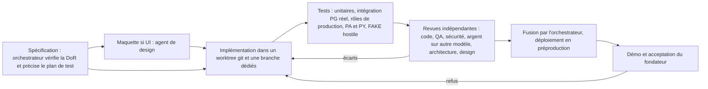
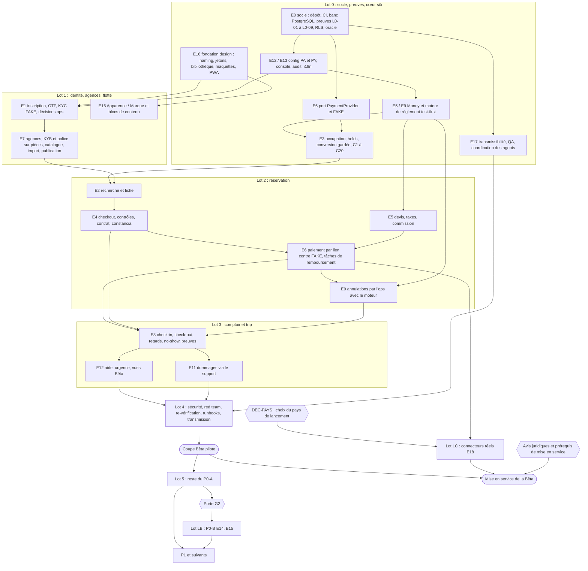

# 19 — Backlog de développement

> **Statut : PROPOSÉ, version 2 du 2026-10-30 (corrections VERIF_19 : modèle d'exploitation des agents §1.9, portes de lot §1.10, tâches du fondateur §6 complétées, échéances alignées sur 22).** Backlog exécutable par une équipe d'agents Claude Code (aucun développeur humain ; le fondateur est le seul humain : product owner, recette, comptes, juridique). Aucun code applicatif dans ce document.
> **Sources (font foi dans cet ordre en cas d'écart)** : `04_FEATURE_INVENTORY.csv` + README (périmètre, `phase_mvp`, `lot_p0a`, `beta_pilote`, epics E1–E18) ; `16_PRODUCT_REQUIREMENTS_DOCUMENT.md` (fiches et critères d'acceptation : les critères ci-dessous les **condensent** et ne les remplacent pas) ; `17_DATA_MODEL_AND_ARCHITECTURE.md` v5 (modules, entités, §10 coupe Bêta, §11 preuves L0-01 à L0-10, tests C1–C20 et RLS-1 à RLS-20, ADR) ; `08_BUSINESS_RULES.md` (BR, SM-1 à SM-8, vecteurs T01–T68) ; vecteurs TA01–TA11 (16 A.8.1) ; `10b_UX_UI_ANALYSIS.md` (écrans S01–S17, A01–A13, O01, O02 ; source UX) ; `18_MVP_AND_ROADMAP.md` v4 (lots, décisions DEC-FONDATEUR-02/03/04) ; `22_OPEN_QUESTIONS.md` (décisions ouvertes).
> **Contrôle** : `python -I tools/check_backlog.py` et, en contrôle indépendant, `python -I tools/verif19_backlog.py` (couverture des feature_id P0-A / P0-B, existence et acyclicité des dépendances, absence d'inversion de lot, règles Bêta et design). Sortie en §7.
> **Décisions du fondateur intégrées** : DEC-FONDATEUR-02 (construire d'abord ; avis juridiques = porte de mise en service), DEC-FONDATEUR-03 (aucun PSP réel avant le choix du pays ; adaptateurs `FAKE`), DEC-FONDATEUR-04 (Panama **et** Paraguay dès le lot 0), DEC-FONDATEUR-05 (**équipe 100 % agents Claude Code**, le fondateur seul humain), DEC-FONDATEUR-06 (**agent de design dédié + revue UX / design indépendante ; web mobile-first + PWA installable ; pas d'app native dans le MVP**), DEC-FONDATEUR-07 (**le fondateur modifie le design quand il le veut** : jetons comme source unique, écran « Apparence / Marque », blocs de contenu éditables), DEC-FONDATEUR-08 (**transmissibilité totale**), DEC-FONDATEUR-09 (**tests exhaustifs** par feature et de bout en bout), DEC-FONDATEUR-10 (**autonomie des agents, charge minimale du fondateur**). Lignes de 04 correspondantes : DSN-001 à DSN-007 (E16), PLT-001 à PLT-005 (E17), PAY-042, FIN-020, VER-029 (E18, lot C).

## Sommaire
1. Mode d'emploi (conventions, Definition of Ready, Definition of Done, modèle d'équipe IA, design, garde-fous, stratégie de tests, règles d'exploitation des agents, portes de lot)
2. Séquence des lots
3. Epics et user stories (lots 0 à 4, coupe Bêta, lot 5, lot des connecteurs réels, P0-B, P1+ en epics)
4. Graphe de dépendances, chemin critique, parallélisation par rôle d'agent
5. Points de décision du fondateur
6. Tâches réservées au fondateur (humain)
7. Validation automatique

---

## 1. Mode d'emploi

### 1.1 Conventions

- **Identifiant** : `US-xyz`, où le chiffre des centaines donne le lot : `US-0xx` lot 0 (L0), `US-1xx` L1, `US-2xx` L2, `US-3xx` L3, `US-4xx` L4, `US-5xx` L5 (reste du P0-A après la coupe Bêta), `US-6xx` LC (connecteurs réels, après le choix du pays), `US-7xx` LB (P0-B). Un identifiant n'est jamais réutilisé ; une story retirée garde son numéro avec la mention « RETIRÉE ». **Une story déplacée vers un lot postérieur garde son identifiant** (pas de renumérotation) ; c'est alors la rubrique **Lot** qui fait foi, et la story figure dans la liste ci-dessous, lue par `tools/check_backlog.py`.
- **Stories déplacées sans renumérotation** : US-036, US-044, US-045 (L0 → L1, VERIF_19 §4.3 : aucun dépendant hors US-047, allègent le lot 0 sans toucher le chemin critique).
- **Format d'une story** (lu par le script ; ne pas changer les libellés en gras) : titre `#### US-xyz — Titre`, puis les rubriques **Epic**, **Récit**, **Features** (identifiants de 04, ou « — » pour une story de socle), **Références** (BR, SM, EC, vecteurs T/TA, tests C/RLS/L0 de 17, écrans de 10b), **Critères d'acceptation** (Given / When / Then, condensés de 16 ; 16 fait foi), **Notes techniques** (modules et entités de 17), **Dépendances**, **Estimation**, **Lot**, **Bêta pilote**, **Revue design**, **Bloqué par (défaut)**.
- **Bêta pilote** : `OUI` = la story fait partie de la tranche Bêta (lots 0 à 4) ; `NON` = après la coupe ; `PRÉALABLE` = lot des connecteurs réels, hors build Bêta mais exigé pour la **mise en service** de la Bêta (18 §4). Une story `OUI` peut porter des lignes de 04 marquées MANUEL : elle construit alors seulement l'outil de console (`manual_action`) qui remplace la ligne, la version complète étant au lot 5. Le statut `beta_pilote` de chaque ligne reste celui de 04.
- **Revue design** : `OUI` pour toute story qui produit ou modifie un écran, un texte vu par un utilisateur, un e-mail / SMS ou un document PDF ; elle impose l'étape de revue design de la DoD (§1.4).
- **Bloqué par (défaut)** : décisions ou avis ouverts de 22 qui conditionnent la **valeur** ou la **mise en service** de la story, et le **défaut codé** en attendant (toujours fail-closed, paramétré, jamais une décision prise à la place du fondateur). Aucun avis juridique ne bloque le build (DEC-FONDATEUR-02).
- **Langue** : récits et critères en français ; termes techniques, noms d'entités (17) et codes d'erreur (16 A.8) en anglais ; textes d'interface en espagnol neutre LATAM (es-PA / es-PY) et en anglais (10b §3.3).

### 1.2 Échelle d'estimation

- **Points** (suite 1, 2, 3, 5, 8, 13) ; **1 point ≈ ½ jour-agent idéal**, c'est-à-dire le travail d'un agent d'implémentation **plus** ses revues indépendantes et ses corrections, sans attente. Une story de 13 points doit être découpée avant d'entrer en cours si l'orchestrateur le juge utile.
- **Aucune conversion en temps calendaire** n'est faite ici. La durée réelle sera **mesurée après le lot 0** (points livrés par semaine) puis recalée après le lot 1. Les goulots attendus ne sont pas la vitesse de codage mais : (1) le **temps de revue et de recette du fondateur**, (2) les **limites d'usage** des agents (quotas, fenêtres de contexte), (3) les **mises en place externes** (comptes, hébergement, domaine, fournisseurs KYC / SMS / e-mail, plus tard bac à sable PSP), (4) les avis juridiques pour la mise en service.
- L'ancien énoncé de charge de 18 §5.0 (≈ 16 à 28 semaines-équipe pour la Bêta) supposait 2 développeurs humains ; il est **caduc**. 18 v4 donne désormais **170 à 300 jours-agent pour la Bêta et 320 à 640 jours-agent pour le P0-A** ; à 1 point ≈ ½ jour-agent, ce backlog donne ≈ 261 et ≈ 369 jours-agent (§7) : **cohérence arithmétique, non mesurée** (le facteur ½ jour par point est une hypothèse de ce backlog, pas une mesure ; ce n'est pas un recoupement indépendant, A24-20) ; au niveau du lot 0, 222 points ≈ 111 jours-agent **dépassent** la fourchette du barème de 18 (47–97 jours-agent) ; la mesure du lot 0 (US-027) recale. Les totaux en points de ce backlog sont en §7.

### 1.3 Definition of Ready (DoR)

Une story entre en cours seulement si :
1. ses **dépendances** sont fusionnées (ou explicitement simulées par un contrat d'interface déjà fusionné) ;
2. ses **critères d'acceptation** sont testables et cohérents avec la fiche de 16 citée ; tout écart avec 16 ou 17 est d'abord tranché par l'orchestrateur (et noté dans 17 ou 16), jamais dans le code ;
3. les **vecteurs** cités (T, TA, C, RLS, L0) existent dans 08 / 16 / 17 et, pour toute variante PYG, ont été produits par l'**oracle indépendant** (US-016) et reportés dans 08 ;
4. les **entités** touchées sont nommées dans 17 §3.2 (aucune table « bêta » jetable : 17 §10 principe 1) ;
5. chaque décision ouverte listée a un **défaut codé** et un nom de paramètre (17 §7.2) ;
6. pour une story `Revue design : OUI`, la **maquette** de l'écran (US-033 ou maquette dédiée) est approuvée et les composants existent dans la bibliothèque (US-032) ou sont ajoutés par l'agent de design dans la même story ;
7. les **tâches fondateur** préalables (comptes, secrets, décisions, §6) sont faites.

### 1.4 Definition of Done (DoD)

Une story est terminée quand **tout** ce qui suit est vrai :
1. **Tests** (pyramide complète de §1.8, écrits pour partie par l'agent QA **indépendamment** de l'agent d'implémentation ; toutes les suites vertes avant fusion, seuils de couverture de §1.8 tenus) : unitaires et d'intégration sur un PostgreSQL réel en conteneur (jamais simulé) ; tests de contrat d'API générés depuis l'OpenAPI ; parcours e2e Playwright (dont viewports mobiles et PWA) pour toute story visible ; parcours dorés inter-modules impactés rejoués en PA et PY ; tous les critères d'acceptation automatisés ; **tests sous les rôles de production** (`app_api`, `app_worker`, `app_anon` ; jamais `migrator` ni superutilisateur ; assertion L0-05 en tête) dès qu'une table à RLS est touchée ; vecteurs dorés T/TA verts ; C1–C20 et RLS-1 à RLS-20 toujours verts (régression) ; fuzz C11 à 1 000 exécutions en CI.
2. **Deux pays** : chaque test monétaire, de taxe, de date ou de libellé est exécuté en variante **PA** (USD, ITBMS 7 %, `America/Panama`, es-PA) **et PY** (PYG sans décimale, IVA 10 %, `America/Asuncion`, es-PY) quand la variante a un sens ; les valeurs attendues PYG viennent de l'oracle (17 §10 point 2 bis), jamais du code testé ; le test « aucune constante pays codée en dur » reste vert.
3. **Adaptateurs `FAKE`** : toute intégration externe passe par un port (17 §5) et est testée contre son adaptateur `FAKE` (mode normal et **mode hostile** : doublons, retards, refus, réponses inconnues, capacités absentes) ; **aucun appel à un PSP réel** avant le lot des connecteurs réels (DEC-FONDATEUR-03) ; test C19 vert (aucun `FAKE` dans l'image ni la configuration de production).
4. **Revues indépendantes** (aucune fusion sans elles, §1.5) : revue de code ; QA / tests ; **revue « argent » sur un autre modèle** (famille B, §1.9) pour toute story qui calcule, déplace, rembourse ou facture un montant ; **revue sécurité** pour toute story qui touche l'authentification, la RLS, les rôles, les secrets, les webhooks, les fichiers ou les données C2/C3, **faite sur la famille B** pour la RLS, les rôles, les fonctions `SECURITY DEFINER` et la concurrence (C1–C20) ; revue de **conformité à l'architecture** (modules, imports, entités de 17, `platform.now()`) ; **revue design** pour toute story `Revue design : OUI` (qualité visuelle, cohérence avec le système de design, WCAG 2.2 AA, comportement sur petit téléphone 360 px, PWA, textes espagnols relus).
5. **Traçabilité** : journal d'audit pour toute action d'état ; événements de domaine de 17 §4.5 publiés par l'outbox ; codes d'erreur stables (16 A.8) ; migrations additives et réversibles, jouées en préproduction.
6. **Documentation à jour** (obligatoire pour **chaque** story, epic E17) : README du module touché, spécification OpenAPI régénérée si l'API change, documentation du schéma et historique des migrations si la base change, ADR ajouté au journal du dépôt pour toute décision d'architecture (et report dans 17), inventaire des variables d'environnement et secrets (noms seulement) si une variable est ajoutée, runbook mis à jour si l'exploitation change, glossaire ES/FR/EN si un terme métier apparaît, entrée de CHANGELOG ; mise à jour de 17 §7.2 si un paramètre est créé ; aucune décision fondateur « prise » par défaut sans la mention PROPOSÉ. Un agent qui n'a pas écrit la story doit pouvoir la reprendre avec ces seuls documents.
7. **Design modifiable** : aucun style codé en dur dans un composant (couleurs, typographies, espacements, rayons, ombres, mouvements viennent des jetons, US-030) ; tout texte marketing ou texte clé passe par un bloc de contenu éditable (US-121) ou par le catalogue i18n.
8. **Démonstration** : pour une story visible, démo au fondateur (préproduction, téléphone réel) et acceptation enregistrée ; pour une story technique, rapport de tests lisible par le fondateur.
9. **Exploitation** (§1.9) : fusion seulement par demande de fusion sur la branche protégée, avec la piste d'audit de la session ; **aucun déploiement en production hors de la porte de déploiement** de §1.9 ; usage consommé noté au tableau des stories.

La **porte de sortie de chaque lot** (pré-mortem, red team, post-mortem, restauration rejouée) est en §1.10 : un lot n'est pas terminé tant qu'elle n'est pas passée, même si toutes ses stories le sont.

### 1.5 Modèle d'équipe IA

**Il n'y a pas de développeur humain.** Le développement est fait par des agents Claude Code organisés en équipe ; le fondateur est le seul humain.

| Rôle | Qui | Responsabilités | Ne fait jamais |
|---|---|---|---|
| **Orchestrateur (tech lead)** | agent Claude Code | lit le backlog, vérifie la DoR, découpe, assigne, ouvre une branche / un worktree par story, exige les revues, **fusionne**, tient le tableau de bord et le journal des décisions, prépare les démos | fusionner sans les revues requises ; trancher une décision fondateur |
| **Agent back-end** | agent | modules NestJS, commandes, travailleurs pg-boss, ports et adaptateurs | modifier la RLS ou les rôles sans revue sécurité |
| **Agent données / base** | agent | schéma, migrations, contraintes, RLS, fonctions `SECURITY DEFINER`, preuves L0, tests de concurrence | écrire du SQL métier avec `now()` |
| **Agent front-end** | agent | Next.js (guest, console agence, comptoir, back-office), PWA, i18n | créer un composant hors bibliothèque sans accord de l'agent de design |
| **Agent intégrations** | agent | adaptateurs `FAKE` à capacités simulées, puis connecteurs réels (LC) | activer un connecteur réel avant LC |
| **Agent de design** | agent | naming et identité visuelle (propositions au choix du fondateur), jetons de design comme source unique, jetons de design, bibliothèque de composants, maquettes et prototypes des écrans avant implémentation, micro-interactions et mouvement, règles photo des annonces, « effet waouh » sobre et mobile-first ; **ne copie pas l'identité de Turo** (10b reste la source UX) | valider seul son propre travail |
| **Vérificateur : revue de code** | agent indépendant | lisibilité, correction, conformité aux critères | réécrire la story |
| **Vérificateur : QA / tests** | agent indépendant | rejoue les critères, ajoute des tests de bord, tests e2e PA et PY | — |
| **Vérificateur : sécurité** | agent indépendant (**famille B** pour RLS, rôles, `SECURITY DEFINER`, concurrence ; §1.9) | RLS, IDOR, secrets, webhooks, données personnelles, OWASP | — |
| **Vérificateur : argent** | agent indépendant **sur un autre modèle** (famille B, §1.9) | recalcule les montants avec l'oracle, contrôle invariants E1–E5, arrondis, idempotence | utiliser le code testé comme oracle |
| **Vérificateur : architecture** | agent indépendant | frontières de modules, entités de 17, ADR, événements | — |
| **Agent red team** | agent indépendant, sans droit d'écriture sur le code (famille B de préférence) | attaque le système à chaque lot (porte de lot §1.10) (abus, fraude, IDOR, données personnelles, contournement de la commission) | corriger lui-même |
| **Vérificateur : UX / design** | agent indépendant | toute story visible : qualité visuelle, cohérence au système de design, WCAG 2.2 AA, petit téléphone, PWA, textes es/en | — |
| **Fondateur** | **humain** | décisions (§5), comptes et secrets (§6), acceptation, juridique, choix de l'identité et des écrans clés | coder |

**Cycle d'une story** :



**Règles** : un worktree et une branche par story ; jamais deux agents sur la même migration ; une story « argent » ou « sécurité » ne peut pas être revue par l'agent qui l'a écrite ni par le même modèle (argent, RLS / rôles, concurrence : famille B, §1.9) ; l'oracle de règlement (US-016) est écrit par un agent qui n'écrit pas le moteur (US-017) ; les revues sont consignées dans la demande de fusion ; l'orchestrateur ne lance pas plus de stories en parallèle que le fondateur ne peut en accepter (le goulot est la recette humaine).

**Autonomie (minimiser la charge du fondateur)** :
1. Les agents **décident seuls de tout ce qui est technique** (choix de bibliothèque, découpage, conception interne, tests), dans le cadre de 17 et des ADR ; une décision d'architecture nouvelle est écrite en ADR et revue par l'agent architecture, sans le fondateur.
2. Ils n'escaladent au fondateur **que** : (a) les actions réservées à un humain (§6 : comptes, secrets, paiements, contrats, juridique, tests en conditions réelles) ; (b) les décisions produit listées dans 22 et en §5. Chaque escalade a un **défaut convenu d'avance** (rubrique « Bloqué par (défaut) ») : le travail continue avec le défaut, jamais bloqué en attente d'une réponse.
3. Les escalades sont **groupées** dans un **point fondateur hebdomadaire** unique : démo en préproduction + au plus ~5 décisions, préparées par l'orchestrateur (contexte, options, recommandation, défaut en vigueur). Aucune interruption hors de ce point, sauf incident de production ou action humaine bloquant le chemin critique.

**Communication entre agents** (artefacts partagés et versionnés dans le dépôt, dossier `docs/team/`, mis en place par US-029) :
- **tableau des stories** (statut, agent, branche, revues obtenues) ;
- **journal des décisions** et ADR ;
- **note de passation par story** (ce qui est fait, ce qui reste, pièges, paramètres ajoutés) ;
- **rapports de revue** (un par vérificateur, joints à la demande de fusion) ;
- **registre des risques** (probabilité, impact, parade, propriétaire) ;
- **« questions entre agents »** : un agent pose une question ; l'orchestrateur répond par écrit (ou la transforme en escalade fondateur si elle relève de 22).

**Rigueur « mission critique »** :
- **zéro défaut visé** sur l'argent, la sécurité et la réservation : **deux revues indépendantes** obligatoires pour ces stories (dont l'argent sur un autre modèle), en plus de la QA ;
- **modèle de menaces** court pour chaque feature touchant données, argent ou droits (STRIDE ou équivalent, joint à la story) ;
- **pré-mortem** au démarrage de chaque lot (« pourquoi ce lot échouerait-il ? » → risques au registre), **post-mortem de lot** à sa sortie et **post-mortem** sans blâme après chaque incident ou bogue échappé (cause, test ajouté, règle ajoutée) : planifiés pour **chaque lot** L0 à L5, LC et LB par la porte de lot de §1.10 et ses stories porteuses ;
- **agent red team** à chaque lot : attaque le système (abus, fraude au paiement, contournement de la commission, IDOR, fuite de données personnelles, injection, cas de 11) ; ses constats deviennent des stories ou des bogues ; une story de red team par lot (US-049, US-122, US-222, US-313, US-407, US-540, US-608, US-712 ; §1.10), avec un accent sur **l'argent et la RLS aux lots 0 et 1** ;
- **re-vérification indépendante avant chaque mise en production** par un agent qui n'a rien construit dans la version (US-408).

**Auto-contrôle** : à chaque session de travail, l'orchestrateur écrit un **rapport de santé** daté dans le dépôt (tests et couverture, score de mutation, stories en cours et bloquées, risques ouverts, escalades en attente, consommation d'usage) ; le fondateur peut le lire en deux minutes.

**Continuité** : tout l'état utile est dans des fichiers (tableau, notes de passation, `RESUME_HERE` du dépôt, rapports) ; toute nouvelle session ou tout nouvel agent reprend le travail sans mémoire préalable, y compris après une interruption pour limite d'usage (protocole de point de reprise de §1.9).

**Ce qu'il faut savoir honnêtement** : les agents tournent **dans des sessions Claude Code** ; ils ne travaillent pas 24 h / 24 sans surveillance, sauf tâches planifiées explicitement (CI, régression nocturne, rapports) ; leur débit dépend des quotas d'usage ; les revues indépendantes réduisent le risque mais ne remplacent ni la recette du fondateur ni les tests en conditions réelles avec les agences pilotes.

**Tâches minimales et inévitables du fondateur** : §6.

**Parallélisation par rôle** : §4.3.

### 1.6 Design et mobile

- **Périmètre mobile du MVP** (DSN-006, US-048) : web responsive **mobile-first** + **PWA installable** (guest, console agence, comptoir) ; **aucune application native** iOS / Android dans le MVP. Une application native (par ex. React Native / Expo réutilisant l'API) est une **décision ouverte de phase P2 / P3** (DEC-NATIVE, §5) ; seul le repli ADR-005 (enveloppe native ou terminal fourni pour le **comptoir**, si TRP-056 échoue sur iOS) peut l'avancer, et seulement pour le comptoir.
- **Fondation design** (epic E16, lot 0) : **naming et identité** en premier (US-028 : l'agent de design propose des noms et 2 à 3 directions visuelles ; le fondateur choisit ; aucun nom ni style n'est encore choisi), jetons, bibliothèque de composants vivante (Storybook publié, US-032), maquettes / prototypes des écrans clés **avant** leur implémentation, règles de mouvement et de micro-interactions, règles photo des annonces. Points de contrôle fondateur : choix du nom et de la direction (US-028), approbation des écrans clés (US-033).
- **Design modifiable par le fondateur à tout moment** (exigence du 2026-10-30) : (1) les **jetons de design** (couleurs, typographie, espacements, rayons, ombres, mouvement) sont des **données versionnées**, source unique appliquée par thème, sans style codé en dur dans les composants (US-030, règle de lint) ; (2) un écran de back-office **« Apparence / Marque »** (P0-A ; Bêta SIMPLIFIÉ) permet au fondateur de changer logo, nom de marque, palette, polices (liste approuvée), images et textes du héros de l'accueil, bannières, habillage des gabarits e-mail (et WhatsApp au lot 5), avec **aperçu en direct, brouillon / publication, historique des versions et retour arrière en un clic** (US-034, US-120, US-538) ; surcharges par pays en P1 ; (3) **blocs de contenu éditables** es/en pour les pages marketing et les textes clés, sans déploiement (US-121) ; (4) une **bibliothèque de composants vivante** où le fondateur voit chaque composant (US-032) ; (5) les **changements de mise en page structurels** restent du ressort de l'agent de design et passent par le cycle de story et la revue design. Lignes de 04 : DSN-002 (jetons), DSN-003 (« Apparence / Marque », Bêta SIMPLIFIÉ), DSN-004 (blocs de contenu), DSN-005 (bibliothèque), DSN-006 (mobile-first et PWA), DSN-007 (revue UX / design et validation des écrans clés).
- **Source UX** : 10b (principes, écrans, états vide / chargement / erreur, textes, WCAG 2.2 AA). Ce backlog ne recopie pas 10b : chaque story UI cite ses écrans.

### 1.7 Garde-fous transverses (rappel, tirés de 17)

- **Argent** : `bigint` en unités mineures, `roundHalfUp` / `allocHost` uniques (ADR-009) ; règlement = fonction pure versionnée (ADR-010) ; aucune écriture entre devises ; une capacité PSP inconnue vaut « non ».
- **Réservation** : écritures par **commandes seulement** (ADR-035) ; exclusion GiST + conversion gardée (ADR-002) ; horloge = base (`platform.now()`, ADR-030).
- **Pays** : aucune constante propre à un pays dans le code (ADR-024, ADR-033).
- **`FAKE`** : jamais actif en production (ADR-032, test C19).

### 1.8 Stratégie de tests

**Principe** : chaque story est testée à tous les niveaux pertinents et le **système entier** est testé ensemble, dans les deux pays, y compris quand les dépendances externes se comportent mal. Les suites sont décrites et lançables par un repreneur (US-039). **Honnêteté** : les tests réduisent fortement le risque mais **ne prouvent pas l'absence de bogue** ; c'est pourquoi la production est surveillée (US-004, oracle C12) et un processus de triage des bogues existe après la mise en service (US-409).

| Niveau | Contenu | Outils / sources | Quand | Story porteuse |
|---|---|---|---|---|
| Unitaire | fonctions pures, règles, validations | test runner TypeScript | chaque story | chaque story |
| Intégration | modules + PostgreSQL **réel en conteneur**, rôles de production, outbox | banc US-005 | chaque story touchant la base | chaque story |
| Contrat d'API | requêtes et réponses conformes à l'OpenAPI générée ; codes d'erreur stables | OpenAPI (US-038) | chaque story API | US-041 |
| Bout en bout | parcours Playwright, viewports mobiles (360 px, 390 px), tablette du comptoir, PWA installée | Playwright | chaque story visible | US-041 |
| **Parcours dorés inter-modules** | cycle de vie complet : recherche → hold → paiement (`FAKE` normal **et hostile**) → trip → check-in / check-out → annulation / no-show → règlement → grand livre (dès le lot 5) → notifications, **en PA (USD) et en PY (PYG)** | Playwright + API + base | chaque fusion touchant un module traversé ; complet chaque nuit | US-047, US-221, US-312, US-539 |
| Propriétés et fuzz monétaires | invariants du règlement, des taxes, des arrondis, des devis ; comparaison à l'**oracle indépendant** | génération de propriétés + oracle US-016 | chaque story argent ; 10 000 cas la nuit | US-042 |
| Mutation | score de mutation du moteur de règlement, de `Money` et des devis | outil de mutation | chaque nuit | US-042 |
| Concurrence | C1–C20, fuzz C11, preuves L0-01 à L0-09 | banc US-005 | chaque fusion (C11 : 1 000) ; nuit : 10 000 | US-006, US-007, US-022 à US-025 |
| Isolation multi-locataires | RLS-1 à RLS-20, IDOR agence contre agence, matrice d'autorisation par rôle | US-011 | chaque fusion | US-011, US-043 |
| Sécurité | contrôles OWASP ASVS niveau 2 ciblés, matrice d'autorisations, analyse des dépendances et des secrets, en-têtes, téléversements | US-043 | chaque fusion ; complet par lot | US-043, US-401, US-407 |
| Accessibilité et rendu | axe (WCAG 2.2 AA), **régression visuelle** des écrans et composants, es et en, 360 px | US-044 | chaque story visible | US-044 |
| Performance (fumée) | objectifs de 17 §6.7 (ex. p95 de pose de hold < 300 ms sous la contention de C1) | US-045 | chaque nuit ; par lot | US-045 |
| Résilience | `FAKE` hostiles : délais dépassés, doublons, webhooks dans le désordre ou tardifs, pannes de PSP / KYC / SMS / e-mail, travailleur arrêté | US-019, US-020, US-045 | chaque nuit | US-045 |
| Gabarits | aucune variable non résolue, es et en, e-mail / SMS / PDF | US-021 | chaque fusion touchant un gabarit | US-021 |
| Migrations | montée et descente sur les graines PA et PY ; migration de données sous `FORCE` (RLS-19) | US-046 | chaque migration | US-046 |
| Données personnelles | export des données d'une personne, effacement par destruction de clé, rétention | US-046 | chaque nuit | US-046, US-536 |
| Rapprochement | contrôles nocturnes : oracle C12, cohérence règlements / remboursements / commission ; dès le lot 5, Σ débits = Σ crédits | US-047 | chaque nuit | US-047 |

**Portes de CI** (aucune fusion sinon) : toutes les suites concernées vertes ; seuils de couverture **PROPOSÉS** : modules STL, PRC, PAY, AVL et type `Money` ≥ 95 % des lignes et ≥ 90 % des branches ; autres modules back-end ≥ 85 % des lignes ; front-end ≥ 75 % des lignes ; **score de mutation ≥ 80 %** sur le moteur de règlement, `Money` et le moteur de devis (bloquant pour toute story qui les modifie) ; 0 violation axe bloquante ; 0 vulnérabilité critique ou élevée connue. **Chaque nuit** : régression complète (parcours dorés PA et PY, fuzz C11 à 10 000, propriétés monétaires, mutation, résilience, performance de fumée, rapprochement) avec rapport au tableau de bord QA (US-047).

**Indépendance** : l'**agent QA** écrit les tests d'acceptation et les parcours dorés à partir de 16 et de ce backlog, **sans lire d'abord l'implémentation** ; l'agent d'implémentation n'écrit jamais seul les tests qui valident sa propre story argent, sécurité ou réservation.

### 1.9 Règles d'exploitation de l'équipe d'agents (VERIF_19-MAJ-2)

Écrites par l'orchestrateur dans `docs/team/OPERATING_RULES.md` **avant la première fusion** (première version avec les artefacts de US-029), puis appliquées par configuration et testées par US-050 (lot 0) ; toute modification passe par une demande de fusion approuvée par le fondateur (fichier protégé par CODEOWNERS). Les valeurs ci-dessous sont **PROPOSÉES** et paramétrables.

**1. Moindre privilège (secrets et base de données)** — **aucun agent ne détient de secret de production.**

| Acteur | Dépôt | Préproduction | Production | Secrets |
|---|---|---|---|---|
| Agents d'implémentation, de design et vérificateurs | branche de story seulement (aucun push sur `main`) | déploiement automatique depuis `main` ; base en lecture via `app_api` sur graines synthétiques PA / PY ; jamais `migrator` en interactif | **aucun accès** (ni console cloud, ni base, ni journaux bruts contenant des données personnelles) | secrets de test et clés des `FAKE` seulement, injectés par la CI, jamais affichés |
| Agent red team | lecture seule | comptes de test, préproduction seulement | aucun | aucun |
| Orchestrateur | fusion par demande de fusion sur la branche protégée | idem agents + relance des déploiements de préproduction | **déclenche** le pipeline de production (porte ci-dessous) ; aucune session interactive sur la base | aucun secret de production : le pipeline les lit dans le coffre de l'hébergeur via une identité de déploiement à durée courte (OIDC) |
| Pipeline CI / CD (identité machine) | — | — | seul détenteur du droit de déployer ; rôle `migrator` utilisé seulement par le job de migration | lecture au coffre au moment du job |
| Fondateur | propriétaire et administrateur (MFA) | — | propriétaire des comptes ; **bris de glace** journalisé (runbook US-405) | propriétaire du coffre et du séquestre (F-13) |

Aucune donnée réelle n'entre dans un environnement accessible aux agents : la préproduction ne reçoit jamais de copie de production non pseudonymisée.

**2. Porte de déploiement en production** — un déploiement de production n'est **déclenché que par l'orchestrateur**, via le pipeline, et seulement si : (a) toutes les portes de CI de §1.8 sont vertes sur le commit exact ; (b) la version est passée par la préproduction (US-003) ; (c) le rapport « go » de re-vérification (US-408) existe pour une version (une version = un ensemble de stories annoncé dans les notes de version) ; (d) **accord du fondateur** dans l'environnement protégé `production` (approbateur requis) pour les **5 premiers déploiements** (`founder_approval_first_prod_deploys` = 5, PROPOSÉ) puis, jusqu'à la fin de la recette pilote, pour toute version contenant une migration de données ou destructive, une modification de RLS ou de rôles, ou une modification du moteur de règlement, de `Money` ou du devis. Les autres versions sont déployées par l'orchestrateur et présentées au point hebdomadaire. Un retour arrière (US-003) peut être lancé par l'orchestrateur sans accord préalable ; il est notifié au fondateur.

**3. Budget d'usage par lot et limites**
- **Budget du lot** = points du lot × usage mesuré par point (mesuré sur les 20 premiers points du lot 0, US-027) × 1,3 de marge ; le fondateur fixe le plafond mensuel et le plafond journalier (F-15) ; le rapport de santé (US-029) affiche le consommé contre le budget du lot.
- **Seuils** : alerte à 70 % du plafond journalier ; à 90 %, arrêt des tâches non critiques et régression nocturne réduite au minimum (C11 à 1 000, parcours dorés, oracle) ; à 100 %, point de reprise et arrêt.
- **Priorité quand le quota baisse** : (1) `main` rouge ou incident ; (2) stories du chemin critique (§4.2) ; (3) revues en attente qui débloquent une fusion ; (4) le reste.
- **Coupe-circuit** : un agent qui échoue 3 fois sur la même erreur (`agent_max_attempts_per_task` = 3) ou qui dépasse 2 fois l'usage prévu de sa story s'arrête, écrit une note « BLOQUÉ » et l'orchestrateur réassigne, découpe ou escalade au point hebdomadaire.
- **Protocole de point de reprise (limite d'usage atteinte)** : (a) à chaque étape, commits de travail poussés sur la branche de story (jamais sur `main`) et note de passation tenue à jour (fait, reste, prochaine commande, pièges) ; (b) à l'avertissement de limite, l'agent termine ou annule l'étape atomique en cours (jamais une migration à moitié appliquée en préproduction), pousse, passe la story en `PAUSED_USAGE_LIMIT` au tableau avec l'heure de reprise prévue ; (c) à la reprise, la nouvelle session lit `docs/team/RESUME_HERE.md`, le tableau et la note, **relance les tests de la branche** avant de continuer ; (d) le rapport de santé consigne l'interruption. L'exercice est fait une fois au lot 0 (US-050).

**4. Modèles par rôle (choix configurable, `team.model.*`)** — pour éviter des erreurs corrélées, les revues critiques sont faites par une **autre famille de modèle** que l'implémentation.

| Rôles | Famille par défaut (PROPOSÉ) | Paramètre |
|---|---|---|
| Orchestrateur, agents back-end, données, front-end, intégrations, design | **famille A** : Claude, modèle le plus capable disponible dans Claude Code | `team.model.implementation` |
| Revue de code, QA, architecture, UX / design | famille A, autre instance sans contexte partagé, de préférence un autre modèle de la famille | `team.model.review` |
| **Vérificateurs argent, sécurité (RLS, rôles, `SECURITY DEFINER`), concurrence (US-011, US-022 à US-025, US-043), re-vérification US-408, red team** | **famille B** : modèle d'un **autre fournisseur**, choisi au lot 0 par l'orchestrateur et approuvé par le fondateur (budget F-15) | `team.model.independent_review` |
| Oracle de règlement (US-016) | famille A, agent distinct de celui du moteur ; recoupé avec les scripts Python audités de `tools/` ; revu par la famille B | — |

Invocation : la revue famille B est un **job de CI** déclenché sur la demande de fusion (diff, story, vecteurs et critères en entrée ; rapport versionné en sortie) ; la clé d'API est un secret de CI que les agents ne lisent pas. **Indisponibilité** de la famille B : la revue est faite par un autre modèle de la famille A sans contexte partagé et marquée « revue dégradée » au registre ; la fusion reste possible pour la préproduction, mais la revue famille B doit être rejouée **avant tout déploiement de production** ; au-delà de 5 jours ouvrés, escalade au point hebdomadaire.

**5. Branches protégées** : `main` protégée (aucun push direct ni force-push, demande de fusion obligatoire, statuts de CI et rapports de revue requis par la DoD, historique linéaire) ; CODEOWNERS : migrations, RLS, fonctions `SECURITY DEFINER`, modules STL / PAY / PRC / AVL et `Money`, IaC, workflows de CI / CD et `docs/team/OPERATING_RULES.md` exigent le vérificateur concerné ; seuls les workflows de déploiement, la protection des branches et l'environnement `production` exigent le fondateur.

**6. Piste d'audit des actions des agents** : chaque session écrit un journal versionné (`docs/team/sessions/`) : agent, rôle, modèle utilisé, story, commandes sensibles (migrations, déploiements, accès à la préproduction, relances), fichiers touchés, résultat ; chaque commit porte le rôle et le modèle en pied de message ; les journaux d'audit de GitHub et de l'hébergeur (déploiements, accès au coffre) sont conservés au moins 1 an et relus par l'agent sécurité à chaque porte de lot.

### 1.10 Portes de lot : pré-mortem, red team, post-mortem (VERIF_19-MAJ-1)

S'applique à **chaque lot** (L0 à L5, LC, LB). Un lot n'est terminé que si sa porte est passée :
1. **pré-mortem** au démarrage du lot, avant la première story qui n'est pas du socle : « pourquoi ce lot échouerait-il ? » ; chaque risque au registre avec probabilité, impact, parade et propriétaire ;
2. **red team du lot** en préproduction sur le périmètre du lot, plus le rejeu des scénarios des lots précédents ; aucun constat critique ou élevé ouvert à la sortie (corrigé et rejoué) ;
3. **post-mortem de lot** sans blâme : points prévus / livrés, bogues échappés, incidents, limites d'usage atteintes, règles ajoutées à §1.9 ou à la DoD ; commité dans `docs/team/` ;
4. **post-mortem de chaque incident** du lot sous 5 jours ouvrés (déjà exigé par §1.5) ;
5. **exercice de restauration** rejoué et chronométré (US-051), **revue des accès des agents** (§1.9 points 1 et 6) et budget d'usage du lot comparé au réel.

| Lot | Story porteuse | Accent de la red team |
|---|---|---|
| L0 | **US-049** (+ US-027) | **argent** (règlement, supersession, arrondis PYG, idempotence), **RLS** (RLS-1 à RLS-20, `SECURITY DEFINER`, `search_path`, `app_anon`), concurrence (C1–C20), `FAKE` en production (C19) |
| L1 | **US-122** | **RLS** agences / membres / pays, console `manual_action`, données KYC C2 / C3, import CSV, OTP, contenus éditables ; **argent** : paramètres pays (US-110) |
| L2 | US-222 | devis, lien de paiement et preuve, annulations concurrentes, remboursements, commission contournée |
| L3 | US-313 | preuves photo, horodatage, check-out, no-show, exports |
| L4 | US-407 | système complet avant ouverture |
| L5 | US-540 | mode (a), Yappy, libre-service, grand livre, messagerie, KYC complet |
| LC | US-608 | connecteurs réels, webhooks signés, secrets PSP / KYC / e-facture |
| LB | US-712 | fonds détenus, MIT, versements, chargebacks |

---

## 2. Séquence des lots

| Ordre | Lot | Contenu | Stories | Sortie |
|---|---|---|---|---|
| 0 | **L0 — Socle, preuves et cœur sûr** | dépôt, CI, environnements (IaC), sauvegardes ; transmissibilité et documentation (E17) ; **d'abord les preuves PostgreSQL L0-01 à L0-09** (L0-10 = hypothèses simulées par le `FAKE`) ; identité de base, RLS par acteur et par pays, console interne ; configuration PA + PY ; primitives monétaires ; **moteur de règlement test-first** avec vecteurs T/TA automatisés et **oracle indépendant** ; ports et `FAKE` ; disponibilité, hold et conversion gardée avec **C1–C20** ; fondation design (E16) ; test PWA iOS ; règles d'exploitation des agents, restauration testée, limitation de débit | US-001 à US-052, sauf US-036, US-044, US-045 (déplacées au lot 1) | rapport L0 et recalage (US-027) : un échec d'une preuve bloque L2 ; porte de lot (US-049, §1.10) |
| 1 | **L1 — Identité, agences, flotte, catalogue** | écran « Apparence / Marque » et blocs de contenu (Bêta SIMPLIFIÉ) ; inscription, OTP, KYC hébergé (`FAKE`), outils de console Bêta (`manual_action`), agences créées par l'ops, KYB et police sur pièces, catalogue véhicules, import CSV, calendrier, rétention et registre Ley 81, RPO/RTO ; portabilité, régression visuelle, performance et résilience (US-036, US-044, US-045, venues du lot 0) | US-101 à US-122, US-036, US-044, US-045 | une agence importée et publiable en préproduction ; porte de lot (US-122) |
| 2 | **L2 — Recherche, réservation, contrat, paiement agence (`FAKE`), commission** | recherche, devis et taxes, fiche, checkout, contrôles bloquants et revue, paiement par lien (mode b) contre le `FAKE`, contrat, constancia, annulations déclenchées par l'ops avec le moteur, tâches de remboursement de l'agence, commission | US-201 à US-222 | réservation de bout en bout PA et PY sur `FAKE` ; porte de lot (US-222) |
| 3 | **L3 — Comptoir, trip, preuves, support** | interface comptoir, check-in / check-out en ligne, photos, retards, no-show et refus par l'ops, dossier de preuve, dommages via le support, aide et urgence, vues Bêta | US-301 à US-313 | trip complet au comptoir ; porte de lot (US-313) |
| 4 | **L4 — Sécurité, durcissement, recette interne** | revue de sécurité, restauration et retour arrière, recette PA et PY, runbooks, checklist de transmission exercée, dossier de sortie | US-401 à US-409 | **fin du build Bêta** ; porte de lot (US-407) |
| — | **Coupe Bêta pilote** | jalon : lots 0 à 4 terminés = tranche Bêta construite (lignes de 04 au 2026-10-30 après VERIF_18 : 96 construites — 25 OUI, 71 SIMPLIFIÉ, dont PAY-042 au lot LC —, 58 MANUEL remplacées par des actions de console ou des procédures, 12 DIFFÉRÉ). La **mise en service** exige en plus le lot LC, les avis juridiques, les textes signés, les polices, la dotation SUP-020 et J-ADM-031 (18 §4) | — | — |
| 5 | **L5 — Reste du P0-A** | versions complètes des lignes SIMPLIFIÉ, construction des lignes MANUEL et DIFFÉRÉ : KYC complet, KYB, éditeur d'annonce, iCal, mode (a) sous mandat contre `FAKE`, Yappy, moteur complet, libre-service (annulations, no-show), hors ligne, messagerie, WhatsApp, litiges, **grand livre miroir**, facturation, rapprochement | US-501 à US-540 | P0-A complet (bêta fermée 5–10 agences) ; porte de lot (US-540) |
| 6 | **LC — Connecteurs réels** (après le choix du pays, DEC-FONDATEUR-03) | PSP réel du pays (mode b puis a), mesures L0-10, porte PAY-041, PAC ou SIFEN, KYC local, intégration des avis juridiques, contrôle de mise en service | US-601 à US-608 | **préalable à la mise en service** ; peut démarrer dès le choix du pays, en parallèle de L3–L5 (il ne dépend que de L0–L4) |
| 7 | **LB — P0-B** (après la porte G2, 18 §1.2) | caution plateforme, MIT et débits post-trip conformes aux réseaux, frais guest, split, factures annexes, versements, grand livre agence, ITBMS collecté, rapprochement quotidien | US-701 à US-712 | seulement si avis favorables et besoin démontré ; porte de lot (US-712) |
| 8 | **P1 et suivants** | epics seulement (§3.9) | — | — |

**Écarts assumés avec la colonne `lot_p0a` de 04** (sans contradiction de périmètre) :
1. Le **moteur de règlement** (BKG-028, BKG-032, BKG-035, TRP-015 : lot 2 ou 3 dans 04) est construit **test-first au lot 0** comme fonction pure (17 NN3) ; seuls ses déclencheurs (actions de console) arrivent aux lots 2 et 3.
2. La **table d'occupation et le hold** (CAL-011 lot 1, BKG-014 lot 2 dans 04) sont au lot 0 avec C1–C20 (17 §9 : « le schéma de la conversion gardée, la RLS, `platform.now()` et le crypto-shredding font partie du lot 0 »).
3. Le **grand livre en partie double** (FIN-001) n'est **pas** au lot 0 : 17 §10 le diffère dans la Bêta (FIN-001 MANUEL, tables `ledger_account`, `journal_entry`, `journal_line` non créées) ; le lot 0 construit le règlement versionné (`settlement`, `settlement_line`) et les invariants E4 ; le grand livre miroir est au lot 5 (US-530), le grand livre agence complet au P0-B (US-709).
4. Le **contrat-cadre et les mandats hors ligne** (LEG-025, LEG-020, LEG-027 : lot 2 dans 04) sont au lot 1 dans leur forme Bêta (pièce téléversée), parce que la publication des annonces (lot 1) en dépend.
5. Le **mode (a)** sous mandat (PAY-006 et suivants) est construit au lot 5 **contre le `FAKE`** ; le connecteur réel est en LC.
6. **Allègement du lot 0 (VERIF_19 §4.3)** : US-036 (portabilité), US-044 (régression visuelle) et US-045 (performance et résilience) passent au lot 1 sans renumérotation (§1.1) ; US-040 (CHANGELOG, contrôle de CI exigé par la DoD point 6 dès la première fusion) et US-046 (tests de montée / descente des migrations, utiles dès les nombreuses migrations du lot 0, et RLS-19) **restent** au lot 0. Le lot 0 reçoit en échange quatre stories de sûreté : porte de lot (US-049), règles d'exploitation (US-050), restauration testée (US-051), limitation de débit et anti-abus (US-052). Les composants restent contrôlés par axe dès le lot 0 (US-032).

---

## 3. Epics et user stories

**Epics** (README de 04 §4) : E1 à E13 (P0-A), E14 et E15 (P0-B), **E16 Fondations design, marque et contenus** (DSN-001 à DSN-007), **E17 Transmissibilité, qualité et gouvernance multi-agents** (PLT-001 à PLT-005 ; regroupe ici la documentation, la QA et la coordination des agents), **E18 Connecteurs réels** (lot C : PAY-041, PAY-042, FIN-020, VER-029) ; plus **E0 Socle technique et preuves** (propre à ce backlog, sans ligne de 04 : dépôt, preuves PostgreSQL, RLS, oracle). Les epics P1 et suivants sont en §3.10.

### 3.1 Lot 0 — Socle, preuves PostgreSQL et cœur sûr

Ordre interne : US-001 → US-005 → **preuves US-006 / US-007** avant toute autre story de base de données ; en parallèle, fondation design (US-028 en premier) et transmissibilité.

#### US-001 — Dépôt, monolithe modulaire et conventions
- **Epic** : E0
- **Récit** : En tant qu'orchestrateur, je veux un dépôt unique structuré par module avec des conventions écrites, afin que chaque agent travaille dans des frontières claires.
- **Features** : —
- **Références** : 17 §2.1, §2.2, §6.1 ; ADR-001, ADR-011 ; 16 A.8 (codes d'erreur)
- **Critères d'acceptation** :
  - Given un module qui importe l'intérieur d'un autre module, When le lint tourne, Then la CI échoue (règle d'imports entre modules).
  - Given du SQL métier contenant `now()` ou `current_timestamp`, When le lint tourne, Then la CI échoue (ADR-030).
  - Given le dépôt, When un agent neuf le clone, Then `CONTRIBUTING` décrit branches, worktrees, nommage, codes d'erreur sans préfixe et cycle de story (§1.5).
- **Notes techniques** : TypeScript, NestJS (API + travailleurs pg-boss, une image, deux processus) et Next.js (guest, console agence, comptoir ; back-office sur domaine distinct) ; un schéma PostgreSQL par module (D1 : préfixe de table en Bêta, 17 §10 point 3).
- **Dépendances** : —
- **Estimation** : 3 pts
- **Lot** : L0
- **Bêta pilote** : OUI
- **Revue design** : NON
- **Bloqué par (défaut)** : ADR-001 PROPOSÉ (défaut : monolithe modulaire NestJS + Next.js, acté par l'orchestrateur au début du lot 0)

#### US-002 — Intégration continue
- **Epic** : E0
- **Récit** : En tant qu'orchestrateur, je veux une CI qui exécute lint, tests unitaires, tests sur PostgreSQL réel, vecteurs dorés, tests de concurrence et analyses de sécurité, afin qu'aucune fusion ne dégrade la sûreté.
- **Features** : PLT-004
- **Références** : 17 §6.1 (ligne CI/CD), §2.5 (C1–C20), §11 ; 08 T01–T68
- **Critères d'acceptation** :
  - Given une demande de fusion, When la CI tourne, Then les tâches lint, unitaires, intégration (PostgreSQL ≥ 16 réel en conteneur, `btree_gist`, sans pooler), dorés, concurrence, fuzz C11 (1 000 exécutions), RLS, analyse des dépendances et des secrets et rendu `mmdc` des diagrammes sont toutes exécutées.
  - Given la nuit, When la tâche planifiée tourne, Then le fuzz C11 fait ≥ 10 000 exécutions et conserve la graine de chaque échec.
  - Given une tâche rouge, When l'orchestrateur tente la fusion, Then elle est refusée (protection de branche).
- **Notes techniques** : GitHub Actions (17 §6.1) ; matrice de tests PA / PY.
- **Dépendances** : US-001
- **Estimation** : 5 pts
- **Lot** : L0
- **Bêta pilote** : OUI
- **Revue design** : NON
- **Bloqué par (défaut)** : compte GitHub du fondateur (§6, tâche F-01)

#### US-003 — Environnements, infrastructure as code et déploiement réversible
- **Epic** : E12
- **Récit** : En tant que fondateur, je veux une préproduction identique à la production et des déploiements réversibles décrits en code, afin de tester sans risque et de pouvoir changer d'hébergeur.
- **Features** : ADM-034, PLT-001
- **Références** : 17 §6.5, §6.1 (arbre de décision de région) ; ADR-006 ; 16 fiche ADM-034
- **Critères d'acceptation** :
  - Given un déploiement en production, When il est lancé, Then il est d'abord passé par la préproduction (16 ADM-034), il est déclenché par l'orchestrateur via le pipeline seulement et, pour les premiers déploiements, après accord du fondateur (porte de §1.9).
  - Given l'infrastructure, When on la détruit et la recrée depuis le dépôt (Terraform ou équivalent), Then l'environnement de préproduction est reconstruit sans action manuelle autre que les secrets.
  - Given une version défectueuse, When le retour arrière est lancé, Then la version précédente est servie et le retour arrière est journalisé.
- **Notes techniques** : conteneurs ; IaC ; RDS Multi-AZ, S3 deux buckets, KMS deux clés (17 §10 NN10) ; image de production **sans** adaptateur `FAKE` (préparation C19) ; services propres à un fournisseur derrière des ports (portabilité, US-036).
- **Dépendances** : US-002
- **Estimation** : 5 pts
- **Lot** : L0
- **Bêta pilote** : OUI
- **Revue design** : NON
- **Bloqué par (défaut)** : ADR-006 / OQ-MK-09 (défaut : AWS us-east-1 PROPOSÉ, région unique) ; compte d'hébergement et domaine du fondateur (F-02, F-03 ; défaut : sous-domaine technique de travail du fondateur pour la préproduction et SPF / DKIM, remplacé par le domaine de marque après DEC-MARQUE)

#### US-004 — Sauvegardes, supervision et journal d'accès aux données personnelles
- **Epic** : E12
- **Récit** : En tant que responsable des données, je veux des sauvegardes copiées hors compte, une supervision et un journal d'accès aux données personnelles, afin de reprendre après incident et de prouver qui a consulté quoi.
- **Features** : ADM-032
- **Références** : 17 §6.3, §6.4 ; 16 fiche ADM-032 / ADM-035 ; NN10
- **Critères d'acceptation** :
  - Given une consultation d'un dossier KYC, When elle a lieu, Then elle figure au `data_access_log`.
  - Given un webhook en échec 3 fois, When il échoue, Then une alerte part.
  - Given la sauvegarde quotidienne, When elle se termine, Then une copie existe dans un autre compte.
- **Notes techniques** : journaux structurés, suivi d'erreurs, sans OpenTelemetry en Bêta (17 §10 point 3).
- **Dépendances** : US-003
- **Estimation** : 5 pts
- **Lot** : L0
- **Bêta pilote** : OUI
- **Revue design** : NON
- **Bloqué par (défaut)** : —

#### US-005 — Banc PostgreSQL, rôles de production et horloge de la base
- **Epic** : E0
- **Récit** : En tant qu'agent données, je veux un banc PostgreSQL réel avec les rôles de production et une horloge virtuelle dans la base, afin que tous les tests prouvent ce qui tournera en production.
- **Features** : —
- **Références** : 17 §11 **L0-05** (assertion de rôle), **L0-06** ; §1.3 ; ADR-030 ; NN11
- **Critères d'acceptation** :
  - Given un test, When il démarre, Then il vérifie `current_user ∈ {app_api, app_worker, app_anon}` et `NOT rolsuper AND NOT rolbypassrls` (L0-05).
  - Given `platform.now()`, When on inspecte `pg_proc`, Then `provolatile = 'v'` ; deux appels dans une instruction longue sont croissants ; `SET LOCAL app.virtual_now` ne fuit pas après `RESET ALL` ; le corps de production ne lit pas `app.virtual_now` (L0-06).
- **Notes techniques** : rôles `migrator`, `app_api`, `app_worker`, `app_anon`, propriétaires `NOLOGIN` par famille de commandes (`cmd_hold_owner`, ADR-035).
- **Dépendances** : US-002
- **Estimation** : 5 pts
- **Lot** : L0
- **Bêta pilote** : OUI
- **Revue design** : NON
- **Bloqué par (défaut)** : —

#### US-006 — Preuves L0-01, L0-03, L0-08 : exclusion, ré-acquisition, triggers I-OCC, index uniques
- **Epic** : E0
- **Récit** : En tant qu'orchestrateur, je veux prouver sur PostgreSQL la conception de l'occupation et de la conversion gardée avant de construire la réservation, afin de ne pas bâtir sur une hypothèse fausse.
- **Features** : —
- **Références** : 17 §11 **L0-01**, **L0-03**, **L0-08** ; §2.5 ; ADR-002
- **Critères d'acceptation** :
  - Given une occupation `HOLD` désactivée et une occupation concurrente active, When `UPDATE … SET kind = 'TRIP', active = true` dans un `SAVEPOINT`, Then `23P01`, `ROLLBACK TO SAVEPOINT` laisse la transaction utilisable et le bloc C (`COMPENSATED`, `payment_disposition`) est validé ; sans concurrent, trip créé (L0-01).
  - Given un trip `BOOKED`, When on désactive ou supprime son occupation, change son `ref_id` ou crée un trip sans occupation, Then refus au `COMMIT` ; toute sortie de `CONVERTED` / `COMPENSATED` est refusée (L0-03).
  - Given un doublon de `webhook_inbox` à clé partiellement nulle, deux holds vivants même guest / véhicule, deux `AGENCY_LINK` vivants dans deux agences ou deux dispositions `CONVERSION`, When ils sont insérés, Then `23505` traduit en code métier sans `DETAIL` (L0-08).
- **Notes techniques** : schéma de preuve = sous-ensemble exact des tables AVL de 17 §3.2.4 (réutilisé par US-022, pas de prototype jetable).
- **Dépendances** : US-005
- **Estimation** : 5 pts
- **Lot** : L0
- **Bêta pilote** : OUI
- **Revue design** : NON
- **Bloqué par (défaut)** : —

#### US-007 — Preuves L0-02, L0-04 : concurrence, verrou par véhicule, plan de l'expiration
- **Epic** : E0
- **Récit** : En tant qu'orchestrateur, je veux mesurer interblocages et performances de la pose de hold et de l'expiration, afin de valider les seuils de 17.
- **Features** : —
- **Références** : 17 §11 **L0-02**, **L0-04** ; tests **C1**, **C16** ; EC-51
- **Critères d'acceptation** :
  - Given 100 poses concurrentes, When le verrou consultatif par véhicule est actif, Then exactement 1 hold, 0 `40P01`, p95 de pose < 300 ms ; sans verrou, le nombre de `40P01` est consigné (L0-02).
  - Given 10 000 holds et 1 000 véhicules, When l'instruction d'expiration 2a est analysée (`EXPLAIN (ANALYZE, BUFFERS)`), Then deux index sont utilisés, un hold verrouillé est sauté et un hold `PAYMENT_IN_FLIGHT` non balayé n'est pas expiré (L0-04).
- **Notes techniques** : barrières de test (verrous consultatifs) ; rapport chiffré joint au rapport L0 (US-027).
- **Dépendances** : US-006
- **Estimation** : 5 pts
- **Lot** : L0
- **Bêta pilote** : OUI
- **Revue design** : NON
- **Bloqué par (défaut)** : —

#### US-008 — Outbox transactionnelle, événements et tâches planifiées
- **Epic** : E0
- **Récit** : En tant qu'agent back-end, je veux publier les événements de domaine dans la même transaction que l'écriture et les consommer de façon idempotente, afin qu'aucun événement ne soit perdu ni traité deux fois.
- **Features** : —
- **Références** : 17 §4.1, §4.2, §4.5 ; ADR-011
- **Critères d'acceptation** :
  - Given une transaction annulée, When elle publie un événement, Then aucun événement n'est émis.
  - Given un événement rejoué, When il est reçu, Then `inbox_receipt` empêche le double traitement ; après N échecs, il passe en `dead_letter` avec alerte.
- **Notes techniques** : tables `outbox_event`, `inbox_receipt`, `dead_letter`, `scheduled_job` (pg-boss) ; enveloppe d'événement de 17 §4.1.
- **Dépendances** : US-005
- **Estimation** : 3 pts
- **Lot** : L0
- **Bêta pilote** : OUI
- **Revue design** : NON
- **Bloqué par (défaut)** : —

#### US-009 — Journal d'audit chaîné, magasin de preuves et clés par sujet
- **Epic** : E13
- **Récit** : En tant que responsable des données, je veux un journal d'audit inaltérable, des fichiers avec empreinte et des données personnelles chiffrées par sujet dès le premier jour, afin de prouver les faits et de pouvoir effacer une personne sans casser les registres.
- **Features** : LEG-009
- **Références** : 17 §1.7, §3.1.3, §3.1.4 ; ADR-026 ; NN5, NN8 ; BR-ACC-09
- **Critères d'acceptation** :
  - Given le journal, When une mise à jour ou une suppression est tentée depuis l'application, Then elle est impossible et la chaîne de hachage reste vérifiable (16 ADM-001).
  - Given une colonne C2 / C3 d'une table immuable, When elle est écrite, Then elle est chiffrée avec la clé du sujet (`subject_key`).
  - Given un fichier téléversé, When on recalcule son SHA-256, Then il égale celui de `file_asset`.
- **Notes techniques** : `audit_log`, `data_access_log`, `file_asset`, `subject_key` ; destruction de clé = procédure manuelle tracée en Bêta (NN8), outil au lot 5 (US-536).
- **Dépendances** : US-005
- **Estimation** : 5 pts
- **Lot** : L0
- **Bêta pilote** : OUI
- **Revue design** : NON
- **Bloqué par (défaut)** : OQ-BR-25 (défaut : durées prudentes, ADR-018)

#### US-010 — Comptes, sessions et port d'authentification
- **Epic** : E1
- **Récit** : En tant qu'agent back-end, je veux une base d'identité (comptes, sessions, facteurs) derrière un port d'authentification, afin de pouvoir remplacer l'implémentation sans toucher aux modules.
- **Features** : —
- **Références** : 17 §2.3, §3.2.1 ; ADR-021 ; BR-ACC-01
- **Critères d'acceptation** :
  - Given un mot de passe, When il est stocké, Then seul un hachage robuste l'est.
  - Given une session révoquée, When l'API est rappelée, Then 401.
- **Notes techniques** : `user_account`, `session`, `auth_factor`, `email_verification`, `otp_challenge`, `organization`, `membership`, `staff_role_assignment`, `role_permission`, `restriction`.
- **Dépendances** : US-005
- **Estimation** : 5 pts
- **Lot** : L0
- **Bêta pilote** : OUI
- **Revue design** : NON
- **Bloqué par (défaut)** : ADR-021 en attente (défaut : implémentation interne derrière le port, choix de l'orchestrateur au lot 0)

#### US-011 — RLS par type d'acteur et par pays, commandes `SECURITY DEFINER`
- **Epic** : E0
- **Récit** : En tant que fondateur, je veux qu'aucun guest, agence ou agent ne puisse lire ou modifier les données d'un autre, ni d'un autre pays, même en cas de bogue applicatif, afin d'éviter toute fuite inter-agences.
- **Features** : —
- **Références** : 17 §2.3 (portée par pays), ADR-027, **ADR-035** ; **RLS-1 à RLS-20** ; **L0-05**, **L0-07** (RLS-13, RLS-14) ; NN6
- **Critères d'acceptation** :
  - Given la suite RLS-1 à RLS-20, When elle tourne sous `app_anon`, `app_api` (guest, agence, staff PA, staff PY) et `app_worker`, Then toutes les attentes de 17 sont tenues ; aucun rôle applicatif n'a `rolsuper` ni `rolbypassrls`.
  - Given une transaction sans `app.*`, When elle lit, Then 0 ligne et aucune erreur (RLS-8).
  - Given un OPS de portée `{PA}`, When il lit un dossier PY même assigné, Then 0 ligne (RLS-20).
  - Given l'inventaire `pg_proc`, When il est comparé à la liste blanche, Then propriétaire, `search_path` figé et `EXECUTE` conformes (RLS-15).
- **Notes techniques** : `FORCE ROW LEVEL SECURITY` ; fonctions de garde ; vues `security_invoker` ; aucune écriture de table de `app_api` sur les tables AVL (ADR-035).
- **Dépendances** : US-006, US-010
- **Estimation** : 8 pts
- **Lot** : L0
- **Bêta pilote** : OUI
- **Revue design** : NON
- **Bloqué par (défaut)** : —

#### US-012 — Console interne : authentification forte, rôles et journal
- **Epic** : E12
- **Récit** : En tant qu'agent OPS, je veux une console interne protégée par TOTP avec des rôles et un journal de chaque action, afin d'opérer la Bêta en sécurité.
- **Features** : ADM-001
- **Références** : 16 fiche ADM-001 ; 17 §2.3 ; BR-TRUST-05 ; écran O01
- **Critères d'acceptation** :
  - Given un rôle sans droit d'annulation plateforme, When il tente l'action, Then 403 journalisé (16 ADM-001).
  - Given un compte staff sans TOTP, When il se connecte, Then l'accès est refusé.
- **Notes techniques** : Bêta : rôles `ADMIN`, `OPS_AGENT` (12 rôles au lot 5, US-534) ; domaine distinct ; bris de glace hors application (procédure).
- **Dépendances** : US-009, US-011, US-032
- **Estimation** : 5 pts
- **Lot** : L0
- **Bêta pilote** : OUI
- **Revue design** : OUI
- **Bloqué par (défaut)** : —

#### US-013 — Configuration pays Panama et Paraguay
- **Epic** : E12
- **Récit** : En tant que fondateur, je veux que tout ce qui dépend du pays soit une donnée versionnée et que Panama et Paraguay existent dès le premier jour, afin de choisir le pays de lancement sans réécriture.
- **Features** : ADM-014, I18N-004, I18N-005
- **Références** : 17 §1.1–§1.3, §7 ; ADR-019, ADR-024, ADR-033 ; DEC-FONDATEUR-04 ; BR-PRICE-14
- **Critères d'acceptation** :
  - Given une valeur avec `valid_from` passé, When elle est saisie, Then `PARAM_RETROACTIVE` (16 ADM-014).
  - Given une clé obligatoire manquante, When la production démarre, Then refus explicite.
  - Given le code source, When le test « aucune constante pays » tourne, Then aucune devise, taux, fuseau ou pièce propre à PA ou PY n'est codé en dur.
  - Given la version de tzdata, When le service démarre, Then elle est contrôlée (`America/Asuncion`, ADR-019).
- **Notes techniques** : `country`, `currency`, `param_definition`, `param_value`, `holiday_calendar`, `tax_line_config` (ITBMS 7 %, IVA 10 % datés), `legal_entity` ; graines PA et PY ; paramétrage par migration de graines en Bêta (écran au lot 5, US-535).
- **Dépendances** : US-005
- **Estimation** : 5 pts
- **Lot** : L0
- **Bêta pilote** : OUI
- **Revue design** : NON
- **Bloqué par (défaut)** : OQ-BR-14 / OQ-MK-06 (défaut : assiette = loyer seul) ; OQ-BR-20 (défaut : contrôle tzdata)

#### US-014 — Internationalisation espagnol / anglais et formats
- **Epic** : E13
- **Récit** : En tant que guest touriste ou résident, je veux toute l'interface en espagnol ou en anglais avec des formats corrects pour mon pays, afin de comprendre exactement ce que je paie.
- **Features** : I18N-003
- **Références** : 16 fiche I18N-003 / I18N-004 ; 10b §3.3, §3.4 ; TA01
- **Critères d'acceptation** :
  - Given un écran en es, When le test automatisé le parcourt, Then aucune chaîne anglaise (et réciproquement).
  - Given 1 234,56 US$, When affiché en es-PA, Then « US$ 1.234,56 » ; en en, « $1,234.56 » ; un montant PYG s'affiche sans décimale en es-PY.
- **Notes techniques** : catalogue de messages versionné, es-PA, es-PY, en ; la version espagnole fait foi.
- **Dépendances** : US-001
- **Estimation** : 3 pts
- **Lot** : L0
- **Bêta pilote** : OUI
- **Revue design** : NON
- **Bloqué par (défaut)** : UXQ-04 (défaut : « tú » dans l'interface, « usted » dans le contrat, PROPOSÉ)

#### US-015 — Primitives monétaires
- **Epic** : E5
- **Récit** : En tant que vérificateur argent, je veux un type `Money` exact en unités mineures avec un arrondi unique, afin qu'aucun centime ni guaraní ne soit perdu ou inventé.
- **Features** : PRC-021, I18N-005
- **Références** : 16 fiche PRC-021 ; 08 BR-PRICE-14 ; ADR-009 ; **T40, T42, T43, TA06** ; NN2 ; EC-32
- **Critères d'acceptation** :
  - Given T40, T42, T43 et TA06, When le moteur les rejoue, Then résultats identiques au cent (ou à l'unité PYG) près.
  - Given l'addition de deux devises, When elle est tentée, Then `MONEY_CURRENCY_MISMATCH`.
  - Given un `bigint` PYG multiplié par un taux, When le calcul est fait côté TypeScript, Then aucun `number` flottant n'intervient (pilote → chaîne → `bigint`).
- **Notes techniques** : `roundHalfUp`, `allocHost` (égalité exacte → plateforme), fractions exactes.
- **Dépendances** : US-001
- **Estimation** : 3 pts
- **Lot** : L0
- **Bêta pilote** : OUI
- **Revue design** : NON
- **Bloqué par (défaut)** : —

#### US-016 — Oracle indépendant et harnais des vecteurs dorés
- **Epic** : E0
- **Récit** : En tant que vérificateur argent, je veux un oracle écrit indépendamment du moteur et un harnais qui rejoue tous les vecteurs, afin que les résultats attendus ne viennent jamais du code testé.
- **Features** : —
- **Références** : 08 T01–T68 ; 16 A.8.1 TA01–TA11 ; 17 §10 point 2 bis (oracle, variantes `T…-PY`) ; `tools/independent_settlement_check.py`, `tools/verif11_settlement.py`, `tools/check_t49plus.py`, `tools/check_verif12_fixes.py`, `tools/check_ta_consolidation.py`
- **Critères d'acceptation** :
  - Given les scripts Python de `tools/`, When ils sont portés en tests, Then ils redonnent 48 / 48 (T01–T48), les attentes de T49–T68 et TA01–TA11.
  - Given une variante PYG d'un vecteur, When elle est ajoutée, Then ses valeurs attendues sont produites par l'oracle et **reportées dans 08** (numérotation `T…-PY`) avant d'être assertées ; T48 / T62 en PYG sont marqués non normatifs (OQ-BR-24) ; T55 n'a pas de variante.
  - Given le moteur (US-017), When il est écrit, Then il est écrit par un autre agent que l'oracle (règle §1.5).
- **Notes techniques** : l'oracle reste en Python exécuté en CI (`python -I`) ; sorties comparées au moteur TypeScript.
- **Dépendances** : US-015
- **Estimation** : 5 pts
- **Lot** : L0
- **Bêta pilote** : OUI
- **Revue design** : NON
- **Bloqué par (défaut)** : —

#### US-017 — Moteur de règlement des annulations, sous-ensemble Bêta (test-first)
- **Epic** : E9
- **Récit** : En tant qu'agent OPS, je veux qu'une fonction pure calcule le remboursement dû au guest, la part conservée par l'agence, la pénalité et la commission pour chaque annulation ou no-show, afin de ne jamais saisir un montant à la main.
- **Features** : BKG-028, BKG-032, BKG-035, TRP-015
- **Références** : 08 BR-CXL-00 à BR-CXL-14 (table de décision, pseudo-code), SM-8 ; **T01–T09, T14, T15, T23–T27, T38–T43, T61, T62** ; **TA01–TA06, TA11** ; 17 §2.9, NN3 ; ADR-010, ADR-014
- **Critères d'acceptation** :
  - Given TA01, TA02, TA05, TA06, When l'annulation guest est réglée, Then remboursements 128,40 / 85,60 / 64,20 / 24,07 et commissions 0,00 / 4,80 / 2,40 / 2,70.
  - Given T02 (exactement T−24 h), When le guest annule, Then remboursement intégral (borne incluse) ; Given T23 / T24, Then `freeUntil = min(bookedAt + 60 min, start)` ; Given T25, Then requalification no-show.
  - Given T05 et T06, When le no-show est déclaré par l'agence ou par le système, Then résultat identique (invariance à l'initiateur).
  - Given TA11 et le paramètre `p0a_ineligible_no_show_outcome` absent, When le no-show est réglé, Then retenue 0,00, remboursement 128,40, commission 0,00 ; `PROTOCOL_PENALTY` et `AGENCY_KEEPS` donnent les valeurs de 16 A.8.1.
  - Given T61 (a) (`platform_funded_host_compensation` absent), When `PLATFORM_REVIEW_DELAY` est réglé, Then compensation 0,00 ; T17, T18, T20 restent **désactivés** tant que DEC-FONDATEUR-01 est ouverte.
  - Given chaque vecteur, When il est rejoué en PA et en variante PYG de l'oracle, Then égalité exacte et équilibre `remboursement + retenu HT + taxe retenue = total payé`.
- **Notes techniques** : `computeCancellationSettlement` pur, versionné ; motifs Bêta : guest gratuit / tardif, agence, plateforme, no-show guest ; tout autre motif ⇒ erreur explicite (moteur complet au lot 5, US-518).
- **Dépendances** : US-013, US-015, US-016
- **Estimation** : 8 pts
- **Lot** : L0
- **Bêta pilote** : OUI
- **Revue design** : NON
- **Bloqué par (défaut)** : DEC-FONDATEUR-01 / OQ-BR-41 (défaut `false`) ; OQ-BR-45 (défaut `REFUND_GUEST`) ; OQ-BR-30 (défaut 25 h) ; OQ-BR-33 (défaut 60 min) ; OQ-BR-24 (pénalités : valeurs de test 25,00 / 50,00, non normatives)

#### US-018 — Règlements persistés, versions, supersession et commission due
- **Epic** : E5
- **Récit** : En tant que vérificateur argent, je veux que chaque règlement soit stocké, versionné et remplacé par contre-passation, et que la commission due en découle, afin qu'une requalification ne crée jamais de double remboursement.
- **Features** : FIN-018
- **Références** : 08 E1, E4, SM-8 ; **T36** (delta de version, moteur seul), **TA02, TA03, TA08** ; 17 §2.9, §3.2.8 ; EC-54
- **Critères d'acceptation** :
  - Given deux événements d'annulation simultanés (EC-54), When ils sont traités, Then un seul règlement par version (`409 SETTLEMENT_EXISTS` pour le second).
  - Given T36, When la version 2 remplace la version 1, Then le delta −118,44 / pénalité −50 est calculé et la version 1 est conservée.
  - Given TA08, When les commissions par ligne sont calculées, Then 14,40 + 9,60 + 5,40 + 4,80 = 34,20 (arrondi par ligne puis somme).
  - Given la variante PY (PYG sans décimale, IVA 10 %, `America/Asuncion`, graine PY), When les mêmes critères sont rejoués, Then les montants attendus en PYG viennent de l'oracle US-016 (jamais du code testé) et sont égaux à l'unité près ; les montants USD ci-dessus (variante PA, ITBMS 7 %) restent la référence PA (VERIF_19-m9).
- **Notes techniques** : `settlement`, `settlement_line` ; clés d'idempotence `…:v{version}:{opération}:{moyen}:i{n}:a{n}` (08 E4) ; pas de grand livre en Bêta (US-530).
- **Dépendances** : US-011, US-017
- **Estimation** : 5 pts
- **Lot** : L0
- **Bêta pilote** : OUI
- **Revue design** : NON
- **Bloqué par (défaut)** : OQ-MK-07 (défaut : commission 12 % sur la part HT conservée)

#### US-019 — Port `PaymentProvider`, adaptateur `FAKE` et idempotence
- **Epic** : E6
- **Récit** : En tant qu'agent intégrations, je veux une abstraction PSP avec un adaptateur `FAKE` qui simule fidèlement les capacités et les pannes, afin de tout construire avant le choix du pays.
- **Features** : PAY-001, PAY-019
- **Références** : 16 fiches PAY-001, PAY-019 ; 17 §2.8, §4.3, §4.4, §6.5 ; ADR-032 ; **C19** ; **T51, T52, T68** (clés) ; EC-29 ; NN4
- **Critères d'acceptation** :
  - Given la même clé d'idempotence avec un montant différent, When elle arrive, Then `IDEMPOTENCY_CONFLICT`.
  - Given un webhook à signature invalide ou dupliqué, When il arrive, Then rejet journalisé ou dédoublonnage par `webhook_inbox`.
  - Given la configuration de production avec un `psp_account` `FAKE`, ou un webhook `FAKE` sur l'URL de production, When le service démarre ou le reçoit, Then refus de démarrage, `404` sans écriture (C19).
  - Given le `FAKE` en mode hostile, When il renvoie doublons, retards, ordres Yappy de 300 s, liens réutilisables, réponses inconnues ou capacités absentes, Then chaque cas est scriptable par un test.
  - Given la base, When on la parcourt, Then aucun PAN ni CVV (portée PCI SAQ A).
- **Notes techniques** : `psp_account`, `psp_capability` (graines), `payment_operation`, `payment_operation_event`, `webhook_inbox` ; capacité inconnue ⇒ « non ».
- **Dépendances** : US-008, US-011, US-013
- **Estimation** : 8 pts
- **Lot** : L0
- **Bêta pilote** : OUI
- **Revue design** : NON
- **Bloqué par (défaut)** : OQ-PAY-03 (défaut : `FAKE` seulement) ; ADR-004 en attente du choix du pays

#### US-020 — Autres ports et adaptateurs `FAKE`
- **Epic** : E0
- **Récit** : En tant qu'agent intégrations, je veux des ports et des adaptateurs `FAKE` pour l'identité, la facture électronique, la messagerie, les fichiers, la signature et les cartes, afin qu'aucun module ne dépende d'un fournisseur.
- **Features** : FIN-003
- **Références** : 17 §5, §10 (tableau des ports) ; ADR-007, ADR-017, ADR-032
- **Critères d'acceptation** :
  - Given chaque port (`IdentityProvider` avec pièces PA et PY, `EInvoicingProvider` PAC et SIFEN simulés, `MessagingChannel` e-mail et SMS, `FileStore`, `UploadScanner`, `SignatureService`, `MapTiles`), When un test l'utilise, Then son `FAKE` couvre réussite, échec, doublon et retard.
  - Given l'image de production, When elle est construite, Then aucun `FAKE` n'y figure.
- **Notes techniques** : `FAKE` jamais actif en production (C19, comme US-019).
- **Dépendances** : US-008
- **Estimation** : 3 pts
- **Lot** : L0
- **Bêta pilote** : OUI
- **Revue design** : NON
- **Bloqué par (défaut)** : ADR-007 (défaut : `FAKE` jusqu'au choix du fournisseur, LC)

#### US-021 — Moteur de notifications e-mail et SMS
- **Epic** : E10
- **Récit** : En tant que guest, je veux recevoir sans doublon les messages importants dans ma langue, par SMS si c'est urgent et par e-mail pour les documents, afin d'être informé de façon fiable.
- **Features** : NTF-001
- **Références** : 16 fiche NTF-001, A.8.2 ; 17 §4.5 ; BR-NOTIF ; ADR-012
- **Critères d'acceptation** :
  - Given chaque gabarit du catalogue, When il est testé en es et en, Then aucune variable non résolue.
  - Given un événement rejoué, When il est reçu, Then aucun doublon par destinataire et canal.
  - Given un échec d'envoi, When il est remonté, Then repli sur l'autre canal et `notification.fallback.triggered`.
- **Notes techniques** : `notification_template`, `notification_rule`, `notification_dispatch` ; habillage des gabarits lu dans le thème de marque (US-034) ; WhatsApp au lot 5 (US-526).
- **Dépendances** : US-008, US-014, US-020
- **Estimation** : 5 pts
- **Lot** : L0
- **Bêta pilote** : OUI
- **Revue design** : NON
- **Bloqué par (défaut)** : F-03 (défaut : sous-domaine technique de travail du fondateur pour l'e-mail d'envoi, SPF / DKIM)

#### US-022 — Table d'occupation unique
- **Epic** : E3
- **Récit** : En tant qu'agence, je veux qu'un véhicule ne puisse jamais être occupé deux fois sur la même période, quel que soit le canal, afin de ne jamais vendre deux fois le même créneau.
- **Features** : CAL-011, CAL-004
- **Références** : 16 fiche CAL-011, CAL-003 / CAL-004 ; 08 BR-BOOK-05, BR-BOOK-07, BR-BOOK-10 ; 17 §2.5 ; **C1** ; EC-51, EC-19
- **Critères d'acceptation** :
  - Given 100 tentatives concurrentes de hold sur le même intervalle, When elles s'exécutent, Then exactement une réussit et 99 reçoivent `409 VEHICLE_UNAVAILABLE` (C1).
  - Given un tampon de 2 h et un retour à 12:00, When un départ à 13:00 est demandé, Then indisponible ; à 14:00, disponible.
  - Given une transaction qui laisse un trip `BOOKED` sans occupation `TRIP` active, When elle est validée, Then le trigger I-OCC la refuse.
- **Notes techniques** : `vehicle_occupancy` (`kind ∈ {TRIP, HOLD, HOST_BLOCK, BUFFER}`), `guest_occupancy`, exclusion GiST, verrou par véhicule ; schéma de US-006.
- **Dépendances** : US-007, US-011
- **Estimation** : 5 pts
- **Lot** : L0
- **Bêta pilote** : OUI
- **Revue design** : NON
- **Bloqué par (défaut)** : —

#### US-023 — Holds de checkout et de lien de paiement, commandes de réservation
- **Epic** : E3
- **Récit** : En tant que guest, je veux que le véhicule soit bloqué pour moi pendant que je paie, sans pouvoir bloquer abusivement plusieurs véhicules, afin de payer sans risque de double réservation.
- **Features** : BKG-014
- **Références** : 16 fiche BKG-014 ; 08 BR-BOOK-08, BR-BOOK-10, BR-BOOK-11 ; 17 §2.5 ; ADR-025, ADR-035 ; **C5, C9, RLS-2, RLS-3, RLS-4, RLS-13, RLS-14** ; EC-51
- **Critères d'acceptation** :
  - Given un hold `CHECKOUT` créé à 10:00 sans ordre PSP, When la tâche d'expiration tourne à 10:10, Then `EXPIRED` et créneau réservable.
  - Given un guest avec un `AGENCY_LINK` vivant chez A, When il en pose un chez B, Then `AGENCY_LINK_LIMIT` (RLS-2) ; avec 2 holds vivants, un 3ᵉ est refusé exactement une fois en concurrence (RLS-3).
  - Given un guest connecté, When il tente de modifier l'échéance ou le statut de son hold hors des commandes, Then la base refuse et rien ne change (RLS-13).
  - Given un hold `PAYMENT_IN_FLIGHT` après `expires_at`, When B tente un hold, Then `409` (C5).
- **Notes techniques** : `checkout_hold` (`kind` `CHECKOUT` / `AGENCY_LINK`), `cmd_place_hold`, `cmd_release_hold` sous `cmd_hold_owner` ; TTL `agency_link_hold_minutes` paramétré.
- **Dépendances** : US-019, US-022
- **Estimation** : 8 pts
- **Lot** : L0
- **Bêta pilote** : OUI
- **Revue design** : NON
- **Bloqué par (défaut)** : UXQ-09 / ADR-025 (défaut : `agency_link_hold_minutes` = 120, PROPOSÉ) ; `reacquire_preempts_unpaid_hold` (défaut `false`)

#### US-024 — Conversion gardée, ré-acquisition et compensation
- **Epic** : E3
- **Récit** : En tant que guest qui a payé, je veux soit obtenir mon trip, soit être remboursé automatiquement, jamais les deux et jamais rien, afin que l'argent et le véhicule restent cohérents.
- **Features** : BKG-014
- **Références** : 17 §2.5 ; **C2, C3, C4, C4 bis, C6, C7, C8, C13, C14, C15, C15 bis, C16, C17, C18, C20** ; L0-07 ; BR-BOOK-10 ; EC-51
- **Critères d'acceptation** :
  - Given chaque scénario C2 à C18 et C20 de 17 §2.5, When il est rejoué avec barrières et horloge virtuelle sous les rôles de production, Then le résultat attendu de 17 est obtenu.
  - Given un hold déjà compensé et un créneau redevenu libre, When une seconde preuve arrive, Then aucun trip et le paiement est compensé (C13) ; un lien payé deux fois donne un seul trip et une compensation `DUPLICATE_PAYMENT` (C14).
  - Given une opération `SUCCEEDED` dont la conversion échoue 3 fois, When `disposition_sweeper` tourne, Then une disposition est écrite en moins de 20 min virtuelles (C17).
- **Notes techniques** : `hold_compensation`, `payment_disposition` (`CONVERSION` xor `COMPENSATION`), `disposition_sweeper`, `payment_intent_sweeper`, libération différée ; compensation par capacité (void, remboursement API, tâche agence) ; un seul `cancelOrder` par rejeu (C16).
- **Dépendances** : US-018, US-023
- **Estimation** : 8 pts
- **Lot** : L0
- **Bêta pilote** : OUI
- **Revue design** : NON
- **Bloqué par (défaut)** : OQ-ARCH-01 (défaut : `payment_in_flight_margin_s` 120 s et `sweep_grace_s` 60 s, hypothèses non mesurées simulées par le `FAKE`, L0-10)

#### US-025 — Fuzz d'entrelacements C11 et oracle de production C12
- **Epic** : E3
- **Récit** : En tant qu'orchestrateur, je veux un fuzz qui cherche des entrelacements dangereux et une requête nocturne qui alerte en production, afin de détecter toute double réservation silencieuse.
- **Features** : CAL-011
- **Références** : 17 §2.5 **C11**, **C12** ; §11 **L0-09**
- **Critères d'acceptation** :
  - Given 3 véhicules × 4 guests × 2 agences × **2 pays**, `FAKE` hostile et travailleurs actifs, When 1 000 exécutions tournent en CI (10 000 la nuit), Then les invariants (i) à (ix) de C11 tiennent et chaque graine d'échec est rejouable.
  - Given la requête C12, When elle tourne chaque nuit, Then elle compte 0 pour chacun de ses cinq contrôles, sinon une alerte part.
- **Notes techniques** : sous `app_api` / `app_worker` uniquement.
- **Dépendances** : US-024
- **Estimation** : 5 pts
- **Lot** : L0
- **Bêta pilote** : OUI
- **Revue design** : NON
- **Bloqué par (défaut)** : —

#### US-026 — Évaluation PWA sur iOS
- **Epic** : E8
- **Récit** : En tant qu'agent comptoir, je veux que l'application de remise fonctionne sur les appareils des agences (caméra, stockage), afin que les photos de preuve soient fiables.
- **Features** : TRP-056
- **Références** : 16 fiche TRP-056 ; 17 §6.2 ; ADR-005, ADR-039 ; UXQ-05
- **Critères d'acceptation** :
  - Given la grille de test, When elle est complétée sur les appareils cibles (iOS et Android, dont un petit téléphone), Then chaque appareil a un résultat par critère.
  - Given un critère iOS en échec (caméra, stockage, installation), When la grille est remise, Then le risque est inscrit au registre avec la recommandation de repli pour le **comptoir seulement** (enveloppe native ou terminal fourni), présentée au point hebdomadaire de fin de lot 0 (ADR-005, échéance de 22) ; US-302 et US-303 ne sont **pas** bloquées : elles se construisent en PWA (ADR-039 décidé), le repli éventuel passant par les interfaces `CameraCapture` / `OfflineQueue`.
- **Notes techniques** : prototype PWA jetable autorisé (seule exception) ; recommandation écrite PWA / enveloppe native / terminal fourni soumise au fondateur.
- **Dépendances** : US-001
- **Estimation** : 3 pts
- **Lot** : L0
- **Bêta pilote** : OUI
- **Revue design** : NON
- **Bloqué par (défaut)** : ADR-005, repli du comptoir seulement (défaut : PWA en ligne en Bêta, décidée pour le MVP par ADR-039 ; test de risque, ne bloque aucune story)

#### US-027 — Rapport des preuves du lot 0 et recalage
- **Epic** : E0
- **Récit** : En tant que fondateur, je veux un rapport lisible des preuves L0 et une première mesure de vitesse, afin de décider de poursuivre ou de réviser la conception.
- **Features** : —
- **Références** : 17 §11 (L0-01 à L0-10), §10 ; 18 §5.3 ; §1.10 (porte du lot 0)
- **Critères d'acceptation** :
  - Given les preuves L0-01 à L0-09, When le rapport est produit, Then chacune est marquée acquise ou en échec avec mesures ; L0-10 est marquée « hypothèses simulées, à mesurer en LC ».
  - Given un échec, When le rapport est remis, Then les stories du lot 2 sont gelées et une révision de 17 §2.3 / §2.5 est ouverte.
  - Given le lot 0 terminé, When le rapport est remis, Then il contient les points livrés par semaine (première mesure) et les goulots observés (revue fondateur, quotas, mises en place externes).
- **Notes techniques** : produit par l'orchestrateur ; revu par l'agent architecture.
- **Dépendances** : US-007, US-011, US-017, US-025, US-049
- **Estimation** : 2 pts
- **Lot** : L0
- **Bêta pilote** : OUI
- **Revue design** : NON
- **Bloqué par (défaut)** : —

#### US-028 — Naming et identité : propositions et choix du fondateur
- **Epic** : E16
- **Récit** : En tant que fondateur, je veux recevoir des propositions de noms et 2 à 3 directions visuelles, afin de choisir l'identité de la marketplace.
- **Features** : DSN-001
- **Références** : 10b §2, §3.0, §3.3 ; exigence fondateur 2026-10-30
- **Critères d'acceptation** :
  - Given le brief (marchés PA et PY, pro-first, confiance, espagnol d'abord), When l'agent de design livre, Then au moins 8 noms avec contrôle préliminaire de disponibilité (domaine, réseaux, recherche de marques à confirmer par le fondateur) et 2 à 3 directions (logo esquissé, palette, typographies, ton, exemples sur S01, S03 et A02 en mobile).
  - Given les propositions, When on les compare à Turo, Then aucune ne reprend son identité visuelle (couleurs, logo, typographie, mise en page caractéristique).
  - Given le choix du fondateur, When il est enregistré, Then il est consigné dans le journal des décisions et alimente US-030.
- **Notes techniques** : le nom et le logo restent des données de thème (US-034) : un changement ultérieur ne demande pas de développement.
- **Dépendances** : —
- **Estimation** : 3 pts
- **Lot** : L0
- **Bêta pilote** : OUI
- **Revue design** : OUI
- **Bloqué par (défaut)** : DEC-MARQUE (choix fondateur, fin du lot 0 selon 22 ; défaut : nom de travail neutre et thème neutre accessible jusqu'au choix) ; F-20 (antériorité de marque et domaine)

#### US-030 — Jetons de design comme source unique et thème
- **Epic** : E16
- **Récit** : En tant que fondateur, je veux que couleurs, typographies, espacements, rayons, ombres et mouvements soient des données appliquées par thème, afin de pouvoir changer le design à tout moment sans développement.
- **Features** : DSN-002
- **Références** : 10b §3.1, §3.10 (WCAG 2.2 AA) ; exigence fondateur 2026-10-30
- **Critères d'acceptation** :
  - Given un composant, When le lint tourne, Then toute valeur de couleur, police, espacement, rayon, ombre ou durée codée en dur fait échouer la CI.
  - Given une palette, When elle est chargée, Then un contrôle de contraste refuse toute paire texte / fond sous WCAG 2.2 AA.
  - Given un changement de jeton publié, When une page est rechargée, Then le nouveau rendu s'applique sans déploiement.
- **Notes techniques** : jetons stockés en données versionnées (format DTCG ou équivalent), compilés en variables CSS ; thème par défaut issu de US-028.
- **Dépendances** : US-028
- **Estimation** : 5 pts
- **Lot** : L0
- **Bêta pilote** : OUI
- **Revue design** : OUI
- **Bloqué par (défaut)** : —

#### US-031 — Règles de mouvement, de micro-interactions et de photos d'annonce
- **Epic** : E16
- **Récit** : En tant qu'agent de design, je veux des règles écrites pour les animations et les photos, afin d'obtenir un rendu soigné et homogène sur mobile.
- **Features** : —
- **Références** : 10b §3.1, §3.10 (mouvement réduit), §3.11 ; BR-LIST-05
- **Critères d'acceptation** :
  - Given `prefers-reduced-motion`, When il est actif, Then aucune animation non essentielle n'est jouée.
  - Given les règles photo, When elles sont publiées, Then elles fixent cadrages, nombre minimal, ratio, lumière et interdits (plaques lisibles floutées, personnes), et servent au gabarit d'angles du comptoir (TRP-004).
- **Notes techniques** : durées et courbes = jetons (US-030).
- **Dépendances** : US-030
- **Estimation** : 2 pts
- **Lot** : L0
- **Bêta pilote** : OUI
- **Revue design** : OUI
- **Bloqué par (défaut)** : —

#### US-032 — Bibliothèque de composants vivante
- **Epic** : E16
- **Récit** : En tant que fondateur, je veux voir chaque composant dans un guide de style vivant, afin de juger le design et de demander des changements.
- **Features** : DSN-005
- **Références** : 10b §3.1, §3.5, §3.10, §3.12, §4.1 (états vide / chargement / erreur)
- **Critères d'acceptation** :
  - Given la bibliothèque, When elle est publiée (Storybook ou équivalent) en préproduction, Then le fondateur voit chaque composant dans ses états (normal, vide, chargement, erreur, désactivé) en es et en, en clair et à 360 px.
  - Given chaque composant, When le test d'accessibilité automatisé tourne, Then 0 violation WCAG 2.2 AA bloquante.
  - Given un montant, When le composant prix l'affiche, Then il utilise le formatage de US-014 (USD et PYG).
- **Notes techniques** : composants de formulaire, prix TTC, carte véhicule, bloc caution, bandeaux, étapes, capture photo, tableaux de console.
- **Dépendances** : US-014, US-030
- **Estimation** : 8 pts
- **Lot** : L0
- **Bêta pilote** : OUI
- **Revue design** : OUI
- **Bloqué par (défaut)** : —

#### US-033 — Maquettes et prototypes des écrans clés de la Bêta
- **Epic** : E16
- **Récit** : En tant que fondateur, je veux approuver des prototypes cliquables des écrans clés avant leur développement, afin d'éviter de reconstruire.
- **Features** : DSN-007
- **Références** : 10b §4.1 (S01–S09, S14, S15, S17, A01–A05, A12, O01), §4.2.1, §4.2.4 ; UXQ-01, UXQ-04
- **Critères d'acceptation** :
  - Given chaque écran clé de la Bêta, When le prototype est livré, Then il couvre les états vide, chargement et erreur de 10b et le parcours mobile 360 px.
  - Given la session de revue, When le fondateur approuve, Then l'approbation par écran est consignée ; un écran non approuvé bloque la story qui l'implémente (DoR point 6).
- **Notes techniques** : prototypes construits avec la bibliothèque (US-032) dès qu'elle existe ; tests d'utilisabilité V0 de 10b §5.2 sur le prototype.
- **Dépendances** : US-030
- **Estimation** : 8 pts
- **Lot** : L0
- **Bêta pilote** : OUI
- **Revue design** : OUI
- **Bloqué par (défaut)** : approbation fondateur (point de contrôle §5)

#### US-034 — Socle de marque modifiable : thème versionné et contenus
- **Epic** : E16
- **Récit** : En tant que fondateur, je veux que la marque (nom, logo, palette, polices, images, textes clés) soit stockée en versions publiables et réversibles, afin de la changer sans risque.
- **Features** : DSN-002
- **Références** : DEC-FONDATEUR-07 ; 17 §1.7 (audit)
- **Critères d'acceptation** :
  - Given une version de thème en brouillon, When elle est publiée, Then elle devient active de façon atomique et la précédente reste dans l'historique.
  - Given une version publiée, When le retour arrière en un clic est demandé, Then la version précédente redevient active et l'action est journalisée.
  - Given une police hors de la liste approuvée, When elle est choisie, Then `FONT_NOT_APPROVED`.
  - Given une version de thème dont une paire texte / fond échoue au contraste WCAG 2.2 AA, When on la publie, Then la publication est refusée avec la paire en cause (même contrôle que US-030), y compris avant la livraison de l'écran US-120.
- **Notes techniques** : entités `brand_version` et `content_block` (noms de 04 DSN-002 / DSN-004 ; à ajouter à 17 §3.2.13, module CFG, si absentes) ; fichiers en `file_asset` (bucket public) ; API de lecture mise en cache, invalidée à la publication.
- **Dépendances** : US-009, US-012, US-030
- **Estimation** : 5 pts
- **Lot** : L0
- **Bêta pilote** : OUI
- **Revue design** : NON
- **Bloqué par (défaut)** : —

#### US-035 — Guide d'installation depuis zéro et README par module
- **Epic** : E17
- **Récit** : En tant que repreneur (humain, autre IA ou autre équipe), je veux installer le projet depuis zéro sur mon poste avec des données PA et PY et les adaptateurs `FAKE`, afin de pouvoir travailler sans aide.
- **Features** : PLT-003
- **Références** : DEC-FONDATEUR-08
- **Critères d'acceptation** :
  - Given un poste vierge avec Docker, When on suit le guide, Then l'application, les travailleurs, PostgreSQL et les `FAKE` démarrent, les graines PA et PY sont chargées et la suite de tests passe.
  - Given chaque module, When on ouvre son dossier, Then un README décrit responsabilité, entités, événements, ports et commandes de test.
- **Notes techniques** : `docker compose` ; graines de démonstration sans données personnelles réelles.
- **Dépendances** : US-013, US-019, US-020
- **Estimation** : 3 pts
- **Lot** : L0
- **Bêta pilote** : OUI
- **Revue design** : NON
- **Bloqué par (défaut)** : —

#### US-037 — Inventaires : variables et secrets (noms), comptes et propriété
- **Epic** : E17
- **Récit** : En tant que fondateur, je veux savoir quels comptes et quels secrets existent et qu'ils m'appartiennent tous, afin de ne jamais perdre l'accès au projet.
- **Features** : PLT-002
- **Références** : 17 §6.6 ; §6 de ce document (tâches fondateur)
- **Critères d'acceptation** :
  - Given une variable d'environnement ajoutée, When la demande de fusion est revue, Then elle figure à l'inventaire (nom, usage, environnement, propriétaire) **sans valeur**.
  - Given l'inventaire des comptes (GitHub, hébergement, domaine, e-mail, SMS, KYC, cartes, plus tard PSP), When il est relu, Then chaque compte est au nom du fondateur, jamais d'un agent ni d'un prestataire.
- **Notes techniques** : secrets dans le coffre de l'hébergeur ; rotation documentée (runbook US-405).
- **Dépendances** : US-003
- **Estimation** : 2 pts
- **Lot** : L0
- **Bêta pilote** : OUI
- **Revue design** : NON
- **Bloqué par (défaut)** : —

#### US-038 — Documentation d'architecture, API, schéma et glossaire synchronisés
- **Epic** : E17
- **Récit** : En tant que repreneur, je veux une documentation d'architecture, d'API et de base de données toujours conforme au code, afin de comprendre le système sans lire tout le code.
- **Features** : PLT-003
- **Références** : 17 (source) ; ADR-001 à ADR-035 ; 16 A.8.2 (noms canoniques)
- **Critères d'acceptation** :
  - Given une fusion qui change l'API, When la CI tourne, Then la spécification OpenAPI est régénérée et publiée ; un écart non commité fait échouer la CI.
  - Given une migration, When elle est fusionnée, Then la documentation du schéma est régénérée et l'historique des migrations est lisible.
  - Given une décision d'architecture, When elle est prise, Then un ADR est ajouté au journal du dépôt et reporté dans 17.
  - Given un terme métier, When il apparaît, Then le glossaire ES / FR / EN le contient (point de départ : 17 annexe B).
- **Notes techniques** : génération automatique ; contrôle en CI.
- **Dépendances** : US-002
- **Estimation** : 5 pts
- **Lot** : L0
- **Bêta pilote** : OUI
- **Revue design** : NON
- **Bloqué par (défaut)** : —

#### US-039 — Stratégie de test, conventions et flux de revue documentés
- **Epic** : E17
- **Récit** : En tant que développeur humain rejoignant ou remplaçant l'équipe d'agents, je veux savoir comment lancer chaque suite de tests et comment l'équipe travaille, afin de m'intégrer immédiatement.
- **Features** : PLT-003
- **Références** : §1.4, §1.5 de ce document ; 17 §11, §2.5, §2.3
- **Critères d'acceptation** :
  - Given le document de stratégie, When on le suit, Then on sait lancer : unitaires, intégration, dorés et oracles, C1–C20, RLS-1 à RLS-20, L0, fuzz, e2e PA / PY, accessibilité.
  - Given le guide de contribution, When on le lit, Then il décrit worktrees, branches, revues requises par type de story et règles de fusion, de façon applicable par un humain.
- **Notes techniques** : —
- **Dépendances** : US-002, US-016
- **Estimation** : 3 pts
- **Lot** : L0
- **Bêta pilote** : OUI
- **Revue design** : NON
- **Bloqué par (défaut)** : —

#### US-040 — CHANGELOG et notes de version
- **Epic** : E17
- **Récit** : En tant que fondateur, je veux un CHANGELOG et des notes de version lisibles, afin de savoir ce qui a changé à chaque mise en production.
- **Features** : —
- **Références** : —
- **Critères d'acceptation** :
  - Given une fusion, When elle est faite, Then une entrée de CHANGELOG est obligatoire (contrôle CI).
  - Given une mise en production, When elle est faite, Then des notes de version en français sont publiées.
- **Notes techniques** : —
- **Dépendances** : US-002
- **Estimation** : 2 pts
- **Lot** : L0
- **Bêta pilote** : OUI
- **Revue design** : NON
- **Bloqué par (défaut)** : —

#### US-029 — Artefacts de coordination de l'équipe d'agents et rapport de santé
- **Epic** : E17
- **Récit** : En tant qu'orchestrateur, je veux un tableau des stories, un journal des décisions, des notes de passation, des rapports de revue, un registre des risques, un fichier de questions entre agents et un rapport de santé par session dans le dépôt, afin que tout agent ou humain reprenne le travail sans mémoire préalable.
- **Features** : PLT-005
- **Références** : §1.5 de ce document
- **Critères d'acceptation** :
  - Given une nouvelle session sans contexte, When l'agent lit `docs/team/RESUME_HERE.md`, Then il trouve l'état des stories, la dernière passation, les risques et les questions ouvertes.
  - Given une demande de fusion, When l'orchestrateur la fusionne, Then les rapports de revue requis par la DoD y sont joints, sinon la fusion est refusée (contrôle CI).
  - Given une session terminée, When l'orchestrateur la clôt, Then un rapport de santé daté (tests, couverture, mutation, blocages, risques, escalades, usage) est commité.
- **Notes techniques** : fichiers Markdown / YAML versionnés ; gabarits de passation et de revue.
- **Dépendances** : US-001
- **Estimation** : 3 pts
- **Lot** : L0
- **Bêta pilote** : OUI
- **Revue design** : NON
- **Bloqué par (défaut)** : —

#### US-041 — Tests de contrat d'API et e2e Playwright mobiles et PWA
- **Epic** : E17
- **Récit** : En tant qu'agent QA, je veux un cadre de tests de contrat issu de l'OpenAPI et un cadre e2e Playwright avec viewports mobiles et PWA, afin que chaque story visible soit testée comme un utilisateur réel.
- **Features** : PLT-004
- **Références** : §1.8 ; 10b §3.1, §5.2
- **Critères d'acceptation** :
  - Given une réponse d'API non conforme à l'OpenAPI, When le test de contrat tourne, Then il échoue.
  - Given un parcours e2e, When il tourne, Then il est exécuté à 360 px, 390 px et en tablette, en es et en, et une variante PWA installée existe.
- **Notes techniques** : données de test par graines PA / PY ; horloge virtuelle.
- **Dépendances** : US-038, US-035
- **Estimation** : 5 pts
- **Lot** : L0
- **Bêta pilote** : OUI
- **Revue design** : NON
- **Bloqué par (défaut)** : —

#### US-042 — Propriétés monétaires et tests de mutation
- **Epic** : E17
- **Récit** : En tant que vérificateur argent, je veux des tests de propriétés comparés à l'oracle et un score de mutation sur les moteurs monétaires, afin de détecter les erreurs que les vecteurs ne couvrent pas.
- **Features** : PLT-004
- **Références** : §1.8 ; 08 invariants (équilibre, `refund_committed ≤ collected_total`, `allocHost`) ; `tools/independent_settlement_check.py` (20 000 cas aléatoires)
- **Critères d'acceptation** :
  - Given 10 000 cas générés (USD et PYG, promos, fins anticipées, encaissements partiels), When ils sont comparés à l'oracle, Then 0 écart et 0 violation d'invariant.
  - Given le moteur de règlement, `Money` et le moteur de devis, When la mutation tourne, Then score ≥ 80 % (seuil PROPOSÉ), sinon la fusion qui les modifie est refusée.
- **Notes techniques** : oracle US-016 ; exécutions nocturnes.
- **Dépendances** : US-016, US-017
- **Estimation** : 5 pts
- **Lot** : L0
- **Bêta pilote** : OUI
- **Revue design** : NON
- **Bloqué par (défaut)** : —

#### US-043 — Tests de sécurité automatisés et matrice d'autorisations
- **Epic** : E17
- **Récit** : En tant qu'agent sécurité, je veux des contrôles OWASP ASVS ciblés, une matrice d'autorisations testée rôle par rôle et une analyse continue des dépendances et des secrets, afin que chaque fusion soit vérifiée.
- **Features** : PLT-004
- **Références** : 17 §2.3 (matrice de permissions), §6.6 ; RLS-1 à RLS-20 ; ADM-033
- **Critères d'acceptation** :
  - Given chaque couple (rôle, action) de la matrice de 17 §2.3, When le test tourne, Then autorisé ou refusé exactement comme la matrice.
  - Given une dépendance avec vulnérabilité critique ou élevée, ou un secret dans le code, When la CI tourne, Then la fusion est refusée.
- **Notes techniques** : contrôles ASVS niveau 2 retenus listés dans le document de stratégie (US-039).
- **Dépendances** : US-011, US-012
- **Estimation** : 5 pts
- **Lot** : L0
- **Bêta pilote** : OUI
- **Revue design** : NON
- **Bloqué par (défaut)** : —

#### US-046 — Tests de migrations et de données personnelles
- **Epic** : E17
- **Récit** : En tant que responsable des données, je veux que chaque migration soit testée en montée et en descente sur des graines réalistes et que l'export et l'effacement des données d'une personne soient vérifiés, afin de ne jamais corrompre ni conserver indûment des données.
- **Features** : PLT-004
- **Références** : RLS-19 ; ADR-026 ; BR-ACC-09
- **Critères d'acceptation** :
  - Given une migration, When elle monte puis descend sur les graines PA et PY, Then les comptes de lignes et contrôles d'intégrité sont égaux avant / après.
  - Given une personne, When son export est demandé, Then toutes ses données lisibles sont exportées ; When sa clé est détruite, Then ses colonnes C2 / C3 deviennent illisibles sans casser les registres.
- **Notes techniques** : —
- **Dépendances** : US-009, US-038
- **Estimation** : 3 pts
- **Lot** : L0
- **Bêta pilote** : OUI
- **Revue design** : NON
- **Bloqué par (défaut)** : —

#### US-047 — Régression nocturne, contrôles de rapprochement et tableau de bord QA
- **Epic** : E17
- **Récit** : En tant que fondateur, je veux un tableau de bord QA alimenté chaque nuit par la régression complète et les contrôles de cohérence de l'argent, afin de savoir à tout moment si le système est sain.
- **Features** : PLT-004
- **Références** : C12 ; §1.8 ; 08 invariants E1–E5
- **Critères d'acceptation** :
  - Given la nuit, When la régression tourne, Then parcours dorés disponibles PA et PY, fuzz C11 à 10 000, propriétés, mutation et contrôles de rapprochement sont exécutés et publiés ; résilience et performance s'y ajoutent dès US-045 (lot 1).
  - Given un échec, When le rapport est publié, Then un bogue est créé au tableau des stories avec la graine ou le scénario rejouable.
- **Notes techniques** : les parcours dorés s'ajoutent au fil des lots (US-221, US-312, US-539) ; l'invariant de commission (US-217) s'y ajoute au lot 2.
- **Dépendances** : US-041, US-042, US-029
- **Estimation** : 3 pts
- **Lot** : L0
- **Bêta pilote** : OUI
- **Revue design** : NON
- **Bloqué par (défaut)** : —

#### US-048 — Coquille web mobile-first et PWA installable
- **Epic** : E16
- **Récit** : En tant que guest ou agent de comptoir, je veux une application web pensée d'abord pour le téléphone et installable comme une application, afin de l'utiliser confortablement sans passer par un store.
- **Features** : DSN-006
- **Références** : 10b §3.1, §3.2 ; 17 §6.2 ; ADR-005 ; DEC-FONDATEUR-06
- **Critères d'acceptation** :
  - Given un téléphone de 360 px, When chaque écran de la Bêta est ouvert, Then aucun défilement horizontal et cibles tactiles ≥ 44 px.
  - Given le thème publié, When le manifeste est généré, Then nom, icônes et couleurs viennent du thème (US-034) ; la PWA s'installe sur Android et iOS.
  - Given une perte de réseau, When une page est ouverte, Then l'écran « Sin conexión » avec reprise s'affiche (file d'envoi des photos hors ligne au lot 5, US-524).
- **Notes techniques** : service worker minimal ; aucune application native dans le MVP (décision DEC-NATIVE ouverte pour P2 / P3).
- **Dépendances** : US-032, US-026, US-034
- **Estimation** : 3 pts
- **Lot** : L0
- **Bêta pilote** : OUI
- **Revue design** : OUI
- **Bloqué par (défaut)** : ADR-005 (défaut : PWA) ; DEC-NATIVE (défaut : pas d'app native avant P2)

#### US-049 — Porte du lot 0 : pré-mortem, red team argent / RLS / concurrence et post-mortem
- **Epic** : E17
- **Récit** : En tant que fondateur, je veux que le lot 0 soit attaqué avant d'en sortir, surtout sur l'argent et la RLS, afin de corriger les failles là où elles coûtent le moins cher.
- **Features** : —
- **Références** : §1.10 ; VERIF_19-MAJ-1 ; RLS-1 à RLS-20 ; C1–C20, C11, C19 ; 08 E1, E4 ; EC-54 ; TA08, T36
- **Critères d'acceptation** :
  - Given le démarrage du lot, When aucune story hors socle n'est encore en cours, Then le pré-mortem du lot est commité et chaque risque est au registre avec probabilité, impact, parade et propriétaire.
  - Given les scénarios argent (règlement rejoué ou concurrent EC-54, supersession qui double un remboursement, arrondi PYG, clé d'idempotence réutilisée, montant modifié entre devis et règlement), When la red team les joue contre le moteur et `settlement`, Then chaque constat devient un bogue ou une story avec sa gravité et les vecteurs TA08 / T36 restent verts.
  - Given les scénarios RLS (agence A lisant B, pays croisé, `app_anon` sur une table, élévation par une fonction `SECURITY DEFINER` ou par `search_path`, commande appelée sans le rôle prévu), When la red team les joue sous les rôles de production, Then RLS-1 à RLS-20 restent verts et tout contournement est un bogue critique.
  - Given les scénarios de concurrence et d'intégration (double hold, conversion simultanée, webhook `FAKE` rejoué ou falsifié, `FAKE` présent dans l'image de production), When ils sont joués, Then C1–C20 et C19 restent verts.
  - Given la sortie du lot, When la porte de lot est tenue, Then le post-mortem du lot (points prévus / livrés, bogues échappés, incidents, limites d'usage atteintes, règles ajoutées) est commité, l'exercice de restauration est rejoué (US-051) et aucun constat critique ou élevé n'est ouvert.
- **Notes techniques** : agent red team famille B (§1.9), sans écriture sur le code ; revue des constats par le vérificateur sécurité et le vérificateur argent ; résultat intégré au rapport US-027.
- **Dépendances** : US-011, US-012, US-018, US-019, US-025
- **Estimation** : 5 pts
- **Lot** : L0
- **Bêta pilote** : OUI
- **Revue design** : NON
- **Bloqué par (défaut)** : —

#### US-050 — Règles d'exploitation des agents : accès, déploiement, usage, modèles, branches, piste d'audit
- **Epic** : E17
- **Récit** : En tant que fondateur, je veux des règles écrites et appliquées par configuration sur ce que chaque agent peut lire, modifier et déployer, et sur leur consommation, afin qu'aucun agent ne puisse nuire à la production ni épuiser le budget.
- **Features** : PLT-005
- **Références** : §1.9 ; VERIF_19-MAJ-2 ; DEC-FONDATEUR-05, DEC-FONDATEUR-10 ; 17 §6.6
- **Critères d'acceptation** :
  - Given un agent d'implémentation ou un vérificateur, When il tente de lire un secret de production ou de se connecter à la base ou à la console cloud de production, Then l'accès est impossible par construction (aucun identifiant dans son environnement) et l'inventaire US-037 le montre.
  - Given un push direct sur `main`, une modification des workflows de déploiement ou de `docs/team/OPERATING_RULES.md` sans approbation, When il est tenté, Then GitHub le refuse (branche protégée, CODEOWNERS).
  - Given une version candidate, When l'orchestrateur lance le déploiement de production, Then le pipeline exige portes vertes, passage en préproduction, rapport US-408 et, pour les `founder_approval_first_prod_deploys` premiers déploiements, l'approbation du fondateur ; sans elle, rien n'est déployé.
  - Given une demande de fusion d'une story argent, RLS / rôles ou concurrence, When la CI la contrôle, Then elle exige le rapport du vérificateur famille B, ou la mention « revue dégradée » qui bloque tout déploiement de production de cette story.
  - Given une session à 90 % de son budget d'usage, When l'avertissement arrive, Then point de reprise (branche poussée, note de passation, statut `PAUSED_USAGE_LIMIT`), et la session suivante reprend après avoir relancé les tests de la branche ; l'exercice est fait une fois au lot 0.
  - Given une session terminée, When on lit la piste d'audit, Then on retrouve agent, rôle, modèle, story, commandes sensibles et résultat.
- **Notes techniques** : `docs/team/OPERATING_RULES.md`, protection de branche et CODEOWNERS, environnement GitHub `production` avec approbateur, identité de déploiement OIDC, job de CI de revue famille B, `docs/team/sessions/` ; paramètres `team.model.*`, `founder_approval_first_prod_deploys`, `agent_max_attempts_per_task` ajoutés à l'inventaire de configuration.
- **Dépendances** : US-002, US-003, US-029
- **Estimation** : 3 pts
- **Lot** : L0
- **Bêta pilote** : OUI
- **Revue design** : NON
- **Bloqué par (défaut)** : F-15 (budget d'usage et accès à la famille B ; défaut : plafond journalier prudent fixé par l'orchestrateur et revues famille B marquées « revue dégradée » jusqu'à l'ouverture de l'accès)

#### US-051 — Restauration testée et rotation de secret dès le lot 0
- **Epic** : E12
- **Récit** : En tant que responsable des données, je veux restaurer réellement une sauvegarde et faire tourner un secret dès le lot 0, afin de savoir que la reprise fonctionne avant d'en avoir besoin.
- **Features** : ADM-032
- **Références** : 16 fiche ADM-032 ; 17 §6.3, §6.4 ; VERIF_19 §4.3 (a), (d) ; C12
- **Critères d'acceptation** :
  - Given la sauvegarde quotidienne de la préproduction (graines PA et PY), When l'exercice la restaure dans un environnement isolé, Then la base démarre, les comptes de lignes et contrôles d'intégrité sont égaux, l'oracle C12 et les invariants de règlement sont verts, et la durée est mesurée et consignée (première mesure de RTO / RPO, cible fixée en US-112).
  - Given une restauration à un instant T, When on la vérifie, Then aucune écriture postérieure à T n'existe et les règlements et holds sont cohérents (aucune occupation orpheline).
  - Given un secret de préproduction (clé d'API d'un `FAKE`, mot de passe de base), When la rotation est exercée, Then le service continue sans interruption visible et l'ancien secret est refusé.
  - Given chaque porte de lot (§1.10), When elle est tenue, Then l'exercice de restauration est rejoué et sa durée comparée.
- **Notes techniques** : procédure scriptée dans le dépôt (aucune action manuelle hors secrets) ; base de US-112 (RPO / RTO) et US-402 (restauration et retour arrière avant ouverture).
- **Dépendances** : US-004, US-018
- **Estimation** : 3 pts
- **Lot** : L0
- **Bêta pilote** : OUI
- **Revue design** : NON
- **Bloqué par (défaut)** : —

#### US-052 — Limitation de débit et anti-abus : OTP, SMS / e-mail, recherche publique, API
- **Epic** : E12
- **Récit** : En tant que fondateur, je veux que l'envoi de SMS et d'e-mails, la recherche publique et l'API soient limités et protégés des robots, afin d'éviter la fraude et une facture SMS incontrôlée.
- **Features** : —
- **Références** : 17 §6.6 (limitation de débit) ; 16 A.8 (`RATE_LIMITED`, `HOLD_RATE_LIMITED`) ; VERIF_19-m12 ; RLS-1 à RLS-20
- **Critères d'acceptation** :
  - Given un numéro ou une IP qui demande plus d'envois d'OTP que la limite par heure, When la demande suivante arrive, Then `RATE_LIMITED`, aucun SMS n'est envoyé et l'événement est journalisé (distinct du verrouillage `OTP_LOCKED` après échecs).
  - Given le plafond journalier d'envois SMS d'un pays atteint, When un envoi non critique est demandé, Then il est refusé ou basculé sur l'e-mail et une alerte part ; les messages critiques de trip restent envoyés.
  - Given la recherche publique, le devis ou une route d'API appelée au-delà de la limite par IP ou par compte, When la limite est dépassée, Then `429 RATE_LIMITED` avec délai de reprise, sans impact sur les autres clients.
  - Given un trafic de robot simulé (rythme régulier, absence d'en-têtes de navigateur, inscriptions en rafale), When les heuristiques tournent, Then il est ralenti ou soumis au défi du port anti-robot (`FAKE` en Bêta) et le tableau de sécurité le montre.
- **Notes techniques** : limites par IP, par compte et par numéro de 17 §6.6 en paramètres `rate_limit.*` (à ajouter à 17 §7.2, DoD point 6) ; plafond de dépense SMS par pays ; port anti-robot derrière une interface (reCAPTCHA complet = SUP-013, P1).
- **Dépendances** : US-010, US-021, US-043
- **Estimation** : 3 pts
- **Lot** : L0
- **Bêta pilote** : OUI
- **Revue design** : NON
- **Bloqué par (défaut)** : —

### 3.2 Lot 1 — Identité, agences, flotte, catalogue

#### US-101 — Cadre des actions de console (`manual_action`)
- **Epic** : E12
- **Récit** : En tant qu'agent OPS, je veux que chaque action de console qui change un état passe par une commande de domaine réelle et journalisée, afin que les opérations manuelles de la Bêta soient aussi sûres que le libre-service.
- **Features** : —
- **Références** : 17 §10 NN9 et catalogue minimal des actions ; C-v3-05
- **Critères d'acceptation** :
  - Given une action d'état (`CANCEL_TRIP_*`, `DECLARE_NO_SHOW`, `REFUSE_AT_PICKUP`, `KYC_DECISION`, `KYB_DECISION`, `PUBLISH_LISTING`, `RECORD_AGENCY_REFUND_PROOF`…), When l'agent OPS la lance, Then la commande de domaine est appelée dans la même transaction et l'agent ne saisit jamais un montant.
  - Given une action d'enregistrement seul (`RECORD_CLAIM`, `ISSUE_DECISION`, `RECORD_CHARGEBACK`, `OPEN_INCIDENT`, `RECORD_REVIEW`, `RECORD_AGENCY_INVOICE_REF`, `HANDLE_DSR`), When elle est saisie, Then elle est journalisée avec motif obligatoire et pièces.
- **Notes techniques** : `manual_action`, `support_case`, `internal_note`.
- **Dépendances** : US-008, US-012
- **Estimation** : 5 pts
- **Lot** : L1
- **Bêta pilote** : OUI
- **Revue design** : NON
- **Bloqué par (défaut)** : —

#### US-102 — Inscription, CGU et consentements versionnés
- **Epic** : E1
- **Récit** : En tant que visiteur, je veux créer un compte vérifié au plus près de mon intention de réserver, afin de pouvoir réserver ensuite.
- **Features** : ACC-001, LEG-001, LEG-002
- **Références** : 16 fiches ACC-001, LEG-001 / LEG-002 ; BR-ACC-01 ; écran S15
- **Critères d'acceptation** :
  - Given un formulaire valide CGU cochées, When il est soumis, Then compte `PENDING_EMAIL`, consentement versionné créé et e-mail envoyé en ≤ 1 min.
  - Given CGU non cochées, Then `AUTH_TERMS_NOT_ACCEPTED` ; Given un e-mail existant, Then écran identique à un succès.
  - Given une version majeure des CGU publiée, When le guest se reconnecte, Then `TERMS_REACCEPT_REQUIRED` avant toute réservation.
- **Notes techniques** : `user_account`, `email_verification`, `consent`, `document_template` ; opt-in marketing non pré-coché.
- **Dépendances** : US-010, US-021, US-032, US-033
- **Estimation** : 5 pts
- **Lot** : L1
- **Bêta pilote** : OUI
- **Revue design** : OUI
- **Bloqué par (défaut)** : OQ-BR-24 (textes provisoires marqués « à valider », porte de mise en service)

#### US-103 — Nom légal identique au permis
- **Epic** : E1
- **Récit** : En tant qu'agence, je veux que le nom du compte soit celui du permis, afin que le contrat et le contrôle au comptoir concordent.
- **Features** : ACC-006
- **Références** : 16 fiche ACC-006 ; BR-ACC-07 ; SM-3
- **Critères d'acceptation** :
  - Given un compte approuvé, When le nom change, Then SM-3 passe `RECHECK` et le check-in est bloqué.
  - Given un contrat généré, When on le compare au compte, Then nom identique caractère pour caractère.
- **Notes techniques** : champs `legal_first_name`, `legal_last_name`.
- **Dépendances** : US-102
- **Estimation** : 2 pts
- **Lot** : L1
- **Bêta pilote** : OUI
- **Revue design** : OUI
- **Bloqué par (défaut)** : —

#### US-104 — Vérification du téléphone par OTP
- **Epic** : E1
- **Récit** : En tant que guest, je veux vérifier mon téléphone par un code, afin d'être joignable et de sécuriser mon compte.
- **Features** : VER-013
- **Références** : 16 fiche VER-013 ; BR-VERIF-06 ; S15
- **Critères d'acceptation** :
  - Given un code émis à 10:00, When il est saisi à 10:11, Then `OTP_EXPIRED` ; Given 5 codes faux, When un 6ᵉ est saisi, Then `OTP_LOCKED` 1 h.
  - Given un numéro non vérifié, When le guest paie, Then le contrôle bloquant le refuse (US-209).
- **Notes techniques** : `otp_challenge` ; SMS puis e-mail en Bêta (WhatsApp au lot 5).
- **Dépendances** : US-102, US-021
- **Estimation** : 3 pts
- **Lot** : L1
- **Bêta pilote** : OUI
- **Revue design** : OUI
- **Bloqué par (défaut)** : —

#### US-105 — Vérification d'identité par parcours hébergé et consentement biométrique
- **Epic** : E1
- **Récit** : En tant que guest, je veux vérifier mon permis et mon identité dans un parcours guidé avec un consentement biométrique séparé, afin de savoir avant de payer si je peux conduire.
- **Features** : VER-001, VER-004
- **Références** : 16 fiches VER-001, VER-004 ; BR-VERIF-01, BR-VERIF-04 ; SM-3 ; ADR-029 ; NN7 ; écran S04
- **Critères d'acceptation** :
  - Given `DOCS_SUBMITTED`, When le webhook signé « approved » arrive deux fois, Then une seule transition `APPROVED` ; signature invalide ⇒ rejet journalisé.
  - Given aucun consentement biométrique, When le guest lance la vérification, Then `KYC_BIOMETRIC_CONSENT_MISSING` et aucune session.
  - Given un permis expirant avant la fin du trip, When le guest paie, Then `KYC_LICENSE_EXPIRED`.
  - Given le résultat, When il est stocké, Then aucune image n'est copiée chez nous (scores et référence seulement).
- **Notes techniques** : `identity_verification`, `identity_document` (champs minimaux), `liveness_check` ; port `IdentityProvider` contre `FAKE` (pièces PA et PY) ; drapeau « KYC production bloqué sans registre » (US-111).
- **Dépendances** : US-104, US-020, US-009
- **Estimation** : 8 pts
- **Lot** : L1
- **Bêta pilote** : OUI
- **Revue design** : OUI
- **Bloqué par (défaut)** : OQ-MK-09 (défaut : KYC de production désactivé tant que le registre n'est pas validé) ; OQ-BR-25 (défaut : rétention ≤ 3 ans comme plafond, valeur la plus courte) ; ADR-007 (défaut : `FAKE`)

#### US-106 — Décision KYC de la Bêta par l'ops
- **Epic** : E1
- **Récit** : En tant qu'agent OPS, je veux enregistrer la décision KYC prise dans le portail du fournisseur avec ses contrôles manuels, afin que seules des personnes vérifiées réservent pendant la Bêta.
- **Features** : ADM-002, VER-002, VER-003, VER-005, VER-006, ACC-014
- **Références** : 04 notes Bêta (MANUEL) ; 16 fiches ADM-002, VER-002 / VER-003, VER-005, VER-006, ACC-014 ; BR-VERIF-01, BR-VERIF-02, BR-ACC-03 ; SM-3
- **Critères d'acceptation** :
  - Given un dossier en revue, When l'ops enregistre `KYC_DECISION`, Then motif, auteur et contrôles cochés (liveness, pièce selon le statut, liste des permis, doublons) sont journalisés.
  - Given un dossier entré à 09:00 un jour ouvré, When 13:00 passe sans décision, Then alerte.
- **Notes techniques** : action de console sur US-101 ; file sur US-109 ; versions complètes au lot 5 (US-501 à US-504).
- **Dépendances** : US-101, US-105, US-109
- **Estimation** : 3 pts
- **Lot** : L1
- **Bêta pilote** : OUI
- **Revue design** : OUI
- **Bloqué par (défaut)** : OQ-BR-21 (défaut : liste des permis provisoire, IDP et permis non latins en revue)

#### US-107 — Agence créée par l'ops : organisation, membres et nom commercial
- **Epic** : E1
- **Récit** : En tant qu'agent OPS, je veux créer une agence (RUC, nom légal, nom commercial, pays) et ses membres, afin d'embarquer les agences pilotes rapidement.
- **Features** : ACC-029, ACC-008, FLT-001, FLT-003
- **Références** : 16 fiches ACC-029, ACC-008, FLT-001 / FLT-003 ; BR-ACC-06, BR-ACC-07, BR-COHOST-01, BR-COHOST-02
- **Critères d'acceptation** :
  - Given un RUC déjà enregistré, When l'ops crée une agence, Then `ORGANIZATION_RUC_DUPLICATE`.
  - Given une agence non `ACTIVE`, When un véhicule est soumis ou réservé, Then `ORGANIZATION_NOT_ACTIVE`.
  - Given une révocation de membre, When l'ex-employé rappelle l'API, Then 403.
- **Notes techniques** : `organization` (mono-pays), `membership` (`AGENCY_OWNER`, `AGENCY_MANAGER`, `AGENCY_COUNTER_AGENT`) ; actions `CREATE_AGENCY`, `ADD_MEMBER` ; écrans d'équipe au lot 5 (US-505).
- **Dépendances** : US-101, US-011
- **Estimation** : 5 pts
- **Lot** : L1
- **Bêta pilote** : OUI
- **Revue design** : NON
- **Bloqué par (défaut)** : —

#### US-108 — KYB, sanctions, police flotte et documents du véhicule vérifiés sur pièces
- **Epic** : E7
- **Récit** : En tant qu'agent OPS, je veux enregistrer pièces et décisions de KYB, de filtrage sanctions, de police flotte et de documents des véhicules, afin qu'aucune agence ni aucun véhicule non couvert ne soit publié.
- **Features** : VER-027, VER-028, PRT-019, HST-039, ADM-004
- **Références** : 16 fiches VER-027, VER-028, PRT-019, HST-039, ADM-004 ; BR-ACC-06, BR-LIST-01, BR-PROT-01, BR-PROT-10
- **Critères d'acceptation** :
  - Given une agence sans filtrage enregistré, When l'ops l'active, Then `KYB_SCREENING_MISSING` ; source et date figurent au dossier.
  - Given une police expirée à minuit, When la tâche s'exécute, Then toutes les annonces liées passent `RESTRICTED` ; une police à J−30 déclenche une seule alerte.
  - Given un véhicule hors des plaques couvertes, When il est soumis, Then `VEHICLE_NOT_COVERED`.
  - Given une agence dont le compte PSP n'est pas vérifié au nom de l'agence, When l'ops l'active, Then `AGENCY_PSP_ACCOUNT_NOT_VERIFIED` ; le plafond de prépaiement des agences nouvelles (`agency_new_prepay_cap_minor`, PROPOSÉ) est enregistré au dossier (A24-14, EC-57, BR-TRUST-09).
- **Notes techniques** : `insurance_policy`, `insurance_policy_vehicle`, pièces en `file_asset`, `KYB_DECISION`, `RECORD_POLICY` ; `kyb_case` différé (US-506).
- **Dépendances** : US-107, US-009
- **Estimation** : 5 pts
- **Lot** : L1
- **Bêta pilote** : OUI
- **Revue design** : NON
- **Bloqué par (défaut)** : OQ-MK-05 (défaut : aucune annonce sans attestation « plateforme » de l'assureur)

#### US-109 — Fiche 360° et files de revue
- **Epic** : E12
- **Récit** : En tant qu'agent OPS, je veux une fiche complète de chaque utilisateur ou agence et des files de revue avec délais, afin de traiter chaque dossier vite et sans oubli.
- **Features** : ADM-005, ADM-029
- **Références** : 16 fiches ADM-005, ADM-029 ; BR-ACC-10, BR-VERIF-09 ; écran O01
- **Critères d'acceptation** :
  - Given un compte restreint, When le guest réserve, Then `ACCOUNT_RESTRICTED`.
  - Given chaque consultation d'un dossier KYC, When elle a lieu, Then elle est au journal d'accès.
  - Given une file, When un élément dépasse son délai, Then il est signalé.
- **Notes techniques** : `review_queue_item`, `restriction` ; règles de risque des réservations ajoutées en US-209.
- **Dépendances** : US-012, US-101, US-032
- **Estimation** : 5 pts
- **Lot** : L1
- **Bêta pilote** : OUI
- **Revue design** : OUI
- **Bloqué par (défaut)** : —

#### US-110 — Paramètres par défaut de Panama et du Paraguay
- **Epic** : E12
- **Récit** : En tant que fondateur, je veux que toutes les valeurs de règle (âges, préavis, pénalités, grâces, plafonds) soient chargées avec des valeurs PROPOSÉES marquées « À DÉCIDER », afin de construire sans attendre et de décider avant la mise en service.
- **Features** : ADM-031
- **Références** : 16 fiche ADM-014 / ADM-031 ; 17 §7.2 ; BR-CXL-00, BR-RETURN-03 ; **T61** ; J-ADM-031
- **Critères d'acceptation** :
  - Given `platform_funded_host_compensation` absent, When T61 est rejoué, Then compensation 0.
  - Given une valeur encore « À DÉCIDER », When un déploiement de production est demandé, Then il est refusé (valeurs de test autorisées en préproduction).
- **Notes techniques** : graines PA et PY ; chaque valeur porte son statut (PROPOSÉ / DÉCIDÉ) et sa source.
- **Dépendances** : US-013
- **Estimation** : 2 pts
- **Lot** : L1
- **Bêta pilote** : OUI
- **Revue design** : NON
- **Bloqué par (défaut)** : J-ADM-031, OQ-BR-04 (défaut `grace_minutes` 29), OQ-BR-30 (25 h), OQ-BR-33 (60 min), OQ-BR-46 (minimum 1 jour), OQ-BR-37 / OQ-BR-38, DEC-FONDATEUR-01 (`false`), OQ-MK-07 (12 %)

#### US-111 — Rétention, pseudonymisation et registre Ley 81 (Bêta)
- **Epic** : E13
- **Récit** : En tant que responsable des données, je veux des durées de conservation appliquées, un registre des traitements, des sous-traitants, des demandes des personnes et des incidents, afin de respecter la Ley 81 au Panama et la loi paraguayenne.
- **Features** : LEG-009, LEG-010
- **Références** : 16 fiche LEG-009 / LEG-010 ; BR-ACC-09 ; ADR-018, ADR-026 ; NN8
- **Critères d'acceptation** :
  - Given le registre non validé, When le KYC de production est activé, Then `KYC_PRODUCTION_BLOCKED_NO_REGISTER`.
  - Given un trip clos sans litige depuis la durée prévue, When la tâche s'exécute, Then les données sont pseudonymisées et la purge journalisée.
  - Given une demande de personne, When elle est saisie (`HANDLE_DSR`), Then délai et traitement sont suivis.
- **Notes techniques** : `data_subject_request`, `security_incident`, `subprocessor` ; destruction de clé manuelle tracée (outil au lot 5, US-536).
- **Dépendances** : US-009, US-101
- **Estimation** : 5 pts
- **Lot** : L1
- **Bêta pilote** : OUI
- **Revue design** : NON
- **Bloqué par (défaut)** : OQ-BR-25 (durées prudentes) ; OQ-MK-09 (KYC de production bloqué) ; UXQ-11 (responsable des coordonnées bancaires : non collectées par la plateforme en Bêta)

#### US-112 — RPO / RTO, plan de reprise et procédure d'incident
- **Epic** : E12
- **Récit** : En tant que fondateur, je veux des objectifs de reprise mesurés et une procédure d'incident, afin de savoir combien de données et de temps je peux perdre au pire.
- **Features** : ADM-035
- **Références** : 16 fiche ADM-032 / ADM-035 ; 17 §6.4
- **Critères d'acceptation** :
  - Given une restauration complète en préproduction, When elle est chronométrée, Then RPO et RTO mesurés sont consignés.
  - Given un incident déclaré, When il est ouvert, Then il est inscrit au registre avec délais de notification (Ley 81) à respecter.
- **Notes techniques** : `security_incident` ; astreinte = agent orchestrateur + fondateur (contact humain).
- **Dépendances** : US-004, US-111
- **Estimation** : 3 pts
- **Lot** : L1
- **Bêta pilote** : OUI
- **Revue design** : NON
- **Bloqué par (défaut)** : OQ-MK-09 (délai de notification : défaut 72 h, PROPOSÉ)

#### US-113 — Catalogue de référence des véhicules
- **Epic** : E7
- **Récit** : En tant qu'agence, je veux choisir marque, modèle et variante dans un catalogue qui préremplit les caractéristiques, afin de publier des fiches justes et comparables.
- **Features** : HST-050
- **Références** : 16 fiche HST-050 ; 17 ADR-034 ; OQ-CAT-01
- **Critères d'acceptation** :
  - Given une ligne de graine sans `license_note`, When la migration est jouée, Then elle échoue et rien n'est chargé.
  - Given un Toyota Hilux de la graine, When l'agence le choisit, Then places, boîte, carburant et transmission intégrale sont préremplis ; une consommation issue de l'EPA porte « référence US ».
- **Notes techniques** : `vehicle_make`, `vehicle_model`, `vehicle_variant` ; graine d'environ 150 modèles PA / PY (curation ops hors développement).
- **Dépendances** : US-013
- **Estimation** : 5 pts
- **Lot** : L1
- **Bêta pilote** : OUI
- **Revue design** : NON
- **Bloqué par (défaut)** : OQ-CAT-01 (a)(b) (défaut : n'importer que les sources dont la licence est validée) ; (g) (défaut : véhicule sans variante non publiable, file US-114)

#### US-114 — File d'ajout au catalogue véhicules
- **Epic** : E7
- **Récit** : En tant qu'agent OPS, je veux traiter les véhicules absents du catalogue, afin que l'import d'une flotte ne bloque pas.
- **Features** : ADM-036
- **Références** : 16 fiche ADM-036 ; ADR-034
- **Critères d'acceptation** :
  - Given une ligne d'import « Chery Tiggo 2 » absente du catalogue, When l'import est appliqué, Then une demande d'ajout est créée et aucune annonce n'est publiée pour ce véhicule.
  - Given la demande approuvée, When l'ops la clôt, Then le véhicule reçoit sa variante et le demandeur est notifié.
- **Notes techniques** : `catalog_addition_request`.
- **Dépendances** : US-113, US-109
- **Estimation** : 3 pts
- **Lot** : L1
- **Bêta pilote** : OUI
- **Revue design** : NON
- **Bloqué par (défaut)** : —

#### US-115 — Comptoirs, véhicules et annonces (modèle Bêta)
- **Epic** : E7
- **Récit** : En tant qu'agent OPS, je veux enregistrer les comptoirs, les véhicules et leurs annonces avec les états de SM-2 utiles à la Bêta, afin de préparer l'offre des agences pilotes.
- **Features** : HST-011, HST-005, HST-012
- **Références** : 16 fiches HST-011, HST-005, HST-012 ; BR-LIST-04, BR-LIST-05 ; SM-2
- **Critères d'acceptation** :
  - Given une plaque déjà enregistrée, When un véhicule est créé, Then `VEHICLE_PLATE_DUPLICATE`.
  - Given une annonce avec moins de photos que le minimum, When elle est soumise, Then `PHOTO_MIN_COUNT` et elle reste en brouillon.
- **Notes techniques** : `location` (coordonnées saisies par l'ops, sans géocodage), `vehicle`, `listing`, `listing_photo`, `deposit_policy` (table créée ici, saisie par l'ops ; règles d'affichage et de version en US-206) ; assistant d'annonce au lot 5 (US-508).
- **Dépendances** : US-107, US-113
- **Estimation** : 5 pts
- **Lot** : L1
- **Bêta pilote** : OUI
- **Revue design** : NON
- **Bloqué par (défaut)** : —

#### US-116 — Import CSV de la flotte par l'ops
- **Epic** : E7
- **Récit** : En tant qu'agent OPS, je veux importer la flotte d'une agence par CSV (véhicule, photos, prix journalier, distance incluse), afin d'embarquer une agence en une fois.
- **Features** : FLT-011, PRC-001, HST-033
- **Références** : 16 fiches FLT-011, PRC-001, HST-033 ; BR-LIST-04, BR-PRICE-01, BR-MILEAGE-01
- **Critères d'acceptation** :
  - Given un CSV de 50 lignes dont 3 invalides, When il est appliqué, Then 47 véhicules en `DRAFT` et un rapport des 3 erreurs ; réimporté, aucun doublon (clé = plaque).
  - Given un trip confirmé à 40,00 / j, When l'import passe le prix à 50,00, Then le trip garde 40,00.
  - Given un prix PYG, When il est importé, Then il respecte `pyg_price_step`.
- **Notes techniques** : `fleet_import_job` ; rapprochement au catalogue (US-114).
- **Dépendances** : US-115, US-114
- **Estimation** : 5 pts
- **Lot** : L1
- **Bêta pilote** : OUI
- **Revue design** : NON
- **Bloqué par (défaut)** : —

#### US-117 — Contrat-cadre et mandats signés hors ligne
- **Epic** : E13
- **Récit** : En tant qu'agent OPS, je veux téléverser le contrat-cadre et les mandats signés hors ligne par l'agence, afin qu'aucune annonce ne soit publiée sans base contractuelle.
- **Features** : LEG-025, LEG-020, LEG-027
- **Références** : 16 fiches LEG-025, LEG-020, LEG-027 ; BR-LIST-01, BR-PROT-10, BR-PAY-08
- **Critères d'acceptation** :
  - Given une agence sans contrat signé en vigueur, When une annonce est publiée, Then `FRAMEWORK_CONTRACT_NOT_SIGNED`.
  - Given une agence sans mandat en vigueur, When une opération PSP est demandée, Then `MANDATE_REQUIRED` et aucun appel.
- **Notes techniques** : `generated_document` en `OFFLINE_UPLOAD`, `file_asset` ; `master_agreement` et `psp_mandate` en ligne au lot 5 (US-537).
- **Dépendances** : US-107, US-009
- **Estimation** : 2 pts
- **Lot** : L1
- **Bêta pilote** : OUI
- **Revue design** : NON
- **Bloqué par (défaut)** : OQ-BR-24, OQ-MK-01 (textes de l'avocat : porte de mise en service) ; UXQ-10 (défaut : 5 jours ouvrés pour tous les rails)

#### US-118 — Publication d'une annonce par l'ops
- **Epic** : E7
- **Récit** : En tant qu'agent OPS, je veux publier une annonce seulement si toutes les conditions sont remplies, afin que le guest ne voie que des véhicules éligibles et couverts.
- **Features** : ADM-003, HST-016, HST-019, HST-026
- **Références** : 16 fiches ADM-002 / ADM-003, HST-016 / HST-026, HST-019 ; BR-LIST-01, BR-LIST-02, BR-LIST-08, BR-LIST-09 ; SM-2 ; EC-37
- **Critères d'acceptation** :
  - Given une transition absente de SM-2, When elle est demandée, Then `LISTING_TRANSITION_FORBIDDEN`.
  - Given un véhicule de 11 ans (seuil 10) ou à plaque « particular », When il est publié, Then `VEHICLE_TOO_OLD` ou `VEHICLE_PLATE_NOT_COMMERCIAL`.
  - Given une politique de caution sans liste « couvre / ne couvre pas », When l'annonce est publiée, Then `DEPOSIT_POLICY_MISSING`.
  - Given un trip futur, When l'annonce est retirée, Then `LISTING_HAS_FUTURE_TRIPS`.
- **Notes techniques** : action `PUBLISH_LISTING` ; contrôles : agence `ACTIVE`, police couvrant la plaque (US-108), contrat-cadre (US-117), politique de caution (`deposit_policy` de US-115, liste « couvre / ne couvre pas » obligatoire).
- **Dépendances** : US-116, US-108, US-117
- **Estimation** : 3 pts
- **Lot** : L1
- **Bêta pilote** : OUI
- **Revue design** : NON
- **Bloqué par (défaut)** : OQ-BR-29 (défaut : retrait refusé si trip futur)

#### US-119 — Calendrier par véhicule, blocages et préavis
- **Epic** : E3
- **Récit** : En tant qu'agence, je veux voir les occupations de chaque véhicule et bloquer des jours ou des heures, afin de ne pas vendre un véhicule indisponible.
- **Features** : CAL-001, CAL-002, CAL-003, CAL-009
- **Références** : 16 fiches CAL-001 / CAL-002, CAL-003 / CAL-004, CAL-009 ; BR-BOOK-04, BR-BOOK-07 ; écran A06
- **Critères d'acceptation** :
  - Given un trip confirmé, When le calendrier est rouvert, Then il apparaît en ≤ 5 s.
  - Given un blocage chevauchant un trip, When il est créé, Then refus ; Given un blocage du 10 au 12, When un guest cherche le 11, Then le véhicule est absent.
  - Given un préavis de 3 h saisi par l'ops pour le comptoir, When un départ dans 2 h 59 est demandé, Then refus.
- **Notes techniques** : blocages par commandes (`HOST_BLOCK`) ; Bêta : liste des occupations, préavis par comptoir saisi par l'ops, iCal remplacé par l'engagement écrit de l'agence (CAL-009 MANUEL ; iCal au lot 5, US-510).
- **Dépendances** : US-022, US-115, US-032
- **Estimation** : 5 pts
- **Lot** : L1
- **Bêta pilote** : OUI
- **Revue design** : OUI
- **Bloqué par (défaut)** : —

#### US-120 — Écran « Apparence / Marque » (Bêta simplifiée)
- **Epic** : E16
- **Récit** : En tant que fondateur, je veux changer moi-même logo, nom de marque, palette, polices (liste approuvée), images et textes du héros de l'accueil, bannières et habillage des e-mails, avec aperçu en direct, brouillon, publication et retour arrière en un clic, afin de faire évoluer le design quand je le veux.
- **Features** : DSN-003
- **Références** : DEC-FONDATEUR-07 ; écran O02 (10b §8, Apparence / Marque) ; 10b §3.10 (WCAG 2.2 AA)
- **Critères d'acceptation** :
  - Given une palette modifiée en brouillon, When le fondateur ouvre l'aperçu, Then les écrans S01, S03, S05, A02 et un e-mail sont rendus avec la nouvelle palette sans affecter la production.
  - Given une palette qui échoue au contraste WCAG 2.2 AA, When il tente de publier, Then la publication est refusée avec la paire en cause.
  - Given une publication défectueuse, When il clique « revenir à la version précédente », Then elle est restaurée en moins d'une minute et l'action est journalisée.
- **Notes techniques** : sur US-034 ; réservé au rôle `ADMIN` ; Bêta : pas de surcharge par pays (P1), pas d'habillage WhatsApp (lot 5, US-538).
- **Dépendances** : US-034, US-032, US-021
- **Estimation** : 5 pts
- **Lot** : L1
- **Bêta pilote** : OUI
- **Revue design** : OUI
- **Bloqué par (défaut)** : —

#### US-121 — Blocs de contenu éditables es / en
- **Epic** : E16
- **Récit** : En tant que fondateur, je veux modifier les pages marketing et les textes clés en espagnol et en anglais sans déploiement, afin d'ajuster le message rapidement.
- **Features** : DSN-004
- **Références** : exigence fondateur 2026-10-30 ; écran O02 (10b §8, blocs de contenu) ; 10b §3.11 (lignes directrices de contenu)
- **Critères d'acceptation** :
  - Given un bloc modifié et publié, When la page est rechargée, Then le nouveau texte s'affiche dans la langue choisie, sans déploiement.
  - Given un bloc publié en es sans traduction en, When la page en est affichée, Then la version es s'affiche avec un signalement au back-office (jamais un bloc vide).
  - Given un texte juridique (CGU, contrat, politique d'annulation), When on tente de l'éditer comme bloc, Then refus : il reste un gabarit versionné (`document_template`).
- **Notes techniques** : `content_block` (US-034) ; HTML assaini.
- **Dépendances** : US-034, US-014
- **Estimation** : 3 pts
- **Lot** : L1
- **Bêta pilote** : OUI
- **Revue design** : OUI
- **Bloqué par (défaut)** : —

Stories venues du lot 0 sans renumérotation (§1.1, §2 point 6) : US-036, US-044, US-045.

#### US-036 — Portabilité : conteneurs, ports pour les services du fournisseur cloud, export des données
- **Epic** : E17
- **Récit** : En tant que fondateur, je veux pouvoir changer d'hébergeur et récupérer toutes mes données, afin de ne dépendre d'aucun fournisseur ni d'aucun prestataire.
- **Features** : PLT-001
- **Références** : 17 §6.1, §6.4 ; ADR-006
- **Critères d'acceptation** :
  - Given un service propre au fournisseur cloud (stockage, clés, files, e-mail), When il est utilisé, Then il l'est derrière un port documenté avec une alternative nommée.
  - Given la procédure d'export, When elle est exécutée en préproduction, Then base, fichiers et clés de chiffrement (sous séquestre du fondateur) sont exportés et une restauration sur un autre environnement est documentée.
- **Notes techniques** : complète US-003 (IaC). Déplacée du lot 0 au lot 1 sans renumérotation (VERIF_19 §4.3).
- **Dépendances** : US-003
- **Estimation** : 5 pts
- **Lot** : L1
- **Bêta pilote** : OUI
- **Revue design** : NON
- **Bloqué par (défaut)** : —

#### US-044 — Accessibilité automatisée et régression visuelle
- **Epic** : E17
- **Récit** : En tant que vérificateur UX / design, je veux des tests axe et une régression visuelle des composants et des écrans, afin qu'aucun changement ne dégrade l'accessibilité ni le rendu.
- **Features** : PLT-004
- **Références** : 10b §3.10 (WCAG 2.2 AA) ; §1.8
- **Critères d'acceptation** :
  - Given un composant ou un écran, When axe tourne, Then 0 violation bloquante.
  - Given un changement de jetons de design (US-030), When la régression visuelle tourne, Then les écarts sont présentés pour approbation au lieu de faire échouer silencieusement.
- **Notes techniques** : captures es / en, 360 px et tablette. Déplacée du lot 0 au lot 1 sans renumérotation (VERIF_19 §4.3) ; au lot 0, axe tourne déjà sur les composants (US-032).
- **Dépendances** : US-032, US-041
- **Estimation** : 3 pts
- **Lot** : L1
- **Bêta pilote** : OUI
- **Revue design** : NON
- **Bloqué par (défaut)** : —

#### US-045 — Performance de fumée et résilience face aux `FAKE` hostiles
- **Epic** : E17
- **Récit** : En tant qu'orchestrateur, je veux vérifier chaque nuit les objectifs de performance de 17 et le comportement du système quand les fournisseurs sont lents, en double, dans le désordre ou en panne, afin d'éviter les surprises en production.
- **Features** : PLT-004
- **Références** : 17 §6.7 ; §2.5 (C15, C16, C17) ; ADR-032 (mode hostile)
- **Critères d'acceptation** :
  - Given le scénario de fumée, When il tourne, Then les objectifs PROPOSÉS de 17 §6.7 sont mesurés et un dépassement crée une alerte au tableau de bord QA.
  - Given des webhooks dans le désordre, dupliqués ou tardifs, un PSP / KYC / SMS en panne ou un travailleur arrêté, When les scénarios tournent, Then aucun invariant C11 n'est violé et chaque panne produit l'alerte prévue.
- **Notes techniques** : scénarios scriptés dans les `FAKE` (US-019, US-020). Déplacée du lot 0 au lot 1 sans renumérotation (VERIF_19 §4.3) ; branchée sur la régression nocturne US-047.
- **Dépendances** : US-025, US-020
- **Estimation** : 5 pts
- **Lot** : L1
- **Bêta pilote** : OUI
- **Revue design** : NON
- **Bloqué par (défaut)** : —

#### US-122 — Porte du lot 1 : pré-mortem, red team RLS / KYC / console et post-mortem
- **Epic** : E17
- **Récit** : En tant que fondateur, je veux que l'onboarding, la console et les données KYC du lot 1 soient attaqués avant d'en sortir, afin qu'aucune agence ni aucun agent ne lise ce qui ne le concerne pas.
- **Features** : —
- **Références** : §1.10 ; VERIF_19-MAJ-1 ; RLS-1 à RLS-20 ; 17 §2.3 ; BR-TRUST-05
- **Critères d'acceptation** :
  - Given le démarrage du lot, When aucune story hors socle n'est encore en cours, Then le pré-mortem du lot est commité et chaque risque est au registre avec probabilité, impact, parade et propriétaire.
  - Given les scénarios RLS du lot 1 (membre d'une agence lisant une autre agence, rôle de console sans droit, document KYC C2 / C3 lu hors file de revue, pays croisé), When la red team les joue sous les rôles de production, Then RLS-1 à RLS-20 et la matrice d'autorisations (US-043) restent verts et chaque contournement est un bogue critique.
  - Given les scénarios d'abus du lot 1 (injection de formule dans l'import CSV, HTML piégé dans un bloc de contenu, rafale d'OTP, `manual_action` rejouée, paramètre pays modifié hors journal), When ils sont joués, Then chaque constat devient un bogue ou une story avec sa gravité, et une modification de paramètre monétaire (US-110) sans journal est impossible.
  - Given le scénario « agence défaillante après avoir encaissé » (EC-57, BR-TRUST-09 : agence sans véhicule, fermée ou au compte PSP gelé, avec des trips futurs prépayés), When la red team le joue sur la Bêta, Then l'ops peut suspendre les nouvelles réservations de l'agence, lister ses trips futurs et notifier chaque guest, et le contrat-cadre pilote contient la garantie retenue (OQ-MK-11) ou la mention « garantie non décidée » au registre des risques (A24-14).
  - Given la sortie du lot, When la porte de lot est tenue, Then le post-mortem du lot (points prévus / livrés, bogues échappés, incidents, limites d'usage atteintes, règles ajoutées) est commité, l'exercice de restauration est rejoué (US-051) et aucun constat critique ou élevé n'est ouvert.
- **Notes techniques** : agent red team famille B (§1.9) ; revue des constats par le vérificateur sécurité.
- **Dépendances** : US-105, US-110, US-116, US-120, US-121, US-052
- **Estimation** : 3 pts
- **Lot** : L1
- **Bêta pilote** : OUI
- **Revue design** : NON
- **Bloqué par (défaut)** : —

### 3.3 Lot 2 — Recherche, réservation, contrat, paiement par lien (contre `FAKE`), commission

#### US-201 — Recherche par comptoir, dates et heures
- **Epic** : E2
- **Récit** : En tant que visiteur, je veux chercher un véhicule par comptoir, dates et heures, afin de voir ce qui est disponible pour mon voyage.
- **Features** : SRC-001
- **Références** : 16 fiche SRC-001 / SRC-002 ; BR-BOOK-03, BR-BOOK-04, BR-BOOK-06 ; écran S01
- **Critères d'acceptation** :
  - Given début 10:00 et fin 09:30 le même jour, When le visiteur cherche, Then `SEARCH_DATES_INVALID`.
  - Given une recherche valide, When il ouvre une fiche, Then les dates sont pré-remplies.
  - Given un comptoir au Paraguay, When les heures sont affichées, Then elles le sont dans le fuseau `America/Asuncion`.
- **Notes techniques** : liste de comptoirs (autocomplétion différée, US-512) ; lecture via `vehicle_is_free` (RLS-17).
- **Dépendances** : US-119, US-032, US-033, US-013
- **Estimation** : 3 pts
- **Lot** : L2
- **Bêta pilote** : OUI
- **Revue design** : OUI
- **Bloqué par (défaut)** : —

#### US-202 — Devis versionné, jours facturables et taxes
- **Epic** : E5
- **Récit** : En tant que guest, je veux un prix total exact, taxes comprises, figé au moment où je réserve, afin de payer exactement ce qui est annoncé.
- **Features** : PRC-025, PRC-020
- **Références** : 16 fiches PRC-025, PRC-020 ; BR-PRICE-12, BR-PRICE-13, BR-MOD-06 ; **TA01, TA07, T43, T44, T01, T27** ; 17 §2.6
- **Critères d'acceptation** :
  - Given P = 120,00 à 7 %, When le devis est calculé, Then ITBMS 8,40 et total 128,40 (TA01) ; la variante PY applique l'IVA 10 % sur un prix en PYG (valeurs de l'oracle).
  - Given deux lignes de 10,05, When la taxe est calculée, Then 0,70 + 0,70 = 1,40 (T43).
  - Given TA07, When les jours facturables sont calculés avec `grace_minutes` = 29, Then 3, 4 et 1 ; le test est paramétré.
  - Given un devis figé, When il est rejoué, Then le total est identique au cent.
- **Notes techniques** : `quote`, `quote_line`, `trip_price_version`, `tax_line_config` ; frais guest F = 0 en P0-A (PRC-012 en P0-B).
- **Dépendances** : US-015, US-013, US-110, US-115
- **Estimation** : 8 pts
- **Lot** : L2
- **Bêta pilote** : OUI
- **Revue design** : NON
- **Bloqué par (défaut)** : OQ-BR-04 (défaut `grace_minutes` 29, test paramétré) ; OQ-BR-14 / OQ-MK-06 (défaut : taxe sur le loyer seul)

#### US-203 — Résultats en liste et carte, total TTC
- **Epic** : E2
- **Récit** : En tant que visiteur, je veux comparer les véhicules disponibles avec leur prix final, la caution et la mention « sin tarjeta de crédito », afin de choisir sans surprise.
- **Features** : SRC-008, SRC-011, SRC-042
- **Références** : 16 fiches SRC-008 / SRC-012, SRC-011, SRC-042 ; BR-PRICE-13, BR-PAY-06 ; **TA01** ; écran S02
- **Critères d'acceptation** :
  - Given le trip PA1, When il est cherché, Then 128,40 US$ partout (carte, fiche, checkout) ; liste et carte montrent les mêmes véhicules et totaux.
  - Given un véhicule réservé sur le créneau, When on cherche, Then il n'apparaît pas.
  - Given une agence acceptant la caution par débit, When la carte s'affiche, Then « sin tarjeta de crédito » et le montant de la caution ; sans avis, badge « Nuevo ».
  - Given la variante PY (PYG sans décimale, IVA 10 %, `America/Asuncion`, graine PY), When les mêmes critères sont rejoués, Then les montants attendus en PYG viennent de l'oracle US-016 (jamais du code testé) et sont égaux à l'unité près ; les montants USD ci-dessus (variante PA, ITBMS 7 %) restent la référence PA (VERIF_19-m9).
- **Notes techniques** : port `MapTiles` (`FAKE` en test, fournisseur inscrit au registre des sous-traitants) ; filtre « sin tarjeta de crédito ».
- **Dépendances** : US-201, US-202, US-206
- **Estimation** : 5 pts
- **Lot** : L2
- **Bêta pilote** : OUI
- **Revue design** : OUI
- **Bloqué par (défaut)** : —

#### US-204 — Fiche véhicule
- **Epic** : E2
- **Récit** : En tant que visiteur, je veux voir photos, caractéristiques, dates disponibles et lieu de retrait, afin de décider en connaissance de cause.
- **Features** : LST-002, LST-003, LST-006, LST-007
- **Références** : 16 fiches LST-002, LST-003 / LST-020, LST-006 / LST-008, LST-007 ; BR-BOOK-02, BR-BOOK-09, BR-LIST-05 ; écran S03
- **Critères d'acceptation** :
  - Given 8 photos approuvées, When la galerie s'ouvre, Then l'ordre est celui de l'agence ; une photo inaccessible n'empêche pas l'affichage du reste.
  - Given un comptoir ouvert 8 h–18 h, When le guest choisit 19:00, Then `DATES_OUTSIDE_HOURS` ; préavis non respecté ⇒ `DATES_NOTICE_TOO_SHORT`.
  - Given un visiteur non réservé, When il ouvre la fiche, Then l'adresse exacte n'est pas dans la réponse API ; après `BOOKED`, adresse, plan et horaires sont affichés.
- **Notes techniques** : Bêta : nombre de trips seulement (note moyenne au lot 5) ; dates indisponibles grisées au lot 5 (US-513).
- **Dépendances** : US-203
- **Estimation** : 5 pts
- **Lot** : L2
- **Bêta pilote** : OUI
- **Revue design** : OUI
- **Bloqué par (défaut)** : —

#### US-205 — Conditions affichées : annulation, distance, police flotte et mentions de l'assureur
- **Epic** : E9
- **Récit** : En tant que visiteur, je veux lire en dates claires la politique d'annulation, la distance incluse, la police flotte (RC, franchises, exclusions) et la caution, afin de connaître mes risques.
- **Features** : LST-010, LST-012, LST-013, PRT-003, PRT-009, PRT-013
- **Références** : 16 fiches LST-010, LST-012, LST-013, PRT-009, PRT-003 / PRT-013 ; BR-CXL-01, BR-MILEAGE-01, BR-PROT-01, BR-PROT-04, BR-PROT-06 ; écran S03
- **Critères d'acceptation** :
  - Given un départ le 14/01 10:00 réservé 5 j avant, When la fiche s'affiche, Then « gratuite jusqu'au 13/01 10:00 » ; départ dans 20 h ⇒ « gratuite pendant 1 h après la réservation ».
  - Given 200 km / j et 3 jours facturables, When le checkout s'affiche, Then « 600 km incluidos » et le même prix du km sur fiche, checkout, contrat et facture.
  - Given une police valide, When la fiche s'affiche, Then assureur, n° masqué, RC, franchises, exclusions, caution et liste « couvre / ne couvre pas » sont identiques au contrat ; RC sous le minimum ⇒ `POLICY_RC_BELOW_MINIMUM`.
- **Notes techniques** : textes de police saisis par l'ops en Bêta ; mêmes sources que le contrat (US-211).
- **Dépendances** : US-204, US-108, US-206
- **Estimation** : 5 pts
- **Lot** : L2
- **Bêta pilote** : OUI
- **Revue design** : OUI
- **Bloqué par (défaut)** : OQ-MK-05 (aucune promesse de couverture sans attestation) ; OQ-BR-16 (pas de protection plateforme en P0) ; OQ-BR-30 (25 h)

#### US-206 — Politique de caution de l'agence et options sans carte de crédit
- **Epic** : E6
- **Récit** : En tant que résident sans carte de crédit, je veux savoir quelle caution l'agence accepte (débit, espèces…) et ce qu'elle couvre, afin de réserver quand même.
- **Features** : PAY-035
- **Références** : 16 fiche PAY-035 ; BR-PAY-06, BR-VERIF-09 ; écran A11 (affichage) ; UXQ-02
- **Critères d'acceptation** :
  - Given une agence acceptant la carte de débit, When un guest filtre « sin tarjeta de crédito », Then ses véhicules apparaissent.
  - Given une politique modifiée, When un trip confirmé existe, Then son contrat garde l'ancienne version.
  - Given une politique sans liste « couvre / ne couvre pas », When l'agence publie, Then `DEPOSIT_POLICY_MISSING` et aucune mention de couverture sur S03.
  - Given la variante PY (PYG sans décimale, IVA 10 %, `America/Asuncion`, graine PY), When les mêmes critères sont rejoués, Then les montants attendus en PYG viennent de l'oracle US-016 (jamais du code testé) et sont égaux à l'unité près ; les montants USD ci-dessus (variante PA, ITBMS 7 %) restent la référence PA (VERIF_19-m9).
- **Notes techniques** : `deposit_policy` (créée en US-115) versionnée ; `counter_deposit_record` au check-in (US-302).
- **Dépendances** : US-115, US-032
- **Estimation** : 3 pts
- **Lot** : L2
- **Bêta pilote** : OUI
- **Revue design** : OUI
- **Bloqué par (défaut)** : UXQ-02 (défaut : déclaration obligatoire, aucune promesse sans elle) ; OQ-PAY-06 (défaut : option « Yappy / virement restitué » suspendue)

#### US-207 — Machine à états du trip
- **Epic** : E8
- **Récit** : En tant que vérificateur architecture, je veux que le trip ne change d'état que par des transitions autorisées et journalisées, afin qu'aucun trip n'arrive dans un état incohérent.
- **Features** : TRP-045
- **Références** : 16 fiche TRP-045 ; 08 SM-1, SM-1b ; **T05, T06, T25** ; EC-54
- **Critères d'acceptation** :
  - Given un trip `IN_PROGRESS`, When une annulation est demandée, Then `TRIP_TRANSITION_FORBIDDEN`.
  - Given T25, When une annulation guest arrive à T+75 min, Then elle est requalifiée `GUEST_NO_SHOW`.
  - Given chaque transition, When elle a lieu, Then `trip_state_log` et `trip.status_changed` sont écrits.
- **Notes techniques** : `trip`, `trip_segment` (1 segment), `trip_driver` (`PRIMARY`), `trip_state_log` ; sous-ensemble Bêta de SM-1.
- **Dépendances** : US-024
- **Estimation** : 5 pts
- **Lot** : L2
- **Bêta pilote** : OUI
- **Revue design** : NON
- **Bloqué par (défaut)** : —

#### US-208 — Checkout une page
- **Epic** : E4
- **Récit** : En tant que guest vérifié, je veux confirmer conducteur, conditions et montant sur une seule page, afin de réserver vite et en connaissance de cause.
- **Features** : BKG-001, BKG-006, BKG-008, BKG-023, BKG-002, BKG-025
- **Références** : 16 fiches BKG-001 / BKG-006, BKG-008 / BKG-023, BKG-002 / BKG-025 ; BR-BOOK-01, BR-BOOK-08, BR-BOOK-12, BR-GEO-01, BR-GEO-02, BR-ACC-08 ; **TA01** ; EC-45, EC-46, EC-53 ; écran S05
- **Critères d'acceptation** :
  - Given le trip PA1, When le détail est ouvert, Then 120,00 + 8,40 = 128,40 et la somme des lignes égale le total ; devis expiré ⇒ `QUOTE_EXPIRED` et nouveau devis.
  - Given un véhicule manuel, When la case n'est pas cochée, Then `MANUAL_TRANSMISSION_NOT_CONFIRMED` ; nom de conducteur différent du compte ⇒ `DRIVER_MUST_BE_ACCOUNT_HOLDER`.
  - Given la case des conditions non cochée, When le guest veut payer, Then bouton inactif et `TERMS_NOT_ACCEPTED` ; après réservation, la version exacte des CGU, de la politique d'annulation et du texte géographique est retrouvable.
  - Given la variante PY (PYG sans décimale, IVA 10 %, `America/Asuncion`, graine PY), When les mêmes critères sont rejoués, Then les montants attendus en PYG viennent de l'oracle US-016 (jamais du code testé) et sont égaux à l'unité près ; les montants USD ci-dessus (variante PA, ITBMS 7 %) restent la référence PA (VERIF_19-m9).
- **Notes techniques** : `consent` par document ; conducteur additionnel via l'ops en Bêta.
- **Dépendances** : US-204, US-202, US-102, US-105
- **Estimation** : 8 pts
- **Lot** : L2
- **Bêta pilote** : OUI
- **Revue design** : OUI
- **Bloqué par (défaut)** : —

#### US-209 — Contrôles bloquants et revue de chaque réservation
- **Epic** : E4
- **Récit** : En tant qu'agent OPS, je veux que chaque réservation passe des contrôles bloquants puis, en Bêta, une revue humaine, afin d'écarter les conducteurs inéligibles avant la remise des clés.
- **Features** : BKG-012, ADM-029, VER-007
- **Références** : 16 fiches BKG-012, ADM-029, VER-007 ; BR-BOOK-11, BR-VERIF-02, BR-VERIF-09, BR-ACC-04 ; EC-43, EC-50 ; ADR-023
- **Critères d'acceptation** :
  - Given âge minimum 25 ans pour une classe et un guest de 24 ans, When il réserve, Then `AGE_CLASS_MISMATCH` ; chaque contrôle renvoie un code stable et un message es / en.
  - Given une entrée le 01/11 et une fin le 31/01 en mode FLAG, When le guest valide, Then la réservation passe en revue, n'est pas refusée et la décision ops est motivée ; fin à entrée + 90 j exactement ⇒ aucun signalement.
  - Given une revue non faite à T−2 h, When la tâche tourne, Then annulation `PLATFORM_REVIEW_DELAY` avec remboursement intégral calculé par le moteur.
- **Notes techniques** : `risk_rule` (5 à 10 règles codées), `risk_assessment` ; deux branches paramétrées par `flagged_booking_payment_order` : `REVIEW_BEFORE_LINK` (revue avant émission du lien, `review_required`, `review_hold_minutes`) ou `PAY_THEN_REVIEW` (paiement puis revue).
- **Dépendances** : US-208, US-109, US-110, US-017
- **Estimation** : 5 pts
- **Lot** : L2
- **Bêta pilote** : OUI
- **Revue design** : OUI
- **Bloqué par (défaut)** : UXQ-08 (défaut : `flagged_booking_payment_order = REVIEW_BEFORE_LINK`, 17 §7.2, recommandation PROPOSÉE de 22, les deux branches `REVIEW_BEFORE_LINK` et `PAY_THEN_REVIEW` testées) ; UXQ-12 (défaut : refus après paiement annoncé avant paiement et remboursé intégralement par l'agence) ; OQ-BR-21 (défaut : mode FLAG) ; UXQ-03 (défaut : statut et date d'entrée contrôlés par l'ops à la revue)

#### US-210 — Paiement par lien du PSP de l'agence et preuve de paiement
- **Epic** : E6
- **Récit** : En tant que guest, je veux payer sur la page du PSP de l'agence et voir ma réservation confirmée dès que le paiement est prouvé, afin de ne jamais être confirmé sans paiement ni payer sans réservation.
- **Features** : PAY-033, PAY-034
- **Références** : 16 fiches PAY-033, PAY-034 ; BR-PAY-01, BR-BOOK-10, BR-TRUST-02 ; ADR-003, ADR-025 ; **C6, C8, C14, C20** ; écran S06
- **Critères d'acceptation** :
  - Given le mode b et un hold `AGENCY_LINK` sans preuve à son échéance (120 min, valeur de test), When la tâche s'exécute, Then `EXPIRED`, créneau libéré, aucun trip, contrat ni `booking.trip.booked`.
  - Given une confirmation soumise par un `AGENCY_COUNTER_AGENT` seul, When elle est enregistrée, Then elle reste une proposition ; seule `AGENCY_OWNER` / `AGENCY_MANAGER` confirme (double confirmation au-delà du seuil).
  - Given un webhook à signature falsifiée, Then rejet ; Given 120,00 reçus pour un devis de 128,40, Then `MISMATCH` et aucun trip.
  - Given un `AGENCY_LINK` créé au comptoir pour un début immédiat, payé 8 min après et confirmé 20 min après, Then trip `BOOKED` sans compensation `START_PASSED` (C20).
  - Given la variante PY (PYG sans décimale, IVA 10 %, `America/Asuncion`, graine PY), When les mêmes critères sont rejoués, Then les montants attendus en PYG viennent de l'oracle US-016 (jamais du code testé) et sont égaux à l'unité près ; les montants USD ci-dessus (variante PA, ITBMS 7 %) restent la référence PA (VERIF_19-m9).
- **Notes techniques** : `psp_account` `LINK_ONLY`, `tender`, `payment_operation` `LINK_PAYMENT`, `payment_operation_link`, `agency_payment_confirmation` ; adaptateur `AGENCY_LINK_GENERIC` + `FAKE` ; conversion par US-024.
- **Dépendances** : US-209, US-207, US-019, US-024, US-220
- **Estimation** : 8 pts
- **Lot** : L2
- **Bêta pilote** : OUI
- **Revue design** : OUI
- **Bloqué par (défaut)** : UXQ-09 (défaut 120 min) ; `agency_payment_dual_confirm_minor` (J-ADM-031, valeur de test) ; OQ-MK-01, OQ-MK-02 lecture b, OQ-PAY-03 (porte de mise en service, pas de build)

#### US-211 — Contrat de location par trip et signature horodatée
- **Epic** : E4
- **Récit** : En tant qu'agence, je veux un contrat de location généré pour chaque trip et signé électroniquement par le guest, afin d'avoir une base juridique opposable.
- **Features** : BKG-018, BKG-019
- **Références** : 16 fiches BKG-018, BKG-019 ; BR-BOOK-12, BR-TT-03 ; ADR-017
- **Critères d'acceptation** :
  - Given un trip `BOOKED`, When le contrat est généré, Then raison sociale + RUC, n° de police masqué, franchise, caution, grille de retard et interdiction de sortie sont identiques à la fiche et au devis.
  - Given une seconde génération, Then nouvelle version, l'ancienne reste consultable ; Given un contrat non signé, When l'agent tente le check-in, Then refus.
  - Given un PDF modifié après signature, When on recalcule l'empreinte, Then `CONTRACT_HASH_MISMATCH`.
- **Notes techniques** : `document_template`, `generated_document`, `signature` (clic + OTP + empreintes) ; port `SignatureService` interne ; PDF bilingue (es fait foi).
- **Dépendances** : US-207, US-205, US-104, US-020
- **Estimation** : 8 pts
- **Lot** : L2
- **Bêta pilote** : OUI
- **Revue design** : OUI
- **Bloqué par (défaut)** : OQ-BR-24 (défaut : modèle de contrat de l'agence + gabarit PROPOSÉ marqué « à valider », sans « definitiva e inapelable »)

#### US-212 — Constancia bilingue, centre légal, positionnement d'intermédiaire et litiges
- **Epic** : E13
- **Récit** : En tant que guest touriste, je veux une constancia d'arrendamiento bilingue et des pages légales claires, afin de prouver ma location à un contrôle et de connaître mes droits.
- **Features** : LEG-026, LEG-011, LEG-014, LEG-015
- **Références** : 16 fiches LEG-026, LEG-011 / LEG-015, LEG-014 ; BR-TT-03, BR-ACC-01 ; EC-48
- **Critères d'acceptation** :
  - Given un trip `BOOKED`, When la constancia est ouverte, Then plaque, période exacte (fuseau du pays) et identité du conducteur en es et en ; recherche par plaque et date possible pour l'agence.
  - Given une page légale, When elle est servie, Then version, date, es et en (es fait foi) ; « definitiva e inapelable » absent tant qu'OQ-BR-24 est ouverte.
  - Given le checkout, le contrat et le reçu, Then mention d'intermédiaire et identité du loueur (raison sociale, RUC).
- **Notes techniques** : `generated_document` ; pages légales = gabarits versionnés (pas de blocs éditables, US-121).
- **Dépendances** : US-211
- **Estimation** : 3 pts
- **Lot** : L2
- **Bêta pilote** : OUI
- **Revue design** : OUI
- **Bloqué par (défaut)** : OQ-MK-01 (formulation d'intermédiaire provisoire) ; OQ-BR-19 (transfert d'amende : P1)

#### US-213 — Confirmation de réservation
- **Epic** : E4
- **Récit** : En tant que guest, je veux un écran et un message de confirmation avec contrat, constancia, adresse et documents à apporter, afin de préparer mon retrait.
- **Features** : BKG-022, NTF-007
- **Références** : 16 fiches BKG-022, NTF-007 / NTF-011 ; BR-BOOK-01 ; écran S07
- **Critères d'acceptation** :
  - Given un retour du PSP sans preuve reçue, When l'écran s'affiche, Then « en cours de confirmation » sans adresse exacte ; à la preuve, passage à confirmé sans rechargement.
  - Given un passage `BOOKED`, When 1 min s'écoule, Then la confirmation est envoyée avec contrat et constancia, sans doublon si l'événement est rejoué, et affiche les trois numéros (support, agence, assistance).
- **Notes techniques** : gabarit `EVT_BOOKING_CONFIRMED` sur `booking.trip.booked`.
- **Dépendances** : US-210, US-212, US-021
- **Estimation** : 3 pts
- **Lot** : L2
- **Bêta pilote** : OUI
- **Revue design** : OUI
- **Bloqué par (défaut)** : —

#### US-214 — Mes réservations et détail du trip
- **Epic** : E4
- **Récit** : En tant que guest, je veux retrouver mes trips et tout ce qu'il me faut le jour J, afin de ne rien oublier.
- **Features** : BKG-027
- **Références** : 16 fiche BKG-027 ; BR-MOD-01 ; RLS-1 ; écrans S08, S09
- **Critères d'acceptation** :
  - Given un guest A, When il demande le trip de B, Then 404 (RLS-1).
  - Given un trip `BOOKED`, When il ouvre le détail, Then contrat, constancia et reçu sont téléchargeables ; toute modification passe par le support en Bêta.
- **Notes techniques** : lecture seule ; actions « annuler » et « signaler » en libre-service au lot 5.
- **Dépendances** : US-213
- **Estimation** : 3 pts
- **Lot** : L2
- **Bêta pilote** : OUI
- **Revue design** : OUI
- **Bloqué par (défaut)** : —

#### US-215 — Annulations par le guest, l'agence et la plateforme déclenchées par l'ops
- **Epic** : E9
- **Récit** : En tant qu'agent OPS, je veux annuler un trip à la demande du guest, de l'agence ou de la plateforme et obtenir automatiquement le montant à rembourser et la pénalité, afin de traiter chaque annulation juste et vite.
- **Features** : BKG-028, BKG-032, BKG-035, ADM-006
- **Références** : 16 fiches BKG-028, BKG-032, BKG-035, ADM-006 ; BR-CXL-01, BR-CXL-06, BR-CXL-12, BR-CXL-13, BR-CXL-14 ; **TA01, TA02, TA04, TA05, TA06, T07, T08, T14, T15, T16, T19, T22, T61, T62** ; SM-1, SM-8
- **Critères d'acceptation** :
  - Given TA02, When l'ops lance `CANCEL_TRIP_GUEST` à T−10 h, Then remboursement 85,60, commission 4,80 et tâche de remboursement de l'agence (US-216), sans saisie de montant.
  - Given TA04, When `CANCEL_TRIP_HOST` à T−30 h puis à exactement T−24 h, Then 128,40 remboursés et pénalité « > 24 h » puis « ≤ 24 h » portée au relevé (valeurs de test).
  - Given `CANCEL_TRIP_PLATFORM`, When il est enregistré, Then `cost_bearer` est renseigné ; T61 (a) ⇒ compensation 0,00.
  - Given T07 / T08, When le motif « à cause du guest » est utilisé, Then la qualification dépend de la preuve validée.
  - Given la variante PY (PYG sans décimale, IVA 10 %, `America/Asuncion`, graine PY), When les mêmes critères sont rejoués, Then les montants attendus en PYG viennent de l'oracle US-016 (jamais du code testé) et sont égaux à l'unité près ; les montants USD ci-dessus (variante PA, ITBMS 7 %) restent la référence PA (VERIF_19-m9).
- **Notes techniques** : action de console → commande AVL réelle → moteur (US-017) → `settlement` (US-018) → `refund_instance` `AGENCY_MANUAL` ; libération de l'occupation dans la même transaction.
- **Dépendances** : US-216, US-101, US-207, US-018
- **Estimation** : 8 pts
- **Lot** : L2
- **Bêta pilote** : OUI
- **Revue design** : NON
- **Bloqué par (défaut)** : DEC-FONDATEUR-01 (`false`) ; OQ-BR-24 (pénalités de test) ; OQ-BR-37, OQ-BR-38 (défaut : exemptions non appliquées, lignes annexes non remboursées hors table) ; OQ-BR-30 (25 h)

#### US-216 — Remboursements exécutés par l'agence : tâches, échéances et preuves
- **Epic** : E6
- **Récit** : En tant qu'agence, je veux la liste des remboursements que je dois exécuter, avec montant calculé, échéance et dépôt de preuve, afin de rembourser le guest à temps.
- **Features** : PAY-021
- **Références** : 16 fiche PAY-021 ; BR-PAY-08 ; 08 E1, E3, SM-8 ; **TA02, T01, T05, T14, T15** ; EC-49, EC-55 ; écran A12
- **Critères d'acceptation** :
  - Given TA02, When l'annulation est réglée, Then un remboursement de 85,60 est planifié et visible du guest, de l'agence et de l'ops.
  - Given un remboursement supérieur à l'encaissé, When il est demandé, Then `REFUND_EXCEEDS_COLLECTED`.
  - Given une agence sans mandat, When le règlement est calculé, Then aucune opération n'est émise par la plateforme ; une tâche est ouverte en A12 et la plateforme suit la preuve (`RECORD_AGENCY_REFUND_PROOF`).
  - Given 5 jours ouvrés sans preuve, When la tâche tourne, Then `EVT_REFUND_OVERDUE`.
  - Given la variante PY (PYG sans décimale, IVA 10 %, `America/Asuncion`, graine PY), When les mêmes critères sont rejoués, Then les montants attendus en PYG viennent de l'oracle US-016 (jamais du code testé) et sont égaux à l'unité près ; les montants USD ci-dessus (variante PA, ITBMS 7 %) restent la référence PA (VERIF_19-m9).
- **Notes techniques** : `refund_instance` (`executor = AGENCY_MANUAL`), `agency_refund_task` ; aucune coordonnée bancaire du guest stockée en Bêta.
- **Dépendances** : US-018, US-019, US-207, US-032
- **Estimation** : 5 pts
- **Lot** : L2
- **Bêta pilote** : OUI
- **Revue design** : OUI
- **Bloqué par (défaut)** : UXQ-10 (défaut 5 jours ouvrés) ; UXQ-11 ; OQ-PAY-07 / OQ-PAY-22 (défaut : Yappy remboursé par virement de l'agence avec preuve)

#### US-217 — Commission due et relevé exporté pour le comptable
- **Epic** : E5
- **Récit** : En tant que fondateur, je veux un relevé mensuel de commission par agence, calculé automatiquement sur les seuls trips synchronisés, afin que le comptable facture sans recalcul.
- **Features** : FIN-018, PYO-013, FIN-001, FIN-002
- **Références** : 16 fiches FIN-018 / PYO-013, FIN-001, FIN-002 ; BR-PAYOUT-05, BR-PRICE-12 ; **TA02, TA03, TA08**
- **Critères d'acceptation** :
  - Given TA08, When le relevé est produit, Then 34,20 avec une ligne arrondie par trip ; TA02 dans le mois ⇒ 4,80 sur 40,00.
  - Given le relevé, When il est calculé, Then il ne contient que des trips synchronisés.
  - Given la fin du mois, When l'export est produit, Then le comptable dispose des montants, de la référence de facture à saisir (`RECORD_AGENCY_INVOICE_REF`) et des pénalités d'agence.
  - Given le relevé d'un mois (PA en USD et PY en PYG), When le contrôle d'invariant tourne (à chaque fusion touchant STL ou FIN et chaque nuit dans US-047), Then Σ `commission_line` du relevé = Σ des commissions des `settlement_line` des versions courantes (non remplacées par supersession, non annulées) des trips synchronisés du mois, et Σ pénalités d'agence du relevé = Σ pénalités des règlements courants, à l'unité mineure près ; tout écart fait échouer la CI et ouvre un bogue S1 (invariant Bêta en l'absence de grand livre, VERIF_19 §4.1).
  - Given la variante PY (PYG sans décimale, IVA 10 %, `America/Asuncion`, graine PY), When les mêmes critères sont rejoués, Then les montants attendus en PYG viennent de l'oracle US-016 (jamais du code testé) et sont égaux à l'unité près ; les montants USD ci-dessus (variante PA, ITBMS 7 %) restent la référence PA (VERIF_19-m9).
- **Notes techniques** : `commission_statement`, `commission_line`, `agency_fiscal_reference`, `legal_entity` (une ligne) ; facture émise hors plateforme en Bêta (FIN-002 MANUEL), grand livre au lot 5 (US-530).
- **Dépendances** : US-018, US-210
- **Estimation** : 5 pts
- **Lot** : L2
- **Bêta pilote** : OUI
- **Revue design** : NON
- **Bloqué par (défaut)** : OQ-MK-07 (12 %) ; OQ-MK-06, ADR-013 (entité qui facture : défaut facture hors plateforme)

#### US-218 — Avis collectés et nombre de trips
- **Epic** : E10
- **Récit** : En tant que visiteur, je veux voir combien de trips une agence a réalisés et, plus tard, sa note, afin de juger sa fiabilité.
- **Features** : REV-001, REV-010
- **Références** : 16 fiche REV-001 / REV-010 ; BR-REVIEW-03, BR-REVIEW-05
- **Critères d'acceptation** :
  - Given un avis recueilli par e-mail, When l'ops l'enregistre (`RECORD_REVIEW`), Then il est rattaché au trip et journalisé.
  - Given 3 avis (5, 4, 3) et 2 trips non notés, When l'agrégat est calculé, Then moyenne 4,0 et 5 trips (affichage Bêta : nombre de trips seulement).
- **Notes techniques** : `review`, `rating_aggregate`.
- **Dépendances** : US-101, US-207
- **Estimation** : 2 pts
- **Lot** : L2
- **Bêta pilote** : OUI
- **Revue design** : NON
- **Bloqué par (défaut)** : —

#### US-219 — Réservations de l'agence
- **Epic** : E7
- **Récit** : En tant que gérant d'agence, je veux la liste filtrable de mes réservations et leur détail, afin de préparer les remises.
- **Features** : HDB-002
- **Références** : 16 fiche HDB-001 / HDB-002 ; BR-COHOST-02 ; RLS-9 ; écran A05
- **Critères d'acceptation** :
  - Given une confirmation à 10:00, When l'agence rafraîchit à 10:01, Then le trip apparaît.
  - Given un agent du lieu A, When il appelle la liste du lieu B, Then `FORBIDDEN_LOCATION`.
- **Notes techniques** : vue de lecture ; action « Cancelar reserva » en libre-service au lot 5 (US-520).
- **Dépendances** : US-207, US-107, US-032
- **Estimation** : 3 pts
- **Lot** : L2
- **Bêta pilote** : OUI
- **Revue design** : OUI
- **Bloqué par (défaut)** : —

#### US-220 — Porte PSP et compte PSP d'agence en mode lien
- **Epic** : E6
- **Récit** : En tant que fondateur, je veux qu'aucune agence ne soit activée sans moyen d'encaissement validé par écrit, afin de ne pas ouvrir de réservations impayables.
- **Features** : PAY-041
- **Références** : 16 fiche PAY-041 ; 18 §3 C6
- **Critères d'acceptation** :
  - Given la porte non décidée, When un admin active le mode a pour une agence, Then `PSP_GATE_NOT_DECIDED`.
  - Given une agence pilote, When elle est activée, Then un moyen d'encaissement confirmé (`psp_account` `LINK_ONLY`) et la référence de la validation écrite sont enregistrés.
- **Notes techniques** : validation écrite du PSP par le fondateur (MANUEL) ; garde construite.
- **Dépendances** : US-019, US-107
- **Estimation** : 2 pts
- **Lot** : L2
- **Bêta pilote** : OUI
- **Revue design** : NON
- **Bloqué par (défaut)** : OQ-PAY-03, OQ-PAY-22 (porte décidée en LC, US-603)

#### US-221 — Parcours dorés « réservation » PA et PY
- **Epic** : E17
- **Récit** : En tant qu'agent QA, je veux des parcours de bout en bout recherche → hold → paiement (`FAKE` normal et hostile) → confirmation → annulation par l'ops → règlement → tâche de remboursement → notifications, en USD et en PYG, afin de prouver que les modules communiquent correctement.
- **Features** : —
- **Références** : §1.8 ; C6, C13, C14, C20 ; TA01, TA02 et variantes PYG de l'oracle
- **Critères d'acceptation** :
  - Given chaque parcours en PA et en PY, When il tourne chaque nuit et à chaque fusion touchant AVL, PAY, PRC, STL ou NTF, Then montants, états, notifications et journal d'audit sont ceux attendus.
  - Given le `FAKE` en mode hostile (doublon, retard, désordre, panne), When le parcours tourne, Then aucun invariant C11 n'est violé.
- **Notes techniques** : écrits par l'agent QA sans lire l'implémentation.
- **Dépendances** : US-215, US-213, US-047
- **Estimation** : 5 pts
- **Lot** : L2
- **Bêta pilote** : OUI
- **Revue design** : NON
- **Bloqué par (défaut)** : —

#### US-222 — Porte du lot 2 : pré-mortem, red team réservation / paiement / commission et post-mortem
- **Epic** : E17
- **Récit** : En tant que fondateur, je veux que la réservation, le paiement par lien et la commission soient attaqués avant la sortie du lot 2, afin qu'aucun guest ni aucune agence ne puisse détourner un montant.
- **Features** : —
- **Références** : §1.10 ; 11 (cas limites) ; C1–C20 ; BR-TRUST-02 ; TA02, TA08
- **Critères d'acceptation** :
  - Given le démarrage du lot, When aucune story hors socle n'est encore en cours, Then le pré-mortem du lot est commité et chaque risque est au registre avec probabilité, impact, parade et propriétaire.
  - Given les scénarios argent du lot 2 (devis modifié côté client, preuve de paiement falsifiée ou réutilisée, lien de paiement rejoué, double annulation simultanée, remboursement saisi deux fois, paiement hors plateforme pour éviter la commission) en PA et en PY, When la red team les joue en préproduction, Then chaque constat devient un bogue ou une story et l'invariant de commission (US-217) reste vrai.
  - Given la sortie du lot, When la porte de lot est tenue, Then le post-mortem du lot (points prévus / livrés, bogues échappés, incidents, limites d'usage atteintes, règles ajoutées) est commité, l'exercice de restauration est rejoué (US-051) et aucun constat critique ou élevé n'est ouvert.
- **Notes techniques** : agent red team famille B (§1.9) ; revue des constats par les vérificateurs argent et sécurité.
- **Dépendances** : US-210, US-215, US-216, US-217, US-221
- **Estimation** : 3 pts
- **Lot** : L2
- **Bêta pilote** : OUI
- **Revue design** : NON
- **Bloqué par (défaut)** : —

### 3.4 Lot 3 — Comptoir, trip, preuves, support

#### US-301 — Comptoir : « Hoy en mostrador » et connexion agence 2FA
- **Epic** : E8
- **Récit** : En tant qu'agent de comptoir, je veux voir les départs et retours du jour et y accéder en sécurité sur un poste partagé, afin de piloter ma journée.
- **Features** : TRP-052
- **Références** : 16 fiche TRP-052 ; BR-PICKUP-01, BR-PICKUP-04 ; écrans A01, A02
- **Critères d'acceptation** :
  - Given la journée, When l'écran s'ouvre, Then départs et retours avec 4 statuts, recherche, scan du QR et horodatage de fraîcheur ; aucun départ ⇒ état vide avec les prochains jours.
  - Given 20 remises mesurées au pilote, Then médiane ≤ 10 min et ≤ 5 écrans (M4).
  - Given une inactivité, When le délai passe, Then la session est verrouillée.
- **Notes techniques** : PWA tablette d'abord ; OTP à la connexion agence.
- **Dépendances** : US-219, US-026, US-032
- **Estimation** : 5 pts
- **Lot** : L3
- **Bêta pilote** : OUI
- **Revue design** : OUI
- **Bloqué par (défaut)** : ADR-005 (défaut : PWA en ligne)

#### US-302 — Check-in au comptoir avec contrôle du permis en 6 points
- **Epic** : E8
- **Récit** : En tant qu'agent de comptoir, je veux un check-in guidé qui bloque toute remise sans paiement prouvé, contrat signé, permis contrôlé, caution saisie et photos complètes, afin de remettre les clés sans risque.
- **Features** : TRP-002, VER-015
- **Références** : 16 fiches TRP-002, VER-015 ; BR-PICKUP-01 à BR-PICKUP-08, BR-VERIF-07 ; **T07, T08, TA03, TA04** ; SM-1 ; EC-15 ; écran A03
- **Critères d'acceptation** :
  - Given un trip non confirmé, When l'agent ouvre le check-in, Then `CHECKIN_PAYMENT_NOT_CONFIRMED` (critère S2 : 0 remise sur paiement non confirmé).
  - Given 5 cases sur 6, When l'agent continue, Then `CHECKIN_LICENSE_CHECK_INCOMPLETE` ; aucun n° de pièce n'est visible à l'écran.
  - Given un check-in sans caution saisie, Then `DEPOSIT_NOT_RECORDED` ; sans photos complètes, le trip ne passe pas `IN_PROGRESS`.
  - Given un trip réservé 3 h avant le départ, When il est confirmé, Then le check-in est ouvert immédiatement.
- **Notes techniques** : `trip_identity_check`, `counter_deposit_record`, `key_handover`, `trip_inspection` ; « Rechazar entrega » ouvre `REFUSE_AT_PICKUP` (US-307), qualification validée par l'ops.
- **Dépendances** : US-301, US-303, US-210, US-211, US-206
- **Estimation** : 8 pts
- **Lot** : L3
- **Bêta pilote** : OUI
- **Revue design** : OUI
- **Bloqué par (défaut)** : ADR-005 (décision avant L3 sur le résultat de US-026)

#### US-303 — Capture photo guidée, horodatage serveur et empreintes
- **Epic** : E8
- **Récit** : En tant qu'agence, je veux des photos prises dans l'application selon un gabarit d'angles, horodatées par le serveur et protégées par empreinte, afin qu'elles fassent preuve en cas de litige.
- **Features** : TRP-004
- **Références** : 16 fiche TRP-004 ; BR-PICKUP-03, BR-RETURN-01, BR-DAMAGE-02 ; règles photo US-031
- **Critères d'acceptation** :
  - Given 19 photos sur 20 (compteur manquant), When l'agent valide, Then `PHOTO_TEMPLATE_INCOMPLETE`.
  - Given une photo reçue, When on recalcule l'empreinte du fichier stocké, Then elle égale celle enregistrée ; indicateur M8 ≥ 95 %.
- **Notes techniques** : `inspection_photo`, `file_asset` (bucket privé `PRIVATE_EVIDENCE` à verrou objet), `UploadScanner`.
- **Dépendances** : US-026, US-020, US-009, US-032
- **Estimation** : 5 pts
- **Lot** : L3
- **Bêta pilote** : OUI
- **Revue design** : OUI
- **Bloqué par (défaut)** : —

#### US-304 — Check-out au comptoir avec photos de retour
- **Epic** : E8
- **Récit** : En tant qu'agent de comptoir, je veux clôturer le trip avec photos comparées par angle, kilométrage, carburant et statut de la caution, afin de terminer proprement et de déclencher la commission.
- **Features** : TRP-033
- **Références** : 16 fiche TRP-033 ; BR-RETURN-01, BR-RETURN-02, BR-RETURN-05, BR-FUEL-01, BR-FUEL-02, BR-FUEL-03, BR-MILEAGE-03 ; écran A04
- **Critères d'acceptation** :
  - Given un check-out à 10:20 serveur, When il est validé, Then la fin effective est 10:20 et la commission du trip devient due à `COMPLETED`.
  - Given une photo manquante, When l'agent veut signaler un frais, Then impossible de le saisir sans preuve.
  - Given un trip avec l'Extra carburant prépayé (BR-FUEL-02), un retour anticipé causé par le véhicule ou l'agence (BR-FUEL-03) ou un véhicule seulement non lavé mais rangé (BR-RETURN-05), When l'agent veut saisir un frais de carburant ou de nettoyage, Then la saisie est refusée avec le motif de la règle.
  - Given la variante PY (PYG sans décimale, IVA 10 %, `America/Asuncion`, graine PY), When les mêmes critères sont rejoués, Then les montants attendus en PYG viennent de l'oracle US-016 (jamais du code testé) et sont égaux à l'unité près ; les montants USD ci-dessus (variante PA, ITBMS 7 %) restent la référence PA (VERIF_19-m9).
- **Notes techniques** : `trip_inspection` (retour) ; libération de l'occupation par commande.
- **Dépendances** : US-302
- **Estimation** : 5 pts
- **Lot** : L3
- **Bêta pilote** : OUI
- **Revue design** : OUI
- **Bloqué par (défaut)** : —

#### US-305 — Détection automatique des retards
- **Epic** : E8
- **Récit** : En tant qu'agent OPS, je veux être alerté une seule fois dès qu'un véhicule n'est pas rendu à l'heure, afin d'agir tôt.
- **Features** : TRP-035
- **Références** : 16 fiche TRP-035 ; BR-RETURN-03, BR-BOOK-05 ; **C10** ; EC-17, EC-18, EC-19
- **Critères d'acceptation** :
  - Given une fin à 10:00 et `overdue_detection_minutes` = 30, When il est 10:29, Then pas d'`OVERDUE` ; à 10:30, `OVERDUE` et une seule alerte.
  - Given un trip `OVERDUE` étendu pendant qu'un hold est posé sur la période suivante, Then aucun chevauchement actif et le trip suivant est marqué à risque (C10).
  - Given la variante PY (PYG sans décimale, IVA 10 %, `America/Asuncion`, graine PY), When les mêmes critères sont rejoués, Then les montants attendus en PYG viennent de l'oracle US-016 (jamais du code testé) et sont égaux à l'unité près ; les montants USD ci-dessus (variante PA, ITBMS 7 %) restent la référence PA (VERIF_19-m9).
- **Notes techniques** : `overdue_case` ; minuterie pg-boss ; grille de frais affichée, non facturée par la plateforme en P0-A.
- **Dépendances** : US-304, US-110
- **Estimation** : 3 pts
- **Lot** : L3
- **Bêta pilote** : OUI
- **Revue design** : NON
- **Bloqué par (défaut)** : OQ-BR-04, OQ-BR-39 (défaut : détection à 30 min, grille et frontière retard / extension paramétrées)

#### US-306 — Escalade de non-restitution par l'ops et vue des retards
- **Epic** : E8
- **Récit** : En tant qu'agent OPS, je veux suivre les véhicules en retard et escalader une non-restitution par étapes tracées, afin de récupérer le véhicule dans le cadre légal.
- **Features** : TRP-038, ADM-022
- **Références** : 16 fiches TRP-038, ADM-022 ; BR-RETURN-04, BR-DAMAGE-10 ; EC-20
- **Critères d'acceptation** :
  - Given un trip qui passe `OVERDUE`, When la vue est ouverte, Then il apparaît en ≤ 1 min avec son étape.
  - Given une escalade, When l'ops lance `ESCALATE_OVERDUE`, Then l'étape, le motif et les gabarits produits (mise en demeure, plainte pré-remplie) sont journalisés.
- **Notes techniques** : vue RPT ; automatisation graduée au lot 5 (US-523).
- **Dépendances** : US-305, US-101
- **Estimation** : 2 pts
- **Lot** : L3
- **Bêta pilote** : OUI
- **Revue design** : NON
- **Bloqué par (défaut)** : OQ-BR-17 (défaut : aucune récupération ni coupure par la plateforme)

#### US-307 — No-show et refus du véhicule déclenchés par l'ops
- **Epic** : E8
- **Récit** : En tant qu'agent OPS, je veux constater un no-show ou un refus du véhicule et obtenir automatiquement le règlement correspondant, afin de traiter ces cas sans calcul manuel.
- **Features** : TRP-015, TRP-007
- **Références** : 16 fiches TRP-015, TRP-007 ; BR-CXL-04, BR-CXL-08, BR-CXL-12 ; **T05, T06, T07, T08, TA03, TA11** ; EC-01, EC-04
- **Critères d'acceptation** :
  - Given T+50 min (grâce 60), When `DECLARE_NO_SHOW` est demandé, Then `NO_SHOW_TOO_EARLY`.
  - Given PA1 en P0-A, When no-show avec message tracé, Then remboursement 42,80 (TA03) ; sans message tracé et paramètre absent, retenue 0,00 et remboursement 128,40 (TA11).
  - Given un refus du véhicule validé (`REFUSE_AT_PICKUP`, motif propreté ou sécurité), Then remboursement 128,40 (motif FULL) et pénalité éventuelle de l'agence selon ADM-031 ; refus pour permis non conforme ⇒ T07 avec preuve validée, T08 sans.
  - Given la variante PY (PYG sans décimale, IVA 10 %, `America/Asuncion`, graine PY), When les mêmes critères sont rejoués, Then les montants attendus en PYG viennent de l'oracle US-016 (jamais du code testé) et sont égaux à l'unité près ; les montants USD ci-dessus (variante PA, ITBMS 7 %) restent la référence PA (VERIF_19-m9).
- **Notes techniques** : commandes AVL + moteur US-017 ; tâche de remboursement US-216.
- **Dépendances** : US-215, US-302
- **Estimation** : 5 pts
- **Lot** : L3
- **Bêta pilote** : OUI
- **Revue design** : NON
- **Bloqué par (défaut)** : OQ-BR-45 (`REFUND_GUEST`) ; OQ-BR-33 (60 min)

#### US-308 — Dossier de preuve exportable par trip
- **Epic** : E8
- **Récit** : En tant qu'agent OPS, je veux exporter en un fichier toutes les preuves d'un trip avec leurs empreintes, afin de répondre à un litige ou à l'ACODECO.
- **Features** : CLM-034
- **Références** : 16 fiche CLM-034 ; BR-DAMAGE-02, BR-DAMAGE-04, BR-PAY-11
- **Critères d'acceptation** :
  - Given un trip terminé, When l'export est généré, Then le manifeste liste chaque fichier avec son SHA-256 et chaque empreinte correspond.
  - Given 40 photos, contrat, constancia et messages, When l'export est demandé, Then prêt en ≤ 10 min, lien expirant après 7 j (seuils PROPOSÉS).
- **Notes techniques** : `evidence_bundle` ; signature horodatée (US-211) incluse.
- **Dépendances** : US-303, US-211, US-111
- **Estimation** : 5 pts
- **Lot** : L3
- **Bêta pilote** : OUI
- **Revue design** : NON
- **Bloqué par (défaut)** : —

#### US-309 — Dommages, incidents et décisions via le support
- **Epic** : E11
- **Récit** : En tant qu'agent OPS, je veux enregistrer une déclaration de dommage ou d'incident reçue par e-mail ou téléphone et rendre une décision motivée par gabarit, afin de traiter les litiges de la Bêta de façon traçable.
- **Features** : CLM-001, CLM-002, CLM-006, ADM-008, LEG-024
- **Références** : 16 fiches CLM-001 / CLM-002, CLM-006, ADM-008, LEG-024 ; BR-DAMAGE-01 à BR-DAMAGE-04, BR-REIMB-03, BR-TT-05, BR-FUEL-03 ; EC-12, EC-13, EC-41, EC-47, EC-56
- **Critères d'acceptation** :
  - Given une fin de trip à 10:00 et un délai de 24 h, When la déclaration est enregistrée le lendemain à 10:01, Then `CLAIM_DEADLINE_PASSED`.
  - Given un dossier sans photos de départ et de retour, When l'ops tente une décision de retenue, Then `CLAIM_DECISION_WITHOUT_EVIDENCE` ; une décision sans motif ⇒ `DECISION_RATIONALE_REQUIRED`.
  - Given une demande de refacturation du parking payé par l'agence pour récupérer son véhicule (BR-TT-05) ou d'un frais non imputable au guest (BR-FUEL-03), When l'ops prépare la décision, Then le gabarit l'exclut comme non refacturable.
- **Notes techniques** : `support_case`, `decision`, `RECORD_CLAIM`, `ISSUE_DECISION` ; décision exécutée par l'agence (contrat-cadre).
- **Dépendances** : US-308, US-101
- **Estimation** : 3 pts
- **Lot** : L3
- **Bêta pilote** : OUI
- **Revue design** : NON
- **Bloqué par (défaut)** : OQ-BR-24 (aucune décision « définitive »)

#### US-310 — Aide, urgence et support bilingue
- **Epic** : E12
- **Récit** : En tant que guest, je veux trouver depuis chaque écran les numéros d'urgence et le support dans ma langue, afin d'obtenir de l'aide rapidement, surtout en cas d'accident.
- **Features** : SUP-004, SUP-011, SUP-020, MSG-001, MSG-007
- **Références** : 16 fiches SUP-004 / SUP-011, SUP-020, MSG-001 / MSG-007 ; BR-PROT-05, BR-TRUST-06 ; écran S17
- **Critères d'acceptation** :
  - Given chaque écran, When l'en-tête est affiché, Then l'accès à l'aide est visible ; S17 affiche support, numéro d'urgence de l'agence, assistance de l'assureur et 911 / Tránsito.
  - Given un message hors plage, When il arrive, Then une réponse automatique part dans la langue du compte ; le délai de première réponse est mesuré (M6).
  - Given la plage publiée, When l'ouverture est demandée, Then un planning de présence validé la couvre (SUP-020, tâche fondateur).
- **Notes techniques** : Bêta : messages guest–agence relayés par le support (`support_case`), sans messagerie in-app (US-525).
- **Dépendances** : US-213, US-021
- **Estimation** : 3 pts
- **Lot** : L3
- **Bêta pilote** : OUI
- **Revue design** : OUI
- **Bloqué par (défaut)** : C15 de 18 (dotation SUP-020 : défaut plage réduite 8 h–20 h, PROPOSÉ)

#### US-311 — Vues Bêta, KPI de sortie et rapprochement mensuel assisté
- **Epic** : E5
- **Récit** : En tant que fondateur, je veux les vues du jour, des retards et des KPI S1–S4 et un export pour rapprocher chaque mois les encaissements de l'agence avec les trips, afin de détecter le contournement.
- **Features** : FIN-019
- **Références** : 16 fiche FIN-019 ; 18 §1.1 (S1–S4) ; BR-TRUST-02
- **Critères d'acceptation** :
  - Given 10 trips et un export PSP de 11 paiements dont un de 128,40 sans trip, When le comptable rapproche avec l'outil d'export, Then l'écart « paiement sans trip » est visible.
  - Given les KPI S1–S4, When la vue est ouverte, Then chaque indicateur est calculé depuis les données (pas de saisie).
  - Given la Bêta, When le rapprochement mensuel FIN-019 est fait, Then c'est une **procédure MANUEL bornée** : au plus 2 agences pilotes, seuil d'écart fixé par J-ADM-031 (« seuil de rapprochement ») avant l'ouverture, checklist signée chaque mois par le fondateur ou le comptable, tout écart au-delà du seuil traité sous 5 jours ouvrés ; l'ajout d'une 3ᵉ agence ou deux mois consécutifs avec un écart inexpliqué rendent le rapprochement automatisé (US-532) préalable.
  - Given la variante PY (PYG sans décimale, IVA 10 %, `America/Asuncion`, graine PY), When les mêmes critères sont rejoués, Then les montants attendus en PYG viennent de l'oracle US-016 (jamais du code testé) et sont égaux à l'unité près ; les montants USD ci-dessus (variante PA, ITBMS 7 %) restent la référence PA (VERIF_19-m9).
- **Notes techniques** : vues RPT, `data.export` CSV ; rapprochement automatisé au lot 5 (US-532).
- **Dépendances** : US-217, US-305
- **Estimation** : 3 pts
- **Lot** : L3
- **Bêta pilote** : OUI
- **Revue design** : NON
- **Bloqué par (défaut)** : —

#### US-312 — Parcours dorés « trip complet » PA et PY
- **Epic** : E17
- **Récit** : En tant qu'agent QA, je veux un parcours de bout en bout jusqu'au retour (check-in, check-out, retard, no-show, refus, dossier de preuve, commission, notifications) en USD et en PYG, afin de prouver le cycle de vie complet.
- **Features** : —
- **Références** : §1.8 ; T05, T06, TA03, TA11, C10
- **Critères d'acceptation** :
  - Given chaque variante (trip normal, retard, no-show, refus, annulation tardive) en PA et en PY, When elle tourne chaque nuit, Then états, montants, commission et notifications attendus.
  - Given un mobile 360 px et la tablette du comptoir, When les écrans sont parcourus, Then axe et régression visuelle passent.
- **Notes techniques** : prolonge US-221.
- **Dépendances** : US-221, US-307, US-308
- **Estimation** : 5 pts
- **Lot** : L3
- **Bêta pilote** : OUI
- **Revue design** : NON
- **Bloqué par (défaut)** : —

#### US-313 — Porte du lot 3 : pré-mortem, red team comptoir / preuves et post-mortem
- **Epic** : E17
- **Récit** : En tant que fondateur, je veux que le comptoir et les preuves soient attaqués avant la sortie du lot 3, afin que les litiges reposent sur des preuves fiables.
- **Features** : —
- **Références** : §1.10 ; 11 (cas limites) ; BR-TRUST-02
- **Critères d'acceptation** :
  - Given le démarrage du lot, When aucune story hors socle n'est encore en cours, Then le pré-mortem du lot est commité et chaque risque est au registre avec probabilité, impact, parade et propriétaire.
  - Given les scénarios du lot 3 (photo antidatée ou d'un autre véhicule, check-out antidaté, no-show déclaré trop tôt, export du dossier de preuve par une autre agence, frais saisi sans preuve), When la red team les joue en préproduction, Then chaque constat devient un bogue ou une story avec sa gravité.
  - Given la sortie du lot, When la porte de lot est tenue, Then le post-mortem du lot (points prévus / livrés, bogues échappés, incidents, limites d'usage atteintes, règles ajoutées) est commité, l'exercice de restauration est rejoué (US-051) et aucun constat critique ou élevé n'est ouvert.
- **Notes techniques** : agent red team famille B (§1.9).
- **Dépendances** : US-303, US-304, US-307, US-308, US-312
- **Estimation** : 3 pts
- **Lot** : L3
- **Bêta pilote** : OUI
- **Revue design** : NON
- **Bloqué par (défaut)** : —

### 3.5 Lot 4 — Sécurité, durcissement, recette interne

#### US-401 — Revue de sécurité avant ouverture
- **Epic** : E12
- **Récit** : En tant que fondateur, je veux une revue de sécurité complète avec modèle de menaces, test ciblé et contrôle des secrets et de la portée PCI, afin d'ouvrir sans vulnérabilité grave connue.
- **Features** : ADM-033
- **Références** : 16 fiche ADM-033 ; 17 §6.6 ; RLS-1 à RLS-20 ; C19 ; NN6
- **Critères d'acceptation** :
  - Given le rapport, When l'ouverture est décidée, Then 0 vulnérabilité critique ou élevée ouverte.
  - Given les suites RLS-1 à RLS-20, IDOR et C1–C20, When elles tournent sous les rôles de production en préproduction, Then toutes vertes.
- **Notes techniques** : revue faite par l'agent sécurité **et** un second vérificateur indépendant ; test d'intrusion externe facultatif sur devis (tâche fondateur).
- **Dépendances** : US-311, US-310, US-309, US-307, US-306, US-112, US-043
- **Estimation** : 8 pts
- **Lot** : L4
- **Bêta pilote** : OUI
- **Revue design** : NON
- **Bloqué par (défaut)** : —

#### US-402 — Restauration testée et retour arrière exécuté
- **Epic** : E12
- **Récit** : En tant que fondateur, je veux avoir vu une restauration complète et un retour arrière réussis, afin de savoir que la reprise fonctionne vraiment.
- **Features** : ADM-034, ADM-035
- **Références** : 16 fiches ADM-034, ADM-032 / ADM-035
- **Critères d'acceptation** :
  - Given l'ouverture demandée, When on vérifie, Then un rapport de restauration avec RPO et RTO mesurés existe et un retour arrière a été exécuté au moins une fois.
- **Notes techniques** : exercice rejoué depuis le runbook (US-405).
- **Dépendances** : US-112, US-003
- **Estimation** : 3 pts
- **Lot** : L4
- **Bêta pilote** : OUI
- **Revue design** : NON
- **Bloqué par (défaut)** : —

#### US-403 — Recette interne PA et PY et tests d'utilisabilité
- **Epic** : E17
- **Récit** : En tant que fondateur, je veux une recette de bout en bout des six parcours de la Bêta dans les deux pays et des tests d'utilisabilité, afin de valider le produit avant les agences pilotes.
- **Features** : —
- **Références** : 18 §1.1 (parcours 1 à 6) ; 10b §5.2 (vagues V0 / V1)
- **Critères d'acceptation** :
  - Given chaque parcours en PA et en PY sur `FAKE`, When le fondateur le joue sur téléphone et tablette, Then il l'accepte ou ouvre des bogues triés.
  - Given les tâches de test de 10b §5.2, When elles sont jouées par des testeurs, Then les métriques sont relevées.
- **Notes techniques** : recette pilote réelle hors build (18 §6).
- **Dépendances** : US-401, US-402, US-312
- **Estimation** : 5 pts
- **Lot** : L4
- **Bêta pilote** : OUI
- **Revue design** : OUI
- **Bloqué par (défaut)** : —

#### US-404 — Dossier de sortie du build Bêta
- **Epic** : E0
- **Récit** : En tant que fondateur, je veux un dossier qui atteste que les critères techniques de passage sont tenus, afin de décider de la mise en service dès que les prérequis externes sont réunis.
- **Features** : —
- **Références** : 17 §10 (critères de passage et de mise en service) ; 18 §4
- **Critères d'acceptation** :
  - Given le dossier, When il est relu, Then il atteste C1–C20, RLS-1 à RLS-20, L0-01 à L0-09, vecteurs dorés du sous-ensemble Bêta verts, oracle C12 à 0 en préproduction et liste ce qui manque pour la mise en service (LC, avis, textes, polices, SUP-020, J-ADM-031, décisions UXQ-09 et DEC-FONDATEUR-01).
- **Notes techniques** : produit par l'orchestrateur, re-vérifié par US-408.
- **Dépendances** : US-403, US-406, US-408
- **Estimation** : 2 pts
- **Lot** : L4
- **Bêta pilote** : OUI
- **Revue design** : NON
- **Bloqué par (défaut)** : —

#### US-405 — Runbooks d'exploitation
- **Epic** : E17
- **Récit** : En tant que repreneur ou agent d'astreinte, je veux des procédures pas à pas pour chaque opération sensible, afin d'agir correctement sans l'auteur du système.
- **Features** : PLT-003
- **Références** : 17 §6.4, §6.5 ; ADM-035 ; LEG-010
- **Critères d'acceptation** :
  - Given les runbooks déploiement, retour arrière, exercice de restauration, incident de sécurité, panne du PSP ou du KYC, demande d'une personne (DSR), rotation des clés et des secrets, When chacun est rejoué en préproduction par un agent qui ne l'a pas écrit, Then il aboutit sans aide.
- **Notes techniques** : runbooks versionnés dans le dépôt, liés depuis le rapport de santé.
- **Dépendances** : US-402, US-112, US-111
- **Estimation** : 5 pts
- **Lot** : L4
- **Bêta pilote** : OUI
- **Revue design** : NON
- **Bloqué par (défaut)** : —

#### US-406 — Checklist de transmission exercée
- **Epic** : E17
- **Récit** : En tant que fondateur, je veux qu'un repreneur neuf puisse reprendre le projet à tout moment, afin de ne dépendre ni d'un agent ni d'un prestataire.
- **Features** : PLT-003
- **Références** : DEC-FONDATEUR-08
- **Critères d'acceptation** :
  - Given la checklist (comptes et propriété, secrets, dépôts, environnements, documentation, runbooks, tests, décisions ouvertes, état des stories), When un agent neuf sans contexte la suit, Then il installe depuis zéro, lance toutes les suites, déploie en préproduction et reprend une story ouverte.
  - Given un écart trouvé, When l'exercice se termine, Then il est corrigé avant la mise en service.
- **Notes techniques** : exercice à refaire avant chaque mise en production majeure.
- **Dépendances** : US-405, US-035, US-037, US-038, US-039, US-029
- **Estimation** : 3 pts
- **Lot** : L4
- **Bêta pilote** : OUI
- **Revue design** : NON
- **Bloqué par (défaut)** : —

#### US-407 — Red team du lot 4
- **Epic** : E17
- **Récit** : En tant que fondateur, je veux qu'un agent attaque le système comme un fraudeur ou un curieux, afin de corriger les failles avant les vrais clients.
- **Features** : —
- **Références** : 11 (cas limites) ; RLS-1 à RLS-20 ; C11 ; BR-TRUST-02 ; §1.10 (porte du lot 4)
- **Critères d'acceptation** :
  - Given les scénarios d'abus (paiement double ou falsifié, hold abusif, contournement de la commission, IDOR, fuite de données, injection, élévation de rôle, lien de paiement réutilisé), When la red team les joue en préproduction, Then chaque constat devient un bogue ou une story avec sa gravité.
  - Given un constat critique ou élevé, When le lot se termine, Then il est corrigé et rejoué.
  - Given le démarrage du lot 4 puis sa sortie, When la porte de lot est tenue, Then le pré-mortem du lot 4 et le post-mortem du build Bêta (lots 0 à 4) sont commités, avec les règles ajoutées à §1.9 ou à la DoD.
- **Notes techniques** : agent sans accès en écriture au code, famille B de préférence (§1.9) ; les autres lots ont leur propre story de porte (§1.10).
- **Dépendances** : US-401
- **Estimation** : 5 pts
- **Lot** : L4
- **Bêta pilote** : OUI
- **Revue design** : NON
- **Bloqué par (défaut)** : —

#### US-408 — Re-vérification indépendante avant mise en production
- **Epic** : E17
- **Récit** : En tant que fondateur, je veux qu'un agent qui n'a rien construit re-vérifie la version avant chaque mise en production, afin d'avoir un regard neuf sur l'argent, la sécurité et la réservation.
- **Features** : —
- **Références** : §1.5 (rigueur), §1.8
- **Critères d'acceptation** :
  - Given la version candidate, When l'agent de re-vérification rejoue les suites, relit les changements argent / sécurité / réservation et compare aux vecteurs et à 16, Then il signe un rapport « go / no-go » joint au dossier de sortie.
- **Notes techniques** : famille B (§1.9) pour l'argent, la sécurité / RLS et la concurrence ; le rapport « go » est une condition de la porte de déploiement de §1.9.
- **Dépendances** : US-407, US-403
- **Estimation** : 3 pts
- **Lot** : L4
- **Bêta pilote** : OUI
- **Revue design** : NON
- **Bloqué par (défaut)** : —

#### US-409 — Surveillance post-mise en service et triage des bogues
- **Epic** : E17
- **Récit** : En tant que fondateur, je veux que les anomalies de production soient détectées, triées par gravité et corrigées avec un test de non-régression, afin que les bogues restants (il y en aura) soient maîtrisés.
- **Features** : —
- **Références** : C12 ; 17 §6.3 ; §1.8
- **Critères d'acceptation** :
  - Given une alerte (C12, erreurs, webhooks en échec, retards de remboursement), When elle se déclenche, Then un bogue est créé avec gravité (S1 argent / sécurité / réservation à S4 cosmétique) et délai de prise en charge.
  - Given un bogue S1, When il est corrigé, Then un test de non-régression et un post-mortem sont ajoutés.
- **Notes techniques** : tableaux d'alerte et processus documentés dans les runbooks.
- **Dépendances** : US-405, US-047
- **Estimation** : 3 pts
- **Lot** : L4
- **Bêta pilote** : OUI
- **Revue design** : NON
- **Bloqué par (défaut)** : —

### 3.6 Coupe Bêta pilote

Jalon atteint quand US-404 est accepté par le fondateur. **Construit** : les lignes OUI / SIMPLIFIÉ de 04 (96 au 2026-10-30, dans leur forme Bêta ; PAY-042 au lot LC), les outils de console qui remplacent la plupart des 58 lignes MANUEL, les éléments non négociables NN1 à NN11 de 17 §10, les deux pays, la fondation design et l'écran « Apparence / Marque » simplifié. **Non construit** : les 12 lignes DIFFÉRÉ et les versions complètes (lot 5). **Mise en service** : seulement après LC (US-607), les avis juridiques, les textes signés, les polices, la dotation SUP-020, les valeurs J-ADM-031 et la recette pilote avec 1 à 2 agences (18 §4).

### 3.7 Lot 5 — Reste du P0-A (après la coupe Bêta)

Les stories de ce lot construisent les lignes MANUEL et DIFFÉRÉ et complètent les lignes SIMPLIFIÉ. Elles reprennent intégralement les critères des fiches de 16 citées (le résumé ci-dessous n'en retient que l'essentiel).

#### US-501 — Liveness, face match et file de revue KYC complète
- **Epic** : E1
- **Récit** : En tant qu'agent OPS, je veux recevoir les scores de liveness et de face match du fournisseur et ne revoir que les cas douteux, afin de vérifier plus de guests avec moins d'effort.
- **Features** : VER-002, VER-003, ADM-002
- **Références** : 16 fiches VER-002 / VER-003, ADM-002 / ADM-003 ; BR-VERIF-01, BR-VERIF-04, BR-VERIF-07, BR-VERIF-09 ; SM-3 ; EC-43
- **Critères d'acceptation** :
  - Given un score sous le seuil, When le résultat arrive, Then `MANUAL_REVIEW` et la décision ops est motivée et journalisée.
  - Given un dossier entré à 09:00 un jour ouvré, When 13:00 passe sans décision, Then alerte.
- **Notes techniques** : `liveness_check` (scores, aucune image) ; seuils paramétrés.
- **Dépendances** : US-106
- **Estimation** : 5 pts
- **Lot** : L5
- **Bêta pilote** : NON
- **Revue design** : OUI
- **Bloqué par (défaut)** : OQ-MK-09 (KYC de production) ; ADR-029

#### US-502 — Pièces d'identité selon le statut et liste des permis acceptés
- **Epic** : E1
- **Récit** : En tant que guest touriste ou résident, je veux que les pièces demandées dépendent de mon statut, afin de ne fournir que ce qui est nécessaire.
- **Features** : VER-005, VER-006
- **Références** : 16 fiches VER-005, VER-006 ; BR-VERIF-01, BR-VERIF-02 ; 10b §3.7 ; écran S04
- **Critères d'acceptation** :
  - Given le statut « touriste », When la session démarre, Then le passeport est exigé ; une pièce expirée ⇒ `MORE_INFO_REQUIRED`.
  - Given un permis provisoire, When il est soumis, Then refus motivé ; une nouvelle version de liste ne s'applique qu'aux décisions postérieures.
- **Notes techniques** : pièces PA (cédula, cédula E) et PY (cédula paraguaya), passeport ; liste versionnée par pays.
- **Dépendances** : US-105
- **Estimation** : 5 pts
- **Lot** : L5
- **Bêta pilote** : NON
- **Revue design** : OUI
- **Bloqué par (défaut)** : OQ-BR-21 (IDP et permis non latins en revue manuelle)

#### US-503 — Contrôle des 90 jours du permis étranger
- **Epic** : E1
- **Récit** : En tant qu'agence, je veux que la durée de validité d'un permis étranger soit contrôlée selon la date d'entrée, afin de ne pas louer à un conducteur non autorisé.
- **Features** : VER-007
- **Références** : 16 fiche VER-007 ; BR-VERIF-02 ; ADR-023 ; EC-50
- **Critères d'acceptation** :
  - Given le mode BLOCK, When entrée le 01/11 et fin le 31/01, Then `KYC_FOREIGN_LICENSE_90D` ; en mode FLAG, revue sans refus.
- **Notes techniques** : `foreign_entry_declaration` ; mode FLAG / BLOCK paramétré par pays.
- **Dépendances** : US-502, US-209
- **Estimation** : 3 pts
- **Lot** : L5
- **Bêta pilote** : NON
- **Revue design** : OUI
- **Bloqué par (défaut)** : OQ-BR-21 (FLAG) ; UXQ-03 (défaut : deux champs au checkout si le fournisseur ne les collecte pas)

#### US-504 — Un compte par personne
- **Epic** : E1
- **Récit** : En tant que fondateur, je veux empêcher les comptes multiples d'une même personne, afin de limiter la fraude.
- **Features** : ACC-014
- **Références** : 16 fiche ACC-014 ; BR-ACC-03, BR-TRUST-01 ; EC-43
- **Critères d'acceptation** :
  - Given un numéro vérifié sur A, When B tente de le vérifier, Then `ACCOUNT_DUPLICATE_PHONE` ; deux comptes au même n° de permis ⇒ le second en revue sans pouvoir réserver.
- **Notes techniques** : `identity_document.number_bidx` (index aveugle).
- **Dépendances** : US-105
- **Estimation** : 3 pts
- **Lot** : L5
- **Bêta pilote** : NON
- **Revue design** : NON
- **Bloqué par (défaut)** : —

#### US-505 — Équipes de l'agence, rôles fins et nom commercial en libre-service
- **Epic** : E3
- **Récit** : En tant que propriétaire d'agence, je veux inviter mes employés avec des rôles et des lieux limités, afin que chacun ne voie que ce qu'il doit.
- **Features** : FLT-001, FLT-003, ACC-008
- **Références** : 16 fiches FLT-001 / FLT-003, ACC-008 ; BR-COHOST-01, BR-COHOST-02 ; RLS-9 ; écran A13
- **Critères d'acceptation** :
  - Given un agent limité au lieu A, When il ouvre la liste des trips, Then il ne voit que le lieu A ; une révocation ⇒ 403 immédiat.
  - Given une invitation, When 30 jours passent, Then elle expire.
- **Notes techniques** : `membership` (`AGENCY_ACCOUNTANT`, `CO_HOST` avec `vehicle_scope`).
- **Dépendances** : US-107, US-032
- **Estimation** : 5 pts
- **Lot** : L5
- **Bêta pilote** : NON
- **Revue design** : OUI
- **Bloqué par (défaut)** : —

#### US-506 — KYB complet et file d'onboarding des agences
- **Epic** : E1
- **Récit** : En tant qu'agence candidate, je veux suivre mon onboarding (KYB, bénéficiaires, sanctions, documents) en ligne, afin d'être activée sans aller-retour par e-mail.
- **Features** : VER-027, VER-028, ADM-004
- **Références** : 16 fiches VER-027, VER-028, ADM-004 ; BR-ACC-06, BR-LIST-01 ; écran A07
- **Critères d'acceptation** :
  - Given une checklist incomplète, When l'ops tente d'approuver, Then refus ; une agence sans contrat ou sans PSP confirmé ⇒ `ONBOARDING_INCOMPLETE`.
- **Notes techniques** : `kyb_case`, `beneficial_owner`, `sanctions_screening` ; port `ScreeningProvider` (`FAKE`).
- **Dépendances** : US-108, US-032
- **Estimation** : 8 pts
- **Lot** : L5
- **Bêta pilote** : NON
- **Revue design** : OUI
- **Bloqué par (défaut)** : —

#### US-507 — Police flotte et documents du véhicule en libre-service
- **Epic** : E7
- **Récit** : En tant qu'agence, je veux déposer ma police et les documents de chaque véhicule et être alertée avant expiration, afin que mes annonces restent en ligne.
- **Features** : PRT-019, HST-039, PRT-009, PRT-003
- **Références** : 16 fiches PRT-019, HST-039, PRT-009, PRT-003 / PRT-013 ; BR-PROT-01, BR-PROT-04, BR-PROT-06, BR-PICKUP-06
- **Critères d'acceptation** :
  - Given un revisado expiré, When la tâche quotidienne tourne, Then l'annonce passe `RESTRICTED`.
  - Given un véhicule sans police vérifiée, When il est publié, Then refus.
- **Notes techniques** : `vehicle_document`.
- **Dépendances** : US-506
- **Estimation** : 5 pts
- **Lot** : L5
- **Bêta pilote** : NON
- **Revue design** : OUI
- **Bloqué par (défaut)** : OQ-MK-05

#### US-508 — Éditeur d'annonce
- **Epic** : E7
- **Récit** : En tant qu'agence, je veux créer et modifier mes annonces dans un assistant par étapes (véhicule, photos guidées, prix, distance, disponibilité, documents), afin de gérer ma flotte sans l'ops.
- **Features** : HST-005, HST-011, HST-012, PRC-001, HST-033
- **Références** : 16 fiches HST-005, HST-011, HST-012, PRC-001, HST-033 ; BR-LIST-04, BR-LIST-05, BR-PRICE-01, BR-MILEAGE-01 ; écran A10
- **Critères d'acceptation** :
  - Given une annonce sans photos, When elle est soumise, Then elle reste en brouillon avec l'étape manquante indiquée.
  - Given une modification de la distance incluse, When un trip est déjà confirmé, Then il garde l'ancienne configuration.
- **Notes techniques** : reprise du brouillon ; règles photo US-031.
- **Dépendances** : US-116, US-505
- **Estimation** : 8 pts
- **Lot** : L5
- **Bêta pilote** : NON
- **Revue design** : OUI
- **Bloqué par (défaut)** : —

#### US-509 — Soumission, éligibilité, revue et cycle de vie des annonces
- **Epic** : E7
- **Récit** : En tant qu'agence, je veux soumettre mes annonces à une revue et suivre leur statut, afin de savoir quand elles sont visibles.
- **Features** : HST-016, HST-019, HST-026, ADM-003
- **Références** : 16 fiches HST-016 / HST-026, HST-019, ADM-002 / ADM-003 ; SM-2 ; EC-37
- **Critères d'acceptation** :
  - Given chaque changement de statut, When il a lieu, Then il est journalisé avec motif ; un dossier d'annonce en attente au-delà du délai est signalé.
- **Notes techniques** : SM-2 complet.
- **Dépendances** : US-508, US-507
- **Estimation** : 5 pts
- **Lot** : L5
- **Bêta pilote** : NON
- **Revue design** : OUI
- **Bloqué par (défaut)** : OQ-BR-29

#### US-510 — Préavis par lieu et synchronisation iCal
- **Epic** : E3
- **Récit** : En tant qu'agence qui vend aussi ailleurs, je veux synchroniser mes calendriers, afin de ne jamais vendre deux fois.
- **Features** : CAL-003, CAL-009
- **Références** : 16 fiches CAL-003 / CAL-004, CAL-009 ; BR-BOOK-04, BR-BOOK-07, BR-BOOK-10
- **Critères d'acceptation** :
  - Given un événement ajouté chez l'agence à 10:00, When 15 min passent, Then le créneau n'est plus réservable ; un événement chevauchant un trip confirmé laisse le trip et alerte.
  - Given l'URL d'export, When on la lit, Then aucun nom ni téléphone.
- **Notes techniques** : `ical_feed`, `ical_conflict` ; port `CalendarFeed`.
- **Dépendances** : US-119
- **Estimation** : 8 pts
- **Lot** : L5
- **Bêta pilote** : NON
- **Revue design** : OUI
- **Bloqué par (défaut)** : —

#### US-511 — Tableau de bord de l'agence
- **Epic** : E7
- **Récit** : En tant que gérant, je veux un tableau de bord (trips du jour, alertes, revenus, tâches), afin de piloter mon activité sur la plateforme.
- **Features** : HDB-001
- **Références** : 16 fiche HDB-001 / HDB-002
- **Critères d'acceptation** :
  - Given un agent de comptoir, When il ouvre le tableau de bord, Then il ne voit ni commissions ni relevés.
- **Notes techniques** : vues RPT.
- **Dépendances** : US-219, US-505
- **Estimation** : 3 pts
- **Lot** : L5
- **Bêta pilote** : NON
- **Revue design** : OUI
- **Bloqué par (défaut)** : —

#### US-512 — Autocomplétion des lieux et tri des résultats
- **Epic** : E2
- **Récit** : En tant que visiteur, je veux saisir un lieu avec des suggestions typées et trier les résultats, afin de trouver plus vite.
- **Features** : SRC-002, SRC-012
- **Références** : 16 fiches SRC-001 / SRC-002, SRC-008 / SRC-012 ; BR-HP-07
- **Critères d'acceptation** :
  - Given « Tocumen » saisi, When les suggestions s'affichent, Then le type « aeropuerto » est indiqué ; le tri « prix croissant » suit le total TTC.
- **Notes techniques** : port `GeoProvider` (`FAKE`).
- **Dépendances** : US-203
- **Estimation** : 5 pts
- **Lot** : L5
- **Bêta pilote** : NON
- **Revue design** : OUI
- **Bloqué par (défaut)** : —

#### US-513 — Dates indisponibles et bloc agence sur la fiche
- **Epic** : E2
- **Récit** : En tant que visiteur, je veux voir les dates indisponibles grisées et la présentation de l'agence avec sa note, afin de choisir sans essais inutiles.
- **Features** : LST-008, LST-020
- **Références** : 16 fiches LST-006 / LST-008, LST-003 / LST-020 ; BR-BOOK-07, BR-HP-01
- **Critères d'acceptation** :
  - Given un trip du 10 au 12, When le guest choisit le 11, Then la date est grisée et non sélectionnable.
  - Given une agence à 4 trips notés, Then la note est la moyenne des 4.
- **Notes techniques** : —
- **Dépendances** : US-204, US-505, US-527
- **Estimation** : 3 pts
- **Lot** : L5
- **Bêta pilote** : NON
- **Revue design** : OUI
- **Bloqué par (défaut)** : —

#### US-514 — Lieux de prise et de retour
- **Epic** : E4
- **Récit** : En tant que guest, je veux savoir clairement que le retour se fait au même comptoir, afin d'éviter une erreur coûteuse.
- **Features** : BKG-016
- **Références** : 16 fiche BKG-016 ; BR-BOOK-09
- **Critères d'acceptation** :
  - Given une demande avec retour différent, When elle est soumise, Then `ONE_WAY_NOT_ALLOWED`.
- **Notes techniques** : one-way en P1 (OQ-MK-08).
- **Dépendances** : US-208
- **Estimation** : 2 pts
- **Lot** : L5
- **Bêta pilote** : NON
- **Revue design** : OUI
- **Bloqué par (défaut)** : —

#### US-515 — Mode (a) sous mandat contre `FAKE` : cartes, autorisation / capture, refus, 3-D Secure
- **Epic** : E6
- **Récit** : En tant que guest, je veux payer par carte directement dans le parcours, avec autorisation puis capture sur le compte de l'agence, afin de réserver plus simplement.
- **Features** : PAY-002, PAY-006, PAY-017, PAY-018
- **Références** : 16 fiches PAY-002 / PAY-017 / PAY-018, PAY-006 ; BR-PAY-01, BR-PAY-02, BR-PAY-11 ; **TA10, T28** ; EC-26 ; 17 §4.3
- **Critères d'acceptation** :
  - Given 3 refus sur le même hold, When le guest tente une 4ᵉ fois, Then `PAYMENT_ATTEMPTS_EXCEEDED` ; 3DS échoué ⇒ aucun `BOOKED`, hold libéré.
  - Given TA10, When l'annulation est réglée, Then capture partielle 42,80, void 85,60, remboursement en fonds 0,00, commission 4,80 ; T28 rejoué ⇒ capture partielle 69,22 et void 187,44.
  - Given une agence sans mandat, When un ordre API est demandé, Then `MANDATE_REQUIRED` et aucun appel.
  - Given la variante PY (PYG sans décimale, IVA 10 %, `America/Asuncion`, graine PY), When les mêmes critères sont rejoués, Then les montants attendus en PYG viennent de l'oracle US-016 (jamais du code testé) et sont égaux à l'unité près ; les montants USD ci-dessus (variante PA, ITBMS 7 %) restent la référence PA (VERIF_19-m9).
- **Notes techniques** : `payment_command` et boîte d'envoi monétaire, `psp_mandate`, `psp_credential_use_log`, hold `CHECKOUT` ; contre `FAKE` uniquement.
- **Dépendances** : US-210, US-537, US-220
- **Estimation** : 13 pts
- **Lot** : L5
- **Bêta pilote** : NON
- **Revue design** : OUI
- **Bloqué par (défaut)** : OQ-PAY-03 ; porte PAY-041 (US-603) pour l'usage réel

#### US-516 — Yappy via le PSP de l'agence
- **Epic** : E6
- **Récit** : En tant que résident panaméen, je veux payer par Yappy, afin de réserver sans carte.
- **Features** : PAY-004
- **Références** : 16 fiche PAY-004 ; BR-PAY-01, BR-PAY-08 ; **T33, T34**
- **Critères d'acceptation** :
  - Given un ordre Yappy non confirmé en 5 min, When le délai expire, Then ordre caduc et pas de `BOOKED` ; IPN valide reçu deux fois ⇒ un seul `BOOKED`.
  - Given T33 / T34, When un trip payé en partie par Yappy est annulé, Then la part Yappy suit le rail alternatif.
  - Given la variante PY (PYG sans décimale, IVA 10 %, `America/Asuncion`, graine PY), When les mêmes critères sont rejoués, Then les montants attendus en PYG viennent de l'oracle US-016 (jamais du code testé) et sont égaux à l'unité près ; les montants USD ci-dessus (variante PA, ITBMS 7 %) restent la référence PA (VERIF_19-m9).
- **Notes techniques** : capacités Yappy simulées par le `FAKE` ; spécifique PA (aucun équivalent codé en dur pour PY).
- **Dépendances** : US-515
- **Estimation** : 5 pts
- **Lot** : L5
- **Bêta pilote** : NON
- **Revue design** : OUI
- **Bloqué par (défaut)** : OQ-PAY-07, OQ-PAY-22 ; UXQ-01

#### US-517 — Remboursements complets par moyen d'origine
- **Epic** : E6
- **Récit** : En tant que guest, je veux être remboursé sur chaque moyen de paiement utilisé, dans le bon ordre et sans double remboursement, afin de récupérer exactement ce qui m'est dû.
- **Features** : PAY-021
- **Références** : 16 fiche PAY-021 ; 08 E1, E2, E3, SM-8 ; **T49, T51, T52, T66** ; EC-49, EC-55
- **Critères d'acceptation** :
  - Given T66 (a) et (b), When la version 2 est imputée, Then compléments exacts par moyen (carte 0,00).
  - Given T49, When une version est remplacée avant exécution, Then supersession sans double engagement.
  - Given la variante PY (PYG sans décimale, IVA 10 %, `America/Asuncion`, graine PY), When les mêmes critères sont rejoués, Then les montants attendus en PYG viennent de l'oracle US-016 (jamais du code testé) et sont égaux à l'unité près ; les montants USD ci-dessus (variante PA, ITBMS 7 %) restent la référence PA (VERIF_19-m9).
- **Notes techniques** : remboursement API sous mandat ou tâche agence selon la capacité.
- **Dépendances** : US-515, US-518
- **Estimation** : 8 pts
- **Lot** : L5
- **Bêta pilote** : NON
- **Revue design** : NON
- **Bloqué par (défaut)** : UXQ-10, UXQ-11

#### US-518 — Moteur de règlement complet
- **Epic** : E9
- **Récit** : En tant que vérificateur argent, je veux que le moteur couvre tous les motifs d'annulation et de fin anticipée, afin qu'aucun cas ne soit calculé à la main.
- **Features** : ADM-006
- **Références** : 08 BR-CXL-00 à BR-CXL-16, E6 ; **T10–T22, T37, T44–T46, T65** ; 16 fiche ADM-006
- **Critères d'acceptation** :
  - Given T37 et T65, When une panne non imputable est enregistrée (fin forcée), Then les remboursements de la configuration de test sont obtenus ; fin forcée sans motif ⇒ `TERMINATION_REASON_REQUIRED`.
  - Given chaque vecteur listé, When il est rejoué contre l'oracle (USD et PYG), Then égalité exacte ; T17, T18, T20 restent désactivés tant que DEC-FONDATEUR-01 est ouverte.
- **Notes techniques** : extension de US-017, même revue argent sur autre modèle.
- **Dépendances** : US-017, US-042
- **Estimation** : 8 pts
- **Lot** : L5
- **Bêta pilote** : NON
- **Revue design** : NON
- **Bloqué par (défaut)** : DEC-FONDATEUR-01 ; OQ-BR-46 (minimum 1 jour)

#### US-519 — Annulation par le guest en libre-service
- **Epic** : E9
- **Récit** : En tant que guest, je veux annuler moi-même en voyant avant de confirmer le montant remboursé, qui l'exécute et quand, afin de décider en connaissance de cause.
- **Features** : BKG-028
- **Références** : 16 fiche BKG-028 ; **TA01, TA02, TA05, TA06, T02, T23, T24, T25** ; écran S10
- **Critères d'acceptation** :
  - Given TA01, TA02, TA05, TA06, When le guest annule, Then 128,40 / 85,60 / 64,20 / 24,07 affichés puis planifiés.
  - Given la variante PY (PYG sans décimale, IVA 10 %, `America/Asuncion`, graine PY), When les mêmes critères sont rejoués, Then les montants attendus en PYG viennent de l'oracle US-016 (jamais du code testé) et sont égaux à l'unité près ; les montants USD ci-dessus (variante PA, ITBMS 7 %) restent la référence PA (VERIF_19-m9).
- **Notes techniques** : même commande que `CANCEL_TRIP_GUEST`.
- **Dépendances** : US-518, US-214
- **Estimation** : 5 pts
- **Lot** : L5
- **Bêta pilote** : NON
- **Revue design** : OUI
- **Bloqué par (défaut)** : OQ-BR-30, OQ-BR-38 ; UXQ-07 (défaut : politique unique par pays)

#### US-520 — Annulation par l'agence en libre-service
- **Epic** : E9
- **Récit** : En tant que gérant d'agence, je veux annuler une réservation avec motif en voyant la pénalité, afin d'assumer mes engagements en connaissance de cause.
- **Features** : BKG-032
- **Références** : 16 fiche BKG-032 ; 10b §4.1 bis ; **TA04, T14, T15, T62**
- **Critères d'acceptation** :
  - Given TA04, When l'agence annule à T−30 h puis à exactement T−24 h, Then 128,40 remboursés et pénalité du palier correspondant affichée avant confirmation.
  - Given la variante PY (PYG sans décimale, IVA 10 %, `America/Asuncion`, graine PY), When les mêmes critères sont rejoués, Then les montants attendus en PYG viennent de l'oracle US-016 (jamais du code testé) et sont égaux à l'unité près ; les montants USD ci-dessus (variante PA, ITBMS 7 %) restent la référence PA (VERIF_19-m9).
- **Notes techniques** : réservé à `AGENCY_OWNER` / `AGENCY_MANAGER`.
- **Dépendances** : US-518, US-219
- **Estimation** : 3 pts
- **Lot** : L5
- **Bêta pilote** : NON
- **Revue design** : OUI
- **Bloqué par (défaut)** : OQ-BR-24, OQ-BR-37

#### US-521 — Annulation par la plateforme complète
- **Epic** : E9
- **Récit** : En tant qu'agent OPS, je veux toutes les annulations plateforme (revue non faite, T&S, fermeture de compte, étapes incomplètes) avec leur payeur, afin de traiter chaque cas selon les règles.
- **Features** : BKG-035, ADM-029
- **Références** : 16 fiches BKG-035, ADM-029 ; **T16, T19, T22, T61, TA09**
- **Critères d'acceptation** :
  - Given T16, When `PLATFORM_INCOMPLETE_STEPS` imputable au guest, Then remboursement partiel ; T19 et T22 ⇒ aucun gain agence ; `cost_bearer` toujours renseigné.
  - Given la variante PY (PYG sans décimale, IVA 10 %, `America/Asuncion`, graine PY), When les mêmes critères sont rejoués, Then les montants attendus en PYG viennent de l'oracle US-016 (jamais du code testé) et sont égaux à l'unité près ; les montants USD ci-dessus (variante PA, ITBMS 7 %) restent la référence PA (VERIF_19-m9).
- **Notes techniques** : —
- **Dépendances** : US-518, US-209
- **Estimation** : 3 pts
- **Lot** : L5
- **Bêta pilote** : NON
- **Revue design** : NON
- **Bloqué par (défaut)** : DEC-FONDATEUR-01

#### US-522 — No-show et refus du véhicule en libre-service
- **Epic** : E8
- **Récit** : En tant qu'agent de comptoir ou guest, je veux déclarer un no-show ou un refus du véhicule depuis l'application avec preuves, afin que le cas soit réglé vite.
- **Features** : TRP-015, TRP-007
- **Références** : 16 fiches TRP-015, TRP-007 ; 10b §4.1 bis ; **T05, T06, T38, T39, TA03, TA11**
- **Critères d'acceptation** :
  - Given le bouton « Declarar no-show » avant la grâce, When il est affiché, Then inactif avec l'heure d'activation expliquée.
  - Given un refus pour permis non conforme, When l'agent le saisit, Then la qualification reste à valider par l'ops.
- **Notes techniques** : écrans A02, A03, S09.
- **Dépendances** : US-518, US-307
- **Estimation** : 5 pts
- **Lot** : L5
- **Bêta pilote** : NON
- **Revue design** : OUI
- **Bloqué par (défaut)** : OQ-BR-45, OQ-BR-33

#### US-523 — Non-restitution graduée automatisée
- **Epic** : E8
- **Récit** : En tant qu'agent OPS, je veux que les étapes de non-restitution se déclenchent seules aux bons délais, afin de ne rien oublier.
- **Features** : TRP-038, ADM-022
- **Références** : 16 fiches TRP-038, ADM-022 ; BR-RETURN-04 ; EC-20
- **Critères d'acceptation** :
  - Given un trip `OVERDUE` depuis 2 h, When la tâche tourne, Then tâche ops « contact » ; à 6 h, mise en demeure générée ; à 24 h, plainte pré-remplie.
- **Notes techniques** : —
- **Dépendances** : US-306
- **Estimation** : 5 pts
- **Lot** : L5
- **Bêta pilote** : NON
- **Revue design** : NON
- **Bloqué par (défaut)** : OQ-BR-17

#### US-524 — Check-in et check-out hors ligne
- **Epic** : E8
- **Récit** : En tant qu'agent de comptoir dans un parking sans réseau, je veux faire le check-in hors ligne et que tout soit envoyé à la reconnexion, afin de ne pas bloquer la remise.
- **Features** : TRP-057
- **Références** : 16 fiche TRP-057 ; 10b §3.2 ; ADR-005
- **Critères d'acceptation** :
  - Given un check-out sans réseau, When l'appareil se reconnecte, Then toutes les photos sont reçues avec un SHA-256 identique à celui calculé sur l'appareil ; un écart d'horloge de 3 h est signalé.
- **Notes techniques** : port `OfflineQueue`, file chiffrée ; selon ADR-005 (PWA ou enveloppe native du comptoir).
- **Dépendances** : US-302, US-304
- **Estimation** : 13 pts
- **Lot** : L5
- **Bêta pilote** : NON
- **Revue design** : OUI
- **Bloqué par (défaut)** : ADR-005

#### US-525 — Messagerie par trip et détection du marché gris
- **Epic** : E10
- **Récit** : En tant que guest, je veux écrire à l'agence depuis le trip sans partager mes coordonnées, afin d'organiser le retrait en sécurité.
- **Features** : MSG-001, MSG-007
- **Références** : 16 fiche MSG-001 / MSG-007 ; BR-BOOK-02, BR-TRUST-02, BR-TRUST-06 ; EC-40 ; écran S16
- **Critères d'acceptation** :
  - Given « escríbeme al +507 6xxx-xxxx », When le message est envoyé, Then le numéro est masqué et le message signalé ; un visiteur sans trip ne peut pas écrire.
- **Notes techniques** : `message_thread`, `message`, `message_flag`.
- **Dépendances** : US-214, US-021
- **Estimation** : 8 pts
- **Lot** : L5
- **Bêta pilote** : NON
- **Revue design** : OUI
- **Bloqué par (défaut)** : —

#### US-526 — WhatsApp avec repli et notifications de trip
- **Epic** : E10
- **Récit** : En tant que guest, je veux recevoir mes rappels sur WhatsApp, avec un SMS ou un e-mail si WhatsApp échoue, afin de ne rien manquer.
- **Features** : NTF-002, NTF-011
- **Références** : 16 fiches NTF-002, NTF-007 / NTF-011 ; ADR-012
- **Critères d'acceptation** :
  - Given chaque gabarit WhatsApp, Then un équivalent SMS ou e-mail testé existe ; un échec bascule automatiquement.
  - Given un trip annulé, When l'heure du rappel arrive, Then aucun rappel.
- **Notes techniques** : adaptateur BSP réel au moment de la mise en service (approbation Meta non bloquante).
- **Dépendances** : US-021, US-302
- **Estimation** : 5 pts
- **Lot** : L5
- **Bêta pilote** : NON
- **Revue design** : OUI
- **Bloqué par (défaut)** : approbation Meta (défaut : SMS / e-mail)

#### US-527 — Avis du guest dans l'application
- **Epic** : E10
- **Récit** : En tant que guest, je veux noter l'agence après mon trip, afin d'aider les autres.
- **Features** : REV-001, REV-010
- **Références** : 16 fiche REV-001 / REV-010 ; BR-REVIEW-01 à BR-REVIEW-07 ; écran S13
- **Critères d'acceptation** :
  - Given un trip terminé, When l'invitation est envoyée, Then le guest peut noter une seule fois dans le délai prévu ; la moyenne s'affiche dès le premier avis publié.
- **Notes techniques** : —
- **Dépendances** : US-218, US-304
- **Estimation** : 3 pts
- **Lot** : L5
- **Bêta pilote** : NON
- **Revue design** : OUI
- **Bloqué par (défaut)** : —

#### US-528 — Déclarations de dommage et d'incident en ligne
- **Epic** : E11
- **Récit** : En tant qu'agence ou guest, je veux déclarer un dommage ou un incident avec photos dans l'application, afin que le dossier démarre avec les bonnes preuves.
- **Features** : CLM-001, CLM-002
- **Références** : 16 fiche CLM-001 / CLM-002 ; BR-DAMAGE-01, BR-DAMAGE-02 ; SM-4 ; EC-12, EC-13 ; écrans S11, A09
- **Critères d'acceptation** :
  - Given une déclaration sans photos de départ et de retour, When elle est soumise, Then `CLAIM_EVIDENCE_MISSING`.
- **Notes techniques** : `claim`, `incident_report`.
- **Dépendances** : US-308
- **Estimation** : 5 pts
- **Lot** : L5
- **Bêta pilote** : NON
- **Revue design** : OUI
- **Bloqué par (défaut)** : —

#### US-529 — Instruction des dossiers, arbitrage et exécution des décisions
- **Epic** : E11
- **Récit** : En tant qu'agent OPS, je veux instruire chaque dossier avec des étapes horodatées et rendre une décision motivée que l'agence exécute sous 5 jours ouvrés, afin de protéger le guest et l'agence.
- **Features** : CLM-006, ADM-008, LEG-024
- **Références** : 16 fiches CLM-006, ADM-008, LEG-024 ; SM-4, SM-7 ; **T36, T67** ; EC-41, EC-47, EC-56
- **Critères d'acceptation** :
  - Given une décision non exécutée par l'agence à J+5 ouvrés, When la tâche tourne, Then une pénalité est proposée sur la facture de commission.
  - Given T36, When un no-show contesté est requalifié, Then nouvelle version de règlement, l'ancienne conservée.
  - Given la variante PY (PYG sans décimale, IVA 10 %, `America/Asuncion`, graine PY), When les mêmes critères sont rejoués, Then les montants attendus en PYG viennent de l'oracle US-016 (jamais du code testé) et sont égaux à l'unité près ; les montants USD ci-dessus (variante PA, ITBMS 7 %) restent la référence PA (VERIF_19-m9).
- **Notes techniques** : `dispute`, `decision`.
- **Dépendances** : US-528, US-518
- **Estimation** : 8 pts
- **Lot** : L5
- **Bêta pilote** : NON
- **Revue design** : OUI
- **Bloqué par (défaut)** : OQ-BR-24

#### US-530 — Grand livre en partie double (miroir P0-A)
- **Epic** : E5
- **Récit** : En tant que comptable, je veux un grand livre en partie double qui reflète commissions, pénalités et créances, afin d'avoir des comptes justes et auditables.
- **Features** : FIN-001
- **Références** : 16 fiche FIN-001 ; 08 E4 ; 17 §3.5 ; ADR-008 ; **TA08, T36**
- **Critères d'acceptation** :
  - Given toute transaction, When elle est écrite, Then Σ débits = Σ crédits ; un rejeu ne crée aucune écriture en double ; TA08 ⇒ commission à recevoir 34,20.
  - Given l'historique de la Bêta (règlements avec versions et supersessions, pénalités d'agence, relevés de commission émis, références de facture), When la reprise est jouée, d'abord sur une copie restaurée (US-051) puis en production, Then chaque élément source produit exactement une écriture (clé d'idempotence = identifiant source + version ; un rejeu crée 0 écriture), Σ débits = Σ crédits par devise, la commission à recevoir par agence et par mois égale les relevés émis moins les encaissements enregistrés, et le rapport d'écarts est vide et signé par le vérificateur argent avant l'activation du grand livre.
  - Given la variante PY (PYG sans décimale, IVA 10 %, `America/Asuncion`, graine PY), When les mêmes critères sont rejoués, Then les montants attendus en PYG viennent de l'oracle US-016 (jamais du code testé) et sont égaux à l'unité près ; les montants USD ci-dessus (variante PA, ITBMS 7 %) restent la référence PA (VERIF_19-m9).
- **Notes techniques** : `ledger_account`, `journal_entry`, `journal_line`, `account_balance` ; aucune écriture entre devises.
- **Dépendances** : US-217, US-311
- **Estimation** : 8 pts
- **Lot** : L5
- **Bêta pilote** : NON
- **Revue design** : NON
- **Bloqué par (défaut)** : —

#### US-531 — Relevé et facture de commission émis par la plateforme
- **Epic** : E5
- **Récit** : En tant qu'agence, je veux recevoir chaque mois relevé et facture de commission en ligne, afin de payer sans contestation.
- **Features** : PYO-013, FIN-002, FIN-018, FIN-003
- **Références** : 16 fiches FIN-018 / PYO-013, FIN-002 ; écran A08
- **Critères d'acceptation** :
  - Given aucune facture sans relevé, When la finance tente d'émettre, Then `INVOICE_WITHOUT_STATEMENT` ; un rejet du PAC laisse la facture `DRAFT` avec motif.
  - Given 30 j d'impayé, When la tâche s'exécute, Then l'agence est suspendue pour les nouvelles réservations et ses trips confirmés sont maintenus.
  - Given la variante PY (PYG sans décimale, IVA 10 %, `America/Asuncion`, graine PY), When les mêmes critères sont rejoués, Then les montants attendus en PYG viennent de l'oracle US-016 (jamais du code testé) et sont égaux à l'unité près ; les montants USD ci-dessus (variante PA, ITBMS 7 %) restent la référence PA (VERIF_19-m9).
- **Notes techniques** : `fiscal_document` via `EInvoicingProvider` (`FAKE` PAC / SIFEN) ; connecteur réel en LC (US-604).
- **Dépendances** : US-530, US-020
- **Estimation** : 5 pts
- **Lot** : L5
- **Bêta pilote** : NON
- **Revue design** : OUI
- **Bloqué par (défaut)** : OQ-MK-06, ADR-013

#### US-532 — Rapprochement automatisé des revenus
- **Epic** : E5
- **Récit** : En tant que fondateur, je veux un rapprochement automatique entre les encaissements déclarés par le PSP de l'agence et les trips, afin de détecter le contournement.
- **Features** : FIN-019
- **Références** : 16 fiche FIN-019 ; BR-TRUST-02
- **Critères d'acceptation** :
  - Given un paiement sans trip, When le rapprochement tourne, Then écart signalé et tâche ops au-delà du seuil ; période non rapprochée ⇒ `STATEMENT_NOT_RECONCILED`.
- **Notes techniques** : `reconciliation_run`, `reconciliation_item`.
- **Dépendances** : US-531
- **Estimation** : 5 pts
- **Lot** : L5
- **Bêta pilote** : NON
- **Revue design** : NON
- **Bloqué par (défaut)** : J-ADM-031 (seuil de rapprochement)

#### US-533 — Gestes commerciaux et crédits plafonnés
- **Epic** : E12
- **Récit** : En tant qu'agent OPS, je veux accorder un geste commercial dans un plafond, afin de résoudre un litige mineur sans abus.
- **Features** : ADM-007
- **Références** : 16 fiche ADM-007 ; BR-PAY-07 ; **TA09**
- **Critères d'acceptation** :
  - Given TA09 (plafond non décidé = 0), When un crédit de 10,00 est tenté, Then `CREDIT_CAP_EXCEEDED` journalisé.
  - Given la variante PY (PYG sans décimale, IVA 10 %, `America/Asuncion`, graine PY), When les mêmes critères sont rejoués, Then les montants attendus en PYG viennent de l'oracle US-016 (jamais du code testé) et sont égaux à l'unité près ; les montants USD ci-dessus (variante PA, ITBMS 7 %) restent la référence PA (VERIF_19-m9).
- **Notes techniques** : `commercial_gesture`.
- **Dépendances** : US-530
- **Estimation** : 3 pts
- **Lot** : L5
- **Bêta pilote** : NON
- **Revue design** : NON
- **Bloqué par (défaut)** : J-ADM-031 (plafond défaut 0)

#### US-534 — Console à 12 rôles
- **Epic** : E12
- **Récit** : En tant qu'admin, je veux attribuer les rôles internes et agence complets, afin que chacun n'ait que les droits nécessaires.
- **Features** : ADM-001
- **Références** : 16 fiche ADM-001 ; 17 §2.3 ; RLS-6, RLS-7
- **Critères d'acceptation** :
  - Given `FINANCE`, When il lit, Then relevés de deux agences visibles et 0 ligne KYC (RLS-7) ; `SUPERADMIN` exige une double validation.
- **Notes techniques** : —
- **Dépendances** : US-012, US-032
- **Estimation** : 3 pts
- **Lot** : L5
- **Bêta pilote** : NON
- **Revue design** : OUI
- **Bloqué par (défaut)** : —

#### US-535 — Écran de paramètres pays
- **Epic** : E12
- **Récit** : En tant qu'admin, je veux modifier les paramètres datés d'un pays dans une console, afin de ne plus passer par une migration.
- **Features** : ADM-014, ADM-031
- **Références** : 16 fiche ADM-014 / ADM-031
- **Critères d'acceptation** :
  - Given un trip réservé sous l'ancienne valeur, When la nouvelle entre en vigueur, Then son devis garde l'ancienne ; valeur rétroactive ⇒ `PARAM_RETROACTIVE`.
- **Notes techniques** : double validation pour les paramètres monétaires.
- **Dépendances** : US-110, US-032
- **Estimation** : 3 pts
- **Lot** : L5
- **Bêta pilote** : NON
- **Revue design** : OUI
- **Bloqué par (défaut)** : —

#### US-536 — Outil d'effacement et registre Ley 81 dans la console
- **Epic** : E13
- **Récit** : En tant que responsable des données, je veux traiter demandes des personnes, effacements par destruction de clé et registre depuis la console, afin de répondre dans les délais légaux.
- **Features** : LEG-009, LEG-010
- **Références** : 16 fiche LEG-009 / LEG-010 ; ADR-026
- **Critères d'acceptation** :
  - Given une demande d'effacement sans litige ouvert, When elle est exécutée, Then la clé du sujet est détruite, l'effacement est inscrit au registre et les registres immuables restent cohérents.
- **Notes techniques** : —
- **Dépendances** : US-111, US-032
- **Estimation** : 5 pts
- **Lot** : L5
- **Bêta pilote** : NON
- **Revue design** : OUI
- **Bloqué par (défaut)** : OQ-BR-25, OQ-MK-09, UXQ-11

#### US-537 — Contrat-cadre, mandat et mandat PSP signés en ligne
- **Epic** : E7
- **Récit** : En tant que propriétaire d'agence, je veux signer en ligne le contrat-cadre et les mandats, afin d'être activé plus vite.
- **Features** : LEG-025, LEG-020, LEG-027
- **Références** : 16 fiches LEG-025, LEG-020, LEG-027 ; BR-LIST-01, BR-PAY-08
- **Critères d'acceptation** :
  - Given un remboursement supérieur au montant calculé, When il est demandé sous mandat, Then `MANDATE_AMOUNT_EXCEEDED` ; chaque appel est journalisé avec l'identifiant du mandat.
  - Given un mandat révoqué, When l'ops génère une mise en demeure au nom de l'agence, Then `MANDATE_REQUIRED`.
- **Notes techniques** : `master_agreement`, `psp_mandate` ; signature US-211.
- **Dépendances** : US-211, US-506
- **Estimation** : 5 pts
- **Lot** : L5
- **Bêta pilote** : NON
- **Revue design** : OUI
- **Bloqué par (défaut)** : OQ-BR-24, OQ-MK-01, OQ-PAY-03

#### US-538 — « Apparence / Marque » complète
- **Epic** : E16
- **Récit** : En tant que fondateur, je veux étendre l'écran « Apparence / Marque » à l'habillage des gabarits WhatsApp, aux bannières planifiées et à la comparaison de versions, afin de piloter toute la marque sans développement.
- **Features** : DSN-003, DSN-004
- **Références** : DEC-FONDATEUR-07 ; écran O02 (10b §8) ; surcharges par pays en P1
- **Critères d'acceptation** :
  - Given deux versions de thème, When le fondateur les compare, Then les différences de jetons et d'images sont listées et prévisualisées côte à côte.
  - Given une bannière planifiée, When sa date de fin passe, Then elle disparaît sans action.
- **Notes techniques** : sur US-120 et US-526.
- **Dépendances** : US-120, US-526
- **Estimation** : 3 pts
- **Lot** : L5
- **Bêta pilote** : NON
- **Revue design** : OUI
- **Bloqué par (défaut)** : —

#### US-539 — Parcours dorés complets du P0-A
- **Epic** : E17
- **Récit** : En tant qu'agent QA, je veux étendre les parcours dorés au libre-service, au mode (a), à Yappy, aux litiges, au grand livre et à la facturation, en PA et en PY, afin de prouver que tout le P0-A fonctionne ensemble.
- **Features** : —
- **Références** : §1.8 ; T28, T33, T34, T36, T49, T66, TA08, TA10
- **Critères d'acceptation** :
  - Given chaque parcours, When il tourne chaque nuit, Then Σ débits = Σ crédits, remboursements par moyen exacts et notifications attendues, dans les deux pays.
- **Notes techniques** : prolonge US-312.
- **Dépendances** : US-312, US-517, US-529, US-531
- **Estimation** : 5 pts
- **Lot** : L5
- **Bêta pilote** : NON
- **Revue design** : NON
- **Bloqué par (défaut)** : —

#### US-540 — Porte du lot 5 : pré-mortem, red team du P0-A complet et post-mortem
- **Epic** : E17
- **Récit** : En tant que fondateur, je veux que les fonctions du lot 5 (mode a, Yappy, libre-service, grand livre, messagerie) soient attaquées avant la bêta fermée, afin d'ouvrir à 5–10 agences sans faille connue.
- **Features** : —
- **Références** : §1.10 ; 11 (cas limites) ; C1–C20 ; RLS-1 à RLS-20 ; 08 E1–E5
- **Critères d'acceptation** :
  - Given le démarrage du lot, When aucune story hors socle n'est encore en cours, Then le pré-mortem du lot est commité et chaque risque est au registre avec probabilité, impact, parade et propriétaire.
  - Given les scénarios du lot 5 (capture au-delà de l'autorisation, 3-D Secure contourné, remboursement par un moyen autre que l'origine, annulation en libre-service concurrente d'une annulation agence, écriture de grand livre rejouée, contournement de la commission par la messagerie, prise de compte KYC), When la red team les joue en préproduction en PA et en PY, Then chaque constat devient un bogue ou une story et Σ débits = Σ crédits reste vrai.
  - Given la sortie du lot, When la porte de lot est tenue, Then le post-mortem du lot (points prévus / livrés, bogues échappés, incidents, limites d'usage atteintes, règles ajoutées) est commité, l'exercice de restauration est rejoué (US-051) et aucun constat critique ou élevé n'est ouvert.
- **Notes techniques** : agent red team famille B (§1.9) ; revue des constats par les vérificateurs argent et sécurité.
- **Dépendances** : US-501, US-515, US-517, US-519, US-525, US-530
- **Estimation** : 5 pts
- **Lot** : L5
- **Bêta pilote** : NON
- **Revue design** : NON
- **Bloqué par (défaut)** : —

### 3.8 Lot LC — Connecteurs réels (après le choix du pays)

Démarre dès que DEC-PAYS est prise ; ne dépend que des lots 0 à 4 ; **requis pour la mise en service** de la Bêta. Estimations **provisoires** : à refaire avec la documentation du PSP, du PAC / SIFEN et du fournisseur KYC retenus.

#### US-601 — Connecteur réel du PSP du pays de lancement (mode lien)
- **Epic** : E18
- **Récit** : En tant que fondateur, je veux que les paiements par lien des agences pilotes passent par le PSP réel du pays choisi, afin d'encaisser de vrais paiements.
- **Features** : PAY-033, PAY-034, PAY-042
- **Références** : 17 §10 (ports Bêta), §4.4 ; ADR-004, ADR-032 ; 09b
- **Critères d'acceptation** :
  - Given le bac à sable du PSP, When les scénarios de US-210 et C6, C8, C14, C20 sont rejoués avec l'adaptateur réel, Then mêmes résultats qu'avec le `FAKE`.
  - Given un IPN non signé, When il arrive, Then il n'est jamais cru seul (preuve = confirmation de l'agence).
- **Notes techniques** : `verifyAndParseWebhook`, `createPaymentLink` si disponible sans identifiants API ; secrets fournis par le fondateur.
- **Dépendances** : US-210, US-220
- **Estimation** : 13 pts
- **Lot** : LC
- **Bêta pilote** : PRÉALABLE
- **Revue design** : NON
- **Bloqué par (défaut)** : DEC-PAYS ; contrat et bac à sable PSP (tâches fondateur F-08) ; OQ-PAY-03

#### US-602 — Mesures L0-10 sur le bac à sable du PSP
- **Epic** : E18
- **Récit** : En tant qu'agent données, je veux mesurer marges, TTL, ordre des événements et idempotence du PSP réel, afin de remplacer les hypothèses du `FAKE`.
- **Features** : —
- **Références** : 17 §11 **L0-10** ; OQ-ARCH-01
- **Critères d'acceptation** :
  - Given les mesures, When elles sont faites, Then `psp_capability`, `payment_in_flight_margin_s` et `sweep_grace_s` sont mis à jour ; un écart supérieur à l'hypothèse ouvre une révision de 17 §2.5.
- **Notes techniques** : —
- **Dépendances** : US-601
- **Estimation** : 5 pts
- **Lot** : LC
- **Bêta pilote** : PRÉALABLE
- **Revue design** : NON
- **Bloqué par (défaut)** : —

#### US-603 — Porte PAY-041 sur le PSP réel et secours
- **Epic** : E18
- **Récit** : En tant que fondateur, je veux décider sur pièces que le PSP réel convient (ou basculer sur le secours), afin d'ouvrir avec un encaissement fiable.
- **Features** : PAY-041
- **Références** : 16 fiche PAY-041 ; 18 §3 C6
- **Critères d'acceptation** :
  - Given le rapport de US-602 et les réponses écrites du PSP, When la décision du fondateur est saisie par l'action de console dédiée (`manual_action`), Then la porte est enregistrée (décidée / secours) avec la pièce, l'auteur et l'horodatage, et `PSP_GATE_NOT_DECIDED` disparaît pour les agences concernées.
  - Given aucune décision enregistrée, When une agence du pays active le mode (a), Then `PSP_GATE_NOT_DECIDED`.
- **Notes techniques** : —
- **Dépendances** : US-602
- **Estimation** : 3 pts
- **Lot** : LC
- **Bêta pilote** : PRÉALABLE
- **Revue design** : NON
- **Bloqué par (défaut)** : OQ-PAY-03, OQ-PAY-22, OQ-PAY-07

#### US-604 — Connecteur de facture électronique PAC (Panama) ou SIFEN (Paraguay)
- **Epic** : E18
- **Récit** : En tant que comptable, je veux émettre la facture de commission par le système légal du pays, afin d'être en règle.
- **Features** : FIN-002, FIN-020
- **Références** : 16 fiche FIN-002 ; ADR-013 ; OQ-MK-06
- **Critères d'acceptation** :
  - Given un trip terminé, When l'export est demandé, Then lignes et taxe égalent le devis figé ; un rejet laisse la facture `DRAFT` avec motif.
- **Notes techniques** : adaptateur réel de `EInvoicingProvider`.
- **Dépendances** : US-217, US-020
- **Estimation** : 13 pts
- **Lot** : LC
- **Bêta pilote** : PRÉALABLE
- **Revue design** : NON
- **Bloqué par (défaut)** : DEC-PAYS, ADR-013 (défaut en attendant : facture hors plateforme)

#### US-605 — Connecteur KYC réel et accord de sous-traitance
- **Epic** : E18
- **Récit** : En tant que fondateur, je veux un fournisseur KYC réel couvrant les pièces du pays choisi, avec suppression des images attestée, afin de vérifier de vrais guests.
- **Features** : VER-001, VER-029
- **Références** : 16 fiche VER-001 ; ADR-007, ADR-029 ; OQ-ARCH-02, OQ-MK-09
- **Critères d'acceptation** :
  - Given le bac à sable du fournisseur, When les scénarios de US-105 sont rejoués, Then mêmes résultats qu'avec le `FAKE` ; le test d'effacement contractuel est passé.
- **Notes techniques** : inscription au registre des sous-traitants.
- **Dépendances** : US-105
- **Estimation** : 8 pts
- **Lot** : LC
- **Bêta pilote** : PRÉALABLE
- **Revue design** : NON
- **Bloqué par (défaut)** : DEC-PAYS ; contrat KYC (F-07) ; OQ-MK-09

#### US-606 — Intégration des avis juridiques et des valeurs définitives
- **Epic** : E18
- **Récit** : En tant que fondateur, je veux que les textes définitifs, les modes autorisés par les avis et les valeurs J-ADM-031 soient chargés, afin d'ouvrir conformément au droit.
- **Features** : LEG-011, LEG-014, LEG-009, VER-007
- **Références** : 18 §3 (C2–C9, C13, C14) ; OQ-MK-01, OQ-MK-02, OQ-MK-05, OQ-MK-06, OQ-MK-09, OQ-BR-21, OQ-BR-24, OQ-BR-25 ; J-ADM-031
- **Critères d'acceptation** :
  - Given les avis reçus, When les textes sont publiés, Then CGU, contrat, contrat-cadre, mandats et pages légales portent la version validée ; rétentions et mode FLAG / BLOCK suivent les avis ; plus aucune valeur « À DÉCIDER » en production.
- **Notes techniques** : chargement par gabarits et paramètres (aucun code métier modifié).
- **Dépendances** : US-212, US-111, US-209, US-110
- **Estimation** : 5 pts
- **Lot** : LC
- **Bêta pilote** : PRÉALABLE
- **Revue design** : OUI
- **Bloqué par (défaut)** : avis juridiques (porte de mise en service)

#### US-607 — Contrôle de mise en service
- **Epic** : E18
- **Récit** : En tant que fondateur, je veux une vérification finale qu'aucun `FAKE` n'est actif et que tous les prérequis sont réunis, afin d'ouvrir aux vrais clients.
- **Features** : —
- **Références** : 17 §10 (critères de mise en service) ; **C19** ; 18 §4
- **Critères d'acceptation** :
  - Given l'image et la configuration de production, When C19 tourne, Then aucun `FAKE` ; avis, PAY-041, connecteurs, textes signés, polices, SUP-020 et J-ADM-031 sont cochés avec preuve.
- **Notes techniques** : re-vérification indépendante (US-408) rejouée sur la version de mise en service.
- **Dépendances** : US-603, US-604, US-605, US-606, US-404, US-608
- **Estimation** : 2 pts
- **Lot** : LC
- **Bêta pilote** : PRÉALABLE
- **Revue design** : NON
- **Bloqué par (défaut)** : —

#### US-608 — Porte du lot LC : pré-mortem, red team des connecteurs réels et post-mortem
- **Epic** : E17
- **Récit** : En tant que fondateur, je veux que les connecteurs réels soient attaqués avant la mise en service, afin qu'aucun webhook ni secret réel ne devienne une porte d'entrée.
- **Features** : —
- **Références** : §1.10 ; 18 §3 C6 ; C19
- **Critères d'acceptation** :
  - Given le démarrage du lot, When aucune story hors socle n'est encore en cours, Then le pré-mortem du lot est commité et chaque risque est au registre avec probabilité, impact, parade et propriétaire.
  - Given les scénarios du lot LC (webhook non signé ou rejoué, secret PSP ou KYC exposé dans un journal, facture électronique émise deux fois, bascule vers le `FAKE` en production), When la red team les joue sur les bacs à sable, Then chaque constat devient un bogue ou une story et C19 reste vert.
  - Given la sortie du lot, When la porte de lot est tenue, Then le post-mortem du lot (points prévus / livrés, bogues échappés, incidents, limites d'usage atteintes, règles ajoutées) est commité, l'exercice de restauration est rejoué (US-051) et aucun constat critique ou élevé n'est ouvert.
- **Notes techniques** : agent red team famille B (§1.9) ; aucun agent ne lit les secrets réels (§1.9).
- **Dépendances** : US-601, US-604, US-605
- **Estimation** : 3 pts
- **Lot** : LC
- **Bêta pilote** : PRÉALABLE
- **Revue design** : NON
- **Bloqué par (défaut)** : DEC-PAYS (le lot LC ne démarre qu'après)

### 3.9 Lot LB — P0-B (la plateforme encaisse)

Démarre seulement après la porte G2 (avis OQ-MK-02, OQ-MK-03, OQ-PAY-02, 04, 05, 13, 15, 17, 18, 21 favorables et besoin démontré par la bêta, 18 §1.2). Tout est construit contre `FAKE` puis connecté au PSP réel.

#### US-701 — Caution plateforme et fenêtre de rétention
- **Epic** : E14
- **Récit** : En tant que guest, je veux une caution pré-autorisée seulement quand elle tient dans la validité du PSP, afin de ne pas être débité à tort.
- **Features** : PAY-011, PAY-036
- **Références** : 16 fiche PAY-011 / PAY-012 / PAY-036 ; BR-PAY-06 ; ADR-016 ; **T57, T59** ; EC-27, EC-56
- **Critères d'acceptation** :
  - Given T57, When la décision est prise à fin + 70 h, Then capture 12,00 et void 288,00, la Claim ne suspendant pas la libération ; T59 ⇒ pas de pré-autorisation unique.
  - Given la variante PY (PYG sans décimale, IVA 10 %, `America/Asuncion`, graine PY), When les mêmes critères sont rejoués, Then les montants attendus en PYG viennent de l'oracle US-016 (jamais du code testé) et sont égaux à l'unité près ; les montants USD ci-dessus (variante PA, ITBMS 7 %) restent la référence PA (VERIF_19-m9).
- **Notes techniques** : `deposit_hold`.
- **Dépendances** : US-515, US-530
- **Estimation** : 8 pts
- **Lot** : LB
- **Bêta pilote** : NON
- **Revue design** : OUI
- **Bloqué par (défaut)** : porte G2 ; OQ-PAY-19 ; OQ-BR-47

#### US-702 — Libération automatique de la caution
- **Epic** : E14
- **Récit** : En tant que guest, je veux que ma caution soit libérée automatiquement à l'échéance, afin de récupérer mes fonds sans démarche.
- **Features** : PAY-012
- **Références** : 16 fiche PAY-011 / PAY-012 / PAY-036 ; **T58**
- **Critères d'acceptation** :
  - Given T58 (PSP sans capture partielle), When la décision est prise, Then void 300,00 puis MIT 12,00.
  - Given la variante PY (PYG sans décimale, IVA 10 %, `America/Asuncion`, graine PY), When les mêmes critères sont rejoués, Then les montants attendus en PYG viennent de l'oracle US-016 (jamais du code testé) et sont égaux à l'unité près ; les montants USD ci-dessus (variante PA, ITBMS 7 %) restent la référence PA (VERIF_19-m9).
- **Notes techniques** : libération à fin + 72 h, jamais suspendue par une réclamation.
- **Dépendances** : US-701
- **Estimation** : 3 pts
- **Lot** : LB
- **Bêta pilote** : NON
- **Revue design** : NON
- **Bloqué par (défaut)** : porte G2

#### US-703 — Carte enregistrée, MIT et débits post-trip conformes aux réseaux
- **Epic** : E14
- **Récit** : En tant que fondateur, je veux débiter un frais post-trip seulement avec consentement et préavis conformes aux règles Visa / Mastercard, afin d'éviter les chargebacks perdus.
- **Features** : PAY-015, PAY-037
- **Références** : 16 fiche PAY-015 / PAY-037 ; BR-PAY-09, BR-PAY-10, BR-REIMB-03 ; **T29, T50, T64, T68** ; EC-28
- **Critères d'acceptation** :
  - Given une notification envoyée il y a 15 j (Visa), When un débit est tenté, Then `MIT_NOTICE_PERIOD_NOT_ELAPSED` ; T68 ⇒ une instance, clés a1, a2, a3, 69,22 débités une fois.
- **Notes techniques** : `payment_instrument`, `mit_consent`, `debt_balance`.
- **Dépendances** : US-515
- **Estimation** : 8 pts
- **Lot** : LB
- **Bêta pilote** : NON
- **Revue design** : OUI
- **Bloqué par (défaut)** : porte G2 ; OQ-BR-43

#### US-704 — Frais de service guest
- **Epic** : E14
- **Récit** : En tant que fondateur, je veux pouvoir facturer un frais de service au guest si la loi le permet, afin de diversifier le revenu.
- **Features** : PRC-012
- **Références** : 16 fiche PRC-012 ; BR-PRICE-06 ; **T03**
- **Critères d'acceptation** :
  - Given le mode P0-A, When un devis est calculé, Then F = 0.
  - Given le mode P0-B et T03, When le devis est calculé, Then la part de F retenue est 6,00.
  - Given la variante PY (PYG sans décimale, IVA 10 %, `America/Asuncion`, graine PY), When les mêmes critères sont rejoués, Then les montants attendus en PYG viennent de l'oracle US-016 (jamais du code testé) et sont égaux à l'unité près ; les montants USD ci-dessus (variante PA, ITBMS 7 %) restent la référence PA (VERIF_19-m9).
- **Notes techniques** : `quote_line` `TRIP_FEE`.
- **Dépendances** : US-202, US-518, US-032
- **Estimation** : 3 pts
- **Lot** : LB
- **Bêta pilote** : NON
- **Revue design** : OUI
- **Bloqué par (défaut)** : porte G2 ; OQ-MK-01

#### US-705 — Split de la commission à la source
- **Epic** : E14
- **Récit** : En tant qu'agence, je veux que la commission soit prélevée à la source par le PSP, afin de ne plus payer de facture.
- **Features** : PAY-038
- **Références** : 16 fiche PAY-038 ; **TA08**
- **Critères d'acceptation** :
  - Given une agence en mode split, When le relevé est produit, Then il est identique à celui de FIN-018 sans créance (34,20 prélevés).
  - Given la variante PY (PYG sans décimale, IVA 10 %, `America/Asuncion`, graine PY), When les mêmes critères sont rejoués, Then les montants attendus en PYG viennent de l'oracle US-016 (jamais du code testé) et sont égaux à l'unité près ; les montants USD ci-dessus (variante PA, ITBMS 7 %) restent la référence PA (VERIF_19-m9).
- **Notes techniques** : —
- **Dépendances** : US-531, US-515
- **Estimation** : 5 pts
- **Lot** : LB
- **Bêta pilote** : NON
- **Revue design** : NON
- **Bloqué par (défaut)** : porte G2 ; OQ-PAY-15

#### US-706 — Factures annexes : paiement ou contestation par le guest
- **Epic** : E14
- **Récit** : En tant que guest, je veux un délai pour payer ou contester un frais post-trip avec preuves, afin d'être traité équitablement.
- **Features** : CLM-021
- **Références** : 16 fiche CLM-021 ; SM-5 ; BR-REIMB-01, BR-REIMB-02
- **Critères d'acceptation** :
  - Given une facture notifiée à J0 10:00 et `invoice_guest_response_h` = 72, When il est J+3 09:59, Then aucun débit (`GUEST_RESPONSE_WINDOW_OPEN`) ; contestation avec preuves ⇒ `DISPUTED`.
  - Given la variante PY (PYG sans décimale, IVA 10 %, `America/Asuncion`, graine PY), When les mêmes critères sont rejoués, Then les montants attendus en PYG viennent de l'oracle US-016 (jamais du code testé) et sont égaux à l'unité près ; les montants USD ci-dessus (variante PA, ITBMS 7 %) restent la référence PA (VERIF_19-m9).
- **Notes techniques** : `incidental_invoice`, `damage_charge`.
- **Dépendances** : US-529, US-703
- **Estimation** : 5 pts
- **Lot** : LB
- **Bêta pilote** : NON
- **Revue design** : OUI
- **Bloqué par (défaut)** : porte G2

#### US-707 — Compte de versement vérifié
- **Epic** : E15
- **Récit** : En tant qu'agence, je veux enregistrer un compte bancaire vérifié, afin de recevoir mes versements.
- **Features** : PYO-001
- **Références** : 16 fiche PYO-001 / PYO-002 ; BR-PAYOUT-01
- **Critères d'acceptation** :
  - Given un changement de compte, When un versement est prévu dans les 48 h, Then il passe `ON_HOLD`.
- **Notes techniques** : `payout_account`.
- **Dépendances** : US-506
- **Estimation** : 3 pts
- **Lot** : LB
- **Bêta pilote** : NON
- **Revue design** : OUI
- **Bloqué par (défaut)** : porte G2

#### US-708 — Versements aux agences
- **Epic** : E15
- **Récit** : En tant qu'agence, je veux être payée à J+2 par lot, afin d'avoir une trésorerie prévisible.
- **Features** : PYO-002
- **Références** : 16 fiche PYO-001 / PYO-002 ; SM-6
- **Critères d'acceptation** :
  - Given un chargeback ouvert, When le lot est préparé, Then le versement du trip est `ON_HOLD`.
- **Notes techniques** : `payout_batch`, `payout_item` ; port `PayoutRail` (ACH Panama, SIPAP Paraguay).
- **Dépendances** : US-707, US-530
- **Estimation** : 8 pts
- **Lot** : LB
- **Bêta pilote** : NON
- **Revue design** : NON
- **Bloqué par (défaut)** : porte G2

#### US-709 — Grand livre agence, compensations, chargebacks et solde négatif
- **Epic** : E15
- **Récit** : En tant que comptable, je veux des reprises exactes après chargeback et un solde agence par devise, afin de ne jamais reprendre plus que versé.
- **Features** : PYO-007
- **Références** : 16 fiche PYO-007 ; 08 E5, SM-6b ; **T53, T54, T55, T67**
- **Critères d'acceptation** :
  - Given T53, When le chargeback est imputé, Then reprise 45,00 (et non 166,85) ; T54 (a) / (b) ⇒ 0,00 / 25,50 ; T55 ⇒ 220 752 PYG sans écriture entre devises.
- **Notes techniques** : `host_ledger_state`, `chargeback`.
- **Dépendances** : US-708, US-517
- **Estimation** : 8 pts
- **Lot** : LB
- **Bêta pilote** : NON
- **Revue design** : NON
- **Bloqué par (défaut)** : porte G2

#### US-710 — Collecte et reversement de l'ITBMS / IVA
- **Epic** : E15
- **Récit** : En tant que comptable, je veux calculer la taxe à reverser par période, afin de déclarer juste.
- **Features** : FIN-004
- **Références** : 16 fiche FIN-004 ; **T44**
- **Critères d'acceptation** :
  - Given T44, When le remboursement est réglé, Then taxe remboursée 8,80 et retenue 5,40 ; à la clôture, taxe à reverser = collectée − remboursée.
  - Given la variante PY (PYG sans décimale, IVA 10 %, `America/Asuncion`, graine PY), When les mêmes critères sont rejoués, Then les montants attendus en PYG viennent de l'oracle US-016 (jamais du code testé) et sont égaux à l'unité près ; les montants USD ci-dessus (variante PA, ITBMS 7 %) restent la référence PA (VERIF_19-m9).
- **Notes techniques** : `tax_remittance`.
- **Dépendances** : US-530, US-202
- **Estimation** : 5 pts
- **Lot** : LB
- **Bêta pilote** : NON
- **Revue design** : NON
- **Bloqué par (défaut)** : porte G2 ; OQ-BR-14, OQ-MK-06

#### US-711 — Rapprochement quotidien PSP et banques
- **Epic** : E15
- **Récit** : En tant que comptable, je veux rapprocher chaque jour les mouvements du PSP et des banques avec le grand livre, afin que les fonds de tiers soient toujours expliqués.
- **Features** : FIN-005
- **Références** : 16 fiche FIN-005
- **Critères d'acceptation** :
  - Given un relevé PSP du jour, When il est rapproché, Then chaque mouvement est apparié ou en écart ; Σ fonds de tiers = solde PSP ± écarts expliqués.
- **Notes techniques** : —
- **Dépendances** : US-708, US-532
- **Estimation** : 5 pts
- **Lot** : LB
- **Bêta pilote** : NON
- **Revue design** : NON
- **Bloqué par (défaut)** : porte G2

#### US-712 — Porte du lot LB : pré-mortem, red team des fonds détenus et post-mortem
- **Epic** : E17
- **Récit** : En tant que fondateur, je veux que la détention de fonds soit attaquée avant d'être activée, afin de ne jamais verser, reprendre ou retenir un montant à tort.
- **Features** : —
- **Références** : §1.10 ; 08 E5, SM-6b ; T53, T55
- **Critères d'acceptation** :
  - Given le démarrage du lot, When aucune story hors socle n'est encore en cours, Then le pré-mortem du lot est commité et chaque risque est au registre avec probabilité, impact, parade et propriétaire.
  - Given les scénarios du lot LB (MIT rejoué, versement doublé, chargeback imputé deux fois, solde négatif contourné, caution non libérée, écriture entre devises), When la red team les joue contre le `FAKE` en PA et en PY, Then chaque constat devient un bogue ou une story et T53 / T55 restent verts.
  - Given la sortie du lot, When la porte de lot est tenue, Then le post-mortem du lot (points prévus / livrés, bogues échappés, incidents, limites d'usage atteintes, règles ajoutées) est commité, l'exercice de restauration est rejoué (US-051) et aucun constat critique ou élevé n'est ouvert.
- **Notes techniques** : agent red team famille B (§1.9) ; revue des constats par le vérificateur argent.
- **Dépendances** : US-703, US-708, US-709
- **Estimation** : 3 pts
- **Lot** : LB
- **Bêta pilote** : NON
- **Revue design** : NON
- **Bloqué par (défaut)** : porte G2

### 3.10 P1 et phases suivantes (epics seulement)

Lignes de 04 indicatives ; chaque epic sera découpé en stories après le recalage du lot 1 et la sortie de la bêta fermée.

| Epic | Phase | Contenu (lignes de 04) | Porte / décision |
|---|---|---|---|
| P1-E1 Modifications, extensions et échange de trip | P1 | TRP-020 à TRP-025, TRP-027 | OQ-BR-04 |
| P1-E2 Avis de l'hôte, double aveugle, profil public | P1 | REV-002, REV-004, REV-006, ACC-017 | — |
| P1-E3 Recherche avancée | P1 | SRC-013 à SRC-016, SRC-030 | — |
| P1-E4 Connexion Google / Apple / code | P1 | ACC-002, ACC-003, ACC-004 | — |
| P1-E5 Restrictions, soldes, chargebacks, recouvrement | P1 | ACC-025, PAY-025, PAY-028, ADM-021 | P0-B pour les soldes plateforme |
| P1-E6 Support 24/7 et triage | P1 | ADM-010, reliquat SUP-004 | dotation |
| P1-E7 Risque configurable et exigences dynamiques | P1 | ADM-011, SUP-012, SUP-019, VER-009, VER-019 | — |
| P1-E8 Outils flotte et API | P1 | FLT-004, FLT-005, FLT-010, FLT-017, FLT-018, FLT-019 | — |
| P1-E9 Livraison, aéroport, one-way | P1 | HST-034, BKG-041, BKG-017 | OQ-MK-08 |
| P1-E10 Télématique et alertes frontière | P1 | TRP-042, TRP-043, TRP-055 | OQ-BR-17 |
| P1-E11 Protections guest | P1 | PRT-001, PRT-002, PRT-011, BKG-003, PRC-018 | OQ-BR-16 |
| P1-E12 Tarification avancée | P1 | PRC-002, PRC-008, PRC-010, PRC-011, PRC-014 | — |
| P1-E13 Droits des personnes en libre-service et cookies | P1 | LEG-005, LEG-007, LEG-008, ADM-026 | — |
| P1-E14 Facturation mandatée et B2B | P1 | reliquat FIN-002, ACC-034 | OQ-MK-06 |
| P1-E15 Panapass / ATTT | P1 | CLM-036 | — |
| P1-E16 Caution modulée et remboursement multi-rails | P1 | PAY-039, PAY-040 | seulement si P0-B ouvert |
| P1-E17 Marque par pays | P1 | surcharges par pays de l'écran « Apparence / Marque » (DEC-FONDATEUR-07, P1) | — |
| P2-E1 P2P vérifié | P2 | HST-049, PRT-007, HST-048, PRT-008, PRT-015, PYO-003 | OQ-BR-35, OQ-BR-16, OQ-BR-28 |
| P2-E2 Ouverture du second pays | P2 | I18N-005, FIN-003, connecteurs réels du second pays | OQ-MK-04, OQ-PAY-08 à 12 |
| P2-E3 Différenciation | P2 | CLM-035, TRP-054, BKG-042, SRC-046, MKT-018, PAY-003, HST-051 | — |
| P2/P3-E4 Applications natives iOS / Android | P2 / P3 | réutilisation de l'API (par ex. React Native / Expo) | **DEC-NATIVE** (ouverte) |
| P3-E1 Options conditionnelles | P3 | PAY-009, BKG-043, ACC-030, PRC-003 | OQ-BR-15 |

---

## 4. Graphe de dépendances, chemin critique, parallélisation

### 4.1 Graphe au niveau des lots et des epics



### 4.2 Chemin critique

Calculé par `tools/check_backlog.py` (plus long chemin pondéré par les points ; sortie complète en §7) :

- **Vers la fin du build Bêta (US-404)** : 122 points, 24 stories : US-001 → US-002 → US-005 → US-006 → US-011 → US-012 → US-101 → US-107 → US-115 → US-119 → US-201 → US-203 → US-204 → US-208 → US-209 → US-210 → US-302 → US-304 → US-305 → US-311 → US-401 → US-407 → US-408 → US-404.
- **Vers la mise en service (US-607)** : même chemin + US-607 (124 points), **à condition** que DEC-PAYS soit prise assez tôt pour que le lot LC (52 points, dont US-601 et US-604 à 13 points provisoires) se termine avant US-404 ; sinon la chaîne DEC-PAYS → US-601 → US-602 → US-603 → US-607 devient critique, avec les avis juridiques.
- **Plus long chemin du graphe** (jusqu'au P0-B) : 131 points, 24 stories : même début jusqu'à US-311, puis US-530 → US-708 → US-709 → US-712. Les portes de lot ajoutées (US-049, US-122, US-222, US-313, US-540, US-608, US-712) ne rallongent pas les chemins vers US-404 et US-607 (122 et 124 points, inchangés).
- **Lecture** : le chemin critique traverse la base (preuves, RLS, console), l'onboarding des agences, la réservation, le comptoir puis la sécurité. Il mesure les **dépendances**, pas la capacité : le lot 5 se déroule en grande partie en parallèle (il ne dépend que des lots 0 à 4), si bien que sa durée réelle dépend du nombre d'agents et du quota (§1.9), pas de ce chemin (VERIF_19-m13). Le **cœur monétaire** (US-015 → US-016 → US-017 → US-018 → US-024) est presque critique : il doit avancer en parallèle dès le début du lot 0. Les vrais goulots hors code sont : décisions et validations du fondateur (US-028, US-033, point hebdomadaire), comptes externes (§6), DEC-PAYS et avis juridiques.

### 4.3 Parallélisation par rôle d'agent

Le travail se répartit par **rôle** et non par développeur ; plusieurs agents d'un même rôle peuvent travailler en parallèle sur des worktrees distincts, sous les règles de §1.5 (jamais deux agents sur la même migration). L'orchestrateur limite le parallélisme à ce que les vérificateurs, le fondateur et le budget d'usage du lot (§1.9) peuvent absorber. Les vérificateurs « famille B » sont des modèles d'un autre fournisseur (§1.9 point 4). Lot LB : US-701 à US-711 répartis de la même façon, red team US-712.

| Lot | Agent données / base | Agent back-end | Agent front-end | Agent intégrations | Agent design | Agent QA (indépendant) | Vérificateurs |
|---|---|---|---|---|---|---|---|
| L0 | US-005 → US-006 → US-007 (preuves d'abord), US-011, US-022 → US-023 → US-024 → US-025, US-009, US-051 | US-001, US-008, US-010, US-012, US-013, US-015 → **US-017** → US-018, US-021, US-034, US-052 | US-014, US-032, US-048 | US-019, US-020 | **US-028** (dès le jour 1), US-030 → US-031, US-033 | **US-016** (oracle, autre agent que US-017), US-041 à US-043, US-046, US-047 | orchestrateur : US-029, **US-050** ; architecture sur chaque story ; famille B : argent sur US-015 à US-018, US-024, sécurité / RLS / concurrence sur US-011, US-012, US-019, US-022 à US-025 ; red team **US-049** |
| L1 | US-111, US-113 | US-101, US-107, US-108, US-109, US-110, US-112, US-114, US-115, US-116, US-117, US-118, US-036 | US-102 → US-103 → US-104, US-105 (UI), US-119, US-120, US-121 | US-105 (port `IdentityProvider`) | maquettes et revues de US-102 à US-121 | e2e d'inscription et d'onboarding PA / PY, US-044, US-045 | famille B : sécurité sur KYC et RLS agences ; red team **US-122** |
| L2 | US-207, US-216 (schéma) | US-202, US-209, US-210, US-215, US-217, US-218, US-220 | US-201, US-203 → US-204 → US-205, US-208, US-213, US-214, US-219 | US-210 (adaptateur lien), US-211 (signature) | maquettes S01–S09, A05, A12 | **US-221** parcours dorés | argent sur US-202, US-210, US-215, US-216, US-217 ; sécurité sur US-210 ; red team US-222 |
| L3 | US-305 | US-306, US-307, US-308, US-309, US-311 | US-301 → US-302 → US-304, US-303, US-310 | — | A01–A04, S17 | **US-312** | argent sur US-307 ; red team US-313 |
| L4 | US-402 | US-405 | corrections | — | revue visuelle globale | US-403, **US-407** (red team), **US-408** | sécurité (US-401) |
| L5 | US-510, US-530, US-536 | US-501 à US-504, US-506, US-509, US-515 à US-518, US-521, US-523, US-529, US-531 à US-535, US-537 | US-505, US-508, US-511 à US-514, US-519, US-520, US-522, US-524, US-525, US-527, US-528, US-538 | US-515, US-516, US-526 | écrans A07–A11, A13, S10–S16 | US-539 | argent sur US-515 à US-521, US-529 à US-533 ; red team US-540 |
| LC | US-602 | US-606, US-607 | — | US-601, US-603, US-604, US-605 | — | rejeu des suites sur les connecteurs | argent et sécurité sur US-601, US-604 ; red team US-608 |

**Démarrages possibles en parallèle au jour 1** (sans dépendance entre eux) : US-001, US-028 ; dès US-001 : US-002, US-014, US-015, US-026, US-029 ; dès US-002 : US-005, US-038, US-039, US-040, US-003 ; dès US-005 : US-006, US-008, US-009, US-010, US-013.

---

## 5. Points de décision du fondateur

Chaque décision a un **défaut codé** (fail-closed, paramétré) qui permet au travail de continuer ; elle est présentée au **point hebdomadaire** (§1.5) avant la date « au plus tard ». **Les échéances sont recopiées de la liste unique de 22 (« Décisions fondateur / produit en attente »), qui fait foi** ; en cas d'écart, corriger ce tableau, jamais 22 seul (VERIF_19-MAJ-4). Les avis juridiques ne sont pas des décisions du fondateur : ils conditionnent la mise en service (DEC-FONDATEUR-02).

| Décision (22) | Stories concernées | Au plus tard | Défaut utilisé en attendant |
|---|---|---|---|
| **DEC-MARQUE** : nom et direction visuelle (DSN-001) | US-028 → US-030, US-033, US-048, toutes les stories UI | fin du lot 0 (22) | nom de travail neutre, thème neutre accessible (modifiable ensuite sans développement, US-120) |
| **Approbation des écrans clés** (DSN-007) | US-033 → stories UI des lots 1 à 3 | avant chaque story UI concernée | la story attend (DoR point 6) ; l'orchestrateur avance les stories sans UI |
| **ADR-005** (TRP-056) : repli du comptoir (enveloppe native ou terminal fourni) si la PWA échoue sur iOS ; la PWA est **décidée** pour le MVP (ADR-039) | US-026 → US-524 (repli éventuel) ; US-301 à US-303 non bloquées | fin du lot 0, résultat de TRP-056 (22) | PWA en ligne seulement |
| **DEC-NATIVE** : applications natives (22) | P2/P3-E4 | après la bêta fermée | aucune application native |
| **DEC-FONDATEUR-01** (OQ-BR-41) : compensation de l'agence par la plateforme | US-017, US-110, US-215, US-518, US-521 | point hebdomadaire avant la recette du lot 2 ; au plus tard avant la mise en service (22 ; critère de passage de 17 §10) | `platform_funded_host_compensation = false` ; T17, T18, T20 désactivés |
| **OQ-BR-04** : jours facturés, frontière retard / extension | US-202, US-305, US-110 | point hebdomadaire avant le lot 2, jalon J-ADM-031 (22) | `grace_minutes` = 29 ; `overdue_detection_minutes` = 30 ; tests paramétrés |
| **OQ-BR-45** : no-show d'une agence inéligible | US-017, US-307, US-522 | avant la mise en service | `REFUND_GUEST` (TA11) |
| **UXQ-09** : durée du hold `AGENCY_LINK` | US-023, US-210 | point hebdomadaire avant la recette de la Bêta (22) | 120 min ; `reacquire_preempts_unpaid_hold = false` |
| **UXQ-08** : revue avant le lien de paiement ou après paiement | US-209 | point hebdomadaire avant le lot 2 (22) | `flagged_booking_payment_order = REVIEW_BEFORE_LINK` (17 §7.2, recommandation PROPOSÉE), les deux branches testées |
| **UXQ-12** : refus après paiement remboursé et annoncé | US-209, US-216 | avant la mise en service de la Bêta (22) | oui : annonce avant paiement, remboursement intégral par l'agence |
| **UXQ-10** : délai de remboursement par l'agence | US-117, US-216, US-537 | avant la signature du contrat-cadre | 5 jours ouvrés pour tous les rails |
| **UXQ-02** : caution de chaque agence pilote | US-206, US-118 | avant la publication des annonces pilotes | déclaration obligatoire ; aucune promesse de couverture sans elle |
| **UXQ-03** : statut et date d'entrée (fournisseur KYC ou checkout) | US-209, US-503 | avant le lot 2 (22) | contrôle par l'ops à la revue (Bêta) |
| **UXQ-04** : tú / usted | US-014 et textes | avant la recette de la Bêta, test V0 (22) | « tú » interface, « usted » contrat |
| **UXQ-07** : politique d'annulation par agence | US-519 | aucune en P0 ; revue en P1 (22) | politique unique par pays |
| **OQ-MK-07** : taux de commission | US-018, US-217 | porte G0, premier point hebdomadaire après le lot 0 (22) | 12 % de la part HT conservée |
| **OQ-BR-30, OQ-BR-33, OQ-BR-46, OQ-BR-37 / 38, J-ADM-031** : valeurs pays | US-110, US-017, US-215, US-307, US-518 | J-ADM-031 : point hebdomadaire avant le lot 2 (valeurs de test autorisées pendant le build), valeurs définitives avant la mise en service (22) | valeurs PROPOSÉES de 17 §7.2 (25 h, 60 min, 1 jour, pénalités de test 25,00 / 50,00) |
| **OQ-CAT-01** (g) : véhicule sans variante publiable ? | US-113, US-114 | avant la graine du lot 1 | non publiable ; file d'ajout |
| **DEC-PAYS** : pays de lancement | US-601 à US-608 | avant le démarrage du lot C (22) | build des deux pays sur `FAKE` |
| **ADR-013 / OQ-MK-06** : entité qui facture la commission | US-217, US-531, US-604 | avant LC | facture émise hors plateforme par le comptable |
| **Porte PAY-041** sur le PSP réel | US-220, US-603 | avant la mise en service | `PSP_GATE_NOT_DECIDED` (aucun mode a) |
| **Porte G2** (P0-B) | US-701 à US-711 | après la bêta fermée | P0-B non démarré |
| Décisions techniques (ADR-001, ADR-006, ADR-021…) | US-001, US-003, US-010 | lot 0 | **décidées par les agents** (orchestrateur + agent architecture), consignées en ADR ; le fondateur est seulement informé |

---

## 6. Tâches réservées au fondateur (humain)

Liste minimale et inévitable ; tout le reste est fait par les agents. Les comptes sont **au nom du fondateur ou de son entité** (PLT-002, F-14), les agents n'ont qu'un accès délégué révocable et **jamais les secrets de production** (§1.9). Complétée par VERIF_19-MAJ-3 (F-14 à F-20) ; la colonne « Quand » donne le lot ou la porte où la tâche devient nécessaire.

| # | Tâche | Pour quelles stories | Quand |
|---|---|---|---|
| F-01 | Créer l'organisation GitHub (dépôt, CI), donner l'accès aux agents ; **identité des agents** (A24-11) : défaut = commits signés par l'identité git d'un **compte machine appartenant au fondateur** (`<code>-bot`, membre de l'organisation, jeton à portée limitée au dépôt et à durée courte), le fondateur restant seul approbateur humain ; vérifier le **plan GitHub** nécessaire aux règles de protection de branche et aux approbateurs d'environnement sur dépôt privé (plan payant probable, à budgéter dans F-15) ; voir handoff §4.10 | US-001, US-002, US-050 | avant le lot 0 |
| F-02 | Créer le compte d'hébergement (cloud) et la facturation, avec alertes de budget ; gérer les secrets racine et le coffre (les agents n'y ont pas accès, §1.9) | US-003, US-004, US-036, US-050 | début du lot 0 |
| F-03 | **Domaine de travail** : sous-domaine technique du fondateur pour la préproduction et l'e-mail d'envoi (SPF / DKIM) dès le début du lot 0 ; **domaine de marque** acheté après DEC-MARQUE (F-20) | US-003, US-021, US-028 | début du lot 0 (travail) ; fin du lot 0 (marque) |
| F-04 | Ouvrir les comptes SMS / e-mail transactionnel, cartes (tuiles) et suivi d'erreurs | US-020, US-021, US-203 | lot 0 – lot 1 |
| F-05 | Choisir nom et direction visuelle ; approuver les écrans clés | US-028, US-033 | lot 0 |
| F-06 | Point hebdomadaire : démo, au plus ~5 décisions (§5), acceptation des stories ; **approbation des premiers déploiements de production** (§1.9) ; lecture des post-mortems de lot (§1.10) | toutes | chaque semaine |
| F-07 | Contrat et bac à sable du fournisseur KYC, accord de sous-traitance | US-105 (réel : US-605) | avant LC |
| F-08 | Après DEC-PAYS : contrat et bac à sable du PSP, comptes PSP des agences pilotes, réponses écrites (OQ-PAY-03 / 07 / 22) | US-601 à US-603 | LC |
| F-09 | Avis juridiques et textes (CGU, contrat, contrat-cadre, mandats), assureur (attestation de police), comptable (OQ-MK-06) ; inclut OQ-MK-10 (F-21) et OQ-MK-11 (garantie en cas de défaillance d'agence, A24-14) | US-606 | devis et délais demandés pendant le lot 0, sans commander l'avis (DEC-FONDATEUR-02) ; avis avant la mise en service |
| F-10 | Valeurs J-ADM-031 et décisions de §5 | US-110 | point hebdomadaire avant le lot 2 (valeurs de test autorisées pendant le build) ; définitives avant la mise en service (22) |
| F-11 | Recrutement et planning du support et de l'ops (SUP-020) | US-310 | avant la mise en service |
| F-12 | Recette réelle avec les agences pilotes, formation des comptoirs, test d'intrusion externe facultatif (devis) | US-403, US-401, recette pilote | avant la mise en service |
| F-13 | Séquestre des clés et des accès (coffre personnel), exercice de transmission (US-406) | US-037, US-406 | lot 4 |
| F-14 | **Entité juridique, compte bancaire et enregistrement fiscal** du porteur du projet (contrats cloud, PSP, KYC, SMS, assurance, facture de commission) ; montage selon OQ-MK-01 / OQ-MK-06 | US-217, US-601 à US-605 ; F-07, F-08, F-09, F-18 | comptes du lot 0 au nom personnel du fondateur, transfert prévu ; entité et banque **avant LC** (contrats PSP et KYC) et avant la première facture de commission |
| F-15 | **Budget d'usage IA et cloud** : abonnements Claude Code des agents, accès API à un modèle d'un autre fournisseur pour les revues « famille B », plafonds mensuel et journalier, budget cloud | US-050, US-027 (§1.9 point 3) | **avant le lot 0** ; revu après US-027 (usage par point mesuré) puis à chaque porte de lot |
| F-16 | **Prospection des agences pilotes** : entretiens G0 avec 5 à 10 loueurs par pays (OQ-MK-07, 18 C1), choix de 1 à 2 agences pilotes, lettre d'intention, puis signature du contrat-cadre | US-116, US-117, US-537 ; porte G0 | entretiens **pendant le lot 0** (G0 au premier point hebdomadaire après le lot 0) ; agences choisies avant la fin du lot 1 (import de flotte) ; signature avant la recette pilote |
| F-17 | **Compte WhatsApp Business et fournisseur BSP** (vérification Meta, numéro dédié, gabarits approuvés) | US-526, US-538 | demande lancée pendant le lot 4 ; compte actif avant le lot 5 |
| F-18 | **Assurance de la plateforme** : responsabilité civile professionnelle / erreurs et omissions (E&O) d'intermédiaire et cyber, distincte des polices flotte des agences (F-09) | mise en service ; US-607 | devis pendant les lots 3–4 ; souscrite **avant la mise en service** |
| F-19 | **Responsable des données** : désigner le responsable Ley 81/2019 (Panama) et le point de contact Ley 7593/2025 (Paraguay, Agencia Nacional de Protección de Datos Personales) ; enregistrement ou déclaration des traitements (18 C13) | US-111, US-536, US-605 | désigné **avant le lot 1** (registre Bêta US-111) ; formalités avant la mise en service |
| F-20 | **Marque et domaine** : recherche d'antériorité DIGERPI (PA) et DINAPI (PY), réservation du domaine et des comptes de réseaux, dépôt de marque | US-028, US-120 ; 18 C18 | recherche avant DEC-MARQUE (fin du lot 0) ; dépôt avant la publication du nom |
| F-21 | **Faire valider par un avocat la réutilisation fonctionnelle (non littérale) des règles de Turo et la méthode de recherche** (lecture d'environ 732 articles publics de help.turo.com, résumés paraphrasés seulement ; 02 « Constat A24-04 ») ; OQ-MK-10 (A24-13) | US-606 ; règles de 08 reprises de Turo | devis pendant le lot 0 ; avis **avant la mise en service (go-live)** |

### 6.1 Charge estimée du fondateur par semaine (ajouté A24-12 ; INFÉRÉ, non mesuré)

Estimation de l'auditeur (24, A24-12) reprise et détaillée ; **à valider par le fondateur avant le lot 0** (disponibilité réelle). Hypothèses : un seul humain ; les agents préparent tout (listes d'actions, ordres du jour, brouillons) ; les avocats, le courtier et le comptable font leur propre travail (le fondateur ne fait que commander, relire, signer) ; aucune durée calendaire n'est connue avant US-027.

| Phase | Heures / semaine (fourchette) | Contenu principal | Pics |
|---|---|---|---|
| Démarrage (semaines 1 à 2 du lot 0) | 15–25 h | installation du poste (WSL 2, Docker, gh : P-01 à P-05), F-15, F-01 (organisation, compte machine, plan), F-02, F-03, F-04 ; premier point hebdomadaire | redémarrage WSL, création des comptes |
| Lot 0, suite (semaines 3 à 6 environ) | 12–20 h | **F-16 : 10 à 20 entretiens de loueurs** (5 à 10 par pays, ≈ 1 h chacun + déplacement) et relevé de prix en client mystère ; F-05 (nom, direction visuelle), F-20 ; demandes de devis et délais (F-09, F-21, F-07) ; point hebdomadaire 1,5–3 h | choix du nom ; décision G0 au premier point après le lot 0 |
| Régime de build (lots 1 à 4) | 4–8 h | point hebdomadaire (démo, ≤ 5 décisions, acceptations) 1,5–3 h ; approbation des 5 premiers déploiements ; F-19 avant le lot 1 ; choix des agences pilotes (F-16) ; F-10 avant le lot 2 | portes de lot (+2–4 h) ; signature des contrats-cadres |
| Avant la mise en service | 10–20 h | avis juridiques (F-09, F-21), assurance (F-18), support (F-11), recette réelle avec les agences (F-12), entité et banque (F-14), DEC-PAYS puis F-08 | recette pilote (2 à 4 semaines) |
| Exploitation de la Bêta | 5–15 h | escalades ops et litiges en plus du support doté (SUP-020) ; point hebdomadaire | incidents |

**Délégable** : rédaction des avis et textes (avocats), polices (courtier), fiscalité (comptable), une partie des entretiens (assistant local), recette (responsable ops recruté, F-11). **Regroupement recommandé** : séance A « comptes et poste » (F-01 à F-04, F-15, P-01 à P-05), séance B « juridique » (devis F-09, F-21, F-07), séance C « marque » (F-05, F-20). Si la disponibilité réelle est inférieure à la borne basse, le lot 0 s'allonge et G0 recule d'autant : à consigner au registre des risques.

---

## 7. Validation automatique

Commande : `python -I tools/check_backlog.py` (depuis le dossier du projet). Sortie du 2026-10-30 après les corrections VERIF_19 (avertissements de déplacement omis) :

```
Fichier : 19_DEVELOPMENT_BACKLOG.md
Stories : 178 ; rubriques et valeurs contrôlées

Par lot (stories / points) :
  L0   49 stories   222 pts
  L1   25 stories   103 pts
  L2   22 stories   105 pts
  L3   13 stories    55 pts
  L4    9 stories    37 pts
  L5   40 stories   215 pts
  LC    8 stories    52 pts
  LB   12 stories    64 pts
  total 178 stories  853 pts
Tranche Bêta (L0-L4) : 118 stories, 522 pts ; P0-A complet (L0-L5) : 737 pts
Stories avec revue design : 72

Couverture P0-A : 166/166 ; P0-B : 13/13
Lignes Bêta construites (OUI / SIMPLIFIÉ de 04) portées par une story Bêta (ou PRÉALABLE pour le lot C) : 96/96
Lignes MANUEL de 04 dont l'outil de console est construit dans la Bêta : 53/58
Dépendances : 394 ; cycles : 0
Information : 15 couples (feature, story) construits plus tôt que le lot_p0a de 04 (écarts assumés §2)
Chemin critique vers fin du build Bêta (US-404) : 122 pts, 24 stories
  US-001 -> US-002 -> US-005 -> US-006 -> US-011 -> US-012 -> US-101 -> US-107 -> US-115 -> US-119 -> US-201 -> US-203 -> US-204 -> US-208 -> US-209 -> US-210 -> US-302 -> US-304 -> US-305 -> US-311 -> US-401 -> US-407 -> US-408 -> US-404
Chemin critique vers mise en service (US-607) : 124 pts, 25 stories
  US-001 -> US-002 -> US-005 -> US-006 -> US-011 -> US-012 -> US-101 -> US-107 -> US-115 -> US-119 -> US-201 -> US-203 -> US-204 -> US-208 -> US-209 -> US-210 -> US-302 -> US-304 -> US-305 -> US-311 -> US-401 -> US-407 -> US-408 -> US-404 -> US-607
Chemin critique vers P0-A complet (plus long chemin) : 131 pts, 24 stories
  US-001 -> US-002 -> US-005 -> US-006 -> US-011 -> US-012 -> US-101 -> US-107 -> US-115 -> US-119 -> US-201 -> US-203 -> US-204 -> US-208 -> US-209 -> US-210 -> US-302 -> US-304 -> US-305 -> US-311 -> US-530 -> US-708 -> US-709 -> US-712

RÉSULTAT : OK
```

**Comptes** : la tranche Bêta (lots 0 à 4) compte 118 stories et 522 points (≈ 261 jours-agent à l'hypothèse non mesurée de ½ jour par point, cohérent arithmétiquement avec les 170–300 de 18 v4) ; le P0-A complet (lots 0 à 5) 737 points (≈ 369 jours-agent, dans les 320–640 de 18 v4, en bas de fourchette) ; le lot LC 8 stories et 52 points (provisoire) ; le P0-B 12 stories et 64 points. Ces points ne sont **pas** convertis en durée (§1.2) : la vitesse sera mesurée à la fin du lot 0 (US-027).

**Écart avec la version 1 (VERIF_19)** : +10 stories et +34 points : portes de lot (US-049 5, US-122 3, US-222 3, US-313 3, US-540 5, US-608 3, US-712 3), règles d'exploitation (US-050 3), restauration testée (US-051 3), limitation de débit (US-052 3) ; US-036, US-044 et US-045 (13 points) passent du lot 0 au lot 1. Par lot : L0 221 → 222, L1 87 → 103, L2 102 → 105, L3 52 → 55, L4 37 inchangé (porte portée par US-407), L5 210 → 215, LC 49 → 52, LB 61 → 64.

**Contrôle indépendant** : `python -I tools/verif19_backlog.py` reste à jour sur tout le fond (rubriques, échelle, Bêta, couverture, références, dépendances, ordre des lots, cycles : 0 erreur), mais **contient en dur** les points de la version 1 (221 / 87 / 102 / 52 / 37 / 210 / 49 / 61, total 819) et la règle « centaine = lot » sans exception : il signale donc 11 écarts purement structurels (8 points annoncés, 3 stories déplacées). Le script n'est pas modifié (il appartient à l'auditeur) ; sa mise à jour structurelle est demandée : nouveaux totaux ci-dessus et lecture de la liste « Stories déplacées sans renumérotation » de §1.1. **Mise à jour faite le 2026-10-30 (rédacteur technique final, structurelle uniquement)** : le script lit désormais les totaux annoncés dans le bloc ci-dessus (plus aucun total de la version 1 en dur) et accepte les stories listées en §1.1 comme déplacées vers un lot **postérieur** (avertissement au lieu d'erreur) ; aucun contrôle de fond n'est modifié. Résultat : **0 erreur** (sortie `verification/verif19_backlog_output.txt`). **Empreinte gelée** (A24-22, 2026-10-30) : SHA-256 de `tools/verif19_backlog.py` = `ccfb9e070d492ed04ddaf2d67c39385ee8750dc9f0c7e504d9b7b6fc9b16fdef` ; toute modification ultérieure du script doit être relue par un tiers et l'empreinte mise à jour ici. La relecture par un tiers du diff structurel déjà fait reste à faire.

**Premières stories à lancer** (ordre recommandé à l'orchestrateur) : US-001 (dépôt et conventions), US-028 (naming et identité : le fondateur doit choisir tôt), US-002 (CI), US-029 (artefacts de coordination, avec la première version de `docs/team/OPERATING_RULES.md`), US-050 (règles d'exploitation appliquées) dès US-003, US-005 (banc PostgreSQL et rôles), US-015 (Money), US-006 (preuves L0-01, L0-03, L0-08), US-016 (oracle indépendant), US-014 (i18n), US-026 (test PWA iOS).
